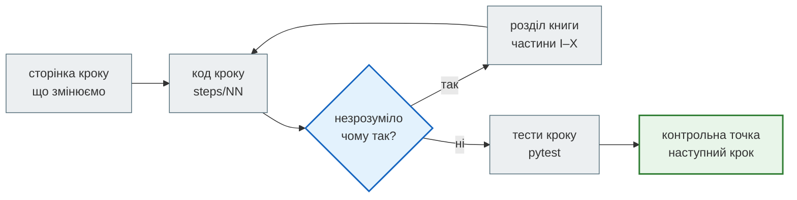

# Як користуватися книгою

Книга має дві половини, які читаються разом:

- **Zero to Hero** — 12 кроків. Кожен крок — це папка `steps/NN_*` з повним робочим проєктом і сторінка в книзі,
  яка пояснює, що змінилося порівняно з попереднім кроком і чому.
- **Книга FastAPI** — частини I–X зі знаннями: як працює HTTP API, FastAPI, async, бази, кеш, тести, безпека, Docker.
  Крок посилається на потрібні розділи, тож теорію читаєш тоді, коли вона знадобилась.

## У цьому розділі

| Сторінка | Що там |
|---|---|
| [Необхідні знання](prerequisites.md) | що варто знати до початку |
| [Налаштування](local_setup.md) | Python, venv, залежності кроку, PostgreSQL і Redis |
| [Структура репозиторію](repository_structure.md) | `steps/`, `examples/`, `docs/`, CI |
| [Як читати кроки](how_to_use.md) | маршрут, порівняння кроків, приклади поза кроками |
