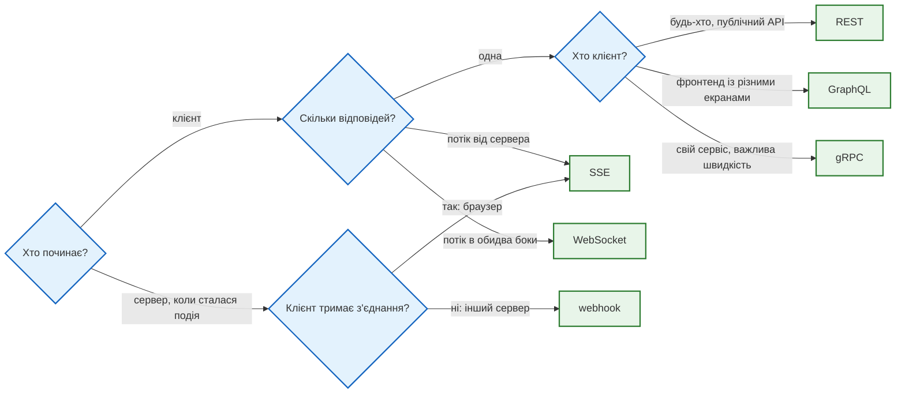

# Які бувають API: REST, GraphQL, gRPC, WebSocket, SSE, webhook

## Проблема { #problem }

REST не єдиний спосіб віддати дані. Мобільному застосунку потрібні три поля з п'яти вкладених ресурсів одним запитом. Двом внутрішнім сервісам — тисячі викликів на секунду. Чату — щоб сервер сам надсилав повідомлення, без запиту клієнта. Платіжній системі — повідомити тебе, що оплата пройшла. Кожен стиль API розв'язує одну з цих задач і програє в інших. Щоб обрати, треба бачити їх поруч на тих самих даних.

## Ментальна модель { #mental-model }

Головне питання — **хто починає розмову і скільки повідомлень у ній**:



| Стиль | Транспорт | Хто починає | Контракт | Підтримка у FastAPI 0.162 |
|---|---|---|---|---|
| REST | HTTP, JSON | клієнт | OpenAPI | основне призначення |
| GraphQL | один `POST /graphql`, JSON | клієнт | схема GraphQL | немає; бібліотека Strawberry (`GraphQLRouter`) |
| gRPC | HTTP/2, бінарний protobuf | клієнт; потоки в обидва боки | файл `.proto` | немає; окремий сервер `grpcio` |
| WebSocket | одне TCP-з'єднання після `Upgrade` | будь-хто, будь-коли | немає стандартного | `@app.websocket`, з Starlette |
| SSE | звичайна відповідь HTTP `text/event-stream` | сервер, після одного запиту | немає стандартного | `EventSourceResponse` з `fastapi.sse` (від 0.135) |
| webhook | звичайний `POST` від сервера | сервер, на адресу клієнта | домовленість; в OpenAPI — `webhooks` | `app.webhooks` (лише опис) |

## Ті самі дані різними стилями { #same-data }

[`examples/meteo_api`](https://github.com/NikoriakViktor/news_hub/tree/main/examples/meteo_api) віддає спостереження метеостанцій кожним стилем: REST — в `app.py`, решта — в `api_types.py` і `grpc_meteo.py`. [`api_styles_demo.py`](https://github.com/NikoriakViktor/news_hub/blob/main/examples/meteo_api/api_styles_demo.py) бере те саме спостереження станції 34504 кожним способом:

```text
--- REST GET /api/v1/stations/34504/observations → 200, 371 байтів
{"station": "34504", "time": "2024-09-02T18:00Z", "temperature": 25.1, "dew_point": 12.9, "relative_humidity": 47, "wind_dir": 110, "wind_speed": 6, "pressure": 998.9, "sea_level_pressure": 1015.1, "max_temperature": 33.0, "min_temperature": null, "telegram": "AAXX 02181 34504 32975 51106 10251 20129 39989 40151 52027 80001 333 10330="}
--- REST ?fields=time,temperature → 103 байтів
{"time": "2024-09-02T18:00Z", "temperature": 25.1}
--- GraphQL POST /graphql → 200, 133 байтів
{"data": {"station": {"name": "Дніпро", "observations": [{"time": "2024-09-02T18:00Z", "temperature": 25.1}]}}}
--- GraphQL неіснуюче поле → 200
Cannot query field 'altitude' on type 'Station'.
--- WebSocket /ws/observations
[{"time": "2024-09-02T18:00Z", "temperature": 25.1}, {"done": true}]
--- WebSocket невідома станція
{'error': 'станцію 00000 не знайдено'} → закрито з кодом 1008
--- SSE GET /events/observations → text/event-stream; charset=utf-8
event: observation
data: {"time": "2024-09-02T18:00Z", "temperature": 25.1}

event: done
data: {}
--- webhook → {'delivered': 1, 'subscribers': 1}
одержувач отримав {'event': 'observation.created', 'station': '34504', 'time': '2024-09-02T18:00Z', 'temperature': 25.1}, підпис вірний: True
--- gRPC GetLatest → 44 байтів protobuf
station: "34504", time: "2024-09-02T18:00Z", temperature: 25.1, pressure: 998.9
--- gRPC невідома станція
StatusCode.NOT_FOUND станцію 00000 не знайдено
```

Що з цього видно:

- **REST** повертає все, що вирішив сервер (371 байт). `?fields=` зменшує відповідь, але лише до полів, які сервер передбачив, і лише для одного ресурсу.
- **GraphQL** одним запитом дав назву станції й вкладені спостереження. Форму відповіді описав клієнт. Помилка в запиті прийшла з кодом **`200`** і списком `errors` у тілі. Моніторинг, який рахує лише коди `4xx`/`5xx`, її не побачить.
- **WebSocket** — клієнт надіслав `{"subscribe": "34504"}`, далі сервер шле сам. Помилку видно з коду закриття (`1008` — порушення правил), а не з HTTP-коду.
- **SSE** — звичайний `GET`, але відповідь не закінчується: сервер дописує події `event:`/`data:`, розділені порожнім рядком.
- **Webhook** — розмову почав сервер: він сам зробив `POST` на адресу одержувача й підписав тіло HMAC. Одержувач перевірив підпис.
- **gRPC** — 44 байти бінарного protobuf замість JSON. Метод викликається як функція (`stub.GetLatest(...)`), а помилка — статус gRPC `NOT_FOUND`, не HTTP-код.

## REST { #rest }

Стиль за замовчуванням для публічних API: його розуміють браузери, `curl`, проксі, кеші й будь-яка мова. FastAPI будує з нього OpenAPI і `/docs`. Решта цієї частини книги — про нього.

## GraphQL { #graphql }

Одна адреса `POST /graphql`. Клієнт надсилає запит мовою GraphQL і отримує рівно ті поля, які попросив, з будь-якою вкладеністю. Дані описує схема з типами:

```python title="meteo_api/api_types.py (фрагмент)"
@strawberry.type
class Station:
    wmo: str
    name: str

    @strawberry.field
    def observations(self, last: int = 3) -> List[Observation]:
        return [to_observation(o) for o in repo.list_observations(self.wmo)[-last:]]

app.include_router(GraphQLRouter(strawberry.Schema(query=Query)), prefix="/graphql")
```

Ціна гнучкості:

- **HTTP-кеш не працює**: усі запити — `POST` на одну адресу.
- **Помилки — у тілі з `200`**, як видно вище.
- **Клієнт вирішує, скільки роботи зробить сервер.** Запит з глибокою вкладеністю (станції → спостереження → станції → …) може покласти базу. Потрібні ліміти глибини й складності запиту.
- **N+1 запит до бази**: поле `observations` викликається для кожної станції окремо. Розв'язок — DataLoader, який збирає ці виклики в один запит.

## gRPC { #grpc }

Контракт — файл `.proto`. З нього генерується код сервера й клієнта для будь-якої мови:

```protobuf title="meteo_api/meteo.proto"
service Meteo {
  rpc GetLatest (StationRequest) returns (Observation);
  rpc StreamObservations (StationRequest) returns (stream Observation);
}
```

gRPC працює поверх HTTP/2 і передає бінарний protobuf. Він компактніший і швидший за JSON, тип кожного поля відомий заздалегідь, є потоки в обидва боки. Але браузер не може викликати gRPC напряму (потрібен проксі gRPC-Web), а `curl` і DevTools показують лише байти. Тому gRPC — для зв'язку між своїми сервісами, а не для публічного API.

FastAPI до gRPC стосунку не має. Це окремий сервер `grpcio` на окремому порту ([`grpc_meteo.py`](https://github.com/NikoriakViktor/news_hub/blob/main/examples/meteo_api/meteo_api/grpc_meteo.py)), який може використовувати ту саму бізнес-логіку (`repo`), що й FastAPI.

## WebSocket { #websocket }

Клієнт робить звичайний HTTP-запит з `Upgrade: websocket`. Після відповіді `101 Switching Protocols` це вже не HTTP, а одне з'єднання, яким обидві сторони шлють повідомлення коли завгодно. Підходить для чату, спільного редагування, ігор — коли повідомлення йдуть в обидва боки часто.

[`examples/realtime/realtime_app.py`](https://github.com/NikoriakViktor/news_hub/blob/main/examples/realtime/realtime_app.py) — чат з автентифікацією і розсилкою:

```python title="realtime_app.py (фрагмент)"
async def ws_user(token: Annotated[str | None, Query()] = None) -> str:
    """Браузерний WebSocket не вміє заголовок Authorization — токен приходить у query або першим повідомленням."""
    if token not in TOKENS:
        raise WebSocketException(code=status.WS_1008_POLICY_VIOLATION, reason="invalid token")
    return TOKENS[token]


@app.websocket("/ws/chat")
async def chat(websocket: WebSocket, user: Annotated[str, Depends(ws_user)]) -> None:
    await manager.connect(websocket)
    try:
        while True:
            text = await websocket.receive_text()
            await manager.broadcast(f"{user}: {text}")
    except WebSocketDisconnect:
        manager.disconnect(websocket)
```

```text
--- WebSocket без токена
закрито: 1008 invalid token
--- WebSocket з токеном, два клієнти
alice отримала: admin: привіт | bob отримав: admin: привіт
```

`Depends` у WebSocket працює так само, як у звичайних маршрутах. Але `HTTPException` тут не допоможе: відповіді HTTP вже не буде. Замість нього — `WebSocketException` з кодом закриття.

**Розсилка, коли клієнт зник.** Сервер дізнається про обрив лише тоді, коли спробує читати чи писати. Типовий `ConnectionManager` з підручників шле всім підряд:

```python
async def broadcast_naive(self, message: str) -> None:
    for websocket in self.active:
        await websocket.send_text(message)       # перший мертвий сокет зупиняє розсилку для решти
```

```text
--- розсилка, коли один клієнт зник
broadcast_naive: виняток RuntimeError('Cannot call send once a close message has been sent')
broadcast_naive: отримали ['a'], лишились ['a', 'dead', 'c']
broadcast: отримали ['a', 'c'], лишились ['a', 'c']
```

Наївна версія: клієнт `c` нічого не отримав, а мертвий сокет лишився в списку й зламає й наступну розсилку. Правильна `broadcast` ловить помилку на кожному сокеті окремо й прибирає мертві.

`ConnectionManager` — список у пам'яті процесу. З двома воркерами uvicorn клієнти, підключені до різних процесів, одне одного не побачать. Це та сама проблема, що й зі [станом у пам'яті](rest_principles.md#stateless). Розсилку між процесами роблять через Redis Pub/Sub.

## SSE { #sse }

Server-Sent Events — односторонній потік від сервера по звичайному HTTP. У браузері для нього є `EventSource`, який сам перепідключається після обриву і надсилає `Last-Event-ID`, щоб отримати лише пропущене. Підходить для стрічок, сповіщень, прогресу довгої задачі, потокового виводу LLM — коли дані йдуть лише від сервера.

З FastAPI 0.135 SSE вбудований:

```python title="realtime_app.py (фрагмент)"
from fastapi.sse import EventSourceResponse, ServerSentEvent

@app.get("/events/news", response_class=EventSourceResponse)
async def news_events(last_event_id: Annotated[int, Header()] = 0) -> AsyncIterator[ServerSentEvent]:
    yield ServerSentEvent(comment="потік новин", retry=3000)          # retry: через скільки мс перепідключатися
    for item in NEWS:
        if item["id"] > last_event_id:
            yield ServerSentEvent(data=item, event="news", id=str(item["id"]))
```

```text
--- SSE GET /events/news
200 text/event-stream; charset=utf-8
: потік новин
retry: 3000

event: news
data: {"id": 1, "title": "Новина 1"}
id: 1
...
--- SSE з Last-Event-ID: 3
['id: 4', 'id: 5']
--- SSE з yield моделі
data: {"id":1,"title":"Новина 1"}

data: {"id":2,"title":"Новина 2"}
```

- Клієнт, що надіслав `Last-Event-ID: 3`, отримав лише події 4 і 5.
- `dict` у `data` іде через `json.dumps`, і кирилиця перетворюється на `\u...`. Pydantic-модель серіалізується без цього.
- Якщо генератор довго нічого не yield-ить, FastAPI сам надсилає коментар `: ping` кожні 15 секунд, щоб проксі не закрив «мовчазне» з'єднання.
- `meteo_api` формує ці рядки вручну через `StreamingResponse(..., media_type="text/event-stream")`. Так теж можна, але тоді `id`, `retry`, екранування переносів рядків і ping — на тобі.

## Webhook { #webhook }

Webhook — це звичайний `POST`, але напрямок зворотний: **сервер** надсилає запит **клієнту**, коли сталася подія. Клієнт заздалегідь реєструє свою адресу. Так працюють платіжні системи, GitHub, Telegram. Опитувати сервер щохвилини «а чи є щось нове?» замість цього — даремні запити й затримка.

Обов'язкове для одержувача webhook:

- **Перевірка підпису**: адреса публічна, і `POST` на неї може надіслати будь-хто. Відправник підписує тіло HMAC спільним секретом, одержувач перевіряє (`hmac.compare_digest`).
- **Захист від повтору**: час у підписі й журнал отриманих id. Відправники повторюють доставку, якщо не дочекались `2xx`, тож одна подія може прийти двічі.
- **Швидка відповідь**: прийняти, записати, відповісти `2xx`, а обробити у фоні. Інакше відправник вирішить, що доставка не вдалась, і повторить.

FastAPI вміє **описати** webhook, який надсилає твій сервер, у документації OpenAPI:

```python
@app.webhooks.post("news-published")
def news_published(body: News) -> None:
    """Цей запит робить НАШ сервер на адресу клієнта, коли з'являється новина. Маршруту /news-published немає."""
```

```text
--- OpenAPI
paths: ['/events/news', '/events/plain']
webhooks: {'news-published': ['post']}
SSE у схемі: ['text/event-stream']
```

`app.webhooks` нічого не надсилає і маршруту не створює: це лише розділ `webhooks` в OpenAPI 3.1, щоб клієнт знав формат тіла. Надсилати — твоєму коду (`httpx`, у `meteo_api` — `fire_test_event`). Зверни увагу: `/ws/chat` у `paths` немає. OpenAPI не описує WebSocket, тож `/docs` про нього не знає.

## У News Hub { #news-hub }

News Hub — REST API. Webhook у ньому є, але у зворотному напрямку: він **одержувач**.

| Webhook | Хто надсилає | Як перевіряється | Крок |
|---|---|---|---|
| `POST /api/webhooks/scrape` | зовнішній планувальник | HMAC тіла + час + журнал повторів | [8](../tutorials/08_security/index.md) |
| `POST /api/telegram/webhook` | Telegram | секрет у заголовку `X-Telegram-Bot-Api-Secret-Token` | [9](../tutorials/09_telegram_bot/index.md) |

WebSocket і SSE в News Hub немає: новини з'являються раз на збір, і клієнту досить запитати стрічку. Бот отримує оновлення від Telegram через webhook, а не тримає з'єднання.

## Типові помилки { #mistakes }

| Помилка | Наслідок | Як правильно |
|---|---|---|
| WebSocket там, де дані йдуть лише від сервера | складніше за SSE: свій протокол, своє перепідключення, проксі мають підтримувати `Upgrade` | SSE |
| розсилка без `try` на кожному сокеті | один зниклий клієнт зупиняє розсилку для решти | ловити помилку на кожному, прибирати мертві |
| `ConnectionManager` у пам'яті з кількома воркерами | клієнти різних процесів не бачать повідомлень одне одного | Redis Pub/Sub |
| `HTTPException` у WebSocket-маршруті | клієнт не отримує зрозумілої причини | `WebSocketException(code=1008, reason=...)` |
| токен WebSocket у query без HTTPS і з довгим терміном | токен потрапляє в журнали доступу ([HTTP-запит і відповідь](http_anatomy.md)) | короткоживучий токен лише для підключення або перше повідомлення |
| webhook без перевірки підпису | будь-хто викликає твою обробку | HMAC + час + журнал id |
| довга обробка всередині webhook | відправник не дочекався відповіді й повторює | `2xx` одразу, обробка у фоні |
| `sse-starlette` у новому коді на FastAPI ≥ 0.135 | зайва залежність | `fastapi.sse.EventSourceResponse` |
| GraphQL без лімітів глибини | один запит кладе базу | ліміти глибини й складності, DataLoader |
| моніторинг GraphQL за HTTP-кодами | помилки приходять з `200` | рахувати `errors` у тілі |

## Налагодження { #debugging }

- **WebSocket**: DevTools → Network → фільтр WS → вкладка Messages. Код закриття: `1000` — нормальне, `1006` — обрив без закриття (часто проксі), `1008` — порушення правил.
- **WebSocket за nginx** вимагає `proxy_set_header Upgrade $http_upgrade; proxy_set_header Connection "upgrade";`, інакше з'єднання не встановиться.
- **SSE**: `curl -N http://localhost:8000/events/news`. `-N` вимикає буферизацію. Якщо події приходять пачкою наприкінці, буферизує проксі: у nginx — `proxy_buffering off` або заголовок `X-Accel-Buffering: no`.
- **gRPC**: `grpcurl` замість `curl`; змінні `GRPC_VERBOSITY=debug` і `GRPC_TRACE` для журналу клієнта.
- **Webhook**: локальний сервер не має публічної адреси. Тунель (`ngrok`, `cloudflared`) або демо як в `api_styles_demo.py`: одержувач на `127.0.0.1` в тому самому процесі.

## Безпека { #security }

- **WebSocket не перевіряє CORS.** Браузер дозволить сторонньому сайту відкрити WebSocket до твого API, і cookie поїдуть разом із запитом. Якщо автентифікація через cookie — перевіряй заголовок `Origin` при підключенні.
- **WebSocket і SSE тримають з'єднання**: тисяча клієнтів — тисяча відкритих з'єднань. Обмежуй кількість на користувача й закривай неактивні.
- **Webhook — вхідні дані з інтернету.** Підпис, час, захист від повтору ([крок 8](../tutorials/08_security/index.md)). А коли **ти** надсилаєш webhook на адресу, яку вказав клієнт, — це SSRF: адреса може вести в твою внутрішню мережу.
- **GraphQL інтроспекція** (`__schema`) відкриває всю схему. У продакшні її часто вимикають.

## Питання { #questions }

1. Чим SSE відрізняється від WebSocket? Коли досить SSE?
2. Що отримає клієнт GraphQL, який попросив неіснуюче поле? Який HTTP-код?
3. Чому gRPC не використовують для публічного API, з яким працює браузер?
4. Що станеться з наївною розсилкою, якщо другий з трьох клієнтів зник?
5. Що робить `@app.webhooks.post(...)` і чого він не робить?
6. Як браузер після обриву SSE отримує лише пропущені події?
7. Як FastAPI-застосунок має закрити WebSocket з невалідним токеном?

??? success "Відповіді"

    1. SSE — односторонній потік від сервера по звичайному HTTP, з автоматичним перепідключенням у браузері; WebSocket — двосторонній канал після `Upgrade`. SSE досить, коли клієнт лише слухає: стрічка, сповіщення, прогрес.
    2. `200` зі списком `errors` у тілі: «Cannot query field 'altitude' on type 'Station'».
    3. Браузер не може викликати gRPC напряму (потрібен gRPC-Web і проксі), а бінарний protobuf не подивишся в DevTools чи `curl`.
    4. Відправка другому кине виняток, і третій нічого не отримає; мертвий сокет лишиться в списку.
    5. Додає опис webhook у розділ `webhooks` OpenAPI. Нічого не надсилає і маршруту не створює.
    6. Сервер дає кожній події `id`; `EventSource` при перепідключенні надсилає `Last-Event-ID`, і сервер віддає лише події після нього.
    7. `raise WebSocketException(code=status.WS_1008_POLICY_VIOLATION, reason=...)` — у залежності чи в самому маршруті.

## Що далі { #next }

[HTTP-клієнти: requests, httpx, aiohttp](http_clients.md) — досі сервер лише відповідав; тепер він сам іде до інших серверів: тайм-аути, пул з'єднань, повтори, кодування.

**Джерела:** FastAPI — [WebSockets](https://fastapi.tiangolo.com/advanced/websockets/), [Server-Sent Events](https://fastapi.tiangolo.com/tutorial/server-sent-events/), [OpenAPI Webhooks](https://fastapi.tiangolo.com/advanced/openapi-webhooks/); [Starlette — WebSockets](https://starlette.dev/websockets/); [HTML Living Standard — Server-sent events](https://html.spec.whatwg.org/multipage/server-sent-events.html); [RFC 6455 — The WebSocket Protocol](https://www.rfc-editor.org/rfc/rfc6455) (§7.4 коди закриття); [GraphQL — Specification](https://spec.graphql.org/), [Strawberry — FastAPI](https://strawberry.rocks/docs/integrations/fastapi); [gRPC — Introduction](https://grpc.io/docs/what-is-grpc/introduction/), [gRPC — Python quick start](https://grpc.io/docs/languages/python/quickstart/); [OpenAPI 3.1 — webhooks](https://spec.openapis.org/oas/v3.1.0#oasWebhooks).
