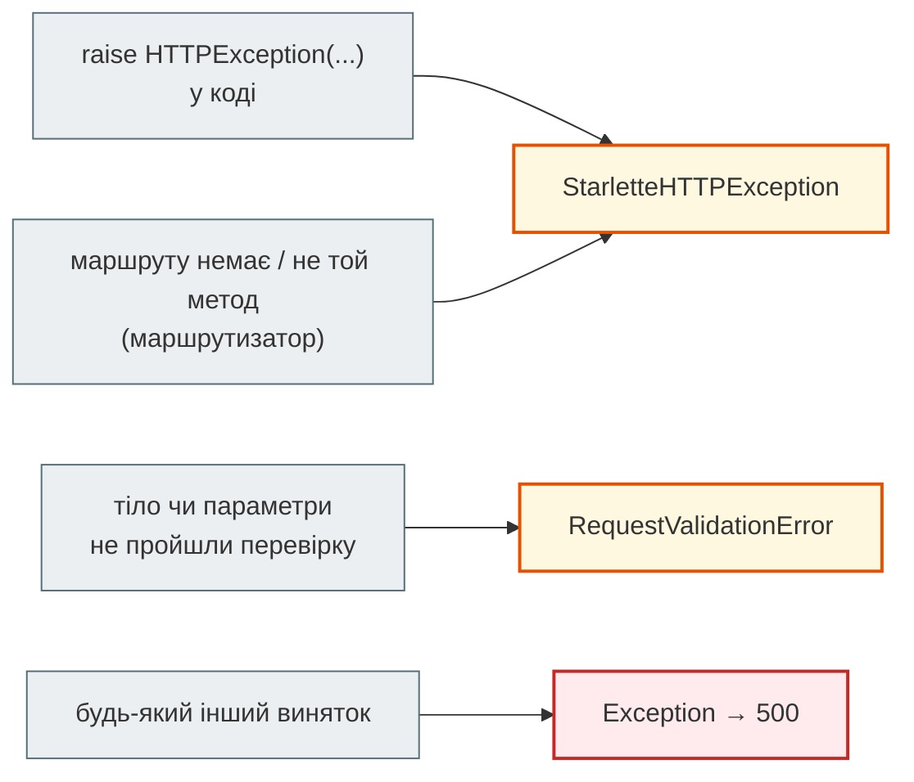

# Формат помилок: `detail` і RFC 9457

## Проблема { #problem }

Код відповіді каже, **що** пішло не так, а тіло має пояснити **чому** і що з цим робити. Якщо кожен ендпоінт пише помилку по-своєму (тут `{"detail": "..."}`, там `{"error": "..."}`, деінде текст), клієнт мусить розбирати кожен варіант окремо. FastAPI має свій однаковий формат. Існує й стандарт — RFC 9457 «Problem Details». Тут розберемося, чим вони відрізняються і як замінити формат на весь API, нічого не зламавши.

## Ментальна модель { #mental-model }

| | FastAPI за замовчуванням | RFC 9457 Problem Details |
|---|---|---|
| `Content-Type` | `application/json` | `application/problem+json` |
| помилка `HTTPException` | `{"detail": "Item not found"}` | `{"type", "title", "status", "detail", "instance"}` |
| помилка перевірки | `{"detail": [{"type", "loc", "msg", "input", "ctx"}]}` | ті самі поля + розширення, наприклад `invalid_params` |
| хто визначає формат | FastAPI | стандарт: його розуміють шлюзи API, бібліотеки клієнтів, інші сервіси |

Поля RFC 9457:

| Поле | Що це | Приклад |
|---|---|---|
| `type` | URI типу проблеми; `about:blank` — «нічого більше, ніж код HTTP» | `/problems/validation-error` |
| `title` | короткий заголовок типу, однаковий для всіх випадків цього типу | `Not Found` |
| `status` | код HTTP — дублюється в тілі, щоб не загубився за проксі | `404` |
| `detail` | пояснення саме цього випадку | `Item 7 not found` |
| `instance` | який запит спричинив проблему | `/items/7` |
| розширення | будь-які додаткові поля | `invalid_params` |

Помилки потрапляють у відповідь трьома шляхами, і кожен має свій обробник:



## Як підмінити обробники неправильно { #naive }

[`examples/errors/naive_app.py`](https://github.com/NikoriakViktor/news_hub/blob/main/examples/errors/naive_app.py) — так зазвичай роблять уперше:

```python title="naive_app.py (фрагмент)"
@app.exception_handler(HTTPException)                      # fastapi.HTTPException — підклас starlette
async def http_handler(request: Request, exc: HTTPException) -> JSONResponse:
    return JSONResponse({"problem": exc.detail}, status_code=exc.status_code)


@app.exception_handler(RequestValidationError)
async def validation_handler(request: Request, exc: RequestValidationError) -> JSONResponse:
    return JSONResponse({"errors": exc.errors()}, status_code=422)   # без jsonable_encoder
```

```text
raise HTTPException(404) → 404 application/json                 {"problem":"Item not found"}
невідомий маршрут       → 404 application/json                 {"detail":"Not Found"}
не той метод            → 405 application/json                 {"detail":"Method Not Allowed"}
короткий пароль         → 422 application/json                 {"errors":[{"type":"string_too_short","loc":["body","password"],"msg":"String should have at least 12 characters","input":"hunter2","ctx":{"min_length
email без @ (ValueError) → 500 text/plain; charset=utf-8        Internal Server Error
```

Три помилки:

1. **Обробник на `fastapi.HTTPException`** ловить лише те, що кидає твій код. `404` для невідомого маршруту і `405` кидає маршрутизатор Starlette — базовим класом `starlette.exceptions.HTTPException`, і вони пройшли повз. API відповідає у двох різних форматах.
2. **`exc.errors()` як є** містить `input` — значення, яке надіслав клієнт. Пароль `hunter2` повернувся у відповіді й потрапить у журнали проксі та клієнта.
3. **`ctx` може містити об'єкт винятку.** Валідатор кинув `ValueError`, Pydantic поклав його в `ctx.error`, і `JSONResponse` не зміг перетворити це на JSON. Помилка клієнта стала `500`. Стандартний обробник FastAPI проганяє помилки через `jsonable_encoder`, а саморобний — ні.

## Як правильно: Problem Details { #problem-details }

[`examples/errors/problem_app.py`](https://github.com/NikoriakViktor/news_hub/blob/main/examples/errors/problem_app.py):

```python title="problem_app.py (фрагмент)"
def problem(status: int, request: Request, *, detail: str | None = None, type_: str = "about:blank",
            title: str | None = None, headers: dict[str, str] | None = None, **ext: Any) -> JSONResponse:
    body = Problem(type=type_, title=title or HTTPStatus(status).phrase, status=status,
                   detail=detail, instance=request.url.path, **ext)
    return JSONResponse(body.model_dump(exclude_none=True), status_code=status,
                        media_type=PROBLEM, headers=headers)


@app.exception_handler(StarletteHTTPException)          # базовий клас: ловить і наші 404, і 404/405 маршрутизатора
async def http_problem(request: Request, exc: StarletteHTTPException) -> JSONResponse:
    detail = exc.detail if isinstance(exc.detail, str) and exc.detail != HTTPStatus(exc.status_code).phrase else None
    return problem(exc.status_code, request, detail=detail, headers=exc.headers)   # headers: WWW-Authenticate тощо


@app.exception_handler(RequestValidationError)
async def validation_problem(request: Request, exc: RequestValidationError) -> JSONResponse:
    params = [InvalidParam(name=".".join(str(part) for part in error["loc"]), reason=error["msg"], code=error["type"])
              for error in exc.errors()]                 # лише loc, msg, type: без input (паролі) і ctx (об'єкти)
    return problem(422, request, type_="/problems/validation-error", title="Запит не пройшов перевірку",
                   detail=f"Помилок: {len(params)}", invalid_params=[p.model_dump() for p in params])


@app.exception_handler(Exception)
async def server_problem(request: Request, exc: Exception) -> JSONResponse:
    log.exception("unhandled error on %s", request.url.path)                   # подробиці — у журнал
    return problem(500, request)                                               # клієнту — без подробиць
```

```text
--- raise HTTPException(404): 404 application/problem+json
{"type": "about:blank", "title": "Not Found", "status": 404, "detail": "Item 7 not found", "instance": "/items/7"}
--- невідомий маршрут: 404 application/problem+json
{"type": "about:blank", "title": "Not Found", "status": 404, "instance": "/nope"}
--- не той метод: 405 application/problem+json
{"type": "about:blank", "title": "Method Not Allowed", "status": 405, "instance": "/items/7"}
--- короткий пароль, email без @: 422 application/problem+json
{"type": "/problems/validation-error", "title": "Запит не пройшов перевірку", "status": 422, "detail": "Помилок: 2", "instance": "/signup", "invalid_params": [{"name": "body.email", "reason": "Value error, email без @", "code": "value_error"}, {"name": "body.password", "reason": "String should have at least 12 characters", "code": "string_too_short"}]}
--- 401: 401 application/problem+json www-authenticate=Bearer
{"type": "about:blank", "title": "Unauthorized", "status": 401, "detail": "Not authenticated", "instance": "/private"}
--- необроблений виняток: 500 application/problem+json
{"type": "about:blank", "title": "Internal Server Error", "status": 500, "instance": "/boom"}
```

Що тут видно:

- **Один формат на всі шість випадків**, включно з `404`/`405` маршрутизатора: обробник зареєстровано на базовий `StarletteHTTPException`.
- **Заголовки збережено**: `401` прийшов з `www-authenticate: Bearer`, `405` — з `allow: GET`. Обробник передає `exc.headers` далі. Без цього клієнт не дізнається, як автентифікуватися, а `429` втратить `Retry-After`.
- **Пароля у відповіді немає**: з помилок Pydantic взято лише `loc`, `msg`, `type`. Обидві помилки (email і пароль) прийшли разом, бо FastAPI перевіряє все тіло, перш ніж відповісти.
- **`500` без подробиць**: виняток містив `password=secret host=db.internal`, клієнт бачить лише `Internal Server Error`, а трасування пішло в журнал (`log.exception`).
- **`about:blank`** — для звичайних HTTP-помилок, де нічого не додати до коду; тоді `title` — стандартна назва коду. Власний `type` (`/problems/validation-error`) — для помилок зі своєю структурою.

## Документація теж має знати { #openapi }

Обробник змінює відповіді, але не OpenAPI: `/docs` і далі обіцяв би для `422` стару схему `HTTPValidationError`. Тому опис підміняють і там:

```python
app = FastAPI(
    # model реєструє схему Problem у components; FastAPI кладе її під application/json, тож явно додаємо й problem+json
    responses={422: {"model": Problem, "description": "Помилка перевірки",
                     "content": {PROBLEM: {"schema": {"$ref": "#/components/schemas/Problem"}}}}},
)
```

```text
--- OpenAPI 422: Помилка перевірки ['application/problem+json', 'application/json'] Problem
```

`model=` потрібен, щоб схема `Problem` (і вкладена `InvalidParam`) з'явилась у `components`. FastAPI при цьому сам додає `application/json`, тож у документації два типи вмісту з тією самою схемою. Це не помилка, але точний опис — лише `application/problem+json`.

## У News Hub { #news-hub }

News Hub лишає стандартний формат FastAPI: усі його клієнти (Swagger, Postman, бот, тести) живуть в одному репозиторії й розуміють `{"detail": ...}`. Власний обробник у ньому один — для помилок LLM ([крок 7](../tutorials/07_llm_api/index.md)):

```python
@app.exception_handler(LLMError)
```

Він перетворює збій провайдера на `502`, а відкритий circuit breaker — на `503` з `Retry-After`, щоб жоден ендпоінт аналізу не повертав `500` на чужу недоступність.

Problem Details варто вводити, коли з'являються зовнішні клієнти або кілька сервісів, які мають однаково читати помилки один одного. Тоді це робиться трьома обробниками з цієї сторінки, без змін в ендпоінтах.

## Типові помилки { #mistakes }

| Помилка | Наслідок | Як правильно |
|---|---|---|
| обробник на `fastapi.HTTPException` | `404`/`405` маршрутизатора — у старому форматі | `starlette.exceptions.HTTPException` |
| `exc.errors()` у відповідь як є | паролі й токени з `input` у відповіді; `ctx` з об'єктом винятку → `500` | лише `loc`, `msg`, `type`, або `jsonable_encoder` і прибрати `input` |
| `JSONResponse(...)` без `headers=exc.headers` | губляться `WWW-Authenticate`, `Retry-After`, `Allow` | передавати `exc.headers` |
| обробник `Exception` повертає `str(exc)` | клієнт бачить SQL, шляхи, паролі з рядків підключення | загальне повідомлення; подробиці — у журнал |
| `application/json` для Problem Details | клієнти й шлюзи не впізнають формат | `media_type="application/problem+json"` |
| змінили обробник, але не OpenAPI | документація обіцяє формат, якого вже немає | `responses={422: ...}` на застосунку |
| `HTTP_422_UNPROCESSABLE_ENTITY` | попередження про застарілість | `HTTP_422_UNPROCESSABLE_CONTENT` або просто `422` |

## Налагодження { #debugging }

- Перевір **усі** шляхи помилок, а не лише свій `raise`: невідомий маршрут, не той метод, битий JSON, необроблений виняток. Різний формат хоча б в одному — обробник зареєстровано не на той клас.
- `500` замість `422` після підміни обробника — шукай у журналі `TypeError: Object of type ... is not JSON serializable`: у відповідь потрапив `ctx` з об'єктом.
- `raise_server_exceptions=False` у `TestClient` — щоб побачити відповідь `500`, а не виняток у тесті.

## Безпека { #security }

- **`input` у помилках перевірки — витік.** Pydantic повертає те, що надіслав клієнт: паролі, токени, номери карток. Стандартний обробник FastAPI теж його повертає; для форм входу й платежів — прибирати.
- **Відповідь `500` — без подробиць.** Повідомлення винятку часто містить рядок підключення, SQL, шлях до файлу.
- **`detail` у `HTTPException` — для клієнта.** Не клади туди внутрішні id, назви таблиць чи відповідь іншого сервісу як є.
- **Однаковий формат усіх помилок ускладнює розвідку**: за різними форматами `404` атакувальник відрізняє «маршруту немає» від «об'єкта немає».

## Питання { #questions }

1. Чим `title` відрізняється від `detail` у RFC 9457?
2. Чому обробник, зареєстрований на `fastapi.HTTPException`, не змінює відповідь на невідомий маршрут?
3. Чому саморобний обробник `RequestValidationError` може повернути `500`?
4. Що в стандартній помилці перевірки FastAPI може бути небезпечним для форми входу?
5. Що станеться з `WWW-Authenticate`, якщо обробник не передасть `exc.headers`?
6. Чому після підміни обробника треба змінити й опис `422` в OpenAPI?

??? success "Відповіді"

    1. `title` — заголовок типу проблеми, однаковий для всіх її випадків; `detail` — пояснення саме цього випадку.
    2. `404`/`405` маршрутизатора — це `starlette.exceptions.HTTPException`, базовий клас; обробник підкласу його не ловить.
    3. У `ctx` може лежати об'єкт винятку (`ValueError` з валідатора), а `JSONResponse` не серіалізує його без `jsonable_encoder`.
    4. Поле `input`: воно повертає надісланий пароль.
    5. Заголовок загубиться, і клієнт не дізнається схему автентифікації.
    6. Інакше `/docs` і згенеровані клієнти чекатимуть формат `HTTPValidationError`, якого вже немає.

## Що далі { #next }

[Частина I. HTTP і дизайн REST API](README.md) — решта розділів частини.

**Джерела:** [RFC 9457 — Problem Details for HTTP APIs](https://www.rfc-editor.org/rfc/rfc9457); FastAPI — [Handling Errors](https://fastapi.tiangolo.com/tutorial/handling-errors/) (розділи «Install custom exception handlers», «Override the default exception handlers», «FastAPI's HTTPException vs Starlette's HTTPException»), [Additional Responses in OpenAPI](https://fastapi.tiangolo.com/advanced/additional-responses/); [Pydantic — Validation Errors](https://docs.pydantic.dev/latest/errors/validation_errors/).
