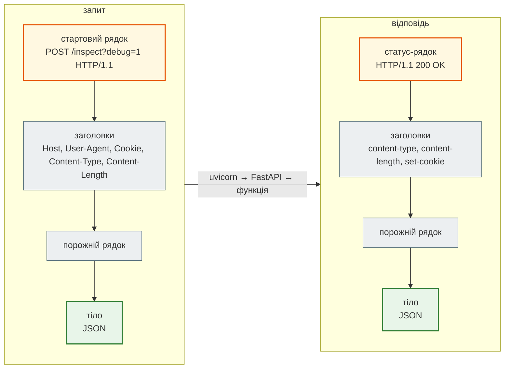

# HTTP-запит і відповідь зсередини

## Проблема { #problem }

FastAPI ховає HTTP за функціями й типами: пишеш `payload: Payload`, а тіло запиту вже розібране й перевірене. Це зручно, доки щось не ламається. Заголовок «не доходить», клієнт отримує `307` замість даних, cookie не зберігається в браузері, секрет з'являється в журналі сервера. Щоб розібратися в таких випадках, треба знати, що насправді йде по мережі і звідки FastAPI бере кожен параметр.

## Ментальна модель { #mental-model }

HTTP/1.1 — **текст** у визначеному порядку: стартовий рядок, заголовки, порожній рядок, тіло. Запит і відповідь влаштовані однаково, різниться лише перший рядок.



| Частина запиту | Що в ній | Як дістати у FastAPI |
|---|---|---|
| метод | `GET`, `POST`, `PUT`, `PATCH`, `DELETE` | декоратор `@app.post(...)`; `request.method` |
| шлях | `/inspect`, `/api/news/42` | параметр шляху `news_id: int`; `request.url.path` |
| рядок запиту (query) | `?debug=1&limit=5` після `?` | параметр функції `limit: int = 10` або `Query()`; `request.query_params` |
| заголовки | пари `Ім'я: значення` | `Annotated[str \| None, Header()]`; `request.headers` |
| cookie | заголовок `Cookie: session_id=tok-123` | `Annotated[str \| None, Cookie()]`; `request.cookies` |
| тіло | JSON, форма, файл | модель Pydantic; `await request.body()`, `await request.json()` |

| Частина відповіді | Як задати у FastAPI |
|---|---|
| статус-код | `status_code=201` у декораторі; `response.status_code`; `HTTPException(404)` |
| заголовки | параметр `response: Response` → `response.headers["X-..."] = ...` |
| cookie | `response.set_cookie(...)` |
| тіло | те, що повертає функція (через `response_model` → JSON); або готовий `JSONResponse`, `StreamingResponse`, `FileResponse` |

`Request` і `Response` — класи Starlette, FastAPI лише реекспортує їх (`from fastapi import Request, Response`).

## Мінімальний приклад: що йде по мережі { #wire }

Код — [`examples/http_anatomy`](https://github.com/NikoriakViktor/news_hub/tree/main/examples/http_anatomy). Ендпоінт збирає всі частини запиту й додає заголовок і cookie у відповідь:

```python title="inspect_app.py"
@app.post("/inspect")
async def inspect_http(
    request: Request,
    response: Response,
    payload: Payload,
    user_agent: Annotated[str | None, Header()] = None,
    x_request_id: Annotated[str | None, Header()] = None,
    session_id: Annotated[str | None, Cookie()] = None,
) -> dict:
    response.headers["X-Server"] = "news-hub-demo"
    response.set_cookie("visited", "true")
    return {
        "method": request.method,
        "path": request.url.path,
        "query": dict(request.query_params),
        "user_agent": user_agent,
        "x_request_id": x_request_id,
        "session_id": session_id,
        "raw_body": (await request.body()).decode(),
        "message": payload.message,
    }
```

`raw_client.py` надсилає запит прямо в сокет, без бібліотек, тож видно кожен байт:

```bash
uvicorn inspect_app:app --port 8014     # термінал 1
python raw_client.py                    # термінал 2
```

```text
=== ЗАПИТ
POST /inspect?debug=1 HTTP/1.1
Host: 127.0.0.1:8014
User-Agent: MyClient/1.0
X-Request-ID: abc-1
Cookie: session_id=tok-123
Content-Type: application/json
Content-Length: 27
Connection: close

{"message": "Привіт"}

=== ВІДПОВІДЬ
HTTP/1.1 200 OK
date: Wed, 11 Nov 2026 15:44:28 GMT
server: uvicorn
content-length: 201
content-type: application/json
x-server: news-hub-demo
set-cookie: visited=true; Path=/; SameSite=lax
connection: close

{"method":"POST","path":"/inspect","query":{"debug":"1"},"user_agent":"MyClient/1.0","x_request_id":"abc-1","session_id":"tok-123","raw_body":"{\"message\": \"Привіт\"}","message":"Привіт"}
```

Що тут видно:

- **`Content-Length: 27` — у байтах, а не в символах.** `{"message": "Привіт"}` — 21 символ, але кожна кирилична літера в UTF-8 займає 2 байти. Хто рахує довжину рядка замість байтів, обрізає тіло.
- **Імена заголовків не залежать від регістру.** Клієнт надіслав `X-Request-ID`, uvicorn відповів `content-type`, `x-server` малими літерами, і це однаково правильно.
- **FastAPI сам зіставляє імена.** Параметр `user_agent` прочитав заголовок `User-Agent`: `_` у назві параметра стає `-`, регістр ігнорується.
- **Рядок запиту — частина стартового рядка**, а не окремий блок: `?debug=1` прийшов у `request.query_params`.
- **`set_cookie` за замовчуванням** додав `Path=/; SameSite=lax`, але не `Secure` і не `HttpOnly` (див. [Безпеку](#security)).

## Коли до функції не доходить { #not-reached }

Той самий клієнт, чотири запити, які ендпоінт не обробляє як очікується:

```text
=== GET /items HTTP/1.1
HTTP/1.1 307 Temporary Redirect
server: uvicorn
content-length: 0
location: http://127.0.0.1:8014/items/

=== DELETE /items/ HTTP/1.1
HTTP/1.1 405 Method Not Allowed
server: uvicorn
allow: GET
content-type: application/json
{"detail":"Method Not Allowed"}

=== POST /inspect HTTP/1.1  {}
HTTP/1.1 422 Unprocessable Entity
content-type: application/json
{"detail":[{"type":"missing","loc":["body","message"],"msg":"Field required","input":{}}]}

=== POST /inspect HTTP/1.1 {'X_Request_ID': 'under'} {"message":"m"}
HTTP/1.1 200 OK
{"method":"POST", ..., "x_request_id":null, ...}
```

(Вивід скорочено: прибрано однакові заголовки `content-length`, `connection` і частину тіла.)

| Відповідь | Чому | Що робити |
|---|---|---|
| `307` + `location` | маршрут оголошено як `/items/`, а запит — на `/items`. Starlette сам перенаправляє на варіант з косою рискою (`redirect_slashes=True`) | писати шлях точно як у маршруті. Клієнти, що не йдуть за редиректом, бачать порожню відповідь; за проксі `location` може вийти з `http://` замість `https://` |
| `405` + `allow` | шлях існує, методу немає. Заголовок `allow` перелічує дозволені методи | перевірити метод; `405` — не про косу риску |
| `422` + `loc` | тіло не відповідає моделі: `["body", "message"]` — поле відсутнє | читати `detail[].loc`: перший елемент — частина запиту (`body`, `query`, `header`, `path`, `cookie`) |
| `200`, але `x_request_id: null` | заголовок надіслано як `X_Request_ID`. FastAPI шукає `x-request-id` з дефісом, і підкреслення в імені заголовка з ним не збігається | у HTTP імена заголовків пишуть з дефісами. nginx за замовчуванням ще й відкидає заголовки з `_` (`underscores_in_headers off`) |

## Журнал сервера { #access-log }

uvicorn записує в журнал кожен запит — **стартовий рядок разом з рядком запиту**:

```text
INFO:     127.0.0.1:43168 - "POST /inspect?debug=1 HTTP/1.1" 200 OK
INFO:     127.0.0.1:43178 - "GET /items HTTP/1.1" 307 Temporary Redirect
INFO:     127.0.0.1:43180 - "DELETE /items/ HTTP/1.1" 405 Method Not Allowed
INFO:     127.0.0.1:43184 - "POST /inspect HTTP/1.1" 422 Unprocessable Entity
```

Заголовків і тіла в журналі немає. Тому все, що передають у URL (`?token=...`), опиняється в журналах сервера, проксі й історії браузера.

## У News Hub { #news-hub }

| Частина HTTP | Де | Крок |
|---|---|---|
| рядок запиту з перевіркою | `GET /api/news?category=&lang=&skip=&limit=` | [2](../tutorials/02_fastapi_basics/fastapi_app.md) |
| тіло JSON → модель | `POST /api/scrape` з `ScrapeRequest` | [2](../tutorials/02_fastapi_basics/scrape_endpoint.md) |
| `Request` напряму | `get_store(request)` бере сховище з `request.app.state` | [2](../tutorials/02_fastapi_basics/depends_and_lifespan.md) |
| заголовки відповіді | `X-Request-ID`, `X-Process-Time` від middleware; `Retry-After` при `429` | [4](../tutorials/04_middleware_redis/index.md) |
| заголовок `Authorization` | `Bearer <JWT>` адміна | [8](../tutorials/08_security/index.md) |
| `X-Forwarded-For` | справжній IP клієнта за nginx | [11](../tutorials/11_compose_deploy/index.md) |

## Типові помилки { #mistakes }

| Помилка | Наслідок | Як правильно |
|---|---|---|
| `Content-Length` = `len(рядок)` | тіло обрізане або сервер чекає ще байтів | `len(body.encode())`; HTTP-бібліотеки рахують самі |
| запит на `/items`, маршрут `/items/` | `307`, а не дані | шлях як у маршруті |
| `X_Token` у заголовку | параметр `x_token` отримує `None`; за nginx заголовок зникає взагалі | `X-Token` |
| `Header()` без значення за замовчуванням | без заголовка — `422` з `loc: ["header", ...]` | `= None`, якщо заголовок необов'язковий |
| `await request.json()` поряд з моделлю тіла | дані розбираються двічі, перевірку моделі легко обійти | або модель, або `Request`; `Request` — для того, чого моделлю не описати |

## Налагодження { #debugging }

- Що прийшло насправді — `request.headers`, `request.query_params`, `await request.body()` у тимчасовому ендпоінті, як `/inspect` вище.
- Що пішло назад — `curl -i URL` (заголовки відповіді) або `curl -v URL` (ще й заголовки запиту).
- `422` — перший елемент `loc` каже, у якій частині запиту шукати.
- `307` у журналі uvicorn поруч із запитом, що «нічого не повернув», — майже завжди коса риска в кінці.

## Безпека { #security }

- **Cookie з сесією чи токеном** — лише з прапорцями:

    ```python
    response.set_cookie("sid", token, httponly=True, secure=True, samesite="strict", max_age=3600)
    ```

    ```text
    set-cookie: sid=tok; HttpOnly; Max-Age=3600; Path=/; SameSite=strict; Secure
    ```

    `HttpOnly` — JavaScript сторінки не прочитає cookie (захист від крадіжки через XSS). `Secure` — браузер надсилає її лише через HTTPS. `SameSite` — обмежує надсилання з чужих сайтів (захист від CSRF).
- **Секрети — у заголовках або тілі, не в URL**: рядок запиту записується в журнали ([вище](#access-log)).
- **HTTP без TLS передає все відкритим текстом**, і `Authorization`, і `Cookie`. Ззовні — лише HTTPS ([крок 11](../tutorials/11_compose_deploy/index.md)).
- **Заголовкам від клієнта не вірити**: `X-Forwarded-For`, `User-Agent`, `X-Request-ID` клієнт пише що завгодно. `X-Forwarded-For` можна брати лише від свого проксі (`--forwarded-allow-ips`).

## Питання { #questions }

1. З яких частин складається HTTP-запит і чим відповідь відрізняється від нього?
2. Чому для `{"message": "Привіт"}` `Content-Length` — 27, а не 21?
3. Клієнт отримав `307` на `GET /items`. Що не так і що є в заголовку `location`?
4. Чим `405` відрізняється від `404`?
5. Чому параметр `x_request_id` отримав `None`, хоча заголовок `X_Request_ID` надіслано?
6. Які прапорці потрібні cookie із сесією і від чого захищає кожен?

??? success "Відповіді"

    1. Стартовий рядок (метод, шлях з рядком запиту, версія), заголовки, порожній рядок, тіло. У відповіді замість стартового рядка — статус-рядок (`HTTP/1.1 200 OK`), решта так само.
    2. `Content-Length` рахує байти: кожна з 6 кириличних літер у UTF-8 займає 2 байти.
    3. Маршрут оголошено як `/items/`; Starlette перенаправляє на нього, `location: http://127.0.0.1:8014/items/`.
    4. `404` — такого шляху немає; `405` — шлях є, але не для цього методу, а заголовок `allow` перелічує дозволені.
    5. FastAPI шукає заголовок `x-request-id` з дефісом; ім'я з підкресленням з ним не збігається.
    6. `HttpOnly` — від крадіжки через XSS; `Secure` — лише через HTTPS; `SameSite` — від CSRF.

## Що далі { #next }

[Методи HTTP: безпечність, ідемпотентність, кеш](http_methods.md).

**Джерела:** [RFC 9110 — HTTP Semantics](https://www.rfc-editor.org/rfc/rfc9110); [RFC 9112 — HTTP/1.1](https://www.rfc-editor.org/rfc/rfc9112); FastAPI — [Header Parameters](https://fastapi.tiangolo.com/tutorial/header-params/), [Cookie Parameters](https://fastapi.tiangolo.com/tutorial/cookie-params/), [Using the Request Directly](https://fastapi.tiangolo.com/advanced/using-request-directly/), [Response — Change Headers](https://fastapi.tiangolo.com/advanced/response-headers/); [Starlette — Requests](https://starlette.dev/requests/), [Responses](https://starlette.dev/responses/); [MDN — Set-Cookie](https://developer.mozilla.org/en-US/docs/Web/HTTP/Headers/Set-Cookie).
