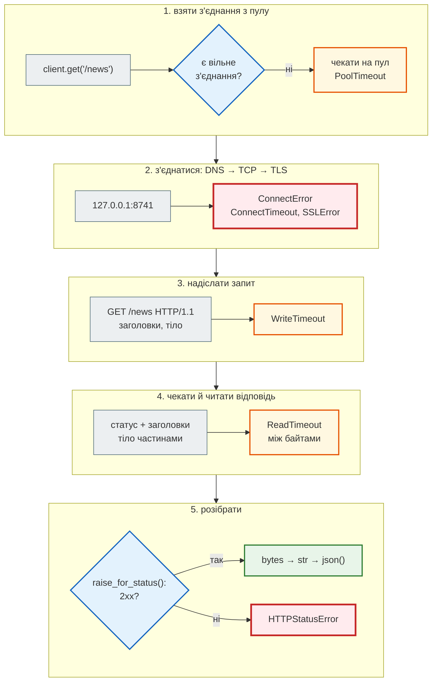
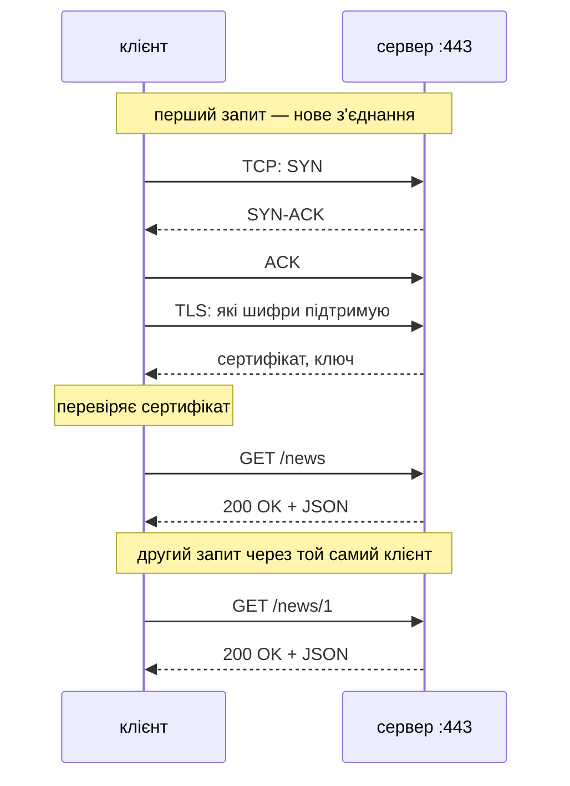
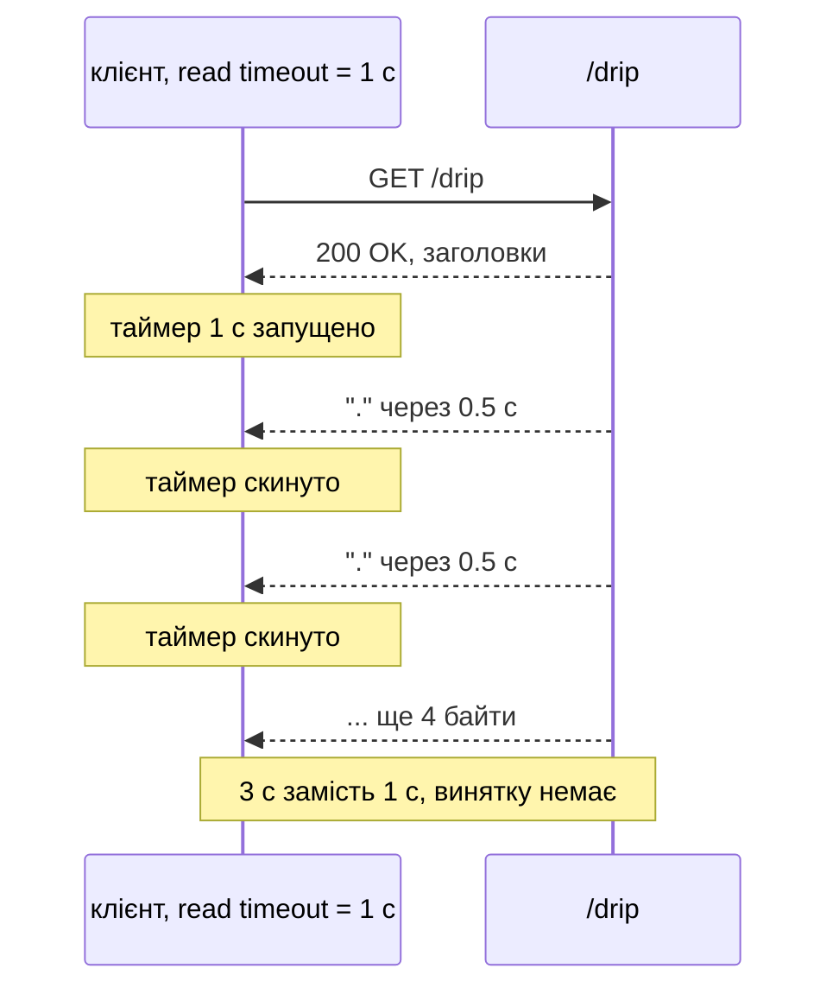
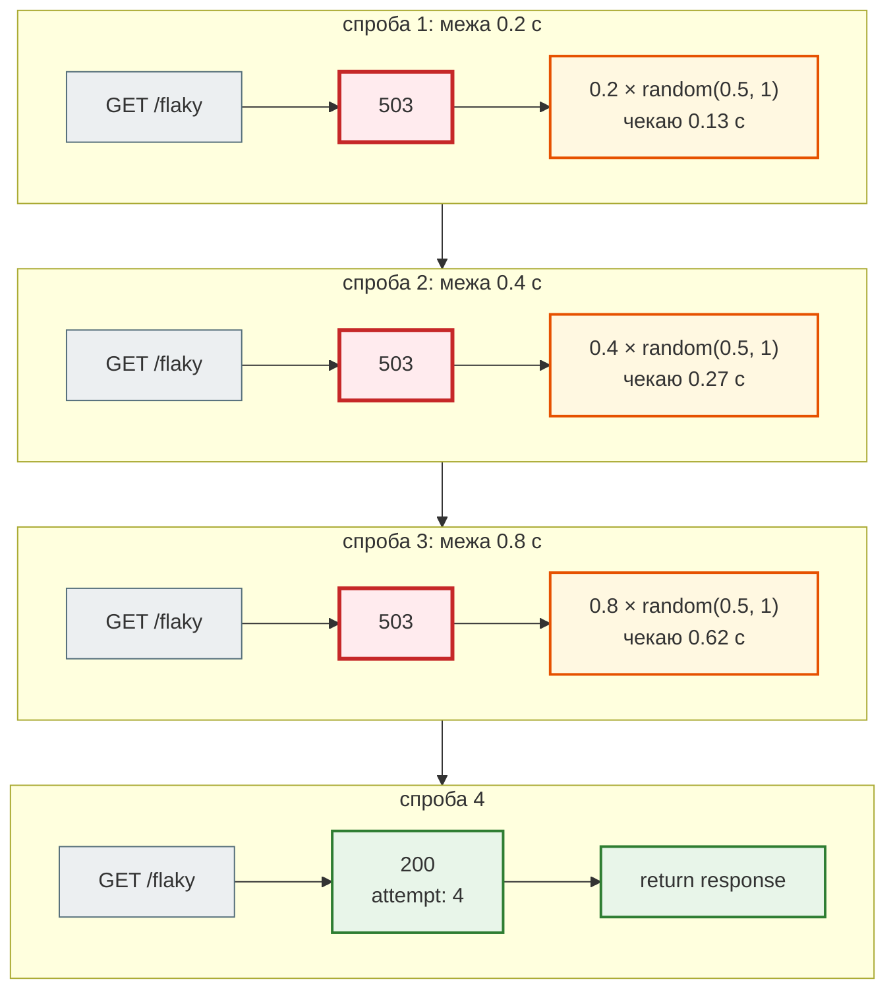
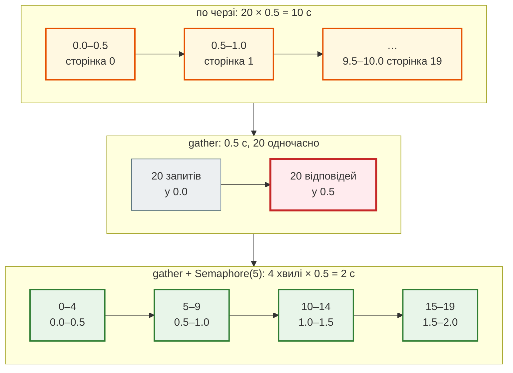
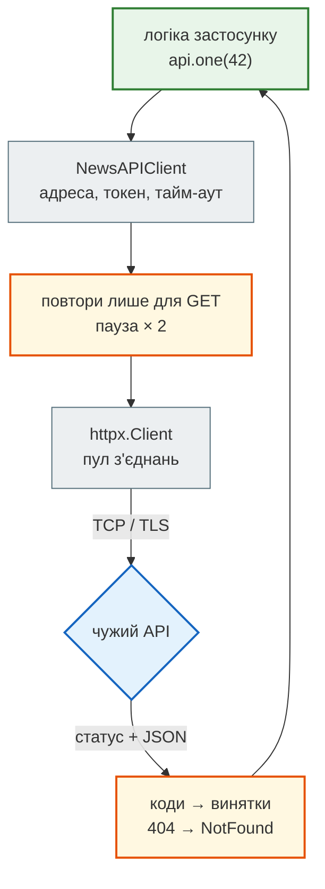

# HTTP-клієнти: requests, httpx, aiohttp

## Проблема { #problem }

Сервер на FastAPI теж буває клієнтом. News Hub завантажує сторінки rbc.ua ([крок 2](../tutorials/02_fastapi_basics/scrape_endpoint.md)), RSS адмінських джерел через `safe_fetch` ([крок 8](../tutorials/08_security/ssrf.md)), звертається до Gemini й Anthropic ([крок 7](../tutorials/07_llm_api/index.md)), а тести ходять в API через `httpx` ([крок 5](../tutorials/05_api_testing/fake_server.md)). Чужий сервер не обіцяє нічого: може не відповісти зовсім, відповідати по байту, повернути `503`, перенаправити, надіслати текст у Windows-1251 чи файл на 200 МБ.

`requests.get(url)` виглядає як виклик функції, а насправді це DNS, TCP, TLS, очікування, читання тіла й декодування. На кожному кроці щось може піти не так, і тоді або програма зависає назавжди, або один збій валить увесь збір, або повтор створює дубль замовлення. На цій сторінці всі ці випадки відтворені на локальному сервері, без інтернету.

## Ментальна модель { #mental-model }

Один запит клієнта — п'ять кроків. На кожному свій тайм-аут і свій виняток:



- **Крок 1 — лише у клієнта з пулом.** `requests.Session`, `httpx.Client`, `aiohttp.ClientSession` тримають відкриті з'єднання й віддають їх наступним запитам. Якщо з'єднання вже є, кроку 2 немає зовсім.
- **Крок 2 — найдорожчий.** Нове з'єднання — це DNS, рукостискання TCP і для `https` ще рукостискання TLS: кілька обмінів «туди й назад» до першого байта запиту.
- **Кроки 4–5 — окремо.** Статус приходить раніше за тіло. Бібліотека може повернути відповідь, а тіло ще тільки йде мережею.
- **`404` чи `503` — не виняток.** Запит відбувся, відповідь прийшла. Виняток буде лише після `raise_for_status()`.

Чому пул важливий, видно на часовій діаграмі:



Другий запит одразу йде з `GET`: з'єднання з пулу вже пройшло TCP і TLS.

| | `requests` | `httpx` | `aiohttp` |
|---|---|---|---|
| модель | синхронна: потік чекає відповідь | синхронна (`Client`) і асинхронна (`AsyncClient`), той самий інтерфейс | лише асинхронна (`ClientSession`) |
| клієнт з пулом | `requests.Session` | `httpx.Client` / `httpx.AsyncClient` | `aiohttp.ClientSession` |
| у `async def` FastAPI | блокує цикл подій ([виміри](../tutorials/02_fastapi_basics/async_measurements.md)) | `AsyncClient` — так | так |

## Мінімальний приклад: той самий GET трьома бібліотеками { #basics }

Код — [`examples/http_clients`](https://github.com/NikoriakViktor/news_hub/tree/main/examples/http_clients). Кожен скрипт сам запускає у фоновому потоці «чужий сайт» [`server.py`](https://github.com/NikoriakViktor/news_hub/blob/main/examples/http_clients/server.py) (FastAPI + uvicorn на `127.0.0.1:8741`): `/news`, `/slow`, `/flaky`, `/old-news`, `/cp1251`, `/big` тощо.

```python title="basics.py (фрагмент)"
response = requests.get(f"{BASE}/news", timeout=5)
print(response.status_code, response.headers["content-type"], response.json())
missing = requests.get(f"{BASE}/news/42", timeout=5)
print("404 без винятку:", missing.status_code, missing.ok, missing.json())
missing.raise_for_status()                                   # → requests.HTTPError

with httpx.Client(base_url=BASE) as client:                  # base_url: далі лише шляхи
    client.get("/news/42").raise_for_status()                # → httpx.HTTPStatusError

async with aiohttp.ClientSession(base_url=BASE) as session:
    async with session.get("/news") as resp:                 # відповідь — контекстний менеджер
        print(resp.status, resp.content_type, await resp.json())   # тіло читаємо через await
```

```text
--- requests (синхронний)
200 application/json [{'id': 1, 'title': 'Ціни на пальне'}, {'id': 2, 'title': 'Погода в Києві'}]
404 без винятку: 404 False {'detail': 'новину 42 не знайдено'}
raise_for_status → HTTPError — 404 Client Error: Not Found for url: http://127.0.0.1:8741/news/42
User-Agent: python-requests/2.34.2
params= → http://127.0.0.1:8741/echo?district=%D0%9F%D0%BE%D0%B4%D1%96%D0%BB&limit=5
json= → application/json 49 b'{"title": "\\u041f\\u0440\\u0438\\u0432\\u0456\\u0442"}'
--- httpx.Client (синхронний)
200 HTTP/1.1 [{'id': 1, 'title': 'Ціни на пальне'}, {'id': 2, 'title': 'Погода в Києві'}]
raise_for_status → HTTPStatusError 404 {'detail': 'новину 42 не знайдено'}
User-Agent: python-httpx/0.28.1
json= → application/json 24 b'{"title":"\xd0\x9f\xd1\x80\xd0\xb8\xd0\xb2\xd1\x96\xd1\x82"}'
--- httpx.AsyncClient
200 [{'id': 1, 'title': 'Ціни на пальне'}, {'id': 2, 'title': 'Погода в Києві'}]
--- aiohttp.ClientSession
200 application/json [{'id': 1, 'title': 'Ціни на пальне'}, {'id': 2, 'title': 'Погода в Києві'}]
raise_for_status → ClientResponseError 404 Not Found
User-Agent: Python/3.12 aiohttp/3.14.5
```

Що тут видно:

- **Жодна бібліотека не кидає виняток на `404`.** `missing.ok` — `False`, а тіло — `{'detail': ...}`, а не новина. Без перевірки статусу програма піде далі й упаде пізніше з `KeyError` у зовсім іншому місці (див. [Практику](#practice)).
- **`params=`** кодує рядок запиту сам: кирилиця стала байтами UTF-8 через `%`. Склеювати `?district=` руками не треба.
- **`json=`** перетворює словник на тіло й ставить `Content-Type: application/json`. `requests` екранує кирилицю (`П`, 49 байтів), `httpx` пише UTF-8 як є (24 байти). Сервер прочитає обидва варіанти однаково.
- **`User-Agent` за замовчуванням** називає бібліотеку і її версію. Деякі сайти таких клієнтів відсікають, тож свій клієнт представляється сам (див. [У News Hub](#news-hub)).
- **`response.headers`** не залежить від регістру: `headers["Content-Type"]` і `headers["content-type"]` дають те саме.

Винятки трьох бібліотек:

| Що сталося | `requests` | `httpx` | `aiohttp` |
|---|---|---|---|
| спільний предок | `RequestException` | `HTTPError` (мережа — `TransportError`) | `ClientError` |
| нікого немає за адресою | `ConnectionError` | `ConnectError` | `ClientConnectorError` |
| не встигли з'єднатися | `ConnectTimeout` | `ConnectTimeout` | `ConnectionTimeoutError` |
| не встигли прочитати | `ReadTimeout` | `ReadTimeout` | `SocketTimeoutError`; `total` — `TimeoutError` |
| збій TLS: сертифікат, протокол | `SSLError` | `ConnectError` | `ClientConnectorCertificateError`, `ClientConnectorSSLError` |
| 4xx/5xx після `raise_for_status()` | `HTTPError` | `HTTPStatusError` | `ClientResponseError` |
| тіло — не JSON | `JSONDecodeError` | `json.JSONDecodeError` | `ContentTypeError` (не той `Content-Type`) |

`aiohttp` за тайм-аут `total` кидає `asyncio.TimeoutError`. З Python 3.11 це той самий клас, що `TimeoutError`; у 3.10 — окремий, тому News Hub ловить обидва (`except (aiohttp.ClientError, asyncio.TimeoutError)`).

## Тайм-аути { #timeouts }

### Без тайм-ауту — вічно { #no-timeout }

[`timeouts.py`](https://github.com/NikoriakViktor/news_hub/blob/main/examples/http_clients/timeouts.py) запускає `requests.get` без `timeout` на сторінку, що відповідає за 30 с, і перевіряє через 3 с:

```text
--- без тайм-ауту
requests.get(url) без timeout: через 3 с ще чекає? True
тайм-аути за замовчуванням: httpx Timeout(timeout=5.0) | aiohttp ClientTimeout(total=300, connect=None, sock_read=None, sock_connect=30, ceil_threshold=5)
```

| Бібліотека | Тайм-аут за замовчуванням |
|---|---|
| `requests` | **немає**: чекає, доки ОС не закриє з'єднання, а це можуть бути години |
| `httpx` | 5 с на кожну фазу: з'єднання, читання, запис, пул |
| `aiohttp` | `total=300` (5 хвилин на весь запит), `sock_connect=30` |

Зависає не лише цей запит. Синхронний воркер, потік чи задача Celery стоять разом із ним. Кілька таких «вічних» запитів, і пул воркерів зайнятий повністю, хоча сервер нічого не робить.

### Connect, read, total { #timeout-kinds }

```text
--- сервер не відповідає (read)
requests timeout=1, /slow?delay=3            ReadTimeout                  за 1.0 с
httpx за замовчуванням (5 с), /slow?delay=3  відповідь 200                за 3.0 с
httpx за замовчуванням (5 с), /slow?delay=8  ReadTimeout                  за 5.0 с
--- немає кому відповісти (connect)
requests, закритий порт 8799                 ConnectionError              за 0.0 с
httpx, закритий порт 8799                    ConnectError                 за 0.0 с
httpx connect=1, переповнена черга з'єднань  ConnectTimeout               за 1.0 с
```

(Час — з одного запуску, у тебе може трохи відрізнятися.)

- **Закритий порт — миттєва відмова**, а не тайм-аут: ОС одразу відповідає «тут ніхто не слухає».
- **`ConnectTimeout`** — коли пакети з'єднання йдуть у порожнечу: сервер перевантажений, фаєрвол мовчки відкидає, адреса недосяжна. Скрипт відтворює це сокетом, який слухає порт, але ніколи не приймає з'єднань.
- **Тайм-аути задають окремо**, бо з'єднання має бути швидким, а відповідь буває довгою: `requests.get(url, timeout=(3, 10))` — 3 с на з'єднання і 10 на читання; `httpx.Timeout(10, connect=3)`; `aiohttp.ClientTimeout(total=15, sock_connect=3)`.

### Read-тайм-аут — між байтами, а не на всю відповідь { #read-timeout }

Найнеочевидніша пастка. `/drip` починає відповідь одразу, але тіло надсилає по байту раз на 0,5 с — 6 байтів за 3 с:

```text
--- тіло капає по байту раз на 0.5 с, 6 байтів (≈ 3 с)
requests timeout=1                           відповідь 6                  за 3.0 с
httpx timeout=1                              відповідь 6                  за 3.0 с
aiohttp sock_read=1                          відповідь 6                  за 3.0 с
aiohttp total=1                              TimeoutError                 за 1.0 с
httpx timeout=1 + asyncio.timeout(1)         TimeoutError                 за 1.0 с
```



`timeout=1` у `requests` і `httpx` означає «не більше 1 с **тиші** між двома шматками», а не «вся відповідь за 1 с». Сервер, що повільно цідить байти (зламаний або навмисно), тримає клієнта скільки завгодно. Стелю на весь запит дають:

- `aiohttp.ClientTimeout(total=...)` — є з коробки;
- `httpx.AsyncClient` — `async with asyncio.timeout(15):` навколо запиту (Python 3.11+; у 3.10 — `asyncio.wait_for`);
- синхронні `requests` і `httpx.Client` — загальної стелі не мають; її дає лише стеля розміру тіла (див. [Великі відповіді](#streaming)) або окремий потік чи процес із власним тайм-аутом.

## Пул з'єднань: один клієнт на застосунок { #pooling }

[`pooling.py`](https://github.com/NikoriakViktor/news_hub/blob/main/examples/http_clients/pooling.py) показує порт, з якого прийшов клієнт (`request.client.port` на сервері). Новий порт — нове TCP-з'єднання:

```text
--- порт клієнта, який бачить сервер (новий порт = нове з'єднання)
requests.get × 3:    [48446, 48458, 48468]
Session × 3:         [48480, 48480, 48480]
httpx.Client × 3:    [48486, 48486, 48486]
aiohttp session × 3: [48498, 48498, 48498]
--- 200 запитів
requests.get щоразу:           0.36 с
одна requests.Session:         0.16 с
httpx.Client на кожен запит:   3.05 с
один httpx.Client:             0.16 с
```

(Час залежить від машини; у трьох запусках `httpx.Client` на кожен запит займав 2,5–5 с.)

- **`requests.get(...)`** — це тимчасова `Session` на один запит: з'єднання відкривається й закривається щоразу.
- **Один клієнт** перевикористовує те саме з'єднання: порт не змінюється, 200 запитів — удвічі швидше навіть на `127.0.0.1`. Через інтернет з HTTPS різниця більша: там кожне нове з'єднання — ще й рукостискання TLS.
- **`httpx.Client` на кожен запит — найповільніше**: конструктор щоразу створює SSL-контекст і завантажує сертифікати (≈15 мс у цьому середовищі), навіть для `http://`.
- **Клієнт тримає й спільні налаштування**: `base_url`, заголовки (токен один раз), тайм-аут, ліміти.

Тому клієнт створюють **один на застосунок** (або на велику операцію) і закривають у кінці. У FastAPI для цього є `lifespan`:

```python
@asynccontextmanager
async def lifespan(app: FastAPI):
    async with httpx.AsyncClient(timeout=10, headers={"User-Agent": "news_hub/1.0"}) as client:
        app.state.http = client               # ендпоінти й залежності беруть його з request.app.state
        yield                                 # при зупинці застосунку клієнт закриється
```

`lifespan` і `app.state` докладно — у [кроці 2](../tutorials/02_fastapi_basics/depends_and_lifespan.md). Незакритий `aiohttp.ClientSession` виводить попередження `Unclosed client session`, а незакриті з'єднання тримають сокети, доки їх не прибере збирач сміття.

## Повтори з паузою { #retries }

Сервер інколи коротко недоступний: перезапуск, перевантаження, ліміт запитів. Тоді має сенс повторити запит, але за правилами. [`retries.py`](https://github.com/NikoriakViktor/news_hub/blob/main/examples/http_clients/retries.py):

```python title="retries.py (фрагмент)"
RETRY_STATUSES = {429, 502, 503, 504}           # «спробуй пізніше»; 4xx інші — помилка запиту, повтор не допоможе
SAFE_TO_RETRY = {"GET", "HEAD", "OPTIONS", "PUT", "DELETE"}   # ідемпотентні методи


def request_with_retry(client: httpx.Client, method: str, url: str, *,
                       attempts: int = 4, base: float = 0.2, cap: float = 2.0, **kwargs) -> httpx.Response:
    if method not in SAFE_TO_RETRY:
        attempts = 1                             # POST/PATCH: повтор може створити дубль
    for attempt in range(1, attempts + 1):
        try:
            response = client.request(method, url, **kwargs)
            if response.status_code not in RETRY_STATUSES or attempt == attempts:
                return response
            reason = str(response.status_code)
            retry_after = response.headers.get("Retry-After")
        except httpx.TransportError as error:   # ConnectError, ReadTimeout, …
            if attempt == attempts:
                raise
            reason, retry_after = type(error).__name__, None
        pause = min(cap, base * 2 ** (attempt - 1)) * random.uniform(0.5, 1)    # backoff + jitter
        if retry_after and retry_after.isdigit():
            pause = max(pause, float(retry_after))                              # сервер сказав, скільки чекати
        print(f"  спроба {attempt}: {reason}, чекаю {pause:.2f} с")
        time.sleep(pause)
```

```text
--- GET /flaky: три 503, потім 200
  спроба 1: 503, чекаю 0.13 с
  спроба 2: 503, чекаю 0.27 с
  спроба 3: 503, чекаю 0.62 с
200 {'ok': True, 'attempt': 4} за 1.0 с
--- те саме, але сервер надсилає Retry-After: 1
  спроба 1: 503, чекаю 1.00 с
  спроба 2: 503, чекаю 1.00 с
200 {'ok': True, 'attempt': 3} за 2.0 с
--- GET /news/42: 404 не повторюємо
404
```

(Паузи випадкові через jitter: у кожному запуску інші.)



- **Exponential backoff**: межа паузи подвоюється (0,2 → 0,4 → 0,8 с) і обмежена `cap`. Тисяча клієнтів, що повторюють без паузи, добиває сервер, який намагається піднятися.
- **Jitter** — випадкова частка паузи. Без неї всі клієнти, що впали одночасно, і повторять одночасно, хвилею.
- **`Retry-After`** — сервер сам каже, скільки чекати (`429`, `503`; див. [Коди відповідей](status_codes.md)). Повторити раніше означає отримати ту саму відмову.
- **`404` не повторюється**: за секунду він не стане `200`. Повторюють лише те, що може минути: `429`, `502`, `503`, `504`, помилки з'єднання й тайм-аути.

### Чому POST не повторюють { #retry-post }

`POST /orders` на сервері створює замовлення, але відповідає за 1,5 с, а тайм-аут клієнта — 1 с. Наївний повтор «бо тайм-аут»:

```text
--- POST /orders: сервер відповідає за 1.5 с, тайм-аут 1 с
  ReadTimeout — повторюю
  ReadTimeout — повторюю
  ReadTimeout — повторюю
замовлень на сервері: 3
```

Тайм-аут означає «відповіді не дочекались», а не «сервер нічого не зробив». Кожна спроба створила замовлення: три тайм-аути — три дублікати. Повторювати автоматично можна лише ідемпотентні методи (`GET`, `HEAD`, `PUT`, `DELETE`). Для `POST` потрібен захист на сервері: унікальний ключ або `Idempotency-Key` ([Методи HTTP](http_methods.md#mental-model)).

### Вбудовані повтори { #builtin-retries }

```text
--- вбудовані повтори httpx: лише помилки з'єднання
GET /flaky з retries=2: 503
закритий порт: ConnectError після повторів, 0.50 с
```

`httpx.HTTPTransport(retries=2)` повторює **лише невдале з'єднання** (`ConnectError`, `ConnectTimeout`): `503` повернувся як є. Це безпечно навіть для `POST`, бо запит ще не пішов. Повтори за статусом пишуть самі, як вище, або беруть бібліотеку (`tenacity`; у `requests` — `urllib3.Retry` через `HTTPAdapter(max_retries=...)`). SDK провайдерів часто мають свої: `anthropic.AsyncAnthropic(max_retries=2)`.

## Перенаправлення { #redirects }

[`redirects_encodings.py`](https://github.com/NikoriakViktor/news_hub/blob/main/examples/http_clients/redirects_encodings.py), `/old-news` відповідає `301` на `/news`:

```text
--- 301 /old-news → /news
requests: 200 http://127.0.0.1:8741/news history: [301]
httpx:    301 location: /news | next: http://127.0.0.1:8741/news
httpx follow_redirects=True: 200 http://127.0.0.1:8741/news [301]
aiohttp:  200 http://127.0.0.1:8741/news history: [301]
aiohttp /loop: TooManyRedirects 5 перенаправлень
requests /loop: TooManyRedirects — Exceeded 30 redirects.
```

| | `requests` | `httpx` | `aiohttp` |
|---|---|---|---|
| за замовчуванням | іде за перенаправленням | **не йде**: повертає `301`/`302` | іде |
| увімкнути / вимкнути | `allow_redirects=False` | `follow_redirects=True` | `allow_redirects=False` |
| межа | 30 (`Session.max_redirects`) | 20 (`max_redirects`) | 10 (`max_redirects=`) |
| ланцюжок | `response.history` | `response.history` | `resp.history` |

- **`httpx` без `follow_redirects=True` повертає саму відповідь `301`.** Код, перенесений з `requests`, раптом бачить порожнє тіло й `location` замість даних. Наступний запит уже підготовлено в `response.next_request`.
- **`response.url`** — остання адреса, а не та, яку просили. Відносні посилання на сторінці рахують від неї.
- **Цикл перенаправлень** обривається винятком `TooManyRedirects`, а не зависанням.
- **Коли сервер сам вирішує, куди піти**, перенаправлення вимикають і перевіряють кожну нову адресу: `safe_fetch` робить `allow_redirects=False` і пропускає кожен `Location` через ті самі перевірки SSRF ([крок 8](../tutorials/08_security/ssrf.md#redirects)).

## Тіло: bytes, str, JSON { #body }

Мережею йдуть **байти**. `response.content` (`await resp.read()`) — байти як є; `response.text` (`await resp.text()`) — байти, декодовані за `charset`; `response.json()` — текст, розібраний як JSON.

```text
--- тіло: bytes і str
content[:12]: b'\xcd\xee\xe2\xe8\xed\xe8: \xf6\xb3\xed\xe8'
charset з заголовка: windows-1251 → Новини: ціни на пальне, погода
без charset: requests.encoding = ISO-8859-1 → Íîâèíè: ö³íè íà ïàëüíå, ïîãîäà
  apparent_encoding = johab
  encoding = 'cp1251' → Новини: ціни на пальне, погода
без charset: httpx.encoding = utf-8 → ������: ���� �� ������, ������
--- битий байт: сервер обіцяє UTF-8, а в тілі 0xff
requests: 'года �'
httpx:    'года �'
aiohttp cp1251: windows-1251 → Новини: ціни на пальне, погода
aiohttp broken: text() → UnicodeDecodeError invalid start byte
aiohttp broken: text(errors='replace') → 'года �'
```

- **`charset` у `Content-Type` є** — усі три бібліотеки декодують правильно, навіть Windows-1251.
- **`charset` немає** — кожна вгадує по-своєму, і всі неправильно. `requests` для `text/*` бере ISO-8859-1 (так казав старий стандарт HTTP/1.1) і дає «Íîâèíè». Вгадування за вмістом (`apparent_encoding`) на короткому тексті назвало корейське `johab`. `httpx` бере UTF-8 і замінює все на «�». Якщо кодування сайту відоме, його задають явно: `response.encoding = "cp1251"`.
- **Битий байт** у тілі, яке обіцяє UTF-8: `requests` і `httpx` замінюють його на «�», а `aiohttp` `text()` **кидає `UnicodeDecodeError`**. Це не `ClientError`, тож `except aiohttp.ClientError` його не ловить. Саме так в News Hub одна сторінка з одним байтом валила весь збір ([крок 5](../tutorials/05_api_testing/fake_server.md#finding)); виправлення — `resp.text(errors="replace")`.
- **`json()`** не дивиться на статус: для `502` від проксі з HTML-сторінкою він кине `JSONDecodeError`. Спочатку статус і `Content-Type`, потім `json()`.

## Великі відповіді: потоком і зі стелею { #streaming }

Без особливих налаштувань бібліотека читає **все тіло в пам'ять**. [`streaming.py`](https://github.com/NikoriakViktor/news_hub/blob/main/examples/http_clients/streaming.py):

```python title="streaming.py (фрагмент)"
with requests.get(f"{BASE}/big", params={"mb": 50}, stream=True, timeout=5) as response:
    for chunk in response.iter_content(chunk_size=64 * 1024):
        total += len(chunk)                     # тут — запис у файл або парсинг частинами

with httpx.Client() as client, client.stream("GET", f"{BASE}/big", params={"mb": 50}) as response:
    for chunk in response.iter_bytes():
        total += len(chunk)

async for chunk in resp.content.iter_chunked(64 * 1024):      # aiohttp
    body += chunk
    if len(body) > max_bytes:
        raise ValueError(f"відповідь більша за {max_bytes} байт — далі не читаємо")
```

```text
пам'ять процесу на старті: 64 МБ
requests stream=True: 50 МБ частинами за 0.0 с, пік пам'яті 65 МБ
httpx client.stream: 50 МБ, пік пам'яті 67 МБ
aiohttp: Content-Length = None
aiohttp: відповідь більша за 5242880 байт — далі не читаємо
requests без stream, 200 МБ: len(content) = 200 МБ, пік пам'яті 474 МБ
```

(Пам'ять — `ru_maxrss` процесу на Linux; сервер працює в тому самому процесі.)

- **Потоком** 50 МБ пройшли через процес, а пам'ять майже не зросла: у кожен момент у ній один шматок.
- **Без `stream=True`** 200 МБ тіла коштували понад 400 МБ піку: байти й їх склеювання.
- **`Content-Length` може не бути** (`None`): сервер надсилає частинами. Тому стелю перевіряють під час читання, а не лише за заголовком. Так робить `_read_limited` у `safe_fetch`: чужий URL може віддати гігабайт і покласти сервер.
- **Відповідь потоком треба закрити** (`with` / `async with`), інакше з'єднання не повернеться в пул.

## Багато сторінок одночасно { #concurrency }

20 сторінок, кожна відповідає 0,5 с. Сервер рахує, скільки запитів обробляє одночасно. [`concurrency.py`](https://github.com/NikoriakViktor/news_hub/blob/main/examples/http_clients/concurrency.py):

```python title="concurrency.py (фрагмент)"
async def fetch(client: httpx.AsyncClient, n: int) -> dict:
    response = await client.get(f"/page/{n}")
    response.raise_for_status()
    return response.json()

async def limited(limit: int) -> list[dict]:
    semaphore = asyncio.Semaphore(limit)         # не більше `limit` запитів одночасно

    async def fetch_limited(client: httpx.AsyncClient, n: int) -> dict:
        async with semaphore:
            return await fetch(client, n)

    async with httpx.AsyncClient(base_url=BASE) as client:
        return await asyncio.gather(*(fetch_limited(client, n) for n in range(PAGES)))
```

```text
по черзі, httpx.Client                    10.1 с   сервер бачив одночасно: 1
ThreadPoolExecutor(5), httpx.Client        2.1 с   сервер бачив одночасно: 5
gather, httpx.AsyncClient                  0.6 с   сервер бачив одночасно: 20
  порядок результатів = порядок задач: [0, 1, 2, 3, 4, 5] …
gather + Semaphore(5)                      2.1 с   сервер бачив одночасно: 5
gather + httpx.Limits(max_connections=5)   2.0 с   сервер бачив одночасно: 5
gather + aiohttp limit_per_host=5          2.0 с   сервер бачив одночасно: 5
  сторінки по 1 с, 2 з'єднання, pool=0.5: ['Response', 'Response', 'PoolTimeout', 'PoolTimeout', 'PoolTimeout', 'PoolTimeout']
```

(Час з одного запуску, у тебе може трохи відрізнятися.)



- **По черзі** програма 10 с просто **чекала**. Запити не рахують, а чекають, і чекати можна на всі одразу.
- **`gather`** — 0,5 с, але сервер отримав **20 запитів одночасно**. Для чужого сайту 1000 одночасних запитів від однієї адреси схожі на атаку: блокування, `429`, а в тебе — ліміт відкритих файлів.
- **`Semaphore(5)`** пропускає не більше п'яти: 4 хвилі по 0,5 с = 2 с. Той самий результат дають ліміти пулу: `httpx.Limits(max_connections=5)`, `aiohttp.TCPConnector(limit_per_host=5)`. Семафор обмежує і роботу навколо запиту (розбір, запис у базу), ліміт пулу — лише з'єднання.
- **За замовчуванням ліміти є, але великі**: `httpx` — 100 з'єднань, `aiohttp` — 100 усього і без ліміту на хост.
- **Черга на пул має свій тайм-аут**: задачі, що чекали вільне з'єднання довше `pool=0.5`, отримали `PoolTimeout`, хоча сервер працював. З лімітом пулу `pool` ставлять не менше за час, який задачі реально стоять у черзі.
- **Потоки** (`ThreadPoolExecutor`) теж працюють для синхронного клієнта: мережеве очікування відпускає GIL. Для десятків запитів цього досить, для сотень і тисяч — async.
- **`gather` повертає результати в порядку задач**, а не в порядку відповідей. Без `return_exceptions=True` перший виняток вилітає з `gather`, і результатів решти задач ти не отримаєш. News Hub тому ловить помилки всередині `fetch_one` і повертає їх як дані.

## Свій клієнт до чужого API { #api-client }

Коли запити до одного API розкидані по коду, у кожному місці повторюються адреса, токен, тайм-аут, перевірка статусу й повтори. Тому їх збирають в **один клас-клієнт**: решта програми викликає методи й отримує дані та **свої** винятки. [`api_client.py`](https://github.com/NikoriakViktor/news_hub/blob/main/examples/http_clients/api_client.py):

```python title="api_client.py (фрагмент)"
class NewsAPIError(Exception):
    """Будь-яка помилка чужого API новин."""


class NotFound(NewsAPIError):
    pass


class NewsAPIClient:
    def __init__(self, base_url: str, *, token: str | None = None, timeout: float = 5,
                 retries: int = 3, pause: float = 0.2, transport: httpx.BaseTransport | None = None) -> None:
        headers = {"User-Agent": "news_hub/1.0 (+https://github.com/NikoriakViktor/news_hub)"}
        if token:
            headers["Authorization"] = f"Bearer {token}"
        self._http = httpx.Client(base_url=base_url, timeout=timeout, headers=headers, transport=transport)
        self._retries = retries
        self._pause = pause

    def _request(self, method: str, path: str, **kwargs) -> dict | list:
        attempts = self._retries if method == "GET" else 1       # POST не повторюємо: можна створити дубль
        for attempt in range(1, attempts + 1):
            try:
                response = self._http.request(method, path, **kwargs)
            except httpx.TransportError as error:
                if attempt == attempts:
                    raise NewsAPIError(f"{method} {path}: {type(error).__name__}") from error
            else:
                if response.status_code < 500 or attempt == attempts:
                    break
            time.sleep(self._pause * 2 ** (attempt - 1))

        if response.status_code == 404:
            raise NotFound(response.json()["detail"])
        if response.is_error:
            raise NewsAPIError(f"{method} {path}: HTTP {response.status_code}")
        return response.json()

    def news(self) -> list[dict]:
        return self._request("GET", "/news")

    def one(self, news_id: int) -> dict:
        return self._request("GET", f"/news/{news_id}")
```

```text
['Ціни на пальне', 'Погода в Києві']
NotFound: новину 42 не знайдено
flaky після повторів: {'ok': True, 'attempt': 3}
NewsAPIError: GET /news: ConnectError | причина: ConnectError
```



Що дає такий шар:

- **Одне місце для налаштувань.** Тайм-аут, токен зі змінної середовища, кількість повторів — у конструкторі, а не в кожному виклику.
- **Свої винятки.** Код застосунку ловить `NotFound` і нічого не знає про `httpx`. Причина зберігається в `__cause__` (`raise ... from error`), тож у журналі видно справжній `ConnectError`. Замінити `httpx` на `aiohttp` — правка в одному класі.
- **Повтори вирішено один раз і правильно**: `GET` — так, `POST` — ні.
- **Легко тестувати**: параметр `transport` дозволяє підставити `httpx.MockTransport` (див. [нижче](#testing)).

Так влаштовані офіційні SDK (Telegram, Gemini, Anthropic): усередині HTTP, назовні методи й винятки. Шар LLM у News Hub — те саме на рівень вище: `LLMClient` з `LLMUnavailable` і `CircuitOpen` замість винятків двох різних SDK ([крок 7](../tutorials/07_llm_api/llm_client.md)).

## Тестування клієнтів { #testing }

Тести не ходять в інтернет. Три способи підмінити той бік, від найдешевшого ([`test_clients.py`](https://github.com/NikoriakViktor/news_hub/blob/main/examples/http_clients/test_clients.py)):

```python title="test_clients.py (фрагмент)"
def test_mock_transport_returns_canned_json() -> None:
    seen: list[httpx.Request] = []

    def handler(request: httpx.Request) -> httpx.Response:
        seen.append(request)
        return httpx.Response(200, json=[{"id": 1, "title": "Тест"}])

    with httpx.Client(transport=httpx.MockTransport(handler), base_url="http://news.test") as client:
        assert titles(client) == ["Тест"]
    assert seen[0].url == "http://news.test/news"                 # перевіряємо й сам запит


def test_asgi_transport_calls_fastapi_app_in_process() -> None:
    async def run() -> list[str]:
        async with httpx.AsyncClient(transport=httpx.ASGITransport(app=app), base_url="http://test") as client:
            response = await client.get("/news")
            return [item["title"] for item in response.json()]

    assert asyncio.run(run()) == ["Ціни на пальне", "Погода в Києві"]
```

```text
....                                                                     [100%]
4 passed in 0.68s
```

| Спосіб | Що виконується по-справжньому | Що ні | Коли |
|---|---|---|---|
| `httpx.MockTransport(handler)` | увесь код клієнта; запит можна перевірити | мережа, декодування байтів, тайм-аути | логіка навколо відповіді: статуси, повтори, винятки (`handler` може кинути `httpx.ConnectTimeout`) |
| `httpx.ASGITransport(app=...)` | FastAPI-застосунок повністю, у тому самому процесі | мережа; `lifespan` треба запустити самому | тести власного API ([крок 5](../tutorials/05_api_testing/index.md)) |
| локальний сервер (`aiohttp.test_utils.TestServer`, uvicorn у потоці) | усе: з'єднання, заголовки, байти, тайм-аути | лише чужий сайт замінено своїм | парсинг, кодування, тайм-аути; так у News Hub знайшли `UnicodeDecodeError` ([крок 5](../tutorials/05_api_testing/fake_server.md)) |

Бібліотеки `respx` (для `httpx`) і `aioresponses` (для `aiohttp`) роблять те саме, що `MockTransport`: реєструєш «на `GET /news` відповісти так», і вони перехоплюють запити без зміни коду. Мок відповідає тим, що йому сказали, тож усе між байтами й рядком він не перевіряє: для цього потрібен справжній сервер на `127.0.0.1`.

## У News Hub { #news-hub }

| Де | Бібліотека | Що з цієї сторінки | Крок |
|---|---|---|---|
| `scraper.py`: 7 сторінок rbc.ua | `aiohttp` | одна `ClientSession` на збір; `gather`; `ClientTimeout(total=15)` на сторінку; `raise_for_status()`; помилка сторінки — у `PageResult.error`, решта сторінок живе; свій `User-Agent` і `Accept-Language` | [2](../tutorials/02_fastapi_basics/scrape_endpoint.md) |
| `scraper.py`: битий байт | `aiohttp` | `resp.text(errors="replace")` замість `UnicodeDecodeError` | [5](../tutorials/05_api_testing/fake_server.md#finding) |
| тести API | `httpx.AsyncClient` + `ASGITransport` | клієнт без мережі; `lifespan` запускається вручну | [5](../tutorials/05_api_testing/index.md) |
| тести скрапера | `aiohttp` проти `TestServer` | справжній HTTP, сайт — свій | [5](../tutorials/05_api_testing/fake_server.md) |
| `safe_fetch`: RSS за адресою адміна | `aiohttp` | `ClientTimeout(total=10)`; `allow_redirects=False` і ручні перенаправлення (≤ 3); стеля 2 МБ частинами; лише XML-типи; `trust_env=False` | [8](../tutorials/08_security/ssrf.md) |
| `llm.py`: Gemini, Anthropic | SDK поверх `aiohttp` / `httpx` | `LLM_TIMEOUT=30`; `max_retries=2` в Anthropic; мережеві помилки обох бібліотек — `NETWORK_ERRORS` | [7](../tutorials/07_llm_api/index.md) |
| Telegram-бот | `aiogram` поверх `aiohttp` (`AiohttpSession`) | | [9](../tutorials/09_telegram_bot/index.md) |

Заголовки скрапера з [`steps/02_fastapi_basics/news_hub/scraper.py`](https://github.com/NikoriakViktor/news_hub/blob/main/steps/02_fastapi_basics/news_hub/scraper.py):

```python
HEADERS = {
    "User-Agent": "Mozilla/5.0 (compatible; EduScraper/1.0; +educational)",
    "Accept-Language": "uk,en;q=0.9",
    "Accept": "text/html,application/xhtml+xml",
}
```

`ClientSession` у скрапері створюється на кожен виклик `scrape_all_async` і закривається після нього: один збір — сім запитів через один пул. Сторінок сім, тож `Semaphore` не потрібен: ліміт `aiohttp` за замовчуванням (100) не досягається. Якщо джерел стане сотні, обмеження одночасності (`limit_per_host`) додається в `TCPConnector`, а сесія переїжджає в `lifespan`.

## Типові помилки { #mistakes }

| Помилка | Наслідок | Як правильно |
|---|---|---|
| `requests.get(url)` без `timeout` | запит, воркер і потік чекають вічно | завжди `timeout=`; окремо connect і read |
| read-тайм-аут вважають стелею на всю відповідь | повільний сервер тримає клієнта скільки завгодно | `aiohttp` `total=`; `asyncio.timeout` навколо `httpx`; стеля розміру |
| `.json()` без перевірки статусу | `KeyError` чи `JSONDecodeError` далеко від причини | `raise_for_status()` або явна перевірка `status_code` перед `.json()` |
| новий клієнт на кожен запит | нове з'єднання щоразу; `httpx.Client` — ще й новий SSL-контекст | один клієнт на застосунок (`lifespan`) |
| `requests` в `async def` | цикл подій стоїть, усі запити до сервера чекають | `httpx.AsyncClient` / `aiohttp`, або `def`-ендпоінт |
| повтор `POST` після тайм-ауту | дублікати | повторювати лише ідемпотентні; для `POST` — `Idempotency-Key` |
| повтори без паузи й jitter | хвиля запитів добиває сервер | backoff з межею, jitter, `Retry-After` |
| повтор `4xx` | марні запити, той самий результат | повторювати `429`, `502`–`504`, помилки з'єднання |
| код з `requests` перенесли на `httpx` | `301`/`302` замість даних | `follow_redirects=True` |
| `response.text` без `charset` у заголовку | «Íîâèíè» або «������» | `response.encoding = "cp1251"` або `content.decode(...)` |
| `aiohttp` `text()` на байтах чужого сайту | `UnicodeDecodeError` валить `gather` | `text(errors="replace")`; ловити й `UnicodeDecodeError` |
| велике тіло без `stream` | уся відповідь у пам'яті | `stream=True` / `client.stream` / `iter_chunked` зі стелею |
| `gather` на тисячі URL без ліміту | блокування сайтом, `Too many open files` | `Semaphore`, `Limits`, `limit_per_host` |
| незакрита сесія чи відповідь потоком | `Unclosed client session`, з'єднання не повертаються в пул | `with` / `async with` |

## Налагодження { #debugging }

- **Що пішло насправді** — `response.request.headers` (`requests`, `httpx`) і `resp.request_info` (`aiohttp`). Або тимчасовий ендпоінт, що повертає `request.headers`, як `/echo` у прикладі чи `/inspect` у [HTTP-запиті зсередини](http_anatomy.md#wire).
- **Де саме зависає** — тип винятку: `ConnectTimeout` (не з'єдналися), `ReadTimeout` (з'єдналися, сервер мовчить), `PoolTimeout` (чекали своє ж з'єднання; сервер ні до чого).
- **Журнал бібліотеки**: `logging.basicConfig(level=logging.DEBUG)` показує рядки `httpx` / `httpcore` і `urllib3` (`requests`) — нові з'єднання, перевикористання, перенаправлення.
- **Порівняй з `curl -v URL`**: якщо `curl` отримує дані, а Python ні, різниця в заголовках (`User-Agent`, `Accept`) або в проксі зі змінних середовища (`HTTP_PROXY`, `HTTPS_PROXY`), які всі три бібліотеки читають самі (`aiohttp` — з `trust_env=True`).
- **Кракозябри** — подивись `response.headers["content-type"]` і `response.encoding`, потім перші байти `response.content`.

## Безпека { #security }

- **`verify=False` — не рішення.** На `SSLError: certificate verify failed` часто радять вимкнути перевірку. З'єднання лишається шифрованим, але невідомо з ким: будь-хто посередині підставить свій сертифікат і прочитає токен. Причину виправляють: оновити сертифікати, для корпоративного проксі вказати його CA (`verify="ca.pem"`).
- **Токени — не в коді й не в URL.** Ключ API бери зі змінної середовища, передавай у заголовку `Authorization`. Рядок запиту (`?token=...`) потрапляє в журнали серверів і проксі ([Журнал сервера](http_anatomy.md#access-log)).
- **Помилки клієнта не в журнал як є.** `str(error)` для `HTTPStatusError` містить повний URL, разом із `?key=...`, якщо ключ передано так.
- **Чужий URL від користувача — це SSRF.** Сервер піде туди, куди скажуть: `localhost`, Redis, метадані хмари `169.254.169.254`. Перевіряти треба IP після DNS і кожне перенаправлення — `safe_fetch` у [кроці 8](../tutorials/08_security/ssrf.md). `requests` і `httpx` при перенаправленні на інший хост прибирають `Authorization`, але не перевіряють, куди саме ведуть перенаправлення.
- **Стеля розміру й тайм-аут** — теж захист: без них один повільний або величезний відповідач тримає воркер і пам'ять.
- **Чесний `User-Agent` і помірна одночасність** — правила ввічливого клієнта. Сайти блокують тих, хто приходить сотнями запитів за секунду.

## Практика { #practice }

### Знайди помилку { #find-the-bug }

```python
def news_title(news_id: int) -> str:
    response = requests.get(f"{BASE}/news/{news_id}")
    return response.json()["title"]


print(news_title(2))
print(news_title(42))
```

```text
Погода в Києві
KeyError: 'title'
```

Для новини 2 працює, для 42 — `KeyError`. Знайди **дві** проблеми: одну видно у виводі, друга проявиться в день, коли сервер зависне.

??? success "Відповідь"

    1. **Статус не перевірено.** На `404` сервер повернув `{"detail": ...}`, і програма впала з `KeyError: 'title'`, яке нічого не каже про справжню причину. Потрібен `response.raise_for_status()` до `.json()`.
    2. **Немає `timeout`.** Якщо сервер зависне, `requests` чекатиме вічно, і разом з ним зависне той, хто викликав функцію.

    ```python
    def news_title(news_id: int) -> str:
        response = requests.get(f"{BASE}/news/{news_id}", timeout=5)
        response.raise_for_status()
        return response.json()["title"]
    ```

    Тепер для 42 буде `HTTPError: 404 Client Error: Not Found for url: …`.

### Зміни приклад: `Retry-After` у клієнті { #practice-retry-after }

Навчи `NewsAPIClient._request` повторювати `GET` на `429` і `503` з урахуванням `Retry-After`.

**Критерії перевірки:**

- на `/flaky?fail=2&retry_after=1` клієнт повертає `{'ok': True, 'attempt': 3}` і витрачає не менше 2 с;
- без `Retry-After` пауза, як і раніше, подвоюється;
- `404` і `POST` — одна спроба;
- `Retry-After` більший за розумну межу (наприклад, 30 с) не чекається: клієнт кидає `NewsAPIError`.

### Спробуй самостійно: заголовки кількох новин одночасно { #practice-many }

Напиши асинхронну функцію `titles(ids)`, яка **одночасно** запитує `/news/{id}` для кожного id і повертає словник `{id: заголовок}`; для неіснуючої новини значення — `None`.

**Критерії перевірки:**

- `titles([1, 2, 42])` повертає `{1: 'Ціни на пальне', 2: 'Погода в Києві', 42: None}`;
- запити йдуть одночасно (`httpx.AsyncClient` + `gather`), через **один** клієнт, з тайм-аутом;
- одночасно не більше 5 запитів;
- `404` обробляється, а інші помилки (`5xx`, немає з'єднання) вилітають винятком.

??? tip "Підказка"
    Корутина для одного id повертає пару `(id, title)`; `dict(await asyncio.gather(...))` складе з пар словник. Перевір `response.status_code == 404` **до** `raise_for_status()`. Сервер — `from server import start_server` з прикладу.

## Питання { #questions }

1. Чому `requests.get(url)` без `timeout` — помилка? Які тайм-аути за замовчуванням у `httpx` і `aiohttp`?
2. Сервер почав відповідь одразу, але тіло надсилає по байту раз на пів секунди. Чи спрацює `timeout=1` у `requests`? Як обмежити час усієї відповіді?
3. Чому один клієнт на застосунок швидший за `requests.get` на кожен запит? Що додатково сповільнює `httpx.Client` на кожен запит?
4. Що повертає `requests.get` для `404`: виняток чи відповідь? А `httpx.get` для `301`?
5. Які відповіді й помилки має сенс повторювати? Чому не можна автоматично повторювати `POST /orders` після `ReadTimeout`?
6. Навіщо до експоненційної паузи додають jitter?
7. Сервер віддав текст у Windows-1251 без `charset` у заголовку. Що покажуть `requests` і `httpx`, і як це виправити?
8. 20 сторінок по 0,5 с: скільки часу займуть по черзі, з `gather` і з `Semaphore(5)`? Чому `gather` без ліміту небезпечний?
9. Чим `httpx.MockTransport` відрізняється від локального тестового сервера? Що мок не перевірить?

??? success "Відповіді"

    1. Якщо сервер зависне, запит (і воркер разом із ним) чекатиме вічно. `httpx` — 5 с на кожну фазу; `aiohttp` — `total=300`, `sock_connect=30`.
    2. Ні: read-тайм-аут рахує тишу між шматками, і кожен байт його скидає. Загальна стеля — `aiohttp.ClientTimeout(total=...)` або `asyncio.timeout` навколо запиту `httpx.AsyncClient`; для синхронних клієнтів — стеля розміру або окремий потік з тайм-аутом.
    3. Клієнт перевикористовує відкрите з'єднання: немає нових TCP і TLS рукостискань. `httpx.Client` при створенні ще й будує SSL-контекст і завантажує сертифікати.
    4. Відповідь зі `status_code == 404`; виняток — лише після `raise_for_status()`. `httpx` за замовчуванням не йде за перенаправленням і повертає саму відповідь `301`.
    5. `429`, `502`, `503`, `504`, помилки з'єднання й тайм-аути — і лише для ідемпотентних методів. Тайм-аут не означає, що сервер нічого не зробив: замовлення могло створитися, і повтор створить дубль.
    6. Щоб клієнти, які впали одночасно, не повторювали теж одночасно — хвилею, яка знову покладе сервер.
    7. `requests` декодує як ISO-8859-1 («Íîâèíè»), `httpx` — як UTF-8 («������»). Задати кодування явно: `response.encoding = "cp1251"` або `response.content.decode("cp1251")`.
    8. Близько 10 с, 0,5 с і 2 с. `gather` без ліміту відкриває стільки з'єднань, скільки задач: для чужого сайту це схоже на атаку, а в себе впираєшся в ліміт файлів.
    9. Мок відповідає готовим об'єктом без мережі: код клієнта виконується, але з'єднання, заголовки на дроті, декодування байтів і тайм-аути — ні. Локальний сервер перевіряє все це по-справжньому.

## Що далі { #next }

[Частина I. HTTP і дизайн REST API](README.md) — решта розділів частини.

**Джерела:** requests — [Quickstart](https://requests.readthedocs.io/en/latest/user/quickstart/), [Advanced Usage](https://requests.readthedocs.io/en/latest/user/advanced/) (Session Objects, Timeouts, Body Content Workflow); httpx — [QuickStart](https://www.python-httpx.org/quickstart/), [Clients](https://www.python-httpx.org/advanced/clients/), [Timeouts](https://www.python-httpx.org/advanced/timeouts/), [Resource Limits](https://www.python-httpx.org/advanced/resource-limits/), [Transports](https://www.python-httpx.org/advanced/transports/), [Async Support](https://www.python-httpx.org/async/), [Requests Compatibility](https://www.python-httpx.org/compatibility/); aiohttp — [Client Quickstart](https://docs.aiohttp.org/en/stable/client_quickstart.html), [Advanced Client Usage](https://docs.aiohttp.org/en/stable/client_advanced.html), [Testing](https://docs.aiohttp.org/en/stable/testing.html); [RFC 9110 — HTTP Semantics](https://www.rfc-editor.org/rfc/rfc9110) (§9.2 безпечні й ідемпотентні методи, §15.4 перенаправлення, §10.2.3 `Retry-After`); [MDN — Retry-After](https://developer.mozilla.org/en-US/docs/Web/HTTP/Reference/Headers/Retry-After); Python — [`asyncio.timeout`](https://docs.python.org/3/library/asyncio-task.html#asyncio.timeout), [`asyncio.Semaphore`](https://docs.python.org/3/library/asyncio-sync.html#asyncio.Semaphore).
