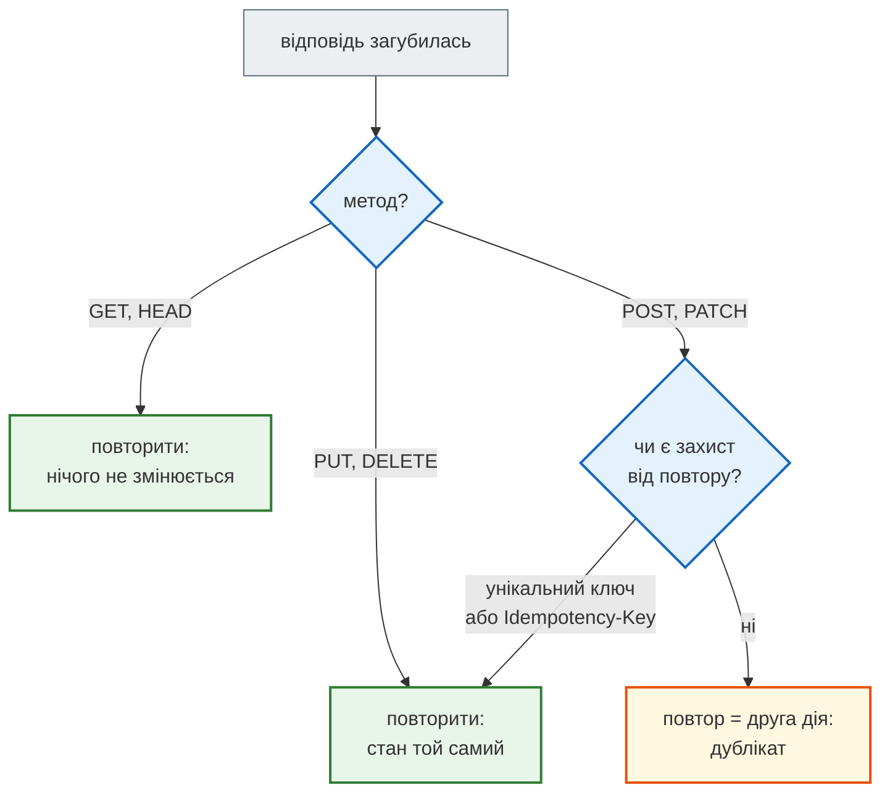

# Методи HTTP: безпечність, ідемпотентність, кеш

## Проблема { #problem }

Мережа ненадійна: відповідь може загубитися, і клієнт не знає, чи сервер встиг виконати запит. Можна його повторити, але чи безпечно це робити? Чи не з'явиться друге замовлення, другий платіж, друга новина? Відповідь залежить від **методу** запиту: стандарт HTTP (RFC 9110) обіцяє для кожного методу певні властивості. Клієнти, проксі й браузери покладаються на ці обіцянки, тож ендпоінт, який їх порушує, ламається не у твоєму коді, а в чужому.

## Ментальна модель { #mental-model }

Три властивості, від найсуворішої:

- **Безпечний** (safe) — клієнт нічого не просить змінити, лише читає. Браузер, пошуковий бот, попереднє завантаження сторінки можуть викликати його будь-коли.
- **Ідемпотентний** (idempotent) — повтор того самого запиту залишає сервер у тому самому **стані**, що й один виклик. Відповідь при цьому може відрізнятися. Кожен безпечний метод ідемпотентний.
- **Кешований** (cacheable) — відповідь можна зберегти й віддати повторно без звернення до сервера.

| Метод | Що означає | Безпечний | Ідемпотентний | Кешований | Тіло запиту |
|---|---|---|---|---|---|
| `GET` | прочитати ресурс | так | так | так | значення не визначене стандартом — не використовувати |
| `HEAD` | як `GET`, але лише заголовки | так | так | так | — |
| `OPTIONS` | що вміє ресурс | так | так | ні | — |
| `POST` | обробити дані: створити, запустити дію | ні | **ні** | лише з явними заголовками свіжості, на практиці ні | так |
| `PUT` | замінити ресурс **повністю** тим, що в тілі | ні | так | ні | так |
| `PATCH` | змінити **частину** ресурсу (RFC 5789) | ні | не гарантовано | ні | так |
| `DELETE` | видалити ресурс | ні | так | ні | значення не визначене — не використовувати |



## Як це виглядає на ділі { #in-practice }

Код — [`examples/http_anatomy/methods_app.py`](https://github.com/NikoriakViktor/news_hub/blob/main/examples/http_anatomy/methods_app.py): CRUD над словником у пам'яті, без бази, щоб видно було лише HTTP. Дві моделі: `ItemIn` — повний стан (для `POST` і `PUT`), `ItemPatch` — усі поля необов'язкові (для `PATCH`).

```python title="methods_app.py (фрагмент)"
@app.put("/items/{item_id}")
def replace_item(item_id: int, body: ItemIn) -> ItemOut:
    get_or_404(item_id)
    ITEMS[item_id] = {"id": item_id, **body.model_dump()}     # увесь стан — з тіла, навіть пропущені поля
    return ItemOut(**ITEMS[item_id])


@app.patch("/items/{item_id}")
def modify_item(item_id: int, body: ItemPatch) -> ItemOut:
    item = get_or_404(item_id)
    item.update(body.model_dump(exclude_unset=True))          # лише ті поля, які клієнт надіслав
    return ItemOut(**item)
```

`methods_demo.py` повторює кожен запит і дивиться на стан:

```text
POST ×2  → 201 201
  стан: [{'id': 1, 'title': 'Книга', 'description': 'FastAPI'}, {'id': 2, 'title': 'Книга', 'description': 'FastAPI'}]
  Location: /items/3
PUT ×2 /items/1 {title} → [{'title': 'Нова', 'description': None, 'id': 1}, {'title': 'Нова', 'description': None, 'id': 1}]
PATCH /items/2 {title} → {'title': 'Друга', 'description': 'FastAPI', 'id': 2}
DELETE ×2 /items/3 → 204 404
  стан: [{'id': 1, 'title': 'Нова', 'description': None}, {'id': 2, 'title': 'Друга', 'description': 'FastAPI'}]
POST з id і is_admin → {'title': 'x', 'description': None, 'id': 3}
strict  з id         → 422 [(['body', 'id'], 'Extra inputs are not permitted')]
HEAD    /items → 405 GET
OPTIONS /items → 405 GET
```

Що тут видно:

- **`POST` двічі — дві однакові книги.** Неідемпотентний метод: повтор після загубленої відповіді створює дублікат. `201` з заголовком `Location` каже, де живе створений ресурс.
- **`PUT` двічі — той самий стан.** Але `description` став `None`: `PUT` замінює ресурс **повністю**, і пропущене поле — теж частина нового стану. Хто хоче змінити одне поле, шле `PATCH`.
- **`PATCH` змінив лише `title`**, `description` лишився: `model_dump(exclude_unset=True)` бере тільки надіслані поля.
- **`DELETE` двічі — `204`, потім `404`.** Ідемпотентність — про стан сервера, а не про відповідь: ресурсу немає після першого і після другого виклику.
- **Зайві поля `id` і `is_admin` мовчки відкинуто.** Pydantic за замовчуванням ігнорує невідомі поля, і клієнт не може підсунути свій `id` чи права (mass assignment). З `ConfigDict(extra="forbid")` той самий запит — `422`: клієнт дізнається про помилку, а не думає, що все записалось.
- **`HEAD` і `OPTIONS` — `405`.** FastAPI не додає `HEAD` до GET-маршрутів автоматично, хоча RFC 9110 вимагає підтримувати `HEAD` скрізь, де є `GET`. Якщо він потрібен (моніторинг, перевірка посилань), його оголошують явно: `@app.api_route("/items", methods=["GET", "HEAD"])`. `OPTIONS` для CORS обробляє `CORSMiddleware`.

## Дизайн ендпоінтів { #design }

Метод — дієслово, шлях — іменник. Дві адреси на ресурс:

| Запит | Що робить | Успіх |
|---|---|---|
| `GET /items?offset=&limit=` | список, фільтри й пагінація — у рядку запиту | `200` |
| `POST /items` | створити; тіло — повний стан без `id` | `201` + `Location` |
| `GET /items/{id}` | один ресурс | `200`, немає — `404` |
| `PUT /items/{id}` | замінити повністю | `200` (або `204`) |
| `PATCH /items/{id}` | змінити передані поля | `200` |
| `DELETE /items/{id}` | видалити | `204`, немає — `404` |

Дія, яка не вкладається в CRUD («зібрати новини», «закріпити нотатку»), — `POST` на окрему адресу: `POST /api/scrape`, `POST /api/notes/{id}/pin`. Не `GET`: дія змінює стан.

## У News Hub { #news-hub }

| Ендпоінт | Метод | Чим захищений від повтору |
|---|---|---|
| `GET /api/news`, `/api/news/{id}` | безпечний | — |
| `POST /api/scrape` | неідемпотентний за стандартом | унікальний `url` у базі: повторний збір не створює дублікатів |
| `POST /api/news` | неідемпотентний | той самий `url` удруге → `409 Conflict` |
| `PATCH /api/news/{id}` | частковий | `model_dump(exclude_unset=True)` |
| `DELETE /api/news/{id}` | ідемпотентний | `204`, далі `404` |

Повторний збір з [кроку 3](../tutorials/03_sqlalchemy_alembic/index.md):

```text
{'source': 'snapshot', 'mode': 'async', 'total_time': 0.0, 'news_found': 168, 'news_valid': 168, 'news_saved': 168, 'news_total': 168}
{'source': 'snapshot', 'mode': 'async', 'total_time': 0.0, 'news_found': 168, 'news_valid': 168, 'news_saved': 0, 'news_total': 168}
count: {'count': 168}
```

Другий `POST` знайшов ті самі 168 новин і не зберіг жодної: `POST` за стандартом неідемпотентний, але ця операція фактично ідемпотентна, бо дублікати відсікає база.

## Типові помилки { #mistakes }

| Помилка | Наслідок | Як правильно |
|---|---|---|
| зміна стану через `GET` (`GET /items/1/delete`) | бот, попереднє завантаження чи `` на чужому сайті видаляє дані | змінювати — лише `POST`/`PUT`/`PATCH`/`DELETE` |
| `PUT` з моделлю, де всі поля необов'язкові | `PUT` поводиться як `PATCH`, клієнт не знає, що стане з пропущеними полями | `PUT` — повна модель; `PATCH` — модель з `None` + `exclude_unset=True` |
| `PATCH` через `model_dump()` без `exclude_unset` | непередані поля затираються значеннями за замовчуванням | `model_dump(exclude_unset=True)` |
| повтор `POST` без захисту | дублікати замовлень, платежів, записів | унікальний ключ у базі (`409`) або заголовок `Idempotency-Key` |
| тіло в `GET` або `DELETE` | проксі й клієнти його відкидають, кеш не враховує | параметри — у шляху й рядку запиту |
| `sqlite:///:memory:` у прикладі з `def`-ендпоінтами | `500 no such table`: кожен потік пулу FastAPI отримує власну порожню базу | `poolclass=StaticPool` для бази в пам'яті або файл SQLite |

Останній рядок — не про HTTP, але це пастка, у яку потрапляють приклади CRUD з документацій і чатів. Перевірено на uvicorn: три `POST` поспіль — `500 500 500`, у журналі `sqlite3.OperationalError: no such table: items`. Для `:memory:` SQLAlchemy тримає окреме з'єднання (а отже, окрему базу) на кожен потік, а FastAPI виконує `def`-ендпоінти в різних потоках пулу.

## Налагодження { #debugging }

- `405` + заголовок `allow` — шлях правильний, метод ні; `allow` перелічує, які методи є.
- Дублікати в базі — шукай `POST` без унікального ключа і клієнта з автоматичним повтором (HTTP-бібліотеки, черги, мобільна мережа).
- Поле «саме» стало `null` після оновлення — `PUT` з неповним тілом або `PATCH` без `exclude_unset`.

## Безпека { #security }

- **`GET` має бути безпечним буквально.** Будь-яка дія через `GET` — готова CSRF-атака: досить посилання чи картинки на чужому сайті, і браузер жертви надішле запит разом з її cookie.
- **Окремі моделі на вхід і вихід.** Вхідна модель без `id`, `role`, `is_admin` — і клієнт не може їх задати; вихідна (`response_model`) — без хешів паролів і службових полів.
- **`extra="forbid"`** для API, де мовчазне ігнорування поля — ризик: клієнт думає, що змінив права, а насправді ні.
- **Ідемпотентність — частина захисту від повторного надсилання**: перехоплений і повторений `POST` без ключа ідемпотентності виконує дію вдруге.

## Питання { #questions }

1. Чим безпечний метод відрізняється від ідемпотентного? Наведи метод, який ідемпотентний, але не безпечний.
2. `DELETE` удруге повертає `404`. Чи порушує це ідемпотентність?
3. Клієнт надіслав `PUT /items/1` з `{"title": "Нова"}`. Що станеться з `description`? А з `PATCH`?
4. Як зробити повторний `POST /api/scrape` безпечним для даних?
5. Що поверне FastAPI на `HEAD` до GET-маршруту і як це змінити?

??? success "Відповіді"

    1. Безпечний — нічого не змінює; ідемпотентний — повтор не змінює стан більше, ніж один виклик. `PUT` і `DELETE` — ідемпотентні, але не безпечні.
    2. Ні: ідемпотентність — про стан сервера (ресурсу немає), а не про однакову відповідь.
    3. З `PUT` — `None`, бо `PUT` замінює весь стан. З `PATCH` і `exclude_unset=True` — лишиться як був.
    4. Унікальний ключ у базі (у News Hub — `url`): повторні новини не вставляються.
    5. `405 Method Not Allowed`; оголосити маршрут явно з `methods=["GET", "HEAD"]` через `@app.api_route`.

## Що далі { #next }

[Коди відповідей](status_codes.md). Як FastAPI перевіряє тіло й параметри — [Маршрути, параметри і валідація](../03_fastapi_core/routes_and_validation.md).

**Джерела:** [RFC 9110 — HTTP Semantics, §9 Methods](https://www.rfc-editor.org/rfc/rfc9110#name-methods); [RFC 5789 — PATCH](https://www.rfc-editor.org/rfc/rfc5789); FastAPI — [Body: Updates](https://fastapi.tiangolo.com/tutorial/body-updates/), [Response Status Code](https://fastapi.tiangolo.com/tutorial/response-status-code/); [Pydantic — Extra data](https://docs.pydantic.dev/latest/concepts/models/#extra-data); [SQLAlchemy — Using a Memory Database in Multiple Threads](https://docs.sqlalchemy.org/en/20/dialects/sqlite.html#using-a-memory-database-in-multiple-threads); [MDN — HTTP request methods](https://developer.mozilla.org/en-US/docs/Web/HTTP/Methods).
