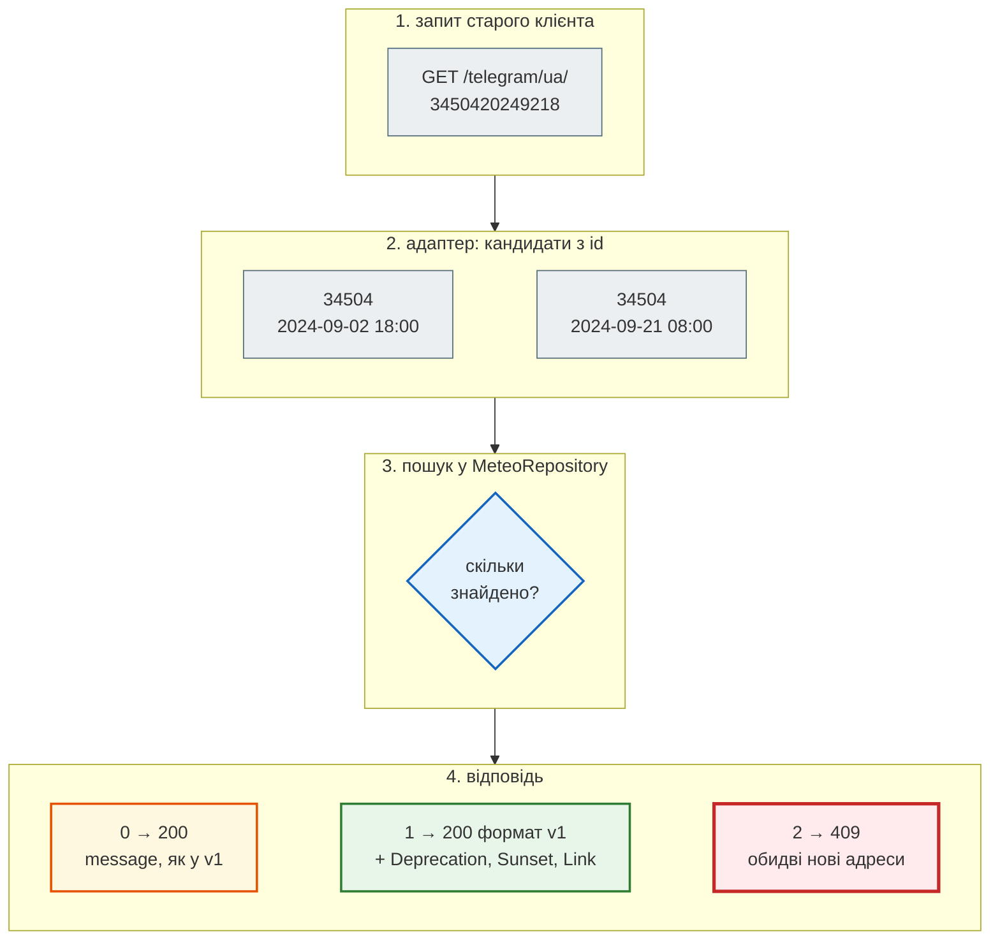

# Кейс: API v1 → v2

## Проблема { #problem }

Перша версія Meteo API працювала: телеграми завантажувались, Streamlit-дашборд їх показував, Swagger відкривався. Але кожен новий клієнт натрапляв на ті самі пастки. «Не знайдено» приходило з кодом `200`, помилка сервера теж була `200`, а читання робилося через `POST`. Id запису ще й був неоднозначним. Виправити це в тій самій версії не можна: дашборд і чужі скрипти вже покладаються саме на таку поведінку.

Тут розберемо справжню першу версію (`legacy/main.py`) поруч з другою (`meteo_api/app.py`): що в v1 було не так, що змінила v2, які вади знайшлися вже в самій v2 і як їх виправили, і як перевести клієнтів зі старого контракту на новий, нікого не зламавши. Самі правила версіонування (сумісні й несумісні зміни, `Deprecation`, `Sunset`, `410 Gone`) — на сторінці [Версіонування API](versioning.md). Тут вони застосовані до живого коду.

## Ментальна модель { #mental-model }

| Було (v1) | Проблема | Стало (v2) |
|---|---|---|
| `POST /filter_telegrams/` з тілом-фільтром | дієслово в адресі; `POST` для читання не кешується і не ідемпотентний; половину полів фільтра ніхто не читає | `GET /api/v1/stations/{wmo}/observations?hour=18&fields=…` |
| `POST /download_telegrams` чекає хвилини | клієнт висить до тайм-ауту | `POST /api/v1/imports` → `202` + `Location` зі статусом |
| `GET /telegram/ua/3450420249218` | склеєний id без нулів: `9`+`2`+`18` і `9`+`21`+`8` дають той самий рядок; назва колекції MongoDB — в адресі | `GET /api/v1/stations/34504/observations/2024-09-02T18:00Z` |
| `{"message": "Дані за цим ID не знайдено"}` з кодом `200` | `raise_for_status()` мовчить, клієнт падає пізніше з `KeyError` | `404` + `{"detail": …}` |
| `{"error": str(e)}` з кодом `200` | помилка сервера виглядає як успіх | `404`, `409`, `422`; непередбачене — `500` |
| `PUT` з довільним `dict` | `PUT` мав би замінити ресурс цілком; поля й типи не перевіряються | `PATCH` з моделлю Pydantic: лише відомі поля, з межами; невідоме поле — `422` |
| `DELETE` → `200 {"message": …}` в обох випадках | успіх і «не знайдено» не відрізнити | `204` / `404` |
| увесь результат одним списком | тисячі записів в одній відповіді | `limit` / `offset` / `total` / `next` |

v2 **не складніша** за v1, вона послідовніша. Кожен рядок таблиці — одне правило з попередніх сторінок цієї частини: [методи](http_methods.md), [коди відповідей](status_codes.md), [ресурси](rest_principles.md#resources), [колекції й пагінація](collections.md), [довга операція](status_codes.md).

!!! note "Чому «v2» живе за адресою `/api/v1`"
    «v2» — друге покоління сервісу. Перше не мало версії в адресі взагалі (`/telegram/...`). Друге — перший **версійований** контракт, тому його префікс `/api/v1`. Старі й нові адреси не перетинаються, і обидва покоління можуть жити в одному застосунку ([нижче](#migration)).

## Як було: v1 на ділі { #v1 }

Код v1 — [`legacy/main.py`](https://github.com/NikoriakViktor/news_hub/blob/main/examples/meteo_api/meteo_api/legacy/main.py). Сам він не запускається: потрібні MongoDB і модулі завантажувача з першого проєкту. Тому для запуску MongoDB підмінено словником у пам'яті з тими самими методами (`find_one`, `find`, `update_one`, `delete_one`), а завантажувач — функцією, що падає, як при недоступному ogimet.com. Маршрути — без жодної зміни.

```python title="legacy/main.py (фрагмент)"
@app.get("/telegram/{collection_name}/{id_teleg}")
def get_data_from_collection(collection_name: str, id_teleg: str):
    collection = db[collection_name]                 # назва колекції MongoDB — прямо з URL
    data = collection.find_one({"id_telegram": id_teleg}, {"_id": False})
    if data is None:
        return {"message": "Дані за цим ID не знайдено"}     # 200
    return JSONResponse(content=clean_data(data))


@app.post("/download_telegrams")
def download_telegrams(country_code: str):
    try:
        download_and_process_telegrams(country_code)          # хвилини, клієнт чекає
        return {"message": f"Successfully downloaded telegrams for '{country_code}'"}
    except Exception as e:
        return {"error": str(e)}                              # 200
```

```text
--- 1. читання і «не знайдено»
GET /telegram/ua/3450420249218               200 {'id_telegram': '3450420249218', 'data': {'station_id': '34504', 'year': 2024, 'month': 9, 'day': 2, 'hour': 18, 'temperature': 25.1, 'pressure': 998.9}}
GET /telegram/ua/0000000000000               200 {'message': 'Дані за цим ID не знайдено'}
   raise_for_status() мовчить, далі: KeyError 'data'
--- 2. помилка сервера з кодом 200
POST /download_telegrams?country_code=ua     200 {'error': 'ogimet.com: connection refused'}
--- 3. DELETE і PUT
PUT {'temperature': 'спекотно', 'colour': 1} 200 {'message': 'Запис успішно оновлено'}
   у базі: {'station_id': '34504', 'year': 2024, 'month': 9, 'day': 2, 'hour': 18, 'temperature': 'спекотно', 'pressure': 998.9, 'colour': 1}
DELETE (є)                                   200 {'message': 'Запис успішно видалено'}
DELETE (уже немає)                           200 {'message': 'Запис з таким ID не знайдено'}
```

- **Код `200` нічого не означає.** Знайдено, не знайдено, сервер упав — усе `200`. Клієнт з `raise_for_status()` вважає, що все добре, і падає рядком нижче на `response.json()["data"]`.
- **`PUT` з `dynamic_updates: dict`** записує в базу що завгодно: рядок замість числа, вигадане поле `colour`. Наступний клієнт, що рахує середню температуру, отримає `TypeError` на чужих даних.
- **Повторний `DELETE`** має відповідати `404`. Тут обидва випадки — `200` з різним текстом, і клієнту лишається порівнювати рядки українською.

Фільтр — ще тонше. Модель `TelegramFilter` оголошує 25 необов'язкових полів, а код маршруту читає лише `country_code`, `station_id`, `date`, `hour` і `fields_to_return`:

```text
--- 4. фільтр: оголошені поля, які ніхто не читає
   {'country_code': 'ua'}                               → 2 шт.
   {'country_code': 'ua', 'date_start': '20240904'}     → 2 шт.
   {'country_code': 'ua', 'temperature': 99}            → 2 шт.
   {'country_code': 'ua', 'date': '2024-9-4'}           → 0 шт.
--- 5. склеєний id
   34504 2024-09-02 18h → 3450420249218
   34504 2024-09-21 08h → 3450420249218
```

- `date_start` і `temperature` є в Swagger, клієнт їх передає, а сервер мовчки ігнорує. Клієнт вважає, що отримав відфільтровані дані.
- Дата не того формату (`2024-9-4`) — не `422`, а порожній список: `date[4:6]` дає `-9`, і запит шукає місяць `-9`.
- Id `f"{station}{year}{month}{day}{hour}"` без доповнення нулями неоднозначний: 2 вересня 18:00 і 21 вересня 08:00 дають той самий рядок.

Що з цього бачить документація:

```text
--- 6. OpenAPI: які відповіді задокументовано
   POST   /download_telegrams                      ['200', '422'] schema={}
   GET    /telegram/{collection_name}/{id_teleg}   ['200', '422'] schema={}
   DELETE /telegram/{collection_name}/{id_teleg}   ['200', '422'] schema={}
   PUT    /telegram/{collection_name}/{id_teleg}   ['200', '422'] schema={}
   POST   /filter_telegrams/                       ['200', '422'] schema={}
```

Жодної схеми відповіді (`{}` — «будь-що»), жодного `404`. Генератор клієнтів з такого OpenAPI зробить функції, що повертають `Any`.

## Що змінила v2 { #v2 }

Ті самі ситуації у v2 ([`meteo_api/app.py`](https://github.com/NikoriakViktor/news_hub/blob/main/examples/meteo_api/meteo_api/app.py)):

```python title="meteo_api/app.py (фрагмент)"
class ObservationPatch(BaseModel):
    """Тіло PATCH: лише поля, які змінюємо (виправлення помилки оператора)."""
    model_config = ConfigDict(extra="forbid")

    temperature: Optional[float] = Field(None, ge=-80, le=60)
    pressure: Optional[float] = Field(None, ge=850, le=1100)
    wind_speed: Optional[float] = Field(None, ge=0, le=75)

    @field_validator("temperature")
    @classmethod
    def temperature_not_null(cls, value: Optional[float]) -> float:
        """Поле не передали — його не змінюють; передали null — помилка, а не стерта температура."""
        if value is None:
            raise ValueError("температура не може бути null; не хочеш міняти — не передавай її")
        return value


@app.exception_handler(NotFoundError)          # виняток сховища → 404 в одному місці
def not_found(request, error):
    return JSONResponse(status_code=404, content={"detail": str(error)})


@app.patch("/api/v1/stations/{wmo}/observations/{moment}", response_model=Observation, responses=NOT_FOUND)
def patch_observation(wmo: str, moment: datetime, body: ObservationPatch):
    changes = body.model_dump(exclude_unset=True)
    return to_json(repo.update_observation(wmo, utc(moment), changes))


@app.post("/api/v1/imports", status_code=202, response_model=ImportJob, response_model_exclude_none=True,
          responses={422: {"description": "тіло не JSON за схемою або CSV зламаний (номер рядка в detail)"}})
def create_import(body: ImportIn, response: Response, background: BackgroundTasks):
    try:                                         # формат перевіряємо до 202: клієнт дізнається одразу
        records = parse_ogimet_csv(body.csv.splitlines())
    except ValueError as error:
        raise HTTPException(422, [{"type": "value_error", "loc": ["body", "csv"], "msg": str(error)}]) from None
    job_id = uuid.uuid4().hex[:8]
    imports[job_id] = {"id": job_id, "status": "queued"}
    background.add_task(run_import, job_id, records)
    response.headers["Location"] = f"/api/v1/imports/{job_id}"
    return imports[job_id]
```

`utc(moment)` — маленька допоміжна функція в `create_app`: `parse_time(moment.isoformat())`, тобто будь-який часовий пояс → UTC. Що змінилося в цьому коді порівняно з першим варіантом v2 (`moment: str`, без валідатора, без `extra="forbid"`, CSV розбирається у фоні), розібрано [нижче](#v2-gaps).

```text
--- 1. читання і «не знайдено»
GET .../observations/2024-09-02T18:00Z         200 {'station': '34504', 'time': '2024-09-02T18:00Z', 'temperature': 25.1, 'dew_point': 12.9, 'relative_humidity': 47, 'wind_dir': 110, 'wind_speed': 6, 'pressure': 998.9, 'sea_level_pressure': 1015.1, 'max_temperature': 33.0, 'min_temperature': None, 'telegram': 'AAXX 02181 34504 32975 51106 10251 20129 39989 40151 52027 80001 333 10330='}
GET .../observations/2024-09-02T21:00+03:00    200 {'station': '34504', 'time': '2024-09-02T18:00Z', 'temperature': 25.1, 'dew_point': 12.9, 'relative_humidity': 47, 'wind_dir': 110, 'wind_speed': 6, 'pressure': 998.9, 'sea_level_pressure': 1015.1, 'max_temperature': 33.0, 'min_temperature': None, 'telegram': 'AAXX 02181 34504 32975 51106 10251 20129 39989 40151 52027 80001 333 10330='}
GET .../observations/2024-09-02T21:00Z         404 {'detail': 'спостереження 34504 на 2024-09-02T21:00Z немає'}
GET /api/v1/stations/99999                     404 {'detail': 'станцію 99999 не знайдено'}
--- 2. довга операція
POST /api/v1/imports                           202 {'id': 'abbedae3', 'status': 'queued'} Location=/api/v1/imports/abbedae3
GET Location                                   200 {'id': 'abbedae3', 'status': 'done', 'added': 1, 'skipped': 0}
--- 3. PATCH і DELETE
PATCH {'temperature': 'спекотно'}              422 {'detail': [{'type': 'float_parsing', 'loc': ['body', 'temperature'], 'msg': 'Input should be a valid number, unable to parse string as a number', 'input': 'спекотно'}]}
PATCH {'temperature': 25.3, 'colour': 1}       422 {'detail': [{'type': 'extra_forbidden', 'loc': ['body', 'colour'], 'msg': 'Extra inputs are not permitted', 'input': 1}]}
PATCH {'temperature': 25.3}                    200 {'station': '34504', 'time': '2024-09-02T18:00Z', 'temperature': 25.3, 'dew_point': 12.9, 'relative_humidity': 47, 'wind_dir': 110, 'wind_speed': 6, 'pressure': 998.9, 'sea_level_pressure': 1015.1, 'max_temperature': 33.0, 'min_temperature': None, 'telegram': 'AAXX 02181 34504 32975 51106 10251 20129 39989 40151 52027 80001 333 10330='}
DELETE (є)                                     204 
DELETE (уже немає)                             404 {'detail': 'спостереження 34504 на 2024-09-02T18:00Z немає'}
```

- **Адреса — ресурс, а не дія.** Спостереження вкладене в станцію, момент — ISO 8601. Id однозначний, і його можна прочитати очима. Зсув можна передати будь-який: `2024-09-02T21:00+03:00` — той самий момент, що й `18:00Z`, і відповідь завжди в UTC.
- **Помилки сховища — винятки, а не словники.** `MeteoRepository` кидає `NotFoundError` / `ConflictError`, два обробники перетворюють їх на `404` / `409`. Маршрути про коди помилок не думають.
- **`PATCH` пропускає лише описані поля.** Рядок замість числа — `422`. Невідоме `colour` — теж `422` з `loc: ["body", "colour"]`: `extra="forbid"` не дає йому ні потрапити в сховище, ні зникнути мовчки ([`ConfigDict`: `extra`](../02_typing_and_pydantic/config_dict.md#extra)).
- **Довга операція повертає `202` одразу**, а стан живе за адресою з `Location`. У тестовому клієнті фонова задача виконується до відповіді, тому вже перший `GET` бачить `done`. У живому сервері спершу буде `queued` / `running`.

Фільтри стали параметрами `GET` і перевіряються:

```text
--- 4. фільтр і поля — параметри GET
   {}                                                           200 {'items': 3, 'total': 3, 'next': None}
   {'hour': 3}                                                  200 {'items': 1, 'total': 1, 'next': None}
   {'date_from': '2024-09-03T03:00Z', 'fields': 'time,temperature'} 200 {'items': [{'time': '2024-09-03T03:00Z', 'temperature': 18.0}, {'time': '2024-09-03T06:00Z', 'temperature': 21.0}], 'total': 2, 'next': None}
   {'hour': 25}                                                 422 [('less_than_equal', ['query', 'hour'])]
   {'date_from': '2024-9-4'}                                    422 [('datetime_from_date_parsing', ['query', 'date_from'])]
   {'fields': 'colour'}                                         422 {'detail': [{'type': 'value_error', 'loc': ['query', 'fields'], 'msg': 'невідомі поля: colour; є: station, time, temperature, dew_point, relative_humidity, wind_dir, wind_speed, pressure, sea_level_pressure, max_temperature, min_temperature, telegram', 'input': 'colour'}]}
   {'limit': 2}                                                 200 {'items': 2, 'total': 3, 'next': 'http://testserver/api/v1/stations/34504/observations?offset=2&limit=2'}
```

Дата не того формату тепер — `422` з точним `loc`, а не порожній список. Невідоме поле у `fields` — теж `422` і в тому самому форматі, що й `hour=25`: список `detail` з `loc: ["query", "fields"]`, а в `msg` — які поля є. Кожен параметр, який є в документації, щось робить.

## Перша v2 і що в ній виправили { #v2-gaps }

**Задача.** Перша версія v2 вже була краща за v1, але не бездоганна. Рецензія на живому сервері (`uvicorn` у фоновому потоці, запити через `requests`) знайшла шість вад. Так вона відповідала **до** виправлень:

```text
GET .../observations/вчора 500 Internal Server Error
PATCH temperature=null 200 None
POST naive time + dew_point 201 2024-09-03T00:00Z None
import broken csv 202 → {'id': '72140b2c', 'status': 'running'}
schema 200 GET observations: {}
```

**Зміна.** Кожна вада — окреме невелике виправлення в `app.py` / `storage.py` і тест у `tests/test_api.py`, що його закріплює:

| Було | Чому | Що змінили | Тест |
|---|---|---|---|
| `GET …/observations/вчора` → `500` | `moment: str` розбирав `parse_time()` усередині маршруту, `ValueError` ніхто не ловив | `moment: datetime` у сигнатурі `GET` / `PATCH` / `DELETE` — FastAPI сам дає `422` з `loc: ["path", "moment"]`; `utc(moment)` зводить будь-який зсув до UTC | `test_bad_time_in_path_is_422`, `test_time_in_path_any_offset` |
| `PATCH {"temperature": null}` → `200`, температура стерта | <code>Optional[float] = None</code> пускає явний `null`, а `exclude_unset=True` його лишає | `field_validator("temperature")`: `null` — `ValueError`, як у `NewsPatch` News Hub ([`ConfigDict`](../02_typing_and_pydantic/config_dict.md#news-hub)); `pressure` і `wind_speed` `null` стерти можна, бо й у `POST` їх може не бути | `test_patch_null_temperature_rejected` |
| `dew_point` у тілі `POST` мовчки відкинуто | `ObservationIn` не має цього поля, а `extra` — `"ignore"` | `ConfigDict(extra="forbid")` в `ObservationIn`, `ObservationPatch`, `ImportIn` → `422` з назвою поля | `test_unknown_body_fields_rejected` |
| імпорт зіпсованого CSV вічно `running` | CSV розбирався у фоновій задачі; `ValueError` валив її до `status="done"`, а виняток бачив лише журнал uvicorn | `parse_ogimet_csv` розбирає CSV **до** `202` і кидає `ValueError` з номером рядка → `422`; несподіваний виняток у `run_import` ловить `try` / `except` → `status: "failed"` і `error` | `test_broken_import_csv_is_422_with_line`, `test_import_failure_is_reported` |
| OpenAPI: схема відповіді `{}`, немає `404` / `409` | маршрути без `response_model` і без `responses=` | моделі відповідей `Station`, `Observation`, `LatestObservation`, `StationPage`, `ObservationPage`, `LatestList`, `ImportJob`, `ErrorOut` і `responses=NOT_FOUND` / `CONFLICT` ([OpenAPI](../03_fastapi_core/openapi.md)) | `test_openapi_has_schemas` |
| `fields=colour` → `400`, а `hour=25` → `422` | помилки параметрів перевіряв код, а не модель, і в іншому форматі | `parse_fields` кидає `HTTPException(422, [...])` у форматі FastAPI: `loc: ["query", "fields"]` ([400 чи 422](status_codes.md#400-vs-422)) | `test_fields_and_bad_fields` |

**Результат.** Ті самі запити після виправлень (`TestClient` на фікстурі, після `PATCH {'temperature': 25.3}` з блоку вище — тому `25.3`; для «несподіваної помилки» `repo.import_records` підмінено функцією, що кидає `RuntimeError("диск повний")`, як у `test_import_failure_is_reported`):

```text
GET .../observations/вчора                     422 {'detail': [{'type': 'datetime_from_date_parsing', 'loc': ['path', 'moment'], 'msg': 'Input should be a valid datetime or date, invalid character in year', 'input': 'вчора', 'ctx': {'error': 'invalid character in year'}}]}
DELETE .../observations/not-a-time             422 {'detail': [{'type': 'datetime_from_date_parsing', 'loc': ['path', 'moment'], 'msg': 'Input should be a valid datetime or date, invalid character in year', 'input': 'not-a-time', 'ctx': {'error': 'invalid character in year'}}]}
PATCH {'temperature': None}                    422 {'detail': [{'type': 'value_error', 'loc': ['body', 'temperature'], 'msg': 'Value error, температура не може бути null; не хочеш міняти — не передавай її', 'input': None, 'ctx': {'error': {}}}]}
PATCH {'wind_speed': None}                     200 {'station': '34504', 'time': '2024-09-02T18:00Z', 'temperature': 25.3, 'dew_point': 12.9, 'relative_humidity': 47, 'wind_dir': 110, 'wind_speed': None, 'pressure': 998.9, 'sea_level_pressure': 1015.1, 'max_temperature': 33.0, 'min_temperature': None, 'telegram': 'AAXX 02181 34504 32975 51106 10251 20129 39989 40151 52027 80001 333 10330='}
POST naive time + dew_point                    422 {'detail': [{'type': 'extra_forbidden', 'loc': ['body', 'dew_point'], 'msg': 'Extra inputs are not permitted', 'input': 12}]}
POST naive time                                201 {'station': '34504', 'time': '2024-09-03T00:00Z', 'temperature': 21.4, 'dew_point': None, 'relative_humidity': None, 'wind_dir': None, 'wind_speed': None, 'pressure': None, 'sea_level_pressure': None, 'max_temperature': None, 'min_temperature': None, 'telegram': None}
POST /api/v1/imports  csv='34504,2024,09'      422 {'detail': [{'type': 'value_error', 'loc': ['body', 'csv'], 'msg': 'рядок 1: очікується «станція,рік,місяць,день,година,хвилина,телеграма» (not enough values to unpack (expected 7, got 3))'}]}
POST /api/v1/imports  (сховище падає)          202 {'id': '19bccf32', 'status': 'queued'}
GET Location                                   200 {'id': '19bccf32', 'status': 'failed', 'error': 'RuntimeError: диск повний'}
--- OpenAPI: які відповіді задокументовано
   GET    /api/v1/stations                                 ['200', '422'] schema={'$ref': '#/components/schemas/StationPage'}
   GET    /api/v1/stations/{wmo}                           ['200', '404', '422'] schema={'$ref': '#/components/schemas/Station'}
   GET    /api/v1/stations/{wmo}/observations              ['200', '404', '422'] schema={'$ref': '#/components/schemas/ObservationPage'}
   POST   /api/v1/stations/{wmo}/observations              ['201', '404', '409', '422'] schema={'$ref': '#/components/schemas/Observation'}
   GET    /api/v1/stations/{wmo}/observations/{moment}     ['200', '404', '422'] schema={'$ref': '#/components/schemas/Observation'}
   PATCH  /api/v1/stations/{wmo}/observations/{moment}     ['200', '404', '422'] schema={'$ref': '#/components/schemas/Observation'}
   DELETE /api/v1/stations/{wmo}/observations/{moment}     ['204', '404', '422'] schema={}
   GET    /api/v1/observations/latest                      ['200', '422'] schema={'$ref': '#/components/schemas/LatestList'}
   POST   /api/v1/imports                                  ['202', '422'] schema={'$ref': '#/components/schemas/ImportJob'}
   GET    /api/v1/imports/{job_id}                         ['200', '404', '422'] schema={'$ref': '#/components/schemas/ImportJob'}
```

- **Неправильний час у шляху — помилка клієнта, а не сервера.** `вчора` і `not-a-time` тепер `422` з `loc: ["path", "moment"]`, як `date_from=2024-9-4` у запиті. Тип параметра в сигнатурі — це і перевірка, і документація.
- **`null` і «не передав» — різні речі.** Без `temperature` у тілі `PATCH` температуру не чіпають; `"temperature": null` — `422`, бо спостереження без температури `POST` теж не прийняв би. `wind_speed: null` — `200`: це поле й так необов'язкове.
- **Час без зсуву (`2024-09-03T00:00`) і досі приймається як UTC** — це свідоме рішення `parse_time`, а не вада. Змінилося інше: `dew_point`, якого `ObservationIn` не знає, тепер дає `422`, а не зникає мовчки.
- **Імпорт каже про помилку там, де клієнт її побачить.** Зламаний формат — `422` одразу, з номером рядка. Збій, якого заздалегідь не перевірити, — `status: "failed"` і `error` за адресою з `Location`, а не вічне `running`.
- **Схеми в OpenAPI.** Генератор клієнтів тепер бачить типи відповідей і `404` / `409`. Лише `DELETE` лишився з `schema={}`: у `204` тіла немає.

**Правило.** Помилку клієнта має ловити модель чи тип у сигнатурі, а не код маршруту; повідомляти — у тому самому форматі, що й решта помилок; а фонова задача мусить записати свою помилку туди, куди дивиться клієнт.

Чи сумісні ці зміни? Для клієнтів, які вже працюють правильно, — так, і нова версія для них не потрібна ([яка зміна сумісна](versioning.md#mental-model)). Код змінився лише для запитів, які й раніше були помилкою: `500` → `422`, «мовчки прийнято» → `422`, `400` → `422`. Ризик лишається для клієнта, що перевіряє саме `status_code == 400` для `fields=`: він тепер має чекати `422` (або будь-який `4xx`).

## Міграція клієнтів без поломок { #migration }

Перейменувати адреси й змінити формат — несумісна зміна. Старий дашборд, чужий скрипт з `requests.get(f"{BASE}/telegram/ua/{id}")` і закладки в браузері перестануть працювати того ж дня. Тому нове покоління вмикають **поруч**, а старі адреси на перехідний період залишають **адаптером**: тонкий маршрут зі старою адресою і старим форматом, який читає те саме нове сховище.

Ескіз такого адаптера (у прикладі його немає; це код для запуску поруч з `create_app`):

```python title="адаптер v1 поверх v2 (ескіз)"
V1_NAMES = {"dew_point": "dew_point_temperature", "max_temperature": "maximum_temperature",
            "min_temperature": "minimum_temperature"}


def candidates(id_teleg):
    """'3450420249218' → усі (станція, час), які могли дати цей id: місяць, день і година — без нулів."""
    wmo, year, rest = id_teleg[:5], id_teleg[5:9], id_teleg[9:]
    for i in (1, 2):
        for j in (i + 1, i + 2):
            try:
                yield wmo, datetime(int(year), int(rest[:i]), int(rest[i:j]), int(rest[j:]), tzinfo=timezone.utc)
            except ValueError:
                continue


legacy = APIRouter(tags=["v1 (застаріло)"], deprecated=True)


@legacy.get("/telegram/{collection_name}/{id_teleg}")
def get_telegram(collection_name: str, id_teleg: str, response: Response):
    response.headers["Deprecation"] = "@1793491200"                 # з 2026-11-01
    response.headers["Sunset"] = "Thu, 01 Jul 2027 00:00:00 GMT"
    found = []
    for wmo, moment in candidates(id_teleg) if collection_name == "ua" else ():
        try:
            found.append(repo.get_observation(wmo, moment))
        except NotFoundError:
            pass
    if not found:
        return {"message": "Дані за цим ID не знайдено"}          # старий контракт: 200 і message
    if len(found) > 1:
        urls = [f"/api/v1/stations/{o['station']}/observations/{to_json(o)['time']}" for o in found]
        raise HTTPException(409, {"message": "id неоднозначний", "candidates": urls})
    new_url = f"/api/v1/stations/{found[0]['station']}/observations/{to_json(found[0])['time']}"
    response.headers["Link"] = f'<{new_url}>; rel="successor-version"'
    return to_v1(id_teleg, found[0])          # {"id_telegram": …, "data": {старі назви полів}}


app = create_app(repo)
app.include_router(legacy)
```

```text
--- 1. старий клієнт не помічає переїзду
   200 {'id_telegram': '3450420249218', 'data': {'station_id': '34504', 'year': 2024, 'month': 9, 'day': 2, 'hour': 18, 'temperature': 25.1, 'dew_point_temperature': 12.9, 'relative_humidity': 47, 'wind_dir': 110, 'wind_speed': 6, 'pressure': 998.9, 'sea_level_pressure': 1015.1, 'maximum_temperature': 33.0, 'minimum_temperature': None}}
   {'deprecation': '@1793491200', 'sunset': 'Thu, 01 Jul 2027 00:00:00 GMT', 'link': '</api/v1/stations/34504/observations/2024-09-02T18:00Z>; rel="successor-version"'}
   200 {'message': 'Дані за цим ID не знайдено'}
--- 2. новий клієнт іде за Link
   GET /api/v1/stations/34504/observations/2024-09-02T18:00Z
   200 {'station': '34504', 'time': '2024-09-02T18:00Z', 'temperature': 25.1, 'dew_point': 12.9}
--- 3. неоднозначний id
   409 {'detail': {'message': 'id неоднозначний', 'candidates': ['/api/v1/stations/34504/observations/2024-09-02T18:00Z', '/api/v1/stations/34504/observations/2024-09-21T08:00Z']}}
--- 4. OpenAPI
   deprecated: True | tags: ['v1 (застаріло)']
```

Що тут важливо:

- **Адаптер зберігає старий контракт разом з його вадами.** «Не знайдено» лишилось `200 {"message": …}`, бо старі клієнти перевіряють саме `"message" in body`. Виправляти контракт треба в новій версії, а не в старій: інакше старі клієнти зламаються так само, як без адаптера.
- **Логіка одна.** Адаптер не має власних даних, лише перекладає адресу й назви полів (`dew_point` → `dew_point_temperature`). Новий запис, доданий через v2, одразу видно й через v1.
- **Старий клієнт отримує підказку, куди йти.** `Deprecation` і `Sunset` кажуть, що адреса застаріла і коли її вимкнуть, `Link` з `rel="successor-version"` — де той самий ресурс у новому контракті. `requests` розбирає цей заголовок сам: `response.links["successor-version"]["url"]`.
- **Де старий контракт не може відповісти чесно, адаптер каже про це прямо.** Після додавання спостереження за 21.09 08:00 id `3450420249218` вказує на два записи. Адаптер не вгадує, а повертає `409` з обома новими адресами.

Порядок переходу — той самий [життєвий цикл версії](versioning.md#lifecycle), прикладений до Meteo API:



1. **v2 поруч з v1.** Адаптер старих адрес і нові маршрути — в одному застосунку, над одним сховищем.
2. **Клієнти, які контролюєш, переходять першими.** Дашборд переписано на `MeteoClient` ([Архітектура](meteo_architecture.md#client)): адреси й формат v2 живуть лише в цьому класі.
3. **Решту клієнтів знаходять за журналом.** Кожен запит на `/telegram/...` чи `/filter_telegrams/` — клієнт, якому треба написати. Для цього адаптер має писати в журнал `User-Agent` чи ключ клієнта.
4. **Після `Sunset`** старі адреси відповідають `410 Gone` з тим самим `Link`, а не зникають з `404`.

Для `POST /filter_telegrams/` адаптер робиться так само: тіло `TelegramFilter` → `repo.list_observations(wmo, …, hour)` → старий формат `{"results": [...]}`. Поля, які v1 ігнорувала, адаптер теж має ігнорувати. Інакше старий клієнт, що роками передавав `temperature: 99`, раптом отримає порожній результат.

## У meteo_api { #meteo-api }

| Файл | Що в ньому |
|---|---|
| [`legacy/main.py`](https://github.com/NikoriakViktor/news_hub/blob/main/examples/meteo_api/meteo_api/legacy/main.py) | v1: FastAPI + MongoDB, дієслова в адресах, `200` на все |
| [`legacy/streamlit_app.py`](https://github.com/NikoriakViktor/news_hub/blob/main/examples/meteo_api/meteo_api/legacy/streamlit_app.py) | дашборд v1: URL і `requests` прямо в коді сторінок |
| [`meteo_api/app.py`](https://github.com/NikoriakViktor/news_hub/blob/main/examples/meteo_api/meteo_api/app.py) | v2: ресурси, методи, коди, пагінація, `202` для імпорту |
| [`meteo_api/storage.py`](https://github.com/NikoriakViktor/news_hub/blob/main/examples/meteo_api/meteo_api/storage.py) | сховище v2 і винятки `NotFoundError` / `ConflictError` |
| [`weather_map/client.py`](https://github.com/NikoriakViktor/news_hub/blob/main/examples/meteo_api/weather_map/client.py) | клієнт v2: єдине місце, що знає адреси нового контракту |
| [`tests/test_api.py`](https://github.com/NikoriakViktor/news_hub/blob/main/examples/meteo_api/tests/test_api.py) | контракт v2: `404`, `409`, `422`, `201` + `Location`, `204`, `202`, пагінація; виправлення з [розділу вище](#v2-gaps): час у шляху, `PATCH null`, зайві поля, зламаний CSV, `failed`, схеми OpenAPI |

Адаптера v1 у прикладі немає: старих клієнтів, яких треба було б підтримувати, у нього не лишилось. News Hub версій не має взагалі, чому — на сторінці [Версіонування](versioning.md#news-hub).

## Типові помилки { #mistakes }

| Помилка | Наслідок | Як правильно |
|---|---|---|
| помилка як `200 {"error": …}` | клієнт приймає збій за успіх, падає далі з `KeyError` | `4xx` / `5xx` і `{"detail": …}` |
| `except Exception` навколо всього маршруту | баг у коді стає «успішною» відповіддю, у журналі порожньо | ловити лише очікувані винятки; решта — `500` і трасування в журналі |
| `POST` для читання з фільтром у тілі | не кешується, не ідемпотентний, не можна дати посилання | `GET` з параметрами запиту |
| поле в моделі фільтра, яке код не читає | документація обіцяє фільтр, якого немає | кожне оголошене поле — використане, або його немає |
| склеєний id без роздільників і нулів | два записи з однаковим id | природний ключ у шляху: `/stations/{wmo}/observations/{ISO-час}` |
| назва колекції чи таблиці з URL | клієнт обирає, з якої колекції читати й видаляти | ресурси в шляху — бізнес-поняття, а не назви в базі |
| «виправити» старий контракт в адаптері | старі клієнти ламаються так само, як без адаптера | адаптер повторює стару поведінку; виправлення — у новій версії |
| вимкнути v1 без попередження | `404` у клієнтів без пояснень | `Deprecation` → `Sunset` → `410 Gone` + `Link` |

## Налагодження { #debugging }

- **Чи клієнт ще на старому контракті?** Шукай у журналі доступу адреси без `/api/v1`: `grep -E '"(GET|POST|PUT|DELETE) /(telegram|filter_telegrams|download_telegrams)' access.log`.
- **Клієнт отримує `200`, а даних немає** — перевір, чи в тілі не `message` / `error`. Для v1 це і є «не знайдено» чи «збій».
- **Порівняй контракти автоматично.** Збережи `openapi.json` обох версій і порівняй `paths` і `components.schemas` (`jq '.paths | keys'`). Зникла адреса чи поле — несумісна зміна.
- **`Link` не видно в браузері?** Заголовки — у DevTools → Network → Headers. У коді — `response.links`.
- **Фоновий імпорт `failed`** — причина в полі `error` стану імпорту (`GET` за адресою з `Location`), трасування — у журналі uvicorn. До виправлення імпорт у такому разі вічно лишався `running`, а виняток фонової задачі був лише в журналі (`Exception in ASGI application`): якщо статус фонової задачі «завис», шукай саме там.

## Безпека { #security }

- **Назва колекції з URL.** У v1 `db[collection_name]` бере будь-яку назву: клієнт може читати й видаляти записи в будь-якій колекції бази `telegram`, а не лише в `ua`. В адресі мають бути лише ресурси, які API свідомо відкриває (OWASP API1 — Broken Object Level Authorization).
- **`PUT` з довільним `dict`** — масове присвоєння: кожен ключ тіла стає `data.<ключ>` у `$set`, тож клієнт перепише `station_id`, `year` чи будь-яке службове поле. Модель тіла з `extra="forbid"` — межа того, що клієнт може змінити ([масове присвоєння](../02_typing_and_pydantic/config_dict.md#mass-assignment)).
- **`{"error": str(e)}`** віддає клієнту текст винятку: адреси внутрішніх сервісів, шляхи до файлів, фрагменти запитів до бази. Клієнту — короткий `detail`, подробиці — в журнал.
- **`POST /download_telegrams` без автентифікації** — будь-хто запускає хвилинне завантаження з ogimet. Кілька паралельних запитів займуть усі потоки сервера. У v2 імпорт теж відкритий, хоча й повертає `202` одразу. Операції запису мають бути закриті ([автентифікація](../08_security/authentication.md)).
- **`allow_origins=["*"]` разом з `allow_credentials=True`** у v1: Starlette тоді повертає в `Access-Control-Allow-Origin` саме той `Origin`, з якого прийшов запит (перевірено: `https://evil.example` → `https://evil.example`), разом з `Access-Control-Allow-Credentials: true`. Будь-який сайт може робити запити з cookie користувача й читати відповіді. Список дозволених доменів — явний.
- **Стара версія — та сама поверхня атаки.** Адаптер v1 має мати ті самі перевірки доступу, що й v2 ([Версіонування — безпека](versioning.md#security)).

## Питання { #questions }

1. Чому `{"message": "не знайдено"}` з кодом `200` гірше, ніж `404`, навіть якщо текст однаковий?
2. Що не так з id `3450420249218` і як v2 вирішила це в адресі?
3. Чому `POST /filter_telegrams/` погано підходить для читання?
4. Що ставалося з полем `colour` у тілі `PATCH` першої v2 і що з ним тепер? Що для цього змінили?
5. Чому `GET …/observations/вчора` у першій v2 давав `500`, а `?date_from=2024-9-4` — `422`? Що зробили, щоб обидва давали `422`?
6. Чому адаптер v1 повертає «не знайдено» з кодом `200`, хоча це погана практика?
7. Що мають отримати старі клієнти після дати `Sunset`?

??? success "Відповіді"

    1. `raise_for_status()` і будь-який HTTP-клієнт вважають `200` успіхом; кеші й монітори теж. Клієнт падає пізніше, з `KeyError`, далеко від справжньої причини.
    2. Місяць, день і година склеєні без нулів, тому `9`+`2`+`18` і `9`+`21`+`8` дають той самий рядок. У v2 момент — ISO 8601 у шляху: `/stations/34504/observations/2024-09-02T18:00Z`.
    3. `POST` не безпечний і не ідемпотентний: його не кешують, не повторюють автоматично, на результат не можна дати посилання. Читання — `GET` з параметрами запиту.
    4. Було: Pydantic ігнорував його (`extra="ignore"` за замовчуванням), відповідь — `200`, і клієнт не знав, що поле пропало. Стало: `ConfigDict(extra="forbid")` в `ObservationPatch` дає `422` з `loc: ["body", "colour"]` і `type: "extra_forbidden"`.
    5. `moment` був оголошений як `str`, його розбирав код маршруту, і `ValueError` ніхто не ловив. `date_from` оголошено як `datetime`, і його перевіряє FastAPI. Виправлення — `moment: datetime` у сигнатурі: тепер `вчора` — `422` з `loc: ["path", "moment"]`.
    6. Адаптер зберігає старий контракт: старі клієнти перевіряють `"message" in body`, а не код. Виправлений контракт — це v2.
    7. `410 Gone` з `Link` на нову адресу, а не `404`.

## Що далі { #next }

[Архітектура: API, клієнт і карта](meteo_architecture.md) — з яких шарів складається Meteo API v2, як карта погоди отримує дані через `MeteoClient` і що перевіряють тести.

**Джерела:** [RFC 9110 — HTTP Semantics](https://www.rfc-editor.org/rfc/rfc9110) (§9.2 безпечні й ідемпотентні методи, §15.3.3 `202 Accepted`, §15.5.11 `410 Gone`); [RFC 9745 — The Deprecation HTTP Response Header Field](https://www.rfc-editor.org/rfc/rfc9745); [RFC 8594 — The Sunset HTTP Header Field](https://www.rfc-editor.org/rfc/rfc8594); [RFC 8288 — Web Linking](https://www.rfc-editor.org/rfc/rfc8288); [RFC 5829 — Link Relation Types for Simple Version Navigation](https://www.rfc-editor.org/rfc/rfc5829) (`successor-version`); FastAPI — [Path Operation Configuration — deprecated](https://fastapi.tiangolo.com/tutorial/path-operation-configuration/#deprecate-a-path-operation), [Background Tasks](https://fastapi.tiangolo.com/tutorial/background-tasks/), [CORS](https://fastapi.tiangolo.com/tutorial/cors/); requests — [Link Headers](https://requests.readthedocs.io/en/latest/user/advanced/#link-headers); [OWASP API Security Top 10 — API1:2023 Broken Object Level Authorization](https://owasp.org/API-Security/editions/2023/en/0xa1-broken-object-level-authorization/).
