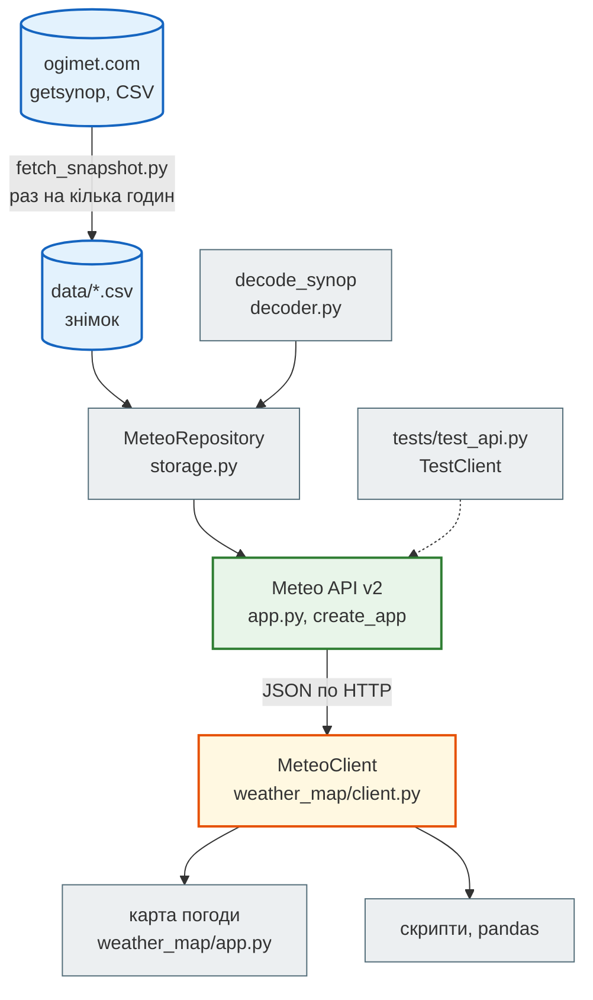
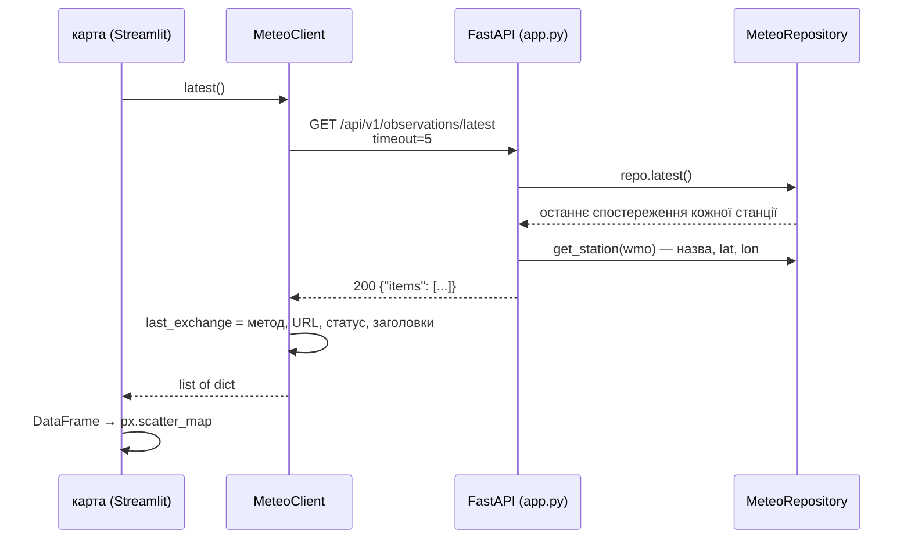
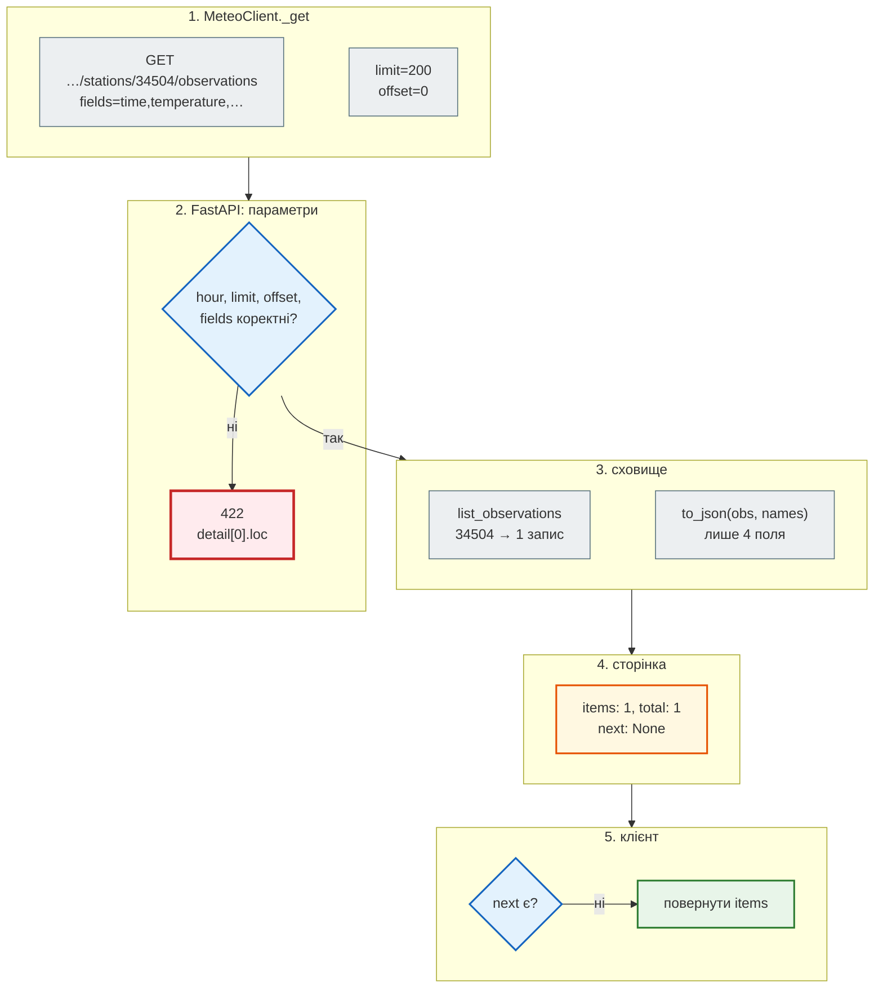

# Архітектура: API, клієнт і карта

## Проблема { #problem }

У першій версії Meteo API дашборд сам будував URL, сам викликав `requests` і сам розбирав відповіді. Сервер сам ходив в ogimet.com і сам писав у MongoDB. Будь-яка зміна зачіпала все одразу: перейменувати адресу означало правити сторінки Streamlit, змінити базу — маршрути, а коли ogimet лежав, лежав і дашборд.

Друга версія розділена на частини з одним завданням у кожної: звідки беруться дані, як вони зберігаються, який у них HTTP-контракт, хто і як цей контракт викликає, що показує карта. Тут розберемо ці частини, шлях одного запиту від карти до сховища, з'єднання через Docker Compose і те, що перевіряють тести. Чому контракт саме такий, пояснено в [кейсі v1 → v2](legacy_case.md).

## Ментальна модель { #mental-model }



| Частина | Файл | Знає | Не знає |
|---|---|---|---|
| завантажувач | [`fetch_snapshot.py`](https://github.com/NikoriakViktor/news_hub/blob/main/examples/meteo_api/meteo_api/fetch_snapshot.py) | адресу ogimet, формат `getsynop`, паузи між запитами | хто й коли читатиме знімок |
| декодер | [`decoder.py`](https://github.com/NikoriakViktor/news_hub/blob/main/examples/meteo_api/meteo_api/decoder.py) | групи телеграми SYNOP, формулу вологості | звідки телеграма |
| сховище | [`storage.py`](https://github.com/NikoriakViktor/news_hub/blob/main/examples/meteo_api/meteo_api/storage.py) | станції, спостереження, пошук, `NotFoundError` / `ConflictError` | HTTP, коди відповідей, JSON |
| API | [`app.py`](https://github.com/NikoriakViktor/news_hub/blob/main/examples/meteo_api/meteo_api/app.py) | адреси, методи, коди, моделі тіла, пагінацію | що дані зі CSV, а не з бази; хто клієнт |
| клієнт | [`weather_map/client.py`](https://github.com/NikoriakViktor/news_hub/blob/main/examples/meteo_api/weather_map/client.py) | базову адресу, тайм-аут, сторінки, коди помилок | Streamlit, графіки |
| карта | [`weather_map/app.py`](https://github.com/NikoriakViktor/news_hub/blob/main/examples/meteo_api/weather_map/app.py) | вкладки, кольори, графіки | жодного URL, жодного коду статусу |

Залежності йдуть в один бік: карта → клієнт → HTTP → API → сховище → декодер. Жодна частина не імпортує ту, що вище за неї. Тому кожну можна замінити окремо: сховище — на PostgreSQL, карту — на Telegram-бота, `requests` у клієнті — на `httpx`.

## Шари всередині API { #layers }

### Сховище і винятки { #repository }

```python title="meteo_api/storage.py (фрагмент)"
class MeteoRepository:
    def __init__(self, stations=(), observations=()):
        self._lock = threading.Lock()
        self._stations = {s["wmo"]: dict(s) for s in stations}
        self._observations = {}                 # (wmo, datetime) → dict

    def get_station(self, wmo):
        try:
            return self._stations[wmo]
        except KeyError:
            raise NotFoundError(f"станцію {wmo} не знайдено") from None

    def add_observation(self, obs):
        self.get_station(obs["station"])
        key = (obs["station"], obs["time"])
        with self._lock:
            if key in self._observations:
                raise ConflictError(f"спостереження {obs['station']} на {format_time(obs['time'])} вже є")
            self._observations[key] = dict(obs)
        return self._observations[key]
```

- **Сховище говорить мовою предметної області.** Воно кидає `NotFoundError` і `ConflictError`, а не `HTTPException`. Що це `404` і `409`, вирішує API: два обробники в `create_app`.
- **Ключ спостереження — `(wmo, datetime)` в UTC.** Той самий природний ключ стоїть в адресі `/stations/{wmo}/observations/{moment}`, тому id-лічильник не потрібен.
- **`threading.Lock`** — бо синхронні маршрути FastAPI виконуються в пулі потоків, і два `POST` можуть писати одночасно ([три типи ендпоінтів](../04_async/endpoint_types.md)).

### Фабрика застосунку { #factory }

```python title="meteo_api/app.py (фрагмент)"
def create_app(repo=None, with_api_types=True):
    repo = repo or MeteoRepository.default()
    imports = {}                                    # id → стан фонового імпорту
    app = FastAPI(title="Meteo API", version="2.0.0", ...)
    app.state.repo = repo

    @app.exception_handler(NotFoundError)
    def not_found(request, error):
        return JSONResponse(status_code=404, content={"detail": str(error)})
    ...
    if with_api_types:                               # RPC, GraphQL, SOAP, WebSocket, SSE, webhook
        from . import api_types
        api_types.install(app, repo)
    return app


app = create_app()                                   # для uvicorn meteo_api.app:app
```

- **Сховище передається в застосунок, а не імпортується маршрутами.** Тест створює `create_app(repo)` зі своїм маленьким сховищем, і кожен тест отримує свіжий застосунок. Підміняти глобальні змінні не треба.
- **Модульний `app`** — для `uvicorn meteo_api.app:app`. Він створюється на сховищі за замовчуванням.
- **Інші стилі API** (`/rpc`, `/graphql`, `/soap`, `/ws/…`, `/events/…`, `/webhooks`) — окремий модуль [`api_types.py`](https://github.com/NikoriakViktor/news_hub/blob/main/examples/meteo_api/meteo_api/api_types.py) над тим самим сховищем ([Які бувають API](api_styles.md)). REST-маршрути про них не знають.

У News Hub той самий принцип зроблено інакше: застосунок один, модульний, а залежності (сесія бази, Redis, LLM, скрейпери) підміняються через `dependency_overrides` ([Тестування FastAPI](../07_testing/testing_fastapi.md#overrides)).

## Шлях одного запиту { #request-flow }

Карта на вкладці «Карта» викликає `client.latest()`. Ось що відбувається далі:



Те саме з живим сервером (`start_server()` запускає uvicorn у фоновому потоці) і справжнім `MeteoClient`:

```python
from client import MeteoClient, MeteoError, StationNotFound
from meteo_api.app import start_server

client = MeteoClient(start_server(port=8042))
client.latest()
client.observations("34504")
client.observations("99999")                         # → StationNotFound
MeteoClient("http://127.0.0.1:8099", timeout=1).latest()   # нікого немає → MeteoError
```

```text
--- 2. MeteoClient.latest()
   {'station': '34504', 'station_name': 'Дніпро', 'time': '2024-09-02T18:00Z', 'temperature': 25.1, 'lat': 48.6, 'lon': 34.967}
   last_exchange: {'request': 'GET http://127.0.0.1:8042/api/v1/observations/latest', 'status': 200} content-length: 381
--- 3. MeteoClient.observations('34504')
   [{'time': '2024-09-02T18:00Z', 'temperature': 25.1, 'wind_speed': 6, 'pressure': 998.9}]
   last_exchange: GET http://127.0.0.1:8042/api/v1/stations/34504/observations?fields=time%2Ctemperature%2Cpressure%2Cwind_speed&limit=200&offset=0
--- 4. помилки — винятки клієнта, а не коди HTTP
   StationNotFound: станцію 99999 не знайдено | status 404
   MeteoError: API недоступний: ConnectionError
```

- **Координати є.** `lat` / `lon` беруться зі станції (`stations_sample.csv` = рядок Дніпра зі `stations_ua.csv`), тож карта може поставити точку навіть на фікстурі ([дані](#snapshot)).
- **Порядок ключів задає модель відповіді, а не `fields=`.** Клієнт просив `time,temperature,pressure,wind_speed`, а отримав `wind_speed` перед `pressure`: маршрут має `response_model=ObservationPage`, і FastAPI серіалізує поля в порядку оголошення в `Observation` (`response_model_exclude_unset=True` прибирає ті, яких не просили). Для JSON-об'єкта порядок ключів значення не має — звертайся за назвою, а не за позицією.

Крок за кроком для `observations("34504")`, з тими самими даними:



## Клієнт: єдине місце, що знає HTTP { #client }

```python title="weather_map/client.py (фрагмент)"
class MeteoClient:
    def __init__(self, base_url, timeout=5):
        self.base_url = base_url.rstrip("/")
        self.timeout = timeout
        self.session = requests.Session()
        self.last_exchange = None              # для «HTTP-інспектора»: що саме пішло й прийшло

    def _get(self, path, **params):
        try:
            response = self.session.get(f"{self.base_url}{path}", params=params, timeout=self.timeout)
        except requests.RequestException as error:
            raise MeteoError(f"API недоступний: {type(error).__name__}") from error
        self.last_exchange = {...}
        if response.status_code == 404:
            raise StationNotFound(response.json()["detail"])
        if not response.ok:
            raise MeteoError(f"GET {path}: {response.status_code}")
        return response.json()

    def observations(self, wmo, fields="time,temperature,pressure,wind_speed"):
        items, offset = [], 0
        while True:
            page = self._get(f"/api/v1/stations/{wmo}/observations", fields=fields, limit=200, offset=offset)
            items += page["items"]
            if page["next"] is None:
                return items
            offset += page["limit"]
```

- **Одна `Session` на клієнт** — з'єднання з API перевикористовується між запитами ([пул з'єднань](http_clients.md#pooling)).
- **Тайм-аут завжди.** Без нього карта зависне разом з API ([тайм-аути](http_clients.md#timeouts)).
- **Сторінки гортає клієнт.** Карта викликає `observations(wmo)` і отримує весь список; про `limit`, `offset` і `next` знає лише цей метод.
- **HTTP перетворюється на винятки предметної області.** `404` → `StationNotFound`, мережа → `MeteoError`. Карта ловить `MeteoError` і показує повідомлення, а не трасування.
- **`fields=`** — сервер віддає лише чотири поля, які потрібні графікам, а не всю телеграму.

Загальний патерн «свій клієнт до чужого API» з повторами й тестами без мережі — на сторінці [HTTP-клієнти](http_clients.md#api-client).

## Карта: лише відображення { #map }

[`weather_map/app.py`](https://github.com/NikoriakViktor/news_hub/blob/main/examples/meteo_api/weather_map/app.py) — Streamlit-сторінка з трьома вкладками: «Карта» (температура на станціях: синій — мороз, червоний — тепло), «Станція» (графіки температури й тиску) і «HTTP-інспектор» (останній `client.last_exchange`). Адресу API вона бере зі змінної `METEO_API_URL`:

```python title="weather_map/app.py (фрагмент)"
API_URL = os.environ.get("METEO_API_URL", "http://127.0.0.1:8032")
client = MeteoClient(API_URL)
try:
    latest = pd.DataFrame(client.latest())
except MeteoError as error:
    st.error(f"Не вдалося отримати дані: {error}. Запусти API: `uvicorn meteo_api.app:app --port 8032`")
    st.stop()
```

Сторінку можна запустити без браузера через `streamlit.testing.v1.AppTest` — з живим API і без нього:

```text
METEO_API_URL = http://127.0.0.1:8032
   title: 🌦️ Погода на метеостанціях України
   tabs: ['🗺️ Карта', '📈 Станція', '🔍 HTTP-інспектор']
   error: []
   info: []
   dataframe: [{'station': '34504', 'station_name': 'Дніпро', 'time': '2024-09-02T18:00Z', 'temperature': 25.1, 'pressure': 998.9, 'wind_speed': 6}]
   plotly_chart: 3
   HTTP-інспектор: {'request': 'GET http://127.0.0.1:8032/api/v1/stations/34504/observations?fields=time%2Ctemperature%2Cpressure%2Cwind_speed&limit=200&offset=0', 'status': 200} content-type: application/json
METEO_API_URL = http://127.0.0.1:8099
   title: 🌦️ Погода на метеостанціях України
   tabs: []
   error: ['Не вдалося отримати дані: API недоступний: ConnectionError. Запусти API: `uvicorn meteo_api.app:app --port 8032`']
   info: []
   plotly_chart: 0
```

- **Без API сторінка не падає.** `MeteoError` → червоне повідомлення з підказкою, `st.stop()` — і вкладки навіть не будуються.
- **На фікстурі карта вже з точкою.** Було: у `stations_sample.csv` координати були порожні, і карта показувала `st.info("У станцій немає координат — завантаж знімок…")` замість мапи. Стало: у фікстурі Дніпро з `lat` 48.6, `lon` 34.967, тож `info` порожній, а `plotly_chart: 3` — мапа на вкладці «Карта» і два графіки (температура, тиск) на вкладці «Станція». Підказка в коді лишилась: її побачиш, якщо в жодної станції немає `lat` / `lon` (`latest.dropna(subset=["lat", "lon", "temperature"])` порожній). Таблиця під мапою є в обох випадках.
- **HTTP-інспектор** показує останній запит, тобто запит вкладки «Станція»: Streamlit виконує весь скрипт згори донизу, усі вкладки одразу.

## Дані: знімок, а не запит на кожен клік { #snapshot }

API не ходить в ogimet.com на кожен запит клієнта. Окремий скрипт `python -m meteo_api.fetch_snapshot --days 3` раз на кілька годин завантажує телеграми 12 обласних центрів (з паузою між запитами й чесним `User-Agent`) і пише CSV. API читає готовий файл при старті. Якщо ogimet недоступний, API і карта працюють на останньому знімку.

Станції — окремо від телеграм. [`data/stations_ua.csv`](https://github.com/NikoriakViktor/news_hub/blob/main/examples/meteo_api/meteo_api/data/stations_ua.csv) — 12 станцій WMO з координатами й висотою зі списку станцій NOAA ISD (`isd-history.csv`, колонки `LAT`, `LON`, `ELEV(M)`). Він лежить у репозиторії, бо координати станцій не змінюються щодня. Фікстура `stations_sample.csv` — рядок Дніпра з нього: `34504,Дніпро,48.600,34.967,143.0`.

```python title="meteo_api/storage.py (фрагмент)"
@classmethod
def default(cls):
    """Знімок даних прикладу, а якщо його ще немає — маленька фікстура для тестів.

    Станції (`stations_ua.csv`, координати — зі списку станцій NOAA ISD) лежать у репозиторії; телеграми
    (`synop_ua.csv`) робить `fetch_snapshot.py`. Раніше перевірявся файл станцій, якого ніхто не створював,
    тож свіжий знімок не підхоплювався ніколи.
    """
    if (DATA_DIR / "synop_ua.csv").exists():
        return cls.from_files(DATA_DIR / "stations_ua.csv", DATA_DIR / "synop_ua.csv")
    return cls.from_files(DATA_DIR / "stations_sample.csv", DATA_DIR / "synop_sample.csv")
```

**Було.** `default()` перемикався на знімок, лише коли існував `stations_ua.csv`, а `fetch_snapshot.py` писав тільки `synop_ua.csv`. Поруч з фікстурою поклали `synop_ua.csv` — і сховище однаково взяло фікстуру з однією станцією без координат:

```text
['stations_sample.csv', 'synop_sample.csv', 'synop_ua.csv']
default(): [{'wmo': '34504', 'name': 'Дніпро', 'lat': None, 'lon': None, 'elevation': None}]
```

Щоб карта показала 12 станцій, потрібен був `stations_ua.csv` (`wmo,name,lat,lon,elevation`), а жоден скрипт прикладу його не робив. Свіжий знімок не підхоплювався ніколи.

**Стало.** `stations_ua.csv` — у репозиторії, а `default()` перевіряє файл, який справді з'являється після `fetch_snapshot.py`, — `synop_ua.csv`. Без знімка:

```text
['stations_sample.csv', 'stations_ua.csv', 'synop_sample.csv']
[{'wmo': '34504', 'name': 'Дніпро', 'lat': 48.6, 'lon': 34.967, 'elevation': 143.0}]
```

Той самий дослід, що й «було»: поруч кладемо `synop_ua.csv` (тут — копія фікстури з однією телеграмою):

```text
['stations_sample.csv', 'stations_ua.csv', 'synop_sample.csv', 'synop_ua.csv']
default(): 12 станцій; {'wmo': '33135', 'name': 'Чернігів', 'lat': 51.467, 'lon': 31.25, 'elevation': 141.0} …
['Чернігів', 'Суми', 'Рівне', 'Житомир', 'Київ', 'Львів', 'Тернопіль', 'Хмельницький', 'Полтава', 'Одеса', 'Харків', 'Дніпро']
```

**Правило.** Умова «є знімок» має перевіряти саме той файл, який пише завантажувач. Довідкові дані, що майже не змінюються (координати станцій), — у репозиторії поруч з кодом, а не в знімку.

## Docker Compose: два сервіси з одного образу { #compose }

```dockerfile title="Dockerfile"
FROM python:3.12-slim
WORKDIR /app
COPY requirements.txt .
RUN pip install --no-cache-dir -r requirements.txt
COPY meteo_api ./meteo_api
COPY weather_map ./weather_map
ENV PYTHONUNBUFFERED=1
```

```yaml title="docker-compose.yml"
services:
  api:
    build: .
    command: uvicorn meteo_api.app:app --host 0.0.0.0 --port 8032
    ports:
      - "8032:8032"
    healthcheck:
      # «контейнер запущено» ≠ «API відповідає»: без перевірки карта стартує раніше й перші запити падають
      test: ["CMD", "python", "-c", "import urllib.request; urllib.request.urlopen('http://localhost:8032/api/v1/stations?limit=1', timeout=3)"]
      interval: 5s
      timeout: 5s
      retries: 10
      start_period: 5s

  weather_map:
    build: .
    command: streamlit run weather_map/app.py --server.address 0.0.0.0 --server.port 8501 --server.headless true
    environment:
      - METEO_API_URL=http://api:8032
    ports:
      - "8501:8501"
    depends_on:
      api:
        condition: service_healthy
```

Після `docker compose up --build --wait`:

```text
$ docker compose up --build --wait                        # без рядків збирання образу
 Network meteo_api_default  Creating
 Network meteo_api_default  Created
 Container meteo_api-api-1  Creating
 Container meteo_api-api-1  Created
 Container meteo_api-weather_map-1  Creating
 Container meteo_api-weather_map-1  Created
 Container meteo_api-api-1  Starting
 Container meteo_api-api-1  Started
 Container meteo_api-api-1  Waiting
 Container meteo_api-api-1  Healthy
 Container meteo_api-weather_map-1  Starting
 Container meteo_api-weather_map-1  Started
 Container meteo_api-weather_map-1  Waiting
 Container meteo_api-api-1  Waiting
 Container meteo_api-api-1  Healthy
 Container meteo_api-weather_map-1  Healthy
$ docker compose ps --format 'table {{.Service}}\t{{.State}}\t{{.Status}}\t{{.Ports}}'
SERVICE       STATE     STATUS                   PORTS
api           running   Up 6 seconds (healthy)   0.0.0.0:8032->8032/tcp, [::]:8032->8032/tcp
weather_map   running   Up Less than a second    0.0.0.0:8501->8501/tcp, [::]:8501->8501/tcp
$ curl -s -o /dev/null -w "%{http_code}\n" http://localhost:8032/docs
200
$ curl -s http://localhost:8501/_stcore/health
ok
$ docker compose exec -T weather_map python -c "..."      # зсередини контейнера карти
1                                                         # http://api:8032/api/v1/stations → total
URLError <urlopen error [Errno 111] Connection refused>   # http://localhost:8032/... 
$ curl -s http://localhost:8032/api/v1/stations/34504
{"wmo":"34504","name":"Дніпро","lat":48.6,"lon":34.967,"elevation":143.0}
$ docker compose logs api
api-1  | INFO:     192.168.16.1:32992 - "GET /docs HTTP/1.1" 200 OK
api-1  | INFO:     127.0.0.1:59640 - "GET /api/v1/stations?limit=1 HTTP/1.1" 200 OK
api-1  | INFO:     192.168.16.1:43070 - "GET /api/v1/stations/34504 HTTP/1.1" 200 OK
api-1  | INFO:     192.168.16.3:35164 - "GET /api/v1/stations HTTP/1.1" 200 OK
```

- **Один образ — два процеси.** Код API і карти в одному образі, різні лише `command`. Для прикладу це простіше, ніж два `Dockerfile`. Ціна — карта тягне `fastapi`, а API — `streamlit` і `plotly`.
- **`localhost` у контейнері — сам контейнер.** Зсередини `weather_map` адреса `localhost:8032` відповідає `Connection refused`, а `api:8032` працює: `api` — ім'я сервісу в мережі Compose ([мережі Compose](../10_docker_and_ci/compose.md#networks)). Тому `METEO_API_URL=http://api:8032`.
- **У журналі API видно, хто клієнт.** `192.168.16.1` — запит з хоста через опублікований порт, `192.168.16.3` — запит з контейнера карти мережею Compose, `127.0.0.1` — сам `healthcheck` усередині контейнера API (`/api/v1/stations?limit=1` кожні 5 секунд).
- **Карта стартує після готовності API, а не після старту контейнера.** Було: `depends_on: [api]` чекав лише, поки контейнер API запуститься. Якщо карта відкривалась раніше, ніж uvicorn почав слухати порт, вона показувала повідомлення `MeteoError`, і лише наступне оновлення сторінки отримувало дані. Стало: `healthcheck` робить справжній HTTP-запит до API (`python -c "import urllib.request; …"` — у `python:3.12-slim` немає `curl`), а `condition: service_healthy` тримає `weather_map`, доки API не стане `healthy`. У виводі `up --wait` це видно за порядком: `api-1 Healthy` → `weather_map-1 Starting` ([depends_on](../10_docker_and_ci/compose.md#depends-on)).
- **`(healthy)` лише в API.** У `weather_map` `healthcheck` немає, тому в `STATUS` просто `Up`. `--wait` вважає такий контейнер готовим, щойно його запущено, — звідси `weather_map-1 Healthy` у виводі `up`, хоча перевірки в нього немає.

## Тести { #tests }

```text
$ pytest -v
tests/test_api.py::test_station_and_404 PASSED                           [  7%]
tests/test_api.py::test_decoded_observation PASSED                       [ 14%]
tests/test_api.py::test_fields_and_bad_fields PASSED                     [ 21%]
tests/test_api.py::test_create_conflict_validation PASSED                [ 28%]
tests/test_api.py::test_pagination PASSED                                [ 35%]
tests/test_api.py::test_patch_and_delete PASSED                          [ 42%]
tests/test_api.py::test_import_accepted PASSED                           [ 50%]
tests/test_api.py::test_bad_time_in_path_is_422 PASSED                   [ 57%]
tests/test_api.py::test_time_in_path_any_offset PASSED                   [ 64%]
tests/test_api.py::test_patch_null_temperature_rejected PASSED           [ 71%]
tests/test_api.py::test_unknown_body_fields_rejected PASSED              [ 78%]
tests/test_api.py::test_broken_import_csv_is_422_with_line PASSED        [ 85%]
tests/test_api.py::test_import_failure_is_reported PASSED                [ 92%]
tests/test_api.py::test_openapi_has_schemas PASSED                       [100%]
======================== 14 passed, 1 warning in 1.04s =========================
```

Час залежить від машини; `1 warning` — попередження Starlette про `httpx` у `TestClient`, не про код прикладу. Тести створюють застосунок на фікстурі з однією справжньою телеграмою (Дніпро, 02.09.2024 18:00 UTC), тож вони не залежать ні від мережі, ні від знімка:

```python title="tests/test_api.py (фрагмент)"
@pytest.fixture
def client():
    repo = MeteoRepository.from_files(DATA_DIR / "stations_sample.csv", DATA_DIR / "synop_sample.csv")
    return TestClient(create_app(repo))
```

| Тест | Що закріплює |
|---|---|
| `test_station_and_404` | станція за WMO; невідома станція → `404` з номером у `detail` |
| `test_decoded_observation` | декодер: `25.1` °C, `998.9` / `1015.1` гПа, вологість `47` % |
| `test_fields_and_bad_fields` | `fields=time,temperature` → лише ці ключі; невідоме поле → `422` з `detail[0].loc == ["query", "fields"]` |
| `test_create_conflict_validation` | `201` + `Location`; повтор → `409`; `99` °C → `422` |
| `test_pagination` | `total`, `limit`, `next` з правильним `offset`; на останній сторінці `next is None` |
| `test_patch_and_delete` | `PATCH` змінює одне поле, решта лишається; `204`, повтор → `404` |
| `test_import_accepted` | `202` + `Location`; за ним — `done`, `added: 1` |
| `test_bad_time_in_path_is_422` | `GET …/вчора`, `PATCH …/2024-13-40T99:00Z`, `DELETE …/not-a-time` → `422`, а не `500` |
| `test_time_in_path_any_offset` | `…/2024-09-02T21:00+03:00` — той самий запис, що `18:00Z` (`25.1` °C) |
| `test_patch_null_temperature_rejected` | `{"temperature": null}` → `422`, температура лишилась `25.1`; `{"wind_speed": null}` → `200` |
| `test_unknown_body_fields_rejected` | `dew_point` у `POST`, одруківка `temprature` у `PATCH` → `422` |
| `test_broken_import_csv_is_422_with_line` | `{"csv": "34504,2024,09\n"}` → `422`, у `msg` — `рядок 1` |
| `test_import_failure_is_reported` | сховище кидає `RuntimeError("диск повний")` → `202`, далі `status: "failed"` і причина в `error` |
| `test_openapi_has_schemas` | схема `200` у `GET …/{moment}` — `Observation`, є `404`; у `components.schemas` — `Station`, `ObservationPage`, `ImportJob`, `ErrorOut` |

Чого тести **не** перевіряють:

- **`MeteoClient`** — пагінацію клієнта й перетворення `404` на `StationNotFound`. Його можна тестувати проти `TestClient` або з підміненим транспортом ([тестування клієнтів](http_clients.md#testing)).
- **Карту.** `AppTest`, як вище, дає тест сторінки без браузера.
- **Інші стилі API** (`api_types.py`, `grpc_meteo.py`) — їх показує [`api_styles_demo.py`](https://github.com/NikoriakViktor/news_hub/blob/main/examples/meteo_api/api_styles_demo.py), але він друкує результати і нічого не перевіряє.
- **`fetch_snapshot.py` і `MeteoRepository.default()`.** Тому й не помітили, що `default()` перевіряв `stations_ua.csv`, якого скрипт не писав, і свіжий знімок не підхоплювався ([дані](#snapshot)). Тест «після знімка `default()` бачить усі 12 станцій» зловив би це одразу.

Сім останніх тестів у таблиці з'явились разом з виправленнями з [кейсу v1 → v2](legacy_case.md#v2-gaps): `500` на неправильний момент, `PATCH null`, мовчки відкинуті поля, імпорт, що завис у `running`, порожні схеми в OpenAPI, `400` для `fields=`. Порядок для кожної вади той самий: спершу тест, що падає, потім виправлення.

## У News Hub { #news-hub }

| Meteo API | News Hub | Різниця |
|---|---|---|
| `MeteoRepository` (CSV у пам'яті) | `NewsRepository` (SQLAlchemy, [крок 3](../tutorials/03_sqlalchemy_alembic/index.md)) | той самий принцип: SQL і зберігання — в одному класі |
| `create_app(repo)` | модульний `app` + `dependency_overrides` | інший спосіб підмінити залежності в тестах |
| `fetch_snapshot.py` → CSV | скрейпер rbc.ua + `data/rbc_news_snapshot.json` як `source="snapshot"` | у News Hub збір запускає API (`POST /api/scrape`), а знімок — запасний варіант і тестові дані |
| карта ходить в API по HTTP через `MeteoClient` | бот читає ту саму базу через репозиторій, без HTTP ([крок 9](../tutorials/09_telegram_bot/index.md)) | бот живе в тому ж коді, тому окремий HTTP-клієнт йому не потрібен |
| один образ, два сервіси в Compose | один образ `news_hub:11` для API, міграцій і бота ([крок 11](../tutorials/11_compose_deploy/index.md)) | той самий прийом: різні лише `command` |

## Типові помилки { #mistakes }

| Помилка | Наслідок | Як правильно |
|---|---|---|
| URL і `requests.get` прямо в коді сторінок | перейменування адреси — правки по всьому фронтенду | один клас-клієнт; сторінки викликають методи |
| `HTTPException` у сховищі | сховище прив'язане до HTTP, його не використати зі скрипта | винятки предметної області; коди — в обробниках API |
| глобальне сховище, яке імпортують маршрути | тести ділять стан і залежать від порядку | `create_app(repo)` або залежність FastAPI |
| запит до зовнішнього сайту на кожен запит клієнта | повільно; зовнішній сайт лежить — лежить і твій API | знімок за розкладом, API читає знімок |
| `localhost` як адреса іншого контейнера | `Connection refused` | ім'я сервісу Compose: `http://api:8032` |
| `depends_on` як «чекати готовності» | карта стартує раніше за API | `healthcheck` + `condition: service_healthy` |
| тести лише сервера | клієнт і карта ламаються непомітно | тести клієнта проти `TestClient`, `AppTest` для сторінки |

## Налагодження { #debugging }

- **Карта пише «API недоступний»** — перевір адресу: `echo $METEO_API_URL`, `curl $METEO_API_URL/api/v1/stations`. У Compose — `docker compose exec weather_map python -c "import urllib.request; print(urllib.request.urlopen('http://api:8032/api/v1/stations').status)"`.
- **Що саме пішло в API** — вкладка «HTTP-інспектор» або `client.last_exchange` у скрипті: метод, повний URL з параметрами, статус, заголовки.
- **Карта без точок** — у станцій немає `lat` / `lon`: подивись `GET /api/v1/stations`. Координати беруться з `stations_ua.csv` (знімок) чи `stations_sample.csv` (фікстура); порожня клітинка в CSV стає `null`. Яке сховище взято, видно з кількості станцій: `total: 1` — фікстура, бо `synop_ua.csv` немає ([вище](#snapshot)).
- **Чи бачить API запити карти** — `docker compose logs -f api`: адреса з мережі Compose (`192.168.x.y`, не `.1`) — це контейнер карти.
- **Тест проходить, а живий сервер ні** — `TestClient` виконує фонові задачі до відповіді, а uvicorn — після. Перевір на живому сервері: `start_server()` у фоновому потоці.

## Безпека { #security }

- **Ні API, ні карта не мають автентифікації**, а `POST`, `PATCH`, `DELETE` і `/imports` змінюють дані. Для прикладу на `localhost` це прийнятно. Для сервера в мережі запис має бути закритий ([автентифікація](../08_security/authentication.md)), а порт API — не опублікований назовні, якщо його клієнт лише карта: тоді досить мережі Compose без `ports:`.
- **`0.0.0.0:8032` в `ports:`** відкриває API на всіх інтерфейсах хоста, не лише на `localhost`. Для локальної розробки — `"127.0.0.1:8032:8032"`.
- **HTTP-інспектор показує заголовки відповіді.** Додаси в клієнт токен — заголовки **запиту** туди не мають потрапити.
- **`fetch_snapshot.py` ходить на чужий сайт**: пауза між запитами, тайм-аут, чесний `User-Agent` — це не ввічливість, а умова, щоб тебе не заблокували.
- **Дані зі знімка — теж ззовні.** Пошкоджену телеграму `decode_synop` пропускає (`None` → `skipped`), а не валить імпорт. Межа довіри — на сторінці [Межа довіри](../02_typing_and_pydantic/trust_boundary.md).

## Питання { #questions }

1. Чому `MeteoRepository` кидає `NotFoundError`, а не `HTTPException(404)`?
2. Навіщо `create_app(repo)`, якщо є модульний `app`?
3. Що станеться з картою, якщо API не запущений? Де це обробляється?
4. Чому в Compose `METEO_API_URL=http://api:8032`, а не `http://localhost:8032`?
5. Чи гарантує `depends_on: [api]`, що API вже відповідає, коли стартує карта?
6. Що з архітектури не покрито тестами і як це перевірити?
7. Чому API читає знімок, а не ходить в ogimet на кожен запит?

??? success "Відповіді"

    1. Сховище не знає про HTTP: його можна викликати зі скрипта чи тесту. Що `NotFoundError` — це `404`, вирішує обробник в `create_app`.
    2. Тест передає своє сховище, і кожен тест отримує свіжий застосунок без спільного стану. Модульний `app` потрібен лише для `uvicorn meteo_api.app:app`.
    3. `MeteoClient` перетворює `requests.RequestException` на `MeteoError`, сторінка ловить її, показує `st.error` і зупиняється (`st.stop()`).
    4. Кожен контейнер має свій `localhost`. `api` — ім'я сервісу, яке DNS мережі Compose перетворює на адресу контейнера API.
    5. Ні. Лише що контейнер API запущено. Готовність — `healthcheck` і `condition: service_healthy`, як тепер у `docker-compose.yml` прикладу.
    6. `MeteoClient`, карта, `api_types.py`, `fetch_snapshot.py`. Клієнт — тести проти `TestClient`; карта — `AppTest`; знімок — тест, що після скрипта `default()` бачить усі станції.
    7. Швидкість і незалежність: відповідь з пам'яті, а недоступний ogimet не ламає API й карту. До того ж ogimet не перевантажується запитами кожного користувача.

## Що далі { #next }

[Частина II. Типи і Pydantic](../02_typing_and_pydantic/README.md) — анотації типів, моделі Pydantic і межа довіри між даними ззовні й кодом, який їм вірить.

**Джерела:** FastAPI — [Bigger Applications — Multiple Files](https://fastapi.tiangolo.com/tutorial/bigger-applications/), [Handling Errors — Install custom exception handlers](https://fastapi.tiangolo.com/tutorial/handling-errors/#install-custom-exception-handlers), [Testing](https://fastapi.tiangolo.com/tutorial/testing/), [Background Tasks](https://fastapi.tiangolo.com/tutorial/background-tasks/); requests — [Session Objects](https://requests.readthedocs.io/en/latest/user/advanced/#session-objects), [Timeouts](https://requests.readthedocs.io/en/latest/user/advanced/#timeouts); Streamlit — [App testing](https://docs.streamlit.io/develop/concepts/app-testing), [`st.stop`](https://docs.streamlit.io/develop/api-reference/execution-flow/st.stop); Docker — [Networking in Compose](https://docs.docker.com/compose/how-tos/networking/), [Control startup order](https://docs.docker.com/compose/how-tos/startup-order/); [WMO — Manual on Codes, FM 12 SYNOP](https://library.wmo.int/idurl/4/35713); [pymetdecoder](https://pypi.org/project/pymetdecoder/).
