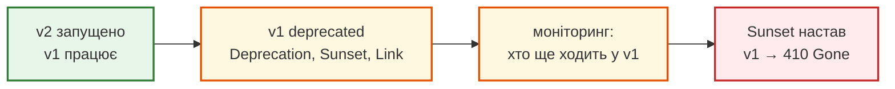

# Версіонування API

## Проблема { #problem }

API змінюється: поле `full_name` хочеться розділити на `first_name` і `last_name`, `GET /items` — переробити на курсорну пагінацію. Для твого коду це рефакторинг на годину. Але в API є клієнти, яких ти не контролюєш: мобільний застосунок, що оновиться через місяць, бот партнера, чийсь скрипт. Для них зміна контракту без попередження — аварія. Версіонування дає змогу змінювати API, не ламаючи тих, хто вже ним користується.

## Ментальна модель { #mental-model }

Версію заводять лише для **несумісної** зміни. Сумісні зміни робляться в поточній версії:

| Зміна | Сумісна? | Що робити |
|---|---|---|
| нове необов'язкове поле у відповіді | так (якщо клієнти ігнорують невідомі поля) | у поточній версії |
| новий ендпоінт, новий необов'язковий параметр | так | у поточній версії |
| прибрати чи перейменувати поле, змінити його тип | **ні** | нова версія |
| нове обов'язкове поле в запиті, суворіша перевірка | **ні** | нова версія |
| інший формат помилок, інша пагінація | **ні** | нова версія |

Де клієнт вказує версію:

| Спосіб | Приклад | Плюси | Мінуси |
|---|---|---|---|
| у шляху | `/api/v1/users/1` | видно в журналах, посиланнях, curl; кожна версія — окремі операції в OpenAPI; кешується без хитрощів | «той самий ресурс» має кілька адрес |
| у заголовку | `X-API-Version: 1` або `Accept: application/vnd.app.v1+json` | адреса ресурсу одна | невидимий у браузері й журналах; потрібен `Vary`; OpenAPI бачить лише «одна з двох схем» |
| у параметрі запиту | `/users/1?version=1` | просто додати | змішує версію з фільтрами; легко забути; OpenAPI — як із заголовком |

Для більшості JSON API обирають **шлях**: він найпростіший для клієнтів і для FastAPI.

## Версії в шляху через `APIRouter` { #path }

Код — [`examples/versioning`](https://github.com/NikoriakViktor/news_hub/tree/main/examples/versioning). Дані одні, контрактів два:

```python title="versioning_app.py (фрагмент)"
class UserV1(BaseModel):          # старий контракт: одне поле з повним ім'ям
    id: int
    full_name: str


class UserV2(BaseModel):          # новий контракт: ім'я й прізвище окремо
    id: int
    first_name: str
    last_name: str


v1 = APIRouter(prefix="/v1", tags=["v1"], deprecated=True)     # deprecated → позначка в OpenAPI і /docs
v2 = APIRouter(prefix="/v2", tags=["v2"])


@v1.get("/users/{user_id}")
def get_user_v1(user_id: int, response: Response) -> UserV1:
    response.headers["Deprecation"] = "@1793491200"     # RFC 9745: застаріла з 2026-11-01 (unix-час)
    response.headers["Sunset"] = "Thu, 01 Jul 2027 00:00:00 GMT"   # RFC 8594: коли її вимкнуть
    response.headers["Link"] = f'</api/v2/users/{user_id}>; rel="successor-version"'
    return to_v1(load(user_id))


@v2.get("/users/{user_id}")
def get_user_v2(user_id: int) -> UserV2:
    return UserV2(**load(user_id))


api = APIRouter(prefix="/api")
api.include_router(v1)
api.include_router(v2)
app = FastAPI(title="Versioning")
app.include_router(api)
```

```text
Шлях:
  /api/v1/users/1    200 {'id': 1, 'full_name': 'Олена Коваленко'}
  /api/v2/users/1    200 {'id': 1, 'first_name': 'Олена', 'last_name': 'Коваленко'}
  /api/v3/users/1    404 {'detail': 'Not Found'}
  заголовки v1: {'deprecation': '@1793491200', 'sunset': 'Thu, 01 Jul 2027 00:00:00 GMT', 'link': '</api/v2/users/1>; rel="successor-version"'}
```

- **Роутери вкладаються**: `/api` + `/v1` + `/users/{user_id}`. Спільне для версії (теги, `dependencies=[...]` з перевіркою доступу, `deprecated`) задається один раз на її роутері ([рівні залежностей](../03_fastapi_core/dependencies.md#levels)).
- **Моделі — окремі на кожну версію.** `UserV1` не змінюється, коли з'являється `UserV2`, тож стара версія не «попливе» випадково.
- **Логіка — одна.** Обидві версії читають ті самі дані через `load()`. Версія — це адаптер формату, а не копія застосунку.
- **Застарілу версію позначають двічі.** Для людей — `deprecated=True`: у `/docs` операція перекреслена. Для програм — заголовки: `Deprecation` (з якого часу застаріла), `Sunset` (коли вимкнуть), `Link` на наступну версію.

Префікс пишуть **без** косої риски в кінці, інакше FastAPI не дасть навіть створити роутер:

```text
>>> APIRouter(prefix="/v1/")
AssertionError: A path prefix must not end with '/', as the routes will start with '/'
```

## Версія в заголовку чи параметрі { #header-query }

```python title="versioning_app.py (фрагмент)"
@app.get("/users/{user_id}", tags=["header"])
def get_user_by_header(
    user_id: int,
    response: Response,
    x_api_version: Annotated[Literal["1", "2"], Header()] = "2",
) -> UserV1 | UserV2:
    response.headers["Vary"] = "X-API-Version"          # кеш мусить розрізняти відповіді за цим заголовком
    user = load(user_id)
    return to_v1(user) if x_api_version == "1" else UserV2(**user)
```

```text
Заголовок:
  {}                         200 {'id': 1, 'first_name': 'Олена', 'last_name': 'Коваленко'}  vary=X-API-Version
  {'X-API-Version': '1'}     200 {'id': 1, 'full_name': 'Олена Коваленко'}  vary=X-API-Version
  {'X-API-Version': '3'}     422 {'detail': [{'type': 'literal_error', 'loc': ['header', 'x-api-version'], 'msg': "Input should be '1' or '2'", ...}]}
Параметр:
  /q/users/1?version=1   {'id': 1, 'full_name': 'Олена Коваленко'}
  /q/users/1             {'id': 1, 'first_name': 'Олена', 'last_name': 'Коваленко'}
```

Працює, але подивись, що з цього бачить OpenAPI:

```text
OpenAPI:
  /api/v1/users/{user_id}  deprecated=True  200 → #/components/schemas/UserV1
  /api/v2/users/{user_id}  deprecated=False 200 → #/components/schemas/UserV2
  /users/{user_id}         deprecated=False 200 → {'anyOf': [{'$ref': '#/components/schemas/UserV1'}, {'$ref': '#/compon
  /q/users/{user_id}       deprecated=False 200 → {'anyOf': [{'$ref': '#/components/schemas/UserV1'}, {'$ref': '#/compon
```

Версії в шляху — дві операції з точною схемою кожна, стара позначена застарілою. Версія в заголовку чи параметрі — одна операція з «або `UserV1`, або `UserV2`». Яка версія повертає яку схему, з документації не видно, і застарілою позначити лише одну версію неможливо. Генератори клієнтів отримають тип-об'єднання.

`Vary: X-API-Version` — обов'язковий супутник версії в заголовку. Без нього проксі чи CDN закешує відповідь v2 і віддасть її клієнту, який просив v1: адреса ж та сама.

## Окрема документація на версію { #mount }

Коли версії сильно різні або їх веде різна команда, кожну роблять окремим застосунком FastAPI і монтують під свій префікс:

```python
v1 = FastAPI(title="API v1", version="1.0")
v2 = FastAPI(title="API v2", version="2.0")
app = FastAPI()
app.mount("/api/v1", v1)
app.mount("/api/v2", v2)
```

```text
v1 API v1 ['/users/{i}'] [{'url': '/api/v1'}]
v2 API v2 ['/users/{i}'] [{'url': '/api/v2'}]
/docs v1: 200 | головний openapi paths: []
```

Кожна версія має власні `/api/v1/docs` і `/api/v1/openapi.json` з правильним `servers`. Ціна — головний застосунок їх не бачить: спільні middleware й `lifespan` треба підключати свідомо.

## Життєвий цикл версії { #lifecycle }



1. Нова версія з'являється **поруч**, стара працює далі.
2. Стара позначається застарілою: `deprecated=True` у документації, заголовки `Deprecation` і `Sunset` у відповідях, повідомлення клієнтам.
3. Журнали показують, хто ще ходить у стару версію. Їм пишуть персонально.
4. Після дати `Sunset` стара версія відповідає `410 Gone` з посиланням на нову, а не мовчки зникає з `404`.

## У News Hub { #news-hub }

News Hub версій не має: усі адреси — `/api/...`, а єдині клієнти (Swagger, Postman, бот, тести) живуть у тому самому репозиторії й змінюються разом з API. Версія знадобиться, коли з'явиться зовнішній клієнт, якого не можна оновити одночасно з сервером. Тоді нинішній `/api` стане `/api/v1` через один `APIRouter(prefix="/v1")`, а не через правку кожного маршруту.

Приклад справжнього переходу з v1 на v2 (інша модель даних, інші адреси) — у кейсі Meteo API: `examples/meteo_api/meteo_api/legacy/` і `examples/meteo_api/meteo_api/app.py`.

## Типові помилки { #mistakes }

| Помилка | Наслідок | Як правильно |
|---|---|---|
| несумісна зміна без нової версії | старі клієнти падають без попередження | нова версія поруч зі старою |
| нова версія на кожну дрібницю | десяток версій, які треба підтримувати | сумісні зміни — у поточній версії |
| одна модель Pydantic на всі версії, «трохи підправлена» | стара версія непомітно змінює контракт | окрема модель на версію; регресійні тести старої версії |
| `prefix="/v1/"` | `AssertionError` при старті | `prefix="/v1"` |
| версія в заголовку без `Vary` | кеш віддає одну версію клієнтам іншої | `Vary: X-API-Version` |
| `if version == ...` по всьому коду | логіка розростається, документація неточна | версія в шляху, адаптери формату на межі |
| стару версію просто видалили | `404` у клієнтів без пояснень | `Deprecation` → `Sunset` → `410 Gone` |

## Безпека { #security }

- **Стара версія — та сама поверхня атаки.** Перевірки доступу вішай на спільний роутер `/api` або на застосунок, а не лише на `/api/v2`. Інакше атакувальник піде в `v1`, де перевірки забули.
- **Виправлення безпеки — в усіх живих версіях одразу.** Тому версій має бути мало.
- **Нові службові поля не мають протікати в старі контракти.** Окремі `response_model` для кожної версії відфільтрують зайве, навіть якщо ORM-об'єкт розрісся.

## Питання { #questions }

1. Яка зміна потребує нової версії: нове необов'язкове поле у відповіді чи перейменування поля?
2. Чому для FastAPI-проєкту версію зазвичай кладуть у шлях, а не в заголовок?
3. Що станеться з `APIRouter(prefix="/v1/")`?
4. Навіщо `Vary: X-API-Version` при версії в заголовку?
5. Як повідомити клієнтів, що v1 вимкнуть, і що вона має відповідати після вимкнення?
6. Де вішати перевірку доступу, щоб її не обійти через стару версію?

??? success "Відповіді"

    1. Перейменування — несумісне, потрібна нова версія. Нове необов'язкове поле — сумісна зміна.
    2. Кожна версія — окремі операції з точними схемами в OpenAPI, стару можна позначити `deprecated`; версію видно в журналах і посиланнях; кешування працює без `Vary`.
    3. `AssertionError: A path prefix must not end with '/'` — застосунок не стартує.
    4. Адреса однакова для всіх версій; без `Vary` кеш віддасть відповідь однієї версії клієнту іншої.
    5. `deprecated=True` у документації, заголовки `Deprecation`, `Sunset`, `Link`; після `Sunset` — `410 Gone`.
    6. На спільному роутері (`/api`) або на застосунку, а не на роутері однієї версії.

## Що далі { #next }

[Частина I. HTTP і дизайн REST API](README.md) — решта розділів частини.

**Джерела:** FastAPI — [Bigger Applications — Multiple Files](https://fastapi.tiangolo.com/tutorial/bigger-applications/), [Sub Applications — Mounts](https://fastapi.tiangolo.com/advanced/sub-applications/), [Path Operation Configuration — deprecated](https://fastapi.tiangolo.com/tutorial/path-operation-configuration/#deprecate-a-path-operation); [RFC 9745 — The Deprecation HTTP Response Header Field](https://www.rfc-editor.org/rfc/rfc9745); [RFC 8594 — The Sunset HTTP Header Field](https://www.rfc-editor.org/rfc/rfc8594); [RFC 9110 — §12.5.5 Vary, §15.5.11 410 Gone](https://www.rfc-editor.org/rfc/rfc9110).
