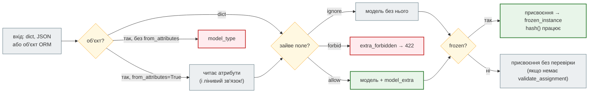

# `ConfigDict`: `extra`, `frozen`, `from_attributes`

## Проблема { #problem }

Клієнт надсилає `{"name": "mallory", "is_admin": true}`, а в моделі є лише `name`. Що буде з `is_admin`: мовчки зникне, дасть 422 чи дійде до бази? Новина, яку перевірив парсер, далі передається з рук у руки, і хтось може змінити її заголовок уже після перевірки. Модель відповіді треба побудувати з рядка SQLAlchemy, а не зі словника. Усе це вирішує не код полів, а налаштування моделі — `model_config = ConfigDict(...)`. Помилка в налаштуванні дає або дірку в безпеці, або 500 там, де мало бути 200.

## Ментальна модель { #mental-model }



`ConfigDict(...)` — звичайний словник, але з описаними ключами: IDE і mypy підказують назви й ловлять одруківки. Налаштування дочірнього класу **зливаються** з батьківськими, а не замінюють їх.

| Ключ | За замовчуванням | Що робить |
|---|---|---|
| `extra` | `"ignore"` (`BaseSettings` — `"forbid"`) | що робити з полями, яких немає в моделі |
| `frozen` | `False` | заборонити присвоєння; зробити модель хешованою |
| `from_attributes` | `False` | приймати об'єкти з атрибутами (рядки ORM, dataclass) |
| `validate_assignment` | `False` | перевіряти значення при `model.field = ...` |
| `str_strip_whitespace` | `False` | обрізати пробіли в усіх рядкових полях |

## `extra` { #extra }

[`examples/pydantic_v2/config_demo.py`](https://github.com/NikoriakViktor/news_hub/blob/main/examples/pydantic_v2/config_demo.py), вхід `{"name": "olena", "is_admin": True}`:

```text
--- 1. extra: що буде з полем, якого немає в моделі
   "ignore" (за замовчуванням)                Ignore(name='olena')
   "forbid"                                   ValidationError: extra_forbidden ('is_admin',) — Extra inputs are not permitted
   "allow": модель                            Allow(name='olena', is_admin=True)
   "allow": model_extra                       {'is_admin': True}
   "allow": model_dump()                      {'name': 'olena', 'is_admin': True}
   JSON Schema "forbid"                       {"additionalProperties": false, "properties": {"name": {"title": "Name", "type": "string"}}, "required": ["name"], "title": "Forbid", "type": "object"}
   JSON Schema "allow"                        {"additionalProperties": true, ...}
```

- **`"ignore"`** — зайве поле мовчки зникає. Безпечно, але одруківка клієнта (`"titel"` замість `"title"`) теж зникає, і клієнт не дізнається, чому заголовок не змінився.
- **`"forbid"`** — `extra_forbidden`; у FastAPI — 422 з `loc` `["body", "is_admin"]`. У JSON Schema і `/docs` — `additionalProperties: false`, тож клієнт бачить контракт.
- **`"allow"`** — зайві поля зберігаються в `model_extra` і **потрапляють у `model_dump()`** без жодної перевірки. Корисно для проксі й логування сирих даних, небезпечно для тіла запиту.

Коли що: тіло запиту на запис — `"forbid"` (одруківки видно одразу); відповідь чужого API — `"ignore"` (API додасть поле — і наш код не впаде); дані, які треба переслати далі без змін, — `"allow"`.

## Масове присвоєння { #mass-assignment }

```text
--- 8. масове присвоєння: UserRow(**body.model_dump())
   ignore → is_admin                          None
   allow → is_admin                           True
   forbid                                     ValidationError: extra_forbidden ('is_admin',) — Extra inputs are not permitted
   сирий dict з request.json()                True
   POST /users (forbid) → 422 extra_forbidden ['body', 'is_admin']
```

Mass assignment (OWASP API3:2023, «Broken Object Property Level Authorization») — клієнт задає поле, якого не мав би задавати: `is_admin`, `owner_id`, `price`. З Pydantic-моделлю `UserRow(**body.model_dump())` безпечний **лише тому, що** в моделі немає `is_admin`, а `extra` не `"allow"`. Дві дороги до дірки:

1. `extra="allow"` у моделі запиту — і `model_dump()` передає `is_admin` у конструктор ORM;
2. `data = await request.json()` і `UserRow(**data)` — модель взагалі не бере участі.

Окремі моделі на вхід (`UserCreate`) і вихід (`UserOut`) з явним списком полів — головний захист; `"forbid"` додає видимість.

## `frozen` { #frozen }

```text
--- 2. frozen
   item.url = ...                             ValidationError: frozen_instance ('url',) — Instance is frozen
   item.tags.append(...) — вкладене           ['uk', 'hacked']
   model_copy(update=...)                     Item(url=42, tags=['uk', 'hacked'])
   hash(Point) і множина                      2
   hash(Item) — у полі list                   TypeError: unhashable type: 'list'
   Field(frozen=True): account.id = 2         ValidationError: frozen_field ('id',) — Field is frozen
   Field(frozen=True): account.name = 'b'     b
```

- **Присвоєння — `ValidationError` типу `frozen_instance`**, не `AttributeError` чи `TypeError`. Якщо таке трапиться всередині маршруту — це 500, а не 422: помилка не з запиту.
- **Заморожування неглибоке.** `item.tags.append(...)` працює: заморожена модель, а не список у ній. Для справжньої незмінності — `tuple[str, ...]` і `frozenset`.
- **`model_copy(update=...)` обходить і `frozen`, і перевірку**: `url=42` у моделі, де `url: str`. Створити змінену копію правильно — `Item.model_validate({**item.model_dump(), "url": ...})`.
- **Хешованість.** `frozen=True` додає `__hash__`, і моделі можна класти в `set` чи ключі `dict` — дублікати зникають. Але лише якщо всі поля хешовані: `list` у полі дає `TypeError` при `hash()`.
- **`Field(frozen=True)`** заморожує одне поле (`frozen_field`) — для `id`, який після створення не змінюється, поки решта полів редагується.

## Присвоєння без `frozen`: `validate_assignment` { #validate-assignment }

```text
--- 3. присвоєння без frozen: перевіряється лише з validate_assignment
   Loose: qty = 'багато'                      Loose(qty='багато')
   Checked: qty = 'багато'                    ValidationError: int_parsing ('qty',) — Input should be a valid integer, unable to parse string as an integer
   Checked: qty = '5' (lax)                   Checked(qty=5)
```

За замовчуванням Pydantic перевіряє дані **лише при створенні**. `model.qty = "багато"` мовчки ламає тип: модель, яку «перевірили», вже не відповідає своїм анотаціям. `validate_assignment=True` перевіряє кожне присвоєння (у lax-режимі — `"5"` стане `5`), ціною повільнішого присвоєння. Або `frozen=True`, і змінювати не можна взагалі.

## Успадкування { #inheritance }

```text
--- 4. успадкування: конфіг дочірнього класу зливається з батьківським
   Child.model_config                         {'frozen': True, 'str_strip_whitespace': True, 'from_attributes': True}
   Child(title='  x  ').title = ...           ValidationError: frozen_instance ('title',) — Instance is frozen
```

`Child` оголосив лише `from_attributes`, але успадкував `frozen` і `str_strip_whitespace`. Скасувати батьківське налаштування можна лише явно: `ConfigDict(frozen=False)`.

## `from_attributes` і SQLAlchemy { #from-attributes }

Основи — на сторінці [Моделі Pydantic 2](pydantic_models.md#from-attributes), там само — чому `class Config: orm_mode = True` у Pydantic 2 не працює. Тут — вкладені зв'язки й async.

```text
--- 5. from_attributes з SQLAlchemy
   вкладений author із selectinload           PostOut(id=1, title='перший', author=AuthorOut(id=1, name='olena'))
   вкладена модель без from_attributes        ValidationError: model_type ('author',) — Input should be a valid dictionary or instance of AuthorNoConfig
   password_hash у результаті?                False
--- 6. async: ліниве завантаження зв'язку
   без selectinload → post.author             ValidationError: get_attribute_error ('author',) — Error extracting attribute: StatementError: (sqlalchemy.exc.MissingGreenlet) greenlet_spawn has
   AuthorWithPosts без selectinload           ValidationError: get_attribute_error ('posts',) — Error extracting attribute: StatementError: (sqlalchemy.exc.MissingGreenlet) greenlet_spawn has
--- 7. маршрут FastAPI: response_model з від'єднаним об'єктом
   GET /posts/1 → 500 Internal Server Error
   причина                                    ResponseValidationError: get_attribute_error ('response', 'author') — Error extracting attribute: DetachedInstanceError: Parent instance <Po
```

- **`from_attributes` потрібен кожній вкладеній моделі.** `PostOut` з ним, а `AuthorNoConfig` без — `model_type` на полі `author`.
- **Pydantic читає атрибут — SQLAlchemy виконує запит.** Для лінивого зв'язку (`lazy="select"`, за замовчуванням) звернення `post.author` — це SQL. В async-сесії неявний SQL неможливий: `MissingGreenlet`. Якщо сесію вже закрито — `DetachedInstanceError`. Pydantic загортає обидві в `get_attribute_error`, а в маршруті це `ResponseValidationError` → **500**.
- **Розв'язок — завантажити зв'язки в запиті**: `select(PostRow).options(selectinload(PostRow.author))`. Щоб забуте завантаження падало одразу і зрозуміло, а не в Pydantic, — `relationship(lazy="raise")`.
- **Модель відповіді — фільтр.** `password_hash` є в рядку `AuthorRow`, але його немає в `AuthorOut` — і в результаті теж.
- **Цикли.** `AuthorWithPosts` → `posts: list[PostOut]` → `author: AuthorOut` — без `posts` усередині. Модель відповіді визначає, наскільки глибоко Pydantic іде зв'язками; модель, що посилається сама на себе через зв'язки ORM, означає один запит на кожен рівень і ризик нескінченної рекурсії.

## У News Hub { #news-hub }

| Налаштування | Де | Навіщо |
|---|---|---|
| `frozen=True, str_strip_whitespace=True` | `NewsItem` у `models.py` ([крок 1](../tutorials/01_typing_pydantic/index.md)) | новина, яку перевірив парсер, не змінюється по дорозі до бази; пробіли з HTML обрізаються |
| `from_attributes=True` | `NewsOut`, `SourceOut` в `api.py` ([крок 3](../tutorials/03_sqlalchemy_alembic/index.md)) | відповідь будується з `NewsRow` / `SourceRow` |
| `extra="forbid"` | `NewsAnalysis` в `analysis.py` ([крок 7](../tutorials/07_llm_api/index.md)) | відповідь LLM із зайвим полем — це не те, що ми просили |
| `extra` за замовчуванням (`"ignore"`) | `NewsPatch`, `SourceCreate` | `{"id": 5}` у тілі `PATCH` мовчки ігнорується |

Кілька деталей з коду:

- `NewsOut(NewsItem)` успадковує `frozen=True` і `str_strip_whitespace=True` — модель відповіді теж незмінна.
- У `NewsRow` немає зв'язків, тому пастки з лінивим завантаженням у News Hub немає. З'явиться зв'язок (`news.source`) — потрібен `selectinload` у репозиторії.
- `PATCH /api/news/{id}` робить `setattr(row, field, value)` для кожного поля з `body.model_dump(exclude_unset=True)`. Це масове присвоєння, і безпечне воно лише тому, що в `NewsPatch` два поля і `extra` не `"allow"`. Змінити `NewsPatch` на `extra="allow"` — і клієнт зможе переписати `id` чи `scraped_at`.
- Для `NewsAnalysis` `extra="forbid"` має ціну: `additionalProperties: false` у JSON Schema, яку бачить і модель LLM. Коментар у `llm.py` фіксує, що старіше поле Gemini `response_schema` таку схему відхиляє з 400, тому News Hub передає її в `response_json_schema`, яке приймає повну JSON Schema.

## Типові помилки { #mistakes }

| Помилка | Наслідок | Як правильно |
|---|---|---|
| `extra="allow"` у моделі запиту + `Row(**body.model_dump())` | клієнт задає `is_admin` | окрема модель запиту; `"forbid"` або `"ignore"` |
| `Row(**await request.json())` | масове присвоєння без жодної перевірки | тіло — через модель Pydantic |
| розраховувати, що `frozen` захищає вкладені списки | `item.tags.append(...)` працює | `tuple`, `frozenset` |
| `model_copy(update=...)` для зміни замороженої моделі | нове значення не перевіряється | `model_validate({**m.model_dump(), ...})` |
| `hash()` моделі з полем `list` | `TypeError: unhashable type` | хешовані типи полів |
| присвоєння без `validate_assignment` | модель з невірним типом | `validate_assignment=True` або `frozen=True` |
| вкладена модель без `from_attributes` | `model_type` | `from_attributes=True` у кожній |
| лінивий зв'язок в async | `MissingGreenlet` → 500 | `selectinload`; `lazy="raise"` |
| `class Config: orm_mode = True` | у Pydantic 2 не працює | `ConfigDict(from_attributes=True)` |

## Налагодження { #debugging }

- **Яке налаштування діє насправді?** `Model.model_config` — повний словник після злиття з батьківськими класами.
- **`get_attribute_error` у відповіді або 500 з `ResponseValidationError`** — дивись текст помилки: `MissingGreenlet` — зв'язок не завантажено в async; `DetachedInstanceError` — об'єкт повернули після закриття сесії.
- **Що прийшло зайвого?** Тимчасово `extra="allow"` і `model.model_extra` — але не в моделі, що йде в базу.

## Безпека { #security }

- **Модель запиту — білий список полів.** Те, чого в ній немає, клієнт не задасть, поки `extra` не `"allow"`.
- **`"forbid"` у тілі запиту** — не захист сам по собі (захищає білий список), але робить спроби видимими: 422 у журналі замість мовчазного ігнорування.
- **Модель відповіді — білий список того, що бачить клієнт.** `password_hash` не потрапить у відповідь, поки його немає в моделі. З об'єкта ORM зайві атрибути не читаються навіть з `extra="allow"`, але зі словника `"allow"` пропустить усе — тому моделям відповіді `"allow"` не ставлять.
- **`frozen` — захист від помилки в нашому коді, не від атаки**: `model_copy`, `object.__setattr__` і вкладені списки його обходять.

## Питання { #questions }

1. Що буде з полем `is_admin` у тілі запиту при `extra="ignore"`, `"forbid"`, `"allow"`?
2. Чому `UserRow(**body.model_dump())` безпечний з `"ignore"` і небезпечний з `"allow"`?
3. Яку помилку дає присвоєння замороженій моделі і чому всередині маршруту це 500?
4. Чому `item.tags.append("x")` працює для `frozen=True`?
5. Коли `hash()` замороженої моделі падає?
6. Що перевіряє Pydantic при `model.qty = "багато"` без додаткових налаштувань?
7. Дочірній клас оголосив `ConfigDict(from_attributes=True)`. Чи заморожений він, якщо батько `frozen=True`?
8. Чому `PostOut.model_validate(post)` в async-коді дає `MissingGreenlet` і як це виправити?

??? success "Відповіді"

    1. Зникне; `extra_forbidden` → 422; збережеться в `model_extra` і потрапить у `model_dump()`.
    2. З `"ignore"` `model_dump()` містить лише оголошені поля; з `"allow"` — і `is_admin`.
    3. `ValidationError` типу `frozen_instance`. Помилка виникла не при розборі запиту, тож FastAPI не перетворює її на 422.
    4. Заморожування неглибоке: заборонене присвоєння атрибуту, а не зміна об'єкта в ньому.
    5. Коли якесь поле має нехешований тип (`list`, `dict`).
    6. Нічого: без `validate_assignment=True` присвоєння не перевіряється.
    7. Так: налаштування зливаються.
    8. Pydantic читає `post.author`, SQLAlchemy намагається виконати лінивий запит синхронно в async-сесії. `selectinload(PostRow.author)` у запиті; `lazy="raise"`, щоб помилка була зрозумілою.

## Що далі { #next }

[Межа довіри](trust_boundary.md) — усі двері, якими дані заходять у News Hub, і що перевіряється на кожних.

**Джерела:** Pydantic — [Configuration](https://docs.pydantic.dev/latest/api/config/) (`extra`, `frozen`, `from_attributes`, `validate_assignment`), [Models — Extra data](https://docs.pydantic.dev/latest/concepts/models/#extra-data), [Models — Faux immutability](https://docs.pydantic.dev/latest/concepts/models/#faux-immutability), [Models — Arbitrary class instances](https://docs.pydantic.dev/latest/concepts/models/#arbitrary-class-instances); SQLAlchemy — [Asyncio: preventing implicit IO](https://docs.sqlalchemy.org/en/20/orm/extensions/asyncio.html#preventing-implicit-io-when-using-asyncsession), [Relationship loading techniques](https://docs.sqlalchemy.org/en/20/orm/queryguide/relationships.html); [OWASP API3:2023 Broken Object Property Level Authorization](https://owasp.org/API-Security/editions/2023/en/0xa3-broken-object-property-level-authorization/).
