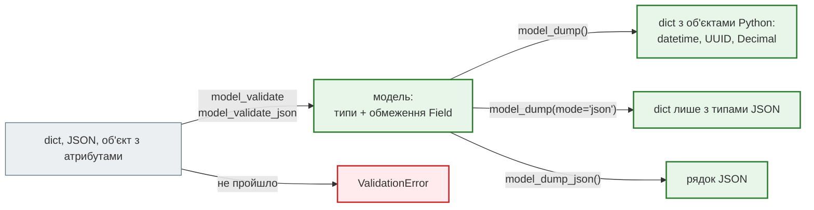

# Моделі Pydantic 2

## Проблема { #problem }

Дані приходять ззовні як словники й рядки: JSON запиту, рядок з бази, відповідь LLM, файл знімка. Код далі хоче працювати з об'єктами, у яких поля мають обіцяні типи й обмеження. Модель Pydantic — це місце, де одне перетворюється на інше: **перевірка на вході** (`model_validate`) і **перетворення на виході** (`model_dump`). Обидва напрямки мають параметри, від яких залежить, чи потрапить `null` у базу, чи піде хеш пароля клієнту і чи впаде `json.dumps`. Окремо — ті, хто переходить з Pydantic 1: частина старого коду працює з попередженням, а частина поводиться інакше без жодного попередження.

## Ментальна модель { #mental-model }



| Задача | Pydantic 2 | Pydantic 1 |
|---|---|---|
| перевірити словник | `Model.model_validate(data)` | `Model.parse_obj(data)` |
| перевірити рядок JSON | `Model.model_validate_json(text)` | `Model.parse_raw(text)` |
| перевірити об'єкт з атрибутами (ORM) | `model_validate(obj)` + `ConfigDict(from_attributes=True)` | `from_orm(obj)` + `Config.orm_mode` |
| у словник | `model_dump()` | `.dict()` |
| у рядок JSON | `model_dump_json()` | `.json()` |
| копія зі змінами | `model_copy(update=...)` | `.copy(update=...)` |
| JSON Schema | `Model.model_json_schema()` | `Model.schema()` |
| налаштування | `model_config = ConfigDict(...)` | `class Config:` |
| валідатор поля / моделі | `@field_validator` / `@model_validator` | `@validator` / `@root_validator` |
| перевірити не-модель (`list[X]`, `TypedDict`) | `TypeAdapter(list[X]).validate_python(...)` | `parse_obj_as(list[X], ...)` |

## `Field`: обмеження { #field }

[`examples/pydantic_v2/models_demo.py`](https://github.com/NikoriakViktor/news_hub/blob/main/examples/pydantic_v2/models_demo.py):

```python title="models_demo.py (фрагмент)"
class ProductCreate(BaseModel):
    name: str = Field(min_length=2, max_length=50)
    price: Decimal = Field(gt=0, max_digits=10, decimal_places=2)
    sku: str = Field(pattern=r"^[A-Z]{3}-\d{4}$")
    tags: list[str] = Field(default_factory=list, max_length=5)
```

```text
--- 1. Field: обмеження
   ('string_too_short', ('name',), 'А')
   ('greater_than', ('price',), -10)
   ('string_pattern_mismatch', ('sku',), 'bad_sku')
   ('too_long', ('tags',), ['a', 'a', 'a', 'a', 'a', 'a'])
```

| Для чого | Параметри `Field` |
|---|---|
| числа | `gt`, `ge`, `lt`, `le`, `multiple_of`; для `Decimal` — `max_digits`, `decimal_places` |
| рядки | `min_length`, `max_length`, `pattern` |
| списки, множини | `min_length`, `max_length` — кількість елементів |
| значення за замовчуванням | `default`, `default_factory` (для `list`, `dict` і всього змінюваного) |
| імена в JSON | `alias`, `validation_alias`, `serialization_alias` |
| документація | `description`, `examples`, `title` — потрапляють у `/docs` |
| вивід | `exclude=True` — ніколи не потрапляє в `model_dump` |

Помилки зібрано всі одразу, а не до першої: клієнт виправляє запит за один раз. `input` — значення, яке надіслав клієнт, без змін (`-10`, а не `-10.0`).

## `model_dump`: `mode="python"` і `mode="json"` { #dump }

```text
--- 2. model_dump(): mode='python' проти mode='json'
   id         UUID      → '6f1c0a2e-8f4b-4e7e-9a77-2a1f3c4d5e6f'
   name       str       → 'Ноутбук'
   price      Decimal   → '25000.50'
   created_at datetime  → '2026-11-11T12:05:00Z'
   site       HttpUrl   → 'https://shop.example/'
   tags       set       → ['sale']
   json.dumps(model_dump()): Object of type UUID is not JSON serializable
   model_dump_json(): {"id":"6f1c0a2e-8f4b-4e7e-9a77-2a1f3c4d5e6f","name":"Ноутбук","price":"25000.50" ...
```

- **`model_dump()`** (режим `python`) лишає об'єкти Python: `UUID`, `Decimal`, `datetime`, `HttpUrl`, `set`. Зручно далі в коді, але `json.dumps` на цьому падає.
- **`model_dump(mode="json")`** — лише типи JSON. `Decimal` стає **рядком** `"25000.50"` (не числом, щоб не втратити точність). `datetime` з UTC — рядком ISO 8601 з `Z`. `set` — списком. `HttpUrl` — нормалізованою адресою з `/` у кінці.
- **`model_dump_json()`** — одразу рядок JSON, швидше за `json.dumps(model_dump(mode="json"))`. News Hub так кладе аналіз LLM у Redis (`analysis.model_dump_json()`).

FastAPI сам перетворює модель у JSON для відповіді. `mode="json"` потрібен, коли словник іде **не** у відповідь FastAPI: у Redis, черги, `JSONResponse`, файл.

## `model_validate` з об'єкта: `from_attributes` { #from-attributes }

```text
--- 3. model_validate з об'єкта
   from_attributes=True: id=1 name='olena'
   без from_attributes: model_type
```

Рядок з бази (`NewsRow` у News Hub) — об'єкт з атрибутами, а не словник. Без `ConfigDict(from_attributes=True)` модель його не прийме. Поля, яких у моделі немає (`password_hash` в `Row`), не потрапляють у результат: модель відповіді — ще й фільтр.

## `exclude_unset` і `PATCH` { #exclude-unset }

`PATCH` має змінити лише ті поля, які клієнт передав. Для цього модель пам'ятає, що саме передали (`model_fields_set`):

```text
--- 4. exclude_unset, exclude_defaults, exclude_none
   тіло {"category": "Спорт"}  model_dump()={'title': None, 'category': 'Спорт', 'pinned': False}
                               exclude_unset={'category': 'Спорт'}  exclude_defaults={'category': 'Спорт'}  exclude_none={'category': 'Спорт', 'pinned': False}  fields_set={'category'}
   тіло {"title": null}        model_dump()={'title': None, 'category': None, 'pinned': False}
                               exclude_unset={'title': None}  exclude_defaults={}  exclude_none={'pinned': False}  fields_set={'title'}
   тіло {"pinned": false}      model_dump()={'title': None, 'category': None, 'pinned': False}
                               exclude_unset={'pinned': False}  exclude_defaults={}  exclude_none={'pinned': False}  fields_set={'pinned'}
```

| Параметр | Що відкидає | Для `PATCH` |
|---|---|---|
| нічого | — | **ні**: `title: None` і `pinned: False` перезапишуть те, що в базі |
| `exclude_unset=True` | поля, яких не було в тілі | **так** — єдиний правильний |
| `exclude_defaults=True` | поля зі значенням, що дорівнює значенню за замовчуванням | ні: `{"pinned": false}` — свідома зміна, а вона зникла |
| `exclude_none=True` | поля зі значенням `None` | ні: лишився `pinned: False`, якого ніхто не передавав |

**Явний `null` — пастка `exclude_unset`.** Тіло `{"title": null}` дало `{'title': None}`: поле передали, отже воно «set». Якщо колонка в базі `NOT NULL` чи модель відповіді вимагає рядок, буде `500`, а не `422`. Тип `str | None = None` тут означає «можна не передавати», але дозволяє й `null`. Заборонити `null`, зберігши необов'язковість, можна валідатором:

```python title="models_demo.py (фрагмент)"
class NewsPatchSafe(BaseModel):
    title: str | None = Field(None, min_length=10)
    category: str | None = None

    @field_validator("title", "category")
    @classmethod
    def not_null(cls, value: str | None) -> str:
        if value is None:                 # валідатор не бачить значення за замовчуванням — лише передане
            raise ValueError("поле можна не передавати, але не можна передати null")
        return value
```

```text
--- 4b. явний null у PATCH
   без тіла: {}
   {'title': None}: [('value_error', ('title',), None)] Value error, поле можна не передавати, але не можна передати null
```

Валідатор поля не запускається для значення за замовчуванням (`validate_default=False`), тому порожнє тіло проходить, а явний `null` — ні.

## Що віддає `model_dump`: підкласи й `exclude` { #output }

```text
--- 5. підклас у полі базового типу
   {'owner': {'name': 'olena'}, 'any_owner': {'name': 'olena', 'password_hash': '$2b$12$...'}}
--- 6. Field(exclude=True)
   {'name': 'olena'}
```

- **Поле типу `User`, у яке поклали `Admin`**, віддає лише поля `User`. Pydantic 1 віддавав усі поля підкласу, разом з `password_hash`. Стару поведінку повертає `SerializeAsAny[User]` — і разом з нею витік.
- **`Field(exclude=True)`** — поле є в моделі, але ніколи не потрапляє у вивід. Надійніше — окрема модель відповіді без цього поля, як `NewsOut` у News Hub.

## Міграція з Pydantic 1 { #migration }

[`examples/pydantic_v2/migration_demo.py`](https://github.com/NikoriakViktor/news_hub/blob/main/examples/pydantic_v2/migration_demo.py) — той самий код, запущений на Pydantic 1.10 і 2.13:

```text
=== Pydantic 1.10.27
--- перетворення типів
   name=123 (int → str)               '123'
   qty='5' (str → int)                5
   qty=1.5 (float → int)              1
   qty=True (bool → int)              1
   Optional[str] без note             Item(name='a', qty=1, note=None)
--- старі методи
   .dict()                            {'name': 'a', 'qty': 1, 'note': None}
   .json()                            '{"name": "a", "qty": 1, "note": null}'
   .parse_obj({...})                  Item(name='a', qty=1, note=None)
   .copy(update=...)                  2
   .schema()['required']              ['name', 'qty']
--- class Config: orm_mode
   Config.orm_mode + from_orm()       Out(name='a')
--- @validator
   @validator                         'a'
--- підклас у полі базового типу
   Team(owner=Admin(...)).dict()      {'owner': {'name': 'o', 'password_hash': 'h'}}
```

```text
=== Pydantic 2.13.5
--- перетворення типів
   name=123 (int → str)               ValidationError: string_type
   qty='5' (str → int)                5
   qty=1.5 (float → int)              ValidationError: int_from_float
   qty=True (bool → int)              1
   Optional[str] без note             ValidationError: missing
--- старі методи
   .dict()                            {'name': 'a', 'qty': 1, 'note': None}  ⚠ PydanticDeprecatedSince20
   .json()                            '{"name":"a","qty":1,"note":null}'  ⚠ PydanticDeprecatedSince20
   .parse_obj({...})                  Item(name='a', qty=1, note=None)  ⚠ PydanticDeprecatedSince20
   .copy(update=...)                  2  ⚠ PydanticDeprecatedSince20
   .schema()['required']              ['name', 'qty', 'note']  ⚠ PydanticDeprecatedSince20
   .model_dump()                      {'name': 'a', 'qty': 1, 'note': None}
   .model_copy(update=...)            '2'
--- class Config: orm_mode
   Config.orm_mode + from_orm()       PydanticUserError: You must set the config attribute `from_attributes=True` to use from_or  ⚠ PydanticDeprecatedSince20
--- @validator
   @validator                         'a'  ⚠ PydanticDeprecatedSince20
--- підклас у полі базового типу
   Team(owner=Admin(...)).dict()      {'owner': {'name': 'o'}}  ⚠ PydanticDeprecatedSince20
```

Три групи змін:

1. **Працює, але з попередженням** — старі методи `.dict()`, `.json()`, `.parse_obj()`, `.copy()`, `.schema()`, `@validator`. Попередження `PydanticDeprecatedSince20`, видалення обіцяно в Pydantic 3. Заміна — механічна, за таблицею вище.
2. **Змінилося мовчки** — без попередження, лише інший результат:
    - **`int` більше не стає рядком** (`string_type`), а `1.5` не обрізається до `1` (`int_from_float`). Рядок `"5"` у ціле й `True` в `1` Pydantic 2 і далі перетворює (докладніше — [Режими lax і strict](strict_mode.md));
    - **`Optional[str]` без значення за замовчуванням тепер обов'язкове.** У Pydantic 1 `Optional` сам додавав `= None`;
    - **підклас віддає лише поля оголошеного типу**;
    - **`model_copy(update=...)` не перевіряє значення**: поле `qty: int` отримало рядок `'2'`. `.copy` у Pydantic 1 теж не перевіряв, але від `model_*` цього легко чекати. Для перевірки — `Model.model_validate({**old.model_dump(), **changes})`.
3. **Ламається з оманливим повідомленням** — `class Config: orm_mode = True`. Pydantic 2 попереджає «'orm_mode' has been renamed to 'from_attributes'», але сам не перейменовує: у `model_config` лишається `{'orm_mode': True}`, і `from_orm` / `model_validate` з об'єкта падає. Треба писати `model_config = ConfigDict(from_attributes=True)`.

## У News Hub { #news-hub }

| Що | Де |
|---|---|
| `Field(min_length=10, max_length=300)` на заголовку | `NewsItem` у `models.py` ([крок 1](../tutorials/01_typing_pydantic/index.md)) |
| `model_validate` з рядка бази, `from_attributes=True` | `NewsOut`, `SourceOut` в `api.py` ([крок 3](../tutorials/03_sqlalchemy_alembic/index.md)) |
| `model_dump(exclude_unset=True)` для `PATCH` | `update_news`, модель `NewsPatch` (крок 3) |
| `model_validate_json` / `model_dump_json` | аналіз LLM: відповідь моделі й кеш у Redis ([крок 7](../tutorials/07_llm_api/index.md)) |
| `model_dump(exclude_none=True)` | статус фонової задачі в Redis ([крок 4](../tutorials/04_middleware_redis/index.md)) — там `None` означає «ще немає», і не зберігати його правильно |
| `TypeAdapter(list[RawNews])` | перевірка знімка `rbc_news_snapshot.json` (крок 1) |
| `max_length` на кожному рядку з запиту | `TokenRequest.password` (`max_length=1000`), `SourceCreate.url`, `NewsPatch` |

## Типові помилки { #mistakes }

| Помилка | Наслідок | Як правильно |
|---|---|---|
| `model_dump()` без параметрів у `PATCH` | поля, яких не передали, перезаписуються `None` і значеннями за замовчуванням | `exclude_unset=True` |
| `exclude_none` або `exclude_defaults` у `PATCH` | свідомо передане `false` / `0` зникає, або непередане потрапляє | `exclude_unset=True` |
| `str \| None = None` у `PATCH` без перевірки на `null` | `{"title": null}` доходить до бази — `500` | валідатор, що забороняє `None` |
| `json.dumps(model.model_dump())` | `TypeError` на `UUID`, `datetime`, `Decimal` | `model_dump(mode="json")` або `model_dump_json()` |
| `class Config: orm_mode = True` у Pydantic 2 | `from_orm` / `model_validate` з об'єкта падає, попри «renamed» у попередженні | `model_config = ConfigDict(from_attributes=True)` |
| чекати, що `Optional[X]` необов'язкове | `422 Field required` після міграції | `X \| None = None` |
| `model_copy(update=...)` для даних ззовні | значення не перевіряються | `model_validate` зі зміненим словником |
| `default=[]` замість `default_factory=list` у звичайному класі | спільний список на всі екземпляри | у моделях Pydantic `[]` безпечний (копіюється), але `default_factory` зрозуміліший і працює скрізь |
| `SerializeAsAny` «щоб віддавало все» | службові поля підкласу йдуть клієнту | окрема модель відповіді |

## Налагодження { #debugging }

- **`model_fields_set`** показує, які поля передали: перше, що варто подивитися, коли `PATCH` змінює не те.
- **`exc.errors()`** — список з `type`, `loc`, `msg`, `input`. `type` стабільний між версіями Pydantic, за ним і перевіряють у тестах, а не за `msg`.
- **Попередження міграції** — `python -W error::DeprecationWarning -m pytest` перетворить усі `PydanticDeprecatedSince20` на помилки й покаже кожне старе місце.
- **`Model.model_json_schema()`** — що саме перевіряє модель; FastAPI бере схему звідти.

## Безпека { #security }

- **Окрема модель відповіді — головний захист від витоку.** `NewsOut` не має полів, яких клієнт не повинен бачити, і `from_attributes` бере з рядка бази лише їх. `Field(exclude=True)` і `SerializeAsAny` — пам'ятати, що робить кожен.
- **`max_length` на кожному рядку й списку з запиту.** Без нього в базу чи до LLM потрапить рядок на мегабайти. Але `max_length` перевіряється вже **після** того, як тіло прочитане й розібране. Від величезних тіл захищає ліміт розміру запиту перед застосунком — у News Hub `client_max_body_size 1m` у nginx ([крок 11](../tutorials/11_compose_deploy/index.md)).
- **`input` у `ValidationError`** містить надіслане значення, разом з паролями: не пиши `exc.errors()` у журнал як є ([Формат помилок](../01_http_and_rest/errors.md#naive)).
- **Явний `null` і `PATCH`**: якщо `null` для поля заборонений бізнес-правилом, перевіряй це в моделі, а не сподівайся на `NOT NULL` у базі — це `500` замість `422`.

## Питання { #questions }

1. Чим `model_dump()` відрізняється від `model_dump(mode="json")` для `Decimal` і `datetime`?
2. Який параметр `model_dump` правильний для `PATCH` і чому не `exclude_none`?
3. Що потрапить у `model_dump(exclude_unset=True)`, якщо тіло — `{"title": null}`?
4. Що треба, щоб `model_validate` прийняв рядок з бази SQLAlchemy?
5. Які три зміни Pydantic 2 не дають жодного попередження, а лише інший результат?
6. Чому `class Config: orm_mode = True` у Pydantic 2 не працює, хоча попередження каже «renamed»?
7. Чому `max_length` не захищає від тіла запиту на 100 МБ?

??? success "Відповіді"

    1. `model_dump()` лишає `Decimal` і `datetime`; `mode="json"` дає рядки: `"25000.50"` і `"2026-11-11T12:05:00Z"`.
    2. `exclude_unset=True`: відкидає лише непередані поля. `exclude_none` пропустить непередані поля, що мають значення не `None` (`pinned: False`), і відкине свідомо переданий `null`.
    3. `{"title": None}` — поле передали, отже воно в `model_fields_set`.
    4. `model_config = ConfigDict(from_attributes=True)`.
    5. Будь-які дві-три з: `int` не стає рядком; `float` з дробовою частиною не стає `int`; `Optional[X]` без значення за замовчуванням обов'язкове; підклас віддає лише поля оголошеного типу.
    6. Pydantic лише попереджає, а ключ лишається `orm_mode`, і `from_attributes` не вмикається.
    7. Перевірка йде після того, як тіло прочитане й розібране; обмежувати розмір треба до застосунку (nginx `client_max_body_size`).

## Що далі { #next }

[Режими lax і strict](strict_mode.md).

**Джерела:** Pydantic — [Models](https://docs.pydantic.dev/latest/concepts/models/), [Fields](https://docs.pydantic.dev/latest/concepts/fields/), [Serialization](https://docs.pydantic.dev/latest/concepts/serialization/) (розділи «model_dump», «Serializing with duck-typing / SerializeAsAny»), [Validators](https://docs.pydantic.dev/latest/concepts/validators/), [Conversion Table](https://docs.pydantic.dev/latest/concepts/conversion_table/), [Migration Guide](https://docs.pydantic.dev/latest/migration/); FastAPI — [Body — Updates: Partial updates with PATCH](https://fastapi.tiangolo.com/tutorial/body-updates/).
