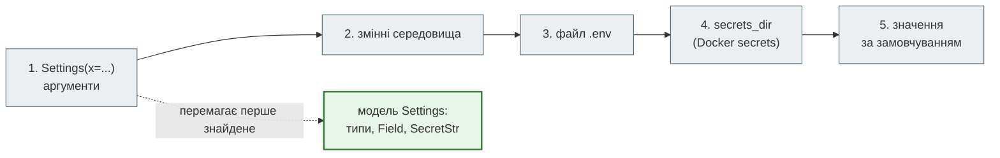

# Налаштування: `pydantic-settings`, `.env`, `SecretStr`

## Проблема { #problem }

Адреса бази, ключ JWT, токен бота різні на ноутбуці, в тестах і на сервері, і в коді їх бути не повинно. Зазвичай їх беруть зі змінних середовища. `os.getenv("WORKERS", "1")` повертає рядок, мовчки підставляє значення за замовчуванням, коли змінну забули, а пароль друкується в журнал разом з усім іншим. `pydantic-settings` описує налаштування моделлю: типи, обмеження, джерела з чітким пріоритетом, приховані секрети й помилка одразу при старті. Але в нього є свої пастки: `.env` з чужим ключем валить старт, а секрет може потрапити в журнал через текст помилки.

## Ментальна модель { #mental-model }



Значення береться з першого джерела, де воно є. Якщо ввімкнено `cli_parse_args=True`, аргументи командного рядка стоять ще вище за аргументи `Settings(...)`.

| Параметр `SettingsConfigDict` | Що робить |
|---|---|
| `env_prefix="APP_"` | поле `database_url` читається зі змінної `APP_DATABASE_URL` |
| `env_file=".env"` | файл dotenv; шлях — **відносно поточної папки**, а не модуля |
| `secrets_dir="/run/secrets"` | кожен файл — одне значення (Docker/Kubernetes secrets) |
| `env_nested_delimiter="__"` | `APP_DB__HOST` → `settings.db.host` |
| `case_sensitive` | за замовчуванням `False`: `app_database_url` теж підходить |
| `extra` | за замовчуванням **`"forbid"`** — на відміну від `BaseModel`, де `"ignore"` |
| `dotenv_filtering="match_prefix"` | з `.env` брати лише ключі з префіксом (pydantic-settings ≥ 2.14) |

## Пріоритет джерел { #priority }

[`examples/settings/settings_demo.py`](https://github.com/NikoriakViktor/news_hub/blob/main/examples/settings/settings_demo.py):

```python title="settings_demo.py (фрагмент)"
class Settings(BaseSettings):
    model_config = SettingsConfigDict(env_prefix="APP_", env_file=work / ".env", secrets_dir=secrets,
                                      extra="ignore")

    environment: str = "from-default"
    database_url: str
    jwt_secret: SecretStr = Field(min_length=32)
    workers: int = 1
```

```text
--- 1. пріоритет джерел для environment
   default ← secrets_dir ← .env                 from-dotenv
   + змінна середовища                          from-os-environ
   + аргумент Settings(environment=...)         from-init
   без .env-рядка: secrets_dir                  from-secrets-dir
```

Практичний наслідок: `.env` — для розробки, а на сервері значення приходять змінними середовища (`environment:` у Compose, секрети CI) і перекривають `.env`, якщо він випадково опинився в образі.

## Чужий ключ у `.env` { #extra }

```text
--- 0. чужий ключ у .env (DOCKER_PORT)
   extra за замовчуванням                       ValidationError: extra_forbidden ('docker_port',)
                                                str(exc) містить: Extra inputs are not permitted [type=extra_forbidden, input_value='8080', input_type=str]
   dotenv_filtering="match_prefix" (≥ 2.14)     postgresql://news:dotenv-pass@db/news
```

Один `.env` зазвичай обслуговує і застосунок, і Compose (`POSTGRES_PASSWORD`, `DOCKER_PORT`). `BaseSettings` за замовчуванням забороняє зайві ключі з `.env` — навіть з `env_prefix`, навіть якщо ключ без префікса. Змінні середовища на це не впливають: у них завжди повно чужого. Розв'язки:

- `extra="ignore"` — зайві ключі ігноруються, але одруківку в назві (`APP_DATABSE_URL`) теж ніхто не помітить;
- `dotenv_filtering="match_prefix"` — з `.env` беруться лише ключі з префіксом, а одруківка з префіксом і далі дасть помилку. Потрібна pydantic-settings 2.14+.

## `SecretStr` { #secret }

```text
--- 2. SecretStr
   repr: SecretStr('**********') | str: ********** | f-рядок: **********
   get_secret_value(): dotenv-secre…
   print(settings): environment='from-secrets-dir' database_url='postgresql://news:dotenv-pass@db/news' jwt_secret=SecretStr('**********') admin_hash= …
   model_dump(): SecretStr | model_dump(mode='json'): **********
   database_url (str) у print(settings): True
   JSON Schema: {"format": "password", "minLength": 32, "title": "Jwt Secret", "type": "string", "writeOnly": true}
```

- **`repr`, `str`, f-рядок — зірочки.** Значення видає лише `get_secret_value()`. Його викликають у місці використання: `jwt.encode(..., key=settings.jwt_secret.get_secret_value())`.
- **`model_dump(mode="json")` теж дає зірочки.** Записати налаштування в JSON і прочитати назад не вийде: секрет стане `**********`.
- **Пароль усередині звичайного рядка не захищений.** `database_url: str` з паролем у середині адреси надрукувався повністю. Або `SecretStr` для всієї адреси, або пароль окремим полем `SecretStr`, а адреса збирається в коді.
- `str(settings.jwt_secret)` там, де потрібне значення, дає `"**********"` — і помилку автентифікації, а не витік. Так помилка з `SecretStr` безпечніша.

## Помилки при старті { #startup }

```text
--- 4. помилки при старті
   APP_JWT_SECRET закороткий (SecretStr)        ValidationError: too_short ('jwt_secret',)
                                                str(exc) містить: Value should have at least 32 items after validation, not 12 [type=too_short, input_value='short-secret', inpu
   APP_WORKERS=four                             ValidationError: int_parsing ('workers',)
                                                str(exc) містить: Input should be a valid integer, unable to parse string as an integer [type=int_parsing, input_value='four', i
   env_file='.env', запуск з іншої папки        default-not-from-env
   змінна в нижньому регістрі                   lowercase-name
```

- **Fail fast — головна перевага.** `WORKERS=four` не стане мовчки `1`: застосунок не запуститься, і в повідомленні буде назва поля.
- **Але текст помилки містить `input_value` — навіть для `SecretStr`.** Секрет, що не пройшов `min_length`, опиниться в трасуванні при старті, а значить, у журналах контейнера й CI. `SecretStr` ховає значення лише після успішної перевірки.
- **`env_file=".env"` шукається від поточної папки.** Запуск `pytest` з кореня репозиторію чи `uvicorn` з іншої папки — і `.env` мовчки не знайдено, підставились значення за замовчуванням. Надійніше — шлях відносно модуля: `Path(__file__).parent.parent / ".env"`. Для налагодження pydantic-settings 2.15+ виводить, звідки взяте кожне значення: `PYDANTIC_SETTINGS_DEBUG=1` разом з рівнем журналу `DEBUG`.
- **Назви змінних нечутливі до регістру** за замовчуванням.

## Один екземпляр на процес { #cache }

```text
--- 5. один екземпляр на процес
   settings_cached() двічі — той самий об'єкт: True
   після settings_clear_cache(): False
   from pydantic import BaseSettings: PydanticImportError `BaseSettings` has been moved to the `pydantic-settings` package. See https://docs.pydanti
```

`Settings()` щоразу читає змінні середовища, `.env` і файли секретів. Тому налаштування створюють один раз:

```python
@lru_cache
def get_settings() -> Settings:
    return Settings()

SettingsDep = Annotated[Settings, Depends(get_settings)]
```

У тестах — `app.dependency_overrides[get_settings] = lambda: Settings(database_url="sqlite://", ...)`, а між тестами — `get_settings.cache_clear()`. У pydantic-settings 2.16+ є вбудовані `Settings.settings_cached()` і `Settings.settings_clear_cache()`, але `lru_cache` працює на будь-якій версії, і саме його показує документація FastAPI.

## `$` у `.env` { #dollar }

```text
--- 3. $ у .env
   у лапках: $2b$12$abcdefghijklmnopqrstuv | без лапок: $2b$12$abcdefghijklmnopqrstuv
   ${DEMO_NAME} в одинарних лапках: hello-olena
```

pydantic-settings читає `.env` через `python-dotenv`. Той підставляє лише форму з фігурними дужками `${ІМ'Я}` — і **навіть в одинарних лапках**. `$2b` без дужок лишається як є. **Docker Compose** підставляє і `$ІМ'Я`, тож хеш bcrypt `$2b$12$...` без лапок обрізається; одинарні лапки в `.env` для Compose від цього рятують. Саме так News Hub на кроці 11 отримував обрізаний хеш ([крок 11](../tutorials/11_compose_deploy/index.md)). Той самий `.env` читають два різні парсери з різними правилами: значення з `$` беруть в одинарні лапки й перевіряють при старті, що прийшло те, що очікували (як `BCRYPT_HASH.fullmatch` у News Hub).

## У News Hub { #news-hub }

News Hub не використовує `pydantic-settings`. Налаштування читаються `os.getenv` у модулях, а секрети й пов'язані значення — функціями-завантажувачами, які діють за тим самим принципом fail fast:

```python title="steps/12_ci_cd/news_hub/security.py (фрагмент)"
def load_admin_settings(env: Mapping[str, str] = os.environ) -> AdminSettings | None:
    """None — адмінку не налаштовано (ендпоінти запису → 503). Налаштовано погано — RuntimeError при старті."""
    secret, password_hash = env.get("JWT_SECRET", ""), env.get("ADMIN_PASSWORD_HASH", "")
    if not secret and not password_hash:
        return None
    if len(secret) < MIN_SECRET_LENGTH:
        raise RuntimeError(f"JWT_SECRET має бути не коротшим за {MIN_SECRET_LENGTH} символи; "
                           "згенеруй: python -m news_hub.security")
```

| | News Hub (`os.getenv` + завантажувачі) | `pydantic-settings` |
|---|---|---|
| типи | вручну: `int(os.getenv("RATE_LIMIT_REQUESTS", "5"))` | з анотацій |
| помилка при старті | для секретів і адмінки — `RuntimeError` без значення секрету | для всіх полів — `ValidationError`, **з** `input_value` |
| «не налаштовано» | `None` → ендпоінти відповідають `503` | `str \| None = None` |
| тести | функції приймають `env: Mapping`, тест передає словник | `Settings(...)` або `dependency_overrides` |
| `.env` | читає лише Compose (`env_file: .env`) | читає сам застосунок |

Повідомлення помилки в News Hub свідомо не містить значення секрету — те, чого `pydantic-settings` за замовчуванням не гарантує.

## Типові помилки { #mistakes }

| Помилка | Наслідок | Як правильно |
|---|---|---|
| `from pydantic import BaseSettings` | `PydanticImportError` у Pydantic 2 | `pip install pydantic-settings`; `from pydantic_settings import BaseSettings` |
| спільний `.env` для Compose і застосунку з `extra` за замовчуванням | `extra_forbidden` при старті | `dotenv_filtering="match_prefix"` або `extra="ignore"` |
| `env_file=".env"` | залежить від папки запуску; мовчки не знаходиться | шлях від `__file__` |
| `Settings()` у кожному запиті | читання файлів на кожен запит | `@lru_cache` або `settings_cached()` |
| `str(settings.secret)` для підключення | `"**********"` замість пароля | `get_secret_value()` |
| пароль у `database_url: str` | надрукується з `print(settings)` | `SecretStr` для адреси або пароля |
| `min_length` на `SecretStr` і журнали старту | значення секрету в `input_value` | перевірка у валідаторі з власним повідомленням без значення |
| значення з `$` без лапок у `.env` для Compose | Compose обрізає рядок | одинарні лапки |
| `.env` у git | секрети в історії назавжди | `.env` у `.gitignore`, у репозиторії — `.env.example` |

## Безпека { #security }

- **`.env` — лише локально.** У репозиторії — `.env.example` без значень (як у News Hub). Секрет, що потрапив у git, вважається скомпрометованим: його змінюють, а не видаляють з історії.
- **`SecretStr` захищає від випадкового друку, не від доступу.** Будь-який код процесу може викликати `get_secret_value()`. Захищає від журналів, `repr` у трасуваннях, `/debug`-ендпоінтів, але не від зловмисного коду.
- **Текст `ValidationError` при старті може містити секрет.** Для секретів з обмеженнями — валідатор з повідомленням без значення.
- **Порівняння секретів — `hmac.compare_digest`**, а не `!=`: звичайне порівняння зупиняється на першому відмінному символі, і час відповіді підказує, скільки символів збіглося.
- **Змінні середовища видно** в `docker inspect`, `/proc/<pid>/environ`, у дочірніх процесах. Для критичних секретів — `secrets_dir` з файлами, доступними лише процесу.

## Питання { #questions }

1. У якому порядку `pydantic-settings` шукає значення поля?
2. Чому `Settings()` падає з `extra_forbidden`, якщо в `.env` є `DOCKER_PORT`? Як виправити, не втративши перевірку одруківок?
3. Що повертає `str(settings.jwt_secret)` і як отримати справжнє значення?
4. Як секрет може потрапити в журнал, навіть якщо поле — `SecretStr`?
5. Чому `env_file=".env"` іноді «не працює»?
6. Чому `Settings()` не створюють у кожному запиті?
7. Чим відрізняється обробка `$` у `.env` у pydantic-settings і Docker Compose?

??? success "Відповіді"

    1. Аргументи `Settings(...)` (а з `cli_parse_args` — ще вище CLI), змінні середовища, `.env`, `secrets_dir`, значення за замовчуванням.
    2. У `BaseSettings` `extra="forbid"` за замовчуванням, і це стосується ключів з `.env`. `dotenv_filtering="match_prefix"` бере з `.env` лише ключі з префіксом.
    3. `"**********"`; справжнє — `get_secret_value()`.
    4. Через текст `ValidationError` при старті: `input_value` містить значення, яке не пройшло перевірку.
    5. Шлях відносний до поточної папки процесу, а не до модуля; файл мовчки не знаходиться.
    6. Кожне створення читає змінні середовища й файли; один екземпляр на процес — через `lru_cache` або `settings_cached()`.
    7. pydantic-settings (python-dotenv) лишає `$2b` як є, але підставляє `${ІМ'Я}` навіть в одинарних лапках; Compose підставляє і `$ІМ'Я`, тож хеш bcrypt без лапок обрізається.

## Що далі { #next }

[Частина II. Типи і Pydantic](README.md) — решта розділів частини.

**Джерела:** Pydantic — [Settings Management](https://docs.pydantic.dev/latest/concepts/pydantic_settings/) (розділи «Field value priority», «Dotenv (.env) support», «Secrets», «Parsing environment variable values»), [Types — SecretStr](https://docs.pydantic.dev/latest/api/types/#pydantic.types.SecretStr); FastAPI — [Settings and Environment Variables](https://fastapi.tiangolo.com/advanced/settings/); [Docker Compose — Interpolation](https://docs.docker.com/compose/how-tos/environment-variables/variable-interpolation/); [The Twelve-Factor App — Config](https://12factor.net/config).
