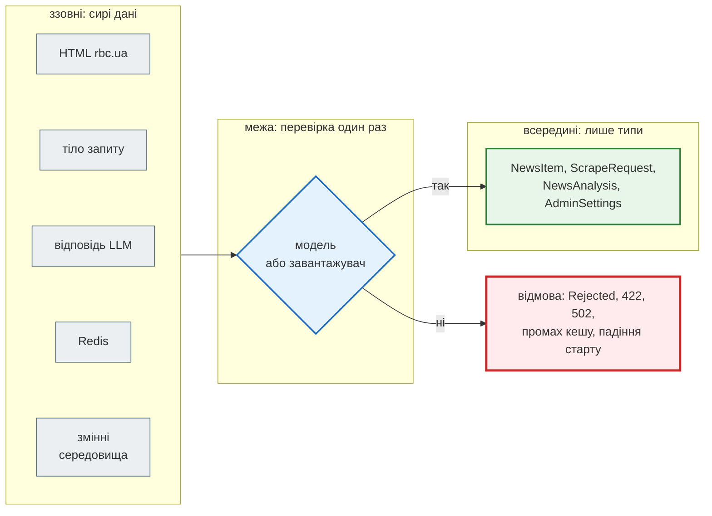
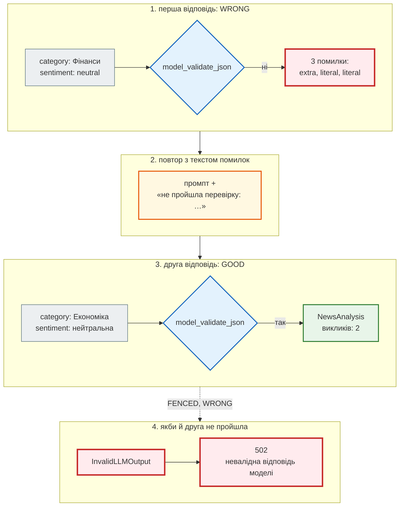

# Межа довіри

## Проблема { #problem }

У застосунок дані потрапляють багатьма дверима: HTML чужого сайту, тіло запиту від клієнта, JSON від моделі LLM, рядок з Redis, змінна середовища, webhook від планувальника. Жодне з цих джерел не обіцяє, що дані правильні. Сайт міняє розмітку, клієнт помиляється або атакує, модель загортає JSON у Markdown, у кеші лежить запис старого формату, у `.env` хтось вписав «п'ять» замість `5`.

Якщо перевіряти дані «там, де знадобились», перевірка розмазується по всьому коду, і в кожному місці трохи інша. Типова помилка тоді — `KeyError` через десять викликів від того місця, де дані зайшли. Межа довіри — інший підхід: перевірити **один раз на вході**, перетворити на типізовану модель, а далі всередині вже не сумніватися.

Покрокова реалізація цієї ідеї для новин з парсера — на сторінці [Крок 1 → Межа довіри](../tutorials/01_typing_pydantic/trust_boundary.md). Тут — та сама ідея для всіх дверей News Hub одразу: що на кожній межі перевіряється, чим і що буває з тим, що перевірку не пройшло.

## Ментальна модель { #mental-model }



Три правила:

1. **Сире — це рядки й словники без гарантій.** Тип сирих даних це й каже: `RawNews` (усі поля `str`), `bytes` тіла, `str` відповіді LLM, `Mapping[str, str]` середовища.
2. **Перевірка — на межі, один раз.** Після неї функції приймають `NewsItem`, а не `dict`. `mypy --strict` стежить, щоб сире не пройшло повз межу, а Pydantic — щоб дані відповідали моделі. Одне не замінює інше: mypy перевіряє код до запуску, Pydantic — дані під час роботи.
3. **Що робити з відмовою, залежить від того, хто винен.**

| Межа | Хто винен у поганих даних | Реакція | Крок |
|---|---|---|---|
| HTML → `NewsItem` | сайт або парсер | відкласти в `Rejected` з причинами, решту зберегти | [1](../tutorials/01_typing_pydantic/index.md) |
| тіло запиту → модель | клієнт | `422` з `loc` і `msg` | [2](../tutorials/02_fastapi_basics/index.md), [3](../tutorials/03_sqlalchemy_alembic/index.md) |
| відповідь LLM → `NewsAnalysis` | модель | одна повторна спроба, потім `502` | [7](../tutorials/07_llm_api/index.md) |
| Redis → `NewsAnalysis`, `JobStatus` | старіша версія нашого ж коду | промах кешу, а не помилка | [4](../tutorials/04_middleware_redis/index.md), [7](../tutorials/07_llm_api/index.md) |
| середовище → налаштування | той, хто розгортає | падіння при старті з поясненням | [8](../tutorials/08_security/index.md), [9](../tutorials/09_telegram_bot/index.md) |
| webhook → `ScrapeRequest` | відправник або атакувальник | спершу підпис (`401`), потім модель (`422`) | [8](../tutorials/08_security/index.md) |

Клієнт отримує `4xx`, бо він може виправити запит. За помилку моделі LLM клієнт не відповідає, тому `502`. За поганий `.env` відповідає адміністратор, і йому краще дізнатися про це при старті, а не від першого користувача.

## HTML → `NewsItem` { #html }

Парсер нічого не перевіряє: він лише дістає рядки з розмітки. Перевіряє `NewsItem`, і `validate_news` ділить результат на дві купки ([`models.py`](https://github.com/NikoriakViktor/news_hub/blob/main/steps/01_typing_pydantic/news_hub/models.py), крок 1):

```python
from news_hub.models import validate_news
from news_hub.parser import parse_rbc_news

html = """
<div class="newsline">
  <div class="newsline__item">
    <a class="newsline__item-title" href="/ukr/news/2024/1234/">Уряд затвердив новий бюджет на 2024 рік</a>
    <time class="newsline__item-date">10:30</time>
  </div>
  <div class="newsline__item">
    <a class="newsline__item-title" href="https://evil.example/ukr/news/x/">Клікни, щоб отримати виплату</a>
    <time class="newsline__item-date">99:99</time>
  </div>
</div>"""
raw = parse_rbc_news(html)
valid, rejected = validate_news(raw)
```

```text
RawNews : {'title': 'Уряд затвердив новий бюджет на 2024 рік', 'url': 'https://www.rbc.ua/ukr/news/2024/1234/', 'category': '', 'description': '', 'datetime': '10:30'}
RawNews : {'title': 'Клікни, щоб отримати виплату', 'url': 'https://evil.example/ukr/news/x/', 'category': '', 'description': '', 'datetime': '99:99'}
NewsItem: NewsItem(title='Уряд затвердив новий бюджет на 2024 рік', url=HttpUrl('https://www.rbc.ua/ukr/news/2024/1234/'), source='rbc.ua', lang='uk', category='Новини', published_time=datetime.time(10, 30))
Rejected: ['url: Value error, очікуємо новину з rbc.ua', 'published_time: Input should be in a valid time format, hour value is outside expected range of 0-23']
```

- **До межі — рядки.** `datetime: '10:30'` і `'99:99'` для парсера однакові: обидва `str`.
- **Після межі — типи й гарантії.** `url` — справжній `HttpUrl` з домену rbc.ua, `lang` — лише `"uk"` або `"ru"`, `published_time` — `time` або `None`. `source`, `lang` і `category` модель вивела з URL сама (`model_validator(mode="before")`).
- **Відхилене не зникає.** `Rejected` зберігає сирий рядок і всі причини. Якщо сайт змінить розмітку, це видно одразу: у звіті збору ростуть відхилені, а не тихо падає кількість новин.

Як це побудовано і як перевіряється файл знімка (`TypeAdapter(list[RawNews])`), розібрано на сторінці [Крок 1 → Межа довіри](../tutorials/01_typing_pydantic/trust_boundary.md#validate-news).

## Тіло запиту { #request-body }

Від клієнта дані перевіряються двома способами. **Модель у сигнатурі маршруту** перевіряє FastAPI ще до виклику функції. **Модель усередині маршруту** перевіряє твій код, коли сире тіло треба пропустити через ту саму модель, що й дані з іншого джерела. Обидва способи — у кроці 7 ([`api.py`](https://github.com/NikoriakViktor/news_hub/blob/main/steps/07_llm_api/news_hub/api.py)):

```python title="steps/07_llm_api/news_hub/api.py (фрагмент)"
class ScrapeRequest(BaseModel):                      # з кроку 2: модель у сигнатурі POST /api/scrape
    source: Literal["live", "snapshot"] = Field("live", ...)
    mode: Literal["async", "sequential"] = Field("async", ...)
    pages: list[HttpUrl] | None = Field(None, max_length=20, ...)
    # only_rbc: field_validator — сервер завантажує лише сторінки rbc.ua


class NewsCreate(BaseModel):
    """Тіло POST /api/news — як сирий рядок парсера; перевіряє NewsItem."""
    title: str
    url: str
    published_time: str = ""


@app.post("/api/news", ...)
async def create_news(body: NewsCreate, repo: RepoDep) -> NewsRow:
    try:
        item = NewsItem.from_raw({"title": body.title, "url": body.url, "category": "",
                                  "description": "", "datetime": body.published_time})
    except ValidationError as error:
        raise HTTPException(422,
                            detail=error.errors(include_url=False, include_context=False)) from error
    ...
```

Запити через `TestClient` з тестовою базою кроку 7:

```text
POST /api/scrape  pages=example.com     422 [('value_error', ['body', 'pages'], 'Value error, сервер завантажує лише сторінки rbc.ua, а не example.com')]
POST /api/scrape  source=file://...     422 [('literal_error', ['body', 'source'], "Input should be 'live' or 'snapshot'")]
POST /api/news    поганий                422 [('string_too_short', ['title'], 'String should have at least 10 characters'), ('value_error', ['url'], 'Value error, очікуємо новину з rbc.ua, pravda.com.ua або epravda.com.ua')]
POST /api/news    добрий                 201 {'id': 1, 'source': 'rbc.ua', 'lang': 'uk', 'category': 'Новини', 'published_time': '10:30:00'}
PATCH /api/news/1 title=null             422 [('value_error', ['body', 'title'], 'Value error, поле не може бути null; не хочеш міняти — не передавай його')]
```

- **`ScrapeRequest` — межа для команди серверу.** `pages` стануть адресами, які сервер сам завантажить. Тому домен перевіряється до того, як з'явиться хоч один вихідний запит. `Literal` у `source` відкидає все, крім двох відомих значень.
- **`NewsCreate` навмисно «сирий»**: рядки, як у парсера. Справжня перевірка — той самий `NewsItem`, тож вручну додана новина проходить ті самі правила, що й новина з сайту. Видно і різницю в `loc`: `['title']` без `body`, бо перевіряв не FastAPI, а `NewsItem`.
- **Ручна межа потребує `try`.** Без нього `ValidationError` усередині маршруту стане `500` ([`ValidationError` у твоєму коді](validation_error.md#inside-route)).
- **`PATCH` з `null`**: <code>str &#124; None = None</code> означає «можна не передавати», а не «можна стерти». Валідатор `not_null` відрізняє одне від іншого ([`ConfigDict`](config_dict.md#news-hub)).

## Відповідь LLM { #llm }

Модель LLM — найменш надійне джерело: вона відповідає текстом, і текст лише *схожий* на JSON за схемою. News Hub перевіряє відповідь тією самою моделлю, яку передає LLM як JSON Schema ([`analysis.py`](https://github.com/NikoriakViktor/news_hub/blob/main/steps/07_llm_api/news_hub/analysis.py), крок 7):

```python title="steps/07_llm_api/news_hub/analysis.py (фрагмент)"
class NewsAnalysis(BaseModel):
    model_config = ConfigDict(extra="forbid", str_strip_whitespace=True)

    summary: str = Field(min_length=5, max_length=300)
    category: Topic                    # Literal["Політика", "Економіка", …, "Інше"]
    sentiment: Sentiment               # Literal["позитивна", "нейтральна", "негативна"]
    keywords: list[str] = Field(max_length=5)


def _parse(reply: LLMReply) -> NewsAnalysis:
    return NewsAnalysis.model_validate_json(reply.text)
```

Дві типові «майже правильні» відповіді й `analyze_news` з `FakeLLM`, що відповідає за сценарієм:

```text
--- 1. що буває у відповіді моделі
   FENCED: [('json_invalid', ())]
   WRONG: [('extra_forbidden', ('confidence',)), ('literal_error', ('category',)), ('literal_error', ('sentiment',))]
--- 2. analyze_news: одна повторна спроба
   WRONG, GOOD → Економіка нейтральна | викликів: 2
   у другому промпті: Попередня відповідь не пройшла перевірку: confidence: Extra inputs are not permitted; category: Input should be 'Політика', 'Економіка', 'Суспільство' …
   FENCED, WRONG → InvalidLLMOutput: fake: відповідь не пройшла перевірку двічі: 3 помилок
```

`FENCED` — правильний JSON, загорнутий у Markdown-блок коду з позначкою `json`, як люблять відповідати чат-моделі. `WRONG` — правильний JSON з вигаданою темою `"Фінанси"`, англійським `"neutral"` і зайвим полем `confidence`. Крок за кроком для `WRONG, GOOD`:



Через API — так само, лише кінцевий результат стає HTTP-кодом:

```text
POST /api/news/1/analyze (LLM двічі не так) 502 {'detail': 'невалідна відповідь моделі: fake: відповідь не пройшла перевірку двічі: 2 помилок'}
```

- **`extra="forbid"`** — відповідь з полем, якого ми не просили, означає, що модель відповідає не на наше питання. Це не та відповідь, яку можна «трохи підрізати».
- **`Literal`** відсікає вигадані теми й англійські значення, яких немає в базі й статистиці.
- **Одна повторна спроба з текстом помилок**, не більше: кожна спроба — платні токени. Друга невдача — `InvalidLLMOutput` → `502`. Клієнт не винен, тому не `422`.
- **Без межі** вигадана тема `"Фінанси"` потрапила б у базу, у фільтр `?ai_category=` і в статистику, і помітив би це хіба що читач.

Надійність LLM ширше — тайм-аути, breaker, промпт-ін'єкція — на сторінці [Надійність LLM](../09_integrations/llm_reliability.md#contract).

## Свій Redis — теж «ззовні» { #own-storage }

Дані з власного кешу записав твій код, але, можливо, *старіша версія* твого коду, з іншою схемою. Тому News Hub читає з Redis теж через модель:

```python title="steps/07_llm_api/news_hub/analysis.py (фрагмент)"
async def get(self, title: str) -> NewsAnalysis | None:
    try:
        raw = await self._redis.get(f"llm:analysis:{text_hash(title)}")
    except RedisError:
        return None                               # кеш — прискорення, а не умова роботи
    try:
        return NewsAnalysis.model_validate_json(raw) if raw else None
    except ValidationError:                       # запис старого формату — просто промах кешу
        return None
```

```text
--- 3. Redis — теж дані ззовні
   кеш зі старим форматом → None
```

Запис `{"summary": "старий формат", "topic": "Економіка"}` не пройшов `NewsAnalysis`, і кеш повернув «немає», а не помилку. Наслідок — один зайвий виклик LLM, а не `500` на кожен запит, доки запис не протухне. Так само `JobStore.get` у кроці 4 повертає `JobStatus.model_validate(data)`, а не сирий словник з Redis. А `PROMPT_VERSION` у ключі кешу робить старі записи невидимими, щойно змінюється промпт чи схема.

## Змінні середовища { #env }

Налаштування — теж дані ззовні: їх вписує людина, Compose підставляє `$змінні`, CI передає секрети. News Hub не використовує `pydantic-settings`, а перевіряє середовище функціями-завантажувачами, які приймають `env: Mapping[str, str]` і викликаються при старті (`lifespan`) ([`security.py`](https://github.com/NikoriakViktor/news_hub/blob/main/steps/12_ci_cd/news_hub/security.py), [`webhooks.py`](https://github.com/NikoriakViktor/news_hub/blob/main/steps/12_ci_cd/news_hub/webhooks.py), [`bot/settings.py`](https://github.com/NikoriakViktor/news_hub/blob/main/steps/12_ci_cd/news_hub/bot/settings.py), крок 12):

```text
load_admin_settings({}) → None
load_admin_settings({'JWT_SECRET': 'secret', 'ADMIN_PASSWORD_HASH': 'x'}) → RuntimeError: JWT_SECRET має бути не коротшим за 32 символи; згенеруй: python -m news_hub.security
load_admin_settings({'JWT_SECRET': 'ssssssssssssssssssssssssssssssssssssssss', 'ADMIN_PASSWORD_HASH': '$2b$12'}) → RuntimeError: ADMIN_PASSWORD_HASH — bcrypt-хеш ($2b$12$ + 53 символи), а не пароль і не обрізаний рядок; у .env для Compose — в одинарних лапках; згенеруй: python -m news_hub.security
load_admin_settings({'BOT_ADMIN_IDS': '1001, @olena'}) → RuntimeError: BOT_ADMIN_IDS — числові id Telegram через кому, наприклад 1001,2002
load_webhook_secret({'WEBHOOK_SECRET': '123'}) → RuntimeError: WEBHOOK_SECRET має бути не коротшим за 32 символи
load_bot_settings({'BOT_TOKEN': '1:x', 'TELEGRAM_WEBHOOK_URL': 'http://bot.example'}) → RuntimeError: TELEGRAM_WEBHOOK_URL: Telegram надсилає webhook лише на https://
```

- **Три стани, а не два.** Нічого не задано — `None`: функцію вимкнено, ендпоінти відповідають `503`. Задано правильно — `AdminSettings`. Задано **неправильно** — падіння при старті. «Неправильно» не перетворюється мовчки на «вимкнено».
- **Повідомлення пояснює, що робити**, і не містить значення секрету.
- **`$2b$12` замість хешу** — не вигадка: Compose підставляє `$змінні` у `.env` без лапок і обрізає bcrypt-хеш. Без перевірки на старті це був би `500` при першому вході ([`$` у `.env`](settings.md#dollar)).

Числові налаштування в News Hub читаються простіше, і в них межа слабша:

```text
$ RATE_LIMIT_REQUESTS="п'ять" python -c "import news_hub.middleware"
  File "news_hub/middleware.py", line 43, in <module>
    RATE_LIMIT_REQUESTS = int(os.getenv("RATE_LIMIT_REQUESTS", "5"))
                          ^^^^^^^^^^^^^^^^^^^^^^^^^^^^^^^^^^^^^^^^^^
ValueError: invalid literal for int() with base 10: "п'ять"
```

Застосунок теж не стартує, і це правильно. Але повідомлення не каже, яка змінна винна, а від'ємне чи нульове значення пройде без помилки. `pydantic-settings` дає для всіх полів одразу типи, межі (`Field(gt=0)`) і `ValidationError` з назвою змінної. Порівняння двох підходів — на сторінці [Налаштування](settings.md#news-hub).

## Webhook: спершу підпис, потім модель { #webhook }

Тіло webhook — сирі `bytes` від будь-кого в інтернеті. Порядок перевірок у `POST /api/webhooks/scrape` (крок 8) — частина межі:

```python title="steps/12_ci_cd/news_hub/api.py (фрагмент)"
body = await request.body()
try:
    delivery = verify_signature(secret, request.headers, body)      # 1. хто надіслав і коли
except WebhookRejected as error:
    raise HTTPException(error.status_code, detail=str(error)) from error
try:
    scrape_request = ScrapeRequest.model_validate_json(body or b"{}")   # 2. що надіслав
except ValidationError as error:         # include_input=False: сирі bytes у відповідь JSON не серіалізуються
    raise HTTPException(422, detail=error.errors(include_url=False, include_context=False,
                                                  include_input=False)) from error
```

Підпис рахується від **сирих байтів**, тому їх перевіряють до розбору: невідомий відправник не отримає навіть `422` з описом моделі. Далі — та сама `ScrapeRequest`, що й для `POST /api/scrape`: одна модель на одну дію, хоч би якими дверима прийшов запит. Докладно — [Webhook і підписи](../08_security/webhooks_and_signatures.md#raw-body).

## У News Hub { #news-hub }

| Межа | Сире | Модель / перевірка | Відмова | Файл, крок |
|---|---|---|---|---|
| HTML стрічки | `list[RawNews]` | `NewsItem` через `validate_news` | `Rejected` з причинами | `models.py`, 1 |
| файл знімка | JSON | `TypeAdapter(list[RawNews])` | `ValidationError` при завантаженні | `snapshot.py`, 1 |
| збір новин | тіло `POST /api/scrape` | `ScrapeRequest` | `422` | `api.py`, 2 |
| нова новина | `NewsCreate` (рядки) | `NewsItem.from_raw` у `try` | `422` без `body` у `loc` | `api.py`, 3 |
| зміна новини | тіло `PATCH` | `NewsPatch` + `not_null` | `422` | `api.py`, 3 |
| стан завдання | JSON з Redis | `JobStatus.model_validate` | — | `jobs.py`, 4 |
| аналіз LLM | `reply.text` | `NewsAnalysis.model_validate_json` | повтор → `InvalidLLMOutput` → `502` | `analysis.py`, 7 |
| кеш аналізу | JSON з Redis | `NewsAnalysis.model_validate_json` | промах кешу | `analysis.py`, 7 |
| RSS-джерело | URL від адміна | `check_url` при додаванні, `safe_fetch` при завантаженні (SSRF) | `400` «заборонена адреса» | `safe_fetch.py`, `api.py`, 8 |
| webhook збору | `bytes` + заголовки | підпис → `ScrapeRequest` | `401` / `409` / `422` | `webhooks.py`, `api.py`, 8 |
| update Telegram | JSON + секрет у заголовку | секрет → `Update.model_validate` | `401` / `400` | `api.py`, 9 |
| середовище | `os.environ` | `load_admin_settings`, `load_webhook_secret`, `load_bot_settings` | `RuntimeError` при старті | `security.py`, `webhooks.py`, `bot/settings.py`, 8–9 |

Межа працює і на виході: `response_model=NewsOut` пропускає у відповідь лише описані поля, навіть якщо в `NewsRow` їх більше ([`from_attributes`](config_dict.md#from-attributes)).

## Типові помилки { #mistakes }

| Помилка | Наслідок | Як правильно |
|---|---|---|
| перевіряти «там, де знадобилось» | різні правила в різних місцях; `KeyError` далеко від причини | одна модель на вході, далі — лише вона |
| `dict` / `Any` у сигнатурах після межі | mypy не бачить, що сире пройшло повз перевірку | функції всередині приймають моделі |
| `try: … except: continue` для поганих записів | парсер зламався, а ніхто не знає | `Rejected` з причинами, лічильник у звіті |
| довіряти JSON від LLM, «бо ми дали схему» | вигадані значення в базі й статистиці | `model_validate_json` + `extra="forbid"` + `Literal` |
| `ValidationError` від LLM чи бази → `422` | клієнту кажуть «виправ запит», а винен сервер | `5xx` для даних сервера, `422` лише для даних клієнта |
| вважати свій Redis довіреним | після зміни схеми кожен запит з кешу — `500` | читати через модель; невалідне — промах |
| неправильний `.env` → «функцію вимкнено» | адмінка мовчки не працює в продакшні | задано неправильно — падіння при старті |
| розбирати тіло webhook до перевірки підпису | чужий відправник бачить модель і помилки | спершу підпис сирих байтів, потім модель |

## Налагодження { #debugging }

- **Скільки відкинула межа?** Для парсера — `news_found` і `news_valid` у звіті `POST /api/scrape`, перші причини — у `rejected`. Різниця, що раптом виросла, — ознака зміни розмітки сайту.
- **Чому відкинуто?** `error.errors()`: `type` і `loc` кажуть, яке правило і яке поле ([структура `ValidationError`](validation_error.md#structure)).
- **LLM відповідає `502`** — у журналі `невалідна відповідь (N помилок) — повтор`. Перевір той самий текст напряму: `NewsAnalysis.model_validate_json(reply_text)`.
- **Кеш «не працює»** після оновлення — записи старого формату тихо стають промахами. Це очікувано, вони зникнуть за TTL. Якщо промахів забагато, перевір `PROMPT_VERSION` і схему.
- **Застосунок не стартує** — читай останній рядок трасування: завантажувачі News Hub називають змінну й пояснюють, що з нею не так. Для `int(os.getenv(...))` дивись на рядок коду над `ValueError`.

## Безпека { #security }

- **Межа — це перша лінія, а не вся оборона.** `NewsItem` перевіряє домен, але `endswith("rbc.ua")` пропускає `fakerbc.ua` ([межа ще не ідеальна](../tutorials/01_typing_pydantic/trust_boundary.md#not-yet)). Правило на межі треба тестувати так само, як будь-яку перевірку доступу.
- **Валідація не робить дані безпечними для будь-якого контексту.** Перевірений заголовок усе одно треба екранувати в HTML бота і не вставляти в SQL рядком. Pydantic гарантує форму й тип, а не відсутність `<script>` чи інструкцій для LLM.
- **Відповідь LLM — недовірене джерело** (OWASP LLM05 — Improper Output Handling): лише перелічені значення, жодних «виконай, що модель сказала».
- **Дані від чужих API — теж межа** (OWASP API10 — Unsafe Consumption of APIs): RSS, ogimet, Telegram перевіряються так само, як клієнт.
- **`input` у помилці валідації** — сирі дані, зокрема паролі й токени. Не віддавай їх клієнту й не пиши в журнал ([`ValidationError` — безпека](validation_error.md#security)).
- **Дорогі перевірки — після дешевих.** Підпис і розмір тіла — до `model_validate_json`, домен — до вихідного запиту.

## Питання { #questions }

1. Чому `RawNews` має всі поля типу `str`, а `NewsItem` — `HttpUrl`, `Literal`, `time`?
2. Що News Hub робить з новиною, що не пройшла `NewsItem`, і чому не пропускає її мовчки?
3. Чому в `POST /api/news` у `loc` помилки немає `body`, а в `POST /api/scrape` є?
4. Відповідь LLM не пройшла `NewsAnalysis` двічі. Який код отримає клієнт і чому не `422`?
5. Навіщо перевіряти дані з власного Redis?
6. Чим «змінну не задано» відрізняється від «змінну задано неправильно» в `load_admin_settings`?
7. Чому підпис webhook перевіряють до `model_validate_json`?

??? success "Відповіді"

    1. `RawNews` описує, що реально є в HTML: рядки без гарантій. `NewsItem` — що гарантовано після перевірки. Різниця типів показує, де межа, і mypy не дасть передати одне замість іншого.
    2. Кладе в `Rejected` разом із сирими даними й причинами. Мовчазний пропуск ховає поломку парсера: новин просто стає менше, і ніхто не знає чому.
    3. `ScrapeRequest` перевіряє FastAPI, і він додає джерело (`body`). `NewsCreate` — сирі рядки, а перевіряє `NewsItem.from_raw` у коді маршруту, тож `loc` — шлях у `NewsItem`.
    4. `502`: дані погані з вини моделі, клієнт нічого не може виправити в запиті.
    5. Запис могла зробити старіша версія коду з іншою схемою. Невалідний запис має стати промахом кешу, а не `500`.
    6. Не задано — `None`, функцію вимкнено (`503`). Задано неправильно — `RuntimeError` при старті, щоб помилку побачили одразу, а не в продакшні.
    7. Підпис рахується від сирих байтів; до його перевірки невідомо, хто відправник. Чужий запит не має доходити навіть до розбору JSON.

## Що далі { #next }

[Частина III. Ядро FastAPI](../03_fastapi_core/README.md) — як FastAPI перетворює моделі цієї частини на перевірку запитів, `422` і OpenAPI. Усе з частини II на справжньому проєкті — [Крок 1. Типи і Pydantic](../tutorials/01_typing_pydantic/index.md).

**Джерела:** Pydantic — [Models — Validating data](https://docs.pydantic.dev/latest/concepts/models/#validating-data), [JSON — JSON parsing](https://docs.pydantic.dev/latest/concepts/json/#json-parsing), [Type Adapter](https://docs.pydantic.dev/latest/concepts/type_adapter/), [Validators](https://docs.pydantic.dev/latest/concepts/validators/), [Configuration — extra](https://docs.pydantic.dev/latest/api/config/#pydantic.config.ConfigDict.extra); FastAPI — [Request Body](https://fastapi.tiangolo.com/tutorial/body/), [Handling Errors](https://fastapi.tiangolo.com/tutorial/handling-errors/), [Response Model](https://fastapi.tiangolo.com/tutorial/response-model/); [OWASP API Security Top 10 — API10:2023 Unsafe Consumption of APIs](https://owasp.org/API-Security/editions/2023/en/0xaa-unsafe-consumption-of-apis/); [OWASP Top 10 for LLM Applications — LLM05:2025 Improper Output Handling](https://genai.owasp.org/llmrisk/llm052025-improper-output-handling/); [The Twelve-Factor App — III. Config](https://12factor.net/config).
