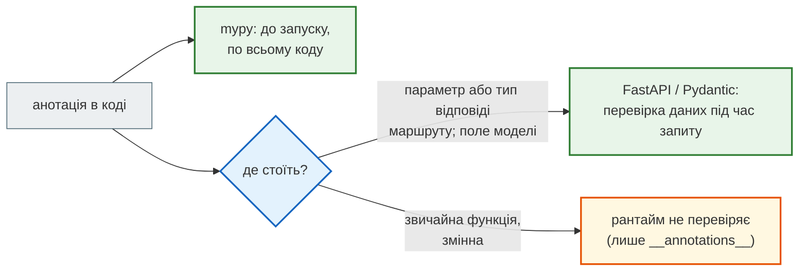

# Анотації типів: що читає FastAPI, а що лише mypy

## Проблема { #problem }

Python не перевіряє анотації: `def double(x: int)` спокійно прийме рядок. FastAPI і Pydantic, навпаки, будують з анотацій перевірку запитів, перетворення типів, схему OpenAPI і впровадження залежностей. Одна й та сама анотація працює для двох читачів: **mypy** перевіряє код до запуску, **FastAPI/Pydantic** перевіряють дані під час роботи. Якщо не знати, хто що читає, легко вирішити, що `Protocol` захищає вхідні дані, а `Annotated[str, Field(min_length=3)]` перевіряє звичайну функцію. Ні те, ні інше не так.

## Ментальна модель { #mental-model }



| Анотація | FastAPI / Pydantic під час роботи | mypy |
|---|---|---|
| `X \| None` | дозволяє `null`; **обов'язковість задає `= None`, а не `\| None`** | вимагає перевірити `None` перед використанням |
| `list[str]` | перевіряє кожен елемент; схема `array` з `items` | перевіряє, що в список кладуть рядки |
| `Literal["a", "b"]` | приймає лише ці значення (`literal_error`); схема `enum` | забороняє інші значення; ловить пропущену гілку |
| `Annotated[T, ...]` | читає метадані: `Query`, `Depends`, `Field`, `AfterValidator` | бачить лише `T`, метадані ігнорує |
| `TypedDict` | перевіряє словник із фіксованими ключами, як модель | перевіряє ключі й типи значень |
| `Protocol` | **не перевіряє**; як тип залежності в `Depends` — працює, бо залежність FastAPI не перевіряє | перевіряє, що об'єкт має потрібні методи |
| тип відповіді `-> Model` | фільтрує й перевіряє відповідь (`response_model`) | перевіряє, що функція повертає `Model` |

## Що бачить рантайм { #runtime }

[`examples/type_hints/runtime_app.py`](https://github.com/NikoriakViktor/news_hub/blob/main/examples/type_hints/runtime_app.py):

```python title="runtime_app.py (фрагмент)"
Status = Literal["todo", "in_progress", "done"]


class TaskIn(BaseModel):
    title: Annotated[str, Field(min_length=3)]   # Annotated: тип для mypy + обмеження для Pydantic
    status: Status
    priority: str | None = None                  # можна не передавати, можна передати null
    due: str | None                              # можна передати null, але НЕ можна не передати
    tags: list[str] = []


@app.post("/tasks", status_code=201)
def create_task(task: TaskIn, notifier: Annotated[Notifier, Depends(get_notifier)]) -> TaskOut:
    row = {"id": len(TASKS) + 1, **task.model_dump(), "secret": "internal"}
    ...
    return row                                   # FastAPI сам зробить TaskOut


@app.get("/raw")
def raw_tasks() -> list[dict[str, Any]]:         # тип відповіді без схеми: віддасть усе, що є
    return TASKS
```

[`runtime_demo.py`](https://github.com/NikoriakViktor/news_hub/blob/main/examples/type_hints/runtime_demo.py):

```text
--- POST /tasks → 201
   {"id": 1, "title": "Deploy", "status": "todo"}
--- status поза Literal → 422
   [["literal_error", ["body", "status"], "Input should be 'todo', 'in_progress' or 'done'"]]
--- без due (str | None без = None) → 422
   [["missing", ["body", "due"], "Field required"]]
--- tags: [1, 2] → 422
   [["string_type", ["body", "tags", 0], "Input should be a valid string"], ["string_type", ["body", "tags", 1], "Input should be a valid string"]]
--- GET /tasks?status=done&limit=99 → 422
   [["less_than_equal", ["query", "limit"], "Input should be less than or equal to 50"]]
--- GET /raw (-> list[dict]) → 200
   [{"id": 1, "title": "Deploy", "status": "todo", "priority": null, "due": null, "tags": ["ops"], "secret": "internal"}]
--- POST /points (TypedDict) → 200
   {"x": 2, "y": 3}
--- POST /points без y → 422
   [["missing", ["body", "y"], "Field required"]]
```

- **`-> TaskOut` — не лише для mypy.** Функція повернула словник з `secret`, а клієнт отримав тільки поля `TaskOut`. FastAPI (з версії 0.89) робить тип відповіді маршруту `response_model`.
- **`-> list[dict[str, Any]]`** — схеми полів немає, і `secret` пішов клієнту.
- **`due: str | None` без `= None` — обов'язкове поле.** `| None` дозволяє передати `null`, а не пропустити поле. Необов'язковим поле робить лише значення за замовчуванням.
- **`list[str]`** — помилка на кожен елемент окремо, з індексом у `loc`.
- **`Annotated[int, Query(ge=1, le=50)]`** — обмеження з метаданих спрацювало для query-параметра.
- **`TypedDict` як тіло запиту** перевіряється як модель, і `"y": "2"` перетворилось на `2` (нестрогий режим Pydantic).

## Що бачить схема OpenAPI { #openapi }

```text
--- OpenAPI
   TaskIn.status: {"type": "string", "enum": ["todo", "in_progress", "done"], "title": "Status"}
   TaskIn.priority: {"anyOf": [{"type": "string"}, {"type": "null"}], "title": "Priority"}
   TaskIn.due: {"anyOf": [{"type": "string"}, {"type": "null"}], "title": "Due"}
   TaskIn.tags: {"items": {"type": "string"}, "type": "array", "title": "Tags", "default": []}
   TaskIn.title: {"type": "string", "minLength": 3, "title": "Title"}
   TaskIn.required: ['title', 'status', 'due']
   Point: {"properties": {"x": {"type": "integer", "title": "X"}, "y": {"type": "integer", "title": "Y"}}, "type": "object", "required": ["x", "y"], "title": "Point"}
```

`priority` і `due` мають однакову схему (`anyOf` з `null`). Різниця лише в `required`, і саме її задає `= None`. `Field(min_length=3)` з `Annotated` став `minLength`, `Literal` — `enum`. Змінна `Status` стала `title` у схемі.

## Що бачить лише mypy { #mypy }

[`examples/type_hints/mypy_only.py`](https://github.com/NikoriakViktor/news_hub/blob/main/examples/type_hints/mypy_only.py) — код з помилками, які Python виконує мовчки:

```text
$ python mypy_only.py
status: archived
рантайм пройшов до кінця: {'x': 1, 'yy': 2} None
Traceback (most recent call last):
  ...
TypeError: EmailNotifier.send() missing 1 required positional argument: 'to'
```

```text
$ mypy --strict mypy_only.py
mypy_only.py:36: error: Value of type "str | None" is not indexable  [index]
mypy_only.py:39: error: Missing return statement  [return]
mypy_only.py:48: error: Incompatible types in assignment (expression has type "int", variable has type "str")  [assignment]
mypy_only.py:55: error: Missing key "y" for TypedDict "Point"  [typeddict-item]
mypy_only.py:55: error: Extra key "yy" for TypedDict "Point"  [typeddict-unknown-key]
mypy_only.py:56: error: Argument 1 to "set_status" has incompatible type "Literal['archived']"; expected "Literal['todo', 'in_progress', 'done']"  [arg-type]
mypy_only.py:58: error: Argument 1 to "notify" has incompatible type "EmailNotifier"; expected "Notifier"  [arg-type]
mypy_only.py:58: note: Following member(s) of "EmailNotifier" have conflicts:
mypy_only.py:58: note:     Expected:
mypy_only.py:58: note:         def send(self, text: str) -> None
mypy_only.py:58: note:     Got:
mypy_only.py:58: note:         def send(self, text: str, to: str) -> None
```

| Рядок | Що зловив mypy | Що зробив Python |
|---|---|---|
| 36 | `name[0]`, де `name: str \| None` | нічого: функцію не викликали з `None` — поки що |
| 39 | `label()` для `Literal` без гілки `"done"` | повернув `None` замість рядка |
| 48 | `bad_title: Annotated[str, Field(min_length=3)] = 42` | нічого: `Field` поза моделлю нічого не перевіряє |
| 55 | одруківка `"yy"` у ключі `TypedDict` | створив словник з одруківкою |
| 56 | `"archived"` поза `Literal` | надрукував `status: archived` |
| 58 | `EmailNotifier` не відповідає `Protocol Notifier` | `TypeError` — лише в момент виклику |

Перевірку вичерпності для `Literal` (рядок 39) mypy дає як «Missing return statement»: він бачить, що для `"done"` функція доходить до кінця без `return`. Точніший спосіб — `assert_never(status)` в останній гілці.

## `Protocol`: інтерфейс для коду, не для даних { #protocol }

`Protocol` описує, які методи має мати об'єкт, без наслідування: `PrintNotifier` не наслідує `Notifier`, але підходить, бо має `send(text)`. Це перевірка для mypy. Pydantic і FastAPI з ним як зі схемою даних працювати не можуть:

```text
--- Protocol як поле моделі
   PydanticSchemaGenerationError: Unable to generate pydantic-core schema for <class '__main__.Notifier'>. Set `arbitrary_types_allowed=True` in the model_config to ignore this error or implement `__get_pydantic_core_schema__` on your type to fully support it.
--- Protocol як тіло запиту
   FastAPIError: Invalid args for response field! Hint: check that <class '__main__.Notifier'> is a valid Pydantic field type. ...
```

Обидві помилки — під час оголошення, ще до першого запиту. «Сирий словник у бізнес-логіці» тут не вийде: застосунок просто не запуститься.

Але як тип **залежності** `Protocol` працює: `notifier: Annotated[Notifier, Depends(get_notifier)]` у `create_task` вище. FastAPI не перевіряє, що повертає залежність. Анотація там для mypy і для того, хто читає код. Так у News Hub влаштований `LLMClient`.

## `Annotated`: тип першим, метадані — далі { #annotated }

```text
--- Annotated з метаданими на першому місці
   AttributeError: 'Depends' object has no attribute '__mro__'
   Annotated[int]: Annotated[...] should be used with at least two arguments (a type and an annotation).
```

`Annotated[Depends(get_db), str]` падає під час оголошення маршруту з незрозумілим `AttributeError`. Порядок завжди `Annotated[тип, метадані...]`. Без метаданих `Annotated` не має сенсу, і Python не дає його створити.

`Annotated` — рекомендований FastAPI спосіб з версії 0.95. Старий запис `limit: int = Query(10, ge=1)` працює й не дає попереджень, але `Annotated` краще: значення за замовчуванням лишається звичайним Python-значенням, і функцію можна викликати поза FastAPI. Те саме з Pydantic: `constr(min_length=3)` у Pydantic 2.13 працює без попереджень, але документація радить `Annotated[str, StringConstraints(...)]` або `Annotated[str, Field(...)]`, бо mypy не розуміє `constr(...)` як тип.

## Дві пастки рантайму { #runtime-gotchas }

**`TypedDict` з `typing` на Python < 3.12:**

```text
(3, 10) PydanticUserError Please use `typing_extensions.TypedDict` instead of `typing.TypedDict` on Python < 3.12.
(3, 12) {'x': 1}
```

Тому News Hub імпортує `TypedDict` з `typing_extensions` — так код працює на будь-якій версії.

**`from __future__ import annotations` і клас усередині функції.** З цим імпортом анотації зберігаються рядками, і FastAPI шукає `Item` за назвою в глобальній області модуля. Клас, оголошений усередині функції, він не знаходить. Помилки при цьому немає, параметр просто стає іншим:

```text
$ python future_gotcha.py
422 {"detail":[{"type":"missing","loc":["query","item"],"msg":"Field required","input":null}]}
```

Тіло запиту правильне, але FastAPI чекає `item` у **query**. Моделі для маршрутів оголошують на рівні модуля — тоді анотації-рядки знаходяться.

## У News Hub { #news-hub }

| Анотація | Де | Для кого |
|---|---|---|
| `TypedDict RawNews` | `parser.py`: новина так, як її дає HTML, лише рядки ([крок 1](../tutorials/01_typing_pydantic/index.md)) | mypy в парсері; Pydantic — у `snapshot.py` через `TypeAdapter(list[RawNews])` |
| `Literal` | `ScrapeRequest.source`/`mode`, `NewsItem.lang`, `JobStatus.status`, теми й тональність аналізу LLM | FastAPI (`422` і `enum` у `/docs`), mypy |
| `X \| None` | `published_time: time \| None` — у 31 зі 168 новин часу немає | mypy змушує перевірити `None` |
| `Annotated[..., Depends(...)]` | `SessionDep`, `RedisDep`, `LLMDep` у `api.py` | FastAPI |
| `Protocol LLMClient` | `llm.py`: `GeminiClient`, `AnthropicClient`, `FakeLLM` для тестів — без спільного базового класу | лише mypy; FastAPI бачить його в `Depends` і не перевіряє |

Крок 1 показує різницю на парсері: [`before_dict.py`](https://github.com/NikoriakViktor/news_hub/blob/main/steps/01_typing_pydantic/examples/before_dict.py) з `list[dict]` і [`after_typed.py`](https://github.com/NikoriakViktor/news_hub/blob/main/steps/01_typing_pydantic/examples/after_typed.py) з `RawNews` і `NewsItem`:

```text
$ mypy --strict examples/after_typed.py
examples/after_typed.py:7: error: TypedDict "RawNews" has no key "titel"  [typeddict-item]
examples/after_typed.py:7: note: Did you mean "title"?
examples/after_typed.py:11: error: Item "None" of "time | None" has no attribute "hour"  [union-attr]
```

З `dict` ту саму одруківку `"titel"` mypy пропускає.

## Типові помилки { #mistakes }

| Помилка | Наслідок | Як правильно |
|---|---|---|
| `x: str \| None` і чекати, що поле необов'язкове | `422 Field required` | `x: str \| None = None` |
| `items: list` без параметра | будь-які елементи; у схемі `items: {}` | `list[str]` |
| `-> list[dict]` або `-> dict` у маршруті | клієнт отримує всі поля, включно зі службовими | `-> list[NewsOut]` |
| `Protocol` як поле моделі чи тіло | застосунок не запускається | `BaseModel` для даних; `Protocol` — для залежностей і сервісів |
| `Annotated[Depends(...), T]` | `AttributeError` під час оголошення | `Annotated[T, Depends(...)]` |
| `Annotated[str, Field(...)]` у звичайній функції | нічого не перевіряється | `@validate_call` або модель |
| `typing.TypedDict` на Python 3.10–3.11 | `PydanticUserError` | `typing_extensions.TypedDict` |
| модель усередині функції з `from __future__ import annotations` | тіло стає query-параметром, `422` | моделі — на рівні модуля |
| `str` для параметра сортування | будь-яке значення доходить до коду, що будує запит до бази | `Literal["date", "-date"]` ([Колекції](../01_http_and_rest/collections.md)) |

## Налагодження { #debugging }

- **`/docs` або `/openapi.json`** — найшвидший спосіб побачити, як FastAPI зрозумів параметр: `in: query` замість тіла одразу видно.
- **`422` з `loc: ["query", ...]` для того, що мало бути тілом** — тип не розпізнано як модель: див. `from __future__ import annotations` вище.
- **`reveal_type(x)`** у коді й `mypy` покаже, який тип бачить mypy; `typing.get_type_hints(func, include_extras=True)` — що бачить рантайм, разом з метаданими `Annotated`.
- **`mypy --strict`** у CI ловить те, що тести можуть пропустити: `None`, одруківки в ключах, невідповідність `Protocol`.

## Безпека { #security }

- **Тип відповіді маршруту — фільтр полів.** `-> NewsOut` гарантує, що пароль чи службове поле не підуть клієнту, навіть якщо функція їх повернула. `dict` такої гарантії не дає.
- **`Literal` для всього, що стає частиною запиту до бази**: поле сортування, напрям, назва таблиці. Список дозволених значень перевіряє FastAPI до твого коду.
- **mypy не захищає від даних ззовні.** Анотація `item: RawNews` у звичайній функції нічого не перевіряє під час роботи. Дані з мережі, файлу чи LLM проходять через модель Pydantic або `TypeAdapter`, як знімок у News Hub.

## Питання { #questions }

1. Чим `x: str | None` відрізняється від `x: str | None = None` для FastAPI?
2. Що FastAPI робить з типом відповіді `-> TaskOut`, крім підказки для mypy?
3. Чому `Protocol` не можна використати як тип тіла запиту, але можна як тип залежності?
4. Що бачить mypy в `Annotated[str, Field(min_length=3)]`?
5. Як mypy показує, що для одного зі значень `Literal` забули гілку?
6. Чому News Hub імпортує `TypedDict` з `typing_extensions`?
7. Чому з `from __future__ import annotations` модель, оголошена в функції, стає query-параметром?

??? success "Відповіді"

    1. Перше — обов'язкове поле, яке можна передати як `null`; друге — необов'язкове.
    2. Використовує як `response_model`: перевіряє відповідь і відкидає поля, яких у моделі немає.
    3. Для тіла потрібна схема даних, а `Protocol` описує методи; FastAPI падає під час оголошення. Результат залежності FastAPI не перевіряє, тож там анотація — лише для mypy.
    4. Просто `str`; метадані ігнорує.
    5. «Missing return statement»: функція для пропущеного значення доходить до кінця без `return`. Точніше — `assert_never` в останній гілці.
    6. Pydantic приймає `typing.TypedDict` лише на Python 3.12+; `typing_extensions` працює на будь-якій версії.
    7. Анотація стає рядком `"Item"`, FastAPI не знаходить такої назви в модулі й не розпізнає модель, тож вважає параметр query.

## Що далі { #next }

[Частина II. Типи і Pydantic](README.md) — решта розділів частини.

**Джерела:** [Python — typing](https://docs.python.org/3/library/typing.html); PEP [604](https://peps.python.org/pep-0604/) (`X | Y`), [585](https://peps.python.org/pep-0585/) (`list[str]`), [586](https://peps.python.org/pep-0586/) (`Literal`), [589](https://peps.python.org/pep-0589/) (`TypedDict`), [593](https://peps.python.org/pep-0593/) (`Annotated`), [544](https://peps.python.org/pep-0544/) (`Protocol`), [563](https://peps.python.org/pep-0563/) (`from __future__ import annotations`); FastAPI — [Python Types Intro](https://fastapi.tiangolo.com/python-types/), [Response Model — Return Type](https://fastapi.tiangolo.com/tutorial/response-model/), [Query Parameters and String Validations](https://fastapi.tiangolo.com/tutorial/query-params-str-validations/); Pydantic — [Types](https://docs.pydantic.dev/latest/concepts/types/), [Fields](https://docs.pydantic.dev/latest/concepts/fields/), [Standard Library Types — TypedDict](https://docs.pydantic.dev/latest/api/standard_library_types/); [mypy — Protocols and structural subtyping](https://mypy.readthedocs.io/en/stable/protocols.html), [Literal types — exhaustiveness checking](https://mypy.readthedocs.io/en/stable/literal_types.html#exhaustiveness-checking).
