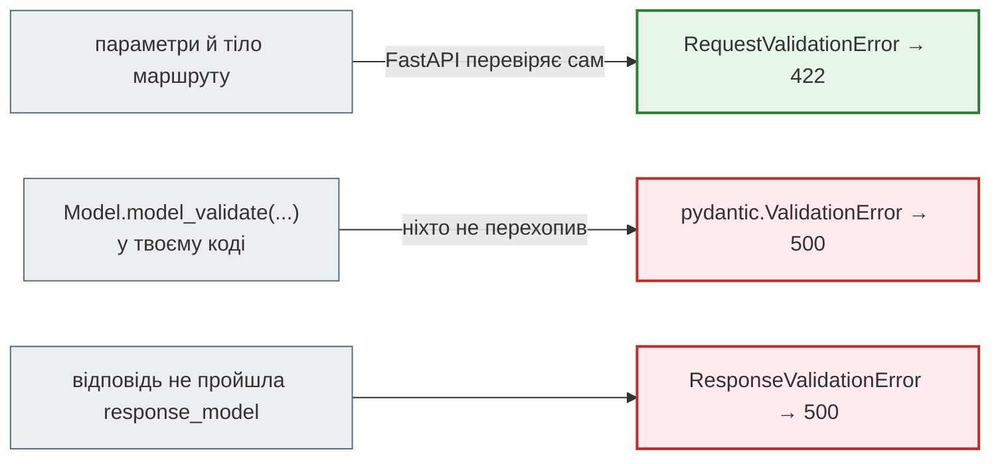

# `ValidationError`: структура і як показати людині

## Проблема { #problem }

Коли дані не пройшли перевірку, Pydantic не зупиняється на першій помилці: він збирає всі й кидає один `ValidationError`. Кожна помилка — словник з кількох ключів. Частина з них для програми (`type`, `loc`), частина для людини (`msg`), а частина небезпечна (`input`, `ctx`). FastAPI віддає цей список клієнту як є, англійською і разом з тим, що клієнт надіслав. Тут розберемо, що в кожному ключі, як перетворити список на повідомлення під полями форми і коли `ValidationError` стає `500`, а не `422`.

## Ментальна модель { #mental-model }

| Ключ | Що це | Для кого | Обережно |
|---|---|---|---|
| `type` | машинний код: `missing`, `string_too_short`, `greater_than_equal`, `value_error`… | програма: за ним перекладають і перевіряють у тестах | стабільний між версіями, на відміну від `msg` |
| `loc` | шлях до поля: `("items", 1, "qty")`; у FastAPI першим іде джерело — `body`, `query`, `path`, `header`, `cookie` | програма: до якого поля форми прив'язати | `()` або `("body",)` — помилка всієї моделі |
| `msg` | повідомлення англійською | розробник | для `ValueError` — з префіксом «Value error, » |
| `input` | значення, яке не пройшло | налагодження | **паролі й токени**; `bytes` після `model_validate_json` |
| `ctx` | параметри правила: `{"ge": 1}`, `{"min_length": 12}`, `{"pattern": ...}` | переклад повідомлень | для `ValueError` — `{"error": ValueError(...)}`, об'єкт, а не JSON |
| `url` | посилання на документацію типу помилки | розробник | FastAPI його не віддає |



## Усі ключі на прикладі { #structure }

[`examples/pydantic_v2/validation_error_demo.py`](https://github.com/NikoriakViktor/news_hub/blob/main/examples/pydantic_v2/validation_error_demo.py):

```python title="validation_error_demo.py (фрагмент)"
class Item(BaseModel):
    sku: str = Field(pattern=r"^[A-Z]{3}-\d{4}$")
    qty: int = Field(ge=1, le=1000)


class Order(BaseModel):
    email: str
    items: list[Item] = Field(min_length=1)
    coupon: str | None = None
    # email: field_validator → ValueError("email без @")
    # coupon: field_validator → PydanticCustomError("coupon_unknown", "Купон {coupon} не діє", {"coupon": value})
```

```text
--- 1. exc.errors(): усі ключі
   title='Order' error_count=4
   {'type': 'value_error', 'loc': ('email',), 'msg': 'Value error, email без @', 'input': 'olena', 'ctx': {'error': ValueError('email без @')}, 'url': 'https://errors.pydantic.dev/2.13/v/value_error'}
   {'type': 'string_pattern_mismatch', 'loc': ('items', 1, 'sku'), 'msg': "String should match pattern '^[A-Z]{3}-\\d{4}$'", 'input': 'bad', 'ctx': {'pattern': '^[A-Z]{3}-\\d{4}$'}, 'url': 'https://errors.pydantic.dev/2.13/v/string_pattern_mismatch'}
   {'type': 'greater_than_equal', 'loc': ('items', 1, 'qty'), 'msg': 'Input should be greater than or equal to 1', 'input': 0, 'ctx': {'ge': 1}, 'url': 'https://errors.pydantic.dev/2.13/v/greater_than_equal'}
   {'type': 'coupon_unknown', 'loc': ('coupon',), 'msg': 'Купон FREE не діє', 'input': 'FREE', 'ctx': {'coupon': 'FREE'}}
```

- **`loc` для вкладених даних** — шлях з індексом списку: `('items', 1, 'qty')`. Перший товар правильний, тож помилок для `items.0` немає.
- **`ValueError` з валідатора** дає загальний `type: value_error`, а сам об'єкт винятку кладе в `ctx.error`.
- **`PydanticCustomError`** дає власний `type` (`coupon_unknown`) і `ctx` з параметрами повідомлення. За таким кодом фронтенд може розрізнити помилки, а не розбирати текст. `url` для власних типів немає.
- `exc.title` — назва моделі, `exc.error_count()` — кількість помилок.

## Що можна викинути і що падає { #serialize }

```text
--- 2. errors(include_url=False, include_context=False, include_input=False)
   {'type': 'value_error', 'loc': ('email',), 'msg': 'Value error, email без @'}
   {'type': 'string_pattern_mismatch', 'loc': ('items', 1, 'sku'), 'msg': "String should match pattern '^[A-Z]{3}-\\d{4}$'"}
   {'type': 'greater_than_equal', 'loc': ('items', 1, 'qty'), 'msg': 'Input should be greater than or equal to 1'}
   {'type': 'coupon_unknown', 'loc': ('coupon',), 'msg': 'Купон FREE не діє'}
--- 3. json.dumps(exc.errors()) і exc.json()
   json.dumps: Object of type ValueError is not JSON serializable
   exc.json(): [{"type":"value_error","loc":["email"],"msg":"Value error, email без @","input":"olena","ctx":{"error":"email  ...
--- 4. input — bytes, якщо перевіряли model_validate_json(bytes)
   json_invalid loc=() input=b'{"email": "olena@example.com"'
```

- **`exc.errors()` не можна просто покласти в `json.dumps` чи `JSONResponse`**: `ctx.error` — об'єкт винятку. Варіанти: `exc.json()`, `jsonable_encoder(exc.errors())` (FastAPI так робить і перетворює виняток на `{}`) або `include_context=False`.
- **`model_validate_json(bytes)`** кладе в `input` сирі `bytes` — теж не JSON. Тому News Hub у webhook збору ([крок 8](../tutorials/08_security/index.md)) викликає `error.errors(include_url=False, include_context=False, include_input=False)`.

## Повідомлення для людини { #friendly }

Фронтенду потрібна не таблиця помилок, а текст під кожним полем, мовою користувача. `type` і `ctx` дають усе для перекладу:

```python title="validation_error_demo.py (фрагмент)"
UK = {
    "missing": "Обов'язкове поле",
    "string_too_short": "Щонайменше {min_length} символів",
    "string_pattern_mismatch": "Не відповідає формату",
    "greater_than_equal": "Має бути не менше {ge}",
    "less_than_equal": "Має бути не більше {le}",
    "too_short": "Потрібно щонайменше {min_length} елемент(и)",
    "int_parsing": "Має бути цілим числом",
}


def to_user(errors: list[dict[str, Any]]) -> dict[str, list[str]]:
    """Помилки → {"поле": ["повідомлення українською"]}; без input, без внутрішніх об'єктів."""
    result: dict[str, list[str]] = {}
    for error in errors:
        loc = [str(part) for part in error["loc"] if part not in ("body", "query", "path", "header", "cookie")]
        field = ".".join(loc) or "__all__"
        template = UK.get(error["type"])
        message = template.format(**error.get("ctx", {})) if template else error["msg"].removeprefix("Value error, ")
        result.setdefault(field, []).append(message)
    return result


@app.exception_handler(RequestValidationError)
async def friendly(request: Request, exc: RequestValidationError) -> JSONResponse:
    return JSONResponse({"errors": to_user(exc.errors())}, status_code=422)
```

```text
--- 5. обробник RequestValidationError: повідомлення для людини
   POST /orders → {'errors': {'email': ['email без @'], 'items.1.sku': ['Не відповідає формату'], 'items.1.qty': ['Має бути не менше 1'], 'coupon': ['Купон FREE не діє']}}
   GET /search → {'errors': {'limit': ['Має бути цілим числом'], 'x-request-id': ['Щонайменше 8 символів']}}
   POST /signup → {'errors': {'password': ['Щонайменше 12 символів']}}
```

- **Переклад за `type`, параметри з `ctx`**: «Має бути не менше {ge}» + `{"ge": 1}`. Не за `msg`: англійський текст може змінитися з версією Pydantic, `type` — ні.
- **Без `input` і без `ctx` у відповіді**: обидва ключі з цього обробника не виходять, тож ні пароль, ні об'єкт винятку туди не потраплять. Порівняй з наївним фільтром «приховати `input`, якщо в назві поля є `password`»: помилка `model_validator` має `loc: ["body"]`, і фільтр за назвою поля її пропустить ([нижче](#model-validator-input)).
- **Джерело (`body`, `query`, `header`) прибрано з назви поля**: фронтенду потрібне `items.1.qty`. Для заголовків FastAPI пише назву з дефісом (`x-request-id`).
- Коли перекладу немає, лишається `msg` — краще англійське повідомлення, ніж жодного.

Повна заміна формату помилок усього API (RFC 9457) — на сторінці [Формат помилок](../01_http_and_rest/errors.md#problem-details).

## Помилка `model_validator`: усе тіло в `input` { #model-validator-input }

```text
--- 7. стандартний detail FastAPI і model_validator: що в input
   [{'type': 'value_error', 'loc': ['body'], 'msg': 'Value error, паролі не збігаються', 'input': {'email': 'a@b.c', 'password': 'correct horse battery', 'password_repeat': 'x'}, 'ctx': {'error': {}}}]
```

Стандартна відповідь FastAPI для помилки рівня моделі віддає в `input` **усе тіло**, разом з паролем. `ctx.error` став `{}`: так `jsonable_encoder` перетворює об'єкт винятку.

## `ValidationError` у твоєму коді — це `500` { #inside-route }

```python title="validation_error_demo.py (фрагмент)"
@app.post("/import")
def import_raw(payload: dict[str, Any]) -> dict[str, int]:
    order = Order.model_validate(payload)         # ValidationError усередині маршруту — не RequestValidationError
    return {"items": len(order.items)}
```

```text
--- 6. ValidationError усередині маршруту
   POST /import → 500 Internal Server Error
```

FastAPI перехоплює лише `RequestValidationError` — помилки параметрів і тіла, які перевіряв сам. `pydantic.ValidationError` з `model_validate` у твоєму коді — звичайний необроблений виняток. Два способи:

- перехопити на місці й кинути `HTTPException(422, detail=exc.errors(include_url=False, include_context=False))` — так зроблено в News Hub у `create_news` ([крок 3](../tutorials/03_sqlalchemy_alembic/index.md)): вручну додана новина проходить ту саму модель `NewsItem`, що й новина з парсера;
- або описати тіло моделлю в сигнатурі маршруту, щоб перевіряв FastAPI.

Обробник `@app.exception_handler(ValidationError)` теж спрацює, але для **всіх** `ValidationError`, зокрема від некоректних даних з бази чи відповіді LLM, де винен не клієнт, а сервер.

## У News Hub { #news-hub }

| Де | Що робить |
|---|---|
| усі маршрути | стандартний `detail` FastAPI ([Формат помилок](../01_http_and_rest/errors.md#news-hub)) |
| `create_news` | `NewsItem.from_raw(...)` у `try`, `ValidationError` → `HTTPException(422, detail=error.errors(include_url=False, include_context=False))` |
| webhook збору | `model_validate_json(body)`; `include_input=False`, бо `input` — `bytes` |
| аналіз LLM | `NewsAnalysis.model_validate_json(reply.text)`; `ValidationError` тут — провина LLM, а не клієнта, тому `InvalidLLMOutput` → `502` ([крок 7](../tutorials/07_llm_api/index.md)) |
| тести | перевіряють `type` і `loc`, а не `msg`: `{error["loc"][0] for error in response.json()["detail"]} == {"title", "url"}` |

## Типові помилки { #mistakes }

| Помилка | Наслідок | Як правильно |
|---|---|---|
| `JSONResponse({"errors": exc.errors()})` | `500`, коли в `ctx` є `ValueError` | `include_context=False`, `exc.json()` або `jsonable_encoder` |
| віддати `input` клієнту чи в журнал | паролі й токени у відповіді та логах | не віддавати `input`; або `include_input=False` |
| ховати `input` за назвою поля (`"password" in field`) | помилка `model_validator` (`loc: ["body"]`) віддає все тіло | не віддавати `input` взагалі |
| `model_validate` у маршруті без `try` | `500` замість `422` | `try` → `HTTPException(422, ...)` або модель у сигнатурі |
| `@app.exception_handler(ValidationError)` замість `RequestValidationError` | помилки запиту він не змінює; зате помилки сервера стають `422` | `RequestValidationError` для запитів |
| переклад або перевірка в тестах за `msg` | ламається з оновленням Pydantic | за `type` і `ctx` |
| `include_input=False` забули при `model_validate_json(bytes)` | `500`: `bytes` не серіалізуються | `include_input=False` |

## Безпека { #security }

- **`input` — головний витік.** Він є в стандартній відповіді FastAPI. Для форм входу, реєстрації, платежів — власний обробник без `input`.
- **`loc` розкриває структуру моделей.** Для публічних API це прийнятно (структура й так в OpenAPI), для внутрішніх моделей, перевірених у коді, — ні: `include_input=False` і короткий `detail`.
- **Великі тіла повертаються назад.** Рядок на мегабайт, що не пройшов `max_length`, повернеться в `input` повністю. Ще одна причина не віддавати `input`.
- **`ValidationError` від даних сервера — не `422`.** Якщо не пройшла відповідь LLM чи рядок з бази, клієнт не винен: `5xx` і журнал, а не «виправте запит».

## Питання { #questions }

1. Які ключі має помилка в `exc.errors()` і який з них використовувати для перекладу?
2. Що буде в `loc` для помилки в полі `qty` другого товару списку `items`? А в FastAPI?
3. Чому `JSONResponse({"errors": exc.errors()})` може дати `500`?
4. Що потрапить в `input`, якщо не пройшов `model_validator(mode="after")`?
5. Чому `Order.model_validate(...)` усередині маршруту дає `500`, а модель у сигнатурі — `422`?
6. Навіщо `PydanticCustomError`, якщо є `ValueError`?

??? success "Відповіді"

    1. `type`, `loc`, `msg`, `input`, `ctx`, `url`. Для перекладу — `type` і параметри з `ctx`.
    2. `('items', 1, 'qty')`; у FastAPI — `['body', 'items', 1, 'qty']`.
    3. Для `ValueError` у `ctx.error` лежить об'єкт винятку, який не серіалізується в JSON.
    4. Усе тіло запиту.
    5. FastAPI перехоплює лише `RequestValidationError` від своєї перевірки; `pydantic.ValidationError` з твого коду — необроблений виняток.
    6. Власний `type` (наприклад, `coupon_unknown`) і `ctx` з параметрами: клієнт розрізняє помилки за кодом, а не за текстом.

## Що далі { #next }

[Налаштування: `pydantic-settings`, `.env`, `SecretStr`](settings.md) — ті самі моделі й ті самі `ValidationError`, але дані приходять не з запиту, а зі змінних середовища при старті.

**Джерела:** Pydantic — [Validation Errors](https://docs.pydantic.dev/latest/errors/validation_errors/), [Errors — ValidationError](https://docs.pydantic.dev/latest/api/pydantic_core/#pydantic_core.ValidationError), [Validators — Raising validation errors](https://docs.pydantic.dev/latest/concepts/validators/#raising-validation-errors); FastAPI — [Handling Errors — Override request validation exceptions](https://fastapi.tiangolo.com/tutorial/handling-errors/#override-request-validation-exceptions).
