# Валідатори і `computed_field`

## Проблема { #problem }

`Field` перевіряє одне поле одним правилом: довжину, діапазон, шаблон. Але бувають правила складніші: промокод треба спершу очистити від пробілів, дата початку має бути раніше за дату кінця, категорію новини можна взяти лише з її адреси. А деякі поля ніхто не надсилає — їх треба обчислити для відповіді. Для цього в Pydantic 2 три інструменти, і кожен має своє місце в конвеєрі перевірки. Поставиш правило не туди — отримаєш `500` замість `422`, мовчазний `None` у полі або пароль у тексті помилки.

## Ментальна модель { #mental-model }

```mermaid
flowchart LR
    classDef step     fill:#eceff1,stroke:#546e7a,stroke-width:1px;
    classDef decision fill:#e3f2fd,stroke:#1565c0,stroke-width:2px;
    classDef success  fill:#e8f5e9,stroke:#2e7d32,stroke-width:2px;
    classDef warning  fill:#fff8e1,stroke:#e65100,stroke-width:2px;

    IN["сирі дані"] --> MB["model_validator<br>(mode='before')<br>увесь вхід, будь-що"]
    MB --> FB["field_validator<br>(mode='before')<br>сире значення поля"]
    FB --> T["тип і Field<br>(Pydantic)"]
    T --> FA["field_validator<br>(mode='after')<br>уже правильний тип"]
    FA --> MA["model_validator<br>(mode='after')<br>self з усіма полями"]
    MA --> OBJ["модель"]
    OBJ -->|"model_dump / відповідь"| CF["computed_field<br>обчислюється на виході"]

    class IN,OBJ step
    class MB,FB warning
    class T,FA,MA success
    class CF decision
```



| Інструмент | Отримує | Для чого |
|---|---|---|
| `@model_validator(mode="before")` | увесь вхід як є: `dict`, список, об'єкт, будь-що | перебудувати вхід: вивести поля з інших, прийняти інший формат |
| `@field_validator(..., mode="before")` | сире значення одного поля | нормалізувати перед перевіркою типу: обрізати, розбити рядок, витягти частину |
| `@field_validator(...)` (`mode="after"`) | значення вже потрібного типу | бізнес-правило для одного поля |
| `@model_validator(mode="after")` | `self` — модель з усіма перевіреними полями | правило між полями: `start < end`, `discount <= price` |
| `@computed_field` | `self` | поле лише для виводу: у `model_dump`, відповіді й схемі OpenAPI |

Колонки «before» позначено жовтим: там значення ще не перевірене, і код мусить бути готовим до будь-якого типу.

## Повний приклад { #example }

[`examples/pydantic_v2/validators_demo.py`](https://github.com/NikoriakViktor/news_hub/blob/main/examples/pydantic_v2/validators_demo.py):

```python title="validators_demo.py (фрагмент)"
class Booking(BaseModel):
    promo_code: str
    base_price: Decimal = Field(gt=0)
    discount: Decimal = Field(default=Decimal(0), ge=0)
    start: date
    end: date

    @field_validator("promo_code", mode="before")      # сире значення: може бути будь-чим
    @classmethod
    def normalize(cls, value: Any) -> Any:
        return value.strip().upper() if isinstance(value, str) else value

    @field_validator("promo_code")                      # mode="after": уже str
    @classmethod
    def known_format(cls, value: str) -> str:
        if not value.isalnum() or len(value) < 3:
            raise ValueError("промокод: щонайменше 3 літери чи цифри")
        return value

    @model_validator(mode="after")                     # усі поля вже перевірені
    def dates_and_discount(self) -> "Booking":
        if self.start >= self.end:
            raise ValueError("start має бути раніше за end")
        if self.discount > self.base_price:
            raise ValueError("знижка більша за ціну")
        return self

    @computed_field                                    # не приймається на вході, з'являється на виході
    @property
    def final_price(self) -> Decimal:
        return self.base_price - self.discount
```

```text
--- 1. before → after → model_validator → computed_field
   правильне бронювання                     {'promo_code': 'SALE2026', 'base_price': '100', 'discount': '15', 'start': '2026-12-01', 'end': '2026-12-10', 'final_price': '85'}
   promo_code=123 (before пропустив не-str) ValidationError [('string_type', ('promo_code',), 'Input should be a valid string')]
   promo_code='ab'                          ValidationError [('value_error', ('promo_code',), 'Value error, промокод: щонайменше 3 літери чи цифри')]
   start > end                              ValidationError [('value_error', (), 'Value error, start має бути раніше за end')]
   start > end і base_price=-1              ValidationError [('greater_than', ('base_price',), 'Input should be greater than 0')]
   final_price у вхідних даних              Decimal('85')
```

- **`before` не перевіряє тип, а лише готує значення.** `123` він пропустив без змін, і далі помилку дав сам Pydantic (`string_type`). Якби `normalize` викликав `.strip()` без перевірки `isinstance`, був би `AttributeError` (див. [нижче](#mistakes-demo)).
- **`ValueError` у валідаторі стає `value_error`** з префіксом «Value error, » у повідомленні.
- **Помилка `model_validator` не має поля** в `loc` (`()`): вона стосується моделі цілком.
- **`model_validator(mode="after")` не запускається, якщо хоч одне поле не пройшло**: при `base_price=-1` помилки про дати немає. Клієнт виправить ціну й лише тоді побачить помилку про дати.
- **`computed_field` на вході ігнорується**: `final_price: 1` у вхідних даних нічого не змінив, результат — `85`.

## Порядок кількох валідаторів { #order }

```text
--- 2. порядок кількох валідаторів одного поля
      before_2 'x'
      before_1 'x'
      after_1 'x'
      after_2 'x'
```

Валідатори `before` виконуються **у зворотному порядку** оголошення, `after` — у прямому. Якщо валідатори одного поля залежать один від одного, краще злити їх в один.

## Типові помилки, перевірені { #mistakes-demo }

```text
--- 3. типові помилки
   валідатор без return                     None
   before без isinstance, code=5            AttributeError: 'int' object has no attribute 'strip'  ← не ValidationError
   assert у валідаторі                      ValidationError [('assertion_error', ('qty',), 'Assertion failed, кількість має бути додатною')]
      info.data у валідаторі start: {}
   info.data з полем, оголошеним нижче      KeyError: 'end'  ← не ValidationError
```

1. **Забули `return`** — поле `name: str` мовчки стало `None`. Без помилки й попередження.
2. **`before` без `isinstance`** — `AttributeError` не є `ValueError`, і Pydantic його не перехоплює. У FastAPI це `500`:

    ```text
    /unsafe code=5 → 500 Internal Server Error
    ```

    Pydantic перетворює на помилку перевірки лише `ValueError`, `AssertionError` і `PydanticCustomError`. Усе інше — падіння.

3. **`assert` працює, але `python -O` прибирає всі `assert`**, і правило зникне в продакшні. Для правил — `raise ValueError`.
4. **`info.data` в `field_validator`** містить лише поля, оголошені **вище** й уже перевірені. `end` оголошено нижче за `start` — `KeyError`, тобто знову `500`. Правила між полями — у `model_validator(mode="after")`, де є всі поля.

Ще дві речі, які RAG-відповіді часто подають як помилки, а Pydantic 2.13 їх прощає:

- **`@field_validator` без `@classmethod`** працює: Pydantic сам робить метод класовим. `@classmethod` пишуть заради mypy й читача.
- **`@computed_field` без `@property`** теж працює в рантаймі. Але mypy бачить метод: `n: int = a.size` → «expression has type "Callable[[], int]"». Тому `@computed_field` + `@property` завжди разом.

## `model_validator(mode="before")`: інший формат входу { #model-before }

```python title="validators_demo.py (фрагмент)"
class Point(BaseModel):
    x: int
    y: int

    @model_validator(mode="before")
    @classmethod
    def from_pair(cls, data: Any) -> Any:
        if isinstance(data, (list, tuple)) and len(data) == 2:   # [1, 2] → {"x": 1, "y": 2}
            return {"x": data[0], "y": data[1]}
        return data
```

```text
--- 4. model_validator(mode='before'): вхід може бути не словником
   Point.model_validate([1, 2])             Point(x=1, y=2)
   Point.model_validate({'x': 1, 'y': 2})   Point(x=1, y=2)
```

На вході може бути що завгодно: словник, список, рядок з бази (`from_attributes`), `None`. Тому перша дія — перевірка типу, а все незнайоме повертається без змін, щоб помилку дав Pydantic.

## У FastAPI { #fastapi }

```text
--- 5. у FastAPI
   {'promo_code': 'SALE2026', 'base_price': '100', 'discount': '15', 'start': '2026-12-01', 'end': '2026-12-10', 'final_price': '85'}
   422 {'type': 'value_error', 'loc': ['body'], 'msg': 'Value error, паролі не збігаються', 'input': {'email': 'a@b.c', 'password': 'hunter2-secret', 'password_repeat': 'hunter3'}, 'ctx': {'error': {}}}
   OpenAPI: ['Booking-Input', 'Booking-Output']
   Booking-Output.final_price: {'type': 'string', 'pattern': '^(?!^[-+.]*$)[+-]?0*\\d*\\.?\\d*$', 'title': 'Final Price', 'readOnly': True} | required: True
   Booking-Input має final_price: False
```

- **Помилка `model_validator` повертає в `input` усе тіло запиту** — тут обидва паролі відкритим текстом. У `field_validator` в `input` лише значення поля. Для форм з паролями — свій обробник помилок без `input` ([Формат помилок](../01_http_and_rest/errors.md#problem-details)).
- **`computed_field` розділив схему на дві**: `Booking-Input` без `final_price` і `Booking-Output`, де `final_price` обов'язковий і `readOnly`. У `/docs` клієнт бачить, що надсилати його не треба.
- `Decimal` у JSON — рядок (`'85'`), див. [Моделі Pydantic 2](pydantic_models.md#dump).

## Валідатор як частина типу: `Annotated` { #annotated }

Якщо те саме правило потрібне в кількох моделях, його виносять у тип:

```python
from typing import Annotated
from pydantic import AfterValidator, BeforeValidator

PromoCode = Annotated[str, BeforeValidator(lambda v: v.strip().upper() if isinstance(v, str) else v),
                      AfterValidator(check_promo)]

class Booking(BaseModel):
    promo_code: PromoCode
```

Порядок той самий: `BeforeValidator` — до перевірки типу, `AfterValidator` — після. Так зроблено `CORS_ORIGINS` у [CORS](../06_middleware_cache_jobs/cors.md#settings), тільки через `field_validator`.

## У News Hub { #news-hub }

`NewsItem` у `models.py` ([крок 1](../tutorials/01_typing_pydantic/index.md)) використовує всі різновиди:

| Валідатор | Що робить |
|---|---|
| `@model_validator(mode="before")` `derive_from_url` | `source`, `lang` і `category` в HTML немає — бере їх з URL (`urlsplit`). Спершу `if not isinstance(data, dict) or not isinstance(data.get("url"), str): return data` |
| `@field_validator("published_time", mode="before")` | стрічка дає `"14:19"`, а атрибут `<time datetime>` — `"2024-05-08T10:30:00"`; з другого бере лише час |
| `@field_validator("url")` (after) | `url` уже `HttpUrl`, тож `url.host` є; пропускає лише дозволені сайти |
| `@field_validator("pages")` у `ScrapeRequest` (`api.py`) | сервер завантажує лише сторінки rbc.ua: захист від SSRF ([крок 8](../tutorials/08_security/index.md)) |

`computed_field` у News Hub немає: похідні поля (`source`, `lang`, `category`) обчислюються один раз на вході й зберігаються в базі, а не на кожній відповіді.

## Типові помилки { #mistakes }

| Помилка | Наслідок | Як правильно |
|---|---|---|
| валідатор без `return` | поле мовчки стає `None` | завжди `return value` |
| `before` без перевірки типу | `AttributeError`/`TypeError` → `500` | `isinstance` першим рядком; незнайоме — повернути як є |
| `info.data["інше_поле"]` | `KeyError` → `500`, якщо поле нижче або не пройшло | `model_validator(mode="after")` |
| `assert` для правил | зникає з `python -O` | `raise ValueError(...)` |
| правило між полями в `field_validator` | залежить від порядку полів | `model_validator(mode="after")` |
| `@computed_field` без `@property` | mypy вважає поле методом | `@computed_field` + `@property` |
| важкі обчислення чи запити в `computed_field` | виконуються при кожному `model_dump` і відповіді | обчислити заздалегідь або `functools.cached_property` |
| `@validator` / `@root_validator` з Pydantic 1 | `PydanticDeprecatedSince20` | `@field_validator` / `@model_validator` |

## Безпека { #security }

- **Помилка `model_validator` — це все тіло в `input`.** Паролі, токени, номери карток підуть у відповідь `422` і в журнали, якщо їх туди пишуть як є.
- **Перевірки безпеки — в `after`.** У `before` значення ще може бути будь-якого типу, і перевірка рядка пропустить список чи число. У `after` тип гарантований: `url.host` у News Hub береться з уже розібраного `HttpUrl`, а не з рядка.
- **`500` з валідатора — теж витік і DoS-ризик.** `AttributeError` на неочікуваному типі дає трасування в журналі й необроблену помилку на кожен такий запит.
- **Повідомлення `ValueError` іде клієнту.** Не вставляй у нього внутрішні дані (`f"ключ {secret} не підходить"`).

## Питання { #questions }

1. Чим `field_validator(mode="before")` відрізняється від `mode="after"` за тим, що він отримує?
2. Де писати правило «`start` раніше за `end`» і чому не в `field_validator`?
3. Що станеться з полем, якщо валідатор не повернув значення?
4. Чому `AttributeError` у валідаторі дає `500`, а `ValueError` — `422`?
5. Чи прийме модель `final_price` з вхідних даних? Що побачить клієнт у схемі OpenAPI?
6. У якому порядку виконаються два `before` і два `after` валідатори одного поля?
7. Чому помилка `model_validator` у формі реєстрації небезпечна?

??? success "Відповіді"

    1. `before` — сире значення будь-якого типу; `after` — значення вже потрібного типу, після `Field`.
    2. У `model_validator(mode="after")`: там усі поля перевірені. У `field_validator` `info.data` має лише поля, оголошені вище.
    3. Стане `None` без жодної помилки.
    4. Pydantic перетворює на помилку перевірки лише `ValueError`, `AssertionError` і `PydanticCustomError`; решта винятків — падіння.
    5. Ні, ігнорує. У схемі дві моделі: `-Input` без поля і `-Output`, де воно `readOnly`.
    6. `before` — у зворотному порядку оголошення, `after` — у прямому.
    7. `input` помилки містить усе тіло, разом з паролями.

## Що далі { #next }

[Частина II. Типи і Pydantic](README.md) — решта розділів частини.

**Джерела:** Pydantic — [Validators](https://docs.pydantic.dev/latest/concepts/validators/) (розділи «Field validators», «Model validators», «Ordering of validators», «Raising validation errors»), [Fields — The computed_field decorator](https://docs.pydantic.dev/latest/concepts/fields/#the-computed_field-decorator), [JSON Schema — mode](https://docs.pydantic.dev/latest/concepts/json_schema/); FastAPI — [Separate Input and Output Schemas](https://fastapi.tiangolo.com/how-to/separate-openapi-schemas/).
