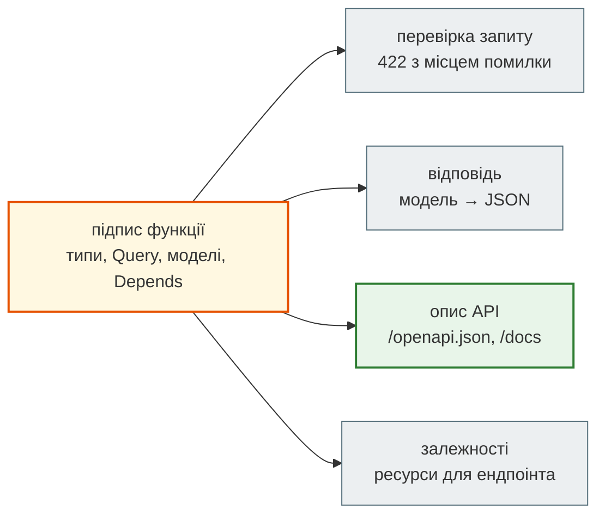

# Частина III. Ядро FastAPI

Як FastAPI перетворює звичайну функцію з анотаціями типів на HTTP-ендпоінт: звідки береться кожен параметр, хто і коли його перевіряє, як ендпоінт отримує ресурси й звідки береться документація.

## Ментальна модель { #mental-model }

FastAPI читає **підпис функції** і за ним будує все інше. Ти пишеш одне — типи, обмеження, моделі — а отримуєш три речі одразу: перевірку вхідних даних, перетворення відповіді на JSON і опис API.

## Розділи { #chapters }

| Розділ | Що там | Де в News Hub |
|---|---|---|
| [Що таке FastAPI](what_is_fastapi.md) | Starlette + Pydantic + uvicorn; шлях запиту від сокета до функції | [крок 2](../tutorials/02_fastapi_basics/index.md) |
| [Маршрути, параметри і валідація](routes_and_validation.md) | шлях, рядок запиту, тіло; `Query`, `Literal`; `422`; `response_model`; `HTTPException`; порядок маршрутів | `GET /api/news`, `POST /api/scrape` |
| [Залежності: `Depends` і `lifespan`](dependencies.md) | DI, ланцюжки залежностей, кеш на запит, `yield`-залежності, `dependency_overrides`, `lifespan` | `StoreDep`, `get_scrapers`, тести |
| [OpenAPI: опис API з коду](openapi.md) | звідки береться `/openapi.json`; `summary`, `description`, `tags`, `responses`; `/docs` і `/redoc` | `/docs` агрегатора |
| [FastAPI, Flask і Django](fastapi_flask_django.md) | той самий API на трьох фреймворках; ASGI і WSGI; як обрати | `examples/frameworks_compared` |
| [FastAPI і Django REST Framework](fastapi_vs_drf.md) | той самий API нотаток на обох; що чому відповідає; як обрати | `examples/fastapi_vs_drf` |

Версії, на яких перевірено приклади: FastAPI 0.162, Starlette 1.10, Pydantic 2.13, uvicorn 0.54. Нижня межа в `requirements.txt` кроку 2 — `fastapi>=0.115`.

## На практиці — Zero to Hero { #practice }

- [Крок 2. Перший API на FastAPI](../tutorials/02_fastapi_basics/index.md) — `steps/02_fastapi_basics`
- [Крок 3. База даних](../tutorials/03_sqlalchemy_alembic/index.md) — залежність `get_store` поступається сесії бази
- [Крок 8. Безпека](../tutorials/08_security/index.md) — залежність `AdminDep` перевіряє JWT
