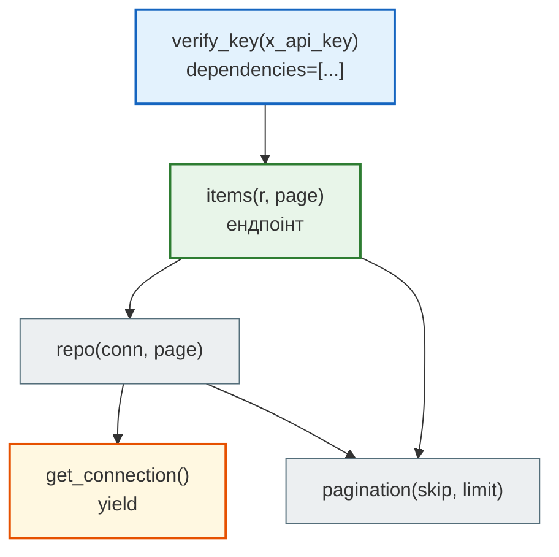
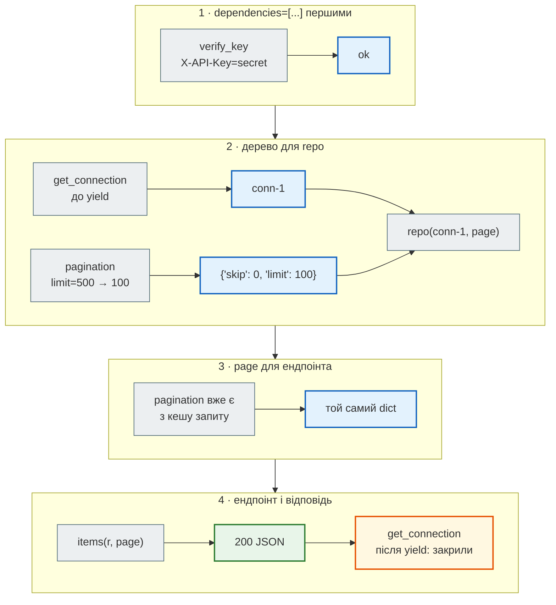

# Залежності: `Depends` і `lifespan`

## Проблема { #problem }

Ендпоінтам потрібні ресурси: сховище, з'єднання з базою, HTTP-клієнт, поточний користувач, параметри пагінації. Якщо кожен ендпоінт створює їх сам, код повторюється, ендпоінт жорстко прив'язаний до конкретної бази чи сервісу, а тест не може підставити заміну без хитрощів.

## Ментальна модель { #mental-model }

**Ендпоінт просить — FastAPI дає.** Параметр `x: Annotated[T, Depends(get_x)]` означає: «перед викликом виклич `get_x` і передай результат». Залежність — звичайна функція, і в неї можуть бути власні параметри: з запиту, з заголовків, з інших залежностей. FastAPI будує з цього дерево і обходить його для кожного запиту.



## Поняття { #concepts }

| Що | Як записати | Навіщо |
|---|---|---|
| залежність | `def get_x(...) -> T` | будь-яка функція (`def` або `async def`) |
| використання | `x: Annotated[T, Depends(get_x)]` | тип для mypy і `/docs` + інструкція для FastAPI |
| псевдонім | `XDep = Annotated[T, Depends(get_x)]` | не повторювати запис у кожному ендпоінті |
| залежність без значення | `@app.get(..., dependencies=[Depends(verify_key)])` | перевірка, результат якої ендпоінту не потрібен |
| залежність з прибиранням | `def get_x(): ...; yield x; ...` | код після `yield` виконується після відповіді |
| підміна | `app.dependency_overrides[get_x] = fake` | тести, локальна розробка |
| ресурс на весь час роботи | `lifespan` + `app.state` | пул з'єднань, клієнти, сховище |

## Як працює всередині { #inside }

Приклад з чотирма залежностями — перевірка ключа, з'єднання з `yield`, пагінація і «репозиторій», який сам залежить від з'єднання й пагінації:

```python title="ex_deps.py"
from collections.abc import Iterator
from typing import Annotated
from fastapi import Depends, FastAPI, Header, HTTPException

app = FastAPI()
log: list[str] = []


def get_connection() -> Iterator[str]:
    log.append("відкрили з'єднання")
    try:
        yield "conn-1"
    finally:
        log.append("закрили з'єднання")


def pagination(skip: int = 0, limit: int = 10) -> dict[str, int]:
    log.append("pagination")
    return {"skip": skip, "limit": min(limit, 100)}


def verify_key(x_api_key: Annotated[str, Header()]) -> str:
    if x_api_key != "secret":
        raise HTTPException(401, "невірний ключ")
    return x_api_key


Conn = Annotated[str, Depends(get_connection)]
Page = Annotated[dict[str, int], Depends(pagination)]


def repo(conn: Conn, page: Page) -> str:          # залежність, що сама має залежності
    log.append(f"repo({conn})")
    return f"repo на {conn}, {page}"


@app.get("/items", dependencies=[Depends(verify_key)])
def items(r: Annotated[str, Depends(repo)], page: Page) -> dict:
    log.append("ендпоінт")
    return {"repo": r, "page": page}
```

Чотири запити й журнал викликів після кожного:

```python
c = TestClient(app)
r = c.get("/items", params={"limit": 500}, headers={"X-API-Key": "secret"})
print(r.status_code, r.json()); print(log)
log.clear(); r = c.get("/items", headers={"X-API-Key": "wrong"}); print(r.status_code, r.json(), log)
log.clear(); r = c.get("/items"); print(r.status_code, r.json()["detail"][0]["loc"], log)
app.dependency_overrides[get_connection] = lambda: "fake-conn"
log.clear(); print(c.get("/items", headers={"X-API-Key": "secret"}).json()["repo"], log)
```

```text
200 {'repo': "repo на conn-1, {'skip': 0, 'limit': 100}", 'page': {'skip': 0, 'limit': 100}}
["відкрили з'єднання", 'pagination', 'repo(conn-1)', 'ендпоінт', "закрили з'єднання"]
401 {'detail': 'невірний ключ'} []
422 ['header', 'x-api-key'] ["відкрили з'єднання", 'pagination', 'repo(conn-1)', "закрили з'єднання"]
repo на fake-conn, {'skip': 0, 'limit': 10} ['pagination', 'repo(fake-conn)', 'ендпоінт']
```

Покроково перший запит:



Що видно з журналу:

| Спостереження | Звідки видно |
|---|---|
| `pagination` викликано **один раз**, хоча її просять `repo` і ендпоінт | у журналі одне `'pagination'`: в межах запиту результат залежності кешується |
| код після `yield` виконується **після** ендпоінта | `"закрили з'єднання"` — останній запис |
| `dependencies=[...]` декоратора виконуються першими | при `401` журнал порожній: `verify_key` упала до інших залежностей |
| при `422` інші залежності **вже встигли виконатися** | без заголовка: з'єднання відкрили й закрили, ендпоінт не викликано |
| підміна прибрала справжню залежність повністю | з `dependency_overrides` у журналі немає ні `відкрили`, ні `закрили` |

Останні два рядки важливі для практики. Помилка перевірки не скасовує вже виконаних залежностей, тому `yield`-залежність мусить прибирати за собою в `finally` або в `with`. А підміна працює на рівні функції: замінив `get_connection`, і `repo` отримує фейк, навіть не знаючи про це.

## `lifespan`: ресурси на весь час роботи сервера { #lifespan }

Залежність живе один запит. Те, що має жити довше (пул з'єднань, HTTP-клієнт, сховище), створюють у `lifespan`, а залежність лише віддає це з `app.state`:

```python
@asynccontextmanager
async def lifespan(app: FastAPI) -> AsyncIterator[None]:
    app.state.store = NewsStore()        # один раз при старті
    yield                                # сервер працює
    app.state.store.clear()              # один раз при зупинці


app = FastAPI(lifespan=lifespan)


def get_store(request: Request) -> NewsStore:
    return request.app.state.store
```

| | `lifespan` | залежність з `yield` |
|---|---|---|
| скільки разів | один на весь час роботи сервера | на кожен запит |
| що там створюють | пул з'єднань, клієнт Redis, HTTP-сесію, модель ML | сесію бази з пулу, транзакцію |
| прибирання | при зупинці сервера | після відповіді на запит |

`@app.on_event("startup")` / `"shutdown"` — старий спосіб, у FastAPI він застарів. `lifespan` тримає старт і зупинку в одній функції, тож ресурс і його закриття видно поруч.

У тестах `lifespan` запускається лише з `with TestClient(app) as c:`.

## У News Hub { #news-hub }

| Залежність | Крок | Що дає |
|---|---|---|
| `StoreDep` → `get_store` | [2](../tutorials/02_fastapi_basics/depends_and_lifespan.md) | `NewsStore` з `app.state` |
| `get_scrapers` | 2 | словник скраперів; у тестах — фейк без мережі |
| `get_db` з `yield` | [3](../tutorials/03_sqlalchemy_alembic/index.md) | сесія бази на запит: `commit` після успіху, `rollback` при помилці |
| `get_llm_client` | [7](../tutorials/07_llm_api/index.md) | клієнт LLM; у тестах — `FakeLLM` |
| `AdminDep` | [8](../tutorials/08_security/index.md) | перевірка JWT: `401` / `403` до ендпоінта |

## Типові помилки { #mistakes }

| Помилка | Наслідок | Як правильно |
|---|---|---|
| `Depends(get_store())` — з дужками | функцію викликано один раз при імпорті, а не на кожен запит: `TypeError`, якщо їй потрібні аргументи | `Depends(get_store)` |
| глобальна змінна замість залежності | тести бачать дані одне одного, підміна — лише `monkeypatch` | `lifespan` + `Depends` |
| ресурс на весь сервер у залежності на запит | новий пул з'єднань на кожен запит | пул — у `lifespan`, з'єднання з пулу — у залежності |
| прибирання після `yield` без `try/finally` | при винятку ресурс не закривається | `try: yield x` / `finally: close()` або `with` |
| забули `app.dependency_overrides.clear()` | підміна з одного тесту протікає в інші | очищати у фікстурі після `yield` |

## Налагодження { #debugging }

- Додай тимчасовий журнал викликів, як `log` вище: так видно порядок, кешування і чи викликається прибирання.
- `/openapi.json` показує параметри залежностей як параметри ендпоінта (`skip`, `limit`, заголовок `x-api-key`). Звідти видно, що клієнт мусить передати.
- `AttributeError: 'State' object has no attribute ...` у тесті означає, що `lifespan` не запустився: потрібен `with TestClient(app)`.

## Безпека { #security }

- Перевірки доступу — залежностями: `dependencies=[Depends(verify_key)]` чи `AdminDep`. Вони виконуються до ендпоінта, і про них неможливо «забути» всередині функції.
- Секрети порівнюй `hmac.compare_digest`, а не `==`, щоб час порівняння не підказував, скільки символів збіглось. У прикладі вище `!=` — для простоти; у News Hub так не роблять ([крок 8](../tutorials/08_security/index.md)).
- `dependency_overrides` — лише для тестів. У робочому коді підміна перевірки доступу — діра.

## Питання { #questions }

1. Що означає `x: Annotated[T, Depends(get_x)]`?
2. Залежність потрібна двом іншим залежностям в одному запиті. Скільки разів вона виконається?
3. Коли виконується код після `yield` у залежності? А після `yield` у `lifespan`?
4. Чому в прикладі при `422` з'єднання все одно відкрили?
5. Що підмінити в тесті, щоб агрегатор не ходив у мережу?

??? success "Відповіді"

    1. Перед викликом ендпоінта виклич `get_x` і передай результат як `x`; `T` — тип для mypy і `/docs`.
    2. Один: у межах запиту результат кешується.
    3. Після відповіді на запит; після зупинки сервера.
    4. FastAPI спершу обчислює всі залежності й параметри, збирає помилки і лише потім відповідає `422`. Тому `yield`-залежність має прибирати в `finally`.
    5. `app.dependency_overrides[get_scrapers]` — словник з фейковими скраперами, як у `tests/test_api.py`.

## Що далі { #next }

[OpenAPI: опис API з коду](openapi.md).

**Джерела:** довідник FastAPI курсу, розділ 5; FastAPI — [Dependencies](https://fastapi.tiangolo.com/tutorial/dependencies/), [Dependencies with yield](https://fastapi.tiangolo.com/tutorial/dependencies/dependencies-with-yield/), [Lifespan Events](https://fastapi.tiangolo.com/advanced/events/), [Testing Dependencies with Overrides](https://fastapi.tiangolo.com/advanced/testing-dependencies/); урок 38 курсу.
