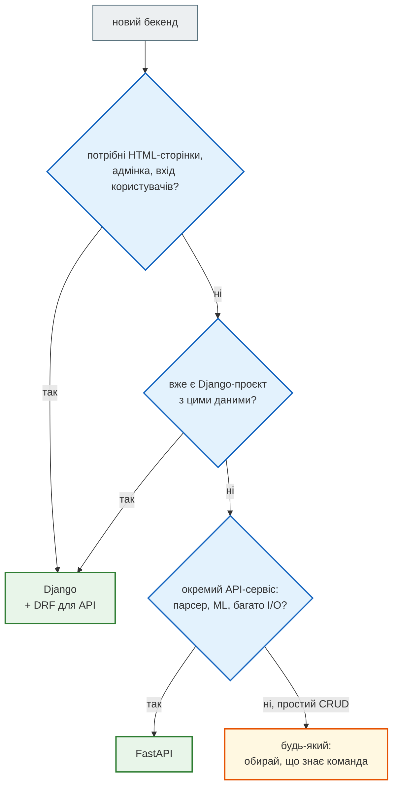

# FastAPI і Django REST Framework

## Проблема { #problem }

Той, хто знає Django, бачить у FastAPI знайоме й незнайоме водночас: є моделі, є перевірка, є ендпоінти, але немає ORM, адмінки, `settings.py`, серіалізаторів. Що чому відповідає? І коли який інструмент обирати?

Найчесніше порівняння — **той самий API** на обох: нотатки з тими самими полями, обмеженнями й адресами.

## Ментальна модель { #mental-model }

| | Django + DRF | FastAPI |
|---|---|---|
| Що це | повний вебфреймворк + пакет для API | мікрофреймворк для API |
| Опис даних | серіалізатор (часто з моделі ORM) | Pydantic-модель за анотаціями типів |
| Обробник | `ViewSet` / `APIView`, роутер робить адреси | функція з декоратором `@app.get(...)` |
| Помилка валідації | `400`, помилки за полями | `422`, список `detail` з `loc` |
| База даних | вбудований ORM + міграції | обираєш сам: SQLAlchemy + Alembic ([Частина V](../05_databases/README.md)) |
| Адмінка, вхід, сесії, форми | є з коробки | немає: окремі пакети або свій код |
| Документація API | пакет drf-spectacular | `/docs` з коробки |
| Async | частково | від початку async |

## Той самий API: FastAPI { #fastapi }

[`examples/fastapi_vs_drf/fastapi_notes.py`](https://github.com/NikoriakViktor/news_hub/blob/main/examples/fastapi_vs_drf/fastapi_notes.py). Дані — у словнику в пам'яті, щоб порівнювати лише API:

```python title="fastapi_notes.py (скорочено)"
class NoteIn(BaseModel):
    title: str = Field(min_length=1, max_length=200)
    content: str = ""
    priority: int = Field(1, ge=1, le=4)
    is_pinned: bool = False


class NoteOut(NoteIn):
    id: int


@app.post("/api/notes/", status_code=201, response_model=NoteOut)
def create_note(body: NoteIn):
    note_id = max(NOTES, default=0) + 1
    NOTES[note_id] = {"id": note_id, **body.model_dump()}
    return NOTES[note_id]


@app.get("/api/notes/{note_id}/", response_model=NoteOut)
def get_note(note_id: int):
    if note_id not in NOTES:
        raise HTTPException(404, "Нотатку не знайдено.")
    return NOTES[note_id]


@app.patch("/api/notes/{note_id}/", response_model=NoteOut)
def patch_note(note_id: int, body: NotePatch):
    note = get_note(note_id)
    note.update(body.model_dump(exclude_unset=True))      # лише передані поля
    return note
```

З папки `examples/fastapi_vs_drf`:

```python
from fastapi.testclient import TestClient
from fastapi_notes import app

fast = TestClient(app)
r = fast.post("/api/notes/", json={"title": "Вивчити FastAPI", "priority": 4})
print("створено  →", r.status_code, r.json())
bad = fast.post("/api/notes/", json={"title": "", "priority": 9})
print("помилки   →", bad.status_code, [(e["loc"][-1], e["msg"]) for e in bad.json()["detail"]])
print("pin       →", fast.post("/api/notes/1/pin/").json()["is_pinned"], "| немає →", fast.get("/api/notes/7/").status_code)
print("patch     →", fast.patch("/api/notes/1/", json={"priority": 2}).json())
print("delete    →", fast.delete("/api/notes/1/").status_code, fast.get("/api/notes/").json())
print("схема     →", sorted(app.openapi()["paths"]))
```

```text
створено  → 201 {'title': 'Вивчити FastAPI', 'content': '', 'priority': 4, 'is_pinned': False, 'id': 1}
помилки   → 422 [('title', 'String should have at least 1 character'), ('priority', 'Input should be less than or equal to 4')]
pin       → True | немає → 404
patch     → {'title': 'Вивчити FastAPI', 'content': '', 'priority': 2, 'is_pinned': True, 'id': 1}
delete    → 204 []
схема     → ['/api/notes/', '/api/notes/{note_id}/', '/api/notes/{note_id}/pin/']
```

`model_dump(exclude_unset=True)` — ключ до `PATCH`: лише поля, які клієнт справді надіслав. `{"priority": 2}` змінило пріоритет і не скинуло `is_pinned`.

## Той самий API: DRF { #drf }

Django-версія — проєкт `crispy_notes_project` уроку 36 курсу ([`hello_app/api.py`](https://github.com/NikoriakViktor/PY-Course-Victor-Nikoriak-11-11-2026/blob/main/module_4/lessons/lesson_36_drf_fastapi/crispy_notes_project/hello_app/api.py)). Два серіалізатори й ViewSet поверх готових services і selectors:

```python title="hello_app/api.py (скорочено)"
class NoteOutputSerializer(serializers.ModelSerializer):
    """Що бачить клієнт: явний список полів, без user."""
    priority_label = serializers.CharField(source="get_priority_display", read_only=True)
    # notebook, tags — назви замість id; повний опис — у файлі

    class Meta:
        model = Note
        fields = ["id", "title", "content", "priority", "priority_label", "is_pinned",
                  "notebook", "tags", "updated_at"]


class NoteInputSerializer(serializers.Serializer):
    """Що клієнт може надіслати. Власника задає сервер, а не клієнт."""
    title = serializers.CharField(max_length=200)
    content = serializers.CharField(required=False, allow_blank=True, default="")
    priority = serializers.ChoiceField(choices=Note.PRIORITY_CHOICES, default=Note.PRIORITY_LOW)
    is_pinned = serializers.BooleanField(required=False, default=False)


class NoteViewSet(viewsets.ViewSet):
    permission_classes = [permissions.IsAuthenticated]

    def _get_note(self, request, pk):
        try:
            return selectors.get_note_detail(request.user, pk)
        except Note.DoesNotExist:
            raise NotFound("Нотатку не знайдено.")

    def destroy(self, request, pk=None):
        services.delete_note(self._get_note(request, pk))
        return Response(status=status.HTTP_204_NO_CONTENT)

    @action(detail=True, methods=["post"])
    def pin(self, request, pk=None):
        note = services.toggle_pin_note(self._get_note(request, pk))
        return Response(NoteOutputSerializer(note).data)
```

Докладно про серіалізатори й ViewSet — у [Django-книзі](https://nikoriakviktor.github.io/notes_chat_app/06_application_architecture/django_serializers_full/).

## Що чому відповідає { #mapping }

| Задача | DRF | FastAPI |
|---|---|---|
| що клієнт надсилає | `NoteInputSerializer` | `NoteIn` |
| що клієнт бачить | `NoteOutputSerializer` (`fields = [...]`) | `NoteOut` + `response_model` |
| часткове оновлення | `partial=True` у серіалізаторі | окрема модель `NotePatch` + `exclude_unset=True` |
| «не знайдено» | `raise NotFound(...)` | `raise HTTPException(404, ...)` |
| адреси | роутер з методів `list/create/retrieve/...` | декоратор на кожній функції |
| дія над об'єктом | `@action(detail=True)` | ще один маршрут `/api/notes/{note_id}/pin/` |
| хто робить запит | `permission_classes`, `request.user` | залежність (`Depends`) — [крок 8](../tutorials/08_security/index.md) |
| схема API | `drf-spectacular` + `@extend_schema_view` | `/openapi.json` з коробки |
| помилка валідації | `400` | `422` |

## Як обрати { #how-to-choose }



News Hub — саме третій випадок: окремий сервіс, що постійно ходить у мережу (сайти, LLM, Telegram), без HTML-сторінок і адмінки. Нотатки з Django-книги — перший: сайт, адмінка й API над однією базою.

## Типові помилки { #mistakes }

| Звичка з Django | Що в FastAPI | Як правильно |
|---|---|---|
| чекати `400` на помилку валідації | `422` | клієнти й тести перевіряють `422` і `detail[].loc` |
| одна модель на все, як `ModelSerializer` з `fields = "__all__"` | службові поля течуть у відповідь | окремі `In`/`Out`, `response_model` |
| шукати `request.user` | його немає | користувач — залежність, що читає токен |
| чекати міграцій від `makemigrations` | ORM немає | SQLAlchemy + `alembic revision --autogenerate` |

## Питання { #questions }

1. Що в FastAPI відповідає `NoteInputSerializer`, а що — `NoteOutputSerializer`?
2. Як у FastAPI зробити `PATCH`, що не скидає непередані поля?
3. Чому помилка валідації в DRF — `400`, а в FastAPI — `422`, і що це змінює для клієнта?
4. Що обрати для API, який лише віддає прогноз ML-моделі, і чому?

??? success "Відповіді"

    1. `NoteIn` — вхід, `NoteOut` + `response_model` — вихід.
    2. Модель з усіма полями `Optional` (`NotePatch`) і `body.model_dump(exclude_unset=True)`.
    3. Різні домовленості фреймворків; клієнт має перевіряти той код і той формат помилок, які повертає конкретний API: у FastAPI — `422` і `detail` зі списком `loc`/`msg`.
    4. FastAPI: окремий API-сервіс без сторінок і адмінки, з async і `/docs` з коробки.

## Що далі { #next }

[Крок 2. Перший API на FastAPI](../tutorials/02_fastapi_basics/index.md) — усе з цієї частини на справжньому проєкті.

**Джерела:** урок 36 курсу; [Django REST Framework](https://www.django-rest-framework.org/); [FastAPI — Body: Updates](https://fastapi.tiangolo.com/tutorial/body-updates/).
