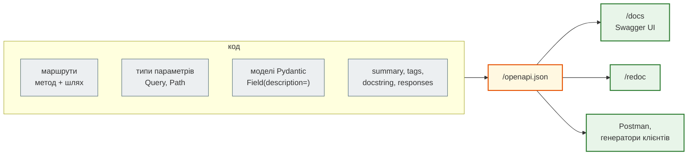

# OpenAPI: опис API з коду

## Проблема { #problem }

Клієнту API треба знати контракт: адреси, методи, параметри, формат тіла, можливі відповіді. Документ, написаний вручну, застаріває з першою зміною коду. А без машинного опису не згенерувати клієнта, не імпортувати API в Postman, не перевірити контракт у CI.

## Ментальна модель { #mental-model }

**OpenAPI** — стандарт машинного опису HTTP API у JSON чи YAML. FastAPI не просить писати його окремо: він **збирає опис з того, що вже є в коді**, і віддає за адресою `/openapi.json`. Swagger UI (`/docs`) і ReDoc (`/redoc`) — лише дві «читалки» цього JSON.



## Що звідки береться { #mapping }

| У коді | В OpenAPI | Приклад |
|---|---|---|
| `FastAPI(title=, version=, description=)` | `info` | `"title": "news_hub API"` |
| `@app.post("/books")` | `paths./books.post` | — |
| `summary="..."` | `summary` операції | без нього — з назви функції: `read_book` → `Read Book` |
| docstring функції | `description` операції (Markdown) | — |
| `tags=["books"]`, `openapi_tags=[...]` | групи в `/docs` | `news`, `scrape`, `system` у News Hub |
| параметри функції | `parameters` з `in: path/query/header` і `schema` | `{'type': 'integer', 'title': 'Book Id'}` |
| модель тіла | `requestBody` → `$ref` на схему | `#/components/schemas/Book` |
| `Field(min_length=, ge=, description=)` | `minLength`, `minimum`, `description` у схемі | — |
| `status_code=201` | код успішної відповіді | `'201'` |
| `responses={409: {...}}` | додаткові відповіді | `'409'` |
| будь-яка валідація | відповідь `422` з `HTTPValidationError` | додається сама |
| назва функції + шлях + метод | `operationId` | `create_book_books_post` |

## Мінімальний приклад { #minimal }

```python title="ex_openapi.py"
from fastapi import FastAPI
from pydantic import BaseModel, Field

app = FastAPI(title="Books API", version="1.0.0",
              openapi_tags=[{"name": "books", "description": "Книжки"}])


class Book(BaseModel):
    title: str = Field(min_length=1, description="назва книжки")
    year: int = Field(ge=1450, description="рік видання")


@app.post("/books", status_code=201, tags=["books"], summary="Додати книжку",
          responses={409: {"description": "така книжка вже є"}})
async def create_book(book: Book) -> Book:
    """Додає книжку. **Markdown** у docstring стає описом у /docs."""
    return book


@app.get("/books/{book_id}", tags=["books"])
async def read_book(book_id: int) -> Book:
    return Book(title="Dune", year=1965)
```

```python
s = TestClient(app).get("/openapi.json").json()
op = s["paths"]["/books"]["post"]
print(op["summary"], "|", op["description"], "|", op["operationId"])
print(sorted(op["responses"]), op["requestBody"]["content"]["application/json"]["schema"])
print(s["paths"]["/books/{book_id}"]["get"]["summary"], s["paths"]["/books/{book_id}"]["get"]["parameters"][0]["schema"])
print(s["components"]["schemas"]["Book"])
```

```text
Додати книжку | Додає книжку. **Markdown** у docstring стає описом у /docs. | create_book_books_post
['201', '409', '422'] {'$ref': '#/components/schemas/Book'}
Read Book {'type': 'integer', 'title': 'Book Id'}
{'properties': {'title': {'type': 'string', 'minLength': 1, 'title': 'Title', 'description': 'назва книжки'}, 'year': {'type': 'integer', 'minimum': 1450.0, 'title': 'Year', 'description': 'рік видання'}}, 'type': 'object', 'required': ['title', 'year'], 'title': 'Book'}
```

- Відповідь `422` з'явилась сама, бо в ендпоінта є що перевіряти.
- `responses={409: ...}` лише **описує** відповідь. Повернути `409` код мусить сам (`raise HTTPException(409, ...)`): OpenAPI не перевіряє, що сервер робить те, що описано.
- Обмеження `Field` стали частиною схеми (`minLength`, `minimum`). Їх бачить клієнт і генератор клієнтів.

## У News Hub { #news-hub }

Опис агрегатора на [кроці 2](../tutorials/02_fastapi_basics/openapi_and_postman.md): 6 операцій у трьох групах, 7 схем.

```text
GET    /api/news          ['news'] Список новин
DELETE /api/news          ['news'] Delete All News
POST   /api/scrape        ['scrape'] Зібрати новини
...
['HTTPValidationError', 'NewsItem', 'PageResult', 'ScrapeReport', 'ScrapeRequest', 'Stats', 'ValidationError']
```

`Delete All News` — summary з назви функції `delete_all_news`: тут його не задали явно. Для API, який читають люди, варто задавати `summary` усім операціям.

## Типові помилки { #mistakes }

| Помилка | Наслідок | Як правильно |
|---|---|---|
| ендпоінт повертає `dict` без моделі й анотації | у `/docs` відповідь «string» або порожня схема | `response_model=` або `-> Model` |
| `HTTPException(404)` у коді, але не в `responses` | клієнт не знає, що буває `404` | `responses={404: {"description": ...}}` |
| однакові назви функцій у різних модулях | дублікати `operationId`, попередження і плутанина в згенерованих клієнтах | унікальні назви або `operation_id=` |
| опис полів у коментарях, а не в `Field(description=)` | `/docs` їх не показує | `Field(description=...)` |

## Налагодження { #debugging }

- `/openapi.json` у браузері або `app.openapi()` у Python показує, як FastAPI зрозумів код. Коли `/docs` виглядає не так, як очікуєш, шукай причину там.
- `app.openapi_schema = None` скидає кешований опис після змін маршрутів у тій самій сесії Python (наприклад, у ноутбуці).

## Безпека { #security }

- `/docs` показує **усі** ендпоінти, зокрема службові. Для API, який не має бути публічним, вимкни документацію: `FastAPI(docs_url=None, redoc_url=None, openapi_url=None)`, або закрий її за nginx.
- Опис — не захист: те, що ендпоінта немає в `/docs` (`include_in_schema=False`), не робить його недоступним.

## Питання { #questions }

1. Звідки береться summary операції, якщо його не задано?
2. Ти описав `responses={409: ...}`. Чи поверне сервер `409` сам?
3. Чому в схемі `Book` є `minLength: 1`?
4. Як прибрати `/docs` з робочого сервера?

??? success "Відповіді"

    1. З назви функції: `read_book` → `Read Book`.
    2. Ні, це лише опис. Код має сам підняти `HTTPException(409, ...)`.
    3. З `Field(min_length=1)`: обмеження Pydantic переходять у JSON Schema.
    4. `FastAPI(docs_url=None, redoc_url=None, openapi_url=None)` або закрити адреси на проксі.

## Що далі { #next }

[FastAPI і Django REST Framework](fastapi_vs_drf.md).

**Джерела:** [OpenAPI Specification](https://spec.openapis.org/oas/latest.html); FastAPI — [Metadata and Docs URLs](https://fastapi.tiangolo.com/tutorial/metadata/), [Path Operation Configuration](https://fastapi.tiangolo.com/tutorial/path-operation-configuration/), [Additional Responses in OpenAPI](https://fastapi.tiangolo.com/advanced/additional-responses/).
