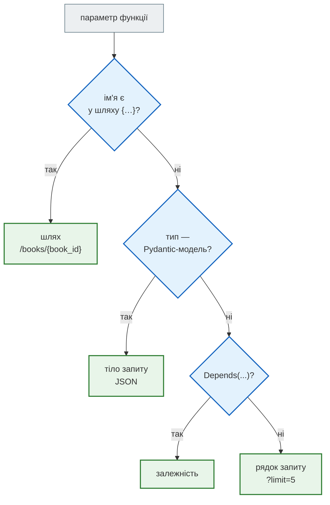
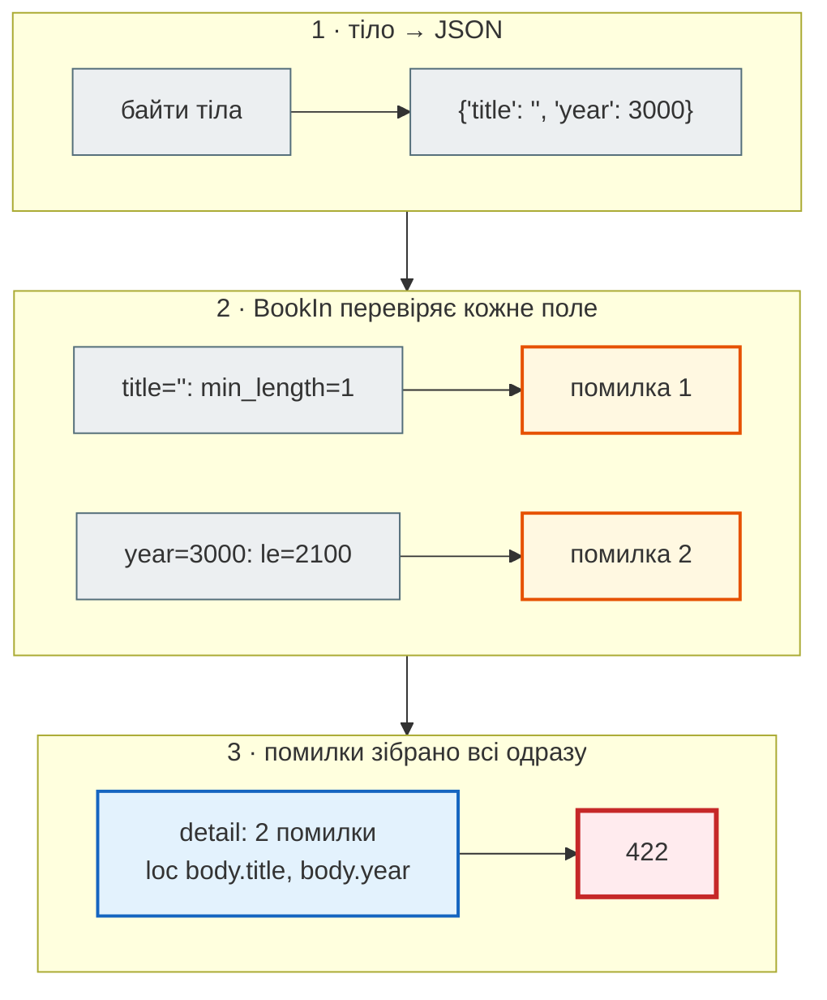

# Маршрути, параметри і валідація

## Проблема { #problem }

Усе, що приходить по HTTP, — рядки: шлях `/books/abc`, рядок запиту `?limit=0`, тіло `{"year": 3000}`. Перш ніж код зможе з цим працювати, треба вирішити: звідки взяти кожне значення, на який тип перетворити, які обмеження перевірити і що відповісти, якщо щось не так. І зробити це однаково в усіх ендпоінтах.

## Ментальна модель { #mental-model }

У FastAPI параметр функції сам каже, **звідки** його брати і **які правила** до нього застосувати:



Явно вказати джерело можна функціями `Path()`, `Query()`, `Body()`, `Header()`, `Cookie()`. Вони ж задають обмеження й опис.

## Поняття { #concepts }

| Що | Як записати | Звідки значення |
|---|---|---|
| параметр шляху | `book_id: int` при `@app.get("/books/{book_id}")` | `/books/42` |
| параметр рядка запиту | `limit: int = Query(10, ge=1, le=100)` | `?limit=5`; немає → `10` |
| перелік дозволених значень | `order: Literal["title", "year"] = "title"` | `?order=year` |
| тіло запиту | `book: BookIn` (Pydantic-модель) | JSON у тілі |
| заголовок | `x_api_key: Annotated[str, Header()]` | `X-API-Key: …` (підкреслення → дефіс) |
| форма відповіді | `response_model=BookOut` або `-> BookOut` | — |
| код успіху | `status_code=status.HTTP_201_CREATED` | — |
| помилка «не знайдено» | `raise HTTPException(404, detail=...)` | — |

## Як працює всередині { #inside }

Запит `POST /books` з тілом `{"title": "", "year": 3000}` до ендпоінта з `book: BookIn`:



Pydantic не зупиняється на першій помилці: клієнт одразу бачить **усі** проблеми запиту. Функція при цьому не викликається.

## Мінімальний приклад { #minimal }

```python title="ex_routes.py"
from typing import Literal
from fastapi import FastAPI, HTTPException, Query, status
from pydantic import BaseModel, Field

app = FastAPI()
BOOKS: dict[int, dict] = {1: {"id": 1, "title": "Dune", "year": 1965, "isbn_internal": "X-1"}}


class BookIn(BaseModel):
    title: str = Field(min_length=1, max_length=100)
    year: int = Field(ge=1450, le=2100)


class BookOut(BaseModel):
    id: int
    title: str
    year: int


@app.get("/books/{book_id}", response_model=BookOut)
async def get_book(book_id: int) -> dict:
    if book_id not in BOOKS:
        raise HTTPException(status.HTTP_404_NOT_FOUND, detail=f"книги {book_id} немає")
    return BOOKS[book_id]


@app.get("/books", response_model=list[BookOut])
async def list_books(limit: int = Query(10, ge=1, le=100),
                     order: Literal["title", "year"] = "title") -> list[dict]:
    return sorted(BOOKS.values(), key=lambda b: b[order])[:limit]


@app.post("/books", response_model=BookOut, status_code=status.HTTP_201_CREATED)
async def create_book(book: BookIn) -> dict:
    book_id = max(BOOKS) + 1
    BOOKS[book_id] = {"id": book_id, **book.model_dump(), "isbn_internal": f"X-{book_id}"}
    return BOOKS[book_id]
```

```python
c = TestClient(app)
print("1", c.get("/books/1").status_code, c.get("/books/1").json())
print("2", c.get("/books/abc").status_code, c.get("/books/abc").json()["detail"][0]["loc"])
print("3", c.get("/books/7").status_code, c.get("/books/7").json())
r = c.post("/books", json={"title": "Solaris", "year": 1961}); print("4", r.status_code, r.json())
r = c.post("/books", json={"title": "", "year": 3000})
print("5", r.status_code, [(e["loc"], e["msg"]) for e in r.json()["detail"]])
r = c.post("/books", content="not json", headers={"content-type": "application/json"})
print("6", r.status_code, r.json()["detail"][0]["type"])
print("7", c.get("/books", params={"order": "year", "limit": 1}).json())
```

```text
1 200 {'id': 1, 'title': 'Dune', 'year': 1965}
2 422 ['path', 'book_id']
3 404 {'detail': 'книги 7 немає'}
4 201 {'id': 2, 'title': 'Solaris', 'year': 1961}
5 422 [(['body', 'title'], 'String should have at least 1 character'), (['body', 'year'], 'Input should be less than or equal to 2100')]
6 422 json_invalid
7 [{'id': 2, 'title': 'Solaris', 'year': 1961}]
```

| Рядок | Що показує |
|---|---|
| 1 | `response_model=BookOut` **відфільтрував** поле `isbn_internal`: у словнику воно є, у відповіді — ні |
| 2 | не число в шляху → `422`, `loc` починається з `path` |
| 3 | `HTTPException` — свій код і `detail`; `422` для «не знайдено» не підходить |
| 4 | `status_code=201` для створення ресурсу |
| 5 | дві помилки тіла одразу, `loc` починається з `body` |
| 6 | зламаний JSON — теж `422`, тип `json_invalid` |
| 7 | `Literal` і `Query` в одному запиті |

## Порядок маршрутів { #route-order }

Маршрути перевіряються **в порядку оголошення**, і перший збіг перемагає:

```python title="ex_order.py"
@app.get("/users/{user_id}")
async def get_user(user_id: int) -> dict:
    return {"user_id": user_id}


@app.get("/users/me")                     # оголошено ПІСЛЯ — сюди запит не дійде
async def me() -> dict:
    return {"user": "я"}
```

```text
GET /users/me → 422 ['path', 'user_id'] Input should be a valid integer, unable to parse string as an integer
```

`/users/me` збігся з шаблоном `/users/{user_id}` раніше, ніж дійшло до `/users/me`, і `"me"` не пройшло перевірку як `int`. Правило: **конкретні шляхи — перед шляхами з параметрами**.

## У News Hub { #news-hub }

| Прийом | Де в [кроці 2](https://github.com/NikoriakViktor/news_hub/blob/main/steps/02_fastapi_basics/news_hub/api.py) |
|---|---|
| `Query(ge=, le=)` | `GET /api/news`: `skip`, `limit` |
| `Literal[...] \| None` | `lang: Literal["uk", "ru"] \| None` |
| тіло — модель з валідатором | `ScrapeRequest` з `@field_validator("pages")` |
| `response_model` | `list[NewsItem]`, `ScrapeReport`, `Stats` |
| форма відповіді з анотації | `/health -> dict[str, str]` |

У [кроці 3](../tutorials/03_sqlalchemy_alembic/index.md) з'являться `HTTPException(404)` для `GET /api/news/{news_id}` і `409` для дубліката `url`. Там само `/api/news/search` оголошено **до** `/api/news/{news_id}`, з коментарем у коді: інакше `search` потрапив би в `news_id` і отримав `422`.

## Типові помилки { #mistakes }

| Помилка | Наслідок | Як правильно |
|---|---|---|
| `def f(book: dict)` для тіла | немає перевірки полів і схеми в `/docs` | Pydantic-модель |
| `POST` з даними як `def f(url: str)` | `url` іде в рядок запиту, а не в тіло | модель у тілі |
| одна модель на вхід і вихід з полями на кшталт `password` | секрет повертається клієнту | окремі `XxxIn` і `XxxOut`, `response_model` |
| `return {"error": "not found"}` | клієнт отримує `200` | `raise HTTPException(404, ...)` |
| `/items/{id}` оголошено раніше за `/items/stats` | `/items/stats` → `422` | конкретні шляхи першими |

## Налагодження { #debugging }

- Отримав `422` — читай `detail[i].loc`: перший елемент (`path`, `query`, `body`, `header`) каже, **звідки** FastAPI чекав значення. Часто проблема саме в тому, що ти передаєш його в інше місце.
- `/openapi.json` → `paths` → `parameters` показує, як FastAPI зрозумів кожен параметр (`"in": "query"`).
- `msg` і `type` в `detail` приходять від Pydantic: `type` (`int_parsing`, `greater_than_equal`, `literal_error`) зручно перевіряти в тестах.

## Безпека { #security }

- Обмежуй **розміри**: `Query(le=1000)` для `limit`, `max_length` для рядків і списків (`pages: list[HttpUrl] = Field(max_length=20)`). Без меж один запит змусить сервер віддати чи обробити все.
- Валідатор може перевіряти не лише формат, а й **дозволеність**: `only_rbc` у `ScrapeRequest` не пускає чужі домени. Але перевірку домену треба писати точно, див. [крок 2 → SSRF](../tutorials/02_fastapi_basics/scrape_endpoint.md#ssrf).
- `response_model` — це ще й фільтр: він не дасть випадково віддати службові поля.

## Питання { #questions }

1. Звідки FastAPI бере `limit` у `def f(limit: int = 10)` і `book` у `def f(book: BookIn)`?
2. Чим відрізняються `loc: ["query", "limit"]` і `loc: ["body", "year"]`?
3. Тіло має дві помилки. Скільки елементів буде в `detail`?
4. Що зробить `response_model`, якщо функція повертає словник з зайвими ключами?
5. Чому `/users/me` після `/users/{user_id}` дає `422`, а не `404`?

??? success "Відповіді"

    1. `limit` — простий тип, тож з рядка запиту; `book` — Pydantic-модель, тож з тіла (JSON).
    2. Перший — параметр рядка запиту, другий — поле `year` у тілі.
    3. Два: Pydantic збирає всі помилки одразу.
    4. Відкине зайві ключі: у відповідь потраплять лише поля моделі.
    5. Запит збігся з першим шаблоном `/users/{user_id}`, і `"me"` не перетворилось на `int`. До `/users/me` справа не дійшла.

## Що далі { #next }

[Залежності: `Depends` і `lifespan`](dependencies.md) — як ендпоінт отримує сховище, з'єднання, поточного користувача.

**Джерела:** FastAPI — [Path Parameters](https://fastapi.tiangolo.com/tutorial/path-params/), [Query Parameters and String Validations](https://fastapi.tiangolo.com/tutorial/query-params-str-validations/), [Request Body](https://fastapi.tiangolo.com/tutorial/body/), [Response Model](https://fastapi.tiangolo.com/tutorial/response-model/), [Handling Errors](https://fastapi.tiangolo.com/tutorial/handling-errors/).
