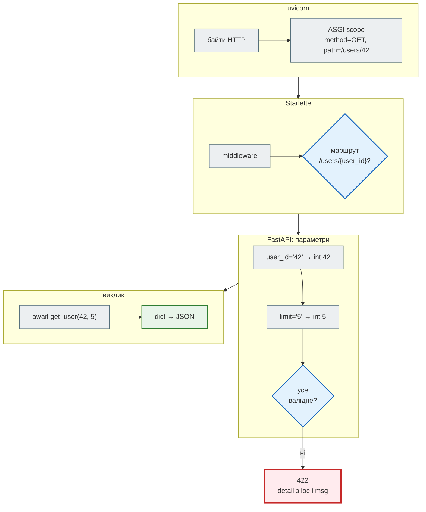

# Що таке FastAPI

## Проблема { #problem }

HTTP API — це завжди та сама рутина: розібрати URL, дістати параметри, перетворити рядки на числа, перевірити обмеження, відповісти зрозумілою помилкою, перетворити результат на JSON, описати все це для клієнтів. Якщо робити це вручну в кожному обробнику, перевірки й документація неминуче розходяться з кодом.

FastAPI бере цю рутину на себе. Ти описуєш **що** приймає і повертає функція (типами), а **як** це перевірити, перетворити й задокументувати, вирішує фреймворк.

## Ментальна модель { #mental-model }

FastAPI — не один великий фреймворк, а тонкий шар над двома бібліотеками, плюс окремий сервер:

| Шар | Що робить | Приклад |
|---|---|---|
| **uvicorn** (ASGI-сервер) | слухає порт, розбирає байти HTTP, передає запит застосунку за протоколом ASGI | `uvicorn news_hub.api:app` |
| **Starlette** (ASGI-фреймворк) | маршрутизація, middleware, `Request`/`Response`, WebSocket, `TestClient` | `app.routes`, `app.state` |
| **Pydantic** | перевірка й перетворення даних за типами, JSON Schema | `NewsItem`, `Query(ge=1)` |
| **FastAPI** | читає підпис функції: які параметри звідки, які залежності, яка модель відповіді; будує OpenAPI | `@app.get`, `Depends`, `/docs` |

```python
>>> from fastapi import FastAPI
>>> from starlette.applications import Starlette
>>> isinstance(FastAPI(), Starlette)
True
```

`FastAPI` — підклас `Starlette`. Усе, що вміє Starlette (middleware, `app.state`, статичні файли), уміє й FastAPI.

## Як працює всередині { #inside }

Шлях одного запиту `GET /users/42?limit=5` від мережі до функції і назад:



1. **uvicorn** приймає з'єднання, розбирає HTTP і викликає застосунок: `await app(scope, receive, send)`.
2. **Starlette** проганяє запит через middleware і шукає маршрут за методом і шляхом. Не знайшов — `404`.
3. **FastAPI** для знайденого маршруту бере кожен параметр функції: з шляху (`user_id`), з рядка запиту (`limit`), з тіла чи заголовків. Перетворює рядки на типи й перевіряє обмеження через Pydantic. Викликає залежності.
4. Якщо щось не так — `422` зі списком помилок, а функція **не викликається**.
5. Функція викликається: `async def` — прямо в циклі подій, `def` — у пулі потоків.
6. Результат перетворюється на JSON (через `response_model` або анотацію результату) і повертається тим самим шляхом.

## Мінімальний приклад { #minimal }

```python title="ex_min.py"
import threading
from fastapi import FastAPI

app = FastAPI()


@app.get("/users/{user_id}")
async def get_user(user_id: int, limit: int = 10) -> dict:
    return {"user_id": user_id, "limit": limit, "thread": threading.current_thread().name}


@app.get("/sync")
def sync_endpoint() -> dict:
    return {"thread": threading.current_thread().name}
```

```python
from fastapi.testclient import TestClient

c = TestClient(app)
print([(r.path, sorted(r.methods)) for r in app.routes])
print(c.get("/users/42?limit=5").json())
print(c.get("/users/42").json()["limit"], c.get("/users/abc").status_code)
print(c.get("/sync").json())
```

```text
[('/openapi.json', ['GET', 'HEAD']), ('/docs', ['GET', 'HEAD']), ('/docs/oauth2-redirect', ['GET', 'HEAD']), ('/redoc', ['GET', 'HEAD']), ('/users/{user_id}', ['GET']), ('/sync', ['GET'])]
{'user_id': 42, 'limit': 5, 'thread': 'asyncio-portal-7bf1604435c0'}
10 422
{'thread': 'AnyIO worker thread'}
```

Що тут видно:

- Маршрутів шість, хоча ми оголосили два: `/openapi.json`, `/docs`, `/docs/oauth2-redirect` і `/redoc` FastAPI додав сам.
- `user_id` з шляху став числом `42`; `limit` без значення — `10` за замовчуванням; `/users/abc` → `422`.
- `async def` виконався в потоці циклу подій (у `TestClient` він зветься `asyncio-portal-…`), а `def` — у робочому потоці пулу (`AnyIO worker thread`). Чому це важливо — [Частина IV](../04_async/README.md).

## У News Hub { #news-hub }

[`steps/02_fastapi_basics/news_hub/api.py`](https://github.com/NikoriakViktor/news_hub/blob/main/steps/02_fastapi_basics/news_hub/api.py) — той самий механізм у справжньому проєкті:

| Шар | У агрегаторі |
|---|---|
| uvicorn | `uvicorn news_hub.api:app --reload`; з кроку 10 — у Docker-образі |
| Starlette | `app.state.store`, `Request` у `get_store`; з кроку 4 — власні middleware |
| Pydantic | `NewsItem`, `ScrapeRequest`, `ScrapeReport`, `Query(ge=1, le=1000)` |
| FastAPI | `@app.get("/api/news")`, `StoreDep`, `response_model`, `/docs` |

Покроковий розбір — [Крок 2. FastAPI над `NewsItem`](../tutorials/02_fastapi_basics/fastapi_app.md).

## Типові помилки { #mistakes }

| Помилка | Що відбувається | Як правильно |
|---|---|---|
| `python api.py` замість uvicorn | файл виконується, але сервер не стартує: `app` — лише об'єкт | `uvicorn модуль:app` або `fastapi dev` (з пакетом `fastapi[standard]`) |
| `uvicorn api:app` не з тієї папки | `Could not import module` | запускай з папки, де видно пакет (`news_hub.api:app`) |
| перевірки `if limit < 1: return {"error": ...}` усередині функції | клієнт отримує `200` з помилкою в тілі, `/docs` нічого не знає про обмеження | `limit: int = Query(ge=1)` |
| блокуючий виклик у `async def` | один запит зупиняє весь сервер | async-бібліотека або `def` — [виміри](../tutorials/02_fastapi_basics/async_measurements.md) |

## Налагодження { #debugging }

- `print(app.routes)` — які маршрути насправді зареєстровано і з якими методами.
- `/openapi.json` — як FastAPI зрозумів твої параметри: звідки (`in: query`/`path`), який тип, які обмеження.
- `uvicorn ... --log-level debug` — кожен запит і відповідь у консолі.
- `TestClient(app)` — запит без сервера й мережі, у тому самому процесі: найшвидший спосіб перевірити гіпотезу.

## Безпека { #security }

- `/docs` і `/openapi.json` відкриті всім за замовчуванням. Для внутрішнього API їх вимикають: `FastAPI(docs_url=None, redoc_url=None, openapi_url=None)`.
- Перевірка типів не дорівнює перевірці прав: `user_id: int` гарантує число, але не те, що цей користувач може його бачити. Права — [крок 8](../tutorials/08_security/index.md).

## Питання { #questions }

1. Які чотири компоненти беруть участь у відповіді на запит і що робить кожен?
2. Що станеться з запитом `/users/abc` до `get_user(user_id: int)` і чи викличеться функція?
3. Де виконується `def`-ендпоінт, а де `async def`?
4. Звідки в застосунку маршрути `/docs` і `/redoc`, якщо ти їх не оголошував?

??? success "Відповіді"

    1. uvicorn — мережа й HTTP; Starlette — маршрутизація, middleware, запит/відповідь; Pydantic — перевірка й перетворення даних; FastAPI — читає підпис функції, викликає залежності, будує OpenAPI.
    2. `422` з `loc: ["path", "user_id"]`; функція не викликається.
    3. `async def` — у циклі подій; `def` — у пулі потоків (AnyIO worker thread).
    4. FastAPI додає їх сам при створенні застосунку; вимикаються параметрами `docs_url`, `redoc_url`, `openapi_url`.

## Що далі { #next }

[Маршрути, параметри і валідація](routes_and_validation.md) — звідки береться кожен параметр і як працює `422`.

**Джерела:** довідник FastAPI курсу, розділ 1; [FastAPI — First Steps](https://fastapi.tiangolo.com/tutorial/first-steps/); [Starlette](https://www.starlette.io/); [Concurrency and async / await](https://fastapi.tiangolo.com/async/).
