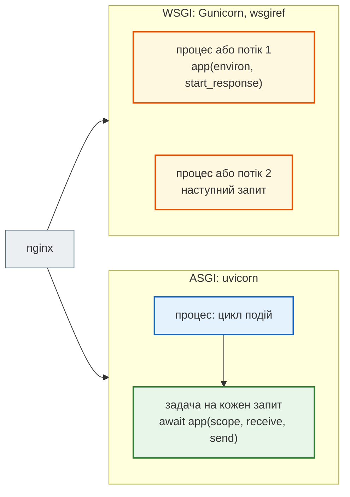
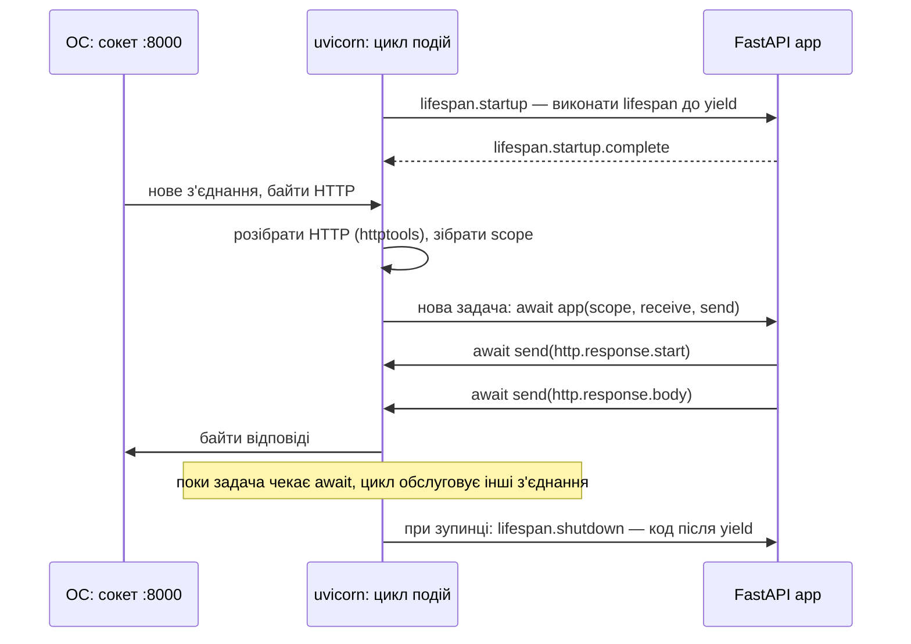

# ASGI і WSGI: цикл подій і процеси uvicorn

## Проблема { #problem }

Між мережею і кодом застосунку стоїть сервер: він приймає TCP-з'єднання, розбирає HTTP і викликає застосунок. Як саме він його викликає, задає інтерфейс. **WSGI** (Flask, класичний Django) — це звичайна функція: один виклик займає потік від початку до кінця запиту. **ASGI** (FastAPI, Starlette, Django з 3.0) — це корутина: поки вона чекає, той самий потік обслуговує інші запити.

Від інтерфейсу залежить, скільки запитів сервер обробляє одночасно, звідки береться цикл подій, що таке `--workers` і чому в News Hub один процес на контейнер.

## Ментальна модель { #mental-model }



| | WSGI | ASGI |
|---|---|---|
| застосунок | функція `app(environ, start_response)` | корутина `async def app(scope, receive, send)` |
| один запит займає | потік або процес до кінця запиту | задачу в циклі подій; потік вільний на кожному `await` |
| одночасних запитів | скільки потоків × процесів | тисячі на процес, поки вони чекають |
| WebSocket, SSE, довгі з'єднання | поза стандартом: кожне з'єднання тримає потік | у стандарті: `scope["type"] == "websocket"` |
| старт і зупинка | поза стандартом | повідомлення `lifespan` |
| обчислення в обробнику | займають свій потік | займають **весь** цикл подій процесу |
| сервери | Gunicorn, uWSGI, `wsgiref` | uvicorn, Hypercorn, Granian |

## Інтерфейс: функція проти корутини { #interface }

[`wsgi_app.py`](https://github.com/NikoriakViktor/news_hub/blob/main/examples/async_concurrency/wsgi_app.py) і [`asgi_app.py`](https://github.com/NikoriakViktor/news_hub/blob/main/examples/async_concurrency/asgi_app.py) — найменші застосунки без фреймворку:

```python title="wsgi_app.py (фрагмент)"
def app(environ, start_response):
    if environ["PATH_INFO"] == "/slow":
        time.sleep(0.5)                          # WSGI не має await: чекати можна лише блокуючи потік
    body = f"pid={os.getpid()} thread={threading.current_thread().name}".encode()
    start_response("200 OK", [("Content-Type", "text/plain"), ("Content-Length", str(len(body)))])
    return [body]
```

```python title="asgi_app.py (фрагмент)"
async def app(scope, receive, send):
    if scope["type"] == "lifespan":              # старт і зупинка процесу: тут FastAPI запускає lifespan
        ...
    await receive()                              # {"type": "http.request", "body": b"", ...}
    if scope["path"] == "/slow":
        await asyncio.sleep(0.5)                 # чекає, не займаючи цикл подій
    elif scope["path"] == "/block":
        time.sleep(0.5)                          # займає цикл подій цього процесу
    await send({"type": "http.response.start", "status": 200, "headers": [...]})
    await send({"type": "http.response.body", "body": body})
```

[`asgi_wsgi_demo.py`](https://github.com/NikoriakViktor/news_hub/blob/main/examples/async_concurrency/asgi_wsgi_demo.py) викликає обидва напряму, без сервера:

```text
--- 1. WSGI: застосунок — функція
   app(environ, start_response) → звичайний виклик функції
   environ (кілька ключів): {'REQUEST_METHOD': 'GET', 'PATH_INFO': '/', 'wsgi.version': (1, 0)}
   start_response: 200 OK | тіло: [b'pid=98240 thread=MainThread']

--- 2. ASGI: застосунок — корутина і повідомлення
   app(scope, receive, send) → coroutine; виконується лише під await
   scope: {'type': 'http', 'method': 'GET', 'path': '/', 'headers': []}
   send: {'type': 'http.response.start', 'status': 200, 'headers': [(b'content-type', b'text/plain'), (b'content-length', b'9')]}
   send: {'type': 'http.response.body', 'body': b'pid=98240'}
```

- **`scope`** — що за з'єднання: `http`, `websocket` чи `lifespan`, метод, шлях, заголовки (байтами). Те саме, що `environ` у WSGI.
- **`receive`** — корутина, що повертає наступне повідомлення від клієнта: шматок тіла, розрив з'єднання, повідомлення WebSocket.
- **`send`** — корутина, що відправляє відповідь шматками: спершу статус і заголовки, потім тіло (можна кількома повідомленнями — так працюють `StreamingResponse` і SSE).

FastAPI — це така сама корутина `app(scope, receive, send)`, лише більша: Starlette розбирає `scope` у `Request`, маршрутизатор вибирає ендпоінт, відповідь перетворюється на повідомлення `send` ([що таке FastAPI](../03_fastapi_core/what_is_fastapi.md#inside)).

## Одночасні запити { #concurrency }

П'ять одночасних запитів, кожен чекає 0.5 с (запуск 2026-11-12):

```text
--- 3. 5 одночасних запитів, кожен чекає 0.5 с
   WSGI, wsgiref, 1 потік                        2.52 с
   WSGI, wsgiref, потік на запит                 0.51 с
   ASGI, uvicorn, 1 процес, await asyncio.sleep  0.51 с
   ASGI, uvicorn, 1 процес, time.sleep           2.50 с
```

- WSGI-сервер з одним потоком обробляє запити **по одному**: 5 × 0.5 с. Справжні WSGI-сервери тому й запускають кілька процесів (Gunicorn `--workers`) і потоків (`--threads`): одночасних запитів стільки, скільки потоків разом.
- ASGI з `await` — 0.5 с на всі п'ять у **одному** потоці одного процесу.
- ASGI з `time.sleep` — знову 2.5 с: ASGI дає можливість не блокувати, але не забороняє блокувати. Один блокуючий виклик повертає сервер до моделі «по одному» ([Блокуючий код](blocking_code.md)).

## Що робить uvicorn { #uvicorn }



- **Цикл подій створює uvicorn**, а не застосунок. `--loop auto` (за замовчуванням) бере `uvloop`, якщо він встановлений (`uvicorn[standard]`, як у News Hub), інакше — стандартний `asyncio`. Тому в демо потік пулу `asyncio.to_thread` зветься `uvloop_0`, а задача запиту — `RequestResponseCycle.run_asgi` з `httptools_impl.py`.
- **`lifespan`** FastAPI — це обробка повідомлень `lifespan.startup` / `lifespan.shutdown` ([`lifespan`](../03_fastapi_core/dependencies.md#lifespan)). Він виконується **один раз на процес**.
- **Кожен запит — окрема задача** в тому самому циклі. Задачі не мають власних потоків, тож усе, що не `await`, виконується в єдиному потоці процесу.

## `--workers`: кілька процесів { #workers }

Один процес — це один цикл подій і одне ядро для Python-коду. `uvicorn --workers N` (або змінна `WEB_CONCURRENCY`) запускає N процесів, що слухають той самий порт:

```text
--- 4. uvicorn --workers 2: два процеси, у кожного свій цикл подій
   pid=98553: 36 запитів з 40
   pid=98554: 4 запитів з 40
   5 × time.sleep(0.5), спроба 1:  1.50 с  {'pid=98553': 3, 'pid=98554': 2}
   5 × time.sleep(0.5), спроба 2:  1.50 с  {'pid=98553': 3, 'pid=98554': 2}
   5 × time.sleep(0.5), спроба 3:  2.00 с  {'pid=98553': 4, 'pid=98554': 1}
```

- **Розподіл не рівний.** З'єднання приймає той процес, який першим забрав його з черги сокета, — це вирішує ядро ОС, а не uvicorn. 36 і 4 з сорока, а п'ять одночасних блокуючих запитів у попередніх запусках розподілялись і 3 + 2, і 4 + 1, і 5 + 0 (тоді 2.51 с, як в одного процесу).
- **Процеси не лікують блокування.** Два процеси з блокуючим кодом — це два сервери «по одному». Ідеальні 1.5 с замість 2.5 с — і то не завжди.
- **Усе в пам'яті — окремо в кожного процесу**: `app.state`, кеш у змінній, лічильники ([процеси не діляться пам'яттю](concurrency_basics.md#processes)). `lifespan` теж виконується в кожному: N процесів — N пулів з'єднань з базою.
- **Скільки процесів.** Правило «2 × ядра + 1» — рекомендація Gunicorn для **синхронних** worker, яким потрібні запаси на очікування. Async-процесу очікування не потрібні: процесів більше, ніж ядер, сенсу не має. У контейнерах зазвичай один процес на контейнер, а масштаб — кількістю контейнерів.

## У News Hub { #news-hub }

```dockerfile title="steps/12_ci_cd/Dockerfile (фрагмент)"
# Кількість процесів — змінна WEB_CONCURRENCY (uvicorn читає її сам), за замовчуванням 1:
# у контейнері масштабуємо кількістю контейнерів (крок 11), а не --workers усередині.
CMD ["uvicorn", "news_hub.api:app", "--host", "0.0.0.0", "--port", "8000"]
```

- `uvicorn[standard]` у `requirements.txt` — `uvloop` і `httptools`, як у демо.
- Один процес на контейнер; чому і скільки пам'яті коштує кожен worker — [крок 10: один процес на контейнер](../tutorials/10_docker/health_shutdown.md#workers). Перед uvicorn стоїть nginx ([крок 11](../tutorials/11_compose_deploy/nginx_real_ip.md)).
- Спільний стан кількох процесів і контейнерів — у PostgreSQL і Redis. Пул з'єднань (`pool_size=10`, `max_overflow=20`, [крок 3](../tutorials/03_sqlalchemy_alembic/engine_and_table.md#pool)) — на процес: N процесів можуть відкрити до N × 30 з'єднань з PostgreSQL.

## Типові помилки { #mistakes }

| Помилка | Наслідок | Як правильно |
|---|---|---|
| «ASGI — значить, усе асинхронне саме» | `time.sleep`, `requests` у `async def` — сервер знову «по одному» | `await` асинхронних бібліотек ([Блокуючий код](blocking_code.md)) |
| `--workers` проти блокуючого коду | кілька серверів «по одному»; розподіл з'єднань нерівний | прибрати блокування |
| стан у пам'яті з `--workers N` | у кожного процесу свій | Redis або база |
| `--workers` і `--reload` разом | `WARNING: "workers" flag is ignored when reloading is enabled.` — працює один процес | `--reload` локально, `--workers`/контейнери — на сервері |
| «2 × ядра + 1» для uvicorn | процеси змагаються за ядра і пам'ять, пул з'єднань з базою множиться | ≈ кількість ядер або один процес на контейнер |
| `asyncio.run()` усередині ендпоінта | `RuntimeError: asyncio.run() cannot be called from a running event loop` | цикл уже є: просто `await` |

## Налагодження { #debugging }

- **Який цикл подій?** `type(asyncio.get_running_loop())` в ендпоінті: `uvloop.Loop` чи `_UnixSelectorEventLoop`. Примусово — `uvicorn --loop asyncio`.
- **Скільки процесів?** `ps -ef | grep uvicorn` або `docker top <контейнер>`: головний процес і N робочих. `os.getpid()` у відповіді чи журналі показує, який процес відповів.
- **Чи виконався `lifespan` у кожному процесі?** Рядок журналу в `lifespan` має з'явитись N разів.

## Безпека { #security }

- **Повільні клієнти.** ASGI-сервер тримає з'єднання дешево, але не безкінечно. `--timeout-keep-alive` (за замовчуванням 5 с) закриває простої; від тисяч повільних з'єднань захищає проксі перед сервером (nginx), а не сам застосунок.
- **`--limit-concurrency` рахує з'єднання, а не запити.** Перевищення — `503` для всіх нових з'єднань, навіть якщо вони ще нічого не встигли запитати:

    ```text
    --- 5. uvicorn --limit-concurrency 10: ліміт рахує відкриті з'єднання
        8 одночасних з'єднань → коди відповідей {200: 8}
       15 одночасних з'єднань → коди відповідей {503: 15}
    ```

    П'ятнадцять одночасних з'єднань при ліміті 10 отримали `503` **усі**: на момент кожного запиту відкритих з'єднань уже було більше за ліміт. Це запобіжник від перевантаження, а не рівномірний обмежувач. Обмежувати клієнтів — у проксі або власним rate limit ([крок 4](../tutorials/04_middleware_redis/index.md)).

## Питання { #questions }

1. Чим відрізняється виклик WSGI-застосунку від виклику ASGI-застосунку?
2. Чому WSGI-сервер з одним потоком обробив п'ять запитів за 2.5 с, а uvicorn з `await` — за 0.5 с?
3. Хто створює цикл подій у застосунку FastAPI?
4. Скільки разів виконається `lifespan`, якщо запустити `uvicorn --workers 4`?
5. Чому `--workers 2` не дав стабільних 1.5 с для п'яти блокуючих запитів?
6. Чому формула «2 × ядра + 1» не підходить для async-сервера?

??? success "Відповіді"

    1. WSGI — звичайний виклик функції, що повертає тіло; ASGI — корутина, що отримує повідомлення через `receive` і відправляє відповідь через `send`, і виконується лише під `await`.
    2. Один потік WSGI зайнятий запитом до кінця; ASGI-задача на `await` віддає потік циклу подій, і він починає наступні запити.
    3. Сервер uvicorn (`uvloop`, якщо встановлений, інакше `asyncio`).
    4. Чотири рази — по одному в кожному процесі.
    5. З'єднання між процесами розподіляє ядро ОС, і воно не рівне: бувало 3 + 2, 4 + 1 і 5 + 0.
    6. Вона розрахована на синхронні worker, що простоюють на очікуваннях. Async-процес сам заповнює очікування іншими запитами, тож зайві процеси лише змагаються за ядра й пам'ять.

## Що далі { #next }

[Три типи ендпоінтів](endpoint_types.md) — що FastAPI робить з `async def`, `def` і `async def` з блокуючим викликом, і де межі пулу потоків.

**Джерела:** [ASGI Specification](https://asgi.readthedocs.io/en/latest/specs/main.html) і [Lifespan Protocol](https://asgi.readthedocs.io/en/latest/specs/lifespan.html); [PEP 3333 — Python Web Server Gateway Interface](https://peps.python.org/pep-3333/); uvicorn — [Settings](https://uvicorn.dev/settings/) (`--workers`, `--loop`, `--limit-concurrency`, `--timeout-keep-alive`), [Deployment](https://uvicorn.dev/deployment/); Gunicorn — [Design: How Many Workers?](https://gunicorn.org/design/#how-many-workers); FastAPI — [Server Workers](https://fastapi.tiangolo.com/deployment/server-workers/).
