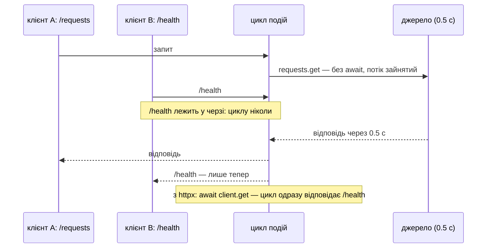

# Блокуючий код: каскадний ефект і як його знайти

## Проблема { #problem }

У процесі uvicorn один потік циклу подій обслуговує всі запити. Поки корутина чекає на `await`, цикл працює на інших. Але виклик **без** `await` — `requests.get`, `time.sleep`, синхронний драйвер бази, цикл обчислень, `bcrypt` — займає цей потік цілком. На цей час зупиняються **всі** запити процесу: ті, що вже виконуються, нові, `/health`. Повільним стає не один ендпоінт, а весь сервер.

Уяви ресторан з одним офіціантом. Поки він сам пішов на кухню готувати страву, ніхто не приймає замовлень, не приносить рахунків, не відповідає на питання. Тут — як цей ефект виглядає у вимірах, чим замінити блокуючі виклики і як знайти той, що лишився.

## Ментальна модель { #mental-model }



На [кроці 2](../tutorials/02_fastapi_basics/async_measurements.md) той самий ефект виміряно на `time.sleep`. Тут — на справжньому мережевому виклику, на процесорі і на `bcrypt`, з лічильником затримки циклу подій.

## Дослід: мережа { #network }

[`examples/async_concurrency/blocking_app.py`](https://github.com/NikoriakViktor/news_hub/blob/main/examples/async_concurrency/blocking_app.py) звертається до локального «джерела» [`upstream_app.py`](https://github.com/NikoriakViktor/news_hub/blob/main/examples/async_concurrency/upstream_app.py), яке відповідає через 0.5 с:

```python title="blocking_app.py (фрагмент)"
@app.get("/requests")
async def with_requests(delay: float = 0.5) -> dict:
    return requests.get(f"{UPSTREAM}/page/1", params={"delay": delay}, timeout=10).json()   # блокує цикл


@app.get("/requests-def")
def with_requests_in_def(delay: float = 0.5) -> dict:
    return requests.get(f"{UPSTREAM}/page/1", params={"delay": delay}, timeout=10).json()   # потік з пулу


@app.get("/httpx")
async def with_httpx(request: Request, delay: float = 0.5) -> dict:
    response = await request.app.state.http.get("/page/1", params={"delay": delay})        # await
    return response.json()
```

[`blocking_demo.py`](https://github.com/NikoriakViktor/news_hub/blob/main/examples/async_concurrency/blocking_demo.py) надсилає п'ять одночасних запитів і поруч кожні 50 мс питає `/health`. «Лаг циклу» — найбільше запізнення фонової задачі, що засинає на 50 мс (про неї — [нижче](#lag)). Запуск 2026-11-12:

```text
--- 1. мережа: 5 одночасних запитів до джерела, що відповідає за 0.5 с
   /requests     async def + requests.get            2.51 с | /health до 0.45 с | лаг циклу 0.96 с
   /requests-def def + requests.get (пул потоків)    0.52 с | /health до 0.00 с | лаг циклу 0.00 с
   /httpx        async def + await httpx             0.51 с | /health до 0.00 с | лаг циклу 0.00 с
```

- `requests` у `async def`: п'ять запитів **по черзі**, 2.5 с, і цикл подій стояв до 0.96 с поспіль.
- Скільки саме чекав `/health`, залежить від того, в якому порядку цикл розбирає чергу між блокуваннями. У цьому запуску — до 0.45 с, у попередньому запуску того самого демо — 2.46 с (`/health` став у чергу за всіма п'ятьма). Найгірший випадок — сума всіх блокувань.
- Той самий `requests` у `def` — 0.52 с: кожен виклик блокує свій потік пулу, а не цикл.
- `httpx.AsyncClient` з `await` — 0.51 с і нуль затримки циклу: правильна заміна.

## Каскадний ефект { #cascade }

Блокування додається, а не усереднюється. Якщо ендпоінт тримає цикл `t` секунд і приходить `n` таких запитів одночасно, останній з них і **кожен інший запит** процесу чекає до `n × t`. Під навантаженням це розкручується:

1. запити обслуговуються по одному → відповіді повільнішають;
2. клієнти не дочікуються і повторюють запит → черга росте;
3. `/health` не відповідає → балансувальник чи Docker вважає процес мертвим і перезапускає його, разом з усіма запитами, що вже виконувались.

Тому одна «невинна» `time.sleep(1)` у рідкісному ендпоінті — це не повільний ендпоінт, а періодична зупинка всього сервера.

## Дослід: процесор { #cpu }

```python title="blocking_app.py (фрагмент)"
def crunch(n: int = 8_000_000) -> int:
    return sum(i * i for i in range(n))       # ≈ 0.3 с чистого процесора


@app.get("/cpu")
async def cpu_in_loop() -> dict:
    return {"result": crunch()}                                                          # блокує цикл


@app.get("/cpu-def")
def cpu_in_thread() -> dict:
    return {"result": crunch()}                                                          # потік, але GIL


@app.get("/cpu-process")
async def cpu_in_process(request: Request) -> dict:
    loop = asyncio.get_running_loop()
    return {"result": await loop.run_in_executor(request.app.state.processes, crunch)}   # інший процес
```

```text
--- 2. процесор: 5 одночасних обчислень
   /cpu          async def + цикл обчислень          1.47 с | /health до 1.42 с | лаг циклу 1.42 с
   /cpu-def      def + цикл обчислень (GIL)          1.77 с | /health до 0.15 с | лаг циклу 0.12 с
   /cpu-process  run_in_executor(ProcessPool)        0.75 с | /health до 0.00 с | лаг циклу 0.01 с
```

- `async def` з обчисленням — цикл стоїть 1.4 с, як з `time.sleep`.
- `def` — цикл живий, але **не вільний**: потоки з обчисленнями забирають GIL у потоку циклу, і `/health` чекав до 0.15 с. Обчислення не стали швидшими (1.77 с): GIL пускає їх по одному ([GIL](concurrency_basics.md#gil)).
- `ProcessPoolExecutor` — цикл вільний, а обчислення йдуть паралельно на чотирьох процесах пулу (0.75 с — дві хвилі: 4 + 1). Пул створюють один раз у `lifespan` і закривають при зупинці; аргументи й результат передаються через `pickle`.

## Дослід: `bcrypt` { #bcrypt }

Перевірка пароля — навмисно повільна робота процесора (12 раундів — ≈ 0.2–0.3 с), але `bcrypt` написаний не на Python і **відпускає GIL**. Тому в потоці він не лише звільняє цикл, а й рахує паралельно:

```python title="blocking_app.py (фрагмент)"
@app.get("/login")
async def login_in_loop() -> dict:
    return {"ok": bcrypt.checkpw(b"wrong", PASSWORD_HASH)}                              # ≈ 0.25 с у циклі


@app.get("/login-thread")
async def login_in_thread() -> dict:
    return {"ok": await run_in_threadpool(bcrypt.checkpw, b"wrong", PASSWORD_HASH)}     # bcrypt відпускає GIL
```

```text
--- 3. bcrypt.checkpw (12 раундів): 5 одночасних входів
   /login        async def + bcrypt.checkpw          0.96 с | /health до 0.91 с | лаг циклу 0.91 с
   /login-thread await run_in_threadpool(checkpw)    0.22 с | /health до 0.00 с | лаг циклу 0.00 с
```

Те саме стосується `hashlib`, `zlib` і багатьох операцій Pillow та NumPy: обчислення в C-коді, що відпускає GIL, переносять у потік, а не в процес — дешевше й без `pickle`. Обчислення на чистому Python — у процес.

## Таблиця замін { #replacements }

| Блокуючий виклик в `async def` | Заміна | Перевірено тут |
|---|---|---|
| `time.sleep(n)` | `await asyncio.sleep(n)` | [крок 2](../tutorials/02_fastapi_basics/async_measurements.md#results) |
| `requests.get(url)`, `urllib.request` | `await client.get(url)` — `httpx.AsyncClient` або `aiohttp.ClientSession`, **один на застосунок** у `lifespan` | розділ «мережа» |
| синхронний драйвер бази (`psycopg2`, `sqlite3`, синхронна сесія SQLAlchemy) | async-драйвер: `asyncpg`, psycopg 3 в async-режимі, `aiosqlite`; SQLAlchemy `AsyncSession` ([Частина V](../05_databases/README.md)) | [крок 2: `/db-sync-broken`](../tutorials/02_fastapi_basics/async_measurements.md#results) |
| синхронний клієнт Redis (`redis.Redis`) | `redis.asyncio.Redis` | — |
| SDK без async-клієнта | `def`-ендпоінт або `await run_in_threadpool(...)` | розділ «мережа» (`/requests-def`) |
| обчислення на чистому Python (сотні мс і більше) | `await loop.run_in_executor(process_pool, f, ...)` | розділ «процесор» |
| `bcrypt`, `hashlib`, `zlib`, Pillow — C-код, що відпускає GIL | `await run_in_threadpool(f, ...)` | розділ «bcrypt» |
| `subprocess.run(cmd)` | `await asyncio.create_subprocess_exec(...)` | — |
| читання великого файлу `open(...).read()` | `await run_in_threadpool(...)` (бібліотека `aiofiles` робить те саме — потоками) | — |
| `socket.gethostbyname` | `await loop.getaddrinfo(...)` (asyncio сам виконує його в потоці) | — |

Правило за замовчуванням: **у `async def` — лише `await` асинхронних бібліотек**. Усе інше — у `def`, у потік або в процес.

## Як знайти блокування { #find }

### Debug-режим asyncio { #debug-mode }

`PYTHONASYNCIODEBUG=1` (або `asyncio.run(main(), debug=True)`) вмикає перевірки циклу подій. Одна з них — попередження про кожен крок, що тримав цикл довше за `loop.slow_callback_duration` (0.1 с за замовчуванням):

```bash
PYTHONASYNCIODEBUG=1 uvicorn blocking_app:app --port 8793
```

```text
--- 4. PYTHONASYNCIODEBUG=1: asyncio сам називає повільний крок
   Executing <Task finished name='Task-4' coro=<RequestResponseCycle.run_asgi() done, defined at httptools_impl.py:420> result=None took 0.505 seconds
   WARNING:  цикл подій запізнився на 0.51 с
```

Попередження спрацювало і зі стандартним циклом, і з `uvloop` (перевірено обома). Межі:

- Воно називає **задачу**, а не рядок: `RequestResponseCycle.run_asgi` — це задача запиту uvicorn. Який ендпоінт — шукай за часом у журналі доступу або за [лагом циклу](#lag).
- Debug-режим сповільнює цикл і додає перевірки на кожен виклик — для розробки й тестів, не для production.
- Корутину, яку забули `await`, Python позначає завжди (`RuntimeWarning: coroutine '...' was never awaited`); debug-режим додає до попередження місце, де її створено.

### Лаг циклу подій { #lag }

Найпростіший production-датчик: фонова задача засинає на короткий інтервал і міряє, наскільки пізніше прокинулась. Запізнення = цикл у цей час був зайнятий чимось без `await`:

```python title="blocking_app.py (фрагмент)"
async def watch_lag(interval: float = 0.05) -> None:
    """Засинає на interval і міряє, наскільки пізніше прокинулась. Запізнення = цикл був зайнятий."""
    loop = asyncio.get_running_loop()
    while True:
        start = loop.time()
        await asyncio.sleep(interval)
        late = loop.time() - start - interval
        lag["max"] = max(lag["max"], late)
        if late > 0.2:
            logger.warning("цикл подій запізнився на %.2f с", late)
```

Задача запускається в `lifespan` (`asyncio.create_task(watch_lag())`) і скасовується при зупинці. Стовпець «лаг циклу» в усіх таблицях вище — з неї. Метрика «максимальний лаг за хвилину» в моніторингу показує блокування раніше, ніж скарги користувачів.

### Навантаження з пробою `/health` { #probe }

Один запит у Swagger блокування не покаже. Покаже 5–10 одночасних запитів і паралельний `/health`, як у `blocking_demo.py`: якщо `/health` чекає — щось тримає цикл.

## У News Hub { #news-hub }

Майже весь код News Hub — `await` асинхронних бібліотек, а синхронне живе в `def`-залежностях і в потоках бібліотек (DNS у `aiohttp` — `ThreadedResolver`, на ньому побудований `PolicyResolver` у [`safe_fetch.py`](https://github.com/NikoriakViktor/news_hub/blob/main/steps/12_ci_cd/news_hub/safe_fetch.py)). Два місця виконуються в циклі без `await`:

**Вхід адміна — `bcrypt` в `async def`.** Ендпоінт `POST /api/admin/token`:

```python title="steps/12_ci_cd/news_hub/api.py (фрагмент)"
async def admin_token(body: TokenRequest, settings: AdminSettingsDep) -> TokenResponse:
    """Одна відповідь на «немає такого імені» і «не той пароль» — не підказуємо, що саме не так."""
    if not authenticate(settings, body.username, body.password):
```

`authenticate` викликає `bcrypt.checkpw` з 12 раундами (`hash_password` у `security.py`). Це той самий виклик, що `/login` у демо: кожна спроба входу тримає цикл подій ≈ 0.2–0.3 с для **всіх** запитів процесу (окремий вимір `checkpw` з 12 раундами на цій машині — 0.28 с). Від масового підбору захищає `LOGIN_RATE_LIMIT` (5 спроб за вікно з однієї адреси, [крок 8](../tutorials/08_security/index.md)), але не від одночасних спроб з багатьох адрес. Виправлення — один рядок, як `/login-thread`:

```python
if not await run_in_threadpool(authenticate, settings, body.username, body.password):
```

**Розбір HTML — у циклі.** У `scraper.py` `fetch_one` після `await resp.text(...)` викликає `parse_rbc_news(html)` — BeautifulSoup, чистий процесор. Для сімох сторінок rbc.ua це короткі відрізки, але це обчислення в циклі подій; у цій частині їхню тривалість не вимірювали. Якщо [лаг циклу](#lag) під час збору росте — розбір переносять у `run_in_threadpool` або в процес.

## Типові помилки { #mistakes }

| Помилка | Наслідок | Як правильно |
|---|---|---|
| `requests` у `async def` | запити по одному, `/health` чекає | `httpx.AsyncClient` / `aiohttp` |
| новий `httpx.AsyncClient()` на кожен запит | нове з'єднання (TCP + TLS) щоразу | один клієнт у `lifespan`, закрити при зупинці |
| синхронна сесія SQLAlchemy в `async def` | кожен SQL-запит блокує цикл | `AsyncSession` і async-драйвер |
| обчислення в `def` «щоб не блокувати» | цикл живий, але GIL гальмує і його, і самі обчислення | `ProcessPoolExecutor`; для C-бібліотек — потік |
| `ProcessPoolExecutor()` в ендпоінті | новий пул процесів на кожен запит: секунди на старт | один пул у `lifespan` |
| `bcrypt.checkpw` в `async def` | ≈ 0.2–0.3 с зупинки всього процесу на кожну спробу входу | `await run_in_threadpool(...)` |
| «async-бібліотека» з синхронним викликом усередині | блокування, якого не видно в коді ендпоінта | перевірити лагом циклу під навантаженням |
| debug-режим asyncio в production | зайві витрати на кожен виклик | у production — датчик лагу і метрики |

## Налагодження { #debugging }

1. **Відтвори навантаженням:** 5–10 одночасних запитів до підозрілого ендпоінта і паралельний `/health`.
2. **Подивись лаг:** зростає — блокує щось у циклі; не зростає, а відповіді повільні — чекання поза циклом (пул потоків, пул з'єднань бази, саме джерело).
3. **Увімкни `PYTHONASYNCIODEBUG=1` локально** — побачиш, скільки триває кожен повільний крок.
4. **Знайди рядок:** обгорни підозрілі виклики `time.perf_counter()` або тимчасово винеси їх у `run_in_threadpool` — якщо лаг зник, блокував саме він.

## Безпека { #security }

- **Блокуючий ендпоінт — готова DoS-атака.** Достатньо кількох одночасних запитів до нього, щоб процес перестав відповідати всім. Найнебезпечніші — ті, що доступні без автентифікації і повільні навмисно: вхід з `bcrypt`, генерація звітів.
- **Обмеження частоти не замінює неблокуючий код**: воно рахує спроби з однієї адреси, а зупинку циклу спричиняє кожна.
- **Тайм-аут на кожен зовнішній виклик**, навіть блокуючий: `requests.get(..., timeout=10)`. Без нього один завислий сайт тримає потік (або весь цикл) безкінечно.

## Питання { #questions }

1. Чому `requests.get` в `async def` гальмує не лише цей ендпоінт?
2. Чому в одному запуску `/health` чекав 0.45 с, а в іншому 2.46 с при тих самих п'яти запитах?
3. Чому `/cpu-def` не зупинив цикл, але все одно сповільнив `/health`?
4. Чому `bcrypt` переносять у потік, а `crunch()` — у процес?
5. Що саме повідомляє debug-режим asyncio і чого він не повідомляє?
6. Як помітити блокування на сервері, де debug-режим вимкнено?

??? success "Відповіді"

    1. Він займає єдиний потік циклу подій процесу; поки виклик триває, жоден інший запит не обробляється.
    2. Залежить від порядку, у якому цикл розбирає чергу між блокуваннями: `/health` міг пройти між ними або чекати за всіма п'ятьма. Найгірший випадок — сума блокувань.
    3. Потік з обчисленнями тримає GIL, і потік циклу отримує його лише між перемиканнями: цикл працює, але з затримками.
    4. `bcrypt` рахує в C-коді й відпускає GIL — потоки працюють паралельно і дешево. `crunch()` — чистий Python, у потоках він ішов би по одному.
    5. Що задача тримала цикл довше за `slow_callback_duration` і скільки саме; не повідомляє рядок коду чи ендпоінт.
    6. Датчиком лагу циклу: фонова задача, що міряє запізнення свого `asyncio.sleep`.

## Що далі { #next }

[Паралельні запити: `gather`, `TaskGroup`, `Semaphore`, тайм-аути](concurrency_patterns.md) — як не лише не блокувати, а й чекати багато джерел одночасно, обмежено і з тайм-аутами.

**Джерела:** Python — [Developing with asyncio](https://docs.python.org/3/library/asyncio-dev.html) (розділи «Debug Mode», «Running Blocking Code»), [`loop.run_in_executor`](https://docs.python.org/3/library/asyncio-eventloop.html#asyncio.loop.run_in_executor), [`loop.slow_callback_duration`](https://docs.python.org/3/library/asyncio-eventloop.html#asyncio.loop.slow_callback_duration); FastAPI — [Concurrency and async / await](https://fastapi.tiangolo.com/async/); HTTPX — [Async Support](https://www.python-httpx.org/async/); [bcrypt на PyPI](https://pypi.org/project/bcrypt/).
