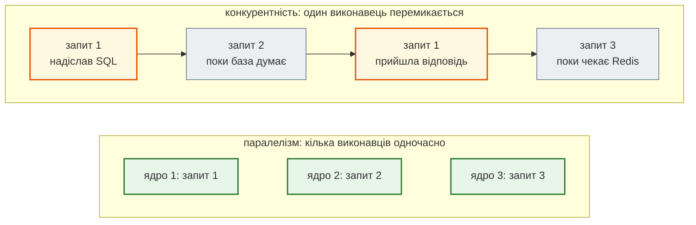
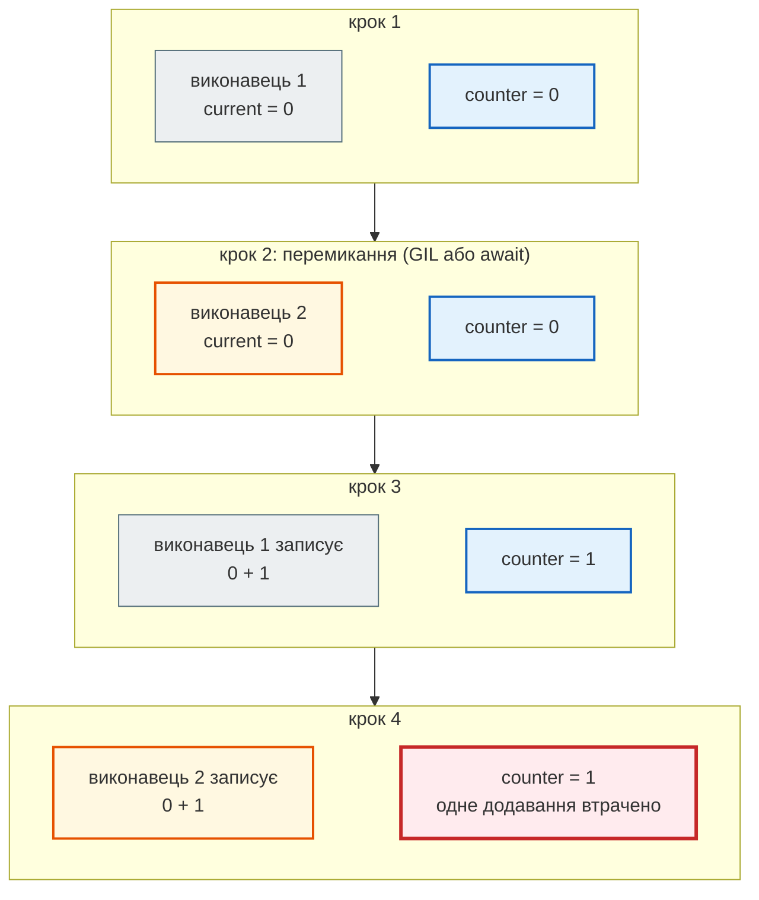
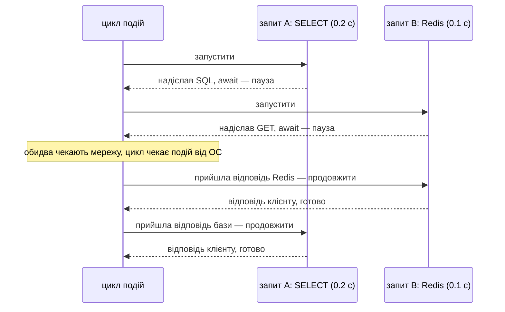
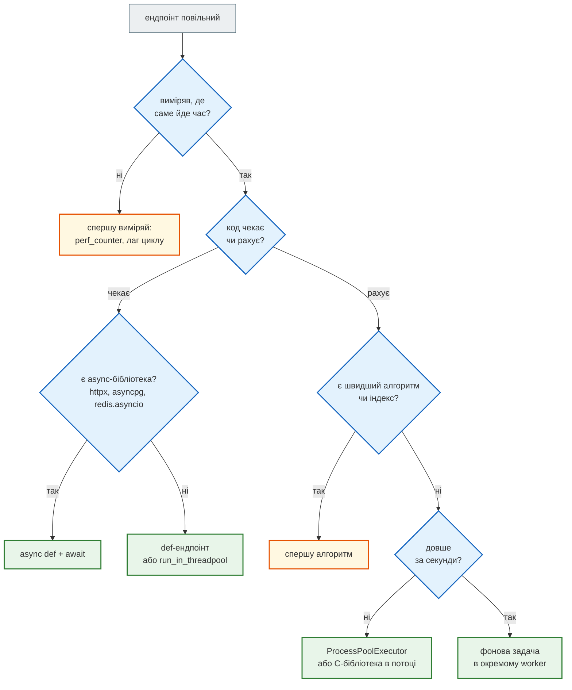

# Чекати чи рахувати: потоки, GIL, процеси, asyncio

## Проблема { #problem }

Сервер API витрачає час на два різні види роботи. Більшу частину часу він **чекає**: відповідь бази, Redis, LLM, чужого сайту. Процесор у цей час простоює. Іноді він **рахує**: розбирає HTML, перевіряє хеш bcrypt, серіалізує великий JSON. Тоді процесор зайнятий на 100 %.

У Python є три способи робити кілька справ одночасно: **потоки** (`threading`), **процеси** (`multiprocessing`) і **асинхронність** (`asyncio`). Кожен прискорює лише один вид роботи, а не той вибір лише ускладнить код. Тут — що робить кожен, де межі (GIL, спільна пам'ять, ціна одного виконавця) і що з цього обирають для API.

## Ментальна модель { #mental-model }



- **Конкурентність** (concurrency) — один виконавець і кілька справ. У кожен момент він робить одну дію, але жодна справа не стоїть, поки інша чекає. Так один процес uvicorn обслуговує сотні запитів.
- **Паралелізм** (parallelism) — кілька виконавців справді одночасно, кожен на своєму ядрі.

| | Робота, що **чекає** (I/O-bound) | Робота, що **рахує** (CPU-bound) |
|---|---|---|
| в API | база, Redis, HTTP до інших сервісів, LLM, диск | парсинг HTML, bcrypt, стиснення, обробка зображень |
| що робить процесор | здебільшого простоює | зайнятий на 100 % |
| що прискорить | чекати **одночасно**: потоки або `asyncio` | рахувати **на кількох ядрах**: процеси |

## Дослід: два види роботи { #experiment }

[`examples/async_concurrency/basics_demo.py`](https://github.com/NikoriakViktor/news_hub/blob/main/examples/async_concurrency/basics_demo.py) запускає ту саму роботу чотирма способами:

```python title="basics_demo.py (фрагмент)"
def fetch(name: str) -> str:
    time.sleep(WAIT)               # блокуюче очікування, як у requests.get
    return f"{name}: ok"


async def fetch_async(name: str) -> str:
    await asyncio.sleep(WAIT)      # очікування, яке віддає керування циклу подій
    return f"{name}: ok"


def count_primes(limit: int) -> int:   # чистий процесор: перебір дільників
    ...

with ThreadPoolExecutor() as pool:
    list(pool.map(fetch, SOURCES))
with ProcessPoolExecutor(max_workers=4) as pool:
    list(pool.map(count_primes, LIMITS))
await asyncio.gather(*(fetch_async(s) for s in SOURCES))
```

Запуск 2026-11-12, WSL2, 16 логічних ядер. Час на іншій машині буде інший, співвідношення — те саме:

```text
Python 3.12.3, ядер: 16, збірка без GIL: False

--- 1. робота, що ЧЕКАЄ: 5 джерел по 0.2 с
   послідовно                             1.00 с
   потоки (ThreadPoolExecutor)            0.20 с
   процеси (ProcessPoolExecutor)          0.21 с
   asyncio.gather                         0.20 с
   результат asyncio.gather: rbc: ok … unian: ok

--- 2. робота, що РАХУЄ: count_primes(200000) × 4
   послідовно                             1.07 с
   потоки (GIL: по одному)                1.27 с
   процеси (по ядру на процес)            0.36 с
   asyncio.gather (корутини без await)    1.16 с
   простих чисел: 17984
```

Що видно:

- **Чекати** одночасно вміють усі три. П'ять очікувань по 0.2 с — це 0.2 с, а не 1 с. Процеси теж упорались, але це найдорожчий спосіб чекати.
- **Рахувати** швидше вміють лише процеси: 0.36 с замість 1.07 с. Потоки — не швидше, а трохи повільніше. `asyncio` — так само, як послідовно: корутина без `await` ніколи не віддає керування, тож чотири корутини просто рахують по черзі.
- `pool.map` і `asyncio.gather` повертають результати **в порядку аргументів**, а не в порядку готовності.

## Потоки і GIL { #gil }

**Потік** (thread) — окрема лінія виконання всередині процесу. Усі потоки процесу бачать ті самі змінні. Запускати їх найзручніше пулом — `ThreadPoolExecutor`: `pool.map(функція, дані)` роздає виклики потокам і збирає результати; `with` чекає на всі й закриває пул.

Чому ж потоки не прискорили `count_primes`? **GIL** (Global Interpreter Lock): у стандартному CPython байт-код у кожен момент виконує **лише один потік** процесу. Потоки чергуються, а не рахують разом. Для роботи, що чекає, це не заважає: на `time.sleep`, читанні сокета чи файлу потік відпускає GIL, і працюють інші. Те саме роблять бібліотеки на C/Rust, що рахують без об'єктів Python: `bcrypt`, `hashlib`, стиснення `zlib`. Для чистого Python-коду, що рахує, чергування лише додає витрати на перемикання.

!!! note "Python без GIL"
    З Python 3.13 існує окрема збірка інтерпретатора без GIL ([PEP 703](https://peps.python.org/pep-0703/)), у якій потоки можуть рахувати паралельно. Звичайний Python, який встановлюють за замовчуванням і який стоїть в образах `python:3.x`, — з GIL. Перевірити: `sysconfig.get_config_var("Py_GIL_DISABLED")` — у демо `збірка без GIL: False`.

## Стан гонитви { #race }

Потоки ділять змінні, і це небезпечно. Чотири виконавці по 1000 разів роблять «прочитати лічильник → записати лічильник + 1»:

```python title="basics_demo.py (фрагмент)"
def add_unsafe(times: int) -> None:
    global counter
    for _ in range(times):
        current = counter
        time.sleep(0)              # потік віддає GIL між «прочитати» і «записати»
        counter = current + 1


async def add_async(times: int) -> None:
    global counter
    for _ in range(times):
        current = counter
        await asyncio.sleep(0)     # await між «прочитати» і «записати» — тут перемикається цикл
        counter = current + 1
```

```text
--- 3. стан гонитви: 4 виконавці × 1000 додавань, очікуємо 4000
   потоки без Lock:                   1001
   потоки з threading.Lock:           4000
   корутини, await між кроками:       1000
   корутини з asyncio.Lock:           4000
   корутини без await між кроками:    4000
```

Три чверті додавань зникли — **стан гонитви** (race condition). «Прочитати й записати» — два кроки, і між ними інший виконавець встигає зробити свої. `time.sleep(0)` лише робить перемикання частішим. Без нього гонитва трапляється рідше, і тому ще небезпечніша: код місяцями працює, а потім губить дані.

Покроково, два виконавці й лічильник, у якому 0:



Два висновки для API:

- **`asyncio` не звільняє від гонитви.** Корутини перемикаються лише на `await`, тож код **між** двома `await` ніхто не перерве (рядок «без await між кроками» — 4000). Але щойно між «прочитати» і «записати» стоїть `await` — запит до бази чи Redis, — гонитва та сама, що з потоками. Саме так у News Hub ламались «перевір, потім встав» у базі ([крок 3](../tutorials/03_sqlalchemy_alembic/checkpoint.md#find-bug-race)) і «прочитай-збільш-запиши» лічильник у Redis ([крок 5](../tutorials/05_api_testing/fake_server.md#fakeredis-limit)).
- **Замок — останній засіб.** `threading.Lock` / `asyncio.Lock` дають 4000, але лише в межах **одного процесу**. Між процесами uvicorn і контейнерами замок у пам'яті не діє — там атомарність дає сховище: `INSERT … ON CONFLICT`, `INCR`, транзакція Redis. Найкраще — взагалі не ділити змінні: функція отримує дані аргументами й **повертає** результат, як у `pool.map` і `gather`.

## Процеси { #processes }

**Процес** — окрема копія програми зі своїм інтерпретатором, своєю пам'яттю і своїм GIL. Операційна система розкладає процеси по ядрах, тому вони рахують паралельно. Інтерфейс той самий — `ProcessPoolExecutor`.

```text
--- 4. процеси не діляться пам'яттю
   результати процесу: [1, 2, 3]
   seen у головному процесі: []
```

Процес-працівник тричі дописав у **свій** список, а список головного процесу лишився порожнім. Дані між процесами ходять лише аргументами й результатами: Python пакує їх `pickle` і пересилає, а це теж час.

!!! warning "`if __name__ == "__main__":` обов'язковий"
    На Windows і macOS кожен процес-працівник **заново імпортує** файл, щоб знайти функцію. Без перевірки `__name__` працівник знову створив би пул. Тому код, що створює процеси, стоїть під `if __name__ == "__main__":`, а функції для процесів визначені на рівні модуля.

Для API це означає: **кілька процесів uvicorn (`--workers`) або кілька контейнерів не мають спільної пам'яті**. Словник у пам'яті, лічильник запитів, кеш у змінній — у кожного процесу свої. Тому лічильник обмеження частоти й кеш у News Hub живуть у Redis ([крок 4](../tutorials/04_middleware_redis/index.md)), а не в змінній модуля.

## Ціна одного виконавця { #cost }

```text
--- 5. ціна одного виконавця
   потік:  RSS +16 КБ, віртуальна пам'ять +16177 КБ (стек; ulimit -s)
   задача asyncio: +905 Б (tracemalloc)
```

- **Потік**: операційна система резервує під його стек віртуальну пам'ять (на цій машині `ulimit -s` = 8192 КБ, а разом зі службовими областями вийшло ≈ 16 МБ на потік). Реально зайнято — ≈ 16 КБ, поки потік спить. Тисяча потоків — це десятки МБ пам'яті, перемикання силами ОС і ліміт кількості потоків процесу.
- **Задача `asyncio`** — звичайний об'єкт Python: ≈ 0.9 КБ на задачу, що чекає. Десять тисяч одночасних очікувань — кілька мегабайтів.
- **Процес** — найдорожчий: новий інтерпретатор (десятки МБ), запуск, `pickle` аргументів. Він окупається, лише коли кожна задача рахує помітний час.

Звідси вибір для сервера, що тримає тисячі з'єднань: для очікувань — `asyncio`, а не потік на з'єднання.

## `asyncio`: один потік, багато очікувань { #asyncio }

`async def` оголошує **корутину** — функцію, що може стати на паузу. Паузу ставить `await`. Виклик корутини **не виконує** її тіло: він повертає об'єкт-корутину, який запускає **цикл подій** (event loop). Цикл подій — диспетчер: виконує корутину до першого `await`, і поки вона чекає, запускає наступну.



- `asyncio.run(main())` створює цикл подій, виконує корутину й закриває цикл. У застосунку FastAPI цього не пишуть: цикл створює uvicorn ([ASGI і WSGI](asgi_vs_wsgi.md)).
- `await` можна писати лише всередині `async def`.
- Корутини перемикаються **лише на `await`**. Код між двома `await` займає цикл подій цілком. Звідси головна пастка — блокуючий виклик у `async def` ([Блокуючий код](blocking_code.md)).

## Що обрати для API { #choose }



| | Потоки | Процеси | `asyncio` |
|---|---|---|---|
| для роботи, що | чекає | рахує | чекає (тисячі одночасно) |
| паралельне обчислення | ні (GIL), крім C-бібліотек, що відпускають GIL | так, по ядру на процес | ні, один потік |
| спільна пам'ять | так → гонитва, `Lock` | ні → лише аргументи й результати | так, перемикання лише на `await` |
| ціна виконавця (вимір вище) | ≈ 16 КБ RSS, ≈ 16 МБ віртуальної | окремий інтерпретатор | ≈ 0.9 КБ |
| що потрібно від коду | нічого особливого | функції на рівні модуля, `__main__` | `async def` і async-бібліотеки **до самого низу** |
| у FastAPI | `def`-ендпоінти, `def`-залежності, `run_in_threadpool` | `--workers`, контейнери, `ProcessPoolExecutor` | `async def`-ендпоінти |

## У News Hub { #news-hub }

| Інструмент | Де | Навіщо |
|---|---|---|
| `asyncio` | усі ендпоінти `async def`; `aiohttp` у `scraper.py`, `redis.asyncio`, SQLAlchemy з `asyncpg`/`aiosqlite`, async-клієнти Gemini і Anthropic | майже вся робота — чекати мережу |
| потоки | `def`-залежності (`get_repo`, `get_cache`…) — FastAPI виконує їх у пулі потоків; DNS у `aiohttp` (`ThreadedResolver`, `safe_fetch.py`) | короткі синхронні виклики, для яких немає `await` |
| процеси | один процес uvicorn у контейнері; масштаб — кількістю контейнерів (`Dockerfile`, змінна `WEB_CONCURRENCY`) | спільний стан — у PostgreSQL і Redis, а не в пам'яті |

Виміри «async проти blocking» на окремому демо-застосунку — [крок 2: async чи blocking](../tutorials/02_fastapi_basics/async_measurements.md). Що з кожним видом ендпоінта робить FastAPI — [Три типи ендпоінтів](endpoint_types.md).

## Типові помилки { #mistakes }

| Помилка | Наслідок | Як правильно |
|---|---|---|
| потоки для обчислень на чистому Python | не швидше, ніж послідовно (GIL) | процеси або C-бібліотека, що відпускає GIL |
| процеси для дрібних задач | запуск і `pickle` дорожчі за роботу | процеси — лише для помітних обчислень |
| «в asyncio немає гонитви» | втрачені оновлення, коли між читанням і записом є `await` | атомарна операція в сховищі або `asyncio.Lock` в межах процесу |
| `threading.Lock` проти гонитви між процесами | не діє: у кожного процесу свій замок | атомарність у базі чи Redis |
| стан у змінній модуля при `--workers N` | у кожного процесу своя копія, дані «стрибають» між запитами | Redis або база |
| `async def` без жодного `await` усередині | корутина виконується як звичайна функція, але в циклі подій | `await` асинхронних бібліотек або `def` |
| `ProcessPoolExecutor` без `if __name__ == "__main__":` | `RuntimeError` на Windows і macOS | пул — у `main()` під перевіркою `__name__` |

## Налагодження { #debugging }

- **Спершу визнач вид роботи.** `top`/`htop` під навантаженням: процес uvicorn на 100 % одного ядра — рахує; майже 0 % при повільних відповідях — чекає (базу, мережу, пул з'єднань).
- **Гонитву ловлять навантаженням, а не одним запитом.** `asyncio.gather` з 10–20 однакових запитів (як у тестах кроку 5) виявляє те, чого не видно в Swagger.
- **`threading.enumerate()`** показує, скільки потоків у процесі зараз і як вони звуться: `AnyIO worker thread` — пул FastAPI.

## Питання { #questions }

1. Опитати API погоди для 50 міст і стиснути 50 фото — яка робота чекає, а яка рахує? Чим прискорити кожну?
2. Чому чотири потоки не прискорили `count_primes`, а чотири процеси — прискорили?
3. Чи можлива гонитва між корутинами? За якої умови?
4. Чому лічильник запитів у змінній модуля показує різні числа, якщо запустити uvicorn з `--workers 2`?
5. Скільки пам'яті коштує потік і скільки — задача `asyncio` за вимірами вище? Чому «8 МБ на потік» — не про реально зайняту пам'ять?
6. Що поверне виклик `async def`-функції без `await`?

??? success "Відповіді"

    1. Погода — чекає: `asyncio` (або потоки). Стиснення — рахує: процеси.
    2. GIL: потоки по черзі виконують байт-код одного інтерпретатора. У кожного процесу свій інтерпретатор і свій GIL, тож вони рахують на різних ядрах.
    3. Так, якщо між «прочитати» і «записати» спільний стан є `await`: там цикл подій перемикається на іншу корутину. Код між двома `await` не переривається.
    4. Кожен процес має власну пам'ять і свою копію змінної; запити розподіляються між процесами.
    5. Потік — ≈ 16 КБ реально зайнятої пам'яті й ≈ 16 МБ зарезервованої віртуальної (стек за `ulimit -s`); задача — ≈ 0.9 КБ. 8 МБ — це резерв адресного простору під стек, а не зайнята пам'ять.
    6. Об'єкт-корутину; тіло ще не виконувалось. Запускає її `await`, `asyncio.run` або цикл подій.

## Що далі { #next }

[ASGI і WSGI: цикл подій і процеси uvicorn](asgi_vs_wsgi.md) — хто створює цикл подій у вебзастосунку і чим ASGI відрізняється від WSGI.

**Джерела:** Python — [`concurrent.futures`](https://docs.python.org/3/library/concurrent.futures.html), [`threading`](https://docs.python.org/3/library/threading.html), [`multiprocessing`](https://docs.python.org/3/library/multiprocessing.html) (розділ «Programming guidelines»), [Coroutines and Tasks](https://docs.python.org/3/library/asyncio-task.html), [Глосарій: global interpreter lock](https://docs.python.org/3/glossary.html#term-global-interpreter-lock); [PEP 703 — Making the Global Interpreter Lock Optional](https://peps.python.org/pep-0703/); [PEP 492 — Coroutines with async and await syntax](https://peps.python.org/pep-0492/); FastAPI — [Concurrency and async / await](https://fastapi.tiangolo.com/async/).
