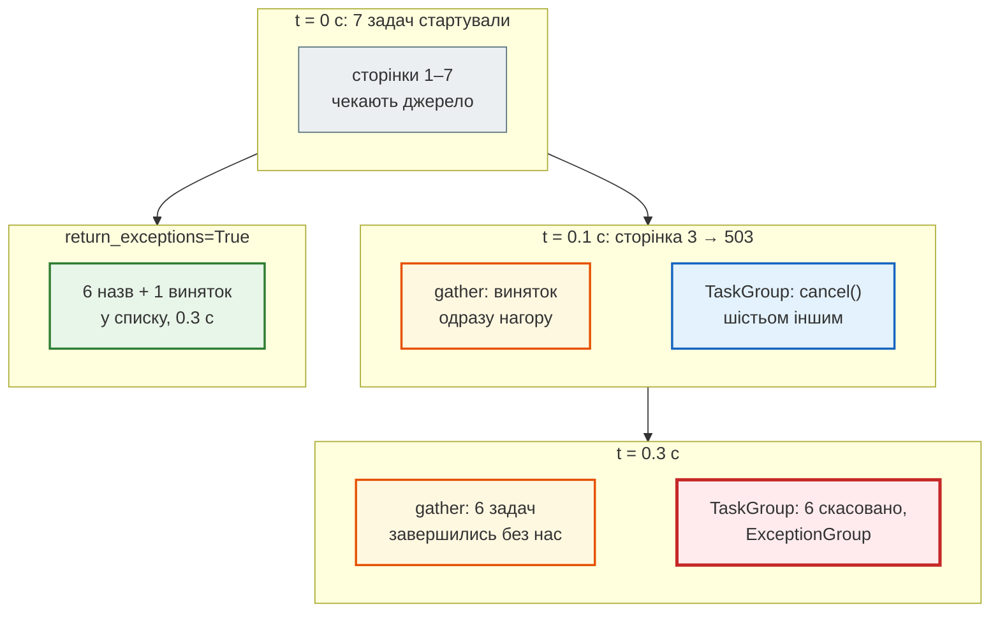
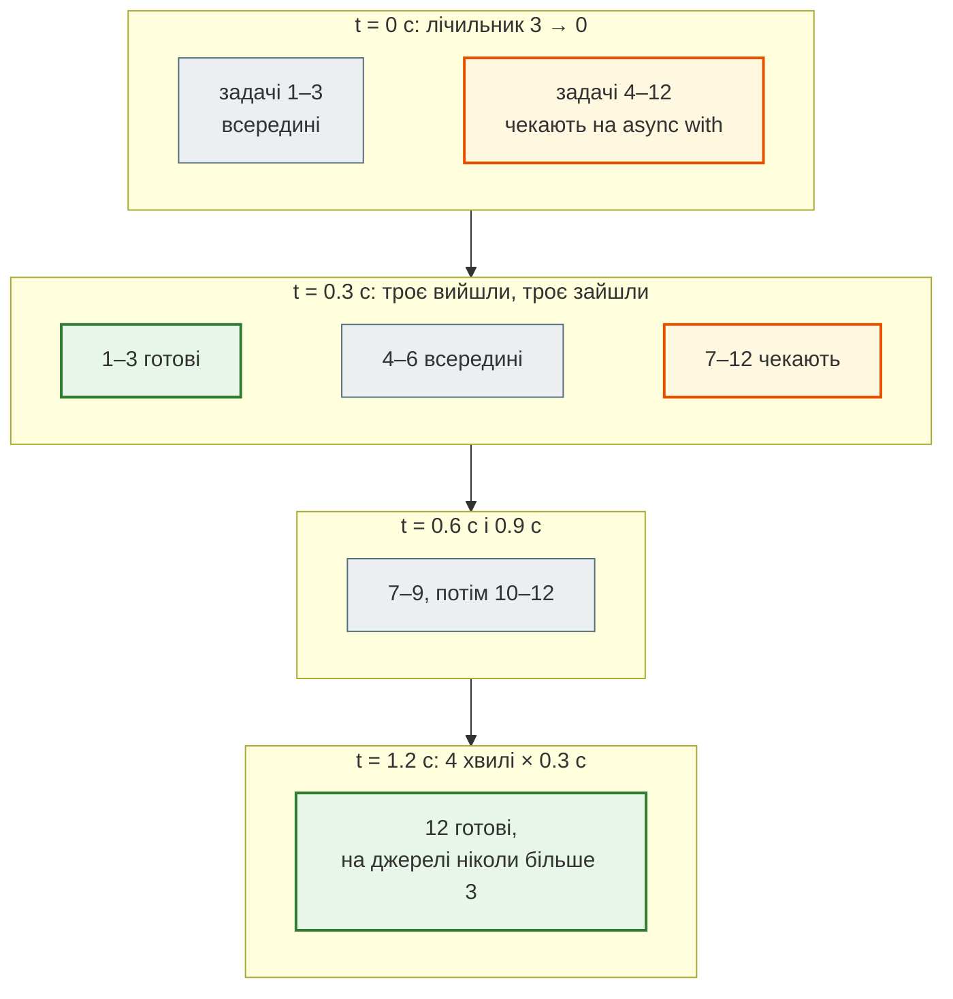

# Паралельні запити: `gather`, `TaskGroup`, `Semaphore`, тайм-аути

## Проблема { #problem }

Агрегатор новин, BFF, що збирає відповідь з трьох сервісів, перевірка десятка джерел — усе це «зробити N запитів і зібрати результати». Послідовно це сума часу всіх запитів, одночасно — час найповільнішого. Але одночасність приносить свої питання:

- одна сторінка впала — що буде з рештою результатів?
- джерел тисяча — чи можна відкрити тисячу з'єднань разом?
- одне джерело зависло — скільки чекати?
- клієнт пішов або спрацював тайм-аут — що стається з задачами, які ще працюють?

Тут — інструменти `asyncio` для кожного з цих питань, виміряні на локальному «джерелі».

## Ментальна модель { #mental-model }

| Задача | Інструмент | Python |
|---|---|---|
| усі результати, порядок як у запиті | `asyncio.gather(*aws)` | 3.7+ |
| усі результати, навіть якщо частина впала | `gather(..., return_exceptions=True)` | 3.7+ |
| усе або нічого: збій одного скасовує решту | `async with asyncio.TaskGroup()` | 3.11+ |
| не більше N одночасно | `asyncio.Semaphore(N)` або ліміт з'єднань клієнта | 3.7+ |
| не довше T секунд | `async with asyncio.timeout(T)`, `asyncio.wait_for(aw, T)`, тайм-аут HTTP-клієнта | `timeout` — 3.11+ |
| обробляти в порядку готовності | `asyncio.as_completed(aws)` | 3.7+ |
| запустити й не чекати зараз | `asyncio.create_task(coro)` + зберегти посилання | 3.7+ |

Усі демо — [`examples/async_concurrency/patterns_demo.py`](https://github.com/NikoriakViktor/news_hub/blob/main/examples/async_concurrency/patterns_demo.py). Сторінки віддає [`upstream_app.py`](https://github.com/NikoriakViktor/news_hub/blob/main/examples/async_concurrency/upstream_app.py): `/page/{n}?delay=` відповідає через `delay` секунд, `/fail/{n}` — `503`, `/stats` показує, скільки запитів було одночасно. Запуск 2026-11-12, Python 3.12.

## `gather`: усе разом { #gather }

```python title="patterns_demo.py (фрагмент)"
async def fetch(client: httpx.AsyncClient, n: int, delay: float = DELAY) -> str:
    response = await client.get(f"/page/{n}", params={"delay": delay})
    response.raise_for_status()
    return response.json()["title"]

titles = [await fetch(client, n) for n in PAGES]                    # по черзі
titles = await asyncio.gather(*(fetch(client, n) for n in PAGES))   # разом
```

```text
--- 1. 7 сторінок по 0.3 с
   по черзі (await у циклі):   2.12 с
   asyncio.gather:             0.31 с  порядок: ['Новина 1', 'Новина 2', 'Новина 3'] …
```

- `await` у циклі — це **по черзі**, навіть в `async def`: кожна ітерація чекає попередню.
- `gather` загортає кожну корутину в задачу, запускає всі й чекає всі. Результати — у порядку аргументів.
- Один `httpx.AsyncClient` на всі запити: з'єднання перевикористовуються.

Той самий прийом збирає відповідь API з кількох сервісів (BFF) — схема, `fetch_*` і `HttpDep` тут умовні:

```python title="схема BFF"
@app.get("/mobile/dashboard/{user_id}")
async def mobile_dashboard(user_id: int, http: HttpDep) -> Dashboard:
    user, orders, balance = await asyncio.gather(
        fetch_user(http, user_id), fetch_orders(http, user_id), fetch_balance(http, user_id),
    )
    return Dashboard(user=user, orders=orders, balance=balance)
```

## Одна сторінка впала { #failure }

Сторінка 3 з семи відповідає `503` через 0.1 с:

```text
--- 2. одна сторінка з 7 відповідає 503
   gather: виняток через 0.10 с: 503; результатів решти сторінок немає
   клієнт отримав сторінок одразу після винятку: 0
   … і через 0.5 с: 6 — решта задач працювала далі, але результати загублено
   gather(return_exceptions=True): 0.30 с, успішних 6, винятків ['HTTPStatusError']
```

- **`gather` без `return_exceptions`** передає перший виняток одразу — і результати шести інших сторінок втрачено.
- **Решта задач при цьому не скасовується.** Вони працюють далі й завершуються, але їхні результати нікому не потрібні. У застосунку це «фонові» запити, що тримають з'єднання й квоти після того, як відповідь клієнту вже пішла.
- **`return_exceptions=True`** повертає список, у якому на місці збою — об'єкт винятку. Код далі сам вирішує, що робити з кожним (`isinstance(r, BaseException)`).

## `TaskGroup`: усе або нічого { #taskgroup }

```python title="patterns_demo.py (фрагмент)"
try:
    async with asyncio.TaskGroup() as group:
        tasks = [group.create_task(fetch_or_fail(client, n)) for n in PAGES]
except* httpx.HTTPStatusError as errors:
    print([e.response.status_code for e in errors.exceptions])
```

```text
--- 3. те саме через asyncio.TaskGroup
   ExceptionGroup через 0.10 с: [503]
   скасовано задач: 6 з 7; клієнт отримав сторінок: 0
   а джерело все одно відпрацювало запитів: 6 — сервер не помітив, що клієнт пішов
```

- Збій однієї задачі **скасовує решту** і чекає, поки вони справді завершаться. З блоку `async with` не виходять «осиротілі» задачі.
- Винятки приходять **групою** (`ExceptionGroup`): якщо впало кілька, видно всі. Ловлять їх `except*`.
- **Скасування — лише на нашому боці.** Клієнт закрив з'єднання, але джерело відпрацювало всі шість запитів: обробник на сервері не дізнався, що відповідь уже нікому не потрібна. Скасування економить наші ресурси, а не чужі.

Покроково, як `gather` і `TaskGroup` поводяться з тим самим збоєм:



| | `gather` | `gather(return_exceptions=True)` | `TaskGroup` |
|---|---|---|---|
| збій однієї задачі | виняток нагору, решта працює далі | виняток стає елементом списку | решта скасовується |
| результати успішних | втрачено | є | втрачено |
| «осиротілі» задачі | так | ні | ні |
| коли брати | рідко: лише якщо збій будь-якої — збій усього, а витік задач не страшний | збір з незалежних джерел: «що вдалось» | частини одного цілого: без однієї відповідь не має сенсу |

## `Semaphore`: не більше N одночасно { #semaphore }

Тисяча джерел через `gather` — це тисяча з'єднань разом: ліміти файлових дескрипторів, бан від чужого сайту, перевантажена база. `Semaphore(N)` пропускає в блок не більше N задач:

```python title="patterns_demo.py (фрагмент)"
sem = asyncio.Semaphore(3)

async def limited(n: int) -> str:
    async with sem:                             # 4-та задача чекає, поки одна з трьох вийде
        return await fetch(client, n)

await asyncio.gather(*(limited(n) for n in range(1, 13)))
```

```text
--- 4. обмежити одночасність: 12 сторінок, не більше 3 разом
   без обмеження                    0.31 с, найбільше одночасно на джерелі: 12
   asyncio.Semaphore(3)             1.21 с, найбільше одночасно на джерелі: 3
   httpx.Limits(max_connections=3)  1.21 с, найбільше одночасно на джерелі: 3
```

Покроково: 12 задач, семафор на 3, кожна сторінка — 0.3 с:



- Час — `ceil(12 / 3) × 0.3 = 1.2` с: ціна захисту джерела.
- **Ліміт з'єднань клієнта** дає те саме для одного клієнта: `httpx.Limits(max_connections=3)`, в `aiohttp` — `TCPConnector(limit=...)`. За замовчуванням обидва обмежують сотнею з'єднань (`httpx`: `max_connections=100`; `aiohttp`: `limit=100`). Семафор потрібен, коли обмежують не з'єднання, а роботу: виклики LLM, записи в базу, кілька різних клієнтів разом.

## Тайм-аути { #timeouts }

Три сторінки: 0.2, 0.4 і 3 с.

```python title="patterns_demo.py (фрагмент)"
async with asyncio.timeout(1):                                          # один ліміт на все
    await asyncio.gather(*(fetch(client, i, d) for i, d in enumerate(delays)))

async def page_or_none(i: int, d: float) -> str | None:                 # ліміт на кожну
    try:
        return await asyncio.wait_for(fetch(client, i, d), timeout=1)
    except TimeoutError:
        return None

await client.get("/page/9", params={"delay": 3}, timeout=1)             # тайм-аут самого клієнта
```

```text
--- 5. тайм-аути: сторінки по 0.2, 0.4 і 3 с
   asyncio.timeout(1) на весь gather: TimeoutError через 1.00 с, дві готові сторінки втрачено
   wait_for(1) на кожну сторінку:     1.00 с, ['Новина 0', 'Новина 1', None]
   тайм-аут httpx (timeout=1):         ReadTimeout через 1.00 с
```

- **Тайм-аут на весь `gather`** скасовує все, що ще не завершилось, і результати двох готових сторінок губляться разом з повільною.
- **Тайм-аут на кожну задачу** + `None` (або `return_exceptions`) — повільна сторінка не забирає з собою інші. Загальний час — не більше найдовшого тайм-ауту.
- **Тайм-аут HTTP-клієнта** — першим рубежем, завжди. `httpx` за замовчуванням чекає 5 с, `aiohttp` — 300 с на весь запит. `asyncio.timeout` поверх — це бюджет на всю операцію: «відповісти клієнту API не пізніше ніж за 2 с, хай що там з джерелами».
- `asyncio.timeout` і `TaskGroup` — з Python 3.11. У 3.10 — `asyncio.wait_for` і тайм-аут клієнта; ловити там треба `asyncio.TimeoutError`, бо в 3.10 це ще не той самий клас, що `TimeoutError`.

## Скасування { #cancellation }

Тайм-аути, `TaskGroup` і `task.cancel()` працюють однаково: у задачу на поточному `await` «влітає» `asyncio.CancelledError`.

```python title="patterns_demo.py (фрагмент)"
async def worker() -> None:
    try:
        await fetch(client, 1, 3)
    except asyncio.CancelledError:
        log.append("CancelledError на await")
        raise                                       # пробросити далі — обов'язково
    finally:
        log.append("finally: прибирання виконано")


async def swallows() -> str:
    try:
        await fetch(client, 2, 3)
        return "сторінка"
    except asyncio.CancelledError:
        return "нічого"                             # помилка: скасування «з'їдено»
```

```text
--- 6. скасування
   CancelledError на await → finally: прибирання виконано → той, хто чекав, теж отримав CancelledError | task.cancelled() = True
   CancelledError проковтнуто: тайм-аут не спрацював, результат 'нічого' через 0.50 с
```

- `finally` і `async with` виконуються при скасуванні: з'єднання, сесії, файли закриваються. Тому ресурси — завжди через `async with`, а не «закрию після `await`».
- **Не ковтай `CancelledError`.** `asyncio.timeout(0.5)` скасував задачу, але вона повернула `'нічого'` як звичайний результат — і тайм-аут **не** перетворився на `TimeoutError`. Код далі вважає, що все добре. `CancelledError` — підклас `BaseException`, тож `except Exception` його не ловить, а `except BaseException:` і `except asyncio.CancelledError:` без `raise` — ловлять.

## `as_completed`: у порядку готовності { #as-completed }

```text
--- 7. asyncio.as_completed: у порядку готовності
   0.20 с: Новина 2
   0.40 с: Новина 3
   0.60 с: Новина 1
```

Сторінка 1 — найповільніша (0.6 с), і `as_completed` віддав її останньою, хоча в списку вона перша. Так обробляють результати, щойно вони приходять: стрімінг відповіді, прогрес, «перші N відповідей».

## Фонові задачі: `create_task` { #create-task }

`asyncio.create_task(coro)` запускає корутину і не чекає її. Цикл подій тримає лише **слабке** посилання на задачу, тож задачу без збереженого посилання може прибрати збирач сміття посеред роботи. Посилання зберігають (у `app.state`, у множині задач), а при зупинці — скасовують і чекають.

У застосунку FastAPI «запустити й не чекати» має три форми, і всі вони — в інших частинах книги:

- `create_task` у `lifespan` для роботи на весь час життя процесу — реєстрація Telegram-бота з повторами ([крок 11](../tutorials/11_compose_deploy/external_services.md));
- `BackgroundTasks` — робота після відповіді клієнту, в тому самому процесі ([крок 4](../tutorials/04_middleware_redis/background_jobs.md#limits));
- окремий worker з чергою — для задач, що мають пережити перезапуск ([Частина VI](../06_middleware_cache_jobs/README.md)).

## У News Hub { #news-hub }

[`steps/12_ci_cd/news_hub/scraper.py`](https://github.com/NikoriakViktor/news_hub/blob/main/steps/12_ci_cd/news_hub/scraper.py):

```python title="scraper.py (фрагмент)"
async def fetch_one(session: aiohttp.ClientSession, url: str, t0: float) -> tuple[PageResult, list[RawNews]]:
    ...
    try:
        async with session.get(url, headers=HEADERS, timeout=aiohttp.ClientTimeout(total=15)) as resp:
            resp.raise_for_status()
            html = await resp.text(errors="replace")   # один битий байт ≠ втрачена сторінка
        items = parse_rbc_news(html)
    except (aiohttp.ClientError, asyncio.TimeoutError) as e:
        error = f"{type(e).__name__}: {e}"
    ...


async def scrape_all_async(pages: list[str] | None = None) -> ScrapeOutcome:
    """Усі сторінки одночасно: загальний час ≈ час найповільнішої."""
    t0 = time.perf_counter()
    async with aiohttp.ClientSession() as session:
        results = await asyncio.gather(*(fetch_one(session, url, t0) for url in pages or PAGES))
    return _outcome(list(results), t0)
```

- **`gather` без `return_exceptions`, але `fetch_one` сам перетворює очікувані збої на результат**: `PageResult(error=...)`. Це той самий підхід «що вдалось», що `return_exceptions=True`, але з типом: звіт показує, яка сторінка і чому впала ([крок 2: живий збір](../tutorials/02_fastapi_basics/scrape_endpoint.md#live)).
- **Межа підходу:** виняток, якого `fetch_one` не ловить, валить увесь `gather`. Так і сталося з `UnicodeDecodeError` на сторінці з битим байтом — новини решти сторінок губились, поки тест на фейковому сервері цього не знайшов ([крок 5](../tutorials/05_api_testing/fake_server.md#finding)).
- **Тайм-аут — на кожну сторінку** (`ClientTimeout(total=15)`), а не на весь збір: повільна сторінка не забирає інші.
- **Без `TaskGroup` і `asyncio.timeout`**: CI перевіряє News Hub на Python 3.10 і 3.13, а ці інструменти — з 3.11. Звідси й `asyncio.TimeoutError` поруч з `aiohttp.ClientError`.
- **Без `Semaphore`**: сторінок сім і список фіксований, ліміт `aiohttp` (100 з'єднань) їх не торкається. RSS-джерела адміна завантажуються по одному за запит (`POST /api/sources/{id}/fetch`). Семафор знадобиться, коли список джерел стане довгим.
- **Свідомо по черзі**: розсилка Telegram у `notify.py` надсилає повідомлення одне за одним з паузою `SEND_PAUSE = 0.05` с (≈ 20 на секунду, нижче ліміту Telegram). Одночасність тут шкодила б: `429` від Telegram.

## Типові помилки { #mistakes }

| Помилка | Наслідок | Як правильно |
|---|---|---|
| `await` у циклі `for` | по черзі, сума часу | `gather` / `TaskGroup` |
| `gather` без `return_exceptions` для незалежних джерел | одна помилка — немає жодного результату; решта задач працює «осиротілою» | `return_exceptions=True` або перехоплення в самій задачі |
| `gather` по тисячі URL | тисяча з'єднань разом; бан, вичерпані дескриптори | `Semaphore(N)` або ліміт з'єднань клієнта |
| новий `ClientSession` / `AsyncClient` на кожну сторінку | нове з'єднання щоразу, ліміт з'єднань не діє | один клієнт на весь збір |
| тайм-аут лише на весь `gather` | повільне джерело забирає результати швидких | тайм-аут на кожну задачу + бюджет на все |
| жодного тайм-ауту | завислий сайт тримає запит API хвилинами (`aiohttp` — до 300 с) | тайм-аут клієнта завжди |
| `except asyncio.CancelledError:` без `raise` | тайм-аути й скасування мовчки не працюють | прибрати за собою і `raise` |
| `asyncio.create_task(...)` без збереженого посилання | задачу може прибрати збирач сміття; винятки губляться | зберегти, скасувати й дочекатися при зупинці |
| `TaskGroup` на Python 3.10 | `AttributeError: module 'asyncio' has no attribute 'TaskGroup'` | `gather`, `wait_for` — або вимога Python ≥ 3.11 |

## Налагодження { #debugging }

- **Чи справді одночасно?** Запиши для кожної задачі час старту й кінця відносно спільного `t0`, як `PageResult.start`/`end` у News Hub: при одночасності всі стартують біля нуля.
- **Хто ще працює?** `asyncio.all_tasks()` — усі незавершені задачі циклу; `task.get_name()` і `create_task(..., name="page-3")` роблять їх упізнаваними.
- **Скільки одночасно на джерелі?** Лічильник на боці джерела (як `/stats` в `upstream_app.py`) або журнал часу запитів — так перевіряють, що семафор справді обмежує.
- **«Task exception was never retrieved»** у журналі — задачу запустили, вона впала, а результат ніхто не забрав. Шукай `create_task` без `await` або `gather`, що впав раніше, ніж ця задача.

## Безпека { #security }

- **Підсилення запитів.** Ендпоінт, що на один вхідний запит робить N вихідних, — множник для атакувальника. Обмежуй N (`Semaphore`, ліміт довжини списку у схемі запиту) і частоту виклику самого ендпоінта.
- **Чужі URL — через перевірку адреси.** Паралельний збір за списком адрес від користувача — це SSRF у N примірниках. У News Hub чужі адреси проходять лише через `safe_fetch` ([крок 8: SSRF](../tutorials/08_security/ssrf.md)).
- **Тайм-аут — частина захисту**, а не лише зручності: без нього повільне джерело тримає з'єднання і пам'ять процесу як завгодно довго.

## Питання { #questions }

1. Чому `[await fetch(n) for n in pages]` в `async def` виконується по черзі?
2. Що стається з іншими задачами, коли одна задача в `gather` (без `return_exceptions`) кидає виняток? А в `TaskGroup`?
3. Чому після скасування `TaskGroup` джерело все одно відпрацювало шість запитів?
4. Як обмежити збір до трьох одночасних запитів і скільки тоді триватимуть 12 сторінок по 0.3 с?
5. Чому тайм-аут на весь `gather` гірший за тайм-аут на кожну сторінку для агрегатора?
6. Що зламається, якщо задача ловить `CancelledError` і не прокидає його далі?
7. Чому News Hub використовує `gather`, а не `TaskGroup`?

??? success "Відповіді"

    1. Кожна ітерація чекає `await` попередньої; задачі не створюються наперед.
    2. У `gather` виняток одразу йде нагору, інші задачі працюють далі, а їхні результати губляться. У `TaskGroup` інші задачі скасовуються, а винятки приходять групою.
    3. Скасування діє лише на нашому боці: клієнт закрив з'єднання, але обробник на сервері джерела не дізнався, що відповідь не потрібна.
    4. `asyncio.Semaphore(3)` навколо запиту (або `httpx.Limits(max_connections=3)`); ≈ 1.2 с — чотири хвилі по 0.3 с.
    5. Загальний тайм-аут скасовує все незавершене разом, і результати швидких сторінок губляться через одну повільну.
    6. Скасування перестане працювати: тайм-аут не перетвориться на `TimeoutError`, `TaskGroup` не дочекається, і код продовжить роботу з неправильним результатом.
    7. CI перевіряє News Hub і на Python 3.10, а `TaskGroup` — з 3.11; а для незалежних сторінок і не потрібне «все або нічого»: `fetch_one` сам повертає помилку як частину результату.

## Що далі { #next }

[Частина V. Бази даних: SQLAlchemy async і Alembic](../05_databases/README.md) — асинхронна сесія, пул з'єднань і транзакція на запит: те, що в цій частині було «синхронним драйвером бази» в таблиці замін.

**Джерела:** Python — [Coroutines and Tasks](https://docs.python.org/3/library/asyncio-task.html) (розділи «Running Tasks Concurrently», «Task Groups», «Timeouts», «Task Cancellation», «Creating Tasks» — про збереження посилання), [Synchronization Primitives: Semaphore](https://docs.python.org/3/library/asyncio-sync.html#asyncio.Semaphore), [`except*` і ExceptionGroup](https://docs.python.org/3/tutorial/errors.html#raising-and-handling-multiple-unrelated-exceptions); HTTPX — [Resource Limits](https://www.python-httpx.org/advanced/resource-limits/), [Timeouts](https://www.python-httpx.org/advanced/timeouts/); aiohttp — [Client Reference: TCPConnector, ClientTimeout](https://docs.aiohttp.org/en/stable/client_reference.html).
