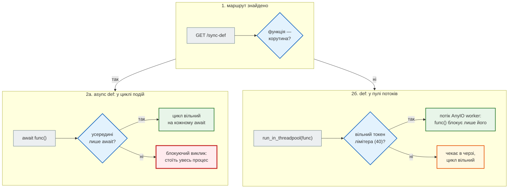

# Три типи ендпоінтів: `async def`, `def` і блокуючий виклик

## Проблема { #problem }

FastAPI приймає ендпоінт і як `async def`, і як звичайний `def`, і обидва «працюють». Різниця видна лише під навантаженням: один варіант обслуговує сотні запитів разом, другий — сорок, третій — по одному, і разом з ним стоїть увесь сервер. Щоб обирати свідомо, треба знати, **де** FastAPI виконує кожну функцію, які там межі і як перенести блокуючий виклик з циклу подій.

На [кроці 2](../tutorials/02_fastapi_basics/async_measurements.md) це виміряно на демо-застосунку з `time.sleep`. Тут — механізм: потоки, пул, його розмір, залежності й два різні способи «виконати в потоці».

## Ментальна модель { #mental-model }

Що робить FastAPI з кожною функцією — ендпоінтом і кожною залежністю — покроково:



| Ендпоінт | Де виконується | Скільки одночасно (на процес) | Що можна всередині |
|---|---|---|---|
| `async def` + `await` | цикл подій | тисячі | лише `await` асинхронних бібліотек |
| `async def` + блокуючий виклик | цикл подій | **один** — і весь сервер чекає | — це помилка |
| `def` | пул потоків AnyIO | 40 (розмір лімітера) | блокуючий код: `requests`, синхронний драйвер, файл |
| `async def` + `await run_in_threadpool(f)` | той самий пул потоків | 40 разом з усіма `def` | блокуючий шматок всередині async-ендпоінта |
| `async def` + `await asyncio.to_thread(f)` | **інший** пул: executor циклу подій | `min(32, ядра + 4)` | те саме, але поза лімітером FastAPI |

## Де виконується кожен ендпоінт { #where }

[`examples/async_concurrency/endpoint_types_app.py`](https://github.com/NikoriakViktor/news_hub/blob/main/examples/async_concurrency/endpoint_types_app.py) — той самий «повільний виклик» у шести варіантах; кожен повертає назву і номер потоку:

```python title="endpoint_types_app.py (фрагмент)"
@app.get("/async-blocking")
async def async_blocking(d: float = 1.0) -> dict[str, str]:
    time.sleep(d)                               # 2. async def + блокуючий виклик: цикл подій стоїть
    return {"thread": here()}


@app.get("/sync-def")
def sync_def(d: float = 1.0) -> dict[str, str]:
    time.sleep(d)                               # 3. def: FastAPI виконує в пулі потоків
    return {"thread": here()}


@app.get("/async-threadpool")
async def async_threadpool(d: float = 1.0) -> dict[str, str]:
    thread = await run_in_threadpool(lambda: (time.sleep(d), here())[1])   # той самий пул, що й для def
    return {"thread": thread}


@app.get("/async-to-thread")
async def async_to_thread(d: float = 1.0) -> dict[str, str]:
    thread = await asyncio.to_thread(lambda: (time.sleep(d), here())[1])   # ІНШИЙ пул: executor циклу подій
    return {"thread": thread}


def sync_dependency() -> str:
    return here()


@app.get("/dependency")
async def dependency(dep_thread: Annotated[str, Depends(sync_dependency)]) -> dict[str, str]:
    return {"thread": here(), "dependency_thread": dep_thread}
```

[`endpoint_types_demo.py`](https://github.com/NikoriakViktor/news_hub/blob/main/examples/async_concurrency/endpoint_types_demo.py) запускає застосунок справжнім uvicorn (FastAPI 0.162, Starlette 1.10, AnyIO 4.16; запуск 2026-11-12):

```text
--- 1. де виконується кожен ендпоінт (d=0)
   ліміти: {'anyio_thread_limit': 40, 'to_thread_workers': 20}
   /async-await       {'thread': 'MainThread #5664'}
   /async-blocking    {'thread': 'MainThread #5664'}
   /sync-def          {'thread': 'AnyIO worker thread #3872'}
   /async-threadpool  {'thread': 'AnyIO worker thread #3872'}
   /async-to-thread   {'thread': 'uvloop_0 #5920'}
   /dependency        {'thread': 'MainThread #5664', 'dependency_thread': 'AnyIO worker thread #3872'}
```

- `async def` — у `MainThread`: це потік циклу подій uvicorn. Блокуючий виклик там зупиняє все.
- `def` і `run_in_threadpool` — в одному пулі: `AnyIO worker thread`. `run_in_threadpool` зі Starlette — це `anyio.to_thread.run_sync`, яким FastAPI сам викликає `def`-функції.
- `asyncio.to_thread` — у потоці executor-а циклу подій (`uvloop_0`; зі стандартним циклом — `asyncio_0`). Це окремий пул зі своїм розміром.
- **Залежність `def` — теж у пулі потоків**, навіть якщо ендпоінт `async def`. Правило «корутина — у цикл, функція — у потік» FastAPI застосовує до **кожної** функції окремо: ендпоінта, кожної залежності, `BackgroundTasks` (`def`-задача теж іде в пул).

## Скільки одночасно { #throughput }

```text
--- 2. одночасні запити, кожен чекає 1 с
   /async-await       × 100:  1.12 с, різних потоків: 1
   /async-blocking    ×   5:  5.01 с, різних потоків: 1
   /sync-def          ×  60:  2.03 с, різних потоків: 40
   /async-threadpool  ×  60:  2.10 с, різних потоків: 40
   /async-to-thread   ×  60:  3.10 с, різних потоків: 20
```

Час — це «скільки хвиль» × тривалість одного виклику:

- `async-await`: 100 очікувань в одному потоці — одна хвиля, ≈ 1 с.
- `async-blocking`: по одному — 5 хвиль, 5 с. Сотня таких запитів чекала б 100 с.
- `sync-def` і `run_in_threadpool`: 40 потоків → 60 запитів = 2 хвилі (40 + 20), ≈ 2 с.
- `asyncio.to_thread`: 20 потоків (`min(32, 16 ядер + 4)`) → 3 хвилі, ≈ 3 с.

## Пул спільний: хто ще чекає { #starvation }

Пул потоків один на процес, і його ділять **усі** `def`-ендпоінти, `def`-залежності, `run_in_threadpool`, `def`-фонові задачі й читання `UploadFile`. Поки 40 повільних `def` зайняли всі токени:

```text
--- 3. пул зайнятий: хто чекає
   /health      (async def) під час 40 × /sync-def:  0.00 с
   /health-sync (def)       під час 40 × /sync-def:  1.71 с
```

Миттєвий `def`-ендпоінт чекав 1.7 с вільного потоку, а `async def` відповів одразу. Так один повільний `def`-ендпоінт під навантаженням гальмує інші `def`-ендпоінти й усі ендпоінти з `def`-залежностями, хоча цикл подій вільний.

## Розмір пулу { #thread-limit }

Розмір задає лімітер AnyIO (`total_tokens`, за замовчуванням 40). Змінюють його при старті процесу:

```python title="endpoint_types_app.py (фрагмент)"
@asynccontextmanager
async def lifespan(app: FastAPI) -> AsyncIterator[None]:
    limiter = anyio.to_thread.current_default_thread_limiter()
    if limit := os.getenv("THREAD_LIMIT"):
        limiter.total_tokens = int(limit)       # пул для def-ендпоінтів, def-залежностей і run_in_threadpool
    app.state.thread_limit = limiter.total_tokens
    yield
```

```text
--- 4. THREAD_LIMIT=100 (total_tokens лімітера anyio)
   /sync-def          ×  60:  1.12 с, різних потоків: 59
   /async-threadpool  ×  60:  1.23 с, різних потоків: 59
   /async-to-thread   ×  60:  3.15 с, різних потоків: 20
```

- `def` і `run_in_threadpool` — одна хвиля, ≈ 1 с: потоків вистачило на всіх (59 різних, бо один потік встиг узяти два запити).
- `asyncio.to_thread` — не змінився: лімітер AnyIO на нього не діє. Два пули — дві ручки налаштування й два різні місця, де шукати чергу.
- **Більший пул — не безкоштовний.** Кожен потік — пам'ять ([ціна виконавця](concurrency_basics.md#cost)). Для обчислень на чистому Python більше потоків не дасть нічого (GIL). Для синхронного драйвера бази більше потоків, ніж з'єднань у пулі бази, лише переносить чергу туди.

## Що обрати { #choose }

| Що всередині | Ендпоінт |
|---|---|
| лише async-бібліотеки (`httpx.AsyncClient`, `asyncpg`, `redis.asyncio`, `aiohttp`) | `async def` |
| лише синхронні бібліотеки (`requests`, `psycopg2`, `sqlite3`, SDK без async) | `def` — FastAPI сам перенесе в потік |
| переважно async, але є один блокуючий виклик | `async def` + `await run_in_threadpool(f, ...)` |
| обчислення на сотні мілісекунд і більше | `ProcessPoolExecutor` через `loop.run_in_executor` ([Блокуючий код](blocking_code.md#cpu)) |
| нічого не чекає і не рахує (віддати значення з `app.state`) | `async def`: без переходу в потік |
| сумніваєшся | `def`: у гіршому разі обмежиш себе 40 потоками, а не зупиниш сервер |

`run_in_threadpool` чи `asyncio.to_thread`? Обидва переносять виклик у потік. У застосунку FastAPI `run_in_threadpool` (або `anyio.to_thread.run_sync`) тримає всю синхронну роботу під одним лімітером, який видно й можна налаштувати. `asyncio.to_thread` — стандартна бібліотека, зручна поза FastAPI, але це другий, незалежний пул.

## У News Hub { #news-hub }

- **Усі ендпоінти — `async def`**, і всередині — `await` асинхронних бібліотек: SQLAlchemy з `asyncpg`/`aiosqlite`, `redis.asyncio`, `aiohttp`, async-клієнти LLM.
- **Залежності-«фабрики» — `def`**: `get_repo`, `get_cache`, `get_llm`, `get_sources` у [`api.py`](https://github.com/NikoriakViktor/news_hub/blob/main/steps/12_ci_cd/news_hub/api.py). Вони миттєві й нічого не блокують, але за правилом вище кожна з них виконується в потоці пулу — як `sync_dependency` у демо. Під звичайним навантаженням це непомітно; якби пул зайняли повільні `def`, вони б теж чекали.
- **`asyncio.to_thread` був і зник.** Стартовий код LLM викликав синхронний SDK Gemini через `asyncio.to_thread` і новий клієнт на кожен виклик; на кроці 7 це замінено на асинхронний `client.aio` ([крок 7: було — синхронний SDK у потоці](../tutorials/07_llm_api/gemini_pool.md#before)). Async-бібліотека краща за потік: ні пулу, ні його ліміту.
- Один блокуючий виклик у `async def` таки лишився — `bcrypt` у вході адміна; вимір і виправлення — [Блокуючий код: у News Hub](blocking_code.md#news-hub).

## Типові помилки { #mistakes }

| Помилка | Наслідок | Як правильно |
|---|---|---|
| `async def` «бо так швидше», а всередині `requests`/`time.sleep`/синхронна база | сервер обслуговує по одному запиту | `def` або async-бібліотека |
| `def` для коду, що вже async | `await` у `def` неможливий; `asyncio.run` у потоці створює новий цикл на кожен запит | `async def` |
| вважати, що `def`-ендпоінтів «необмежено» | 41-й одночасний запит чекає вільного потоку | виміряти; `total_tokens` або `async def` |
| повільний `def` поруч із `def`-залежностями | залежності інших ендпоінтів чекають у тій самій черзі | повільне — в окремий пул або async |
| `asyncio.to_thread` і `run_in_threadpool` упереміш | два пули з різними розмірами; збільшення одного не допомагає другому | в FastAPI — `run_in_threadpool` |
| змінити `total_tokens` на рівні модуля | `current_default_thread_limiter()` потребує запущеного циклу: поза ним — помилка | у `lifespan` |
| спільні змінні в `def`-ендпоінтах без замка | гонитва між потоками пулу | без спільного стану або `threading.Lock` |

## Налагодження { #debugging }

- **Назва потоку в журналі**: `%(threadName)s` у форматі `logging`. `MainThread` у `def`-коді — неможливо; `AnyIO worker thread` у `async def` — теж. Невідповідність показує, де насправді виконується код.
- **Черга до пулу**: `anyio.to_thread.current_default_thread_limiter().statistics()` повертає зайняті токени (`borrowed_tokens`) і кількість тих, хто чекає (`tasks_waiting`). Постійні `tasks_waiting > 0` — пул замалий або в ньому повільні виклики.
- **Тест на 10 одночасних запитів** (як у [кроці 2](../tutorials/02_fastapi_basics/async_measurements.md#demo)) одразу показує, чи ендпоінт іде хвилями.

## Питання { #questions }

1. Де виконується `def`-ендпоінт і де — `def`-залежність `async def`-ендпоінта?
2. Скільки часу займуть 100 одночасних запитів до `def`-ендпоінта, що чекає 1 с, з налаштуваннями за замовчуванням?
3. Чому миттєвий `def`-ендпоінт відповідав 1.7 с, поки 40 інших `def` чекали?
4. Чим `run_in_threadpool` відрізняється від `asyncio.to_thread` у застосунку FastAPI?
5. Чому `THREAD_LIMIT=100` прискорив `/sync-def`, але не `/async-to-thread`?
6. Коли `def` безпечніший вибір, ніж `async def`?

??? success "Відповіді"

    1. Обидва — у пулі потоків AnyIO: FastAPI переносить у потік кожну функцію, що не є корутиною, незалежно від типу ендпоінта.
    2. ≈ 3 с: 40 потоків → три хвилі (40 + 40 + 20).
    3. Пул один на процес; усі 40 токенів лімітера були зайняті, і миттєвий виклик чекав вільного потоку.
    4. `run_in_threadpool` іде в пул AnyIO з лімітером на 40, той самий, що для `def`; `asyncio.to_thread` — в executor циклу подій розміром `min(32, ядра + 4)`.
    5. `total_tokens` змінює лише лімітер AnyIO; executor циклу подій має свій розмір.
    6. Коли всередині є блокуючі виклики, а async-аналога немає: `def` обмежить конкурентність 40 потоками, а `async def` з блокуванням зупинить весь процес.

## Що далі { #next }

[Блокуючий код: каскадний ефект](blocking_code.md) — як один блокуючий виклик гальмує всіх, чим його замінити і як знайти.

**Джерела:** FastAPI — [Concurrency and async / await](https://fastapi.tiangolo.com/async/) (розділи «Path operation functions», «Dependencies», «Very Technical Details»); Starlette — [Thread Pool](https://starlette.dev/threadpool/); AnyIO — [Working with threads](https://anyio.readthedocs.io/en/stable/threads.html) (розділ «Adjusting the default maximum worker thread count»); Python — [`asyncio.to_thread`](https://docs.python.org/3/library/asyncio-task.html#asyncio.to_thread), [`ThreadPoolExecutor`](https://docs.python.org/3/library/concurrent.futures.html#threadpoolexecutor) (розмір за замовчуванням).
