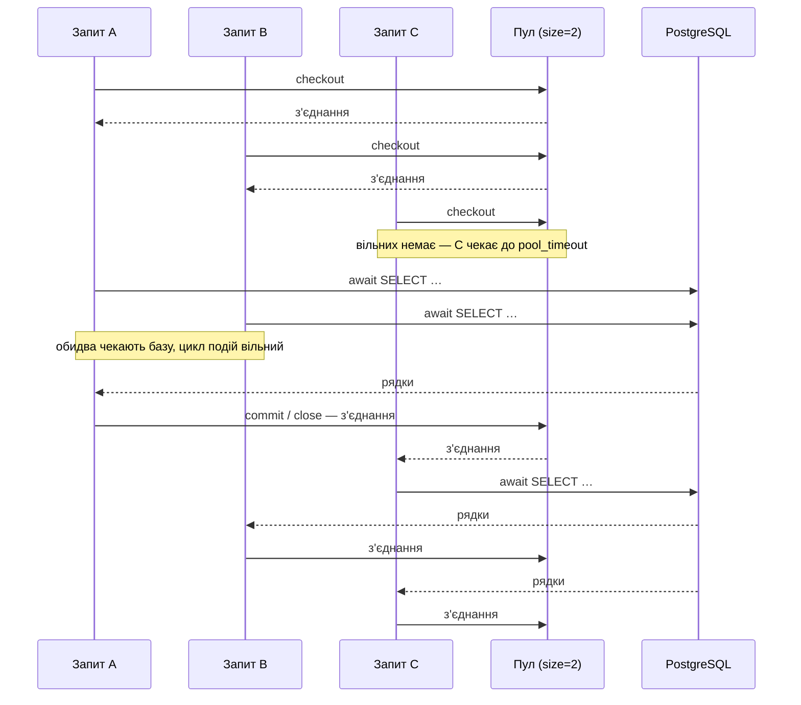
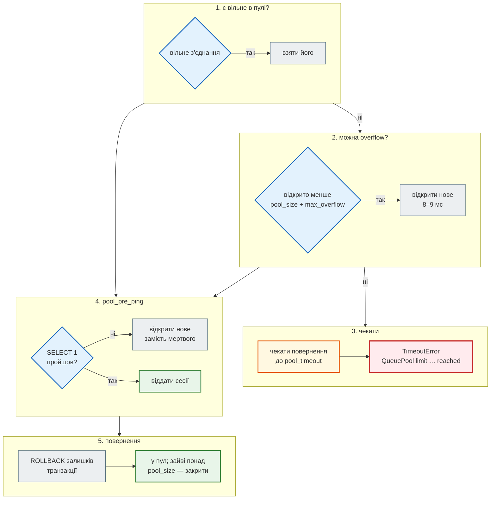

# Пул з'єднань

## Проблема { #problem }

Відкрити з'єднання з PostgreSQL — це TCP-рукостискання, автентифікація й новий серверний процес. Робити це на кожен запит дорого, тому `engine` тримає **пул** уже відкритих з'єднань. Але пул має межі, і вони проявляються лише під навантаженням: двадцять перший запит чекає вільне з'єднання й через 30 секунд падає з `TimeoutError`; після перезапуску PostgreSQL перший запит отримує `connection is closed`; чотири воркери uvicorn з налаштуваннями за замовчуванням разом відкривають більше з'єднань, ніж дозволяє сервер; ендпоінт, що тримає сесію, поки чекає відповідь LLM, вичерпує пул для всіх. Ця сторінка — як пул працює, які параметри за що відповідають і як порахувати, скільки з'єднань потрібно.

Приклади — [`examples/databases/pool_demo.py`](https://github.com/NikoriakViktor/news_hub/blob/main/examples/databases/pool_demo.py) і [`asyncpg_app.py`](https://github.com/NikoriakViktor/news_hub/blob/main/examples/databases/asyncpg_app.py), лише PostgreSQL 16 (у SQLite інша модель з'єднань: це файл, а не сервер), SQLAlchemy 2.1.8 і asyncpg 0.32.

## Ментальна модель { #mental-model }

Пул з `pool_size=2`, `max_overflow=0`, три одночасні запити:



Що відбувається на кожному `checkout` (`AsyncAdaptedQueuePool`, пул за замовчуванням для `asyncpg` і файлового SQLite):



| Параметр `create_async_engine` | За замовчуванням | Що робить |
|---|---|---|
| `pool_size` | 5 | скільки з'єднань пул тримає відкритими постійно |
| `max_overflow` | 10 | скільки тимчасових понад `pool_size` на піку; після повернення закриваються |
| `pool_timeout` | 30 с | скільки чекати вільне з'єднання, перш ніж `TimeoutError` |
| `pool_pre_ping` | `False` | перевіряти з'єднання (`SELECT 1`) перед кожною видачею |
| `pool_recycle` | `-1` (ніколи) | закривати з'єднання, старші за N секунд |
| `poolclass` | `AsyncAdaptedQueuePool`; для SQLite в пам'яті — `StaticPool` | `NullPool` — без пулу; `StaticPool` — одне з'єднання на всіх |

## Ціна з'єднання { #cost }

```text
--- 0. скільки коштує з'єднання: нове чи з пулу (середнє з 50)
    нове з'єднання + SELECT 1:  8.73 мс | з пулу + SELECT 1:  0.81 мс
```

Це PostgreSQL у контейнері на тому самому комп'ютері: ні мережі між машинами, ні TLS. Через мережу й з TLS нове з'єднання коштує ще більше, а `SELECT 1` з пулу — так само мало. Крім часу, кожне з'єднання PostgreSQL — окремий серверний процес з власною пам'яттю, а їх кількість обмежена `max_connections` (за замовчуванням 100).

## Черга й тайм-аут { #queue }

```python title="pool_demo.py (фрагмент)"
engine = create_async_engine(URL, pool_size=2, max_overflow=1, pool_timeout=2)

async def request(n: int, seconds: float) -> str:
    async with engine.connect() as conn:
        got = time.perf_counter() - started
        await conn.execute(text("SELECT pg_sleep(:s)"), {"s": seconds})
        return f"запит {n}: з'єднання через {got:4.2f} с"
```

```text
--- 1. pool_size=2, max_overflow=1: 5 запитів по 0,5 с одночасно
    запит 1: з'єднання через 0.03 с
    запит 2: з'єднання через 0.03 с
    запит 3: з'єднання через 0.03 с
    запит 4: з'єднання через 0.53 с
    запит 5: з'єднання через 0.53 с
    стан пулу: Pool size: 2  Connections in pool: 2 Current Overflow: 0 Current Checked out connections: 0
--- 2. те саме, але запити по 3 с, pool_timeout=2
    запит 1: з'єднання через 0.00 с
    запит 2: з'єднання через 0.00 с
    запит 3: з'єднання через 0.01 с
    TimeoutError: QueuePool limit of size 2 overflow 1 reached, connection timed out, timeout 2.00 (Background on this error at:
    TimeoutError: QueuePool limit of size 2 overflow 1 reached, connection timed out, timeout 2.00 (Background on this error at:
```

- **Три запити отримали з'єднання одразу** (2 з пулу + 1 overflow), двоє чекали півсекунди, поки перші повернуть свої. Для клієнта це просто повільніша відповідь — у журналах помилок нічого.
- **Після навантаження** в пулі лишилося 2 з'єднання: overflow закрито.
- **Коли запити довші за `pool_timeout`**, ті, хто чекав, отримали `TimeoutError` — у FastAPI це 500. Помилка каже не «база впала», а «пул замалий для такого навантаження» або «хтось тримає з'єднання надто довго».
- **`pool_timeout` за замовчуванням — 30 с.** Під перевантаженням це 30 секунд очікування на кожен запит перед 500. Коротший тайм-аут (кілька секунд) швидше повертає помилку, і балансувальник чи клієнт можуть спробувати ще раз.

## Сесія не має тримати з'єднання, поки чекає чужий API { #hold }

```python title="pool_demo.py (фрагмент)"
engine = create_async_engine(URL, pool_size=2, max_overflow=0, pool_timeout=1)

async def endpoint(n: int, release_first: bool) -> str:
    async with AsyncSession(engine) as session:
        title = await session.scalar(select(text("'новина'")))
        if release_first:
            await session.commit()                      # з'єднання повертається в пул до довгого await
        await asyncio.sleep(1.5)                        # виклик LLM, HTTP-запит до іншого сервісу
        return f"{n}:{title}"
```

```text
--- 6. сесія тримає з'єднання, поки ендпоінт чекає чужий API
    commit до await=False ok: 2/4 TimeoutError: QueuePool limit of size 2 overflow 0 reached, connection timed out
    commit до await=True  ok: 4/4
```

Після першого запиту сесія відкрила транзакцію й тримає з'єднання до `commit()`/`rollback()`/`close()` — навіть коли півтори секунди нічого не робить з базою. У PostgreSQL таке з'єднання видно як `idle in transaction`. Чотири запити на пул з двох: половина отримала `TimeoutError`. `commit()` (або `rollback()` для читання) **до** довгого `await` повертає з'єднання, і всі чотири пройшли. У FastAPI з сесією на запит це означає: зовнішній виклик — до першого запиту в базу або після `commit()`, або фонова задача зі своєю сесією.

## Обрив з'єднання і `pool_pre_ping` { #pre-ping }

```text
--- 3. PostgreSQL обірвав з'єднання (перезапуск, тайм-аут простою)
    pool_pre_ping=False запит 1: InterfaceError: connection is closed
    pool_pre_ping=False запит 2: ok, нове з'єднання True
    pool_pre_ping=True  запит 1: ok, нове з'єднання True
    pool_pre_ping=True  запит 2: ok, нове з'єднання True
```

Демо обриває з'єднання пулу через `pg_terminate_backend` — так само виглядає перезапуск PostgreSQL, файрвол чи балансувальник, що закрили простійне з'єднання.

- **Без `pool_pre_ping`** пул віддає мертве з'єднання, і перший запит після обриву — 500. SQLAlchemy позначає з'єднання недійсним, тож наступний запит уже отримує нове.
- **З `pool_pre_ping=True`** перед видачею виконується легкий пінг; мертве з'єднання тихо замінюється. Ціна — один обмін з базою на кожен checkout.
- **`pool_recycle=N`** — інший захист: не віддавати з'єднання, старші за N секунд. Корисний, коли проміжна мережа закриває з'єднання після відомого тайм-ауту простою; від перезапуску бази не рятує.

## Тайм-аути { #timeouts }

```python title="pool_demo.py (фрагмент)"
engine = create_async_engine(URL, connect_args={"server_settings": {"statement_timeout": "500"}})
```

```text
--- 4. тайм-аут запиту: statement_timeout у PostgreSQL
    DBAPIError: canceling statement due to statement timeout
```

| Тайм-аут | Де | Від чого захищає |
|---|---|---|
| `pool_timeout` | пул SQLAlchemy | нескінченне очікування вільного з'єднання |
| `statement_timeout` | PostgreSQL, на з'єднання (`server_settings`) | запит, що виконується хвилинами (немає індексу, `LIKE '%…%'` по великій таблиці) |
| `lock_timeout` | PostgreSQL | очікування блокування (`FOR UPDATE`, міграція з `ALTER TABLE`) |
| `idle_in_transaction_session_timeout` | PostgreSQL | транзакція, яку відкрили й забули |
| `command_timeout` | asyncpg (`create_pool`, `connect`) | те саме, що `statement_timeout`, але на боці клієнта |
| `timeout` у `connect_args` | asyncpg | встановлення з'єднання (база недоступна) |

`server_settings` передає параметри PostgreSQL у момент підключення — так кожне з'єднання пулу отримує їх без окремого `SET`.

## Скільки з'єднань при N воркерах { #workers }

Пул — **на процес**. Кожен воркер uvicorn (`--workers 4`, `WEB_CONCURRENCY=4`), кожен контейнер, кожен окремий процес (бот, планувальник) створює свій `engine` і свій пул.

```text
--- 5. з'єднань на сервері: 3 процеси-«воркери» × (pool_size=4 + max_overflow=2)
    з'єднань під навантаженням: 18 (3 × 6 = 18)
    max_connections сервера: 100
    після навантаження в пулах лишилось: [4, 4, 4] (pool_size, не 6)
    після dispose() усіх пулів: [0, 0, 0] | на сервері: 0
```

Найгірший випадок — сума `pool_size + max_overflow` по всіх процесах:

```text
з'єднань_максимум = процеси × (pool_size + max_overflow)  ≤  max_connections − резерв
```

Резерв — `superuser_reserved_connections` (за замовчуванням 3), міграції, `psql` адміністратора, резервне копіювання, моніторинг. Приклад: налаштування News Hub (`pool_size=10, max_overflow=20` = 30 на процес):

| Процесів API | + бот | Максимум | При `max_connections=100` |
|---|---|---|---|
| 1 | — | 30 | ок |
| 1 | 1 | 60 | ок |
| 3 | — | 90 | майже межа: на міграцію й `psql` лишається 10, з них 3 — резерв суперкористувача |
| 4 | — | 120 | **понад межу**: `FATAL: sorry, too many clients already` на піку |

**Скільки треба насправді.** Не «скільки одночасних HTTP-запитів», а скільки з них **одночасно в базі**. Оцінка за законом Літтла: з'єднань ≈ запитів за секунду × середній час у базі на запит. 200 запитів/с × 20 мс = 4 з'єднання в середньому; пул на 10 дає запас на піки. Більший пул не робить базу швидшою: PostgreSQL з сотнями активних запитів виконує кожен повільніше. Коли процесів багато — пул на боці сервера (PgBouncer) між застосунком і базою.

!!! warning "Пул і `fork`"
    `engine` створюється при імпорті модуля. З'єднання, відкриті до `fork` (gunicorn з `preload_app`), не можна ділити між процесами. uvicorn `--workers` імпортує застосунок у кожному воркері окремо, тож кожен має свій пул. Якщо `fork` таки після імпорту — `engine.dispose(close=False)` у кожному дочірньому процесі.

## asyncpg напряму чи SQLAlchemy { #asyncpg }

asyncpg має власний пул. FastAPI без SQLAlchemy — пул у `lifespan`, з'єднання на запит через залежність з `yield`:

```python title="asyncpg_app.py (фрагмент)"
@asynccontextmanager
async def lifespan(app: FastAPI) -> AsyncIterator[None]:
    app.state.pool = await asyncpg.create_pool(DSN, min_size=2, max_size=10, command_timeout=30)
    yield
    await app.state.pool.close()                     # закрити всі з'єднання пулу


async def get_conn(request: Request) -> AsyncIterator[asyncpg.Connection]:
    async with request.app.state.pool.acquire() as conn:     # повернеться в пул після запиту
        yield conn


@app.get("/news/{news_id}")
async def get_news(news_id: int, conn: ConnDep) -> dict[str, object]:
    row = await conn.fetchrow("SELECT id, title FROM pg_news WHERE id = $1", news_id)   # $1 — параметр
    if row is None:
        raise HTTPException(404, "news not found")
    return dict(row)
```

```text
GET /news/1   → 200 {'id': 1, 'title': 'Гривня зміцнилася'}
GET /news/99  → 404 {'detail': 'news not found'}
GET /pool     → 200 {'size': 2, 'idle': 2, 'max': 10}
```

Пул у `app.state`, а не в глобальній змінній: його створює й закриває `lifespan` у циклі подій застосунку, і тести отримують свій. Швидкість на найпростішому запиті:

```text
--- 7. asyncpg напряму і SQLAlchemy: 2000 запитів по одному рядку
    asyncpg pool      0.17 с, останній результат '1999'
    SQLAlchemy Core   0.58 с, останній результат '1999'
```

У трьох запусках — 0,17–0,69 с для asyncpg і 0,58–1,35 с для SQLAlchemy Core: накладні витрати SQLAlchemy у 2–3 рази на запиті, де база не робить майже нічого. На справжніх запитах (індекси, `JOIN`, сотні рядків) час іде в базі, і різниця стає малою частиною.

| | asyncpg напряму | SQLAlchemy async (поверх asyncpg) |
|---|---|---|
| SQL | рядки з `$1, $2` | `select()`, `insert()`, діалекти |
| результат | `Record` (як `dict`) | `Row` або об'єкти ORM |
| транзакція | `async with conn.transaction()` | сесія, Unit of Work |
| SQLite у тестах | ні | так, той самий код |
| міграції Alembic, autogenerate | без моделей — вручну | з `Base.metadata` |
| накладні витрати | мінімальні | помітні лише на найпростіших запитах |

asyncpg напряму — для вузьких місць (масове завантаження через `copy_records_to_table`, гарячий ендпоінт) або сервісу з кількома запитами. Для застосунку з моделями, міграціями й тестами на SQLite — SQLAlchemy.

Транзакції asyncpg мають свою особливість:

```text
--- 8. транзакція asyncpg: rollback() після commit()
    InterfaceError: cannot rollback; the transaction is already committed
    async with conn.transaction(): ok
```

`AsyncSession.rollback()` після `commit()` нічого не робить, а `Transaction.rollback()` в asyncpg — помилка. Unit of Work над asyncpg, що «завжди робить rollback у `__aexit__`», упаде на кожній успішній операції; надійніше `async with conn.transaction()`, який сам вирішує між `COMMIT` і `ROLLBACK`.

## У News Hub { #news-hub }

```python title="steps/12_ci_cd/news_hub/db.py (фрагмент)"
def make_engine(url: str = DATABASE_URL, echo: bool = False, **options: Any) -> AsyncEngine:
    if url.startswith("postgresql"):
        return create_async_engine(url, pool_size=10, max_overflow=20, pool_pre_ping=True, echo=echo, **options)
    sqlite_engine = create_async_engine(url, echo=echo, **options)
```

Що означають ці три параметри — у [кроці 3](../tutorials/03_sqlalchemy_alembic/engine_and_table.md#pool). Як вони працюють у стеку:

| Процес | Пул | Звідки |
|---|---|---|
| `api` | до 30 з'єднань (`10 + 20`), `pool_pre_ping` | `engine = make_engine()` при імпорті `news_hub.db` |
| `bot` (профіль `polling`) | ще до 30: окремий процес — окремий `engine` | `python -m news_hub.bot` імпортує той самий `db.py` |
| `migrate` | 1 з'єднання, `poolclass=pool.NullPool` | `migrations/env.py`: міграція — разова дія ([крок 3](../tutorials/03_sqlalchemy_alembic/alembic.md#env)) |
| тести | `StaticPool` для SQLite в пам'яті | одне з'єднання тримає базу живою ([крок 3](../tutorials/03_sqlalchemy_alembic/session_per_request.md#test-db)) |

- **Процесів API — один на контейнер.** Dockerfile запускає uvicorn без `--workers` («у контейнері масштабуємо кількістю контейнерів (крок 11), а не --workers усередині»), `WEB_CONCURRENCY` за замовчуванням 1. Кожен доданий контейнер `api` — ще до 30 з'єднань: з `max_connections=100` межа — три.
- **`pool_pre_ping=True`** — PostgreSQL у Compose перезапускається (`restart: unless-stopped`), і перший запит після цього не має бути 500.
- **`statement_timeout` і `pool_timeout` не задано** — діють значення за замовчуванням (без обмеження часу запиту і 30 с очікування з'єднання).
- **Довгі зовнішні виклики** — у фонових задачах зі своєю сесією. `run_analyze_job` робить `commit()` після кожної новини, тож між викликами LLM з'єднання повертається в пул; лише під час першого виклику транзакція після `find_unanalyzed` ще відкрита ([`jobs.py`](https://github.com/NikoriakViktor/news_hub/blob/main/steps/12_ci_cd/news_hub/jobs.py)).

## Типові помилки { #mistakes }

| Помилка | Наслідок | Як правильно |
|---|---|---|
| `create_async_engine` у кожному запиті | новий пул і нове з'єднання щоразу, з'єднання не закриваються | один `engine` на процес |
| сесія відкрита під час виклику LLM/HTTP | `idle in transaction`, пул вичерпано, `TimeoutError` | `commit()` до довгого `await` або фонова задача |
| `pool_size` × воркери × контейнери > `max_connections` | `too many clients already` на піку | порахувати максимум; PgBouncer |
| величезний пул «про запас» | база перевантажена паралельними запитами | пул під реальну кількість одночасних запитів у базі |
| без `pool_pre_ping` після перезапуску бази | перший запит — `connection is closed` → 500 | `pool_pre_ping=True` |
| `pool_timeout` 30 с за замовчуванням під перевантаженням | запити висять пів хвилини перед 500 | кілька секунд |
| без `statement_timeout` | один повільний запит тримає з'єднання хвилинами | `server_settings={"statement_timeout": "…"}` |
| `engine.dispose()` не викликано при зупинці | з'єднання закриваються сервером за тайм-аутом | `await engine.dispose()` у `lifespan` |
| SQLite в пам'яті з пулом за замовчуванням у тестах | кожне з'єднання — своя порожня база | `StaticPool` |
| `NullPool` у застосунку | нове з'єднання на кожен запит (8–9 мс + процес на сервері) | `NullPool` — лише для разових скриптів і міграцій |
| UoW над asyncpg з `rollback()` після `commit()` | `InterfaceError` на кожній успішній операції | `async with conn.transaction()` |

## Налагодження { #debugging }

- **Стан пулу**: `engine.pool.status()` — розмір, вільні, overflow, видані. Корисно в ендпоінті діагностики чи журналі під навантаженням.
- **З'єднання на сервері**: `SELECT application_name, state, count(*) FROM pg_stat_activity GROUP BY 1, 2`. `application_name` задається в `connect_args={"server_settings": {"application_name": "news_hub-api"}}` — тоді видно, який процес скільки тримає. Багато `idle in transaction` — сесії, які не закрили транзакцію.
- **`TimeoutError: QueuePool limit … reached`** — спершу шукай, хто тримає з'єднання (довгі запити, зовнішні виклики в сесії, витік сесії без `async with`), і лише потім збільшуй пул.
- **Події пулу**: `event.listen(engine.sync_engine, "checkout", ...)` і `"checkin"` — час між ними показує, скільки ендпоінт тримав з'єднання.
- **Логи пулу**: `create_async_engine(url, echo_pool="debug")` друкує кожен checkout, checkin, pre-ping і invalidate.

## Безпека { #security }

- **Вичерпання пулу — відмова в обслуговуванні.** Ендпоінт, що тримає з'єднання під час повільного зовнішнього виклику, дозволяє кільком запитам зупинити весь API. Тайм-аути (`pool_timeout`, `statement_timeout`), короткі транзакції, rate limit на дорогих ендпоінтах ([Частина VIII](../08_security/README.md)).
- **Пароль у `DATABASE_URL`**: адреса з паролем не потрапляє в журнал, текст помилки чи відповідь `/health`. `str(engine.url)` SQLAlchemy маскує пароль (`postgresql+asyncpg://news:***@db/news_hub`), а `engine.url.render_as_string(hide_password=False)` і сам рядок `DATABASE_URL` — ні.
- **TLS до бази поза локальною мережею**: для asyncpg — `connect_args={"ssl": ...}` (`ssl.SSLContext` або `"require"`). Усередині мережі Compose база не виставлена назовні.
- **Окремі користувачі бази** для API і міграцій: у пула API немає прав на `DROP TABLE`.

## Питання { #questions }

1. Що робить пул, коли всі `pool_size` з'єднань видано? А коли видано ще й усі `max_overflow`?
2. Чому `TimeoutError: QueuePool limit … reached` найчастіше означає не «замалий пул», а щось інше?
3. Що дає `pool_pre_ping` і яка в нього ціна? Чим він відрізняється від `pool_recycle`?
4. Скільки з'єднань максимум відкриють 4 контейнери API з налаштуваннями News Hub? Що буде з `max_connections=100`?
5. Як оцінити потрібний розмір пулу?
6. Навіщо `statement_timeout`, якщо є `pool_timeout`?
7. Коли брати asyncpg напряму, а коли SQLAlchemy?
8. Чому міграції Alembic у News Hub працюють з `NullPool`?

??? success "Відповіді"

    1. Відкриває тимчасові з'єднання понад `pool_size`, доки не досягне `pool_size + max_overflow`. Далі запит чекає повернення до `pool_timeout`, потім `TimeoutError`.
    2. Частіше з'єднання тримають надто довго: сесія відкрита під час зовнішнього виклику, повільний запит без індексу, сесія без `async with`. Більший пул лише відкладає проблему.
    3. Перевіряє з'єднання перед видачею й замінює мертве — перший запит після перезапуску бази не падає. Ціна — один обмін з базою на checkout. `pool_recycle` закриває з'єднання за віком і не допомагає, якщо базу перезапустили раніше.
    4. 4 × (10 + 20) = 120 на піку — більше за 100: частина з'єднань отримає `too many clients already`. Плюс бот, міграції й резерв суперкористувача.
    5. Скільки запитів одночасно в базі: запитів за секунду × середній час у базі на запит, із запасом на піки. Не кількість одночасних HTTP-запитів.
    6. `pool_timeout` обмежує очікування вільного з'єднання, а `statement_timeout` — виконання самого запиту. Без нього повільний запит тримає з'єднання скільки завгодно, і саме через це інші чекають у черзі.
    7. asyncpg — для вузьких місць і невеликих сервісів без моделей; SQLAlchemy — коли потрібні моделі, міграції з autogenerate, однаковий код для PostgreSQL і SQLite в тестах. На справжніх запитах різниця у швидкості мала.
    8. Міграція — разова дія з одним з'єднанням; пул з постійними з'єднаннями їй не потрібен, а `NullPool` закриває з'єднання одразу після роботи.

## Що далі { #next }

[Міграції Alembic](migrations.md) — як змінювати схему робочої бази без втрати даних і без зупинки API.

**Джерела:** SQLAlchemy 2.0 — [Connection Pooling](https://docs.sqlalchemy.org/en/20/core/pooling.html) (розділи «Dealing with Disconnects», «Using Connection Pools with Multiprocessing or os.fork()»), [Engine Configuration](https://docs.sqlalchemy.org/en/20/core/engines.html), [asyncpg dialect](https://docs.sqlalchemy.org/en/20/dialects/postgresql.html#module-sqlalchemy.dialects.postgresql.asyncpg); asyncpg — [Connection Pools](https://magicstack.github.io/asyncpg/current/api/index.html#connection-pools), [Transactions](https://magicstack.github.io/asyncpg/current/api/index.html#transactions); PostgreSQL — [Connections and Authentication](https://www.postgresql.org/docs/current/runtime-config-connection.html), [Client Connection Defaults](https://www.postgresql.org/docs/current/runtime-config-client.html) (`statement_timeout`, `lock_timeout`, `idle_in_transaction_session_timeout`), [Monitoring — pg_stat_activity](https://www.postgresql.org/docs/current/monitoring-stats.html); [PgBouncer](https://www.pgbouncer.org/).
