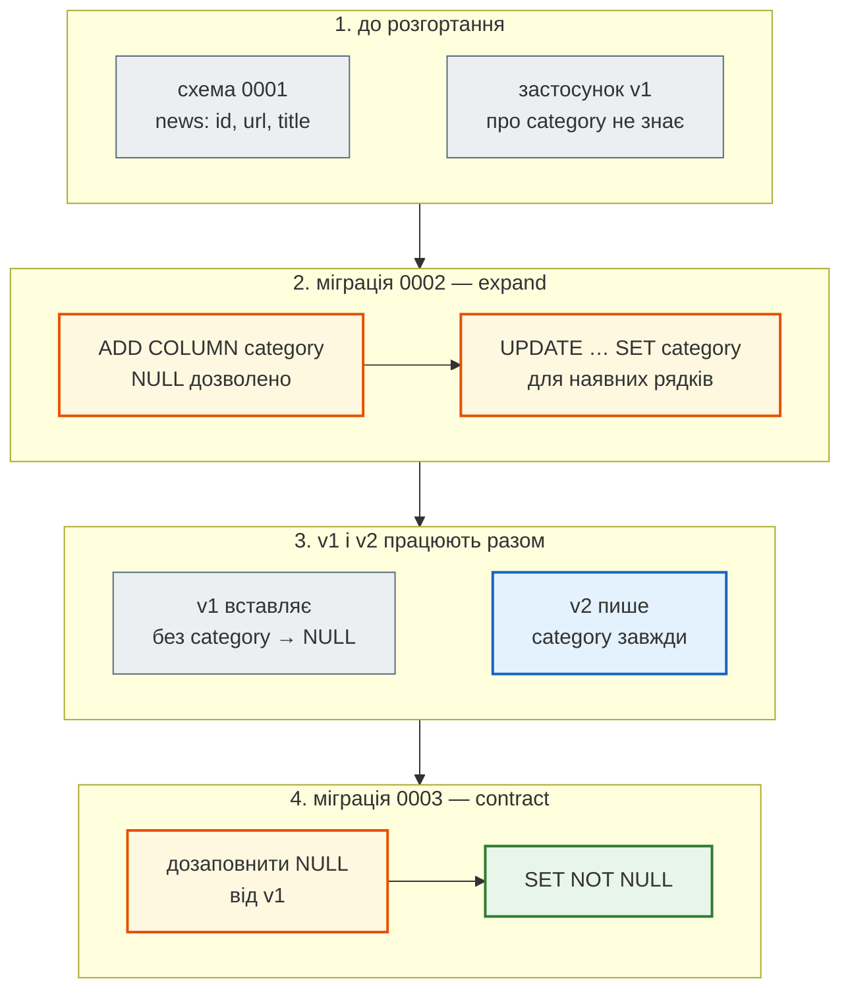

# Міграції Alembic: autogenerate, дані, зміни без зупинки

## Проблема { #problem }

`Base.metadata.create_all()` створює таблиці, яких немає, і не чіпає наявні. Робоча база з тисячами новин має отримати новий стовпець, індекс чи перейменування **без втрати даних**, на кожному сервері однаково й з можливістю відкотитися. Alembic зберігає зміни схеми як код. Але `alembic revision --autogenerate` — лише чернетка: перейменування він бачить як «видалити й додати» (з утратою даних), зміну `server_default` і `CHECK` не бачить зовсім, а в спільній базі пропонує видалити чужі таблиці. `NOT NULL` на заповненій таблиці падає, `CREATE INDEX` блокує запис, а нова версія застосунку з новим стовпцем ламає стару, яка ще працює під час розгортання.

Основи Alembic на прикладі News Hub — `env.py`, перша міграція, `upgrade`/`downgrade`/`current`/`history`, `--sql`, transactional DDL — розібрано в [кроці 3: Міграції Alembic](../tutorials/03_sqlalchemy_alembic/alembic.md). Тут — що робити, коли схема змінюється на живій базі. Приклад — [`examples/databases/migrations_demo/`](https://github.com/NikoriakViktor/news_hub/blob/main/examples/databases/migrations_demo/env.py) (ланцюжок 0001–0004) і [`migrations_demo.py`](https://github.com/NikoriakViktor/news_hub/blob/main/examples/databases/migrations_demo.py), Alembic 1.20.1, SQLite і PostgreSQL 16 (окрема база `migrations`).

## Ментальна модель { #mental-model }

Під час розгортання стара й нова версії застосунку працюють **одночасно** (старий контейнер ще обслуговує запити, новий уже стартує), а міграція виконується між ними. Тому кожна міграція має бути сумісна з **обома** версіями коду. Зміну, несумісну зі старою версією, розбивають на кроки: **expand** (додати нове, не ламаючи старого) → перехід коду → **contract** (прибрати старе).



| Зміна | Безпечна одразу? | Як |
|---|---|---|
| нова таблиця, новий nullable-стовпець | так | одна міграція (як `0002` News Hub) |
| новий `NOT NULL` стовпець | ні: старий код вставляє без нього | expand (nullable + дані) → contract (`NOT NULL`), або `server_default` |
| перейменувати стовпець | ні: старий код читає стару назву | новий стовпець → код пише в обидва → дані → код читає новий → видалити старий |
| видалити стовпець | ні, поки його читає хоч одна версія коду | спершу код без стовпця, потім міграція |
| індекс на великій таблиці | блокує запис на час побудови | `CREATE INDEX CONCURRENTLY` |
| звузити тип, додати `CHECK` | ні, якщо є рядки, що не проходять | перевірити й виправити дані, потім обмеження |

## Міграція з даними { #data-migration }

```python title="migrations_demo/versions/0002_category_expand.py (фрагмент)"
# Таблиця «як у цій міграції», а не імпорт моделі: модель зміниться, а міграція має працювати завжди.
news = sa.table("news", sa.column("id", sa.Integer), sa.column("url", sa.String), sa.column("category", sa.String))


def upgrade() -> None:
    with op.batch_alter_table("news") as batch:
        batch.add_column(sa.Column("category", sa.String(length=100), nullable=True))
    op.execute(
        news.update()
        .where(news.c.category.is_(None))
        .values(category=sa.case((news.c.url.like("%/economy/%"), "Економіка"), else_="Новини"))
    )
```

```python title="migrations_demo/versions/0003_category_contract.py (фрагмент)"
def upgrade() -> None:
    # рядки, які стара версія встигла вставити між 0002 і 0003
    op.execute(news.update().where(news.c.category.is_(None)).values(category="Новини"))
    with op.batch_alter_table("news") as batch:
        batch.alter_column("category", existing_type=sa.String(length=100), nullable=False)
```

`migrations_demo.py` імітує розгортання: дві новини до `0002`, одна вставлена «старою версією» між `0002` і `0003`:

```text
--- 1. 0001, дані старої версії застосунку, потім 0002 (expand + data migration)
    після 0002: [(1, 'Економіка'), (2, 'Новини'), (3, None)]
    після head: [(1, 'Економіка'), (2, 'Новини'), (3, 'Новини')]
```

```text
INFO  [alembic.runtime.migration] Running upgrade  -> 0001, news — таблиця новин
INFO  [alembic.runtime.migration] Running upgrade 0001 -> 0002, category: expand — новий стовпець nullable і заповнення наявних рядків (data migration)
INFO  [alembic.runtime.migration] Running upgrade 0002 -> 0003, category: contract — NOT NULL, коли всі версії застосунку вже пишуть category
INFO  [alembic.runtime.migration] Running upgrade 0003 -> 0004, індекс за title без блокування запису (PostgreSQL: CREATE INDEX CONCURRENTLY)
```

Однаково на SQLite і PostgreSQL.

- **`sa.table(...)` замість `from app.tables import News`.** Міграція — знімок схеми на свій момент. Модель через рік матиме інші стовпці (або її не буде), і міграція з імпортом моделі перестане працювати на новій базі.
- **Дані — одним `UPDATE`, а не циклом у Python.** На мільйонах рядків і він довгий і блокує рядки: такі оновлення ділять на пачки (`WHERE id BETWEEN …`) і виконують окремо від зміни схеми.
- **`0003` дозаповнює ще раз**: між міграціями стара версія вставила рядок без `category` (`(3, None)`), і без цього `SET NOT NULL` упав би.

## `NOT NULL` одразу — на таблиці з рядками { #not-null }

```python
Operations(MigrationContext.configure(sync)).add_column("news", Column("source", String(100), nullable=False))
```

```text
--- 4. NOT NULL одразу, на таблиці з рядками
    IntegrityError: column "source" of relation "news" contains null values          (PostgreSQL)
    OperationalError: Cannot add a NOT NULL column with default value NULL            (SQLite)
```

На порожній базі розробника така міграція проходить, на робочій — падає. Варіанти: expand/contract, як вище, або `server_default=` — тоді база заповнює наявні рядки значенням за замовчуванням (у PostgreSQL 11+ — без переписування таблиці для константи).

## Що бачить autogenerate { #autogenerate }

`migrations_demo.py` порівнює змінені моделі з базою на `head` тією самою функцією, яку викликає `alembic revision --autogenerate` (`compare_metadata`):

```text
--- 3. що бачить autogenerate (модель проти бази на head)
    перейменували title → headline   → ['add_column headline', 'remove_index ix_news_title', 'add_index ix_news_headline', 'remove_column title']
    String(100) → String(200)        → ['modify_type news.category']
    nullable=False → True            → ['modify_nullable news.category']
    додали server_default            → нічого не знайдено
    додали CHECK                     → нічого не знайдено
    перейменували таблицю            → ['add_table articles', 'add_index ix_articles_title', 'remove_index ix_news_title', 'remove_table news']
```

Однаково на SQLite і PostgreSQL.

| Зміна в моделі | Autogenerate | Що робити |
|---|---|---|
| нова таблиця, стовпець, індекс, `UNIQUE` | бачить | прочитати міграцію |
| тип (`String(100)` → `String(200)`) | бачить (`compare_type=True` за замовчуванням з Alembic 1.12) | перевірити, чи дані влазять у новий тип |
| `nullable` | бачить | для `NOT NULL` — спершу дані |
| **перейменування стовпця** | `add_column` + `remove_column` — **дані втрачено** | вручну: `op.alter_column("news", "title", new_column_name="headline")`, на живій базі — expand/contract |
| **перейменування таблиці** | `add_table` + `remove_table` | вручну: `op.rename_table("news", "articles")` |
| `server_default` | не бачить (`compare_server_default=False` за замовчуванням) | дописати `op.alter_column(..., server_default=...)` вручну або ввімкнути порівняння в `env.py` |
| `CheckConstraint` | не бачить | `op.create_check_constraint(...)` вручну |

Autogenerate порівнює **модель з базою**, а не модель з попередньою моделлю: у нього немає історії, тож «стовпець зник, з'явився інший такого ж типу» він не може відрізнити від перейменування. Тому кожну згенеровану міграцію читають перед комітом ([крок 3: autogenerate — чернетка](../tutorials/03_sqlalchemy_alembic/alembic.md#autogenerate)).

### Спільна база: autogenerate пропонує видалити чужі таблиці { #include-object }

Коли `migrations_demo.py` вперше запустили в базі `postgres`, де вже лежали таблиці інших прикладів, `alembic check` упав:

```text
INFO  [alembic.autogenerate.compare.tables] Detected removed table 'audit'
INFO  [alembic.autogenerate.compare.tables] Detected removed table 'sources'
INFO  [alembic.autogenerate.compare.tables] Detected removed table 'balances'
alembic.util.exc.AutogenerateDiffsDetected: New upgrade operations detected: [('remove_table', Table('audit', MetaData(), …
```

Для autogenerate «таблиця в базі, якої немає в `Base.metadata`» — це «видалити таблицю». Згенерована з такої бази міграція містила б `op.drop_table` для чужих даних. Розв'язки: окрема база (або схема) на застосунок — так зроблено в прикладі (`createdb migrations`); або `include_name`/`include_object` у `context.configure(...)` в `env.py`, що пропускає таблиці не з `target_metadata`.

## `alembic check` у CI { #alembic-check }

```text
--- 2. alembic check: модель і база збігаються?
No new upgrade operations detected.
INFO  [alembic.autogenerate.compare.tables] Detected added column 'news.summary'
    AutogenerateDiffsDetected: New upgrade operations detected: [('add_column', None, 'news', Column('summary', String(length=300), table=<ne
```

У моделі з'явився стовпець без міграції — `check` це бачить. З командного рядка:

```text
$ alembic -c migrations_demo/alembic.ini check            # база на 0003, модель — 0004
FAILED: Target database is not up to date.
$ echo $?
255
$ alembic -c migrations_demo/alembic.ini upgrade head && alembic -c migrations_demo/alembic.ini check
No new upgrade operations detected.
$ echo $?
0
```

`check` працює лише з базою на `head`, тому в CI спершу `alembic upgrade head` на **чистій** базі (перевіряє, що весь ланцюжок проходить), потім `alembic check`. Тести цього не замінять: тестові бази створюються з моделей (`create_all`), і стовпець там є. Як це зроблено в News Hub і що буде з «забутою» міграцією — [крок 12: `alembic check`](../tutorials/12_ci_cd/what_to_check.md#alembic-check). Не забувай: `check` має ті самі сліпі зони, що й autogenerate (`server_default`, `CHECK`).

## Індекс без блокування { #concurrently }

```python title="migrations_demo/versions/0004_title_index.py"
def upgrade() -> None:
    with op.get_context().autocommit_block():
        op.create_index("ix_news_title", "news", ["title"], postgresql_concurrently=True)
```

```text
$ alembic -c migrations_demo/alembic.ini upgrade 0003:0004 --sql
BEGIN;

-- Running upgrade 0003 -> 0004

COMMIT;

CREATE INDEX CONCURRENTLY ix_news_title ON news (title);

BEGIN;

UPDATE alembic_version SET version_num='0004' WHERE alembic_version.version_num = '0003';

COMMIT;
```

- **Звичайний `CREATE INDEX` блокує запис у таблицю** на весь час побудови; на великій таблиці це хвилини недоступних `INSERT`/`UPDATE`.
- **`CONCURRENTLY` будує індекс без блокування запису**, але не може виконуватися в транзакції. Alembic на PostgreSQL загортає міграцію в транзакцію (transactional DDL), тому `autocommit_block()`: Alembic робить `COMMIT`, виконує оператор поза транзакцією й відкриває нову (видно в SQL вище).
- **Ціна — менше гарантій.** Якщо `CONCURRENTLY` впав, лишається невалідний індекс (`\d news` покаже `INVALID`), а `alembic_version` — на попередній версії. Індекс видаляють і запускають міграцію знову. Тому таку операцію тримають в окремій міграції.
- На SQLite `postgresql_concurrently` ігнорується — звичайний `CREATE INDEX`, і `0004` проходить там теж.

## Блокування під час міграції { #locks }

`ALTER TABLE` бере найсильніше блокування таблиці (`ACCESS EXCLUSIVE`). Якщо таблицю зараз читає довга транзакція, міграція стоїть у черзі — а за нею стають **усі** нові запити до таблиці, навіть звичайні `SELECT`, і API зависає, хоча сама зміна миттєва. Захист — коротке очікування блокування в міграції:

```python title="migrations_demo.py (фрагмент)"
await reader.execute(text("BEGIN"))
await reader.execute(text("SELECT count(*) FROM news"))      # звіт тримає ACCESS SHARE
await migration.execute(text("SET lock_timeout = '1s'"))
await migration.execute(text("ALTER TABLE news ADD COLUMN source varchar(100)"))
```

```text
--- 7. ALTER TABLE за довгим запитом: lock_timeout (PostgreSQL)
    через 1.0 с: DBAPIError: canceling statement due to lock timeout
```

Міграція не дочекалася блокування й упала через секунду, а не повісила API на весь час звіту. Її повторюють пізніше. У міграції це `op.execute("SET lock_timeout = '5s'")` на початку `upgrade()` або один раз в `env.py` для всіх міграцій PostgreSQL.

## Дві голови { #heads }

Два розробники в різних гілках створили міграції від тієї самої `0004`:

```text
--- 5. дві гілки з однаковим down_revision
Generating /tmp/tmpy5si_69t/migrations/versions/0005a_a_summary_column.py ...  done
Generating /tmp/tmpy5si_69t/migrations/versions/0005b_b_views_column.py ...  done
0005a (head)
0005b (head)
    CommandError: Multiple head revisions are present for given argument 'head'; please specify a specific target revision, '<br
Generating /tmp/tmpy5si_69t/migrations/versions/0006_merge_a_and_b.py ...  done
INFO  [alembic.runtime.migration] Running upgrade 0004 -> 0005b, b: views column
INFO  [alembic.runtime.migration] Running upgrade 0004 -> 0005a, a: summary column
INFO  [alembic.runtime.migration] Running upgrade 0005a, 0005b -> 0006, merge a and b
0006 (head) (mergepoint)
```

Після злиття гілок у git ланцюжок розгалузився: `alembic heads` показує дві голови, `upgrade head` відмовляється. `alembic merge heads -m "…"` створює порожню міграцію з `down_revision = ("0005a", "0005b")`. Порядок застосування гілок не гарантовано (тут `0005b` раніше `0005a`), тож вони не мають залежати одна від одної. `alembic heads` у CI з перевіркою «рівно одна голова» ловить це до злиття.

## `downgrade` — не кнопка «назад» { #downgrade }

```text
--- 6. downgrade до 0001: дані category втрачено
INFO  [alembic.runtime.migration] Running downgrade 0004 -> 0003, індекс за title без блокування запису (PostgreSQL: CREATE INDEX CONCURRENTLY)
INFO  [alembic.runtime.migration] Running downgrade 0003 -> 0002, category: contract — NOT NULL, коли всі версії застосунку вже пишуть category
INFO  [alembic.runtime.migration] Running downgrade 0002 -> 0001, category: expand — новий стовпець nullable і заповнення наявних рядків (data migration)
    стовпці: ['id', 'url', 'title']
```

`downgrade` повертає **схему**, а не дані: `category`, заповнена міграцією й користувачами, зникла разом зі стовпцем. Повторний `upgrade` заповнить її заново правилом з `0002`, а не тим, що вводили люди. На робочій базі відкат роблять новою міграцією «вперед» (виправлення), а від втрати даних захищає резервна копія перед міграцією ([крок 11](../tutorials/11_compose_deploy/backup_restore.md)). `downgrade` корисний у розробці й у CI — як перевірка, що міграція оборотна.

## У News Hub { #news-hub }

| Що зі сторінки | У News Hub |
|---|---|
| ланцюжок | `0001` (news) → `0002` (аналіз LLM) → `0003` (sources) → `0004` (subscriptions) ([`steps/12_ci_cd/migrations/versions/`](https://github.com/NikoriakViktor/news_hub/blob/main/steps/12_ci_cd/migrations/versions/0002_llm_analysis.py)) |
| expand без contract | `0002` додає 5 стовпців, **усі nullable**: «наявні рядки лишаються без аналізу (NULL), дані не переписуються» — зміна сумісна зі старою версією коду |
| перечитана автоміграція | `0001`: `sa.text('now()')` від autogenerate замінено на `sa.func.now()` ([крок 3](../tutorials/03_sqlalchemy_alembic/alembic.md#autogenerate)); `0002`: docstring «згенеровано … і перечитано» |
| `batch_alter_table` | `render_as_batch` для SQLite в `env.py`: SQLite не вміє `ALTER COLUMN` |
| окремий крок міграцій | сервіс `migrate` (`alembic upgrade head`) у Compose; `api` стартує після його успішного завершення ([крок 11](../tutorials/11_compose_deploy/startup_order.md#change)) |
| `alembic check` у CI | `alembic upgrade head` + `alembic check` на чистому PostgreSQL перед `pytest` ([крок 12](../tutorials/12_ci_cd/what_to_check.md#alembic-check)) |
| `CONCURRENTLY`, `lock_timeout`, data migration | не використовуються: індекси створено разом з таблицями, даних для перенесення не було |

Схема News Hub досі лише росла — нові таблиці й nullable-стовпці, тобто чистий expand. Перша зміна, що потребуватиме expand/contract, — будь-яке перейменування чи `NOT NULL` на `news`.

## Типові помилки { #mistakes }

| Помилка | Наслідок | Як правильно |
|---|---|---|
| автоміграція без читання | перейменування стає `drop_column` — дані втрачено | читати кожну; `op.alter_column(new_column_name=...)` |
| `import` моделей у міграції | стара міграція падає, коли модель змінилась | `sa.table(...)` / `sa.column(...)` у самій міграції |
| `NOT NULL` стовпець на заповненій таблиці | `contains null values` (PostgreSQL), `Cannot add a NOT NULL column` (SQLite) | nullable → дані → `NOT NULL`, або `server_default` |
| перейменування за один крок | стара версія коду падає під час розгортання | expand/contract |
| `CREATE INDEX` на великій таблиці | запис заблоковано на хвилини | `postgresql_concurrently=True` в `autocommit_block()` |
| `ALTER TABLE` без `lock_timeout` | черга запитів за міграцією, API зависає | `SET lock_timeout` у міграції |
| autogenerate у спільній базі | `drop_table` для чужих таблиць | окрема база/схема або `include_object` |
| дві голови після злиття гілок | `Multiple head revisions are present` | `alembic merge heads`; перевірка в CI |
| `downgrade` на робочій базі як «відкат» | втрата даних нових стовпців | виправлення новою міграцією; бекап перед міграцією |
| міграції запускає кожен процес API при старті | гонка кількох `upgrade` одночасно | окремий крок (`migrate`) перед стартом API |
| тести на `create_all` і жодного `upgrade head` | зламаний ланцюжок міграцій зелений у CI | `alembic upgrade head` + `alembic check` у CI |

## Налагодження { #debugging }

- **`alembic upgrade head --sql`** (або `0003:0004 --sql`) — SQL без бази: перевірити, що саме виконається, і віддати адміністратору.
- **`alembic current`**, **`alembic history --verbose`**, **`alembic heads`** — де база, який ланцюжок, скільки голів.
- **`Target database is not up to date`** — `check` чи `revision --autogenerate` на базі не на `head`: спершу `upgrade head`.
- **`Can't locate revision identified by '…'`** — у `alembic_version` версія, якої немає в `versions/` (міграцію видалили або перейменували після застосування). Не видаляй застосовані міграції.
- **Autogenerate «не бачить» таблиці** — модуль з моделями не імпортовано в `env.py`, і `Base.metadata` порожній ([крок 3](../tutorials/03_sqlalchemy_alembic/alembic.md#env)).
- **Міграція «висить»** — у PostgreSQL `SELECT pid, wait_event_type, query FROM pg_stat_activity WHERE wait_event_type = 'Lock'`: міграція чекає блокування за довгим запитом.

## Безпека { #security }

- **Бекап перед міграцією** на робочій базі — і перевірене відновлення ([крок 11](../tutorials/11_compose_deploy/backup_restore.md)). `downgrade` даних не повертає.
- **Окремий користувач для міграцій.** Права на `CREATE`/`ALTER`/`DROP` — у міграцій, а не в користувача, від якого працює API.
- **Секрети не в `alembic.ini`.** Адреса з паролем — зі змінної середовища (`DATABASE_URL` в `env.py`, як у News Hub); `alembic.ini` комітиться в git.
- **Data migration — теж код з даними користувачів.** `op.execute` з f-рядком і значеннями з бази — та сама ін'єкція: `sa.table(...).update().values(...)` або `sa.text(...)` з параметрами.

## Питання { #questions }

1. Чому кожна міграція має бути сумісна і зі старою, і з новою версією застосунку?
2. Як додати `NOT NULL` стовпець до таблиці з даними без зупинки API?
3. Що робить autogenerate, якщо перейменувати стовпець у моделі? Як правильно?
4. Які зміни autogenerate не бачить за замовчуванням?
5. Чому в міграції не імпортують моделі застосунку?
6. Навіщо `autocommit_block()` для `CREATE INDEX CONCURRENTLY` і що буде, якщо він впаде?
7. Чому `alembic check` у CI запускають після `upgrade head` на чистій базі?
8. Що робити з двома головами після злиття гілок?
9. Чому `downgrade` — не спосіб відкотити невдалий реліз на робочій базі?

??? success "Відповіді"

    1. Під час розгортання обидві версії працюють одночасно, а міграція виконується між ними: якщо вона ламає стару версію, частина запитів падає, доки старі контейнери не зупиняться.
    2. Expand: додати nullable-стовпець і заповнити наявні рядки. Розгорнути код, що завжди пише стовпець. Contract: дозаповнити `NULL`, що встигла вставити стара версія, і `SET NOT NULL`. Або одразу з `server_default`.
    3. `add_column` нового + `remove_column` старого — дані старого стовпця зникнуть. Вручну `op.alter_column(..., new_column_name=...)`, а на живій базі — expand/contract через новий стовпець.
    4. `server_default`, `CheckConstraint`, перейменування (бачить як видалення й додавання).
    5. Міграція — знімок схеми на свій момент. Модель зміниться чи зникне, і стара міграція перестане працювати на новій базі; `sa.table(...)` описує таблицю такою, якою вона була.
    6. `CONCURRENTLY` не можна виконати в транзакції, а Alembic на PostgreSQL загортає міграцію в транзакцію. Якщо впав — лишається невалідний індекс, його видаляють і повторюють міграцію.
    7. `check` працює лише з базою на `head`; `upgrade head` на чистій базі ще й перевіряє, що весь ланцюжок проходить. Тести цього не перевіряють, бо їхні бази створюються з моделей.
    8. `alembic merge heads` — порожня міграція з двома `down_revision`; гілки не мають залежати одна від одної, бо порядок їх застосування не гарантовано.
    9. Він повертає схему, а не дані: стовпці з даними користувачів зникають. Відкат — нова міграція вперед і бекап перед міграцією.

## Що далі { #next }

Частина V завершена: [SQL для API](sql_for_api.md) → [SQLAlchemy async](sqlalchemy_async.md) → [транзакції](transactions_and_uow.md) → [Repository](repository_pattern.md) → [пул](connection_pool.md) → міграції. Як усе це зібрано в News Hub — [крок 3](../tutorials/03_sqlalchemy_alembic/index.md); як міграції запускаються в Compose — [крок 11](../tutorials/11_compose_deploy/startup_order.md); як перевіряються в CI — [крок 12](../tutorials/12_ci_cd/what_to_check.md#alembic-check). Далі в книзі — [Частина VI. Middleware, кеш, фонові задачі](../06_middleware_cache_jobs/README.md).

**Джерела:** Alembic — [Tutorial](https://alembic.sqlalchemy.org/en/latest/tutorial.html), [Auto Generating Migrations](https://alembic.sqlalchemy.org/en/latest/autogenerate.html) (розділи «What does Autogenerate Detect (and what does it not detect?)», «Controlling What to be Autogenerated»), [Working with Branches](https://alembic.sqlalchemy.org/en/latest/branches.html), [Running “Batch” Migrations for SQLite](https://alembic.sqlalchemy.org/en/latest/batch.html), [Operation Reference](https://alembic.sqlalchemy.org/en/latest/ops.html), [Runtime Objects — autocommit_block](https://alembic.sqlalchemy.org/en/latest/api/runtime.html); PostgreSQL — [CREATE INDEX — Building Indexes Concurrently](https://www.postgresql.org/docs/current/sql-createindex.html#SQL-CREATEINDEX-CONCURRENTLY), [ALTER TABLE](https://www.postgresql.org/docs/current/sql-altertable.html), [Explicit Locking](https://www.postgresql.org/docs/current/explicit-locking.html); Martin Fowler — [Parallel Change (expand/contract)](https://martinfowler.com/bliki/ParallelChange.html).
