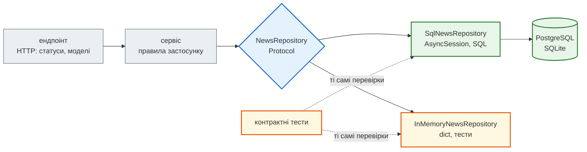

# Патерн Repository

## Проблема { #problem }

SQL прямо в ендпоінтах розсипається по всьому коду: зміна стовпця — десяток файлів, той самий фільтр написано тричі по-різному, а тест кожного ендпоінта потребує бази. Репозиторій збирає доступ до даних в одному місці й дає методи мовою предметної області: `repo.latest(10)` замість `select(...).order_by(...).limit(...)`. Але патерн легко довести до абсурду: абстрактний інтерфейс з однією реалізацією, репозиторій, що дослівно повторює методи сесії, фейк у пам'яті, який поводиться не так, як база, — і зелені тести при зламаному продакшні. Ця сторінка — коли репозиторій потрібен, коли зайвий і як тестувати так, щоб фейк не брехав.

Приклад — [`examples/databases/news_app/`](https://github.com/NikoriakViktor/news_hub/blob/main/examples/databases/news_app/repositories.py) (репозиторій, Unit of Work, сервіс, FastAPI) і [`tests/`](https://github.com/NikoriakViktor/news_hub/blob/main/examples/databases/tests/test_contract.py). Тести запускали на SQLite в пам'яті й на PostgreSQL 16.

## Ментальна модель { #mental-model }



| Шар | Знає | Не знає |
|---|---|---|
| ендпоінт | HTTP: шлях, статус, `response_model`, `HTTPException` | SQL, сесію |
| сервіс | правила застосунку: модерація, «разом або ніяк» | HTTP, SQL |
| репозиторій | таблиці, запити, перетворення рядків ORM | HTTP, правила застосунку |
| база | обмеження: `UNIQUE`, `NOT NULL`, `CHECK` | усе інше |

**Правила даних** (унікальність `url`) — у схемі бази: їх не обійде жоден клієнт. **Правила застосунку** (модерація заголовків) — у сервісі. **SQL** — у репозиторії.

## Контракт і дві реалізації { #contract }

```python title="news_app/repositories.py (фрагмент)"
@dataclass(frozen=True)
class News:
    """Те, що бачить решта програми: не рядок ORM, а звичайний об'єкт без сесії й лінивих зв'язків."""
    id: int
    url: str
    title: str
    views: int = 0


class DuplicateUrl(Exception):
    """Новина з таким url уже є. Обидві реалізації кидають саме його, а не IntegrityError."""


class NewsRepository(Protocol):
    async def add(self, url: str, title: str) -> News: ...
    async def get(self, news_id: int) -> News | None: ...
    async def latest(self, limit: int) -> list[News]: ...
    async def add_view(self, news_id: int) -> None: ...


class SqlNewsRepository:
    def __init__(self, session: AsyncSession) -> None:
        self._session = session

    async def add(self, url: str, title: str) -> News:
        row = NewsRow(url=url, title=title)
        try:
            async with self._session.begin_nested():     # SAVEPOINT: дубль не ламає всю транзакцію
                self._session.add(row)
        except IntegrityError as exc:
            raise DuplicateUrl(url) from exc
        return _to_news(row)
```

- **`Protocol`, а не `abc.ABC`.** Реалізаціям не треба успадковувати базовий клас: mypy перевіряє, що в `SqlNewsRepository` і `InMemoryNewsRepository` є ті самі методи з тими самими сигнатурами (структурна типізація). `ABC` теж працює; різниця в тому, що `Protocol` не змушує фейк з тестів імпортувати базовий клас продакшн-коду.
- **Помилки предметної області, а не бази.** `SqlNewsRepository` перекладає `IntegrityError` у `DuplicateUrl`; фейк кидає той самий `DuplicateUrl`. Сервіс і ендпоінт не імпортують нічого з `sqlalchemy`. `SAVEPOINT` потрібен, щоб після дубля сесія не зламалась ([`PendingRollbackError`](transactions_and_uow.md#broken-session)).
- **Повертає `News`, а не `NewsRow`.** Об'єкт ORM прив'язаний до сесії: після її закриття чи `commit()` читання атрибутів може дати `DetachedInstanceError` або `MissingGreenlet`. Незмінний `dataclass` можна віддати в `response_model`, у фонову задачу, у кеш. Ціна — функція перетворення `_to_news`. Для простого CRUD повертати рядки ORM теж нормально (так робить News Hub).
- **Без `commit()`.** Репозиторій не вирішує, коли транзакція закінчується: це робить Unit of Work або залежність запиту ([Транзакції й Unit of Work](transactions_and_uow.md#uow)).

Ендпоінт працює лише з сервісом, а той — з контрактом:

```python title="news_app/api.py (фрагмент)"
def get_uow() -> UnitOfWork:
    return SqlUnitOfWork(SessionFactory)

UowDep = Annotated[UnitOfWork, Depends(get_uow)]

@app.post("/news", status_code=201)
async def create_news(body: NewsIn, uow: UowDep) -> News:
    try:
        return await publish(uow, body.url, body.title)
    except DuplicateUrl:
        raise HTTPException(409, "news with this url already exists") from None
    except Rejected:
        raise HTTPException(422, "title rejected by moderation") from None
```

## Контрактні тести: фейк не має брехати { #contract-tests }

Фейк у пам'яті робить тести сервісів миттєвими й незалежними від бази. Але це **друга реалізація**, і вона може поводитися інакше: не кидати `DuplicateUrl`, сортувати навпаки, не відкочувати зміни. Тоді тест перевіряє фейк, а не програму. Захист — ті самі тести для обох реалізацій через параметризовану фікстуру:

```python title="tests/conftest.py (фрагмент)"
@pytest.fixture(params=["memory", "sql"])
async def repo(request, session_factory) -> AsyncIterator[NewsRepository]:
    if request.param == "memory":
        yield InMemoryNewsRepository()
        return
    async with session_factory() as session:
        yield SqlNewsRepository(session)
```

```python title="tests/test_contract.py (фрагмент)"
async def test_duplicate_url_raises_and_repo_still_works(repo: NewsRepository) -> None:
    await repo.add("https://example.com/1", "Перша новина")
    with pytest.raises(DuplicateUrl):
        await repo.add("https://example.com/1", "Та сама адреса")
    await repo.add("https://example.com/2", "Друга новина")         # транзакція не зламана
    assert [n.url for n in await repo.latest(10)] == ["https://example.com/2", "https://example.com/1"]
```

```text
$ pytest -v
tests/test_contract.py::test_add_then_get[memory] PASSED
tests/test_contract.py::test_add_then_get[sql] PASSED
tests/test_contract.py::test_get_missing_is_none[memory] PASSED
tests/test_contract.py::test_get_missing_is_none[sql] PASSED
tests/test_contract.py::test_duplicate_url_raises_and_repo_still_works[memory] PASSED
tests/test_contract.py::test_duplicate_url_raises_and_repo_still_works[sql] PASSED
tests/test_contract.py::test_latest_is_newest_first_and_limited[memory] PASSED
tests/test_contract.py::test_latest_is_newest_first_and_limited[sql] PASSED
tests/test_contract.py::test_add_view[memory] PASSED
tests/test_contract.py::test_add_view[sql] PASSED
tests/test_services.py::test_publish_saves_news[fake] PASSED
tests/test_services.py::test_publish_saves_news[sql] PASSED
tests/test_services.py::test_rejected_news_rolls_back_everything[fake] PASSED
tests/test_services.py::test_rejected_news_rolls_back_everything[sql] PASSED
tests/test_services.py::test_duplicate_url[fake] PASSED
tests/test_services.py::test_duplicate_url[sql] PASSED
...
19 passed
```

З `TEST_DATABASE_URL=postgresql+asyncpg://…` ті самі 19 тестів пройшли на PostgreSQL 16.

### Що знайшли контрактні тести { #found }

Перший запуск дав `2 failed, 17 passed` — обидві помилки лише в `[sql]`, фейк проходив:

```text
FAILED tests/test_contract.py::test_add_view[sql] - TypeError: Boolean value ...
FAILED tests/test_services.py::test_rejected_news_rolls_back_everything[sql]
```

1. **`add_view`** спершу був `row.views = NewsRow.views + 1` — SQL-вираз в атрибуті. До `flush` у `row.views` лежить вираз, а не число, і `_to_news` з `row.views or 0` дав `TypeError: Boolean value of this clause is not defined`. Виправлення — `update(NewsRow).where(...).values(views=NewsRow.views + 1)` ([чому](sqlalchemy_async.md#expression-attribute)).
2. **Відкат на SQLite.** Відхилена модерацією новина лишалася в базі: `begin_nested()` без зовнішньої транзакції на драйвері `sqlite3` робить `COMMIT` на `RELEASE`. На PostgreSQL тест проходив і без виправлення. Розбір і рецепт — [SAVEPOINT на SQLite](transactions_and_uow.md#savepoint).

Тест лише з фейком не знайшов би жодної з них. Тест лише з базою знайшов би обидві, але не сказав би, що фейк для тестів сервісів правильний.

### Три рівні тестів { #test-levels }

| Що тестуємо | Чим | Що ловить |
|---|---|---|
| репозиторій | **справжня база** (SQLite в пам'яті, у CI — PostgreSQL), контрактні тести разом з фейком | SQL, обмеження, відмінності баз, розбіжність фейка |
| сервіс | `FakeUnitOfWork` з фейковими репозиторіями | правила застосунку, «разом або ніяк», забутий `commit()` |
| ендпоінт | `TestClient` + `app.dependency_overrides[get_uow] = lambda: fake` | статуси (`201`, `409`, `422`), моделі відповіді |

```python title="tests/test_api.py (фрагмент)"
@pytest.fixture
def client() -> Iterator[TestClient]:
    fake = FakeUnitOfWork()
    app.dependency_overrides[get_uow] = lambda: fake
    yield TestClient(app)                 # без `with`: lifespan (create_all у справжній базі) не запускається
    app.dependency_overrides.clear()


def test_duplicate_is_409(client: TestClient) -> None:
    body = {"url": "https://example.com/1", "title": "Гривня зміцнилася"}
    assert client.post("/news", json=body).status_code == 201
    assert client.post("/news", json=body).status_code == 409
```

Фейк для тестів ендпоінтів спрацює лише тоді, коли він пройшов ті самі контрактні тести, що й SQL-реалізація.

## Коли репозиторій потрібен, а коли зайвий { #when }

| Ознака | Репозиторій | Без нього |
|---|---|---|
| той самий запит у кількох ендпоінтах, задачах, боті | ✓ одне місце | копії, що розходяться |
| складні запити (`ON CONFLICT`, `GROUP BY`, діалекти) | ✓ сховати за методом | SQL у кожному ендпоінті |
| сервіс з правилами, який тестують без бази | ✓ + фейк і контрактні тести | — |
| `GET /items/{id}`, `POST /items` без правил | метод-обгортка над `session.get` нічого не додає | `session.get(Item, id)` в ендпоінті — чесно й зрозуміло |
| «колись перейдемо на MongoDB» | не причина: інша модель даних — інші методи | — |
| `BaseRepository` з `get/add/update/delete/list` для всіх таблиць | дає CRUD, але не мову предметної області | — |

- **`AsyncSession` уже є репозиторієм і Unit of Work** для ORM-об'єктів: `get`, `add`, `delete`, identity map, `commit`. Обгортка, що лише переіменовує ці методи, — зайвий шар.
- **Цінність репозиторію — у методах, яких немає в сесії**: `latest`, `add_many` з `ON CONFLICT`, `find_unanalyzed`, `stats`. Вони кажуть, **що** потрібно, і ховають, **як**.
- **Абстрактний інтерфейс потрібен, коли є друга реалізація.** Для тестів нею буває фейк; але якщо тести репозиторію й так ідуть на SQLite в пам'яті за мілісекунди, фейк може й не знадобитися (так у News Hub).

## У News Hub { #news-hub }

`BaseRepository[ModelT]` дає загальні `get`, `add`, `delete`, `count`; `NewsRepository`, `SourceRepository`, `SubscriptionRepository` додають методи предметної області ([`steps/12_ci_cd/news_hub/repository.py`](https://github.com/NikoriakViktor/news_hub/blob/main/steps/12_ci_cd/news_hub/repository.py)). Як він з'явився на місці `NewsStore` з кроку 2 і змінив ендпоінти на три слова — [Репозиторій замість `NewsStore`](../tutorials/03_sqlalchemy_alembic/repository.md).

| Зі сторінки | У News Hub |
|---|---|
| контракт | неявний: однакові назви методів `NewsStore` (крок 2) і `NewsRepository` (крок 3); `Protocol` немає |
| що повертає | рядки ORM (`NewsRow`); у JSON перетворює `NewsOut` з `from_attributes` |
| помилки | `IntegrityError` доходить до ендпоінта, той повертає `409` (`create` — «такий самий url уже є → IntegrityError (ловить ендпоінт → 409)») |
| `commit()` | ніколи в репозиторії: `get_db`, фонова задача або middleware бота |
| тести | **справжня база**: `tests/integration/conftest.py` — SQLite в пам'яті або PostgreSQL з `TEST_DATABASE_URL` (у CI), таблиці з `Base.metadata.create_all`; фейків репозиторію немає, фейки — для LLM, Redis і сайтів новин ([крок 5](../tutorials/05_api_testing/fake_server.md)) |
| ендпоінт отримує | `RepoDep` → `get_repo(session)` → `SessionDep` → `get_db` |

Це свідомий вибір для проєкту такого розміру: правила застосунку прості, і тест на SQLite в пам'яті коштує мілісекунди. Фейк репозиторію з контрактними тестами став би виправданим, коли з'являться сервіси зі складними правилами, які треба перевіряти сотнями випадків.

## Типові помилки { #mistakes }

| Помилка | Наслідок | Як правильно |
|---|---|---|
| `commit()` у методі репозиторію | операція з двох методів — дві транзакції | `commit()` на межі операції (UoW, залежність) |
| репозиторій повертає об'єкт ORM, який читають після закриття сесії | `DetachedInstanceError`, `MissingGreenlet` | DTO (`dataclass`, Pydantic) або читати в межах сесії |
| фейк без тих самих тестів, що й SQL-реалізація | тести зелені, продакшн ні | параметризована фікстура `["memory", "sql"]` |
| фейк не кидає помилку унікальності | сервіс «зберігає» дублікати в тестах | `DuplicateUrl` в обох реалізаціях |
| `IntegrityError` з `sqlalchemy` у сервісі чи ендпоінті | шари залежать від ORM | репозиторій перекладає у виняток предметної області |
| репозиторій створює власну сесію | два репозиторії — дві транзакції | сесію дає UoW / залежність |
| `BaseRepository.update(**kwargs)` з полями з тіла запиту | масове присвоєння: клієнт змінює `is_admin` | явні поля з моделі запиту ([`ConfigDict`](../02_typing_and_pydantic/config_dict.md#mass-assignment)) |
| «репозиторій для всього», включно з `session.get` | шар без цінності | обгортати лише запити зі змістом |
| логіка застосунку в репозиторії (модерація, права) | SQL і правила змішані; правила не перевірити без бази | правила — у сервісі |

## Налагодження { #debugging }

- **Тест падає лише в `[sql]`** — шукай відмінність бази від Python: порядок без `ORDER BY`, `NULL`, обмеження, транзакції. Лише в `[memory]` — фейк неповний.
- **`pytest -k sql`** / **`-k memory`** — запустити одну реалізацію; `TEST_DATABASE_URL=postgresql+asyncpg://… pytest` — ті самі тести на PostgreSQL.
- **SQL репозиторію** — `echo=True` в engine фікстури або `print(stmt.compile(dialect=postgresql.dialect()))` у методі ([крок 3](../tutorials/03_sqlalchemy_alembic/repository.md#sql)).
- **mypy `--strict`** перевіряє, що реалізація відповідає `Protocol`. Клас без потрібних методів:

    ```text
    _proto_check.py:5: error: Argument 1 to "use" has incompatible type "Broken"; expected "NewsRepository"  [arg-type]
    ```

    І пастка, яку mypy знайшов у самому прикладі: спершу `UnitOfWork` оголошував атрибути `news: NewsRepository`, а `SqlUnitOfWork` присвоював `self.news = SqlNewsRepository(...)`:

    ```text
    news_app/api.py:36: error: Incompatible return value type (got "SqlUnitOfWork", expected "UnitOfWork")  [return-value]
    news_app/api.py:36: note: Following member(s) of "SqlUnitOfWork" have conflicts:
    news_app/api.py:36: note:     audit: expected "AuditLog", got "SqlAuditLog"
    news_app/api.py:36: note:     news: expected "NewsRepository", got "SqlNewsRepository"
    ```

    Змінюваний атрибут протоколу інваріантний: у нього можна було б записати будь-який `NewsRepository`, а в `SqlUnitOfWork` — лише `SqlNewsRepository`. Виправлення — член протоколу лише для читання: `@property def news(self) -> NewsRepository: ...`. Після нього `mypy --strict news_app models.py` — `Success: no issues found in 7 source files`.

## Безпека { #security }

- **SQL лише в репозиторії — менше місць для ін'єкції.** Перевірити параметризацію запитів і білі списки сортування (`?sort=`) треба в одному файлі, а не в кожному ендпоінті ([SQL для API: Безпека](sql_for_api.md#security)).
- **Методи з явними параметрами, а не `**kwargs`.** `repo.update(news_id, **body)` передає в таблицю будь-яке поле з запиту. `repo.set_category(news_id, category)` — лише те, що дозволено.
- **DTO як фільтр.** `News` без `password_hash` чи службових полів не може випадково потрапити у відповідь.
- **Фільтр власника — у репозиторії.** Метод `get_for_user(news_id, user_id)` з `WHERE owner_id = :user_id` надійніший за перевірку `item.owner_id == user.id` в кожному ендпоінті (OWASP API1:2023, «Broken Object Level Authorization»).

## Питання { #questions }

1. Що знає і чого не знає кожен шар: ендпоінт, сервіс, репозиторій, база?
2. Чому `SqlNewsRepository.add` перекладає `IntegrityError` у `DuplicateUrl`, і навіщо там `SAVEPOINT`?
3. Навіщо репозиторію повертати `dataclass`, а не `NewsRow`? Коли рядок ORM теж нормально?
4. Що таке контрактні тести і чому без них фейковий репозиторій небезпечний?
5. Які дві помилки знайшли контрактні тести прикладу і чому тести лише з фейком їх не знайшли б?
6. Коли репозиторій зайвий?
7. Як тестується репозиторій у News Hub і чому там немає фейка?

??? success "Відповіді"

    1. Ендпоінт — HTTP (статуси, моделі); сервіс — правила застосунку; репозиторій — SQL і таблиці; база — обмеження даних. Жоден шар не знає подробиць сусіднього, крім контракту.
    2. Щоб сервіс і ендпоінт не залежали від SQLAlchemy, а фейк кидав той самий виняток. `SAVEPOINT` відкочує лише невдалу вставку, і сесія лишається робочою — інакше наступний запит дав би `PendingRollbackError`.
    3. Об'єкт ORM прив'язаний до сесії; після її закриття читання атрибутів падає. `dataclass` можна передати куди завгодно. Рядок ORM нормально повертати, коли він не виходить за межі сесії запиту — як у News Hub, де `response_model` будує JSON до закриття сесії.
    4. Ті самі тести, параметризовані обома реалізаціями. Без них фейк може поводитися інакше (не кидати помилку дубля, не відкочувати), і тести сервісів перевіряють фейк, а не програму.
    5. `row.views = NewsRow.views + 1` (вираз замість числа до `flush`) і `SAVEPOINT` на SQLite, що робить `COMMIT`. Обидві — у поведінці SQLAlchemy й драйвера, якої у фейка немає.
    6. Коли він лише переіменовує методи сесії (`get`, `add`) для простого CRUD без правил і без повторюваних запитів.
    7. На справжній базі: SQLite в пам'яті локально, PostgreSQL у CI (`TEST_DATABASE_URL`). Правила прості, тест на SQLite швидкий — друга реалізація не окупилася б.

## Що далі { #next }

[Пул з'єднань](connection_pool.md) — звідки сесія бере з'єднання, що буде, коли їх не вистачає, і скільки з'єднань відкриють N воркерів.

**Джерела:** Martin Fowler — [Repository](https://martinfowler.com/eaaCatalog/repository.html), [Unit of Work](https://martinfowler.com/eaaCatalog/unitOfWork.html); Python — [typing.Protocol](https://docs.python.org/3/library/typing.html#typing.Protocol); FastAPI — [Testing Dependencies with Overrides](https://fastapi.tiangolo.com/advanced/testing-dependencies/); SQLAlchemy — [Session Basics](https://docs.sqlalchemy.org/en/20/orm/session_basics.html); [OWASP API Security Top 10 2023 — API1 Broken Object Level Authorization](https://owasp.org/API-Security/editions/2023/en/0xa1-broken-object-level-authorization/).
