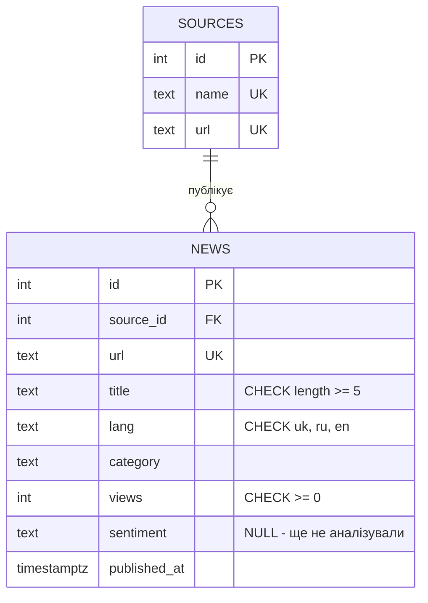
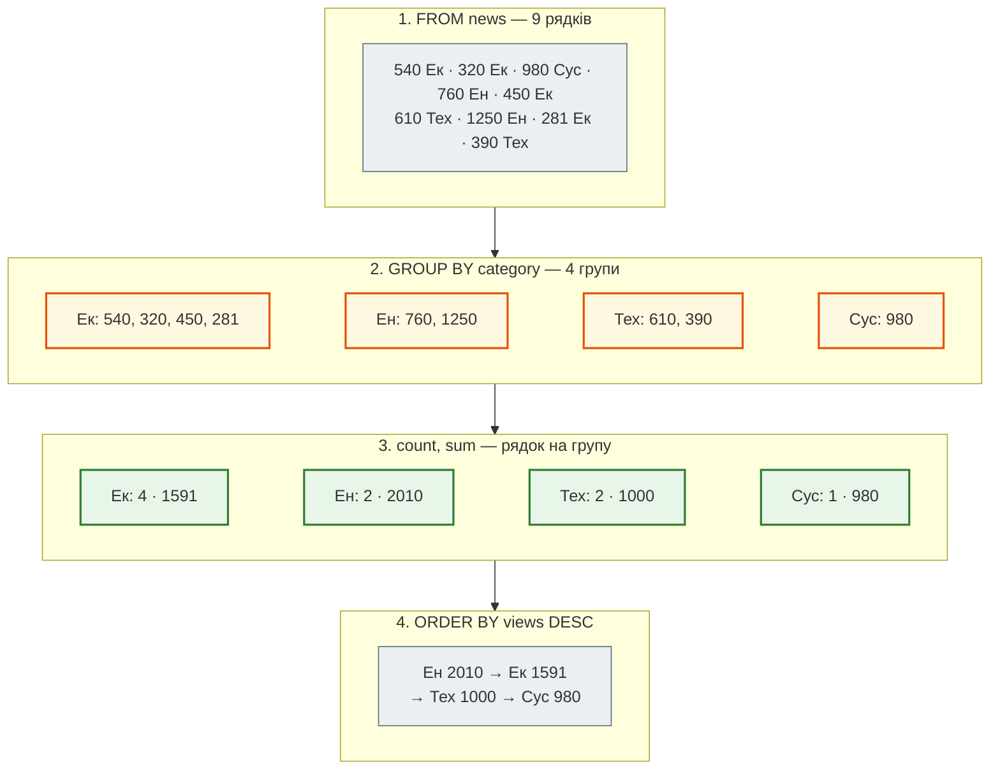
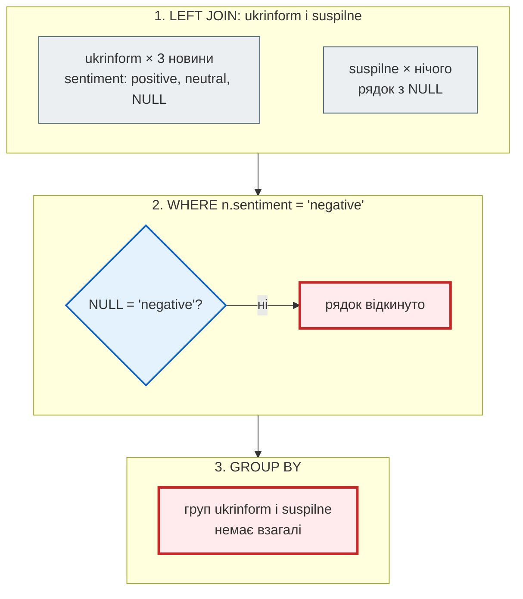

# SQL, яке потрібне API

## Проблема { #problem }

ORM пише SQL за тебе, але не думає за тебе. `GET /api/news?lang=uk` повільний — бо немає індексу чи бо запитів не один, а сто один? `/api/news/stats` рахує в Python те, що база порахувала б одним `GROUP BY`. Звіт «джерела без негативних новин» мовчки губить джерела, бо фільтр стоїть не в тому місці `LEFT JOIN`. Два одночасні запити затирають зміни один одного. Новина з `lang = 'pl'` потрапляє в базу, бо перевірка була лише в Pydantic, а скрипт імпорту її обійшов. Щоб такі помилки бачити, треба читати SQL, який будує SQLAlchemy, і знати, що база вміє сама.

Ця сторінка — SQL з погляду API: схема з ключами й обмеженнями, запити, які стоять за типовими ендпоінтами, індекси під них, транзакції й N+1. Усі приклади виконано на PostgreSQL 16.14.

## Ментальна модель { #mental-model }

Ми **пишемо** `SELECT` першим, але база **виконує** його частини в іншому порядку:

```mermaid
flowchart LR
    classDef step     fill:#eceff1,stroke:#546e7a,stroke-width:1px;
    classDef decision fill:#e3f2fd,stroke:#1565c0,stroke-width:2px;
    classDef success  fill:#e8f5e9,stroke:#2e7d32,stroke-width:2px;
    classDef error    fill:#ffebee,stroke:#c62828,stroke-width:3px;
    classDef warning  fill:#fff8e1,stroke:#e65100,stroke-width:2px;

    F["1. FROM / JOIN<br>рядки таблиць"] --> W["2. WHERE<br>відкинути рядки"]
    W --> G["3. GROUP BY<br>зібрати в групи"]
    G --> H["4. HAVING<br>відкинути групи"]
    H --> S["5. SELECT<br>обчислити стовпці"]
    S --> O["6. ORDER BY<br>відсортувати"]
    O --> L["7. LIMIT / OFFSET<br>сторінка для API"]

    class F,G,S,O step
    class W,H warning
    class L success
```



Звідси два правила, які пояснюють більшість помилок:

- у `WHERE` не можна використати псевдонім з `SELECT` (`AS ...`): на кроці 2 його ще не існує;
- `WHERE` фільтрує **рядки** до групування, `HAVING` — **групи** після.

| Що просить API | Що це в SQL |
|---|---|
| `GET /items/{id}` | `WHERE id = $1` — первинний ключ, індекс є завжди |
| `GET /items?lang=uk&limit=20` | `WHERE … ORDER BY … LIMIT` — потрібен індекс під фільтр **і** сортування |
| `GET /items/stats` | `GROUP BY` з `count`/`sum` — у базі, не в Python |
| `GET /sources` з кількістю новин | `LEFT JOIN … GROUP BY` |
| `POST /items` з унікальним полем | `UNIQUE` + `INSERT … ON CONFLICT` |
| «+1 перегляд» | `UPDATE … SET views = views + 1` — атомарно |

## Таблиці, ключі, обмеження { #keys }

Дві таблиці: джерела й новини. Скрипт — [`examples/databases/sql/sql_basics.sql`](https://github.com/NikoriakViktor/news_hub/blob/main/examples/databases/sql/sql_basics.sql), запуск — `docker exec -i part05-pg psql -U postgres < sql/sql_basics.sql` (контейнер — у README прикладу).



```sql
CREATE TABLE sources (
    id   integer GENERATED ALWAYS AS IDENTITY PRIMARY KEY,
    name text NOT NULL UNIQUE,
    url  text NOT NULL UNIQUE
);

CREATE TABLE news (
    id           integer GENERATED ALWAYS AS IDENTITY PRIMARY KEY,
    source_id    integer NOT NULL REFERENCES sources (id),
    url          text NOT NULL UNIQUE,
    title        text NOT NULL CHECK (length(title) >= 5),
    lang         text NOT NULL CHECK (lang IN ('uk', 'ru', 'en')),
    category     text NOT NULL,
    views        integer NOT NULL DEFAULT 0 CHECK (views >= 0),
    sentiment    text CHECK (sentiment IN ('positive', 'neutral', 'negative')),
    published_at timestamptz NOT NULL DEFAULT now()
);
```

| Запис | Що означає |
|---|---|
| `PRIMARY KEY` | стовпець, що однозначно визначає рядок; двох однакових бути не може; індекс створюється сам |
| `GENERATED ALWAYS AS IDENTITY` | номер генерує база: 1, 2, 3… (сучасна заміна `SERIAL`) |
| `REFERENCES sources (id)` | **зовнішній ключ**: новина не може посилатися на джерело, якого немає |
| `NOT NULL` | значення обов'язкове. `NULL` у SQL — як `None`: «значення немає» |
| `UNIQUE` | повтори заборонені; індекс створюється сам |
| `CHECK (умова)` | рядок, для якого умова хибна, не буде записано |
| `DEFAULT` | значення, якщо його не вказали |
| `timestamptz` | момент часу з часовим поясом; для API — завжди він, а не `timestamp` |

**Один-до-багатьох.** Одне джерело — багато новин. Тому в новині зберігається лише `source_id`, а не назва й адреса джерела: змінилась назва — змінюємо один рядок у `sources`, а не тисячі новин. Прибирати такі повтори — суть **нормалізації**.

### Обмеження не пускають погані дані { #constraints }

```sql
INSERT INTO news (source_id, url, title, lang, category) VALUES (1, 'https://x/10', 'Новина', 'pl', 'Світ');
INSERT INTO news (source_id, url, title, lang, category) VALUES (99, 'https://x/11', 'Новина', 'uk', 'Світ');
INSERT INTO news (source_id, url, title, lang, category) VALUES (1, 'https://www.rbc.ua/ukr/news/1', 'Дубль', 'uk', 'Світ');
INSERT INTO news (source_id, url, lang, category) VALUES (1, 'https://x/12', 'uk', 'Світ');
```

```text
ERROR:  new row for relation "news" violates check constraint "news_lang_check"
DETAIL:  Failing row contains (10, 1, https://x/10, Новина, pl, Світ, 0, null, 2026-11-12 03:52:47.156932+00).
ERROR:  insert or update on table "news" violates foreign key constraint "news_source_id_fkey"
DETAIL:  Key (source_id)=(99) is not present in table "sources".
ERROR:  duplicate key value violates unique constraint "news_url_key"
DETAIL:  Key (url)=(https://www.rbc.ua/ukr/news/1) already exists.
ERROR:  null value in column "title" of relation "news" violates not-null constraint
DETAIL:  Failing row contains (13, 1, https://x/12, null, uk, Світ, 0, null, 2026-11-12 03:52:47.157811+00).
```

- **Кожна помилка називає порушене правило**, а рядок не записано. Pydantic перевіряє тіло запиту, але скрипт імпорту, міграція чи інший сервіс Pydantic обходять. Обмеження в схемі обійти не може ніхто.
- **Назва обмеження — у тексті помилки** (`news_url_key`). Саме за нею API відрізняє «такий `url` уже є» (`409`) від інших порушень.
- **Номери `id` «згоріли».** Невдалі вставки отримали `id` 10–13 до перевірки обмежень, і наступна вдала новина буде 14, а не 10. Лічильник не повертається назад — це нормально ([крок 3: дірки в `id`](../tutorials/03_sqlalchemy_alembic/repository.md#id-gaps)).

### `UPDATE`, `DELETE`, `RETURNING` { #dml }

```sql
UPDATE news SET views = views + 1 WHERE id = 8 RETURNING id, views;
DELETE FROM sources WHERE name = 'rbc.ua';
```

```text
 id | views
----+-------
  8 |   281
(1 row)

UPDATE 1
ERROR:  update or delete on table "sources" violates foreign key constraint "news_source_id_fkey" on table "news"
DETAIL:  Key (id)=(1) is still referenced from table "news".
```

- **`RETURNING`** повертає те, що записала база, тим самим запитом: новий `id` після `INSERT`, нове значення після `UPDATE`. Відповідь `201` чи `200` з тілом не потребує другого `SELECT`.
- **`views = views + 1`** обчислює база, у момент запису. Це не те саме, що «прочитати `views` у Python, додати 1, записати» — чому, на сторінці [Транзакції й Unit of Work](transactions_and_uow.md#lost-update).
- **Зовнішній ключ захищає й від видалення**: джерело з новинами видалити не можна. Інші варіанти задаються в схемі: `REFERENCES sources (id) ON DELETE CASCADE` (видалити новини разом із джерелом) або `ON DELETE SET NULL`.

!!! danger "`WHERE` — не забувай"
    `UPDATE news SET category = 'Інше';` без `WHERE` змінить **усі** рядки, `DELETE FROM news;` — видалить усі. База не перепитує. Перед небезпечним `UPDATE`/`DELETE` спершу виконай `SELECT` з тим самим `WHERE` або працюй у транзакції й подивись результат до `COMMIT`.

## `SELECT`: фільтри, `NULL`, сортування { #select }

```sql
SELECT id, title, views FROM news WHERE views >= 500 ORDER BY views DESC;

SELECT id, title, lang, sentiment
FROM news
WHERE lang IN ('ru', 'en') OR title LIKE 'Г%'
ORDER BY id;
```

```text
 id |                title                | views
----+-------------------------------------+-------
  7 | Графіки відключень на тиждень       |  1250
  3 | Укрзалізниця призначила нові поїзди |   980
  4 | Енергетики відновили живлення       |   760
  6 | Kyiv hosts a tech summit            |   610
  1 | Гривня зміцнилася на міжбанку       |   540
(5 rows)

 id |             title             | lang | sentiment
----+-------------------------------+------+-----------
  1 | Гривня зміцнилася на міжбанку | uk   | positive
  2 | Курс евро снизился            | ru   | negative
  5 | Цены на топливо выросли       | ru   | negative
  6 | Kyiv hosts a tech summit      | en   | neutral
  7 | Графіки відключень на тиждень | uk   | negative
(5 rows)
```

- `=` і `<>` — рівність і нерівність (одне `=`, не `==`); `AND`, `OR`, `NOT` — і дужки, як у Python.
- `IN (...)` — значення зі списку; `BETWEEN a AND b` — діапазон включно.
- `LIKE 'Г%'` — шаблон: `%` — будь-які символи, `_` — один символ. `ILIKE` (PostgreSQL) — без урахування регістру. `%` і `_` у тексті від клієнта — теж частина шаблону, див. [Безпека](#security).
- **Без `ORDER BY` порядок не гарантовано.** База віддає рядки як їй зручно, і після `UPDATE` порядок може змінитися. Для пагінації це означає дублікати й пропуски між сторінками — сортування потрібне завжди, і з унікальним стовпцем наприкінці (`ORDER BY published_at DESC, id DESC`). Offset чи курсор — на сторінці [Колекції](../01_http_and_rest/collections.md#pagination).

### `NULL` — не значення { #null }

```sql
SELECT count(*) AS by_equals FROM news WHERE sentiment = NULL;
SELECT count(*) AS by_is FROM news WHERE sentiment IS NULL;
```

```text
 by_equals
-----------
         0
(1 row)

 by_is
-------
     2
(1 row)
```

Порівняння з `NULL` дає не `true`, а `NULL` — і рядок відкидається. «Немає значення» перевіряють лише `IS NULL` / `IS NOT NULL`. У SQLAlchemy `NewsRow.analyzed_at.is_(None)` будує саме `IS NULL`; `== None` теж, але лінтери на нього скаржаться.

### Псевдонім у `WHERE` { #alias }

```sql
SELECT id, views * 2 AS double_views FROM news WHERE double_views > 2000;
```

```text
ERROR:  column "double_views" does not exist
LINE 1: ...ECT id, views * 2 AS double_views FROM news WHERE double_vie...
                                                             ^
```

Порядок виконання з [ментальної моделі](#mental-model): `WHERE` (крок 2) іде раніше за `SELECT` (крок 5). Повтори вираз (`WHERE views * 2 > 2000`) або загорни запит у підзапит чи `WITH`.

## Агрегати, `GROUP BY`, `HAVING` { #group-by }

Агрегатні функції згортають багато рядків в одне значення: `count`, `sum`, `avg`, `min`, `max`. `GROUP BY` рахує їх **для кожної групи** — це `Counter` з Python одним рядком SQL, і без передачі всіх рядків у застосунок.

```sql
SELECT count(*) AS news, sum(views) AS views, round(avg(views), 2) AS avg_views FROM news WHERE lang = 'uk';

SELECT category, count(*) AS news, sum(views) AS views
FROM news
GROUP BY category
ORDER BY views DESC, category;
```

```text
 news | views | avg_views
------+-------+-----------
    6 |  4201 |    700.17
(1 row)

  category   | news | views
-------------+------+-------
 Енергетика  |    2 |  2010
 Економіка   |    4 |  1591
 Технології  |    2 |  1000
 Суспільство |    1 |   980
(4 rows)
```

Покроково, що робить база з `GROUP BY category`:



`HAVING` — фільтр по групах, після агрегатів:

```sql
SELECT category, sum(views) AS views
FROM news
GROUP BY category
HAVING sum(views) > 1500
ORDER BY category;
```

```text
  category  | views
------------+-------
 Економіка  |  1591
 Енергетика |  2010
(2 rows)
```

!!! warning "Кожен стовпець — або в `GROUP BY`, або в агрегаті"
    ```sql
    SELECT category, title, sum(views) FROM news GROUP BY category;
    ```

    ```text
    ERROR:  column "news.title" must appear in the GROUP BY clause or be used in an aggregate function
    LINE 1: SELECT category, title, sum(views) FROM news GROUP BY catego...
                             ^
    ```

    У групі «Економіка» чотири заголовки. Який показати в одному рядку групи? PostgreSQL не вгадує, а відмовляє. (SQLite такий запит виконає й візьме заголовок з довільного рядка групи — ще одна різниця, яку ловлять лише тести на PostgreSQL.)

## `JOIN` і `LEFT JOIN` { #join }

У `news` лише номери джерел. Назву дає з'єднання: для кожної новини знайти рядок `sources`, у якого `sources.id = news.source_id`.

```sql
SELECT n.id, s.name AS source, n.title
FROM news AS n
JOIN sources AS s ON s.id = n.source_id
WHERE n.lang = 'uk'
ORDER BY n.id;
```

```text
 id |  source   |                title
----+-----------+--------------------------------------
  1 | rbc.ua    | Гривня зміцнилася на міжбанку
  3 | ukrinform | Укрзалізниця призначила нові поїзди
  4 | pravda    | Енергетики відновили живлення
  7 | pravda    | Графіки відключень на тиждень
  8 | rbc.ua    | Нацбанк зберіг облікову ставку
  9 | ukrinform | Стартап зі Львова залучив інвестиції
(6 rows)
```

`JOIN` (повністю — `INNER JOIN`) лишає лише пари, для яких умова `ON` істинна. Джерело `suspilne` без новин з нього зникає. Щоб у звіті були **всі** джерела, потрібен `LEFT JOIN`: усі рядки лівої таблиці, а де пари немає — `NULL` у стовпцях правої.

```sql
SELECT s.name, count(n.id) AS negative_news
FROM sources AS s
LEFT JOIN news AS n ON n.source_id = s.id AND n.sentiment = 'negative'
GROUP BY s.id, s.name
ORDER BY negative_news DESC, s.name;
```

```text
   name    | negative_news
-----------+---------------
 rbc.ua    |             2
 pravda    |             1
 suspilne  |             0
 ukrinform |             0
(4 rows)
```

- `count(n.id)` рахує лише не-`NULL`, тому в `suspilne` — 0, а не 1. `count(*)` дав би 1: рядок-«порожнеча» з `LEFT JOIN` теж рядок.
- `coalesce(sum(n.views), 0)` — «перше не-`NULL`», як `x if x is not None else 0`: `sum` по порожній групі дає `NULL`, а не 0.
- Умова на праву таблицю — у `ON`, а не у `WHERE`:

Той самий звіт, але фільтр перенесено у `WHERE`:

```sql
SELECT s.name, count(n.id) AS negative_news
FROM sources AS s
LEFT JOIN news AS n ON n.source_id = s.id
WHERE n.sentiment = 'negative'
GROUP BY s.id, s.name
ORDER BY negative_news DESC, s.name;
```

```text
  name  | negative_news
--------+---------------
 rbc.ua |             2
 pravda |             1
(2 rows)
```



`LEFT JOIN` дав кожному джерелу рядок, а `WHERE` після нього відкинув усі, де `sentiment` не `'negative'` — разом з «порожніми» рядками джерел без пари. Звіт став `INNER JOIN`, і ніхто цього не помітив: помилки немає, просто менше рядків. Фільтр по правій таблиці `LEFT JOIN` ставлять в `ON` — тоді він обирає **пари**, а не викидає джерела.

## Підзапити й `WITH` { #subqueries }

Підзапит — `SELECT` усередині іншого запиту. Новини, популярніші за середню:

```sql
SELECT id, title, views FROM news WHERE views > (SELECT avg(views) FROM news) ORDER BY views DESC;
```

```text
 id |                title                | views
----+-------------------------------------+-------
  7 | Графіки відключень на тиждень       |  1250
  3 | Укрзалізниця призначила нові поїзди |   980
  4 | Енергетики відновили живлення       |   760
(3 rows)
```

Довгий запит легше читати, якщо дати проміжному результату ім'я — **CTE** (`WITH`), як змінна з результатом запиту:

```sql
WITH source_views AS (
    SELECT source_id, sum(views) AS views
    FROM news
    GROUP BY source_id
)
SELECT s.name, sv.views
FROM source_views AS sv
JOIN sources AS s ON s.id = sv.source_id
WHERE sv.views > (SELECT avg(views) FROM source_views)
ORDER BY sv.views DESC;
```

```text
   name    | views
-----------+-------
 pravda    |  2010
 ukrinform |  1980
(2 rows)
```

У SQLAlchemy те саме: `select(...).subquery()`, `select(...).cte("source_views")` і `.scalar_subquery()` для значення в `WHERE`.

## Індекси й `EXPLAIN` { #indexes }

Без індексу `WHERE url = '...'` переглядає всю таблицю — лінійний пошук. **Індекс** — окрема структура (у PostgreSQL за замовчуванням — B-дерево), яка знаходить рядки за значенням за `O(log n)`. `EXPLAIN` показує план запиту, `EXPLAIN ANALYZE` ще й виконує його і показує реальний час. Скрипт — [`sql/indexes.sql`](https://github.com/NikoriakViktor/news_hub/blob/main/examples/databases/sql/indexes.sql): 200 000 згенерованих новин, `ANALYZE news`, далі плани.

**1. `PRIMARY KEY` і `UNIQUE` уже мають індекс:**

```text
 Index Scan using news_url_key on news  (cost=0.42..8.44 rows=1 width=113)
   Index Cond: (url = 'https://gen/777'::text)
```

**2. Зовнішній ключ індексу не отримує.** PostgreSQL перевіряє `REFERENCES` через індекс на **цільовій** таблиці (`sources.id`), а стовпець `news.source_id` лишається без індексу:

```text
EXPLAIN SELECT count(*) FROM news WHERE source_id = 4;
 ...
               ->  Parallel Seq Scan on news  (cost=0.00..4611.71 rows=20779 width=0)
                     Filter: (source_id = 4)

CREATE INDEX news_source_id_idx ON news (source_id);
 ...
         ->  Bitmap Index Scan on news_source_id_idx  (cost=0.00..546.31 rows=49869 width=0)
               Index Cond: (source_id = 4)
```

Кожен `JOIN` за `source_id` і кожне `DELETE FROM sources` (перевірка, чи немає посилань) без цього індексу перебирає всю `news`. У SQLAlchemy — `mapped_column(ForeignKey("sources.id"), index=True)`.

**3. Стрічка API: фільтр + сортування + `LIMIT`.** `GET /news?lang=uk` — останні 20:

```text
EXPLAIN ANALYZE SELECT id, title FROM news WHERE lang = 'uk' ORDER BY published_at DESC LIMIT 20;
 Limit  (cost=6353.75..6356.08 rows=20 width=54) (actual time=13.407..15.702 rows=20 loops=1)
   ->  Gather Merge  ...
         ->  Sort  ...
               Sort Key: published_at DESC
               Sort Method: top-N heapsort  Memory: 30kB
               ->  Parallel Seq Scan on news  ... (actual time=0.010..7.839 rows=22224 loops=3)
                     Filter: (lang = 'uk'::text)
                     Rows Removed by Filter: 44446
 Execution Time: 15.731 ms

CREATE INDEX news_lang_published_idx ON news (lang, published_at DESC);
 Limit  (cost=0.42..5.10 rows=20 width=54) (actual time=0.060..0.067 rows=20 loops=1)
   ->  Index Scan using news_lang_published_idx on news  ... (actual time=0.059..0.064 rows=20 loops=1)
         Index Cond: (lang = 'uk'::text)
 Execution Time: 0.091 ms
```

Без індексу база прочитала всі 200 000 рядків, відкинула 133 338 і відсортувала решту, щоб віддати 20. **Складений індекс** `(lang, published_at DESC)` уже впорядкований так, як просить запит: база читає з нього рівно 20 записів — 15,7 мс проти 0,09 мс. Порядок стовпців важливий: спершу той, що в `WHERE` з `=`, потім той, що в `ORDER BY`. Окремі індекси на `lang` і на `published_at` такого не дають.

**4. Пошук підрядка B-дерево не прискорює:**

```text
CREATE INDEX news_lower_title_idx ON news (lower(title));
EXPLAIN SELECT id FROM news WHERE lower(title) LIKE '%новина 777%';
   ->  Parallel Seq Scan on news  (cost=0.00..4820.06 rows=8 width=4)
         Filter: (lower(title) ~~ '%новина 777%'::text)

EXPLAIN SELECT id FROM news WHERE lower(title) = 'згенерована новина 777';
   ->  Bitmap Index Scan on news_lower_title_idx  (cost=0.00..43.92 rows=1000 width=0)
         Index Cond: (lower(title) = 'згенерована новина 777'::text)

CREATE EXTENSION IF NOT EXISTS pg_trgm;
CREATE INDEX news_title_trgm_idx ON news USING gin (lower(title) gin_trgm_ops);
EXPLAIN SELECT id FROM news WHERE lower(title) LIKE '%новина 777%';
   ->  Bitmap Index Scan on news_title_trgm_idx  (cost=0.00..86.06 rows=20 width=4)
         Index Cond: (lower(title) ~~ '%новина 777%'::text)
```

- **Індекс за виразом** `lower(title)` працює, лише коли запит містить **той самий вираз**, і лише для `=` чи префікса — не для `%…%`.
- `LIKE '%слово%'` (саме так шукає `icontains` у SQLAlchemy) прискорює **триграмний** GIN-індекс з розширення `pg_trgm`.

**5. Ціна індексів:**

```text
          name           |  size
-------------------------+---------
 news                    | 28 MB
 news_url_key            | 14 MB
 news_lower_title_idx    | 13 MB
 news_title_trgm_idx     | 7480 kB
 news_lang_published_idx | 6184 kB
 news_pkey               | 4408 kB
 news_source_id_idx      | 1368 kB
```

Індекси разом більші за саму таблицю, і кожен `INSERT`/`UPDATE` оновлює кожен з них. Індекс створюють під конкретний запит, який справді є в API, а не «на всякий випадок». На робочій таблиці — `CREATE INDEX CONCURRENTLY`, щоб не блокувати запис ([міграції](migrations.md#concurrently)).

## Транзакції { #transactions }

Перевести кошти з фонду автору — дві зміни. Якщо програма впаде між ними, гроші зникнуть або задвояться. **Транзакція** — група команд, яка виконується повністю або ніяк.

```sql
CREATE TABLE balances (owner text PRIMARY KEY, amount numeric(10, 2) NOT NULL CHECK (amount >= 0));
INSERT INTO balances VALUES ('фонд', 1000), ('автор', 0);

BEGIN;
UPDATE balances SET amount = amount - 300 WHERE owner = 'фонд';
UPDATE balances SET amount = amount + 300 WHERE owner = 'автор';
COMMIT;
```

```text
 owner | amount
-------+--------
 автор | 300.00
 фонд  | 700.00
```

Тепер 900 — більше, ніж лишилося у фонді:

```sql
BEGIN;
UPDATE balances SET amount = amount + 900 WHERE owner = 'автор';
UPDATE balances SET amount = amount - 900 WHERE owner = 'фонд';
SELECT * FROM balances;
ROLLBACK;
SELECT * FROM balances ORDER BY owner;
```

```text
BEGIN
UPDATE 1
ERROR:  new row for relation "balances" violates check constraint "balances_amount_check"
DETAIL:  Failing row contains (фонд, -200.00).
ERROR:  current transaction is aborted, commands ignored until end of transaction block
ROLLBACK
 owner | amount
-------+--------
 автор | 300.00
 фонд  | 700.00
```

- Другий `UPDATE` порушив `CHECK`. Після помилки транзакція **зламана**: навіть `SELECT` у ній PostgreSQL не виконує, доки не буде `ROLLBACK`. У SQLAlchemy це `PendingRollbackError` ([Транзакції й Unit of Work](transactions_and_uow.md#broken-session)).
- Перший `UPDATE` — +900 автору — скасовано разом з усім: баланси як до `BEGIN`.
- `numeric(10, 2)` — точне десяткове число; у Python приходить як `Decimal`. Для грошей — не `float`.

Властивості транзакцій скорочують як **ACID**:

| | Що гарантує |
|---|---|
| **Atomicity** | усе або нічого |
| **Consistency** | після транзакції всі обмеження виконані |
| **Isolation** | паралельні транзакції не бачать незавершених змін одна одної |
| **Durability** | після `COMMIT` зміни переживуть навіть вимкнення сервера |

Без `BEGIN` кожна команда `psql` — окрема транзакція з негайним `COMMIT`. **Ізоляція** буває різного рівня: PostgreSQL за замовчуванням — `READ COMMITTED`, і два читання в одній транзакції можуть побачити різні дані. Рівні, втрачене оновлення, `SELECT … FOR UPDATE` і `ON CONFLICT` — на сторінці [Транзакції й Unit of Work](transactions_and_uow.md#isolation).

## N+1: сто один запит замість двох { #n-plus-one }

Ендпоінт «джерела з їхніми новинами»: один запит за джерелами, а потім **для кожного джерела** — ще один за його новинами. N джерел — N+1 запит. Кожен окремо швидкий, тож у журналі нічого підозрілого, але разом вони — мережеві обміни з базою, і їх кількість росте з даними. [`examples/databases/n_plus_one.py`](https://github.com/NikoriakViktor/news_hub/blob/main/examples/databases/n_plus_one.py), 500 джерел × 4 новини:

```text
база: postgresql; 500 джерел × 4 новини
   awaitable_attrs у циклі      новин: 2000 | запитів:  501 |   292.9 мс
   selectinload                 новин: 2000 | запитів:    2 |    13.7 мс
   joinedload                   новин: 2000 | запитів:    1 |    14.4 мс
   GROUP BY (лише лічильники)   новин: 2000 | запитів:    1 |     1.3 мс
```

```text
база: sqlite; 500 джерел × 4 новини
   awaitable_attrs у циклі      новин: 2000 | запитів:  501 |   433.6 мс
   selectinload                 новин: 2000 | запитів:    2 |    15.2 мс
   joinedload                   новин: 2000 | запитів:    1 |    15.5 мс
   GROUP BY (лише лічильники)   новин: 2000 | запитів:    1 |     1.2 мс
```

- **Той самий результат — у 20 разів повільніше**, і це PostgreSQL на тому самому комп'ютері. Час між запусками коливається (у повторному запуску на PostgreSQL — 240,7 мс проти 12,2 мс), співвідношення — ні. З базою в іншому контейнері чи дата-центрі кожен запит додає ще мережеву затримку.
- **Розв'язків два:** `JOIN` (усе одним запитом) або другий запит з `WHERE source_id IN (...)` для всіх джерел одразу. У SQLAlchemy це `joinedload` і `selectinload` — розбір на сторінці [SQLAlchemy 2 async](sqlalchemy_async.md#n-plus-one).
- **Якщо потрібні лише числа — `GROUP BY`.** Не тягни 2000 рядків, щоб порахувати `len()`.

## У News Hub { #news-hub }

Схема News Hub — таблиця `news` і з кроків 8–9 `sources` та `subscriptions` ([`steps/12_ci_cd/news_hub/tables.py`](https://github.com/NikoriakViktor/news_hub/blob/main/steps/12_ci_cd/news_hub/tables.py)). SQL з неї будує SQLAlchemy, і крок 3 показує цей SQL для кожного методу репозиторію ([який SQL будує SQLAlchemy](../tutorials/03_sqlalchemy_alembic/repository.md#sql)).

| Що зі сторінки | Де в News Hub |
|---|---|
| `UNIQUE (url)` — правило даних у базі | `url: Mapped[str] = mapped_column(String(500), unique=True)` ([крок 3](../tutorials/03_sqlalchemy_alembic/engine_and_table.md#table)) |
| `UNIQUE` на парі стовпців | `UniqueConstraint("chat_id", "keyword")` у `SubscriptionRow` |
| індекс під фільтр | `index=True` на `source`, `lang`, `category`, з кроку 7 — `ai_category`, `sentiment` |
| `GROUP BY` замість `Counter` | `NewsRepository.stats()`; `NULL` (ще не аналізовані) відсікає `where(column.is_not(None))` |
| `IS NULL` | `find_unanalyzed`: `NewsRow.analyzed_at.is_(None)` |
| `ORDER BY` для стабільних сторінок | `find`: `order_by(NewsRow.id).offset(skip).limit(limit)` |
| `INSERT … ON CONFLICT … RETURNING` | `add_many` / `insert_new` ([крок 3](../tutorials/03_sqlalchemy_alembic/repository.md#add-many)) |
| пошук підрядка без урахування регістру | `search`: `NewsRow.title.icontains(q, autoescape=True)` |

Зовнішніх ключів у News Hub немає: `news.source` — рядок з назвою сайту, а не посилання на `sources.id`, тож `JOIN` і N+1 у його запитах не виникають. `search` будує `LIKE '%…%'`, якому, як показано вище, звичайний індекс не допомагає. На тисячах новин це непомітно; для великої таблиці — триграмний індекс.

## Типові помилки { #mistakes }

| Помилка | Наслідок | Як правильно |
|---|---|---|
| правило даних лише в Pydantic | скрипт, міграція чи інший сервіс записують погані дані | `NOT NULL`, `UNIQUE`, `CHECK`, `REFERENCES` у схемі; Pydantic — для зрозумілої 422 |
| `WHERE x = NULL` | завжди 0 рядків | `IS NULL`; у SQLAlchemy `.is_(None)` |
| немає `ORDER BY` у сторінковому запиті | дублікати й пропуски між сторінками | `ORDER BY` з унікальним стовпцем наприкінці |
| фільтр правої таблиці `LEFT JOIN` у `WHERE` | рядки без пари мовчки зникають | умову в `ON` |
| `count(*)` після `LEFT JOIN` | 1 замість 0 для рядка без пари | `count(n.id)` |
| `sum` по порожній групі | `NULL` у JSON замість 0 | `coalesce(sum(...), 0)` |
| стовпець поза `GROUP BY` | помилка на PostgreSQL, довільне значення на SQLite | агрегат або стовпець у `GROUP BY` |
| статистика в Python по всіх рядках | пам'ять і час ростуть з таблицею | `GROUP BY` у базі |
| немає індексу на зовнішньому ключі | `JOIN` і видалення батьківського рядка — повний перегляд | `index=True` на FK |
| окремі індекси на `lang` і `published_at` | стрічка `WHERE lang ORDER BY published_at` все одно сортує | складений індекс у порядку запиту |
| індекс «на всякий випадок» | повільніший запис, місце на диску | індекс під запит, перевірений `EXPLAIN` |
| `UPDATE`/`DELETE` без `WHERE` | змінено всі рядки | спершу `SELECT` з тим самим `WHERE`; транзакція |
| запит у циклі по результатах іншого запиту | N+1 | `JOIN`, `IN (...)`, `selectinload` |

## Налагодження { #debugging }

- **Побачити SQL, який відправляє застосунок**: `create_async_engine(url, echo=True)` або логер `sqlalchemy.engine` на рівні `INFO`. Порахувати запити на ендпоінт — подія `before_cursor_execute` (так робить `count_queries` у [`examples/databases/models.py`](https://github.com/NikoriakViktor/news_hub/blob/main/examples/databases/models.py)). Сотня однакових `SELECT … WHERE source_id = …` — N+1.
- **Скомпілювати запит без бази**: `print(stmt.compile(dialect=postgresql.dialect()))` — так крок 3 показує SQL репозиторію.
- **План**: скопіюй запит у `psql` і виконай `EXPLAIN ANALYZE`. Шукай `Seq Scan` на великій таблиці, `Rows Removed by Filter`, `Sort` перед `Limit`. Після масового завантаження — `ANALYZE таблиця`, інакше планувальник рахує зі старої статистики.
- **Повільні запити на сервері**: розширення `pg_stat_statements` або `log_min_duration_statement = 200` у налаштуваннях PostgreSQL.
- **`psql`**: `\d news` — стовпці, індекси, обмеження, зовнішні ключі; `\di+` — індекси з розмірами.

## Безпека { #security }

**SQL-ін'єкція** — текст від клієнта стає частиною SQL. [`examples/databases/injection_demo.py`](https://github.com/NikoriakViktor/news_hub/blob/main/examples/databases/injection_demo.py), однаково на SQLite і PostgreSQL:

```python title="injection_demo.py (фрагмент)"
attack = "x' OR '1'='1"
unsafe = await session.execute(text(f"SELECT count(*) FROM news WHERE lang = '{attack}'"))
safe = await session.execute(text("SELECT count(*) FROM news WHERE lang = :lang"), {"lang": attack})
```

```text
--- 1. пошук за мовою з рядка запиту ?lang=
    f-рядок у text():          9 рядків (усі новини)
    text() з :lang:            0
    select().where(...):       None
--- 2. ?sort= : назву стовпця параметром не передаси
    ORDER BY :col → виконалось, але сортує за константою, а не за стовпцем
    sort='views'                      → [7, 3, 4]
    sort='views; DROP TABLE news'     → 422: дозволено ['id', 'title', 'views']
--- 3. ?q= : % і _ у LIKE — теж «код»
    q='%'     icontains: 9 | icontains(autoescape=True): 0
    q='_'     icontains: 9 | icontains(autoescape=True): 0
    q='зміц'  icontains: 1 | icontains(autoescape=True): 1
    SQL: SELECT news.id  FROM news  WHERE (news.title ILIKE '%' || '50/%' || '%' ESCAPE '/')
```

- **Значення — лише параметрами.** `x' OR '1'='1` закрило лапки й дописало умову, яка завжди істинна: запит повернув усі рядки. Замість `OR` може бути `; DROP TABLE`. `select().where(News.lang == x)` і `text("… :lang")` передають значення окремо від SQL — драйвер ніколи не вставляє його в текст запиту. f-рядок, `+` чи `.format()` у `text()` — ніколи, навіть «для швидкої перевірки».
- **Ідентифікатори параметрами не передаються.** `ORDER BY :col` виконався без помилки, але сортує за рядком-константою `'views'`, тобто ніяк. Назва стовпця з `?sort=` — лише через **білий список** (`SORTABLE = {"id": News.id, ...}`) і 422 для решти.
- **`%` і `_` від клієнта — частина шаблону `LIKE`.** `?q=%` знайшов усі 9 новин; на великій таблиці це ще й повний перегляд на кожен запит. `icontains(q, autoescape=True)` екранує їх (`ESCAPE '/'`), і News Hub робить саме так у `search`.
- **Мінімальні права.** Користувач бази, від якого працює API, не повинен бути власником схеми чи суперкористувачем: тоді навіть успішна ін'єкція не зробить `DROP TABLE`. Міграції — окремим користувачем з правами на DDL.
- **Тексти помилок бази — не для клієнта.** `DETAIL: Key (url)=(...) already exists` розкриває дані й схему. Клієнту — `409` зі своїм повідомленням, повний текст — у журнал ([Помилки API](../01_http_and_rest/errors.md)).

## Питання { #questions }

1. Чому `WHERE sentiment = NULL` не знаходить нічого?
2. Чим `WHERE` відрізняється від `HAVING`? Чому в `WHERE` не можна написати `sum(views) > 1500`?
3. Звіт «усі джерела й кількість негативних новин» втратив джерела з нулем. Де помилка?
4. Чому після `LEFT JOIN` потрібно `count(n.id)`, а не `count(*)`?
5. Які стовпці мають індекс без `CREATE INDEX`, а який очевидний кандидат — ні?
6. Для `WHERE lang = 'uk' ORDER BY published_at DESC LIMIT 20` який індекс потрібен і чому не два окремі?
7. Що станеться з першим `UPDATE` транзакції, якщо другий порушить `CHECK`? Що буде з наступним `SELECT` у тій самій транзакції?
8. Що таке N+1 і чим його прибрати, якщо потрібні рядки? А якщо потрібні лише кількості?
9. Чому назву стовпця для `?sort=` не можна передати параметром, і як тоді захиститися від ін'єкції?

??? success "Відповіді"

    1. Порівняння з `NULL` дає `NULL`, а не `true`, і рядок відкидається. Для «немає значення» — `IS NULL`.
    2. `WHERE` фільтрує рядки до групування, `HAVING` — групи після. На кроці `WHERE` груп ще немає, тож і сум по них теж.
    3. Умова на праву таблицю (`n.sentiment = 'negative'`) стоїть у `WHERE`. Для джерел без пари `sentiment` — `NULL`, рядок відкидається, і `LEFT JOIN` фактично стає `INNER JOIN`. Умову — в `ON`.
    4. Для рядка без пари `LEFT JOIN` дає один рядок з `NULL`; `count(*)` рахує його як 1, `count(n.id)` — лише не-`NULL`, тобто 0.
    5. `PRIMARY KEY` і `UNIQUE`. Зовнішній ключ (`news.source_id`) індексу не отримує, а за ним роблять `JOIN` і перевіряють видалення батьківського рядка.
    6. Складений `(lang, published_at DESC)`: він уже впорядкований так, як просить запит, і база читає з нього рівно 20 записів. З двох окремих індексів база або відфільтрує за `lang` і сортуватиме все знайдене, або пройде весь `published_at`, відкидаючи інші мови.
    7. Буде скасований: транзакція або вся, або ніяк. Наступний `SELECT` PostgreSQL відхилить (`current transaction is aborted`), доки не буде `ROLLBACK`.
    8. Один запит за списком і ще по одному на кожен його елемент. Прибрати — `JOIN` або другий запит з `IN (...)` (`joinedload`/`selectinload`). Для кількостей — `GROUP BY` без завантаження рядків.
    9. Параметр — це завжди **значення**: `ORDER BY :col` сортує за константою. Назву стовпця беруть зі словника дозволених (білий список), а все інше — `422`.

## Що далі { #next }

[SQLAlchemy 2 async](sqlalchemy_async.md) — як той самий SQL будується з Python: Core і ORM, сесія, ліниві зв'язки в async і `selectinload`/`joinedload` проти N+1.

**Джерела:** PostgreSQL — [Tutorial](https://www.postgresql.org/docs/current/tutorial.html) (розділи «The SQL Language» і «Advanced Features»), [Constraints](https://www.postgresql.org/docs/current/ddl-constraints.html), [Queries](https://www.postgresql.org/docs/current/queries.html) (`JOIN`, `GROUP BY`, `WITH`), [Indexes](https://www.postgresql.org/docs/current/indexes.html) (зокрема «Multicolumn Indexes», «Indexes on Expressions»), [Using EXPLAIN](https://www.postgresql.org/docs/current/using-explain.html), [pg_trgm](https://www.postgresql.org/docs/current/pgtrgm.html), [Transactions](https://www.postgresql.org/docs/current/tutorial-transactions.html); SQLAlchemy — [Using SELECT Statements](https://docs.sqlalchemy.org/en/20/tutorial/data_select.html); [OWASP — SQL Injection Prevention Cheat Sheet](https://cheatsheetseries.owasp.org/cheatsheets/SQL_Injection_Prevention_Cheat_Sheet.html).
