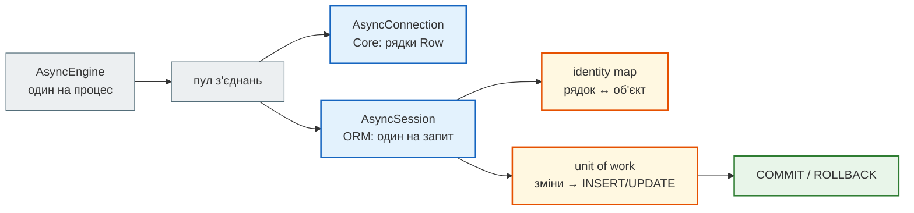
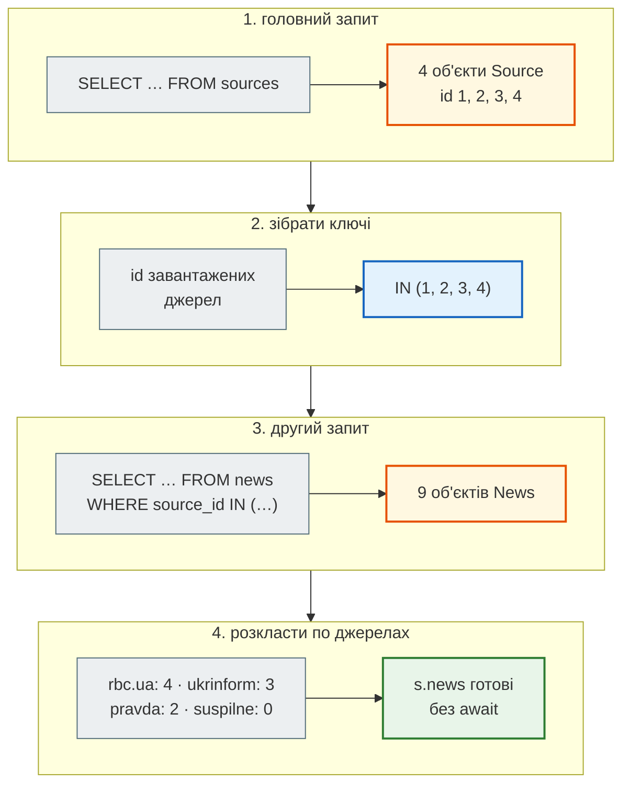

# SQLAlchemy 2 async: Core, ORM, сесія і завантаження зв'язків

## Проблема { #problem }

Писати SQL рядками в ендпоінтах — це ін'єкції, ручне перетворення рядків на об'єкти й різний SQL для PostgreSQL і SQLite. SQLAlchemy будує SQL з Python-виразів і перетворює рядки на об'єкти. В асинхронному FastAPI до цього додаються пастки, яких у синхронному коді немає: звернення до незавантаженого зв'язку `news.source`, яке в Django чи синхронному SQLAlchemy тихо виконало б SQL, тут падає з `MissingGreenlet`, а «виправлення» в циклі перетворюється на N+1. Ця сторінка — як влаштовані engine, з'єднання й сесія, чим Core відрізняється від ORM і як завантажувати зв'язки так, щоб запитів було два, а не п'ятсот один.

Приклади — [`examples/databases/sqlalchemy_demo.py`](https://github.com/NikoriakViktor/news_hub/blob/main/examples/databases/sqlalchemy_demo.py) з моделями з [`models.py`](https://github.com/NikoriakViktor/news_hub/blob/main/examples/databases/models.py): `Source` (джерело) і `News` (новина) зі зв'язком один-до-багатьох. Запускали з SQLAlchemy 2.1.8 на SQLite (aiosqlite) і PostgreSQL 16 (asyncpg); де вивід відрізняється, показано обидва.

## Ментальна модель { #mental-model }



| Об'єкт | Що це | Скільки |
|---|---|---|
| `AsyncEngine` (`create_async_engine`) | діалект + драйвер + **пул з'єднань** | один на процес ([Пул з'єднань](connection_pool.md)) |
| `AsyncConnection` (`engine.connect()`, `engine.begin()`) | одне з'єднання з пулу; виконує Core-запити, повертає `Row` | на час операції |
| `async_sessionmaker` | фабрика сесій з налаштуваннями (`expire_on_commit`, `autoflush`) | одна |
| `AsyncSession` | **робоче місце**: тримає транзакцію, identity map і список змін | одна на HTTP-запит ([Транзакції й Unit of Work](transactions_and_uow.md)) |

Сесія не тримає з'єднання постійно: бере його з пулу на першому запиті й віддає після `commit()`/`rollback()`/`close()`.

## Core і ORM { #core-orm }

SQLAlchemy — це два шари. **Core** працює з таблицями й рядками: `select(table.c.id)`, `insert(table)`, результат — `Row` (схожий на іменований кортеж). **ORM** працює з класами: `select(News)` повертає об'єкти `News`, сесія стежить за їхніми змінами. ORM побудований на Core, і обидва використовують одну функцію `select()`.

```python title="sqlalchemy_demo.py (фрагмент)"
news_table = News.__table__
async with engine.connect() as conn:                      # Core: з'єднання, без сесії
    result = await conn.execute(
        select(news_table.c.id, news_table.c.title).where(news_table.c.lang == "ru").order_by(news_table.c.id))
    raw = await conn.execute(text("SELECT count(*) FROM news WHERE views > :min"), {"min": 500})

async with sessions() as session:                         # ORM: сесія
    objs = (await session.scalars(select(News).where(News.lang == "ru").order_by(News.id))).all()
    pairs = (await session.execute(select(News.lang, func.count()).group_by(News.lang).order_by(News.lang))).all()
    both = (await session.execute(select(News, Source.name).join(News.source).where(News.id == 1))).one()
```

```text
--- 1. Core: таблиці й рядки
   рядок Core: (2, 'Курс евро снизился') | тип: Row | row.title: Курс евро снизился
   text() з параметром: 5
--- 2. ORM: об'єкти, scalars, execute
   scalars(select(News)): [News(id=2, views=320), News(id=5, views=450)]
   execute(select(стовпці)): [('en', 1), ('ru', 2), ('uk', 6)]
   execute(select(News, Source.name)): (News(id=1, views=540), 'rbc.ua')
```

| Метод | Повертає | Коли |
|---|---|---|
| `session.scalars(select(News))` | перший стовпець кожного рядка: об'єкти `News` | список сутностей |
| `session.scalar(select(...))` | одне значення або `None` | `count(*)`, один об'єкт |
| `session.execute(select(a, b))` | `Row` з кількома стовпцями | агрегати, пари «об'єкт + стовпець» |
| `session.get(News, 1)` | об'єкт за первинним ключем або `None` | «знайди або 404» |
| `result.all()` / `.one()` / `.one_or_none()` / `.first()` | список / рівно один / один або `None` / перший | `.one()` кидає виняток, якщо рядків не 1 |

**Коли Core.** Масові операції без об'єктів — `insert(...).values([...])` на тисячі рядків, `update(...).where(...)`, звіти з `GROUP BY` — швидші й зрозуміліші без ORM: не створюються об'єкти, не працює identity map. News Hub так і робить: `add_many` — один Core-`INSERT … ON CONFLICT`, `stats` — `GROUP BY` ([крок 3](../tutorials/03_sqlalchemy_alembic/repository.md#sql)). **Коли ORM** — коли потрібен об'єкт: прочитати, змінити атрибут, віддати в `response_model`.

!!! note "Стиль 2.0"
    `session.query(News).filter(...)` — старий API (1.x). В `AsyncSession` його немає; у новому коді — лише `select()` + `session.scalars()`/`execute()`.

## Identity map { #identity-map }

```text
--- 3. identity map: один рядок — один об'єкт у сесії
   get(1) is get(1): True | select(...) is get(1): True | SQL-запитів: 2
   після views = 999 і нового SELECT: 999 (autoflush відправив UPDATE до SELECT)
```

- **В одній сесії один рядок — один об'єкт.** Другий `get(1)` не пішов у базу: об'єкт уже в identity map. `select(...)` пішов (запитів 2), але повернув **той самий** об'єкт.
- **`select` не перезаписує змінений об'єкт даними з бази.** Ми змінили `views` у пам'яті, і новий `SELECT` показав 999. Тут спрацював `autoflush` (за замовчуванням увімкнено): перед запитом сесія відправила `UPDATE`. News Hub створює сесії з `autoflush=False` і викликає `flush()` явно ([крок 3](../tutorials/03_sqlalchemy_alembic/session_per_request.md#flush)).
- **Identity map — у межах сесії.** Інша сесія (інший запит) отримає свій об'єкт. Тому сесію не кешують між запитами: вона б віддавала застарілі дані й росла в пам'яті.

## Ліниве завантаження в async { #lazy-loading }

Зв'язок `relationship()` за замовчуванням **лінивий** (`lazy="select"`): `news.source` не завантажується разом з новиною, а виконує `SELECT` у момент першого звернення. У синхронному коді це непомітно. В async звернення до атрибута — це не `await`, і виконати SQL неможливо:

```python title="sqlalchemy_demo.py (фрагмент)"
item = await session.get(News, 1)
print(item.source)                                   # SQL потрібен, а await немає
print(await item.awaitable_attrs.source)             # явне ліниве завантаження
await session.refresh(item, ["source"])              # або завантажити атрибут і далі читати звичайно
strict = await session.scalar(select(News).where(News.id == 2).options(raiseload("*")))
print(strict.source)
```

```text
--- 4. ліниве завантаження в async                                     (PostgreSQL)
   item.source          MissingGreenlet: greenlet_spawn has not been called; can't call await_() here. Was IO attempted in an unexpected place? (Backgr
   awaitable_attrs      Source('rbc.ua')
   після refresh        Source('rbc.ua')
   raiseload('*')       InvalidRequestError: 'News.source' is not available due to lazy='raise'
```

На SQLite перша помилка загорнута інакше — `StatementError: (sqlalchemy.exc.MissingGreenlet) greenlet_spawn has not been called…` — і в stderr з'являється `RuntimeWarning: coroutine 'Connection.cursor' was never awaited`. Причина та сама.

### Як це влаштовано { #greenlet }

ORM SQLAlchemy написаний синхронно. `AsyncSession` запускає його всередині **greenlet** (легкого перемикача стеку): коли синхронному коду ORM потрібна база, greenlet віддає керування назад у `await` драйвера. Це працює лише всередині викликів, які почалися з `await session....`. Звернення до атрибута — звичайний Python, не `await`; greenlet не запущено, і SQLAlchemy відповідає `MissingGreenlet` («was IO attempted in an unexpected place?»). Тому `greenlet` — обов'язкова залежність async SQLAlchemy: ставлять `sqlalchemy[asyncio]`. SQLAlchemy 2.1 сам його вже не ставить — у чистому оточенні без `[asyncio]` перший же `create_async_engine` дає `ImportError: The SQLAlchemy asyncio module requires that the Python 'greenlet' library is installed`.

| Спосіб | Що робить | Коли |
|---|---|---|
| `options(selectinload(...))`, `joinedload(...)` | завантажити зв'язок у тому самому запиті | **за замовчуванням**: знаєш наперед, що зв'язок потрібен |
| `await obj.awaitable_attrs.rel` | ліниве завантаження з `await` (потрібен `AsyncAttrs` у `Base`) | рідко, для одного об'єкта; у циклі — N+1 |
| `await session.refresh(obj, ["rel"])` | завантажити атрибут(и) | після `commit` з `expire_on_commit=True`, для одного об'єкта |
| `relationship(lazy="raise")` / `options(raiseload("*"))` | будь-яке ліниве звернення — зрозуміла помилка | щоб забуте `selectinload` падало в тестах, а не в `response_model` |

Те саме відбувається, коли зв'язок читає не твій код, а Pydantic: `response_model` з вкладеною моделлю й `from_attributes=True` звертається до `post.author` і отримує `MissingGreenlet` (або `DetachedInstanceError`, якщо сесію вже закрито), загорнутий у `ResponseValidationError` → 500. Розбір з виводом — [`from_attributes` і SQLAlchemy](../02_typing_and_pydantic/config_dict.md#from-attributes).

### SQL-вираз в атрибуті { #expression-attribute }

```python
row = await session.get(News, 1)
row.views = News.views + 1                          # UPDATE … SET views = views + 1 при flush
```

```text
--- 9. SQL-вираз в атрибуті: row.views = News.views + 1
   до flush:     BinaryExpression news.views + :views_1
   після flush:  MissingGreenlet: greenlet_spawn has not been called; can't call await_() here. Was IO attempted in an unexpected place? (Backgr
   після refresh: 541
```

Атрибуту можна присвоїти SQL-вираз — і `flush` відправить атомарний `UPDATE … SET views = views + 1`. Але до `flush` в атрибуті лежить не число, а вираз (`int(row.views)` чи `row.views or 0` дають `TypeError`), а після `flush` атрибут **прострочений** (expired): SQLAlchemy не знає, яке значення порахувала база, і хоче його перечитати — в async це знову `MissingGreenlet`. Потрібне значення — `await session.refresh(row, ["views"])`. Простіше — `update(News).where(...).values(views=News.views + 1)`: це той самий атомарний `UPDATE`, і SQLAlchemy сама оновить об'єкт у сесії ([Транзакції й Unit of Work](transactions_and_uow.md#lost-update)).

## N+1 і стратегії завантаження { #n-plus-one }

Що таке N+1 і скільки він коштує на 500 джерелах — у [SQL для API](sql_for_api.md#n-plus-one). Тут — які запити будує кожна стратегія.

```python title="sqlalchemy_demo.py (фрагмент)"
sources = (await session.scalars(select(Source).order_by(Source.id))).all()
counts = {s.name: len(await s.awaitable_attrs.news) for s in sources}           # 1 + N

result = await session.scalars(select(Source).options(selectinload(Source.news)).order_by(Source.id))
result = await session.scalars(select(Source).options(joinedload(Source.news)).order_by(Source.id))
sources = result.unique().all()
```

```text
--- 5. N+1: джерела і їхні новини (один-до-багатьох)                   (PostgreSQL)
   awaitable_attrs у циклі: {'rbc.ua': 4, 'ukrinform': 3, 'pravda': 2, 'suspilne': 0} | SQL-запитів: 5
   selectinload            {'rbc.ua': 4, 'ukrinform': 3, 'pravda': 2, 'suspilne': 0} | SQL-запитів: 2
      SQL: SELECT sources.id, sources.name FROM sources ORDER BY sources.id
      SQL: SELECT news.source_id, news.id, news.url, news.title, news.lang, news.views, news.scraped_at FROM news WHERE news.source_id IN ($1::INTEGER, $2::INTEGER, $3::INTEGER, $4::INTEGER) ORDER BY news.id
   joinedload              {'rbc.ua': 4, 'ukrinform': 3, 'pravda': 2, 'suspilne': 0} | SQL-запитів: 1
      SQL: SELECT sources.id, sources.name, news_1.id AS id_1, news_1.source_id, news_1.url, news_1.title, news_1.lang, news_1.views, news_1.scraped_at FROM sources LEFT OUTER JOIN news AS news_1 ON sources.id = news_1.source_id ORDER BY sources.id, news_1.id
   joinedload без unique(): InvalidRequestError: The unique() method must be invoked on this Result, as it contains results that include joined eager loads aga
```

Покроково, що робить `selectinload(Source.news)`:



| | `selectinload` | `joinedload` |
|---|---|---|
| запитів | 2 (на кожен рівень зв'язку — ще один) | 1 |
| SQL | другий `SELECT … WHERE fk IN (…)` | `LEFT OUTER JOIN` у головному запиті |
| колекції (один-до-багатьох) | **рекомендовано**: батьківські рядки не дублюються | кожне джерело повторюється стільки разів, скільки в нього новин; потрібен `.unique()` |
| багато-до-одного (`news.source`) | працює | **рекомендовано**: один `JOIN`, рядків не більшає |
| з `LIMIT` | `LIMIT` на головному запиті, як і очікуєш | SQLAlchemy загортає головний запит у підзапит (розділ 7 нижче) |
| великі `IN` | розбиває на пачки по 500 ключів | — |

### Багато-до-одного й identity map { #many-to-one }

```text
--- 6. N+1: новини і їхнє джерело (багато-до-одного)
   9 новин, 3 різні джерела | SQL-запитів: 4
```

Не 1 + 9, а 1 + 3: ліниве завантаження багато-до-одного спершу шукає об'єкт за первинним ключем в identity map і йде в базу лише для джерел, яких там ще немає. На тестових даних з кількома джерелами N+1 тому майже невидимий, а на справжніх, де в кожної новини свій автор, з'являється. Рахуй запити на реальних обсягах.

### `LIMIT` і `joinedload` колекції { #joinedload-limit }

```text
--- 7. LIMIT і joinedload колекції
   2 джерела: {'rbc.ua': 4, 'ukrinform': 3}
      SQL: SELECT anon_1.id, anon_1.name, news_1.id AS id_1, news_1.source_id, news_1.url, news_1.title, news_1.lang, news_1.views, news_1.scraped_at FROM (SELECT sources.id AS id, sources.name AS name FROM sources ORDER BY sources.id LIMIT $1::INTEGER) AS anon_1 LEFT OUTER JOIN news AS news_1 ON anon_1.id = news_1.source_id ORDER BY anon_1.id, news_1.id
```

`LIMIT 2` з простим `JOIN` обрізав би **рядки результату** — тобто дві новини, а не два джерела. SQLAlchemy це знає й переносить `LIMIT` у підзапит. Результат правильний, але запит складніший, і на великих таблицях його план варто подивитися. Для сторінок колекцій зі зв'язками — `selectinload`.

## Масовий запис { #bulk }

```python
new_ids = (await session.scalars(insert(Source).returning(Source.id), [{"name": "lb.ua"}, {"name": "nv.ua"}])).all()
```

```text
--- 8. insert(...).returning і ORM-масовий запис
   insert().returning(id): [5, 6]
```

`session.add()` для тисяч об'єктів — це тисячі об'єктів у пам'яті й identity map. `session.execute(insert(Model), [dict, dict, …])` (ORM bulk insert) відправляє один `INSERT` на пачку й з `.returning()` повертає `id`. Для «вставити, якщо немає» — `postgresql.insert(...).on_conflict_do_nothing()` ([Транзакції й Unit of Work](transactions_and_uow.md#on-conflict)).

## У News Hub { #news-hub }

`db.py` і `tables.py` кроку 3 — розібрані в [Engine, сесії й таблиця](../tutorials/03_sqlalchemy_alembic/engine_and_table.md): адреса з `DATABASE_URL`, один `engine` на процес, `async_sessionmaker(engine, expire_on_commit=False, autoflush=False)`, `NewsRow` на `Mapped[...]`.

| Зі сторінки | У News Hub |
|---|---|
| Core для масових операцій | `add_many`/`insert_new` — один `INSERT … ON CONFLICT … RETURNING`; `stats` — `GROUP BY`; `clear` — `delete(NewsRow).returning(NewsRow.id)` |
| ORM для одного об'єкта | `BaseRepository.get` → `session.get`; `PATCH` змінює атрибути об'єкта, `UPDATE` відправляє `commit()` ([крок 3](../tutorials/03_sqlalchemy_alembic/crud.md#patch)) |
| `scalars(select(...))` | `find`, `search`, `latest`, `find_unanalyzed` |
| `autoflush=False` + явний `flush()` | `BaseRepository.add` ([крок 3](../tutorials/03_sqlalchemy_alembic/session_per_request.md#flush)) |
| зв'язки, `selectinload`, N+1 | **немає**: у News Hub немає `relationship()` і зовнішніх ключів — `NewsRow`, `SourceRow`, `SubscriptionRow` незалежні таблиці, тож `MissingGreenlet` від лінивого зв'язку тут виникнути не може |
| `from_attributes` | `NewsOut` будується з `NewsRow` ([крок 3](../tutorials/03_sqlalchemy_alembic/engine_and_table.md#two-models)) — без вкладених моделей |

Якщо в News Hub з'явиться зв'язок (наприклад, `news.source_id → sources.id` і `relationship()`), правило з цієї сторінки: `lazy="raise"` у моделі й `selectinload`/`joinedload` у кожному запиті репозиторію, що повертає дані для `response_model`.

## Типові помилки { #mistakes }

| Помилка | Наслідок | Як правильно |
|---|---|---|
| `news.source` без завантаження в async | `MissingGreenlet` (SQLite: `StatementError` з ним усередині) | `selectinload`/`joinedload`; `lazy="raise"`, щоб помилка була зрозумілою |
| `response_model` з вкладеною моделлю, зв'язок не завантажено | `ResponseValidationError` → 500 | `options(selectinload(...))` у запиті репозиторію |
| `await s.awaitable_attrs.rel` у циклі | N+1 | одна опція завантаження на весь запит |
| `joinedload` колекції без `.unique()` | `InvalidRequestError: The unique() method must be invoked…` | `.unique()` або `selectinload` |
| `joinedload` колекції з `LIMIT` | складний підзапит | `selectinload` |
| `session.query(...)` в async | `AttributeError`: у `AsyncSession` його немає | `select()` + `scalars()` |
| `sqlalchemy` без `[asyncio]` (SQLAlchemy 2.1) | `ImportError: … requires that the Python 'greenlet' library is installed` | `sqlalchemy[asyncio]` у `requirements.txt` |
| сесія в глобальній змінній або кеші | дані одного запиту видно в іншому; identity map росте | сесія на запит через `Depends` |
| одна `AsyncSession` у кількох одночасних задачах (`asyncio.gather`) | документація SQLAlchemy забороняє: стан сесії не розрахований на паралельні виклики | окрема сесія на задачу |
| `row.views = News.views + 1` і читання `row.views` | до `flush` — вираз, після — `MissingGreenlet` | `update(...).values(views=News.views + 1)` або `refresh` |
| ORM для масової вставки тисяч рядків | тисячі об'єктів, повільно | `session.execute(insert(Model), [...])` |

## Налагодження { #debugging }

- **`echo=True`** у `create_async_engine` друкує кожен SQL з параметрами. Для тестів зручніше рахувати: `event.listen(engine.sync_engine, "before_cursor_execute", ...)` — так `count_queries` у прикладі показує «SQL-запитів: 5». Тест «ендпоінт робить не більше 2 запитів» ловить N+1 до продакшну.
- **`MissingGreenlet`**: у трасуванні знайди рядок свого коду над `sqlalchemy/orm/attributes.py` — це атрибут, який читали без завантаження. Часто це не твій рядок, а Pydantic у `response_model`.
- **`RuntimeWarning: coroutine 'Connection.cursor' was never awaited`** на SQLite — наслідок `MissingGreenlet`, а не окрема проблема.
- **`DetachedInstanceError`** — об'єкт читають після закриття сесії: сесія закрилась раніше, ніж Pydantic побудував відповідь, або об'єкт передали у фонову задачу. Передавай у фон `id`, а не об'єкт ORM.
- **SQL без бази**: `print(stmt.compile(dialect=postgresql.dialect()))` або з `compile_kwargs={"literal_binds": True}`, щоб побачити значення замість `$1`.
- **Стан об'єкта**: `sqlalchemy.inspect(obj)` — `.persistent`, `.detached`, `.expired_attributes`, `.unloaded` (які зв'язки ще не завантажено).

## Безпека { #security }

- **`text()` — лише з параметрами** (`:name` + словник). `select().where(News.lang == value)` параметризує сам. Демонстрація ін'єкції через f-рядок у `text()` — у [SQL для API](sql_for_api.md#security).
- **`literal_binds=True` — лише для налагодження.** Він вставляє значення в текст SQL; виконувати такий рядок з даними користувача — та сама ін'єкція.
- **Не віддавай об'єкт ORM як є.** `response_model` з явним списком полів — фільтр: `password_hash` у рядку є, у відповіді — ні ([`from_attributes`](../02_typing_and_pydantic/config_dict.md#from-attributes)). Об'єкт ORM, перетворений через `__dict__` чи `jsonable_encoder` без моделі, віддасть усе, що завантажено.
- **Ліниве завантаження — ще й витік даних.** Зв'язок, який Pydantic «дочитав» через `from_attributes` (у синхронному коді це не падає), може віддати пов'язані об'єкти, які ендпоінт не збирався показувати. `lazy="raise"` робить кожне завантаження явним.

## Питання { #questions }

1. Чим `AsyncEngine`, `AsyncConnection` і `AsyncSession` відрізняються і скільки кожного має бути?
2. Коли Core, а коли ORM? Наведи приклад з News Hub для кожного.
3. Чому другий `session.get(News, 1)` не робить запиту, а `select(News).where(News.id == 1)` робить, але повертає той самий об'єкт?
4. Чому `news.source` у синхронному коді працює, а в async дає `MissingGreenlet`?
5. Чим `selectinload` відрізняється від `joinedload` за запитами й результатом? Що брати для колекції, а що для багато-до-одного?
6. Чому N+1 для `news.source` на 9 новинах дав 4 запити, а не 10?
7. Навіщо `relationship(lazy="raise")`, якщо зв'язок однаково треба завантажувати?
8. Що лежить у `row.views` після `row.views = News.views + 1` до і після `flush`?

??? success "Відповіді"

    1. Engine — пул з'єднань і діалект, один на процес. Connection — одне з'єднання для Core-запитів, на час операції. Session — робоче місце ORM з identity map і транзакцією, одна на HTTP-запит.
    2. Core — масові операції й звіти без об'єктів: `add_many` (`INSERT … ON CONFLICT`), `stats` (`GROUP BY`). ORM — коли потрібен об'єкт: `get` для «знайди або 404», `PATCH` через зміну атрибутів.
    3. `get` спершу шукає в identity map за первинним ключем. `select` завжди йде в базу, але для рядка, який уже є в сесії, повертає наявний об'єкт (і не перезаписує його незбережені зміни).
    4. Ліниве завантаження виконує SQL у момент звернення до атрибута. В async SQL можна виконати лише через `await`, а звернення до атрибута — не `await`; greenlet, через який SQLAlchemy викликає async-драйвер, не запущено.
    5. `selectinload` — 2 запити (другий з `IN (…)`), батьківські рядки не дублюються: для колекцій. `joinedload` — 1 запит з `LEFT OUTER JOIN`; для колекцій дублює батьківські рядки (потрібен `.unique()`) і ускладнює `LIMIT`; для багато-до-одного — найкращий.
    6. Ліниве завантаження багато-до-одного шукає джерело в identity map за ключем; запит іде лише для перших звернень до кожного з 3 джерел: 1 + 3.
    7. Щоб забуте завантаження давало зрозумілу помилку одразу (і в тестах), а не `MissingGreenlet` усередині Pydantic чи тихий N+1.
    8. До `flush` — SQL-вираз (`BinaryExpression`), не число. Після `flush` атрибут прострочений: значення порахувала база, і читання вимагає SQL — в async `MissingGreenlet`. Значення дає `await session.refresh(row, ["views"])`.

## Що далі { #next }

[Транзакції й Unit of Work](transactions_and_uow.md) — коли сесія робить `COMMIT`, що ламає її до `rollback()`, `expire_on_commit` і що буде, коли два запити змінюють один рядок одночасно.

**Джерела:** SQLAlchemy 2.0 — [Asynchronous I/O (asyncio)](https://docs.sqlalchemy.org/en/20/orm/extensions/asyncio.html) (розділи «Preventing Implicit IO when Using AsyncSession», «Using AsyncSession with Concurrent Tasks»), [ORM Querying Guide — Relationship Loading Techniques](https://docs.sqlalchemy.org/en/20/orm/queryguide/relationships.html), [Session Basics](https://docs.sqlalchemy.org/en/20/orm/session_basics.html), [ORM Bulk INSERT](https://docs.sqlalchemy.org/en/20/orm/queryguide/dml.html), [Error Messages — MissingGreenlet](https://docs.sqlalchemy.org/en/20/errors.html#error-xd2s); FastAPI — [SQL (Relational) Databases](https://fastapi.tiangolo.com/tutorial/sql-databases/).
