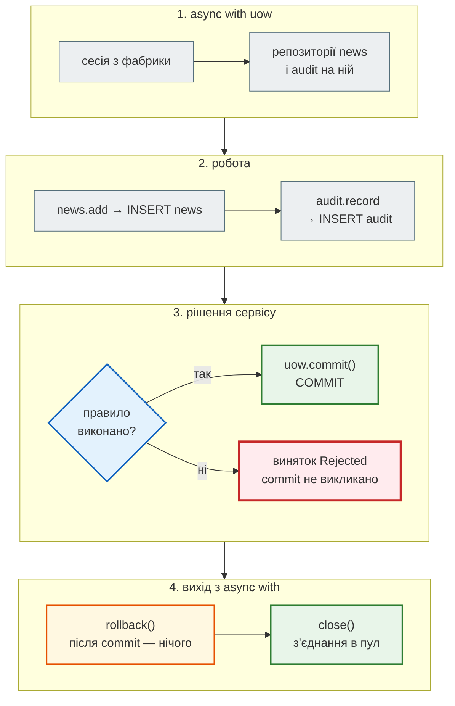
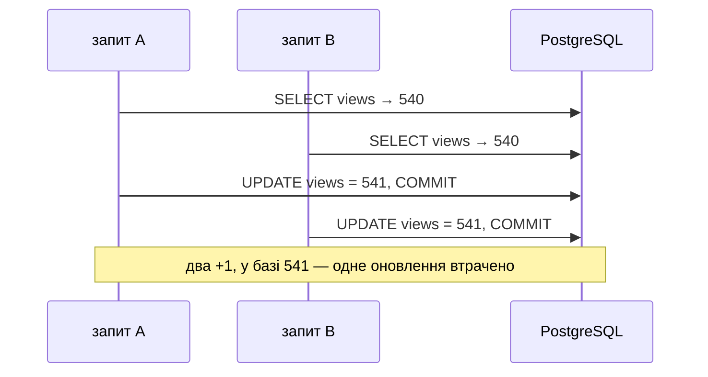

# Транзакції й Unit of Work

## Проблема { #problem }

Ендпоінт додає новину й запис у журнал, а між ними перевірка відхиляє новину. Що лишилося в базі — нічого, новина без запису в журналі чи обидва? Після `IntegrityError` наступний запит у тій самій сесії падає з незрозумілою `PendingRollbackError`. Десять одночасних «+1 перегляд» дають +1, і жодної помилки. `SELECT … FOR UPDATE`, який мав це виправити, на SQLite мовчки не працює. Межі транзакції треба задавати свідомо: де вона починається, що в неї входить, хто робить `COMMIT` і що буде, коли той самий рядок змінюють два запити одночасно.

Приклади — [`examples/databases/transactions_demo.py`](https://github.com/NikoriakViktor/news_hub/blob/main/examples/databases/transactions_demo.py) і [`uow_demo.py`](https://github.com/NikoriakViktor/news_hub/blob/main/examples/databases/uow_demo.py), SQLAlchemy 2.1.8, SQLite (aiosqlite) і PostgreSQL 16 (asyncpg). SQL-основи транзакцій (`BEGIN`/`COMMIT`/`ROLLBACK`, ACID) — у [SQL для API](sql_for_api.md#transactions).

## Ментальна модель { #mental-model }

**Unit of Work** — «одиниця роботи»: усі зміни однієї бізнес-операції накопичуються й підтверджуються разом, одним `COMMIT`, або скасовуються разом. Покроково для операції «опублікувати новину й записати в журнал»:



Головне правило — **безпечно за замовчуванням**: вихід без явного `commit()` скасовує все. Забутий `commit()` дає «нічого не збереглося» (видно одразу), а не «збереглась половина» (видно через місяць).

`AsyncSession` сама вже є Unit of Work: накопичує нові й змінені об'єкти, `flush()` відправляє їх у базу, `commit()` підтверджує. Питання лише в тому, **хто** задає її межі — залежність FastAPI на кожен запит чи явний клас UoW у сервісі.

## Транзакція на запит { #per-request }

У FastAPI межу найпростіше прив'язати до HTTP-запиту: залежність з `yield` відкриває сесію, ендпоінт працює, після нього `commit()` або `rollback()`. Як це зроблено в News Hub, чому `COMMIT` має статися **до** відповіді (`Depends(get_db, scope="function")`) і навіщо `flush()` в ендпоінті — розібрано в кроці 3: [Сесія на запит і COMMIT до відповіді](../tutorials/03_sqlalchemy_alembic/session_per_request.md). Коли саме виконується код після `yield` — [Залежності](../03_fastapi_core/dependencies.md#yield-timing).

Те саме «все або нічого» без FastAPI — `session.begin()`:

```python title="transactions_demo.py (фрагмент)"
async with sessions() as session, session.begin():      # begin(): COMMIT наприкінці, ROLLBACK при винятку
    session.add(Source(name="lb.ua"))
    (await session.get(News, 1)).views = -5                # CHECK (views >= 0) порушиться при flush
```

```text
--- 1. все або нічого                                              (PostgreSQL)
    IntegrityError: new row for relation "news" violates check constraint "views_not_negative"
    lb.ua у базі: 0 | views новини 1: 540
```

Нове джерело теж не збереглося: обидві зміни — одна транзакція.

## Зламана сесія: `PendingRollbackError` { #broken-session }

```python title="transactions_demo.py (фрагмент)"
session.add(Source(name="rbc.ua"))                          # дубль UNIQUE
try:
    await session.flush()
except IntegrityError as exc: ...
await session.get(News, 2)                                  # та сама сесія, без rollback()
```

```text
--- 2. помилка flush ламає сесію до rollback()                     (PostgreSQL)
    flush:           IntegrityError: duplicate key value violates unique constraint "sources_name_key"
    наступний запит: PendingRollbackError: This Session's transaction has been rolled back due to a previous exception during flush. To begin a new 
    після rollback(): News(id=2, views=320)
```

Після помилки `flush` SQLAlchemy відкотила транзакцію в базі, але сесія про це «пам'ятає»: будь-яка наступна операція дає `PendingRollbackError`, доки не викликати `await session.rollback()`. Це дзеркало поведінки PostgreSQL (`current transaction is aborted`): у зламаній транзакції працювати далі не можна.

Наслідок для ендпоінтів: зловив `IntegrityError` → поверни відповідь (`409`) і **не роби більше запитів у цій сесії**. Залежність `get_db` після винятку однаково зробить `rollback()`. Якщо ж після помилки треба продовжити роботу (пропустити поганий рядок і вставити решту) — `SAVEPOINT`.

## `SAVEPOINT`: відкотити частину { #savepoint }

```python title="transactions_demo.py (фрагмент)"
async with sessions() as session, session.begin():
    for name in ("lb.ua", "rbc.ua", "nv.ua"):                 # rbc.ua уже є
        try:
            async with session.begin_nested():                 # SAVEPOINT
                session.add(Source(name=name))
            saved += 1
        except IntegrityError:
            skipped += 1                                       # ROLLBACK TO SAVEPOINT — лише цей рядок
```

```text
--- 4. SAVEPOINT: зберегти добрі рядки, пропустити погані
    додано 2, пропущено 1
    джерела: ['rbc.ua', 'ukrinform', 'pravda', 'suspilne', 'lb.ua', 'nv.ua']
```

`begin_nested()` ставить точку збереження всередині транзакції; помилка відкочує лише до неї, а транзакція й сесія лишаються робочими. Ціна — по два додаткові оператори (`SAVEPOINT`, `RELEASE`) на рядок; для масової вставки дешевше `INSERT … ON CONFLICT DO NOTHING` ([нижче](#on-conflict)).

!!! danger "SQLite: зовнішній `SAVEPOINT` робить `COMMIT`"
    Драйвер `sqlite3` (і `aiosqlite` поверх нього) сам вирішує, коли слати `BEGIN`, — і **не шле його перед `SAVEPOINT`**. Тоді `SAVEPOINT` стає зовнішньою транзакцією, а його `RELEASE` — це `COMMIT`. `uow_demo.py`: `begin_nested()` без зовнішньої транзакції, потім ще один `add` і `rollback()`:

    ```text
    --- 3. SAVEPOINT без зовнішньої транзакції                     (SQLite)
        без виправлення            після rollback: news=1, audit=0
        з fix_sqlite_transactions  після rollback: news=0, audit=0
    ```

    На PostgreSQL обидва рядки — `news=0, audit=0`. Ми знайшли це, коли контрактний тест «відхилена новина не зберігається» впав лише на SQLite. Виправлення — рецепт з документації SQLAlchemy: вимкнути керування транзакціями в драйвері й слати `BEGIN` самим ([`news_app/tables.py`](https://github.com/NikoriakViktor/news_hub/blob/main/examples/databases/news_app/tables.py)):

    ```python
    @event.listens_for(engine.sync_engine, "connect")
    def _no_driver_transactions(dbapi_connection, _record):
        dbapi_connection.isolation_level = None

    @event.listens_for(engine.sync_engine, "begin")
    def _begin(conn):
        conn.exec_driver_sql("BEGIN")
    ```

## `expire_on_commit` { #expire-on-commit }

```text
--- 3. expire_on_commit                                            (PostgreSQL)
    expire_on_commit=True  після commit item.views → MissingGreenlet: greenlet_spawn has not been called; can't call await_() here. Was IO attempted in an unexpected place? (B
    expire_on_commit=False після commit item.views = 982
    expire_on_commit=False, рядок змінили після commit: item.views = 982 | у базі: 0
```

- **`expire_on_commit=True` (за замовчуванням)** після `commit()` позначає всі атрибути всіх об'єктів сесії простроченими: наступне читання перечитає їх з бази. В async читання атрибута — не `await`, тож це `MissingGreenlet` (на SQLite — `StatementError` з ним усередині). Типовий випадок: ендпоінт зробив `commit()` і повертає об'єкт, а `response_model` читає його поля.
- **`expire_on_commit=False`** — після `commit()` об'єкт зберігає значення, які були в пам'яті. Тому в async його ставлять майже завжди, і News Hub теж ([крок 3](../tutorials/03_sqlalchemy_alembic/engine_and_table.md#db)).
- **Ціна `False` — застарілі дані.** Інший запит змінив рядок на 0, а об'єкт показує 982. Для відповіді «ось що ми щойно записали» це правильно. Для рішення «чи можна ще списати кошти» — ні: таке читають з бази в тій самій транзакції, що й записують (`FOR UPDATE` або атомарний `UPDATE`, [нижче](#lost-update)), або `await session.refresh(obj)`.

## Unit of Work як клас { #uow }

Залежність `get_db` — достатня межа, поки транзакція дорівнює HTTP-запиту. Явний UoW потрібен, коли межу визначає **сервіс**: та сама операція викликається з ендпоінта, фонової задачі й бота; одна операція — кілька транзакцій; або сервіс тестують без бази. [`examples/databases/news_app/`](https://github.com/NikoriakViktor/news_hub/blob/main/examples/databases/news_app/uow.py):

```python title="news_app/uow.py (фрагмент)"
class SqlUnitOfWork:
    def __init__(self, session_factory: async_sessionmaker[AsyncSession]) -> None:
        self._factory = session_factory

    async def __aenter__(self) -> Self:
        self._session = self._factory()
        self.news = SqlNewsRepository(self._session)
        self.audit = SqlAuditLog(self._session)
        return self

    async def __aexit__(self, exc_type, exc, tb) -> None:
        await self._session.rollback()          # після commit() — нічого не скасовує; без commit() — ROLLBACK
        await self._session.close()             # з'єднання повертається в пул

    async def commit(self) -> None:
        await self._session.commit()
```

```python title="news_app/services.py (фрагмент)"
async def publish(uow: UnitOfWork, url: str, title: str) -> News:
    """Додати новину й запис у журнал — разом або ніяк."""
    async with uow:
        item = await uow.news.add(url, title)
        await uow.audit.record("publish", item.id)
        if any(word in title.lower() for word in BANNED_WORDS):
            raise Rejected(title)              # після add і record: обидва мають скасуватися
        await uow.commit()
        return item
```

- **Сервіс не знає ні SQL, ні сесії** — лише `uow.news`, `uow.audit`, `uow.commit()`.
- **Два репозиторії — одна сесія — одна транзакція.** Саме це робить UoW: репозиторії не створюють власних сесій.
- **`__aexit__` завжди робить `rollback()`.** В SQLAlchemy `rollback()` після `commit()` нічого не робить. З asyncpg напряму це не так: `pool_demo.py` показує `InterfaceError: cannot rollback; the transaction is already committed` — UoW над `asyncpg` має перевіряти, чи був `commit`, або використовувати `async with conn.transaction()`.
- **Ендпоінт** отримує UoW через `Depends(get_uow)`, і тести підміняють його фейком ([`news_app/api.py`](https://github.com/NikoriakViktor/news_hub/blob/main/examples/databases/news_app/api.py)).

### Фейковий UoW має поводитися як транзакція { #fake-uow }

Для тестів сервісів UoW підміняють фейком у пам'яті. Поширений фейк — `commit()` ставить прапорець, `rollback` нічого не робить. `uow_demo.py` порівнює його з фейком, що відновлює стан без `commit()`, і зі справжнім `SqlUnitOfWork`:

```text
--- 1. сервіс забув commit(): скільки новин видно після
    NaiveFakeUnitOfWork  1
    FakeUnitOfWork       0
    SqlUnitOfWork        0
--- 2. модерація відхилила новину після add і record
    NaiveFakeUnitOfWork  новин: 1
    FakeUnitOfWork       новин: 0
    SqlUnitOfWork        новин: 0
```

Однаково на SQLite і PostgreSQL. **Наївний фейк каже неправду в обидва боки:** сервіс, що забув `commit()`, з ним «зберігає» новину (тест зелений, у продакшні даних немає), а відхилена новина «лишається» (тест червоний, хоча база все відкотила б). `FakeUnitOfWork` у прикладі робить знімок стану на вході й відновлює його, якщо `commit()` не викликали. Як перевірити, що фейк і справжня реалізація поводяться однаково, — [Патерн Repository: контрактні тести](repository_pattern.md#contract-tests).

## Конкурентні оновлення { #lost-update }

Десять запитів «+1 перегляд» одночасно. Три способи:

```python title="transactions_demo.py (фрагмент)"
async def read_modify_write(lock: bool) -> None:
    async with sessions() as session, session.begin():
        stmt = select(News).where(News.id == 1)
        item = await session.scalar(stmt.with_for_update() if lock else stmt)
        await asyncio.sleep(0.05)                              # ендпоінт ще щось робить
        item.views = item.views + 1

async def atomic() -> None:
    async with sessions() as session, session.begin():
        await session.execute(update(News).where(News.id == 1).values(views=News.views + 1))
```

```text
--- 6. десять запитів одночасно: +1 перегляд кожен                 (PostgreSQL)
    прочитати → +1 → записати      було 540, 10 запитів → стало 541 (+1)
    SELECT … FOR UPDATE            було 541, 10 запитів → стало 551 (+10)
    UPDATE SET views = views + 1   було 551, 10 запитів → стало 561 (+10)
    SQL з with_for_update(): SELECT news.id  FROM news  WHERE news.id = $1::INTEGER FOR UPDATE
```

```text
--- 6. десять запитів одночасно: +1 перегляд кожен                 (SQLite)
    прочитати → +1 → записати      було 540, 10 запитів → стало 541 (+1)
    SELECT … FOR UPDATE            було 541, 10 запитів → стало 542 (+1)
    UPDATE SET views = views + 1   було 542, 10 запитів → стало 552 (+10)
    SQL з with_for_update(): SELECT news.id  FROM news  WHERE news.id = ?
```



- **Втрачене оновлення (lost update).** Усі десять прочитали 540, кожен записав 541. Жодної помилки: кожна транзакція окремо коректна, `READ COMMITTED` такого не забороняє.
- **Атомарний `UPDATE … SET views = views + 1`** — найкраще, коли нове значення можна обчислити в SQL: база блокує рядок на час оновлення й рахує від актуального значення. Один оператор, без читання в Python.
- **`SELECT … FOR UPDATE`** (`with_for_update()`) блокує рядок до кінця транзакції: другий запит **чекає** на своєму `SELECT`, доки перший не зробить `COMMIT`, і читає вже 541. Потрібен, коли рішення приймає Python: «списати, якщо вистачає коштів», «призначити, якщо ще вільний». Транзакція з блокуванням має бути короткою — без зовнішніх HTTP-запитів усередині.
- **SQLite мовчки ігнорує `FOR UPDATE`**: SQLAlchemy його навіть не генерує (див. SQL вище). Тест на SQLite покаже `+1` і для «виправленого» коду. Конкурентність перевіряють лише на PostgreSQL.

### Перевір, потім встав → `ON CONFLICT` { #on-conflict }

Різновид тієї самої гонки — check-then-act: «перевірити, чи є `url`, і лише тоді вставити». Два одночасні запити обидва бачать «немає», і другий падає на `UNIQUE`. Розбір з виводом на обох базах — [крок 3: «перевір, потім встав»](../tutorials/03_sqlalchemy_alembic/checkpoint.md#find-bug-race). Рішення — віддати перевірку базі одним оператором:

```python title="transactions_demo.py (фрагмент)"
nothing = insert(News).values(rows).on_conflict_do_nothing(index_elements=["url"]).returning(News.id)
stmt = insert(News).values(...)
upsert = stmt.on_conflict_do_update(index_elements=["url"], set_={"title": stmt.excluded.title}) \
    .returning(News.id, News.title)
```

```text
--- 5. ON CONFLICT: вставити або оновити одним оператором          (PostgreSQL)
    DO NOTHING  → вставлено id: [11]
    DO UPDATE   →  [(1, 'Гривня зміцнилася (оновлено)'), (13, 'Нова новина')]
```

- **`DO NOTHING`** — дублікат пропускається; `RETURNING` повертає `id` лише вставлених рядків. Так працює `add_many` у News Hub ([крок 3](../tutorials/03_sqlalchemy_alembic/repository.md#add-many)).
- **`DO UPDATE` (upsert)** — дублікат оновлюється; `excluded` — значення, які ми намагалися вставити. `RETURNING` повертає і оновлені, і вставлені.
- На SQLite той самий код (через `sqlite.insert`) дав `[10]` і `[(1, …), (11, 'Нова новина')]`: PostgreSQL бере номер з лічильника `id` навіть для рядка, що потім виявився дублікатом, тому там 11 і 13.
- **Для одного рядка з ендпоінта** — `UNIQUE` + `IntegrityError` → `409`: клієнту треба знати, що його новину не створено.

## Рівні ізоляції { #isolation }

```python title="transactions_demo.py (фрагмент)"
reader_engine = engine.execution_options(isolation_level=level)
async with AsyncSession(reader_engine) as reader, reader.begin():
    first = await reader.scalar(select(News.views).where(News.id == 2))
    await set_views(engine, 2, first + 100)                # інша транзакція змінила рядок і COMMIT
    second = await reader.scalar(select(News.views).where(News.id == 2))
```

```text
--- 7. рівні ізоляції                                              (PostgreSQL)
    READ COMMITTED   перше читання 320, друге 420
    REPEATABLE READ  перше читання 420, друге 420
    REPEATABLE READ + чужий UPDATE того самого рядка: DBAPIError: could not serialize access due to concurrent update
```

| Рівень (PostgreSQL) | Що бачить транзакція | Ціна |
|---|---|---|
| `READ COMMITTED` (за замовчуванням) | кожен оператор — останні підтверджені дані; два `SELECT` можуть дати різне | втрачені оновлення можливі; захист — атомарний `UPDATE` або `FOR UPDATE` |
| `REPEATABLE READ` | знімок на момент першого оператора: повторне читання дає те саме | при конфлікті запису — `could not serialize access`; транзакцію треба **повторити** |
| `SERIALIZABLE` | як ніби транзакції йшли по черзі | більше помилок серіалізації; повторювати обов'язково |

`READ UNCOMMITTED` у PostgreSQL поводиться як `READ COMMITTED`: чужих непідтверджених змін PostgreSQL не показує ніколи. Звіт, що читає кілька таблиць і має бути узгодженим, — `REPEATABLE READ`. Вищий рівень не робить код правильним сам: він перетворює тиху гонку на помилку, яку треба обробити повтором усієї транзакції (з новою сесією).

## У News Hub { #news-hub }

| Межа транзакції | Де | Що в ній |
|---|---|---|
| HTTP-запит | `get_db` + `Depends(get_db, scope="function")` | усі зміни ендпоінта; `COMMIT` до відповіді ([крок 3](../tutorials/03_sqlalchemy_alembic/session_per_request.md)) |
| фонова задача збору | `run_scrape_job`: `async with session_factory() as session` | `insert_new` і `commit()`; кеш скидається **після** `COMMIT` |
| фоновий аналіз LLM | `run_analyze_job` | `commit()` після **кожної** новини: збій на 30-й не скасовує 29 уже оплачених аналізів |
| оновлення Telegram | `InjectMiddleware` бота | сесія й `commit()` на кожне оновлення — UoW на рівні middleware |

Код — [`steps/12_ci_cd/news_hub/jobs.py`](https://github.com/NikoriakViktor/news_hub/blob/main/steps/12_ci_cd/news_hub/jobs.py), [`bot/middlewares.py`](https://github.com/NikoriakViktor/news_hub/blob/main/steps/12_ci_cd/news_hub/bot/middlewares.py). Окремого класу UoW у News Hub немає: межу задає місце, де відкривається сесія, а репозиторії (`NewsRepository`, `SubscriptionRepository`) отримують одну сесію на всіх.

- **Фонова задача відкриває свою сесію** («сесія запиту вже закрита»): `BackgroundTasks` виконуються після відповіді, коли `get_db` уже зробив `COMMIT` і закрив сесію ([крок 4](../tutorials/04_middleware_redis/background_jobs.md#endpoint)).
- **`expire_on_commit=False`** — тому `run_analyze_job` після `commit()` читає `row.title` наступної новини без `MissingGreenlet`.
- **Конкурентність через базу**: дублікати новин відсіює `ON CONFLICT (url) DO NOTHING`, дублікати підписок — `ON CONFLICT (chat_id, keyword)`; поодинокий `POST /api/news` — `IntegrityError` → `409`. `FOR UPDATE` і `SAVEPOINT` News Hub не потребує: у ньому немає операцій «прочитай, виріши в Python, запиши».

## Типові помилки { #mistakes }

| Помилка | Наслідок | Як правильно |
|---|---|---|
| запити в сесії після `IntegrityError` | `PendingRollbackError` | `rollback()` або відповідь без нових запитів; `SAVEPOINT`, якщо треба продовжити |
| `commit()` у кожному методі репозиторію | дві зміни операції — дві транзакції; половина зберігається | `commit()` — на межі операції (залежність, UoW), репозиторій лише `flush()` |
| `expire_on_commit=True` в async і читання після `commit()` | `MissingGreenlet` | `expire_on_commit=False` або `refresh()` |
| рішення за значенням, прочитаним до `commit()` іншого запиту | рішення за застарілими даними | `FOR UPDATE` або атомарний `UPDATE` у тій самій транзакції |
| прочитати → змінити в Python → записати | втрачене оновлення, без помилок | `UPDATE … SET x = x + 1`; `FOR UPDATE` |
| `with_for_update()` і тести лише на SQLite | тести зелені, блокування немає | тести конкурентності на PostgreSQL |
| `SAVEPOINT` на SQLite без виправлення драйвера | `RELEASE` робить `COMMIT`, `rollback()` не скасовує | рецепт з `isolation_level = None` і `BEGIN` у події |
| «перевір, чи є, потім встав» | `IntegrityError` під паралельними запитами | `UNIQUE` + `ON CONFLICT` або `IntegrityError` → `409` |
| зовнішній HTTP-виклик усередині транзакції з `FOR UPDATE` | рядок заблоковано на секунди, черга запитів | спершу зовнішній виклик, потім коротка транзакція |
| фейковий UoW без семантики rollback | тести не ловлять забутий `commit()` | фейк, що відновлює стан без `commit()`; контрактні тести |
| `REPEATABLE READ` без повтору транзакції | користувач бачить 500 на конфлікті | повторити операцію з новою сесією (кілька спроб) |

## Налагодження { #debugging }

- **`echo=True`** показує `BEGIN (implicit)`, `SAVEPOINT`, `COMMIT`, `ROLLBACK` — де SQLAlchemy вважає межі транзакції. Це її погляд, а не драйвера: у сценарії з `SAVEPOINT` на SQLite журнал показав `BEGIN (implicit)` → `SAVEPOINT sa_savepoint_1` → `INSERT` → `RELEASE SAVEPOINT` → `ROLLBACK`, хоча рядок уже збережено. Що насправді в базі, перевіряй окремою сесією після операції.
- **Хто тримає транзакцію відкритою**: у PostgreSQL `SELECT pid, state, xact_start, query FROM pg_stat_activity WHERE state LIKE 'idle in transaction%'`. Сесія, що зробила `SELECT` і чекає зовнішній API, — `idle in transaction`: тримає з'єднання з пулу і, з `FOR UPDATE`, блокування.
- **Хто кого блокує**: `SELECT pid, pg_blocking_pids(pid), query FROM pg_stat_activity WHERE cardinality(pg_blocking_pids(pid)) > 0`.
- **Захист від завислих транзакцій** — `idle_in_transaction_session_timeout` і `lock_timeout` у налаштуваннях PostgreSQL або в `connect_args={"server_settings": {...}}` ([Пул з'єднань](connection_pool.md#timeouts)).
- **Гонки** відтворюй `asyncio.gather` з кількох окремих сесій і `asyncio.sleep` між читанням і записом, як у `transactions_demo.py`. Один користувач у тестах їх не покаже.

## Безпека { #security }

- **Цілісність — це безпека.** Подвійне списання, дві реєстрації з одним email, підписка, що «зникла», — результат гонок. Інваріанти, які мають виконуватися завжди, — у схемі (`UNIQUE`, `CHECK`), а не лише в Python-перевірці перед записом.
- **Довгі транзакції — шлях до відмови в обслуговуванні.** Ендпоінт, що тримає `FOR UPDATE` на рядку, поки чекає повільний зовнішній сервіс, дозволяє кількома запитами заблокувати роботу всіх інших. Тайм-аути (`lock_timeout`, `statement_timeout`) і короткі транзакції.
- **Повідомлення про конфлікт — без внутрішніх подробиць.** `could not serialize access` чи текст `IntegrityError` клієнту не віддають: `409` зі своїм текстом, деталі — у журнал.

## Питання { #questions }

1. Що таке Unit of Work і чому `AsyncSession` уже ним є? Коли потрібен окремий клас UoW?
2. Чому після `IntegrityError` наступний запит у тій самій сесії дає `PendingRollbackError` і що з цим робити?
3. Що робить `begin_nested()` і в чому пастка на SQLite?
4. Чому в async майже завжди `expire_on_commit=False` і яка в цього ціна?
5. Десять одночасних «+1» дали +1. Чому немає помилки і які два способи це виправляють?
6. Чому тест на `with_for_update()` на SQLite не доводить, що блокування працює?
7. Чим `READ COMMITTED` відрізняється від `REPEATABLE READ` і що треба робити з `could not serialize access`?
8. Чому фейковий UoW, у якого `commit()` лише ставить прапорець, — поганий фейк?

??? success "Відповіді"

    1. Усі зміни однієї операції підтверджуються разом або скасовуються разом. `AsyncSession` накопичує зміни й підтверджує їх одним `commit()`. Окремий клас потрібен, коли межу транзакції визначає сервіс, а не HTTP-запит: та сама операція з ендпоінта, задачі й бота, або тести сервісу без бази.
    2. Після помилки `flush` транзакцію в базі відкочено, а сесія вимагає явного `rollback()`, перш ніж робити щось далі (як `current transaction is aborted` у PostgreSQL). Повернути відповідь без нових запитів (залежність зробить `rollback()`), або обгорнути ризиковану операцію в `SAVEPOINT`.
    3. Ставить `SAVEPOINT`: помилка відкочує лише до нього, транзакція працює далі. На SQLite драйвер не шле `BEGIN` перед `SAVEPOINT`, і `RELEASE` зовнішнього `SAVEPOINT` стає `COMMIT` — подальший `rollback()` його не скасує. Виправлення — `isolation_level = None` і `BEGIN` у події `begin`.
    4. З `True` читання атрибута після `commit()` вимагає SQL, а в async це `MissingGreenlet`. Ціна `False` — об'єкт може показувати застарілі значення, якщо рядок змінив хтось інший.
    5. Кожна транзакція прочитала 540 і записала 541 — окремо кожна коректна, `READ COMMITTED` це дозволяє. Атомарний `UPDATE … SET views = views + 1` або `SELECT … FOR UPDATE` перед зміною.
    6. SQLite не підтримує `FOR UPDATE`, і SQLAlchemy його не генерує: запит виконується без блокування, тож «виправлений» код дає те саме +1.
    7. `READ COMMITTED` бачить останні підтверджені дані на кожному операторі; `REPEATABLE READ` — знімок на початку транзакції. При конфлікті запису `REPEATABLE READ` кидає помилку серіалізації — операцію треба повторити цілком з новою транзакцією.
    8. Він не скасовує змін без `commit()`: сервіс, що забув `commit()`, проходить тест, хоча в базі нічого не збережеться, а відкат після помилки тест «не бачить».

## Що далі { #next }

[Патерн Repository](repository_pattern.md) — коли окремий шар доступу до даних потрібен, коли зайвий, і як перевірити, що фейк поводиться так само, як справжній репозиторій.

**Джерела:** SQLAlchemy 2.0 — [Transactions and Connection Management](https://docs.sqlalchemy.org/en/20/orm/session_transaction.html) (розділ «Using SAVEPOINT»), [Session Basics — Committing / Rolling Back](https://docs.sqlalchemy.org/en/20/orm/session_basics.html), [SQLite — Serializable isolation / Savepoints / Transactional DDL](https://docs.sqlalchemy.org/en/20/dialects/sqlite.html#serializable-isolation-savepoints-transactional-ddl), [PostgreSQL — INSERT…ON CONFLICT (Upsert)](https://docs.sqlalchemy.org/en/20/dialects/postgresql.html#insert-on-conflict-upsert); PostgreSQL — [Transaction Isolation](https://www.postgresql.org/docs/current/transaction-iso.html), [Explicit Locking](https://www.postgresql.org/docs/current/explicit-locking.html), [SELECT — The Locking Clause](https://www.postgresql.org/docs/current/sql-select.html#SQL-FOR-UPDATE-SHARE); Martin Fowler — [Unit of Work](https://martinfowler.com/eaaCatalog/unitOfWork.html).
