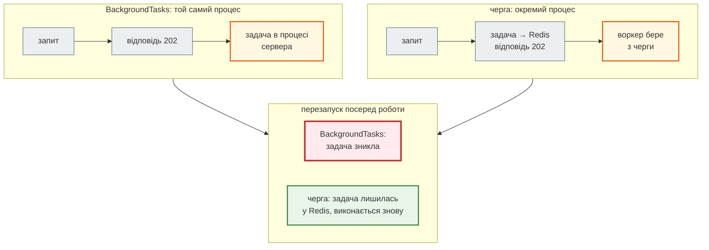
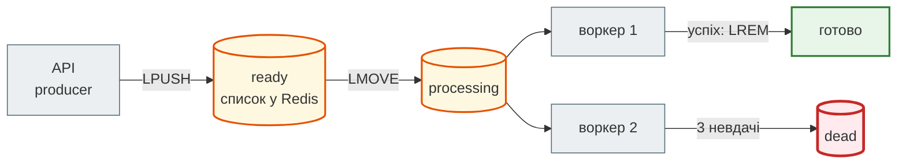

# Фонові задачі й черги

## Проблема { #problem }

Збір новин триває секунди, аналіз сотні новин через LLM — хвилини, розсилка сповіщень залежить від чужого сервера. Тримати HTTP-запит відкритим увесь цей час не можна: клієнт, проксі й балансувальник обірвуть його за таймаутом. Тому відповідають одразу, а працюють потім, «у фоні». FastAPI має для цього `BackgroundTasks`, і для більшості задач цього досить.

Але «у фоні» ставить нові питання. Що буде із задачею, якщо сервер перезапустили? Хто дізнається, що вона впала? Як повторити її, якщо сайт тимчасово не відповідав? І як не надіслати сповіщення двічі, коли задачу повторили? Відповіді на них і відрізняють `BackgroundTasks` від черги задач (arq, Celery, RQ, Dramatiq).

Як News Hub відповідає `202` і зберігає статус задачі, показано на [кроці 4](../tutorials/04_middleware_redis/background_jobs.md). Тут розберемо, що відбувається всередині, і коли потрібна справжня черга.

## Ментальна модель { #mental-model }



| | `BackgroundTasks` | черга (arq, Celery, RQ, Dramatiq) |
|---|---|---|
| де виконується | у процесі сервера, після відповіді | в окремому процесі-воркері, можна на іншій машині |
| де живе задача | у пам'яті процесу | у брокері (Redis, RabbitMQ) |
| перезапуск посеред роботи | задача пропала | лишилась у брокері, її виконає воркер |
| повтори, відкладений запуск, розклад | немає | є |
| статус і результат | пишеш сам (як `JobStore` у News Hub) | вбудовані |
| масштабування | разом із сервером | воркерів окремо від API |
| інфраструктура | нічого | брокер + процес воркера + моніторинг |

## Як працює `BackgroundTasks` { #inside }

[`examples/cache_jobs/background_jobs_demo.py`](https://github.com/NikoriakViktor/news_hub/blob/main/examples/cache_jobs/background_jobs_demo.py) викликає застосунок напряму через ASGI і позначає час кожної події:

```python title="background_jobs_demo.py (фрагмент)"
@app.post("/jobs", status_code=status.HTTP_202_ACCEPTED)
async def create_job(background: BackgroundTasks, scenario: str = "ok") -> dict[str, str]:
    if scenario == "ok":
        background.add_task(slow_task, "A")              # кожна по 300 мс
        background.add_task(slow_task, "B")
    elif scenario == "fail-first":
        background.add_task(failing_task)                # кидає RuntimeError
        background.add_task(slow_task, "after-fail")
    ...
    return {"job_id": "demo"}
```

```text
--- 1. BackgroundTasks: відповідь іде одразу, задачі — після неї, по черзі
    6 ms  ендпоінт повернув 202
    6 ms  клієнт отримав статус 202
    6 ms  задача A: старт
  307 ms  задача A: кінець
  307 ms  задача B: старт
  607 ms  задача B: кінець
  607 ms  виклик ASGI завершився
--- 2. виняток у першій задачі: клієнт уже отримав 202, друга задача не запускається
    0 ms  ендпоінт повернув 202
    0 ms  клієнт отримав статус 202
    0 ms  задача fail: старт
    0 ms  виклик ASGI завершився винятком RuntimeError: джерело недоступне
```

- **Задачі виконуються після того, як відповідь відправлено**, і в тому самому виклику ASGI. Для сервера запит не завершився, доки не завершилися задачі.
- **Задачі йдуть послідовно**, у порядку `add_task`, а не паралельно.
- **Виняток у задачі зупиняє решту.** Задача `after-fail` не запустилась узагалі. Клієнт отримав `202` і ніколи не дізнається, що щось пішло не так: виняток бачить лише сервер у журналі (`Exception in ASGI application`). Тому `run_scrape_job` у News Hub ловить усі винятки й пише `failed` у статус.

### `def` чи `async def` { #sync-async }

```text
--- 3. блокуючий код у задачі: def проти async def — скільки чекає інший запит
block-sync   GET /ping чекав відповіді: 11 ms
block-async  GET /ping чекав відповіді: 304 ms
```

Задачу, оголошену через звичайну `def`, FastAPI виконує в пулі потоків, і цикл подій лишається вільним. `async def` виконується в циклі подій, тож `time.sleep(0.3)` або синхронний HTTP-клієнт усередині неї зупиняють **увесь сервер**: інший запит чекав 304 мс. Правило те саме, що для ендпоінтів ([Частина IV](../04_async/README.md)). У `async def` — лише неблокуючі виклики (`await`), а блокуючий код — у `def` або `asyncio.to_thread`. Важкі обчислення на CPU не підходять ні для того, ні для іншого: у потоці їх тримає GIL, і вони гальмують сервер. Їх виносять в окремий процес або воркер.

### Що буде при перезапуску { #restart }

Розділ 4 демо запускає справжній uvicorn, ставить 2-секундну задачу й зупиняє сервер через 0.3 с:

```text
--- 4. сервер зупиняють посеред 2-секундної задачі
SIGTERM (за замовчуванням)                 відповідь 202; процес завершився за 1.8 с; вивід: ['задача: старт', 'задача: кінець']
SIGTERM --timeout-graceful-shutdown 1      відповідь 202; процес завершився за 1.2 с; вивід: ['задача: старт', 'ERROR:    Cancel 1 running task(s), timeout graceful shutdown exceeded', '… CancelledError у задачі']
SIGKILL (за замовчуванням)                 відповідь 202; процес завершився за 0.0 с; вивід: ['задача: старт']
```

- **`SIGTERM`** (так зупиняють `docker stop`, Compose, systemd) запускає коректну зупинку. uvicorn перестає приймати нові запити й **чекає** незавершені, а з ними й фонові задачі. Задача встигла.
- **З `--timeout-graceful-shutdown 1`** uvicorn чекав секунду й скасував задачу (`CancelledError`).
- **`SIGKILL`** — задача просто зникла, без жодного сліду в журналі.

У Docker між `SIGTERM` і `SIGKILL` за замовчуванням 10 секунд (`docker stop -t`, `stop_grace_period` у Compose). Задача, яка триває хвилину, при кожному оновленні контейнера обривається. Окрім того, падіння процесу, нестача пам'яті (OOM killer) чи перезавантаження сервера вбивають її без попередження. Статус такої задачі в News Hub назавжди лишиться `running`, доки його не прибере TTL ([межі `BackgroundTasks`](../tutorials/04_middleware_redis/background_jobs.md#limits)).

## Черга задач { #queue }

Черга розділяє «прийняти задачу» і «виконати задачу» між різними процесами. API (producer) кладе задачу в брокер і відповідає, а воркер (consumer) забирає й виконує. Найпростіша черга — список у Redis: `RPUSH` додає, `BLPOP` забирає, чекаючи, якщо черга порожня. Кожну задачу отримає **рівно один** воркер, бо `BLPOP` атомарно знімає елемент. Тож більше воркерів означає більше задач за секунду.



Головне питання черги: **що буде, коли воркер помре з задачею в руках?** Демо, розділи 5–7, реалізує надійну чергу власноруч, щоб було видно, що саме роблять бібліотеки.

### Задача не має зникати разом з воркером { #reliable }

```python title="background_jobs_demo.py (фрагмент)"
async def take(r: Redis) -> tuple[str, dict[str, object]] | None:
    """LMOVE ready → processing (атомарно): задача не зникне, якщо воркер помре."""
    raw = await r.lmove(QUEUE, PROCESSING, "RIGHT", "LEFT")
    return (raw, json.loads(raw)) if raw else None

async def ack(r: Redis, raw: str) -> None:            # лише після успішного виконання
    await r.lrem(PROCESSING, 1, raw)
```

```text
--- 5. воркер помер з задачею в руках: BLPOP-стиль проти LMOVE + processing
проста черга (RPOP): у черзі 0 — задача пропала
надійна черга: ready = 0 processing = 1
прибиральник повернув у чергу: 1 | ready = 1
```

З `RPOP`/`BLPOP` задача зникає з Redis у момент, коли воркер її взяв. Якщо воркер помре, вона втрачена. `LMOVE` атомарно переносить задачу в список `processing`, і видаляють її звідти лише після успіху. «Прибиральник» повертає в чергу задачі, які зависли в `processing`. У справжній черзі він повертає лише ті, що висять довше за таймаут задачі, бо інакше відбирав би задачі в живих воркерів. Так влаштовані черги, які гарантують доставку **щонайменше один раз** (at-least-once).

### Повтори і «мертві» задачі { #retries }

```text
--- 6. повтори з паузою й «мертві» задачі
   flaky: спроба 1 — сайт не відповів; повтор через 50 ms
   broken: спроба 1 — сторінка змінила розмітку; повтор через 50 ms
   flaky: спроба 2 — сайт не відповів; повтор через 100 ms
   broken: спроба 2 — сторінка змінила розмітку; повтор через 100 ms
   flaky: спроба 3 — успіх
   broken: спроба 3 — сторінка змінила розмітку; у dead-чергу
dead-черга: ['broken']
```

- **Повтор із паузою, що росте** (50, 100, 200 мс… — exponential backoff), рятує від тимчасових збоїв: мережа, `503`, `429` від чужого API. Повтори без паузи лише добивають сервер, який і так не відповідає. До паузи часто додають випадковий розкид, щоб тисяча задач не повторилася в ту саму мить.
- **Обмеження спроб** обов'язкове. Помилка в коді чи даних (`ValueError` — сторінка змінила розмітку) повтором не виправиться.
- **Dead-черга** зберігає задачі, які вичерпали спроби, разом із помилкою. Їх переглядають і перезапускають вручну, коли виправили причину.
- Що повторювати, вирішує код. Мережеві помилки й `5xx` — так, `4xx` і помилки валідації — ні.

### Ідемпотентність { #idempotency }

At-least-once означає, що задача **може виконатися двічі**: воркер зробив роботу, але помер до `ack`; клієнт не дочекався `202` і надіслав запит ще раз; користувач двічі натиснув кнопку. Тому задача має бути **ідемпотентною**: повторне виконання не повинно змінювати результат.

```python title="background_jobs_demo.py (фрагмент)"
async def notify_idempotent(news_id: int, key: str) -> bool:
    if not await r.set(f"demo:done:{key}", "1", nx=True, ex=24 * 3600):
        return False                                    # уже робили — нічого не повторюємо
    await r.rpush("demo:sent", f"сповіщення про новину {news_id}")
    return True
```

```text
--- 7. ідемпотентність: та сама задача прийшла двічі (повтор після таймауту, подвійний клік)
без ключа: надіслано 2 сповіщення
з ключем news-42: [True, False] | надіслано 1
```

| Спосіб | Приклад |
|---|---|
| ключ «вже зроблено» `SET … NX EX` | сповіщення, оплата, webhook: ключ з id події |
| унікальне обмеження в базі | `INSERT … ON CONFLICT DO NOTHING` — повтор не створить дубліката |
| операція, ідемпотентна за природою | «встановити статус `done`», а не «додати 1» |
| той самий `job_id` у черзі | arq не поставить задачу з `_job_id`, яка вже є |
| ключ ідемпотентності від клієнта | заголовок `Idempotency-Key` у `POST`: повторний запит із тим самим ключем повертає перший результат |

Ключ «вже зроблено» має сенс ставити **після** успіху або разом із результатом в одній транзакції. Інакше задача, що впала після `SET NX`, вже ніколи не повториться. У демо порядок спрощено: побічний ефект — один `RPUSH` у тому самому Redis.

## arq: черга на asyncio { #arq }

[`examples/cache_jobs/arq_demo.py`](https://github.com/NikoriakViktor/news_hub/blob/main/examples/cache_jobs/arq_demo.py) потребує справжнього Redis (`REDIS_URL=redis://localhost:6390/0`). Воркер для демо запущено в тому самому процесі в режимі `burst`, а в розділі 4 — окремим процесом:

```python title="arq_demo.py (фрагмент)"
async def scrape(ctx: dict[str, Any], source: str) -> dict[str, Any]:
    if ctx["job_try"] < 3:
        raise Retry(defer=0.2)                 # повторити пізніше, не займаючи воркер
    return {"source": source, "news_saved": 168, "tries": ctx["job_try"]}

pool = await create_pool(RedisSettings.from_dsn(REDIS_URL))
job = await pool.enqueue_job("scrape", "rbc", _job_id="scrape:rbc")     # у API: поставити й відповісти 202
```

```text
--- 1. постановка в чергу: відповідь API не чекає виконання
job_id: scrape:rbc | статус: queued
той самий _job_id ще раз → None (дубль не поставлено)
--- 2. воркер (окремий процес у житті; тут — burst у тому самому процесі)
спроб scrape: 3 | статус: complete
результат: {'source': 'rbc', 'news_saved': 168, 'tries': 3}
broken: success = False | result = ValueError('сторінка змінила розмітку') | job_try = 1
воркер: виконано 1 | з помилкою 1 | повторів 2
--- 3. після виконання результат живе keep_result секунд — той самий _job_id знову не ставиться
enqueue scrape:rbc → None
--- 4. воркер убили (SIGKILL) посеред задачі
після SIGKILL: статус in_progress | старти: ['спроба 1']
новий воркер: статус complete через 14 с | старти: ['спроба 1', 'спроба 2'] | результат: зібрано
```

Що з цього видно:

- **Статус і результат вбудовані**: `queued` → `in_progress` → `complete`, результат зберігається `keep_result` секунд. Власний `JobStore` не потрібен.
- **`_job_id` — ідемпотентність постановки**: поки задача в черзі або її результат живий, дубль не ставиться (`None`).
- **Повторює лише `Retry`.** Звичайний виняток (`ValueError`) — одразу `failed` після першої спроби, хоча `max_tries=5`. Повтори для тимчасових помилок задача вмикає сама.
- **Задача пережила `SIGKILL` воркера.** Вона лишилась у Redis зі статусом `in_progress`, і новий воркер виконав її знову (`спроба 2`). Чекати довелося 14 с: arq вважає задачу завислою, лише коли зникне її позначка «в роботі», а та живе `job_timeout + 10` секунд (тут `job_timeout=2`). Задачу виконано двічі, тож вона мусить бути ідемпотентною.

## Яку чергу обрати { #which-queue }

Демо запускало лише arq. Решту в книзі не встановлено й не запускалось, таблиця спирається на їхню документацію.

| | arq | Celery | RQ | Dramatiq |
|---|---|---|---|---|
| задачі | `async def` | звичайні функції | звичайні функції | звичайні функції |
| брокер | Redis | RabbitMQ, Redis, SQS… | Redis | RabbitMQ, Redis |
| повтори | `Retry` з коду; задачі, обірвані зупинкою воркера, виконуються знову | `autoretry_for`, `self.retry()` | `Retry(max=...)` при постановці | за замовчуванням, з паузою, що росте |
| підтвердження | після виконання | **за замовчуванням до виконання**; `acks_late=True` — після | — | після виконання |
| розклад (cron) | вбудований `cron` | `celery beat` (окремий процес) | вбудований планувальник | `periodiq` / APScheduler |
| моніторинг | мінімальний | Flower | `rq-dashboard` | `dramatiq-dashboard` |
| коли брати | async-застосунок на FastAPI, Redis уже є | великі системи, складні сценарії (ланцюжки, групи), RabbitMQ | прості синхронні задачі, мінімум налаштувань | надійні повтори з коробки, простіше за Celery |

Як обирати:

1. **Задача коротка, втрата некритична, зовнішній ефект ідемпотентний** — `BackgroundTasks`. Приклади: лист-сповіщення, запис аудиту, прогрів кешу.
2. **Задача довга або її не можна загубити, потрібні повтори, розклад чи окремі воркери** — черга. Для async-коду на FastAPI з Redis природно взяти arq. Celery — коли потрібні його можливості або він уже є в системі.
3. **Кожна задача в черзі — at-least-once**, тож проєктуй її ідемпотентною з першого дня.

## Статус задачі { #status }

Незалежно від інструмента API відповідає однаково: `202 Accepted` з id задачі (і бажано `Location` на ресурс статусу), а клієнт опитує `GET /jobs/{id}`.

| Стан | Що означає |
|---|---|
| `queued` | прийнято, ще не почато |
| `running` | виконується; `started_at`, прогрес, якщо є |
| `done` | готово; результат або посилання на нього |
| `failed` | помилка; текст **без** секретів і внутрішніх деталей |

Статус живе обмежений час (TTL). Якщо задача може зависнути, зберігай час останнього оновлення, щоб `running` без оновлень годину можна було визнати завислим. Альтернативи опитуванню — webhook на адресу клієнта або сповіщення через WebSocket/SSE ([Які бувають API](../01_http_and_rest/api_styles.md#webhook)).

## У News Hub { #news-hub }

News Hub використовує `BackgroundTasks`: `POST /api/scrape/jobs` → `202` + `job_id`, статус — hash `job:<id>` у Redis з TTL доба ([`jobs.py`](https://github.com/NikoriakViktor/news_hub/blob/main/steps/12_ci_cd/news_hub/jobs.py)). Що з цієї сторінки там застосовано:

| Принцип | У News Hub |
|---|---|
| задача не бере ресурсів запиту | своя сесія бази через `session_factory()`, свій COMMIT ([крок 4](../tutorials/04_middleware_redis/background_jobs.md#run-job)) |
| виняток не губиться | `except Exception` → статус `failed` з текстом помилки |
| часткова робота не пропадає | аналіз LLM комітить кожну новину окремо: збій на 30-й не скасовує 29 ([крок 7](../tutorials/07_llm_api/endpoints_and_tests.md#job)) |
| збій побічного ефекту ≠ збій задачі | розсилка сповіщень після збору в `try/except`: новини вже в базі ([крок 9](../tutorials/09_telegram_bot/subscriptions_notify.md)) |
| ідемпотентність | збір вставляє лише нові новини (`insert_new`), і сповіщають лише про щойно вставлені; повторний збір не дублює ні новин, ні сповіщень |
| розклад | вбудованого планувальника немає: збір запускає зовнішній cron через підписаний webhook, і повтор того самого запиту відхиляється `SET NX` ([крок 8](../tutorials/08_security/webhooks.md#change)) |
| перезапуск | задача обривається, статус лишається `running` до TTL — свідомий компроміс |

Для агрегатора цього досить: збір можна повторити будь-коли, і він ідемпотентний. Черга з окремим воркером знадобилася б, якби задачі тривали довше за `stop_grace_period`, їх не можна було б повторити вручну або аналіз LLM треба було б масштабувати окремо від API.

## Типові помилки { #mistakes }

| Помилка | Наслідок | Як правильно |
|---|---|---|
| передати в задачу сесію бази запиту | дані тихо не зберігаються | своя сесія й свій COMMIT ([крок 4](../tutorials/04_middleware_redis/background_jobs.md#run-job)) |
| виняток у задачі без `try/except` | клієнт бачить `queued`/`running` назавжди; наступні задачі не запускаються | ловити й писати `failed` |
| `time.sleep` / синхронний клієнт в `async def` задачі | зупиняє весь сервер | `def` (пул потоків) або `await` |
| важкі обчислення в `BackgroundTasks` | займають процес сервера | окремий процес або воркер |
| хвилинна задача в `BackgroundTasks` за Docker | обривається на кожному оновленні | черга або `stop_grace_period` більший за задачу |
| `BLPOP` як «надійна» черга | задача зникає з воркером | `LMOVE` + `processing` або готова черга |
| нескінченні повтори без паузи | добивають чужий сервер, черга забивається | обмеження спроб, пауза, що росте, dead-черга |
| неідемпотентна задача в черзі | дублікати при повторі | ключ «вже зроблено», унікальні обмеження |
| Celery з налаштуваннями за замовчуванням для задач, які не можна загубити | підтвердження до виконання: задача, яку обірвало падіння воркера, не повториться | `acks_late=True` + ідемпотентність |
| черга задач у Redis з `allkeys-lru` | Redis викидає задачі під навантаженням | `noeviction` для Redis черги ([Пам'ять і диск](redis_basics.md#memory)) |

## Налагодження { #debugging }

- **«Задача не виконалась»:** шукай `Exception in ASGI application` у журналі uvicorn. Так виглядає виняток у `BackgroundTasks`, якого задача не зловила.
- **«Статус завис у `running`»:** чи не перезапускався сервер (`docker compose ps`, `docker inspect` — `RestartCount`, `OOMKilled`).
- **Черга на Redis:** `LLEN`, `LRANGE … 0 10` для списків; для arq — ключі `arq:queue` (sorted set), `arq:job:<id>`, `arq:in-progress:<id>`, `arq:result:<id>`.
- **Повтори:** журнал воркера має показувати номер спроби (`job_try`) і причину. Без цього не відрізнити тимчасовий збій від помилки в коді.
- **Відтворити падіння:** `kill -9` воркера посеред задачі, як розділ 4 `arq_demo.py`. Це єдиний спосіб переконатися, що задача справді переживе падіння.

## Безпека { #security }

- **Дані задачі — це вхід від користувача.** Воркер перевіряє їх так само, як ендпоінт, бо в брокер може писати не лише API.
- **Серіалізація:** `pickle` у брокері означає виконання коду для будь-кого, хто може писати в Redis. arq за замовчуванням використовує `pickle`, Celery — JSON. Redis черги не має бути доступним ззовні ([Безпека Redis](redis_basics.md#security)).
- **Текст помилки в статусі** бачить клієнт. Ні трасувань, ні адрес внутрішніх сервісів, ні секретів: деталі — у журнал, клієнту — коротка причина.
- **Ліміт на постановку задач**: кожна задача — це робота воркера. Без [rate limit](rate_limiting.md) і обмеження довжини черги один клієнт заповнить її на години.
- **id задачі** має бути непередбачуваним (`uuid4`), якщо статус показує чужі дані. Перебором послідовних id можна переглядати чужі задачі.

## Питання { #questions }

1. Коли виконуються задачі `BackgroundTasks` — до відповіді чи після? Паралельно чи по черзі?
2. Що станеться з другою задачею, якщо перша кинула виняток? Що побачить клієнт?
3. Чому `time.sleep` у фоновій задачі `async def` гальмує інші запити, а в `def` — ні?
4. Що буде з фоновою задачею при `docker stop`, якщо вона триває 5 секунд? А 30?
5. Чим `LMOVE` у список `processing` кращий за `BLPOP`?
6. Чому задача в черзі може виконатися двічі і що з цим робити?
7. Які винятки arq повторює автоматично?
8. Коли News Hub варто було б перейти з `BackgroundTasks` на чергу?

??? success "Відповіді"

    1. Після відправлення відповіді, у тому самому виклику ASGI, по черзі в порядку `add_task`.
    2. Друга не запуститься. Клієнт уже отримав `202` і нічого не дізнається; виняток буде лише в журналі сервера.
    3. `async def` виконується в циклі подій, і `time.sleep` його зупиняє. `def` FastAPI виконує в пулі потоків, тож цикл подій вільний.
    4. 5 секунд: uvicorn на `SIGTERM` дочекається її в межах 10 секунд до `SIGKILL`. 30 секунд: Docker уб'є процес через 10 секунд, і задача пропаде.
    5. Задача лишається в Redis, доки воркер не підтвердить успіх, і якщо воркер помре, її можна повернути в чергу. `BLPOP` видаляє задачу в момент, коли її взяли.
    6. Воркер міг виконати роботу й померти до підтвердження, або задачу поставили двічі. Задачу роблять ідемпотентною: ключ «вже зроблено», унікальні обмеження, `_job_id`.
    7. Лише `Retry`, кинутий задачею. Задачі, обірвані зупинкою чи падінням воркера, виконуються знову. Звичайний виняток одразу робить задачу `failed`.
    8. Коли задачі тривають довше за вікно коректної зупинки, їх не можна просто повторити вручну, потрібні автоматичні повтори чи розклад, або аналіз треба масштабувати окремо від API.

## Що далі { #next }

[Частина VI. Middleware, кеш і фонові задачі](README.md) — огляд частини. Практика — [крок 4](../tutorials/04_middleware_redis/index.md), а тести одночасних запитів до ліміту й фонового збору — [крок 5](../tutorials/05_api_testing/index.md).

**Джерела:** FastAPI — [Background Tasks](https://fastapi.tiangolo.com/tutorial/background-tasks/); [Starlette — Background Tasks](https://starlette.dev/background/); [Uvicorn — Settings](https://uvicorn.dev/settings/) (`--timeout-graceful-shutdown`); [Docker — docker container stop](https://docs.docker.com/reference/cli/docker/container/stop/); Redis — [LMOVE: reliable queue pattern](https://redis.io/docs/latest/commands/lmove/); [arq](https://arq-docs.helpmanual.io/); [Celery — Tasks](https://docs.celeryq.dev/en/stable/userguide/tasks.html); [RQ](https://python-rq.org/docs/); [Dramatiq](https://dramatiq.io/); MDN — [202 Accepted](https://developer.mozilla.org/en-US/docs/Web/HTTP/Status/202); IETF — [The Idempotency-Key HTTP Header Field](https://datatracker.ietf.org/doc/draft-ietf-httpapi-idempotency-key-header/) (чернетка).
