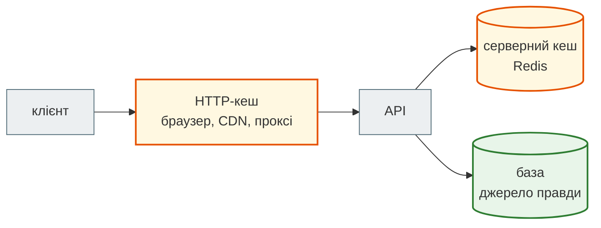
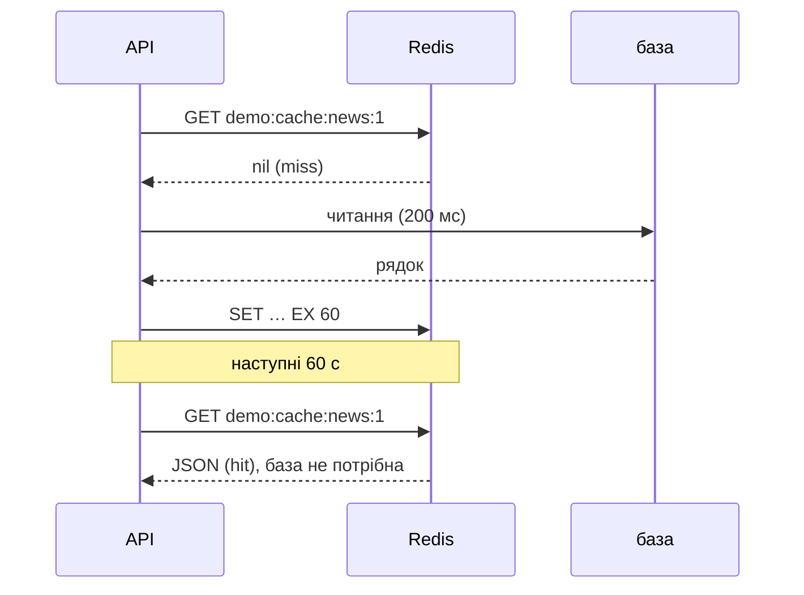
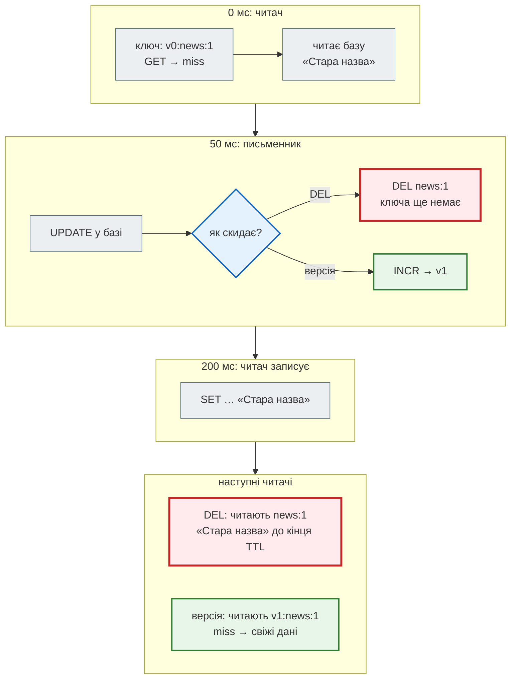

# Стратегії кешу

## Проблема { #problem }

Кеш — найпростіший спосіб прискорити API: порахував один раз, а далі віддаєш з пам'яті. Але кеш — це **копія**, і з першого ж дня з'являються питання, яких не було без нього. Що робити, коли дані змінилися? Як скинути сотню ключів стрічки з різними параметрами? Що буде, якщо запис і читання прийдуть одночасно? А якщо популярний ключ зник і сотня запитів пішла в базу разом? І що буде з API, коли сам Redis недоступний?

Як News Hub кешує стрічку, показано на [кроці 4](../tutorials/04_middleware_redis/cache.md). Тут розберемо самі стратегії: чому обрано саме таку і де її межі.

## Ментальна модель { #mental-model }



Кешів буває два, і вирішують вони різне:

| | HTTP-кеш | серверний кеш (Redis) |
|---|---|---|
| де живе | браузер, CDN, проксі | поруч з API |
| хто вирішує | клієнт за `Cache-Control`, `ETag` | код сервера |
| що економить | мережу й запити до сервера взагалі | роботу бази й обчислення |
| скинути після запису | неможливо: копія вже в чужих руках, лише чекати `max-age` | будь-коли: це твій Redis |
| персональні дані | лише `private` або `no-store` | ключ має містити користувача |

HTTP-кеш і `ETag` з `304 Not Modified` розібрано в Частині I ([Кешованість](../01_http_and_rest/rest_principles.md#caching)). Далі йдеться про серверний кеш.

Будь-яка стратегія відповідає на три питання:

1. **Коли наповнювати?** При читанні (cache-aside) чи при записі (write-through).
2. **Як скидати?** TTL, видалення ключа, версія, теги.
3. **Що робити, коли кешу немає?** Холодний ключ, стампед, Redis недоступний.

## Cache-aside { #cache-aside }

[`examples/cache_jobs/cache_demo.py`](https://github.com/NikoriakViktor/news_hub/blob/main/examples/cache_jobs/cache_demo.py). «База» в демо — словник, читання якого триває 200 мс і рахується:

```python title="cache_demo.py (фрагмент)"
async def cache_aside(r: Redis, db: SlowDB, key: str, ttl: int = 60) -> dict[str, object]:
    cached = await r.get(f"demo:cache:{key}")
    if cached is not None:                            # hit
        return json.loads(cached)
    value = await db.read(key)                        # miss
    await r.set(f"demo:cache:{key}", json.dumps(value, ensure_ascii=False), ex=ttl)
    return value
```

```text
--- 1. cache-aside: miss, потім hit
1: Стара назва за 201 ms
2: Стара назва за 0 ms
3: Стара назва за 0 ms
звернень до бази: 1 | TTL: 60
--- 2. запис у базу без інвалідації — кеш бреше до кінця TTL
у базі: Нова назва | з кешу: Стара назва
```



Кеш наповнює той, хто читає, і лише тим, що справді читають. Тому cache-aside — стратегія за замовчуванням. Платимо за це двома речами: перше читання повільне, а після запису кеш бреше, доки його не скинути або доки не мине TTL.

**TTL — обов'язковий, навіть якщо інвалідація налаштована.** Він обмежує шкоду від усього, що піде не так: забута інвалідація, помилка в ключі, гонитва з наступного розділу. Скільки секунд застарілості допустимо, вирішує бізнес. Стрічка новин на хвилину позаду — нормально, баланс рахунку — ні.

## Інвалідація { #invalidation }

Одна новина — це один ключ. А стрічка `GET /api/news?page=&category=` дає стільки ключів, скільки є комбінацій параметрів. Після запису треба скинути всі.

```text
--- 3. інвалідація стрічки з багатьма комбінаціями параметрів
DEL demo:list:1:all — лишилось застарілих ключів: 8 з 9
INCR версії — влучань у кеш після запису: 0; старих ключів у пам'яті до кінця TTL: 9
тег sport скинуто: видалено 3 ключі, лишились 6 — інші категорії не зачеплено
```

| Спосіб | Як | Плюси | Мінуси |
|---|---|---|---|
| лише TTL | нічого не робити, чекати | найпростіше | дані застарілі до `TTL` секунд |
| `DEL` ключа | видалити після запису | точно | треба знати **всі** ключі; для стрічки лишилось 8 з 9 |
| `SCAN` + `DEL` за шаблоном | знайти й видалити | не треба знати ключі | прохід усієї бази на кожен запис ([`SCAN` замість `KEYS`](redis_basics.md#scan)) |
| **версія** | номер покоління в ключі; запис — `INCR` | одна команда, скидає все; [не має гонитви з записом](#race) | старі ключі займають пам'ять до TTL; скидає **все**, навіть те, що не змінилось |
| теги | множина ключів на тег; скинути — `SMEMBERS` + `DEL` | скидає лише потрібну частину | треба підтримувати множини; та сама гонитва, що й з `DEL` |

```python title="cache_demo.py (фрагмент): версія"
async def versioned_key(p: dict[str, object]) -> str:
    version = await r.get("demo:news:version") or "0"
    return f"demo:news:v{version}:list:{p['page']}:{p['category']}"

await r.incr("demo:news:version")     # інвалідація: старі ключі просто перестають читатися
```

```python title="cache_demo.py (фрагмент): теги"
async with r.pipeline(transaction=True) as pipe:          # запис у кеш + реєстрація ключа в тезі
    pipe.set(key, "[...]", ex=60)
    pipe.sadd(f"demo:tag:{p['category']}", key)
    pipe.expire(f"demo:tag:{p['category']}", 60)
    await pipe.execute()
```

Ще один класичний варіант — версія **на кожну сутність** (`news:42:version`) для кешу окремих карток. Запис новини 42 скидає лише її, і стрічку окремо.

## Гонитва читання й запису { #race }

Найпідступніша вада cache-aside. Читач отримав miss і пішов у базу. Поки він читає, письменник змінює базу й видаляє ключ, якого ще немає. Потім читач записує в кеш **старе** значення, і воно живе до кінця TTL.

```python title="cache_demo.py (фрагмент)"
async def reader() -> None:
    k = await key()                           # ключ (і версію) визначено ДО читання бази
    if await r.get(k) is None:
        value = await db.read("news:1")       # читає «Стара назва» 200 мс
        await r.set(k, json.dumps(value, ensure_ascii=False), ex=60)

async def writer() -> None:
    await asyncio.sleep(0.05)                 # читач уже в базі
    await db.write("news:1", title="Нова назва")
    if strategy == "DEL":
        await r.delete("demo:cache:news:1")   # кешу ще немає — видаляти нічого
    else:
        await r.incr("demo:v:version")
```

```text
--- 4. гонитва читання й запису: DEL проти версії
DEL     у базі: Нова назва | у кеші для наступних читачів: Стара назва
версія  у базі: Нова назва | у кеші для наступних читачів: (порожньо — наступний читач піде в базу)
```



Версія від цієї гонитви захищає, бо читач визначив ключ **до** читання бази. Його застарілий запис ліг під стару версію, яку вже ніхто не читає. Друга половина того самого правила: версію збільшують **після COMMIT**, а не в ендпоінті до нього. Інакше паралельний читач встигне прочитати старі дані з бази й покласти їх під **нову** версію ([крок 4](../tutorials/04_middleware_redis/cache.md#commit)).

## Write-through { #write-through }

Протилежний підхід: кеш оновлює **запис**. Спочатку зміна в базі, потім нове значення в кеші.

```text
--- 5. write-through: запис оновлює і базу, і кеш
запис зайняв 200 ms (база + кеш) | читання після запису: Назва після редагування | звернень до бази при читанні: 0
```

| | cache-aside | write-through |
|---|---|---|
| хто наповнює | читання (miss) | запис |
| перше читання після запису | повільне | швидке |
| запис | швидкий | повільніший: ще й кеш |
| у кеші | лише те, що читають | усе, що писали, навіть якщо ніхто не читає |
| для агрегатів (стрічка, статистика) | природно | важко: що саме перерахувати після одного запису? |

Write-through добре підходить для кешу **окремої сутності**, яку часто читають одразу після запису (профіль, налаштування). Для стрічки з фільтрами й статистики з `GROUP BY` невідомо, що перерахувати, тож там cache-aside з версією. Ще є **write-behind**: запис спершу в кеш, а в базу пізніше, пачкою. Він швидкий, але кеш тимчасово стає джерелом правди, і падіння Redis губить записи. Для API з базою це рідко виправдано.

## Cache stampede { #stampede }

Популярний ключ зник (минув TTL, скинула версія), і сотня одночасних запитів отримала miss. Усі разом ідуть у базу, тобто саме тоді, коли кеш потрібен найбільше.

```text
--- 6. cache stampede: 50 одночасних запитів на холодний ключ
без захисту    звернень до бази: 50 | усі 50 відповіли за 300 ms
single-flight  звернень до бази:  1 | усі 50 відповіли за 207 ms
Redis-замок    звернень до бази:  1 | усі 50 відповіли за 240 ms
```

(Вивід зі справжнього Redis; на `fakeredis` кількість звернень та сама.)

```python title="cache_demo.py (фрагмент): замок у Redis"
for _ in range(100):
    cached = await r.get("demo:cache:news:1")
    if cached is not None:
        return
    if await r.set("demo:lock:news:1", "1", nx=True, ex=5):   # лише один отримає замок; 5 с — якщо власник упаде
        try:
            value = await db.read("news:1")
            await r.set("demo:cache:news:1", json.dumps(value, ensure_ascii=False), ex=60)
        finally:
            await r.delete("demo:lock:news:1")
        return
    await asyncio.sleep(0.02)                                 # решта чекають і перечитують кеш
```

| Захист | Як | Межа |
|---|---|---|
| **single-flight** | у процесі: перший запит рахує, решта чекають на той самий `Future` | лише в одному процесі; 4 процеси uvicorn — 4 звернення |
| **замок `SET NX EX`** | між процесами: рахує той, хто взяв замок | очікування опитуванням; TTL замка має бути більшим за час обчислення |
| **розкид TTL** | `ex=60 + random.randint(0, 12)` | не дає ключам, створеним разом, зникнути разом |
| **дострокове оновлення** | перерахувати незадовго до кінця TTL (з імовірністю, що росте до кінця) | складніше; потрібен час обчислення в записі |
| **віддати застаріле** | тримати значення довше за TTL «свіжості», віддавати старе й оновлювати у фоні | клієнт якийсь час бачить старе |

```text
--- 7. розкид TTL: ключі, створені разом, не мають зникати разом
TTL 60 для всіх: різних моментів зникнення 1 | 60 + randint(0, 12): 13 (від 60 до 72 с)
```

Замок у демо знімається звичайним `DEL`. Якщо обчислення триває довше за 5 секунд, замок встигне зникнути, його візьме інший запит, і перший видалить **чужий** замок. Надійніше — випадковий токен у значенні й видалення лише свого (`redis.lock()` у redis-py робить саме так) або обчислення, яке гарантовано коротше за TTL замка.

## Коли Redis недоступний { #redis-down }

```text
--- 8. Redis недоступний: кеш — прискорення, а не умова роботи
cache-aside без обробки → ConnectionError — запит упаде з 500
з try/except RedisError → Стара назва з бази
```

Якщо кеш лише прискорює роботу, то недоступний кеш — це просто miss. `try/except RedisError` навколо `get` і `set` залишає API працювати повільніше, але працювати. Обов'язково з `socket_connect_timeout`: без таймауту запит висітиме, доки ОС не здасться. І **не** так для лімітів і черг: «Redis недоступний — пропускаємо всіх» вимикає захист саме тоді, коли щось пішло не так. Для них рішення свідоме: `503` або пропуск із записом у журнал.

## Що кешувати { #what-to-cache }

| Кешуй | Не кешуй |
|---|---|
| дорогі читання, які часто повторюються з тими самими параметрами | довільні запити з великою кількістю варіантів (`?q=` пошуку): ключів стає стільки ж, скільки запитів |
| готову серіалізовану відповідь (JSON-рядок) | об'єкти ORM: вони прив'язані до сесії й не серіалізуються |
| результати платних зовнішніх викликів (LLM) за хешем входу | помилки (`404`, `422`) без окремого короткого TTL: новина, створена за секунду, виглядала б відсутньою |
| публічні дані | персональні дані в ключі без користувача: віддаси одному користувачеві дані іншого |

Перш ніж додавати кеш — виміряй. Якщо запит до бази триває 3 мс, кеш на 1 мс не вартий питання «а чи свіжі дані?».

## У News Hub { #news-hub }

[`steps/04_middleware_redis/news_hub/cache.py`](https://github.com/NikoriakViktor/news_hub/blob/main/steps/04_middleware_redis/news_hub/cache.py) — cache-aside з версією:

- ключ `news:v<версія>:<name>:<sha1 параметрів>`, TTL 60 с, у кеші — готовий JSON, заголовок `X-Cache: HIT/MISS`;
- інвалідація — `INCR news:version` у middleware `invalidate_cache`, **після** COMMIT і лише для успішних записів ([крок 4](../tutorials/04_middleware_redis/cache.md#invalidation));
- фонова задача збору сама робить COMMIT і `invalidate()` ([крок 4](../tutorials/04_middleware_redis/background_jobs.md#run-job)).

Що з цієї сторінки стосується News Hub:

| Властивість | У News Hub |
|---|---|
| гонитва читання й запису | закрита версією: `key()` читає версію до репозиторію |
| старі ключі | лежать до 60 с після кожного запису; для агрегатора це небагато |
| stampede | захисту немає; одночасний miss стрічки — кілька однакових `SELECT`, для 60-секундного TTL і агрегатора це прийнятно |
| розкид TTL | немає: усі ключі стрічки після запису створюються в різний час, тож одночасне зникнення малоймовірне |
| Redis недоступний | `NewsCache` винятків не ловить: `GET /api/news` відповість `500`. `AnalysisCache` ([крок 7](../tutorials/07_llm_api/db_cache_cost.md#cache)) ловить `RedisError` і працює без кешу |
| HTTP-кеш | `Cache-Control`/`ETag` News Hub не ставить |

`AnalysisCache` кешує за **хешем тексту**, а не за id новини, з TTL 7 діб: той самий заголовок після видалення й нового збору не коштує ще одного платного виклику LLM.

## Типові помилки { #mistakes }

| Помилка | Наслідок | Як правильно |
|---|---|---|
| кеш без TTL | застарілі дані назавжди, пам'ять росте | TTL на кожен запис, навіть з інвалідацією |
| `DEL` одного ключа для стрічки з параметрами | решта комбінацій бреше до TTL | версія або теги |
| `KEYS news:*` + `DEL` | Redis зупиняється на прохід | версія |
| інвалідація до COMMIT | старі дані під новою версією | після COMMIT (middleware, як у News Hub) |
| ключ без параметрів запиту | `?page=2` отримує першу сторінку | усі параметри, що впливають на відповідь, у ключі |
| ключ без користувача для персональних даних | користувач бачить чужі дані | користувач (або роль) у ключі; краще не кешувати |
| кешувати `None`, а потім перевіряти `if cached:` | порожня відповідь вважається miss щоразу | окремий маркер «нічого немає» з коротким TTL |
| однаковий TTL для пачки ключів | одночасне зникнення, стампед | розкид TTL |
| кеш падає разом з Redis | `500` замість повільної відповіді | `try/except RedisError` і таймаути |

## Налагодження { #debugging }

- **Заголовок `X-Cache: HIT/MISS`** (як у News Hub) показує в `curl -i` і DevTools, звідки прийшла відповідь.
- **Частка влучань** — `INFO stats`: `keyspace_hits` і `keyspace_misses`. Низька частка означає, що ключі занадто конкретні або TTL занадто короткий.
- **«Дані не оновлюються»**: `redis-cli GET news:version` до й після запису. Якщо не змінилась — інвалідація не спрацювала (помилка, `4xx`, інший шлях).
- **«Іноді старі дані»** — шукай гонитву: інвалідація до COMMIT або `DEL` замість версії.
- **Стампед** видно в журналі бази: сплеск однакових запитів одразу після запису чи кінця TTL.

## Безпека { #security }

- **Персональні дані в спільному кеші** — найчастіший витік через кеш. Або користувач у ключі, або не кешувати взагалі. Для HTTP-кешу — `Cache-Control: private` або `no-store` ([Частина I](../01_http_and_rest/rest_principles.md#security)).
- **Отруєння кешу**: якщо відповідь залежить від заголовка (`Host`, `Accept-Language`), якого немає в ключі, атакувальник одним запитом кладе в кеш свою версію для всіх.
- **Ключі з довільного введення** хешуй (як `sha1` параметрів у News Hub). Це обмежує довжину ключа й не пускає в імена ключів чужі символи.
- **Кеш як підсилювач DoS**: запити з унікальними параметрами завжди дають miss і забивають пам'ять. Потрібні обмеження параметрів (`limit ≤ 100`), ліміт частоти й `maxmemory`.

## Питання { #questions }

1. Чим HTTP-кеш відрізняється від серверного і чому HTTP-кеш не можна скинути після запису?
2. Чому навіть з інвалідацією кеш потребує TTL?
3. Як скинути кеш стрічки з усіма комбінаціями параметрів без `KEYS`?
4. Опиши гонитву «читач отримав miss — письменник видалив ключ». Чому версія від неї захищає?
5. Коли write-through кращий за cache-aside?
6. Що таке cache stampede і чим single-flight відрізняється від замка в Redis?
7. Що має робити API, якщо Redis-кеш недоступний? А rate limit?

??? success "Відповіді"

    1. HTTP-кеш живе в браузері, CDN і проксі, а керує ним клієнт за заголовками. Серверний живе поруч з API, і керує ним код. Копія в HTTP-кеші вже в чужих руках, тож лишається чекати `max-age`.
    2. TTL обмежує шкоду від усього, що піде не так: забута інвалідація, гонитва, помилка в ключі.
    3. Версією: номер у кожному ключі, і запис робить `INCR`. Старі ключі перестають читатися, а TTL їх прибирає.
    4. Читач прочитав старе з бази, письменник змінив базу й видалив ключ, якого ще не було, читач записав старе. З версією читач кладе старе під стару версію, яку вже ніхто не читає.
    5. Для окремої сутності, яку часто читають одразу після запису, і коли запис може дозволити собі бути повільнішим.
    6. Одночасний miss популярного ключа: усі запити разом ідуть у базу. Single-flight об'єднує запити лише в одному процесі, а замок `SET NX EX` — між усіма процесами й серверами.
    7. Кеш: працювати без нього, вважаючи недоступність промахом (`try/except RedisError` і таймаути). Ліміт: свідоме рішення (`503` або пропуск із журналом), бо «пропустити всіх» вимикає захист.

## Що далі { #next }

[Rate limit](rate_limiting.md) — другий головний спосіб використання Redis в API: алгоритми, атомарність, ключ клієнта за проксі.

**Джерела:** Redis — [Caching](https://redis.io/solutions/caching/), [SET (NX, EX)](https://redis.io/docs/latest/commands/set/), [Distributed locks](https://redis.io/docs/latest/develop/use/patterns/distributed-locks/); [redis-py — Lock](https://redis.readthedocs.io/en/stable/lock.html); AWS — [Caching best practices](https://aws.amazon.com/caching/best-practices/); Vattani, Chierichetti, Lowenstein — [Optimal Probabilistic Cache Stampede Prevention](https://www.vldb.org/pvldb/vol8/p886-vattani.pdf) (VLDB 2015); [RFC 9111 — HTTP Caching](https://www.rfc-editor.org/rfc/rfc9111); MDN — [HTTP caching](https://developer.mozilla.org/en-US/docs/Web/HTTP/Caching).
