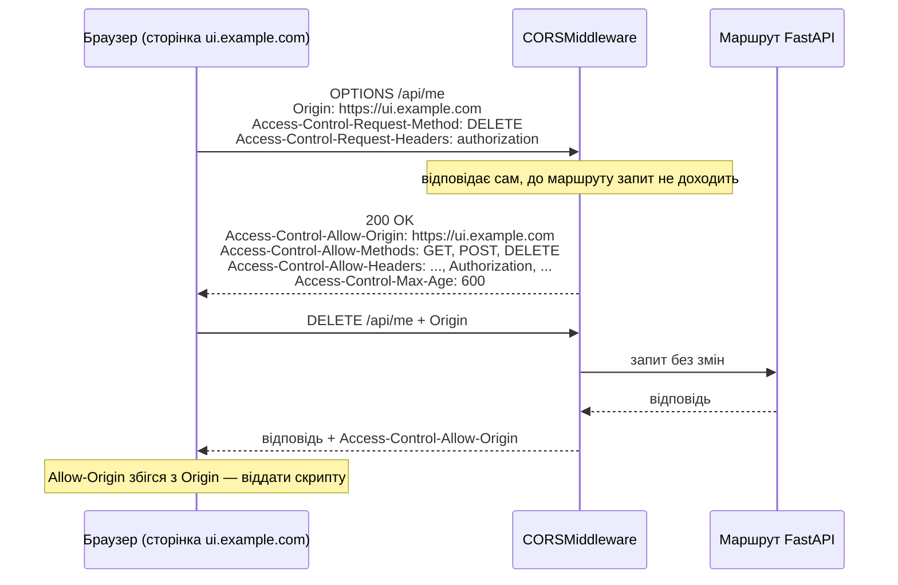
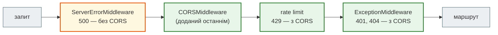

# CORS

## Проблема { #problem }

Фронтенд на `https://ui.example.com` робить `fetch("https://api.example.com/api/me")`. Сервер відповів `200`, у журналі все гаразд, а в консолі браузера — «blocked by CORS policy», і скрипт даних не отримав. Типова реакція — додати `allow_origins=["*"]`, і все запрацює. Але це може відкрити дані користувачів будь-якому сайту. Щоб налаштувати CORS правильно, треба розуміти, **хто** тут що блокує і від чого це захищає.

## Ментальна модель { #mental-model }

**Джерело (origin)** — схема + хост + порт: `https://ui.example.com:443`. `http://localhost:3000` і `http://localhost:8000` — різні джерела, бо різні порти.

**Same-Origin Policy** — правило браузера: скрипт зі сторінки одного джерела **не може читати** відповіді від іншого. Надсилати запити він може.

**CORS** — спосіб для сервера послабити це правило: заголовки `Access-Control-Allow-*` у відповіді кажуть браузеру, якому джерелу можна віддати відповідь.

Три висновки, які важливіші за всі параметри:

1. **CORS виконує браузер, а не сервер.** `curl`, Postman, Python і бот на CORS не зважають.
2. **CORS не блокує запит, а ховає відповідь.** Запит дійшов, функція виконалась, і лише браузер вирішує, чи віддати результат скрипту.
3. **CORS не захист сервера, а дозвіл.** Без CORS-заголовків браузер нічого не дозволяє. Кожен рядок налаштування — це послаблення захисту.

## Простий запит і preflight { #preflight }

Браузер надсилає запит одразу, якщо він «простий»: `GET`, `HEAD` або `POST` лише з безпечними заголовками і `Content-Type` одним із `application/x-www-form-urlencoded`, `multipart/form-data`, `text/plain`. Такий запит міг надіслати й звичайна HTML-форма, тож нового ризику він не додає.

Решта вимагає **preflight** — попереднього запиту `OPTIONS` «чи можна?»:

- метод `PUT`, `PATCH`, `DELETE`;
- `Content-Type: application/json` — тобто майже кожен `POST` до JSON API;
- будь-який нестандартний заголовок: `Authorization`, `X-Request-ID`, `X-Api-Key`.



Якщо preflight не пройшов, основний запит браузер **не надсилає**. Простий запит надсилається завжди, а перевірка — вже по відповіді.

## Налаштування `CORSMiddleware` { #setup }

[`examples/cors/cors_app.py`](https://github.com/NikoriakViktor/news_hub/blob/main/examples/cors/cors_app.py):

```python title="cors_app.py (фрагмент)"
app.add_middleware(
    CORSMiddleware,
    allow_origins=origins,                        # точні джерела, без коси риски в кінці
    allow_credentials=True,                       # браузер може надсилати cookie
    allow_methods=["GET", "POST", "DELETE"],
    allow_headers=["Authorization", "Content-Type"],
    max_age=600,                                  # скільки секунд браузер пам'ятає результат preflight
)
```

| Параметр | За замовчуванням у Starlette 1.10 | Що означає |
|---|---|---|
| `allow_origins` | `()` — нікому | точні джерела; `["*"]` — будь-яке |
| `allow_origin_regex` | `None` | регулярний вираз для джерела, перевіряється `fullmatch` |
| `allow_methods` | `("GET",)` | методи для preflight; `["*"]` — усі |
| `allow_headers` | `()` | нестандартні заголовки запиту; `Accept`, `Accept-Language`, `Content-Language`, `Content-Type` додаються завжди |
| `allow_credentials` | `False` | дозволити запити з cookie |
| `expose_headers` | `()` | які заголовки **відповіді** скрипт зможе прочитати (крім стандартних), наприклад `X-Request-ID` |
| `max_age` | `600` | кеш preflight у браузері, секунди |

`OPTIONS` в `allow_methods` додавати не треба: preflight обробляє сам middleware.

## Що відповідає сервер { #demo }

[`cors_demo.py`](https://github.com/NikoriakViktor/news_hub/blob/main/examples/cors/cors_demo.py) надсилає те, що надіслав би браузер. Функція `browser_reads()` перевіряє відповідь за правилами браузера: `Access-Control-Allow-Origin` має збігтися з джерелом, а для запиту з cookie — ще й `Access-Control-Allow-Credentials: true`.

```text
--- 1. preflight з UI: DELETE + Authorization
200 OK {'vary': 'Origin, Access-Control-Request-Method, Access-Control-Request-Headers, Access-Control-Request-Private-Network', 'access-control-allow-methods': 'GET, POST, DELETE', 'access-control-max-age': '600', 'access-control-allow-headers': 'Accept, Accept-Language, Authorization, Content-Language, Content-Type', 'access-control-allow-credentials': 'true', 'access-control-allow-origin': 'https://ui.example.com'}
--- 2. preflight з чужого сайту
400 Disallowed CORS origin
--- 3. preflight із заголовком, якого немає в allow_headers
400 Disallowed CORS headers
--- 4. GET /api/me з cookie: UI і чужий сайт
https://ui.example.com: 200 {"user":"olena","balance":1200}  браузер віддасть скрипту: True
https://evil.example: 200 {"user":"olena","balance":1200}  браузер віддасть скрипту: False
--- 5. «проста» форма POST з чужого сайту: preflight не потрібен
200 браузер віддасть скрипту: False | переказів на сервері: 1
```

- **1–3.** Preflight обробляє middleware: `200` з дозволами або `400` з причиною. Браузеру досить і відсутності заголовків, але текст `Disallowed CORS origin` / `headers` / `method` у вкладці Network одразу каже, що не так.
- **4.** На запит з чужого сайту сервер **відповів даними**. Від читання їх захищає лише браузер, який не віддасть відповідь скрипту без `Access-Control-Allow-Origin`.
- **5.** Форма з чужого сайту **виконала переказ**. CORS тут ні до чого: простий запит пройшов, а браузер лише сховав відповідь. Від цього захищають cookie з `SameSite` і CSRF-токени, а не CORS.

## `["*"]` разом з `allow_credentials=True` { #wildcard-credentials }

За специфікацією Fetch браузер не віддає відповідь на запит з cookie, якщо в ній `Access-Control-Allow-Origin: *`. Можна подумати, що ця комбінація просто не працює. **Starlette робить інакше:** вона підставляє в `Access-Control-Allow-Origin` джерело, з якого прийшов запит.

```text
--- 8. allow_origins=["*"] + allow_credentials=True
200 {"user":"olena","balance":1200} {'access-control-allow-origin': 'https://evil.example', 'access-control-allow-credentials': 'true', 'vary': 'Origin'}
браузер віддасть скрипту з evil.example: True
preflight з evil.example: 200 https://evil.example
--- 9. allow_origins=["*"] без credentials
200 {'access-control-allow-origin': '*', 'vary': 'Origin'}
з cookie (credentials: 'include'): False | без cookie: True
```

Отже, `["*"]` + `allow_credentials=True` означає: **будь-який сайт, який відкрив користувач, читає його дані** з його cookie. Захисту браузера, на який розраховують, тут немає: сервер сам дав потрібний дозвіл. Біля цього рядка в коді Starlette навіть стоїть коментар «If credentials are allowed, then we must respond with the specific origin instead of '*'».

Чи дійдуть cookie до запиту з іншого **сайту**, вирішує ще й їхній `SameSite`. З `Lax` (типове значення в браузерах і в `set_cookie` Starlette) cookie не їдуть у міжсайтовий `fetch`. Але фронтенд на іншому домені, якому справді потрібні cookie, змушений ставити `SameSite=None` — і тоді `["*"]` з `allow_credentials` відкриває все. Піддомени (`evil.example.com` і `api.example.com`) для `SameSite` — один сайт, тож навіть `Lax` їх не розділяє.

`["*"]` **без** `allow_credentials` безпечне для справді публічних даних: браузер дасть читати відповідь, але без cookie користувача.

## Що таке credentials { #credentials }

Під «credentials» у CORS розуміють те, що браузер додає до запиту **сам**: cookie, вбудовану HTTP-автентифікацію (Basic, яку пам'ятає браузер) і клієнтські TLS-сертифікати. Заголовок `Authorization: Bearer ...`, який скрипт ставить вручну, сюди **не належить**. Для нього `allow_credentials` не потрібен. Потрібен `"Authorization"` в `allow_headers`, бо це нестандартний заголовок і він викликає preflight.

Звідси практичне правило: API з JWT у заголовку (як News Hub) не потребує `allow_credentials=True`. Чужий сайт не знає токена користувача, тож навіть з `["*"]` він отримає лише `401`.

## Помилки без заголовків CORS { #errors }

```text
--- 7. помилки: 401, 500, 429
/api/me  → 401, allow-origin: https://ui.example.com
/api/boom  → 500, allow-origin: None
/api/me {'X-Flood': '1'} → 429, allow-origin: https://ui.example.com
rate limit доданий після CORS → 429, allow-origin: None
```

- **`401` і інші `HTTPException`** мають CORS-заголовки: їх обробляє `ExceptionMiddleware` всередині, ближче до маршруту, ніж CORS.
- **`500` — ніколи.** Необроблений виняток перехоплює `ServerErrorMiddleware`, найзовнішній шар, уже за межами `CORSMiddleware`. Браузер покаже «CORS error», хоча причина — падіння сервера. Шукай її в журналі сервера.
- **Middleware, доданий після `CORSMiddleware`**, обгортає його ззовні. Його власні відповіді (тут `429` від rate limit) CORS-заголовків не отримають, і фронтенд замість `429` з `Retry-After` побачить помилку CORS. `add_middleware(CORSMiddleware, ...)` став **останнім**, щоб він був зовнішнім.



## Список джерел з налаштувань { #settings }

Джерела різні в розробці (`http://localhost:3000`) і в продакшні, тож їх беруть зі змінної середовища. `pydantic-settings` розбирає `list[str]` як JSON (`'["https://a","https://b"]'`). Щоб писати звичайний список через кому, поле позначають `NoDecode` і розбирають самі:

```python title="cors_app.py (фрагмент)"
class Settings(BaseSettings):
    cors_origins: Annotated[list[str], NoDecode] = ["http://localhost:3000"]   # NoDecode: не розбирати як JSON

    @field_validator("cors_origins", mode="before")
    @classmethod
    def split(cls, value: object) -> object:
        if isinstance(value, str):
            return [origin.strip().rstrip("/") for origin in value.split(",") if origin.strip()]
        return value
```

```text
--- 6. allow_origins з косою рискою в кінці
200 allow-origin: None
--- 10. список джерел зі змінної середовища
['https://ui.example.com', 'http://localhost:3000']
```

Браузер надсилає `Origin` без коси риски в кінці, а `allow_origins` порівнює рядки точно. `https://ui.example.com/` у налаштуваннях не збігається ні з чим, і заголовка CORS не буде. Тому валідатор обрізає `/`.

## У News Hub { #news-hub }

`CORSMiddleware` у News Hub немає, і він не потрібен:

- Swagger UI (`/docs`) відкривається з того самого джерела, що й API;
- Telegram-бот, планувальник і тести — не браузери, CORS їх не стосується;
- адмін автентифікується JWT у заголовку `Authorization`, а не cookie ([крок 8](../tutorials/08_security/index.md)).

Коли з'явиться фронтенд на іншому домені, достатньо `allow_origins` з налаштувань, `allow_headers=["Authorization", "Content-Type"]` і **без** `allow_credentials`. `CORSMiddleware` треба додати останнім, після `rate_limit` і `request_context`, щоб `429` і заголовок `X-Request-ID` доходили до фронтенду. Щоб скрипт міг прочитати `X-Request-ID`, його треба вказати в `expose_headers`.

## Типові помилки { #mistakes }

| Помилка | Наслідок | Як правильно |
|---|---|---|
| `allow_origins=["*"]` + `allow_credentials=True` | Starlette віддзеркалює будь-яке джерело — будь-який сайт читає дані користувача з його cookie | точний список джерел |
| коса риска в кінці джерела | заголовок CORS не з'являється, «No 'Access-Control-Allow-Origin' header» | `https://ui.example.com` без `/` |
| CORS як захист від CSRF | простий `POST` з чужого сайту виконується | `SameSite` для cookie, CSRF-токен |
| `allow_credentials=True` для API з `Authorization: Bearer` | зайвий дозвіл | `"Authorization"` в `allow_headers`, credentials не потрібні |
| `allow_origin_regex=r"https://.*example.com"` | збігається з `https://evilexample.com` | `r"https://([a-z0-9-]+\.)?example\.com"` |
| middleware, доданий після `CORSMiddleware` | його `429`/`401` без заголовків CORS | `CORSMiddleware` — останнім |
| «CORS error» на `500` | шукають помилку в налаштуваннях CORS | дивитися журнал сервера: `500` завжди без CORS |
| `X-Request-ID` не видно у `fetch` | скрипт бачить лише стандартні заголовки відповіді | `expose_headers=["X-Request-ID"]` |
| `max_age` у кілька діб | зміни політики доходять до браузерів не скоро; Chrome все одно обмежує 2 годинами | хвилини, не дні |

## Налагодження { #debugging }

- **DevTools → Network**: увімкни показ запитів `OPTIONS` (фільтр «All» або «Fetch/XHR» → «Preflight»). Спершу дивись на preflight: його код, `access-control-allow-*` у відповіді.
- **Повідомлення консолі** називає причину: «No 'Access-Control-Allow-Origin' header is present» — джерело не збіглося або сталася `500`; «is not allowed by Access-Control-Allow-Headers» — заголовок не в `allow_headers`; «must not be the wildcard '*' when the request's credentials mode is 'include'» — `["*"]` без `allow_credentials`, а `fetch` з `credentials: "include"`.
- **Відтворити без браузера**: `curl -i -X OPTIONS http://localhost:8000/api/me -H "Origin: https://ui.example.com" -H "Access-Control-Request-Method: DELETE" -H "Access-Control-Request-Headers: authorization"`.
- У тестах — як `cors_demo.py`: `TestClient` з заголовком `Origin` і перевірка `access-control-allow-origin`.

## Безпека { #security }

- **Жоден рядок CORS не захищає сервер.** Запити з чужих сайтів, `curl` і скрипти доходять завжди. Автентифікація, авторизація, `SameSite`, CSRF-токени й rate limit мають працювати незалежно від CORS.
- **`["*"]` + `allow_credentials=True` у Starlette — фактично «будь-який сайт від імені користувача»**, без страховки з боку браузера.
- **Регулярний вираз для джерел** пиши з `\.` і явними межами; `fullmatch` у Starlette допомагає, але `.` без екранування — будь-який символ.
- **Не віддзеркалюй `Origin` вручну** у власному middleware («дозволю те, що прийшло»): це той самий `*` з credentials.
- **WebSocket не перевіряється CORS** ([Які бувають API](../01_http_and_rest/api_styles.md#security)): для нього джерело перевіряють вручну.
- **Cookie для міжсайтового фронтенду** (`SameSite=None`) — лише з `Secure`, тобто лише через HTTPS.

## Питання { #questions }

1. Хто блокує запит при помилці CORS — сервер чи браузер? Чи виконалась функція маршруту?
2. Чому `POST` з `Content-Type: application/json` викликає preflight, а `POST` HTML-форми — ні?
3. Що повертає Starlette в `Access-Control-Allow-Origin` при `allow_origins=["*"]` і `allow_credentials=True`? Чому це небезпечно?
4. Чи потрібен `allow_credentials=True` для API, що приймає `Authorization: Bearer`?
5. Чому фронтенд бачить «CORS error» замість `500`?
6. Де в ланцюжку middleware має стояти `CORSMiddleware` і чому?
7. Чому `https://ui.example.com/` в `allow_origins` не працює?

??? success "Відповіді"

    1. Браузер. Сервер отримав запит і відповів; для простого запиту функція виконалась, браузер лише не віддав відповідь скрипту. Для непройденого preflight основного запиту не було.
    2. `application/json` не входить до трьох «простих» типів вмісту; HTML-форма надсилає `application/x-www-form-urlencoded` чи `multipart/form-data`, і такий запит браузер дозволяв завжди.
    3. Джерело запиту, яке б воно не було, разом з `Access-Control-Allow-Credentials: true`. Будь-який сайт може читати відповіді з cookie користувача.
    4. Ні: ручний заголовок `Authorization` не є credentials у CORS. Потрібно `"Authorization"` в `allow_headers`.
    5. `500` формує `ServerErrorMiddleware`, зовнішній щодо `CORSMiddleware`, тому заголовків CORS у відповіді немає, і браузер ховає її.
    6. Зовнішнім, тобто доданим останнім: тоді відповіді всіх внутрішніх middleware (`429`, `401`) отримують заголовки CORS.
    7. Браузер надсилає `Origin` без коси риски, а порівняння точне.

## Що далі { #next }

[Частина VI. Middleware, кеш і фонові задачі](README.md) — решта розділів частини.

**Джерела:** [Fetch Standard — CORS protocol](https://fetch.spec.whatwg.org/#http-cors-protocol); [MDN — Cross-Origin Resource Sharing](https://developer.mozilla.org/en-US/docs/Web/HTTP/CORS), [Access-Control-Max-Age](https://developer.mozilla.org/en-US/docs/Web/HTTP/Headers/Access-Control-Max-Age); FastAPI — [CORS](https://fastapi.tiangolo.com/tutorial/cors/); [Starlette — Middleware: CORSMiddleware](https://starlette.dev/middleware/#corsmiddleware); [Pydantic Settings — parsing environment variable values](https://docs.pydantic.dev/latest/concepts/pydantic_settings/#parsing-environment-variable-values); [OWASP — CSRF Prevention Cheat Sheet](https://cheatsheetseries.owasp.org/cheatsheets/Cross-Site_Request_Forgery_Prevention_Cheat_Sheet.html).
