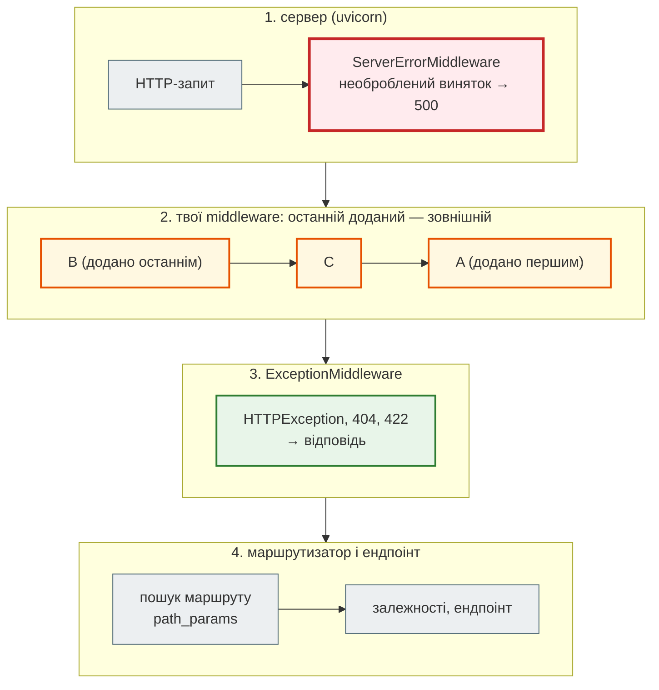

# Middleware: шари навколо застосунку

## Проблема { #problem }

Позначка запиту, час обробки, рядок журналу, ліміт частоти, стиснення, перевірка `Host` потрібні **кожному** запиту. Якщо копіювати їх в ендпоінти, частину забудуть, а `404` на неіснуючий шлях не потрапить у журнал узагалі. Для такого коду існує middleware. Але на практиці питань більше, ніж здається: у FastAPI три способи його написати, і вони відрізняються ціною та можливостями. Порядок шарів легко переплутати. А деяких відповідей middleware просто не бачить: `500`, кінця стрімінгу, WebSocket.

Як middleware News Hub пишуть і реєструють, показано на [кроці 4](../tutorials/04_middleware_redis/middleware.md). Тут розберемо, як це влаштовано загалом.

## Ментальна модель: цибуля { #mental-model }

ASGI-застосунок — це функція `app(scope, receive, send)`. Middleware — такий самий застосунок, який отримує наступний шар у конструкторі й викликає його. Шари вкладені один в одного, як цибуля: запит іде всередину, відповідь — назовні тими самими шарами у зворотному порядку.



Три висновки з цієї схеми:

1. **Middleware виконується до маршрутизації.** Він не знає, який ендпоінт спрацює, і не має `path_params`.
2. **`HTTPException` обробляється всередині**, у `ExceptionMiddleware`. Тому твій middleware бачить `404` як звичайну відповідь.
3. **Необроблений виняток пролітає крізь усі твої шари** аж до `ServerErrorMiddleware`, який стоїть зовні. Тому `500` твої middleware не бачать як відповідь.

## Три способи написати { #three-ways }

[`examples/cache_jobs/middleware_demo.py`](https://github.com/NikoriakViktor/news_hub/blob/main/examples/cache_jobs/middleware_demo.py) пише заголовок часу обробки трьома способами:

```python title="middleware_demo.py (фрагмент)"
async def timing_function(request: Request, call_next: CallNext) -> Response:        # 1. функція
    start = time.perf_counter()
    response = await call_next(request)
    response.headers["X-Process-Time"] = f"{(time.perf_counter() - start) * 1000:.1f}ms"
    return response
app.middleware("http")(timing_function)


class TimingBase(BaseHTTPMiddleware):                                                # 2. клас із dispatch
    async def dispatch(self, request: Request, call_next: CallNext) -> Response:
        ...                                                                          # те саме тіло
app.add_middleware(TimingBase)


class TimingASGI:                                                                    # 3. чистий ASGI
    def __init__(self, app: ASGIApp) -> None:
        self.app = app

    async def __call__(self, scope: Scope, receive: Receive, send: Send) -> None:
        if scope["type"] != "http":                       # websocket, lifespan — пропускаємо як є
            await self.app(scope, receive, send)
            return
        start = time.perf_counter()

        async def send_wrapper(message: Message) -> None:
            if message["type"] == "http.response.start":  # заголовки ще можна змінити
                elapsed = (time.perf_counter() - start) * 1000
                message.setdefault("headers", []).append((b"x-time-to-headers", f"{elapsed:.1f}ms".encode()))
            await send(message)

        await self.app(scope, receive, send_wrapper)
app.add_middleware(TimingASGI)
```

`@app.middleware("http")` — це скорочення: декоратор загортає функцію в `BaseHTTPMiddleware`. Обидва перші способи отримують `Request` і `call_next`, а чистий ASGI бачить сирі повідомлення протоколу: `http.response.start` із заголовками і кожен `http.response.body`.

```text
--- 2. ціна шару: 3000 запитів напряму в ASGI
none         46 мкс на запит  (+0 мкс до застосунку без middleware)
function    188 мкс на запит  (+141 мкс до застосунку без middleware)
base        191 мкс на запит  (+145 мкс до застосунку без middleware)
asgi         56 мкс на запит  (+10 мкс до застосунку без middleware)
```

Демо викликає застосунок напряму, без мережі. Абсолютні числа залежать від машини, а співвідношення між ними — ні: `call_next` перекладає відповідь через додатковий потік повідомлень, і це в кілька разів дорожче за чистий ASGI. Для API, де запит до бази триває мілісекунди, сто мікросекунд байдужі. Але коли шарів п'ять, а сервіс відповідає з кешу, різниця вже помітна.

| | `@app.middleware("http")` | `BaseHTTPMiddleware` | чистий ASGI |
|---|---|---|---|
| писати й читати | найпростіше | просто, є `__init__` для параметрів | складніше: повідомлення, `send_wrapper` |
| бачить | `Request`, готовий `Response` (заголовки, статус) | те саме | кожне повідомлення: заголовки, шматки тіла, `more_body` |
| WebSocket | ні | ні | так (`scope["type"] == "websocket"`) |
| `contextvars` | зміни всередині не видно зовнішнім шарам | те саме | працюють |
| ціна | ~+140 мкс у демо | ~+145 мкс | ~+10 мкс |
| коли брати | журнал, заголовки, ліміти в застосунку | те саме з параметрами | бібліотечні шари, стрімінг, WebSocket, гаряча доріжка |

Документація Starlette прямо попереджає про `contextvars`: зміни `ContextVar` усередині `BaseHTTPMiddleware` не поширюються назовні. Це важливо для трасування й кореляції журналів, які тримають id запиту в `ContextVar`.

## Порядок: останній доданий — зовнішній { #order }

```python title="middleware_demo.py (фрагмент)"
app.middleware("http")(layer("A"))       # першим
app.add_middleware(ClassLayer)          # другим — декоратор і add_middleware в один список
app.middleware("http")(layer("B"))       # останнім → зовнішній
```

```text
--- 3. порядок: останній зареєстрований — зовнішній
B→ C→ A→ ендпоінт ←A ←C ←B
app.user_middleware: ['BaseHTTPMiddleware(middleware)', 'ClassLayer', 'BaseHTTPMiddleware(middleware)']
```

Декоратор і `add_middleware` пишуть в один список `app.user_middleware`. Кожен новий шар Starlette вставляє **на початок** списку, тобто ззовні. Як обирати порядок:

- **Зовні** — те, що мусить побачити кожну відповідь, зокрема ті, що повернули інші шари самі: позначка запиту й журнал, [CORS](cors.md#errors).
- **Далі** — те, що може відповісти саме, не пускаючи запит усередину: `TrustedHost`, rate limit, перевірка розміру тіла.
- **Ближче до ендпоінта** — те, що залежить від результату: інвалідація кешу після успішного запису.

Що буде, якщо поставити журнал усередину від rate limit, показано на [кроці 4](../tutorials/04_middleware_redis/middleware.md#wrong-order): `429` залишаються без позначки й без рядка журналу.

## Чого middleware не бачить { #blind-spots }

```text
--- 4. чого middleware не бачить
GET /items/7   → 200 X-Process-Time=2.4ms | {"id":7}
    до: path_params={} route=None
    після: 200 path_params={'item_id': '7'} route=/items/{item_id} _StreamingResponse
GET /items/0   → 404 X-Process-Time=0.9ms | {"detail":"немає"}
    до: path_params={} route=None
    після: 404 path_params={'item_id': '0'} route=/items/{item_id} _StreamingResponse
GET /items/13  → 500 X-Process-Time=None | Internal Server Error
    до: path_params={} route=None
GET /guarded   → 500 X-Process-Time=None | Internal Server Error
    до: path_params={} route=None
```

- **До `call_next` маршруту ще немає.** `path_params` порожні, `scope["route"]` — `None`. Після `call_next` маршрутизатор уже дописав їх у спільний `scope`, тож шаблон шляху (`/items/{item_id}`) можна взяти для метрик. Але **рішення «пускати чи ні» за маршрутом** middleware прийняти не може. Для цього є залежність.
- **`404` від `HTTPException`** middleware бачить як звичайну відповідь: вона сформована всередині.
- **Необроблений виняток (`/items/13`)** не повертається з `call_next` відповіддю, а **кидається**. Код після `call_next` не виконується: ні заголовка, ні рядка «після» в журналі. Тобто саме найважливіші для розслідування запити зникають з журналу.
- **`HTTPException` у самому middleware (`/guarded`)** — це `500`, а не `401`. `ExceptionMiddleware` стоїть усередині й винятку з зовнішнього шару не ловить. Middleware, який хоче відмовити, **повертає** відповідь (`JSONResponse(status_code=401, ...)`), а не кидає виняток.

Щоб `500` таки потрапляли в журнал, `call_next` загортають у `try/except` і кидають виняток далі, щоб відповідь `500` усе одно сформував `ServerErrorMiddleware`:

```python title="middleware_demo.py (фрагмент)"
try:
    return await call_next(request)
except Exception as error:                        # зафіксувати й кинути далі: 500 зробить ServerErrorMiddleware
    print(f"    журнал: {request.method} {request.url.path} → виняток {type(error).__name__} ...")
    raise
```

```text
    журнал: GET /boom → виняток RuntimeError за 1.6ms
GET /boom з try/except у middleware → 500
```

### Тіло відповіді й стрімінг { #streaming }

```text
    тип відповіді в call_next: _StreamingResponse | є .body: False
--- 5. стрімінг: функція бачить лише заголовки, ASGI — кінець тіла
function заголовок: 2.4ms | тіло прийшло за 308ms
asgi     заголовок: 2.4ms | тіло прийшло за 306ms | ASGI до останнього шматка: 304ms
```

`call_next` завжди повертає `_StreamingResponse`, навіть для звичайного JSON, і `.body` у нього немає. Щоб прочитати тіло, доведеться пройти `body_iterator`, а потім зібрати нову відповідь. Тоді вся відповідь опиняється в пам'яті, а для справжнього стрімінгу клієнт нічого не отримає до кінця.

Ендпоінт тут стрімить три шматки по 100 мс. Middleware-функція поставила `X-Process-Time: 2.4ms`: вона отримала відповідь, щойно були готові **заголовки**. Час до останнього шматка (304 мс) видно лише в чистому ASGI, де можна дочекатися `more_body=False`. Для SSE, завантаження файлів і довгих відповідей «час обробки» з функції-middleware означає лише час до першого байта.

### WebSocket { #websocket }

```text
--- 6. WebSocket: @app.middleware('http') його не бачить
middleware бачив: ['http /']
```

`BaseHTTPMiddleware` пропускає все, крім `scope["type"] == "http"`, без змін. Ліміти, журнал і перевірки для WebSocket робить чистий ASGI-шар або код самого ендпоінта ([Які бувають API](../01_http_and_rest/api_styles.md#security)).

## Middleware чи залежність { #middleware-vs-depends }

Головну таблицю наведено на [кроці 4](../tutorials/04_middleware_redis/middleware.md#middleware-vs-depends). Коротке правило: middleware для того, що стосується **кожного запиту, незалежно від маршруту** (журнал, позначка, заголовки, стиснення). Залежність для того, що потребує **маршруту або розібраних даних** (користувач, права, сесія бази). Якщо залежність потрібна всім ендпоінтам, її підключають на рівні застосунку чи роутера: `FastAPI(dependencies=[...])`, `APIRouter(dependencies=[...])` ([Залежності](../03_fastapi_core/dependencies.md#levels)). Тоді вона й далі працює лише для знайдених маршрутів і бачить `HTTPException`-обробники.

## Вбудовані middleware { #builtins }

```text
--- 7. вбудовані: GZip, TrustedHost, HTTPSRedirect
GET /small Accept-Encoding: gzip → content-encoding=None, байтів у мережі=25, після розпакування=25
GET /big   Accept-Encoding: gzip → content-encoding=gzip, байтів у мережі=476, після розпакування=3701
GET /big    без gzip у запиті → content-encoding=None, байтів=3701
Host: api.example.com   → 200 {"text":"коротко"}
Host: news.example.com  → 200 {"text":"коротко"}
Host: evil.test         → 400 Invalid host header
http://…/api/news?page=2 → 307 Location: https://api.example.com/api/news?page=2
https://…/api/news → 200
```

| Middleware | Що робить | Нюанси |
|---|---|---|
| `GZipMiddleware(minimum_size=500)` | стискає відповідь, якщо клієнт надіслав `Accept-Encoding: gzip` | менше `minimum_size` байтів не стискає; `text/event-stream` за замовчуванням виключено. JSON стиснувся з 3701 до 476 байтів |
| `TrustedHostMiddleware(allowed_hosts=[...])` | `400 Invalid host header` для чужого `Host` | підтримує `*.example.com`; захищає від підміни `Host` у посиланнях (скидання пароля) і кеш-отруєння |
| `HTTPSRedirectMiddleware` | `http://` → `307` на `https://` з тим самим шляхом і запитом | за проксі, що знімає TLS, застосунок бачить `http` і зациклиться, якщо не довіряє `X-Forwarded-Proto` |
| `CORSMiddleware` | заголовки CORS і preflight | [окремий розділ](cors.md) |
| `RequestBodyLimitMiddleware(max_body_size=...)` | `413` для завеликого тіла | є в Starlette 1.10, на якій перевірено демо; у News Hub ту саму роль виконує `client_max_body_size 1m` у nginx |
| `SessionMiddleware` | підписана cookie з сесією | потрібен `itsdangerous`; для JWT-API не потрібен |

Багато з цього можна зробити й у nginx: стиснення, HTTPS, розмір тіла, перевірку `Host`. Робити це двічі не треба. Обери одне місце й запиши, де саме.

## У News Hub { #news-hub }

Три middleware-функції в [`steps/04_middleware_redis/news_hub/middleware.py`](https://github.com/NikoriakViktor/news_hub/blob/main/steps/04_middleware_redis/news_hub/middleware.py): `request_context` (зовнішній: `X-Request-ID`, `X-Process-Time`, журнал), `rate_limit` (відповідає `429` сам, не кидаючи винятків) і `invalidate_cache` (найближчий до ендпоінта: бачить статус після COMMIT). Реєстрація — у зворотному порядку:

```python title="steps/12_ci_cd/news_hub/api.py (фрагмент)"
app.middleware("http")(invalidate_cache)
app.middleware("http")(rate_limit)
app.middleware("http")(request_context)
```

Розбір кожного — [крок 4](../tutorials/04_middleware_redis/middleware.md), [rate limit](../tutorials/04_middleware_redis/rate_limit.md). Що з цієї сторінки стосується News Hub:

- `request_context` не має `try/except` навколо `call_next`: необроблений виняток в ендпоінті дасть `500` **без** рядка журналу від `request_context` і без `X-Request-ID`. Трасування запише сам uvicorn, але без id запиту.
- Усі три — функції через `BaseHTTPMiddleware`. Для агрегатора з десятками запитів за хвилину цього досить.
- Стиснення, HTTPS і обмеження тіла News Hub віддає nginx ([крок 11](../tutorials/11_compose_deploy/nginx_real_ip.md#nginx-rest)).

## Типові помилки { #mistakes }

| Помилка | Наслідок | Як правильно |
|---|---|---|
| `raise HTTPException(401)` у middleware | `500 Internal Server Error` | `return JSONResponse(status_code=401, ...)` |
| журнал після `call_next` без `try/except` | `500` не потрапляють у журнал middleware | `try/except`: записати й `raise` |
| перевірка прав у middleware за `request.url.path.startswith(...)` | обхід через `/API/...`, `//api`, новий маршрут без префікса | залежність на роутері |
| `await response.body()` або читання `body_iterator` у middleware | стрімінг перестає бути стрімінгом, пам'ять | чистий ASGI з `send_wrapper` |
| `X-Process-Time` для стрімінгу | показує час до заголовків | вимірювати в ASGI до `more_body=False` |
| журнал доданий **першим** | стає найвнутрішнім і не бачить `429`/`400` зовнішніх шарів | журнал — останнім `add_middleware` |
| стан запиту в атрибуті `self` ASGI-класу | один екземпляр на всі запити: стан змішується | локальні змінні в `__call__` або `scope["state"]` |
| `HTTPSRedirectMiddleware` за проксі з TLS | нескінченний редирект | редирект у проксі, або довіряти `X-Forwarded-Proto` від свого проксі |

## Налагодження { #debugging }

- **Порядок:** надрукуй `app.user_middleware` — це список ззовні всередину (після того, як усе додано). `ServerErrorMiddleware` і `ExceptionMiddleware` у ньому немає: їх Starlette додає сама, по краях.
- **Чи дійшов запит до ендпоінта:** тимчасовий `print` до й після `call_next` у кожному шарі, як `layer()` у демо. Ланцюжок `B→ C→ A→` без `ендпоінт` одразу показує, хто відповів сам.
- **`500` без деталей:** запусти `TestClient(app)` з `raise_server_exceptions=True` (так за замовчуванням). Виняток з'явиться в тесті з повним трасуванням.
- **Стрімінг «завис»:** перевір, чи якийсь шар не збирає тіло повністю. Підозрілі ті, що читають `response.body` або `body_iterator`.

## Безпека { #security }

- **Middleware не замінює авторизацію.** Перевірка за префіксом шляху — це рядкове порівняння до маршрутизації, і обійти його простіше, ніж здається. Права перевіряють залежності маршрутів ([Частина VIII](../08_security/README.md)).
- **`X-Request-ID` від клієнта** — це текст від користувача. Обмеж довжину й набір символів, перш ніж писати його в журнал: інакше можна підробити рядки журналу.
- **Журнал не повинен містити секретів:** заголовок `Authorization`, cookie, тіло з паролем. Middleware бачить їх усі.
- **`TrustedHostMiddleware`** (або `server_name` у nginx) закриває атаки через підроблений `Host`.
- **Стиснення відповідей із секретами** поруч із даними, які контролює атакувальник, дає побічний канал (BREACH). Для JSON API з токенами в заголовках, а не в тілі, ризик малий, але про нього варто знати.

## Питання { #questions }

1. Три middleware додано в порядку A, B, C. У якому порядку вони побачать запит і відповідь?
2. Чому `raise HTTPException(401)` у middleware дає `500`?
3. Що бачить middleware-функція, коли ендпоінт кидає `RuntimeError`?
4. Чому `request.path_params` порожні до `call_next`?
5. Чому `X-Process-Time` для `StreamingResponse` не показує повного часу?
6. Коли варто писати чистий ASGI замість `@app.middleware("http")`?
7. Чим залежність на рівні роутера краща за middleware для перевірки прав?

??? success "Відповіді"

    1. Запит: C → B → A → ендпоінт; відповідь: A → B → C. Останній доданий — зовнішній.
    2. `ExceptionMiddleware`, який перетворює `HTTPException` на відповідь, стоїть усередині. Виняток із зовнішнього шару долітає до `ServerErrorMiddleware`, а той відповідає `500`.
    3. Нічого як відповідь: `call_next` кидає виняток. Код після нього не виконається, якщо не загорнути виклик у `try/except`.
    4. Middleware виконується до маршрутизатора, а `path_params` заповнює маршрутизатор.
    5. `call_next` повертає відповідь, щойно готові заголовки. Тіло стрімиться вже після того, як middleware поставив заголовок.
    6. Коли потрібні WebSocket, точний час до кінця тіла, робота зі стрімом без буферизації, `contextvars`, мінімальні накладні витрати.
    7. Вона виконується лише для знайденого маршруту, бачить розібрані параметри й користувача, а її `HTTPException` обробляється як слід.

## Що далі { #next }

[CORS](cors.md) — найпоширеніший вбудований middleware і чому його ставлять зовнішнім. Потім — [Redis для API](redis_basics.md): сховище, на якому тримаються кеш, ліміти й черги цієї частини.

**Джерела:** [Starlette — Middleware](https://starlette.dev/middleware/) (розділи «BaseHTTPMiddleware», «Pure ASGI Middleware»); FastAPI — [Middleware](https://fastapi.tiangolo.com/tutorial/middleware/), [Advanced Middleware](https://fastapi.tiangolo.com/advanced/middleware/); [ASGI — HTTP & WebSocket spec](https://asgi.readthedocs.io/en/latest/specs/www.html); [OWASP — Logging Cheat Sheet](https://cheatsheetseries.owasp.org/cheatsheets/Logging_Cheat_Sheet.html).
