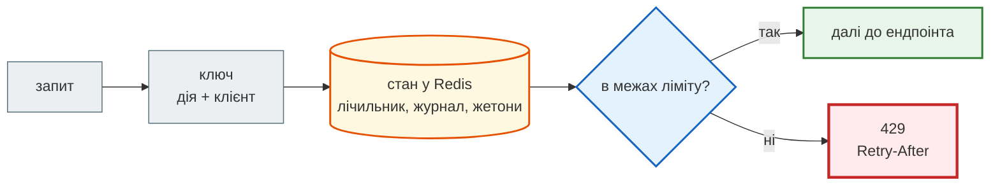
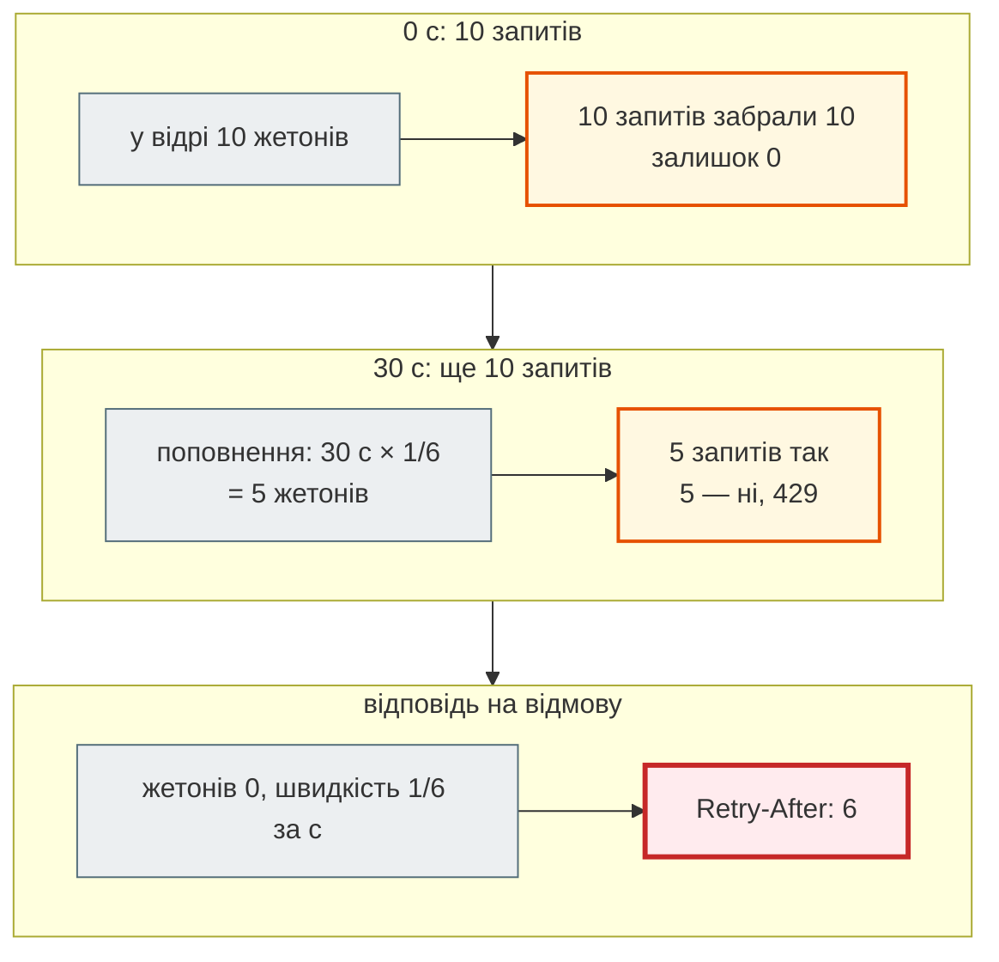

# Rate limit: алгоритми й місце в системі

## Проблема { #problem }

Один клієнт може покласти весь сервіс: скрипт, який тисне «зібрати новини» сто разів на секунду, перебір паролів, дорогі виклики LLM за чужий рахунок. Rate limit обмежує, скільки запитів клієнт може зробити за час. Сформулювати це просто: «не більше 10 за хвилину». Але за цим реченням стоїть кілька рішень. Що саме рахувати: вікно, журнал чи жетони? Як не пропустити зайвого, коли запити приходять одночасно? Хто такий «клієнт», коли перед API стоїть nginx? Що відповісти, щоб клієнт знав, коли повторити? І де ставити обмеження: у nginx чи в застосунку?

News Hub використовує фіксоване вікно ([крок 4](../tutorials/04_middleware_redis/rate_limit.md)). Тут — усі чотири поширені алгоритми на однаковому трафіку.

## Ментальна модель { #mental-model }



Rate limit складається з трьох незалежних частин:

1. **Ключ** — кого рахуємо: адреса, користувач, API-ключ, разом із дією (`rate:scrape:<адреса>`).
2. **Алгоритм** — як рахуємо, і стан, який для цього треба зберігати.
3. **Відповідь** — `429 Too Many Requests` із `Retry-After`.

Стан має бути **спільним для всіх процесів**. Лічильник у пам'яті процесу при 4 процесах uvicorn пропускає вчетверо більше, тому стан тримають у Redis.

## Чотири алгоритми { #algorithms }

[`examples/cache_jobs/rate_limit_demo.py`](https://github.com/NikoriakViktor/news_hub/blob/main/examples/cache_jobs/rate_limit_demo.py), частина 1. Алгоритми реалізовано в пам'яті, а час передається аргументом, тож результат щоразу однаковий:

```python title="rate_limit_demo.py (фрагмент)"
class FixedWindow:
    def hit(self, now: float) -> bool:
        bucket = int(now // self.window)               # номер вікна: 0–59.99 с → 0, 60–119.99 → 1
        self.counts[bucket] = self.counts.get(bucket, 0) + 1
        return self.counts[bucket] <= self.limit


class SlidingLog:
    def hit(self, now: float) -> bool:
        while self.log and self.log[0] <= now - self.window:
            self.log.popleft()                          # забути запити, старші за вікно
        if len(self.log) < self.limit:
            self.log.append(now)
            return True
        return False


class SlidingWindowCounter:
    def hit(self, now: float) -> bool:
        bucket = int(now // self.window)
        elapsed = (now % self.window) / self.window
        estimate = self.counts.get(bucket - 1, 0) * (1 - elapsed) + self.counts.get(bucket, 0)
        if estimate < self.limit:
            self.counts[bucket] = self.counts.get(bucket, 0) + 1
            return True
        return False


class TokenBucket:
    def hit(self, now: float) -> bool:
        self.tokens = min(self.capacity, self.tokens + (now - self.updated) * self.rate)   # поповнення
        self.updated = now
        if self.tokens >= 1:
            self.tokens -= 1
            return True
        return False
```

```text
--- 1. чотири алгоритми, ліміт 10 за 60 с: пройшло (макс. за будь-які 60 с)
сценарій                               фіксоване вікно      ковзний журнал   ковзний лічильник        token bucket
межа вікон: 10 о 59 с, 10 о 61 с               20 (20)             10 (10)             11 (11)             10 (10)
рівномірно: 1 запит / 4 с, 2 хв                20 (10)             20 (10)             20 (10)             29 (15)
сплеск: 25 запитів о 0 с                       10 (10)             10 (10)             10 (10)             10 (10)
сплеск, тиша 30 с, сплеск                      10 (10)             10 (10)             10 (10)             15 (15)
```

Перше число в клітинці — скільки запитів пройшло, у дужках — найбільша кількість пропущених за будь-які 60 секунд. Ліміт в усіх — 10 за 60 с. Token bucket тут має ємність 10 і поповнюється 10 жетонами за 60 с.

- **Фіксоване вікно** на межі пропустило **20 запитів за 2 секунди**: 10 наприкінці одного вікна й 10 на початку наступного. Інших порушень у нього немає.
- **Ковзний журнал** точний: за будь-які 60 секунд не більше 10. Але він зберігає час **кожного** запиту.
- **Ковзний лічильник** наближає журнал двома числами: попереднє вікно враховується пропорційно до того, скільки його ще «у вікні». На межі він пропустив 11, бо наближення дає похибку.
- **Token bucket** обмежує не «N за вікно», а **середню швидкість плюс сплеск**. При рівномірних 15 запитах за хвилину він пропустив 29 з 30 і до 15 за будь-які 60 секунд: 10 жетонів запасу плюс поповнення. Після 30 секунд тиші він знову дозволив 5. Це не похибка, а властивість: короткі сплески дозволено, довгий надлишок — ні.



| | фіксоване вікно | ковзний журнал | ковзний лічильник | token bucket |
|---|---|---|---|---|
| стан на клієнта | одне число | запис на кожен запит у вікні (sorted set) | два числа | два числа (жетони, час) |
| точність | до 2× на межі вікон | точно | майже точно | інша модель: швидкість + сплеск |
| у Redis | `INCR` + `EXPIRE … NX` у `MULTI` | Lua на `ZSET` | `INCR` двох ключів + розрахунок | Lua на hash |
| коли брати | захист від спаму, вхід | ліміт — частина договору (платне API) | великі ліміти, де журнал дорогий | API, де сплески нормальні (завантаження сторінки, пакети запитів) |

Варто знати ще **leaky bucket**: запити стоять у черзі, яка витікає з постійною швидкістю. Так працює `limit_req` у nginx, і він згладжує трафік, а не лише відкидає зайве. **GCRA** — математично той самий token bucket, але з одним числом стану (час «теоретичного прибуття»).

## Атомарність у Redis { #atomic }

Алгоритм у пам'яті одного процесу — ще не rate limit. У Redis кожен крок «прочитати → вирішити → записати» має бути однією атомарною дією ([Атомарність](redis_basics.md#atomicity)). Ковзний журнал, написаний «очевидно»:

```python title="rate_limit_demo.py (фрагмент)"
async def sliding_log_naive(r: Redis, key: str, limit: int, window: int) -> tuple[bool, int]:
    now_ms = int(time.time() * 1000)
    await r.zremrangebyscore(key, 0, now_ms - window * 1000)
    count = await r.zcard(key)                          # перевірка…
    if count >= limit:
        return False, window
    await r.zadd(key, {uuid.uuid4().hex: now_ms})       # …і запис — дві окремі команди
    await r.pexpire(key, window * 1000)
    return True, 0
```

Той самий алгоритм у Lua виконується на сервері як одна команда:

```lua title="rate_limit_demo.py (SLIDING_LOG_LUA)"
local key, now, window, limit, member = KEYS[1], tonumber(ARGV[1]), tonumber(ARGV[2]), tonumber(ARGV[3]), ARGV[4]
redis.call('ZREMRANGEBYSCORE', key, 0, now - window)
if redis.call('ZCARD', key) >= limit then
  local oldest = redis.call('ZRANGE', key, 0, 0, 'WITHSCORES')
  return {0, math.ceil((tonumber(oldest[2]) + window - now) / 1000)}   -- коли звільниться місце
end
redis.call('ZADD', key, now, member)
redis.call('PEXPIRE', key, window)
return {1, 0}
```

50 одночасних запитів, ліміт 10, справжній Redis:

```text
--- 2. 50 одночасних запитів, ліміт 10 (Redis redis://localhost:6390/0)
фіксоване вікно, MULTI   пройшло: 10 | Retry-After у відмовах: [60]
ковзний журнал, наївно   пройшло: 50 | Retry-After у відмовах: []
ковзний журнал, Lua      пройшло: 10 | Retry-After у відмовах: [60]
token bucket, Lua        пройшло: 10 | Retry-After у відмовах: [6]
```

Наївний журнал пропустив **усі 50**: кожен запит виконав `ZCARD`, побачив `0` і пройшов. На `fakeredis` той самий розділ дає `пройшло: 10` для всіх чотирьох, бо гонитви фейк не відтворює. Перевіряти ліміт під одночасними запитами треба на справжньому Redis, як тест News Hub на [кроці 5](../tutorials/05_api_testing/async_client.md#rate-limit).

Ще дві деталі з коду:

- **Кожен член `ZSET` унікальний** (`uuid`). Якщо записувати час, два запити в ту саму мілісекунду стануть одним елементом, і ліміт недорахує.
- **Час** у демо передає клієнт (`time.time()`). Якщо серверів API кілька, їхні годинники мають бути синхронізовані (NTP). Інакше беруть час самого Redis: команду `TIME` усередині скрипту.

## Відповідь: `429` і `Retry-After` { #response }

```text
--- 3. 429 і Retry-After: 5 запитів з однієї адреси, ліміт 3 за 60 с
200 Retry-After: None
200 Retry-After: None
200 Retry-After: None
429 Retry-After: 60
429 Retry-After: 60
```

| Заголовок | Що означає | Звідки значення |
|---|---|---|
| `Retry-After: 60` | через скільки секунд повторити (або HTTP-дата) | фіксоване вікно — `TTL` ключа; журнал — коли зникне найстаріший запис; token bucket — коли з'явиться жетон |
| `X-RateLimit-Limit`, `X-RateLimit-Remaining` | ліміт і залишок | неофіційна, але поширена домовленість (GitHub, News Hub) |
| `RateLimit-Policy`, `RateLimit` | те саме, у вигляді стандарту | чернетка IETF `httpapi-ratelimit-headers`, ще не RFC |

`Retry-After` — те, що робить `429` корисним. Клієнт (і бібліотеки з повторами) чекають рівно стільки, скільки треба, а не опитують сервер щосекунди. Тіло відповіді — звичайна помилка API ([Формат помилок](../01_http_and_rest/errors.md)) із поясненням людською мовою. Middleware, що відповідає `429`, має стояти **всередині** CORS, інакше браузер побачить «CORS error» замість `429` ([CORS](cors.md#errors)).

## Хто такий клієнт: ключ за проксі { #client-key }

```text
--- 4. за проксі: усі клієнти мають адресу nginx
5 різних людей через nginx, ключ = request.client.host: [200, 200, 200, 429, 429]
--- 5. X-Forwarded-For без перевірки: атакувальник міняє «адресу» щоразу
10 запитів напряму, кожен з новим X-Forwarded-For: [200, 200, 200, 200, 200, 200, 200, 200, 200, 200]
--- 6. ProxyHeadersMiddleware з довіреною адресою проксі
5 різних людей через довірений nginx: [200, 200, 200, 200, 200]
атакувальник напряму з підробленим X-Forwarded-For: [200, 200, 200, 429, 429]
```

- **За проксі** `request.client.host` — це адреса nginx. П'ять різних людей ділять один лічильник, і четвертий отримує `429` за чужі запити.
- **Брати `X-Forwarded-For` як є** — гірше: це заголовок від клієнта. Атакувальник ставить щоразу нову «адресу» й ліміту не має зовсім.
- **Правильно** — вірити заголовку лише від свого проксі. `ProxyHeadersMiddleware` з uvicorn (`--forwarded-allow-ips` або змінна `FORWARDED_ALLOW_IPS`) підставляє адресу з `X-Forwarded-For` у `request.client` лише тоді, коли з'єднання прийшло з довіреної адреси. Сам проксі має **перезаписувати** заголовок (`$remote_addr`), а не дописувати (`$proxy_add_x_forwarded_for`).

Як це налаштовано й перевірено в News Hub, розібрано на [кроці 11](../tutorials/11_compose_deploy/nginx_real_ip.md). Окрім адреси, ключем може бути **користувач** або **API-ключ**, якщо запит автентифікований. Це точніше: одна адреса — це часто цілий офіс за NAT або мобільний оператор, а в одного користувача адрес багато.

## Де ставити: nginx чи застосунок { #where }

| | nginx `limit_req` | застосунок + Redis |
|---|---|---|
| ключ | адреса, будь-яка змінна nginx | будь-що: користувач, API-ключ, тариф, дія |
| стан | пам'ять одного nginx (`zone=…:10m`) | спільний для всіх процесів і серверів |
| ціна відмови | запит не доходить до Python | запит доходить до middleware і до Redis |
| алгоритм | leaky bucket, `burst`, `nodelay` | який напишеш |
| знає бізнес-логіку | ні | так: «аналіз LLM — 10 за хвилину» |
| відповідь за замовчуванням | `503` (змінюється `limit_req_status 429`) | `429` + `Retry-After` |

Їх поєднують. nginx грубо захищає від флуду за адресою, щоб Python і Redis не працювали даремно. Застосунок відповідає за точні бізнес-ліміти за користувачем і дією. Приклад конфігурації nginx (у News Hub її немає, у демо не запускалась):

```nginx
limit_req_zone $binary_remote_addr zone=api:10m rate=10r/s;   # 10 запитів/с з адреси, стан у 10 МБ пам'яті

server {
    location /api/ {
        limit_req zone=api burst=20 nodelay;                   # до 20 зверху одразу, далі — відмова
        limit_req_status 429;
        proxy_pass http://news_hub_api;
    }
}
```

## У News Hub { #news-hub }

[`steps/12_ci_cd/news_hub/middleware.py`](https://github.com/NikoriakViktor/news_hub/blob/main/steps/12_ci_cd/news_hub/middleware.py): `RateLimiter` — фіксоване вікно, `INCR` + `EXPIRE … NX` + `TTL` в одній транзакції; middleware `rate_limit` відповідає `429` з `Retry-After` і `X-RateLimit-*`. Ліміти — за дією:

| Дія (`limited_action`) | Що обмежує | Ліміт (змінні середовища) | Крок |
|---|---|---|---|
| `scrape` | `POST /api/scrape*` — завантаження сайтів | `RATE_LIMIT_REQUESTS=5` за `RATE_LIMIT_WINDOW=60` с | [4](../tutorials/04_middleware_redis/rate_limit.md) |
| `analyze` | виклики LLM — гроші й квота | `ANALYZE_RATE_LIMIT=10` за 60 с | [7](../tutorials/07_llm_api/db_cache_cost.md#rate-limit) |
| `login` | `POST /api/admin/token` — перебір пароля | `LOGIN_RATE_LIMIT=5` за `LOGIN_RATE_WINDOW=300` с | [8](../tutorials/08_security/admin_jwt.md) |

Ключ — `rate:<дія>:<адреса>`. Адресу дає `request.client.host`, а справжньою вона стає завдяки nginx, який перезаписує `X-Forwarded-For`, і `FORWARDED_ALLOW_IPS=172.28.0.10` ([крок 11](../tutorials/11_compose_deploy/nginx_real_ip.md)). `limit_req` у nginx News Hub не налаштовано. Фіксованого вікна досить: межа «до 2× ліміту» для захисту від спаму зборами і перебору пароля некритична ([крок 4](../tutorials/04_middleware_redis/rate_limit.md#fixed-window)). Ковзне вікно — вправа в [контрольній точці кроку 4](../tutorials/04_middleware_redis/checkpoint.md#try-yourself).

## Типові помилки { #mistakes }

| Помилка | Наслідок | Як правильно |
|---|---|---|
| лічильник у пам'яті процесу | при N процесах — N× ліміт; рестарт обнуляє | Redis |
| перевірка й запис окремими командами | одночасні запити проходять усі (50 з 10) | `MULTI` або Lua |
| `INCR`, потім `EXPIRE` окремо | ключ без TTL — клієнт заблокований назавжди | одна транзакція з `EXPIRE … NX` ([крок 4](../tutorials/04_middleware_redis/rate_limit.md#two-commands)) |
| `X-Forwarded-For` без перевірки джерела | ліміт обходиться підробленим заголовком | `ProxyHeadersMiddleware` з довіреним проксі |
| `request.client.host` за проксі без налаштування | усі клієнти — один лічильник | `FORWARDED_ALLOW_IPS` + проксі перезаписує заголовок |
| `429` без `Retry-After` | клієнти повторюють одразу й частіше | `Retry-After` з реального стану |
| час як член `ZSET` | запити в одну мілісекунду зливаються | унікальний член (`uuid`) |
| одне спільне вікно для всіх дій | дешеві запити з'їдають ліміт дорогих | ключ з дією |
| ліміт **після** перевірки тіла / автентифікації | помилковими запитами можна засипати сервер без обмежень | ліміт рахує запит до розбору (News Hub: `422` теж рахуються) |
| `429` поза CORS-шаром | браузер показує «CORS error» | CORS — зовнішнім |

## Налагодження { #debugging }

- **Стан ліміту:** `redis-cli GET rate:scrape:<адреса>` і `TTL rate:scrape:<адреса>`. Для журналу — `ZRANGE … WITHSCORES`, для token bucket — `HGETALL`.
- **«Блокує всіх»:** надрукуй ключ у журналі (`rate limit scrape: 172.28.0.10 …` — це адреса nginx, а не клієнта).
- **«Не блокує нікого»:** перевір, чи справді `POST`, чи збігається шлях, і чи не вірить застосунок `X-Forwarded-For` від усіх (`FORWARDED_ALLOW_IPS=*`).
- **Одночасність** перевіряй `asyncio.gather` на справжньому Redis, як розділ 2 демо. Послідовні запити гонитви не покажуть.
- **Межа вікна:** демо з точним часом, як [на кроці 4](../tutorials/04_middleware_redis/rate_limit.md#fixed-window).

## Безпека { #security }

- **Ліміт входу** — обов'язковий: без нього пароль підбирають перебором. Ліміт поєднують з повільним хешем (bcrypt), щоб кожна спроба була дорогою, а кількість спроб — обмеженою ([крок 8](../tutorials/08_security/admin_jwt.md)).
- **Ліміт за адресою не зупиняє розподілену атаку** (ботнет, тисячі адрес). Захист від DDoS — на рівні мережі й CDN. Ліміт у застосунку захищає ресурси й гроші від окремих зловживань.
- **Ключі з даних клієнта** (адреса IPv6, API-ключ) займають пам'ять. Кожен має мати TTL, а для IPv6 часто рахують за підмережею `/64`: інакше одна машина має мільярди адрес.
- **Redis недоступний** — свідоме рішення: «пропустити всіх» вимикає захист, «відмовити всім» вимикає сервіс. Для входу безпечніше відмовити, для читання — пропустити й записати в журнал.
- **Ліміти на дорогі зовнішні виклики** (LLM, SMS) — це захист грошей: без них один клієнт витратить місячну квоту за хвилину.

## Питання { #questions }

1. Скільки запитів може пропустити фіксоване вікно «10 за 60 с» за 2 секунди і чому?
2. Чим ковзний журнал кращий і чим платимо?
3. Чому token bucket пропустив 15 запитів за 60 секунд при «ліміті 10»? Це помилка?
4. Чому наївний ковзний журнал пропустив 50 з 50, а на `fakeredis` — 10?
5. Що має бути в `Retry-After` для фіксованого вікна і для token bucket?
6. Чому не можна брати адресу клієнта з `X-Forwarded-For` як є? Як правильно?
7. Що краще обмежувати в nginx, а що в застосунку?

??? success "Відповіді"

    1. До 20: 10 наприкінці одного вікна й 10 на початку наступного. Лічильник обнуляється разом з ключем на межі.
    2. Він точний: за будь-які 60 секунд не більше ліміту. Платимо пам'яттю (запис на кожен запит) і складнішою атомарністю (Lua).
    3. Ні. Token bucket обмежує середню швидкість (10 за хвилину) і дозволяє сплеск до ємності (10 жетонів). За 60 секунд це до ємності плюс поповнення.
    4. Між `ZCARD` і `ZADD` інші запити встигли виконати свій `ZCARD` і побачили 0. `fakeredis` виконує команди без перемикання, тож гонитви там немає.
    5. Фіксоване вікно — `TTL` ключа (скільки до нового вікна). Token bucket — час до наступного жетона: `(1 − жетони) / швидкість`.
    6. Це заголовок від клієнта, і його можна підробити. Правильно вірити йому лише від свого проксі (`ProxyHeadersMiddleware` з `FORWARDED_ALLOW_IPS`), а проксі має перезаписувати заголовок.
    7. nginx — грубий флуд за адресою, до Python. Застосунок — бізнес-ліміти за користувачем, дією й тарифом, зі спільним станом у Redis.

## Що далі { #next }

[Фонові задачі й черги](background_jobs.md) — що робити з довгою роботою, яку не можна виконувати в запиті.

**Джерела:** [RFC 6585 — 429 Too Many Requests](https://www.rfc-editor.org/rfc/rfc6585#section-4); [RFC 9110 — Retry-After](https://www.rfc-editor.org/rfc/rfc9110#field.retry-after); IETF — [RateLimit header fields for HTTP](https://datatracker.ietf.org/doc/draft-ietf-httpapi-ratelimit-headers/) (чернетка); Redis — [INCR: rate limiter pattern](https://redis.io/docs/latest/commands/incr/), [Scripting with Lua](https://redis.io/docs/latest/develop/interact/programmability/eval-intro/); nginx — [ngx_http_limit_req_module](https://nginx.org/en/docs/http/ngx_http_limit_req_module.html); [Uvicorn — Settings: proxy headers](https://uvicorn.dev/settings/#http); Cloudflare — [How we built rate limiting capable of scaling to millions of domains](https://blog.cloudflare.com/counting-things-a-lot-of-different-things/); OWASP — [Blocking Brute Force Attacks](https://owasp.org/www-community/controls/Blocking_Brute_Force_Attacks).
