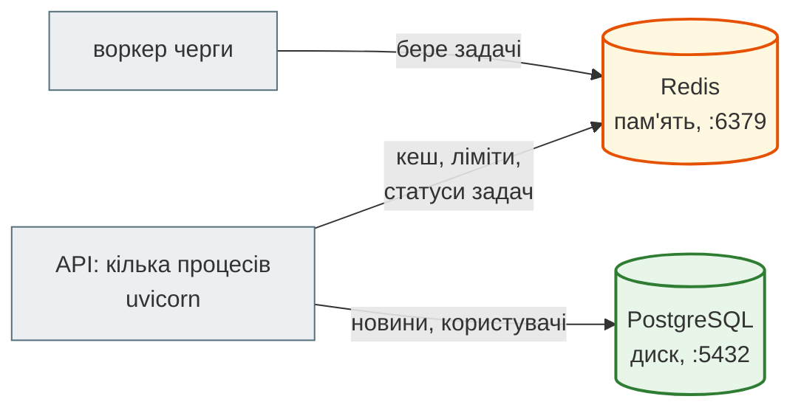
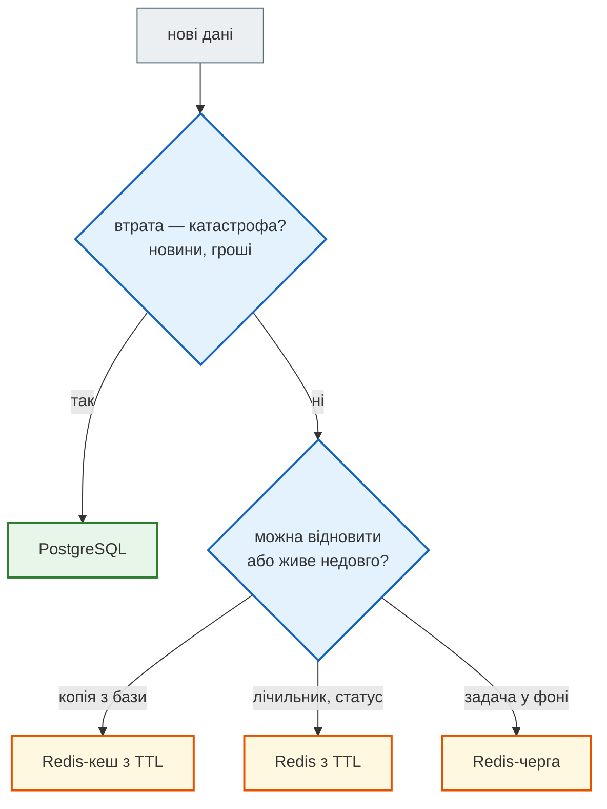
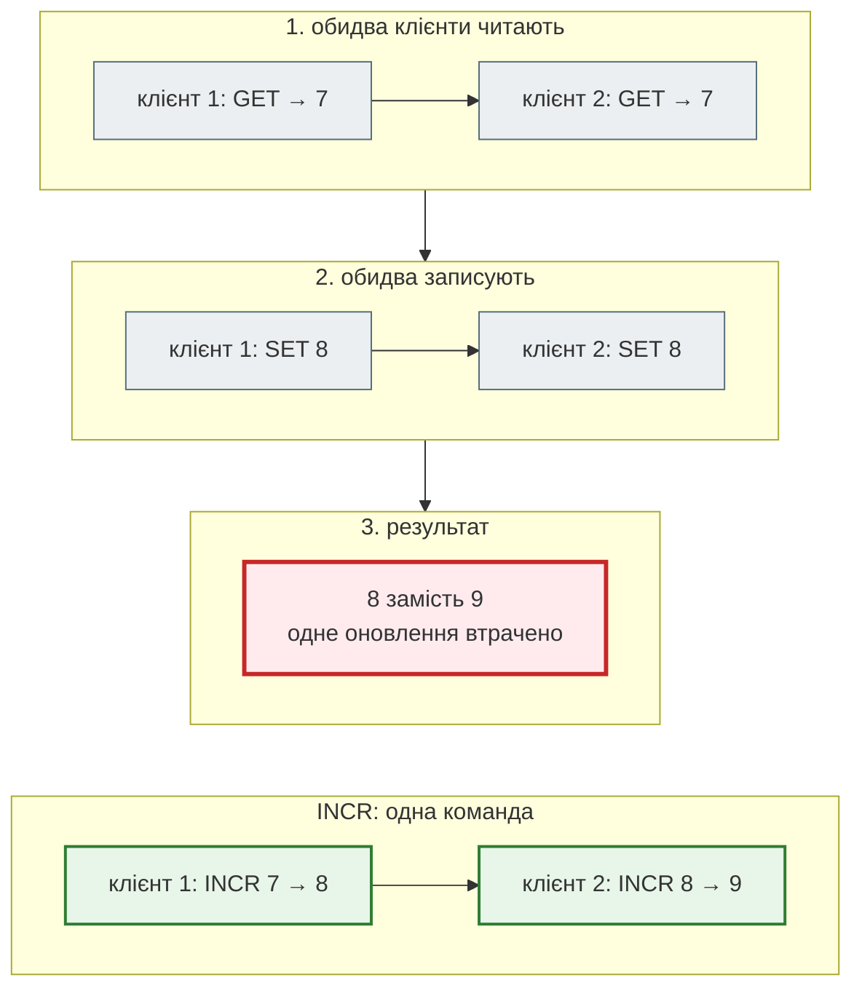

# Redis для API

## Проблема { #problem }

PostgreSQL — **джерело правди**: новини, користувачі, гроші. Але в API є дані іншого роду. Лічильник «скільки запитів за хвилину» оновлюється на кожен запит і завтра нікому не потрібен. Готовий JSON стрічки дешевше віддати з пам'яті, ніж знову рахувати в базі. Статус фонової задачі живе добу. Для таких даних поруч із базою ставлять **Redis** — сервер, який тримає великий словник «ключ → значення» в оперативній пам'яті й відповідає за мікросекунди.

Просто класти дані в Redis замало. Ключ без TTL лишається назавжди, `GET`, а потім `SET` з кількох процесів губить оновлення, транзакція Redis не відкочується, а тести на `fakeredis` такої гонитви не помічають. Ця сторінка пояснює модель Redis на прикладах, на яких тримаються [кеш](caching.md), [rate limit](rate_limiting.md) і [черги](background_jobs.md).

## Ментальна модель { #mental-model }



| | PostgreSQL | Redis |
|---|---|---|
| де дані | на диску | в оперативній пам'яті (копія на диск — за налаштуванням) |
| модель | таблиці, зв'язки, SQL | ключ → значення одного з типів |
| швидкість | мілісекунди | мікросекунди (плюс мережа) |
| запити | будь-які: `JOIN`, `GROUP BY` | лише за ключем і командами його типу |
| гарантії | `CHECK`, зовнішні ключі, ACID | атомарність окремої команди, `MULTI` без відкату |
| для чого | **джерело правди** | те, що можна **відновити** (кеш) або що **живе недовго** (лічильник, задача) |

Ще одна властивість, на якій тримається решта сторінки: **Redis виконує команди по одній**. Поки виконується одна команда, жодна інша не вклиниться, тож кожна окрема команда атомарна. Але дві команди поспіль від одного клієнта атомарними вже не є.

Що класти в Redis, а що в базу:



## Рядки, числа, `decode_responses` { #strings }

[`examples/cache_jobs/redis_demo.py`](https://github.com/NikoriakViktor/news_hub/blob/main/examples/cache_jobs/redis_demo.py) за замовчуванням працює на `fakeredis`. З `REDIS_URL=redis://localhost:6390/0` він працює на справжньому сервері (тимчасовий контейнер — у [README прикладу](https://github.com/NikoriakViktor/news_hub/blob/main/examples/cache_jobs/README.md)). Виводи нижче отримано на Redis 7.4. Там, де `fakeredis` поводиться інакше, це сказано окремо.

```python title="redis_demo.py (фрагмент)"
r = Redis.from_url("redis://localhost:6390/0", decode_responses=True)   # redis.asyncio
await r.set("demo:courier:1:name", "Оксана")
await r.get("demo:courier:1:name")
await r.set("demo:counter", 7)
await r.get("demo:counter"), await r.incr("demo:counter")
```

```text
--- 1. рядки, числа, decode_responses
decode_responses=True : 'Оксана'
decode_responses=False: b'\xd0\x9e\xd0\xba\xd1\x81\xd0\xb0\xd0\xbd\xd0\xb0'
немає ключа: None | EXISTS двох ключів: 1
число повертається рядком: '7' | INCR: 8
```

- Redis зберігає **байти**. Без `decode_responses=True` клієнт повертає `bytes`, з ним — `str` в UTF-8.
- Чисел як типу немає: `SET 7` зберігає рядок `"7"`, і `GET` повертає `'7'`. `INCR` розуміє рядок як ціле число, а для `int()` у Python відповідає код.
- `GET` неіснуючого ключа повертає `None`. `EXISTS` рахує, скільки з переданих ключів існує.
- Двокрапки в назвах (`demo:courier:1:name`) — домовленість, а не синтаксис. Префікс частини застосунку (`news:`, `rate:`, `job:`) дозволяє шукати ключі через `SCAN` і не плутати їх між собою.

## TTL: час життя ключа { #ttl }

```text
--- 2. TTL: -1, -2, і SET, що стирає TTL
SET … EX 300 → TTL 300
ключ без TTL → TTL -1 | немає ключа → TTL -2
SET без EX поверх ключа з TTL → TTL -1 (ключ став вічним)
SET … KEEPTTL → TTL 300
EXPIRE NX на ключ з TTL: False → TTL 300
INCR не ставить TTL → TTL -1
```

| Команда | Що робить з TTL |
|---|---|
| `SET key v EX 300` | записати й задати TTL однією командою |
| `SET key v` | **стирає** TTL: ключ стає вічним |
| `SET key v KEEPTTL` | зберігає наявний TTL (Redis 6+) |
| `EXPIRE key 60` | задає TTL (замінює наявний) |
| `EXPIRE key 60 NX` | лише якщо TTL ще немає (Redis 7+) |
| `INCR`, `HSET`, `RPUSH`, `SADD`… | не змінюють TTL; новий ключ створюється **без** TTL |
| `TTL key` | `-1` — без TTL, `-2` — ключа немає |

Тут ховаються дві найчастіші помилки з Redis. Перша — перезаписати кеш через `SET` без `EX`: запис стає вічним. Друга — створити лічильник через `INCR` і поставити `EXPIRE` окремою командою: якщо процес упаде між ними, ключ лишиться без TTL. Як це блокувало клієнта назавжди і як виправлено однією транзакцією `INCR` + `EXPIRE … NX`, розібрано на [кроці 4](../tutorials/04_middleware_redis/rate_limit.md#two-commands).

## Структури даних { #types }

```text
--- 3. структури даних
list  RPUSH×3, LPOP → задача 1 | LLEN 2
hash  HGETALL → {'status': 'running', 'news_found': '168'}
set   SADD Анна Богдан Анна → 2 нових | SCARD 2
zset  ZREVRANGE 0 1 → [('Оксана', 2130.0), ('Ігор', 1940.0)] | ZREVRANK Ігор: 1
команда не того типу: WRONGTYPE Operation against a key holding the wrong kind of 
```

| Тип | Аналог у Python | Головні команди | Для API |
|---|---|---|---|
| string | `str` / лічильник | `SET`, `GET`, `INCR`, `SET … NX EX` | кеш JSON, лічильник ліміту, замок, «вже оброблено» |
| list | `collections.deque` | `RPUSH`, `LPOP`, `BLPOP`, `LMOVE`, `LRANGE` | черга задач |
| hash | `dict` в одному ключі | `HSET`, `HGETALL`, `HINCRBY` | статус задачі, картка об'єкта |
| set | `set` | `SADD`, `SISMEMBER`, `SCARD`, `SMEMBERS` | унікальні відвідувачі, теги кешу |
| sorted set | купа / `dict` з сортуванням за значенням | `ZADD`, `ZINCRBY`, `ZRANGE`, `ZREMRANGEBYSCORE` | рейтинг, ковзне вікно ліміту, відкладені задачі |

Кожен ключ має **один** тип. Команда іншого типу повертає `WRONGTYPE`, а не перетворює значення. Поля hash і всі значення — знову рядки: `'168'`, а не `168`. Сам Redis ще вміє streams (`XADD`/`XREADGROUP` — черга з підтвердженнями й групами споживачів), бітові мапи, HyperLogLog і геоіндекси, але для API з цієї частини вистачає п'яти типів з таблиці.

## Атомарність: чому `GET` + `SET` губить оновлення { #atomicity }

```python title="redis_demo.py (фрагмент)"
async def buggy(c: Redis) -> None:            # 4 клієнти одночасно, кожен по 500 разів
    for _ in range(500):
        current = int(await c.get("demo:buggy") or 0)
        await c.set("demo:buggy", current + 1)

async def atomic(c: Redis) -> None:
    for _ in range(500):
        await c.incr("demo:atomic")
```

```text
--- 4. гонитва: GET + SET проти INCR, 4 клієнти × 500 (Redis redis://localhost:6390/0)
очікували 2000 | GET+SET: 681 | INCR: 2000
```



Між `GET` і `SET` того самого клієнта інші встигають прочитати старе значення. Дві третини оновлень зникли. `Lock` з `threading` чи `asyncio` тут не допоможе: процеси різні, і в кожного свій замок. Правило: **«прочитати → змінити → записати» в Redis робиться однією командою** (`INCR`, `HINCRBY`, `SET … NX`, `LMOVE`), транзакцією з `WATCH` або скриптом Lua.

!!! warning "`fakeredis` гонитви не показує"
    Той самий розділ на `fakeredis` дає `GET+SET: 2000`. Фейк виконує команду одразу, не віддаючи керування циклу подій, тож клієнти не перемежовуються. Тести на `fakeredis` ловлять логіку, але не гонитву. Тест одночасних запитів News Hub ([крок 5](../tutorials/05_api_testing/async_client.md#rate-limit)) має сенс лише на справжньому Redis.

## Pipeline і `MULTI`/`EXEC` { #pipeline }

Кожна команда — це запит мережею й очікування відповіді. **Pipeline** відправляє пачку команд за один обмін:

```text
--- 5. pipeline: 1000 команд (Redis redis://localhost:6390/0)
по одній: 557 ms | pipeline: 9 ms | останнє значення 2000
```

Ті самі 1000 `INCR` по одній зайняли пів секунди, бо Redis у Docker на WSL відповідає приблизно за пів мілісекунди. Пачкою вони вклалися в 9 мс. На `fakeredis` мережі немає, тож там різниця лише 68 мс проти 28.

У redis-py `pipeline()` за замовчуванням ще й **транзакційний**: команди загортаються в `MULTI … EXEC` і виконуються підряд, без команд інших клієнтів між ними. Але це не транзакція бази:

```python title="redis_demo.py (фрагмент)"
async with r.pipeline(transaction=True) as pipe:
    pipe.incrby("demo:balance", -30)
    pipe.lpush("demo:job:42", "x")             # помилка типу всередині транзакції
    pipe.incr("demo:ops")
    results = await pipe.execute(raise_on_error=False)
```

```text
--- 6. MULTI/EXEC — разом, але без відкату
результати: [70, 'ResponseError', 1]
після EXEC: balance = 70 | ops = 1 — решта команд виконалась
```

| | `pipeline(transaction=False)` | `pipeline()` = `MULTI`/`EXEC` | транзакція PostgreSQL |
|---|---|---|---|
| один обмін мережею | так | так | ні |
| ніхто не вклиниться між командами | ні | так | залежить від рівня ізоляції |
| відкат при помилці | ні | **ні**: решта команд виконується | так |
| читати результат посередині й вирішувати | ні | ні: результати приходять лише після `EXEC` | так |

Останній рядок таблиці важливий. У `MULTI` не можна зробити «прочитай баланс, і якщо вистачає — зніми», бо результат `GET` приходить уже після `EXEC`. Для умовних змін є `WATCH` і Lua.

## Умовна зміна: `WATCH` і Lua { #check-and-set }

Задача: десять клієнтів одночасно знімають по 30 з балансу 100. Пройти мають три зняття, і баланс не може стати від'ємним.

```python title="redis_demo.py (фрагмент)"
async def watched(c: Redis) -> bool:                     # оптимістичне блокування
    async with c.pipeline(transaction=True) as pipe:
        while True:
            try:
                await pipe.watch("demo:balance")         # EXEC не виконається, якщо ключ змінили після WATCH
                balance = int(await pipe.get("demo:balance") or 0)
                if balance < 30:
                    await pipe.unwatch()
                    return False
                pipe.multi()
                pipe.decrby("demo:balance", 30)
                await pipe.execute()
                return True
            except WatchError:                           # хтось встиг раніше — спробувати знову
                continue

script = r.register_script("""
    local balance = tonumber(redis.call('GET', KEYS[1]) or '0')
    if balance < tonumber(ARGV[1]) then return 0 end
    redis.call('DECRBY', KEYS[1], ARGV[1])
    return 1
""")                                                     # увесь скрипт — одна атомарна операція
```

```text
--- 7. «зняти, якщо вистачає»: наївно, WATCH, Lua — 10 одночасних зняттів по 30 з балансу 100 (Redis redis://localhost:6390/0)
наївно  успішних зняттів: 10 | баланс: -200
WATCH   успішних зняттів: 3 | баланс: 10 | повторів після WatchError: 22
Lua     успішних зняттів: 3 | баланс: 10
```

- **Наївно** («прочитати, порівняти, `DECRBY`») усі десять прочитали `100`, і баланс пішов у `-200`.
- **`WATCH`** — оптимістичне блокування: Redis скасовує `EXEC`, якщо ключ змінився після `WATCH`, і клієнт пробує знову. Результат правильний, але знадобилося 22 повтори. Що більше конкуренції, то більше марної роботи. На `fakeredis` повторів 0: гонитви там немає.
- **Lua** виконується на сервері як одна команда. Повторів немає, і обмін мережею один. Саме так у [rate limit](rate_limiting.md#atomic) зроблено ковзне вікно і token bucket. Скрипт має бути коротким: поки він працює, Redis не обслуговує нікого іншого.

## `SCAN` замість `KEYS` { #scan }

```text
--- 8. SCAN замість KEYS
SCAN знайшов 1000 ключів кількома викликами, не блокуючи сервер на весь прохід
```

`KEYS demo:*` проходить усі ключі бази однією командою, і на мільйонах ключів Redis на цей час зупиняється для всіх клієнтів. `SCAN` (`scan_iter` у redis-py) повертає ключі порціями, з курсором. Але й `SCAN` + `DEL` за шаблоном — не спосіб скидати кеш: на кожну інвалідацію доводиться переглядати всю базу. Як обійтися без цього, показано в [Стратегіях кешу](caching.md#invalidation).

## Клієнт `redis.asyncio` у FastAPI { #client }

```python
from redis.asyncio import Redis

redis = Redis.from_url("redis://localhost:6379/0", decode_responses=True)   # пул з'єднань усередині
await redis.ping()
...
await redis.aclose()                                                        # при зупинці застосунку
```

- **Один клієнт на процес**, створений у `lifespan` і закритий після `yield`. Усередині клієнта — пул з'єднань, і кожна команда бере з нього вільне. Новий `Redis(...)` на кожен запит щоразу відкриває з'єднання й лишає незакриті.
- **У FastAPI — лише `redis.asyncio`.** Синхронний `redis.Redis` в `async def` блокує цикл подій на кожну команду ([Частина IV](../04_async/README.md)).
- **Таймаути.** За замовчуванням клієнт чекає з'єднання без обмеження. `socket_connect_timeout` і `socket_timeout` не дають запиту зависнути, коли Redis недоступний.
- **Номер бази** в URL (`/0`, `/15`) розділяє дані на одному сервері. Тести News Hub з `TEST_REDIS_URL` використовують базу `15` і роблять `FLUSHDB` лише в ній.

## `fakeredis` у тестах { #fakeredis }

```text
--- 9. fakeredis: окремий сервер на кожен клієнт, якщо не передати спільний
два FakeAsyncRedis() без параметрів — b бачить: None
зі спільним FakeServer — d бачить: з клієнта c
```

`fakeredis.FakeAsyncRedis` — Redis у пам'яті процесу з тим самим API. Що треба знати:

- **Кожен екземпляр без `server=` — окремий «сервер».** Якщо застосунок і тест створюють клієнтів окремо, тест не побачить ключів застосунку. Або спільний `FakeServer()`, або той самий об'єкт клієнта (як `app.state.redis` у News Hub).
- **Гонитви немає** (див. [вище](#atomicity)): одночасність перевіряють на справжньому Redis.
- **Lua** потребує додаткового пакета: `fakeredis[lua]`.
- **Мережі немає**: виміри часу й таймаутів на фейку нічого не означають.

## Pub/Sub { #pubsub }

```text
--- 10. Pub/Sub: хто не слухав — не отримав
PUBLISH повернув підписників: 1 | отримано: нова новина #104
```

`PUBLISH` доставляє повідомлення тим, хто **зараз** підписаний, і ніде його не зберігає. Повідомлення «до підписки» з демо не отримав ніхто. Pub/Sub підходить для живих сповіщень, наприклад розсилки між процесами WebSocket ([WebSocket](../01_http_and_rest/api_styles.md#websocket)). Для задач, які не можна загубити, потрібна [черга](background_jobs.md#queue).

## Пам'ять і диск { #memory }

```text
--- 11. налаштування сервера
maxmemory: 0 | maxmemory-policy: noeviction
appendonly: no | save: 3600 1 300 100 60 10000
```

Це значення офіційного образу `redis:7-alpine` без налаштувань:

- **`maxmemory 0`** — без обмеження: Redis займатиме пам'ять, доки її не забере система.
- **`noeviction`** — коли `maxmemory` досягнуто, команди запису отримують помилку. **`allkeys-lru`** викидає ключі, до яких найдовше не зверталися. Для сервера-кешу це саме те, що треба, а для черги задач небезпечно: зникнуть задачі. Тому кеш і черги часто тримають у різних екземплярах Redis.
- **`save 3600 1 300 100 60 10000`** — RDB-знімок пам'яті на диск: через годину, якщо була хоч одна зміна; через 5 хвилин, якщо змін 100; через хвилину, якщо 10 000. Після падіння втрачається все, що змінилось після останнього знімка. **`appendonly yes`** (AOF) пише журнал кожної команди: втрати менші, файл більший.

Навіть з AOF Redis не дає гарантій PostgreSQL. Тому новини, користувачі й гроші — у базі, а Redis тримає те, що можна втратити.

## У News Hub { #news-hub }

Redis з'являється на [кроці 4](../tutorials/04_middleware_redis/cache.md#client): `make_redis()` створює клієнт у `lifespan`, `REDIS_URL=fakeredis://` вмикає фейк для тестів і локального запуску. Ключі й типи:

| Ключ | Тип | TTL | Хто пише |
|---|---|---|---|
| `news:version` | string (лічильник) | немає | `NewsCache.invalidate()` — `INCR` |
| `news:v<версія>:<name>:<хеш>` | string (JSON) | 60 с | `NewsCache.set()` — `SET … EX` |
| `rate:<дія>:<адреса>` | string (лічильник) | вікно ліміту | `RateLimiter.hit()` — `INCR` + `EXPIRE … NX` у `MULTI` |
| `job:<id>` | hash | доба | `JobStore._save()` — `HSET` + `EXPIRE` у `MULTI` |
| `llm:analysis:<хеш>` | string (JSON) | 7 діб | `AnalysisCache` ([крок 7](../tutorials/07_llm_api/db_cache_cost.md#cache)) |
| `webhook:seen:<підпис>` | string | 2 × вікно | захист від повтору — `SET … NX EX` ([крок 8](../tutorials/08_security/webhooks.md#change)) |

`news:version` — єдиний ключ без TTL, і так задумано: це номер покоління кешу, а не дані. У Compose ([крок 11](../tutorials/11_compose_deploy/index.md)) Redis запускається з налаштуваннями образу, тобто з `noeviction` і без `maxmemory`. Для агрегатора з TTL на всіх даних цього досить. Якщо кеш почне рости, перший крок — `maxmemory` і `allkeys-lru`.

## Типові помилки { #mistakes }

| Помилка | Наслідок | Як правильно |
|---|---|---|
| `SET key value` поверх кешу | TTL стерто, ключ вічний | `SET … EX` або `KEEPTTL` |
| `INCR`, потім окремо `EXPIRE` | падіння між ними — ключ без TTL | `MULTI` з `EXPIRE … NX` або `SET key 0 EX … NX` перед `INCR` |
| `GET` + `SET` для лічильника | втрачені оновлення (681 з 2000) | `INCR` / `HINCRBY` |
| умова в `MULTI` | результат `GET` приходить після `EXEC` | `WATCH` або Lua |
| розраховувати на відкат `MULTI` | частина команд виконалась | перевіряти типи заздалегідь; Lua для «все або нічого» за логікою |
| `KEYS pattern` у продакшні | Redis зупиняється на весь прохід | `SCAN`; краще ключі, які не треба шукати |
| `redis.Redis` (синхронний) в `async def` | блокується цикл подій | `redis.asyncio.Redis` |
| новий клієнт на кожен запит | з'єднання не закриваються | один клієнт у `lifespan` |
| два `FakeAsyncRedis()` у тестах | тест не бачить даних застосунку | спільний `FakeServer` або той самий клієнт |
| черга й кеш в одному Redis з `allkeys-lru` | Redis викидає задачі | окремі екземпляри або `volatile-lru` + TTL лише на кеші |

## Налагодження { #debugging }

- **`redis-cli --raw`** показує кирилицю як є, без `\xd0…`. `TTL key`, `TYPE key`, `OBJECT ENCODING key` відповідають на питання «чому ключ не зник» і «що тут лежить».
- **`MONITOR`** друкує кожну команду, яку отримує сервер. Так видно, що насправді робить застосунок. На продакшні його не запускають: він сповільнює сервер.
- **`SLOWLOG GET 10`** показує команди, які виконувалися довше за поріг (за замовчуванням 10 мс): там опиняються `KEYS`, великі `HGETALL`, довгі скрипти Lua.
- **`INFO memory`**, **`INFO keyspace`** — скільки пам'яті й ключів у кожній базі, скільки з них мають TTL (`expires=`).
- **Підозра на гонитву** — повтори той самий сценарій на справжньому Redis, як розділ 4 демо: `fakeredis` її не відтворить.

## Безпека { #security }

- **Redis не має відкриватися в інтернет.** Образ за замовчуванням не має пароля, а `CONFIG SET` і `MODULE LOAD` дають повний контроль над сервером. У Compose News Hub Redis без `ports:` і доступний лише в мережі `backend`. Якщо потрібен доступ ззовні — `requirepass` або ACL і TLS.
- **Ключі з даних користувача** (`rate:<адреса>`, `cache:<запит>`) обмежуй або хешуй: довгий рядок від клієнта займає пам'ять, а нові ключі на кожен запит обходять ліміт пам'яті.
- **Lua-скрипти** пиши з `KEYS`/`ARGV`, а не підставляй дані в текст скрипту: це та сама ін'єкція, що й у SQL.
- **Не клади в Redis секрети й персональні дані** без потреби: знімки RDB і AOF лежать на диску відкритим текстом.

## Питання { #questions }

1. Що повернуть `TTL` для ключа без часу життя і для неіснуючого ключа?
2. Що станеться з TTL кешу, якщо оновити значення звичайним `SET`?
3. Чому `GET` + `SET` губить оновлення, а `INCR` — ні?
4. Чи відкотить `MULTI`/`EXEC` інші команди, якщо одна з них упала?
5. Чому в `MULTI` не можна зробити «зняти, якщо вистачає», і які є два розв'язки?
6. Чому тест одночасних запитів на `fakeredis` проходить навіть з неатомарним лічильником?
7. Чому `KEYS` небезпечний у продакшні?
8. Яку `maxmemory-policy` обрати для Redis-кешу і чому не для черги?

??? success "Відповіді"

    1. `-1` і `-2`.
    2. TTL стерто: ключ стане вічним. Потрібен `SET … EX` або `KEEPTTL`.
    3. Між двома командами інші клієнти встигають прочитати старе значення. `INCR` — одна команда, а Redis виконує команди по одній.
    4. Ні. Решта команд виконується, а помилкова повертає помилку в списку результатів.
    5. Результати команд у `MULTI` приходять лише після `EXEC`, тож перевірити баланс посередині не вийде. Розв'язки: `WATCH` з повтором при `WatchError` або скрипт Lua.
    6. `fakeredis` виконує команду, не віддаючи керування циклу подій, тому клієнти не перемежовуються і гонитви немає.
    7. Він проходить усі ключі однією командою й блокує сервер для всіх клієнтів на цей час.
    8. `allkeys-lru`: кеш можна відновити, тож викинути давно не потрібне безпечно. Задачі ж відновити не можна: черга з такою політикою їх губитиме.

## Що далі { #next }

[Стратегії кешу](caching.md) — cache-aside, інвалідація без `KEYS`, гонитва читання з записом, cache stampede.

**Джерела:** Redis — [Data types](https://redis.io/docs/latest/develop/data-types/), [Transactions](https://redis.io/docs/latest/develop/interact/transactions/), [Pipelining](https://redis.io/docs/latest/develop/use/pipelining/), [Scripting with Lua](https://redis.io/docs/latest/develop/interact/programmability/eval-intro/), [SET](https://redis.io/docs/latest/commands/set/), [EXPIRE](https://redis.io/docs/latest/commands/expire/), [KEYS](https://redis.io/docs/latest/commands/keys/), [SCAN](https://redis.io/docs/latest/commands/scan/), [Key eviction](https://redis.io/docs/latest/develop/reference/eviction/), [Persistence](https://redis.io/docs/latest/operate/oss_and_stack/management/persistence/), [Security](https://redis.io/docs/latest/operate/oss_and_stack/management/security/); [redis-py — asyncio](https://redis.readthedocs.io/en/stable/examples/asyncio_examples.html); [fakeredis](https://fakeredis.readthedocs.io/); образ [redis на Docker Hub](https://hub.docker.com/_/redis).
