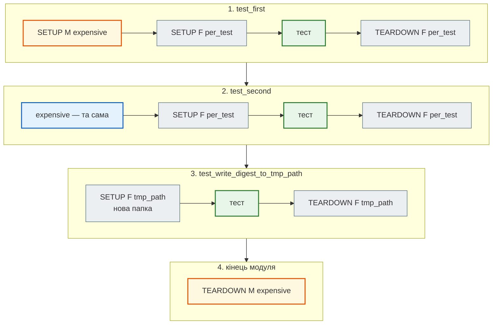

# Фікстури: scope, `yield`, `conftest.py`, `tmp_path`, `monkeypatch`

## Проблема { #problem }

Тестам API потрібні база з таблицями, клієнт, фейкова пошта; тестам файлів — тимчасова папка; тестам налаштувань — змінні середовища. Якщо кожен тест готує це сам, у файлі сорок однакових початків, а прибирання (закрити з'єднання, видалити файл, повернути змінну) забувають — і наступний тест бачить чуже сміття. Або навпаки: підготовку виносять у глобальну змінну модуля, і тести починають залежати від порядку запуску.

**Фікстура** pytest — функція, що готує ресурс для тесту і прибирає після нього. Тест отримує її результат за **іменем параметра**. Ця сторінка — про те, як фікстури створюються, скільки живуть, де лежать і які вбудовані фікстури є в pytest.

## Ментальна модель { #mental-model }

pytest дивиться на параметри тесту, знаходить фікстури з такими іменами, будує з них граф (фікстура теж може просити фікстури) і виконує його від найширшого scope до найвужчого. Код до `yield` — підготовка, після — прибирання у зворотному порядку. Ось реальний прогін двох тестів, що просять `per_test`, яка просить `expensive` (scope `module`), і тесту з `tmp_path`:



```text
$ pytest --setup-show -q tests/test_fixtures.py -k "first or second or tmp_path"
SETUP    S event_loop_policy
    SETUP    M expensive
        SETUP    F per_test (fixtures used: expensive)
        tests/test_fixtures.py::test_first (fixtures used: event_loop_policy, expensive, per_test) .
        TEARDOWN F per_test
        SETUP    F per_test (fixtures used: expensive)
        tests/test_fixtures.py::test_second (fixtures used: event_loop_policy, expensive, per_test) .
        TEARDOWN F per_test
SETUP    S tmp_path_factory
        SETUP    F tmp_path (fixtures used: tmp_path_factory)
        tests/test_fixtures.py::test_write_digest_to_tmp_path (fixtures used: event_loop_policy, request, tmp_path, tmp_path_factory) .
        TEARDOWN F tmp_path
    TEARDOWN M expensive
TEARDOWN S tmp_path_factory
TEARDOWN S event_loop_policy
3 passed, 5 deselected in 0.07s
```

`S`, `M`, `F` — scope `session`, `module`, `function`. `event_loop_policy` — фікстура плагіна `pytest-asyncio`, яку він додає кожному тесту. `--setup-show` — перший інструмент, коли незрозуміло, хто, коли і скільки разів створює ресурс.

Код прикладів — [`tests/test_fixtures.py`](https://github.com/NikoriakViktor/news_hub/blob/main/examples/testing/tests/test_fixtures.py) і [`tests/conftest.py`](https://github.com/NikoriakViktor/news_hub/blob/main/examples/testing/tests/conftest.py) у [`examples/testing`](https://github.com/NikoriakViktor/news_hub/tree/main/examples/testing).

## Фікстура: дані за іменем параметра { #basics }

```python title="tests/conftest.py (фрагмент)"
@pytest.fixture
def mailer() -> FakeMailer:
    return FakeMailer()
```

```python title="tests/test_api.py (фрагмент)"
def test_digest_goes_through_fake_mailer(client: TestClient, mailer: FakeMailer) -> None:
    client.post("/articles", json=BUDGET)
    report = client.post("/digest", json={"subscribers": ["olena@example.com"]}).json()
    assert report == {"sent": ["olena@example.com"], "failed": []}
    assert mailer.outbox[0][2] == "• Уряд ухвалив бюджет"
```

- Тест не викликає `mailer()` — pytest бачить параметр `mailer`, викликає фікстуру й передає результат.
- Кожен тест отримує **свій** результат (scope `function` за замовчуванням): тести не впливають один на одного.
- Фікстура просить інші фікстури так само, як тест. `client` просить `db` і `mailer`, а `db` — `engine`. Якщо тест просить і `client`, і `mailer`, він отримує **той самий** `mailer`, що й `client`: в межах одного тесту кожна фікстура створюється раз. Тому тест бачить листи, які надіслав застосунок.
- Тип у підказці (`mailer: FakeMailer`) pytest не використовує — лише ім'я. Підказка потрібна людям і mypy.

Немає такої фікстури — помилка ще до запуску тесту, зі списком доступних:

```text
E       fixture 'mailr' not found
>       available fixtures: _asyncio_loop_factory, …, capsys, …, client, cov, db, doctest_namespace, engine, event_loop_policy, …, mailer, make_article, monkeypatch, …, tmp_path, tmp_path_factory, …, worker_id
>       use 'pytest --fixtures [testpath]' for help on them.
```

У списку — і фікстури прикладу (`client`, `db`, `mailer`), і вбудовані, і ті, що додали плагіни (`cov` — pytest-cov, `worker_id` — pytest-xdist).

## `yield`: прибирання після тесту { #yield }

```python title="tests/conftest.py (фрагмент)"
@pytest.fixture
def client(db: Session, mailer: FakeMailer) -> Iterator[TestClient]:
    """API над тестовою сесією і фейковою поштою; lifespan запускається (with), підміни прибираються."""
    ...
    app.dependency_overrides[get_db] = test_get_db
    app.dependency_overrides[get_mailer] = lambda: mailer
    with TestClient(app) as c:
        yield c
    app.dependency_overrides.clear()
```

Код після `yield` виконується, **навіть якщо тест упав**: pytest відновлює генератор фікстури в будь-якому разі. Але якщо впаде сама фікстура **до** `yield`, її прибирання не виконається — тож ресурс, створений до падіння, треба прибирати `try/finally` або контекстним менеджером (як `with TestClient(app)` вище).

Прибирання йде у зворотному порядку: спершу `client` (вийти з `with`, прибрати підміни), потім `db` (відкотити транзакцію), потім `engine`, якщо його scope закінчився.

Альтернатива `yield` — `request.addfinalizer(функція)`: зручно, коли прибирань кілька і реєструються вони по ходу підготовки.

## Scope: скільки живе фікстура { #scope }

| Scope | Створюється | Коли брати |
|---|---|---|
| `function` (за замовчуванням) | для кожного тесту | дані, змінювані об'єкти, сесія бази |
| `class` | раз на клас `Test*` | рідко |
| `module` | раз на файл | дорогий ресурс тільки для цього файлу: образ Docker, сервер |
| `package` | раз на пакет (папку з `__init__.py`) | рідко |
| `session` | раз на весь прогін | engine і схема бази, що будується довго |

Правило залежностей: фікстура може просити лише фікстури **такого самого або ширшого** scope. `session`-фікстура, що просить `function`-фікстуру, — помилка `ScopeMismatch`.

У прикладі `engine` має scope `session` (таблиці створюються раз), а `db` — `function` (кожен тест у своїй транзакції, яку потім відкочують — [Тести з базою даних](test_databases.md#transaction-per-test)). Це типовий поділ: **дорогий незмінний ресурс — широкий scope, дані — вузький**.

### Пастка: змінюваний об'єкт у широкому scope { #scope-leak }

```python title="demos/test_scope_leak.py"
@pytest.fixture(scope="module")
def mailer() -> FakeMailer:
    return FakeMailer()                               # один outbox на всі тести модуля


def test_first_digest(mailer: FakeMailer) -> None:
    send_digest(["olena@example.com"], ["Новина"], mailer)
    assert mailer.sent_to() == ["olena@example.com"]


def test_second_digest(mailer: FakeMailer) -> None:
    send_digest(["taras@example.com"], ["Новина"], mailer)
    assert mailer.sent_to() == ["taras@example.com"]
```

```text
$ pytest -q demos/test_scope_leak.py
E       AssertionError: assert ['olena@examp...@example.com'] == ['taras@example.com']
E         At index 0 diff: 'olena@example.com' != 'taras@example.com'
E         Left contains one more item: 'taras@example.com'
1 failed, 1 passed in 0.13s
$ pytest -q demos/test_scope_leak.py -k second
1 passed, 1 deselected in 0.08s
```

Другий тест червоний у загальному прогоні і зелений окремо: він бачить лист з першого. Це головна ознака спільного стану. Те саме буває з глобальною змінною модуля, кешем `lru_cache`, `app.state` чи `app.dependency_overrides`, які не прибрали. Для змінюваних даних — scope `function`.

Глобальний стан підступний ще й тим, що той самий процес може зібрати модуль повторно — так роблять IDE і інструменти мутаційного тестування. Список подій у [`tests/test_fixtures.py`](https://github.com/NikoriakViktor/news_hub/blob/main/examples/testing/tests/test_fixtures.py) спершу не очищувався, і повторний прогін у `mutmut` падав з `assert 2 == 1`. Тепер фікстура `expensive` починає з `EVENTS.clear()`.

## `conftest.py`: де лежать фікстури { #conftest }

- `conftest.py` pytest знаходить сам; **імпортувати його не треба** (і не можна: `from conftest import …` — ознака помилки в структурі).
- Фікстури з `conftest.py` діють на його папку і всі вкладені. Фікстура з тим самим іменем у вкладеному `conftest.py` або в самому тестовому файлі **перекриває** ширшу.
- Там же — хуки (`pytest_collection_modifyitems`, [маркери](pytest_basics.md#markers)) і налаштування, які мають статися до імпорту застосунку (змінні середовища).
- Допоміжні класи й функції без фікстур (`FakeMailer`, `make_raw`) краще тримати в звичайному модулі (`tests/fakes.py`, `tests/factories.py`) і імпортувати явно — так видно, звідки вони.

```text
tests/
├── conftest.py              ← engine, db, client, mailer, make_article — для всіх
├── unit/
│   └── conftest.py          ← лише для unit: тут немає бази й клієнта
└── integration/
    └── conftest.py          ← може перекрити client для integration
```

### `autouse` { #autouse }

`@pytest.fixture(autouse=True)` виконується для кожного тесту в області дії, навіть якщо тест її не просить. Корисно для прибирання глобального стану (`app.dependency_overrides.clear()`, `get_settings.cache_clear()`). Але неявне: читач тесту не бачить, що відбувається. Тому `autouse` — лише для прибирання, а не для підготовки даних.

## Фабрики: лише важливі поля { #factories }

Тестам потрібні новини, але кожному важливі різні поля. **Фабрика** — фікстура, що повертає функцію з розумними значеннями за замовчуванням:

```python title="tests/conftest.py (фрагмент)"
@pytest.fixture
def make_article(db: Session) -> Callable[..., Article]:
    """Фабрика: make_article(title="…") — у тесті видно лише поля, важливі для перевірки."""
    numbers = itertools.count(1)

    def factory(title: str | None = None, source: str = "rbc.ua") -> Article:
        return ArticleRepo(db).add(title or f"Новина номер {next(numbers)}", source)

    return factory
```

```python title="tests/test_fixtures.py (фрагмент)"
def test_factory_shows_only_what_matters(make_article: Callable[..., Article], db: Session) -> None:
    make_article()
    make_article(title="Уряд ухвалив бюджет")
    make_article()
    assert [a.title for a in ArticleRepo(db).search("бюджет")] == ["Уряд ухвалив бюджет"]
```

- Читач бачить лише те, що важливо для перевірки: один заголовок зі словом «бюджет» серед інших.
- Унікальні значення (`Новина номер 1`, `2`…) — з лічильника, а не з `random`: падіння відтворюється.
- Зміниться модель (нове обов'язкове поле) — правиш одну фабрику, а не сорок тестів.
- Фабрика-**фікстура** потрібна, коли їй треба інша фікстура (тут — сесія `db`). Фабрика, що лише будує словник чи об'єкт, — звичайна функція в модулі: так зроблено з `make_raw` у News Hub ([нижче](#news-hub)).

Для великих моделей є бібліотеки фабрик (factory_boy, polyfactory), але для кількох таблиць досить функції.

### Параметризована фікстура { #params }

`@pytest.fixture(params=["sqlite", "postgresql"])` створює фікстуру кілька разів, і кожен тест, що її просить, запускається для кожного значення (`request.param`). Це спосіб прогнати однакові тести на кількох реалізаціях. У прикладі замість цього обрано змінну середовища `TEST_DATABASE_URL`: друга база потрібна не завжди, а перемикач на весь прогін простіше пояснити CI.

## Вбудовані фікстури { #builtin }

| Фікстура | Scope | Що дає |
|---|---|---|
| `tmp_path` | function | нова порожня папка (`pathlib.Path`) для кожного тесту |
| `tmp_path_factory` | session | `mktemp("ім'я")` — папка для фікстур ширшого scope |
| `monkeypatch` | function | тимчасові `setattr`, `setenv`, `delenv`, `setitem`, `chdir`, `syspath_prepend` |
| `capsys` / `capfd` | function | перехоплений `stdout`/`stderr`: `capsys.readouterr().out` |
| `caplog` | function | записи `logging`: `caplog.records`, `caplog.text`, `caplog.set_level(...)` |
| `request` | — | інформація про тест: `request.param`, `request.node`, `request.addfinalizer` |

### `tmp_path` { #tmp-path }

```python title="tests/test_fixtures.py (фрагмент)"
def test_write_digest_to_tmp_path(tmp_path: Path) -> None:
    path = tmp_path / "out" / "digest.txt"               # окрема папка для кожного тесту
    assert digest.write_digest(path, ["Перша", "Друга"]) == 2
    assert path.read_text(encoding="utf-8") == "Перша\nДруга\n"
```

Тест не пише у файли проєкту й не заважає сусідам. pytest зберігає папки трьох останніх прогонів у системній тимчасовій папці (`/tmp/pytest-of-<user>/`) — після падіння туди можна зазирнути.

### `monkeypatch` { #monkeypatch }

```python title="tests/test_fixtures.py (фрагмент)"
def test_env_via_monkeypatch(monkeypatch: pytest.MonkeyPatch) -> None:
    monkeypatch.setenv("SMTP_HOST", "mail.test")
    monkeypatch.delenv("SMTP_PORT", raising=False)
    mailer = SmtpMailer()
    assert (mailer.host, mailer.port) == ("mail.test", 2525)


def test_env_is_restored_after_monkeypatch() -> None:
    assert SmtpMailer().host != "mail.test"             # попередній тест нічого не залишив
```

Після тесту `monkeypatch` повертає все як було: змінні, атрибути, `sys.path`, поточну папку. Дві речі, які він **не** зробить:

- **не змінить уже прочитане значення.** `SmtpMailer` читає `SMTP_HOST` у `__init__`, тому `setenv` діє. Якби модуль прочитав змінну при імпорті (`HOST = os.getenv(...)` на рівні модуля), `setenv` у тесті запізнився б — довелося б патчити саму константу (`monkeypatch.setattr(mail, "HOST", ...)`). Так само `DATABASE_URL` у `newsapp/api.py` читається при імпорті, тому тести підміняють не змінну, а залежність `get_db`.
- **не замінить ім'я в модулі, який уже зробив `from x import f`** — це правило [patch where used](test_doubles.md#where-to-patch).

`monkeypatch.setattr(обʼєкт, "ім'я", значення)` і `unittest.mock.patch` вирішують одну задачу. `monkeypatch` простіший і прибирає сам; `mock.patch` ще й дає мок, що записує виклики ([Підміни](test_doubles.md)).

### `capsys` і `caplog` { #capsys }

```python
def test_capsys_captures_print(capsys: pytest.CaptureFixture[str]) -> None:
    print("надіслано 2 листи")
    assert capsys.readouterr().out == "надіслано 2 листи\n"
```

Для журналів — `caplog`: `with caplog.at_level(logging.WARNING): ...`, потім `assert "таймаут" in caplog.text`. Так перевіряють, що помилка не лише оброблена, а й записана в журнал, і що в журнал **не** потрапив секрет.

## У News Hub { #news-hub }

- **Ланцюг фікстур клієнта.** У [`tests/integration/conftest.py`](https://github.com/NikoriakViktor/news_hub/blob/main/steps/12_ci_cd/tests/integration/conftest.py) `anon` піднімає тестову базу, `FakeLLM` і чистий Redis, а `client(anon)` лише додає токен адміна: `anon.headers.update(admin_headers())`. Тести без прав просять `anon`, тести адміна — `client`; обидва — той самий застосунок. Спільна підготовка — в класі `TestDatabase` ([крок 5, «спільна `TestDatabase`»](../tutorials/05_api_testing/async_client.md#test-database)).
- **Налаштування до імпорту.** Той самий `conftest.py` задає `os.environ["REDIS_URL"]`, `JWT_SECRET`, `ADMIN_PASSWORD_HASH` **на рівні модуля, до** `from news_hub...`, бо застосунок читає їх при імпорті. Хеш пароля — `hash_password(ADMIN_PASSWORD, rounds=4)`: 4 раунди bcrypt замість 12 — щоб тести не витрачали секунди на кожен вхід.
- **Фабрика-функція і фікстура-фабрика.** `make_raw(**overrides)` у [`tests/factories.py`](https://github.com/NikoriakViktor/news_hub/blob/main/steps/12_ci_cd/tests/factories.py) — звичайна функція, їй не потрібна база ([крок 5, «фабрика тестових даних»](../tutorials/05_api_testing/html_fixtures.md#factory)); `html("demo_newsline")` у [`tests/conftest.py`](https://github.com/NikoriakViktor/news_hub/blob/main/steps/12_ci_cd/tests/conftest.py) — фікстура, що повертає функцію читання збереженої сторінки ([крок 5, «розмітка у файлах»](../tutorials/05_api_testing/html_fixtures.md#fixture-files)).
- **`scope="module"` і `tmp_path_factory`.** Образ Docker збирається раз на модуль: фікстура `image` копіює проєкт у `tmp_path_factory.mktemp("context")`, збирає образ і після `yield` видаляє його (`docker rmi`) — [`tests/docker/test_image.py`](https://github.com/NikoriakViktor/news_hub/blob/main/steps/12_ci_cd/tests/docker/test_image.py).
- **`monkeypatch.setenv`** — тести webhook Telegram задають `BOT_TOKEN`, `TELEGRAM_API_URL`, `TELEGRAM_WEBHOOK_URL` перед запуском lifespan ([`tests/integration/test_telegram_webhook.py`](https://github.com/NikoriakViktor/news_hub/blob/main/steps/12_ci_cd/tests/integration/test_telegram_webhook.py)); **`monkeypatch.setattr`** — справжній `get_db` з підміненою фабрикою сесій ([крок 5, «Справжній `get_db`»](../tutorials/05_api_testing/coverage.md#real-get-db)).
- **Async-фікстури** (`@pytest_asyncio.fixture`: `aclient`, `twin`, `telegram`) і `asyncio_default_fixture_loop_scope = function` у `pytest.ini`: кожна async-фікстура отримує цикл подій свого тесту ([крок 5, «маркери оголошено в `pytest.ini`»](../tutorials/05_api_testing/test_layers.md#pytest-ini)).

## Типові помилки { #mistakes }

| Помилка | Наслідок | Як правильно |
|---|---|---|
| змінюваний об'єкт у `scope="module"`/`"session"` | тести залежать від порядку; окремо зелені, разом червоні | дані — `function`; широкий scope — лише для незмінного |
| прибирання не через `yield`/`finally` | після падіння тесту ресурс лишається | код після `yield` або `request.addfinalizer` |
| `from conftest import client` | подвійний імпорт, фікстури дублюються | фікстура за іменем параметра; допоміжне — в окремому модулі |
| `session`-фікстура просить `function`-фікстуру | `ScopeMismatch` | вирівняй scope або винеси спільне в ширшу фікстуру |
| `monkeypatch.setenv` для значення, прочитаного при імпорті | підміна не діє | читати при виклику, або підмінити константу чи залежність |
| `app.dependency_overrides` без `clear()` | підміна живе в наступних тестах | `yield` + `clear()` у фікстурі |
| `random` у фабриці | падіння не відтворюється | лічильник або фіксоване зерно |
| `autouse` для підготовки даних | тест «магічно» має дані, яких не видно | явна фікстура в параметрах |

## Налагодження { #debugging }

- **Хто створює ресурс і скільки разів** — `pytest --setup-show`. Видно scope кожної фікстури (`S`/`M`/`F`) і порядок прибирання.
- **Які фікстури доступні тут** — `pytest --fixtures tests/test_api.py` (з `-v` — ще й файл, де кожна визначена); `pytest --fixtures-per-test` — що отримав кожен тест.
- **Тест падає лише разом з іншими.** Запусти пару: `pytest tests/test_a.py::test_x tests/test_b.py::test_y`. Шукай спільний стан: широкий scope, глобальні змінні, `app.state`, кеші, не прибрані підміни.
- **Помилка у фікстурі** звітується як `ERROR at setup of test_…` (не `FAILED`), а помилка прибирання — `ERROR at teardown of test_…`, навіть якщо сам тест пройшов.

## Питання { #questions }

1. Як pytest вирішує, яку фікстуру передати в тест?
2. Тест просить і `client`, і `mailer`, а `client` теж просить `mailer`. Скільки об'єктів `FakeMailer` буде створено?
3. Що виконається, якщо тест упав: код до `yield`, після `yield`, обидва?
4. Чому `test_second_digest` червоний у загальному прогоні й зелений окремо?
5. Чому `engine` у прикладі має scope `session`, а `db` — `function`?
6. Коли фабрика має бути фікстурою, а коли — звичайною функцією?
7. Чому `monkeypatch.setenv` не допоможе, якщо модуль читає змінну при імпорті?
8. Як побачити порядок створення і прибирання фікстур?

??? success "Відповіді"

    1. За іменем параметра тестової функції; шукає у файлі тесту, потім у `conftest.py` від папки тесту вгору, потім у плагінах і вбудованих.
    2. Один: у межах тесту кожна фікстура створюється раз, і тест отримує той самий об'єкт, що й `client`.
    3. До `yield` — перед тестом; після `yield` — після тесту, навіть якщо тест упав. Не виконається прибирання лише тоді, коли впала сама фікстура до `yield`.
    4. Фікстура `mailer` має scope `module`: другий тест бачить лист з першого. Окремо першого тесту немає — і листа теж.
    5. Створити таблиці — дорого, і вони не змінюються; дані — змінювані, тому кожен тест у своїй транзакції, яку відкочують.
    6. Фікстурою — коли фабриці потрібна інша фікстура (сесія бази); інакше досить функції в модулі.
    7. Значення вже прочитане й збережене в константі модуля; зміна змінної середовища його не оновить.
    8. `pytest --setup-show`.

## Що далі { #next }

[Підміни: dummy, stub, mock, spy, fake](test_doubles.md) — що робити з поштою, мережею і часом, яких у тесті бути не повинно.

**Джерела:** pytest — [About fixtures](https://docs.pytest.org/en/stable/explanation/fixtures.html), [How to use fixtures](https://docs.pytest.org/en/stable/how-to/fixtures.html) (розділи «Fixture scopes», «Teardown/Cleanup», «Factories as fixtures», «Parametrizing fixtures», «Overriding fixtures on various levels»), [How to use temporary directories and files](https://docs.pytest.org/en/stable/how-to/tmp_path.html), [How to monkeypatch/mock modules and environments](https://docs.pytest.org/en/stable/how-to/monkeypatch.html), [How to capture stdout/stderr output](https://docs.pytest.org/en/stable/how-to/capture-stdout-stderr.html), [How to manage logging](https://docs.pytest.org/en/stable/how-to/logging.html); [pytest-asyncio](https://pytest-asyncio.readthedocs.io/); Django-книга — [тестові дані й фікстури](https://nikoriakviktor.github.io/notes_chat_app/08_testing_and_quality/test_data_and_fixtures_full/).
