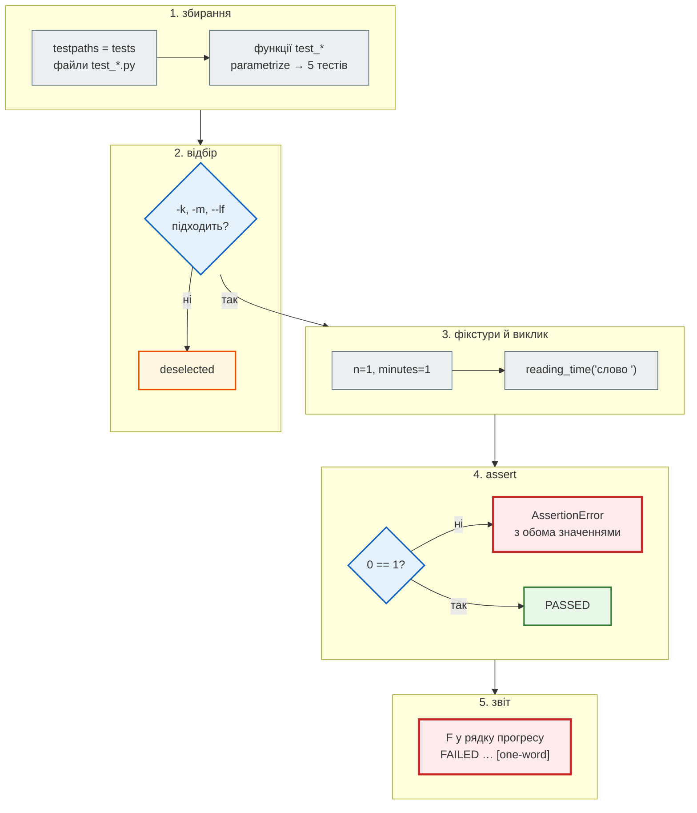

# Основи pytest: тест, `assert`, `parametrize`, маркери

## Проблема { #problem }

Хтось «трохи спростив» функцію часу читання: замість округлення вгору поставив `round`. Застосунок запустився, стаття на 400 слів показала ті самі «2 хв», і зміну злили. За тиждень помітили, що новини з одного абзацу мають «0 хв читання». Ручна перевірка не повторюється після кожної зміни, і перевіряє вона той випадок, у якому ми й так були впевнені.

**Тест** — перевірка, записана кодом: її запускають після кожної зміни, за секунду, тисячу разів. Тести не доводять, що помилок немає (випадків нескінченно багато), але дають інше: **впевненість змінювати код**. Без них кожна правка лякає, код перестають чистити, і він гниє. Тест — це ще й жива документація: він показує, як викликати функцію і що вона обіцяє, а застарілий тест, на відміну від коментаря, падає. Помилку, що повернулася після виправлення, називають **регресією**; найцінніший тест — той, що з'явився разом із виправленням бага.

Ця сторінка — про сам інструмент: як pytest знаходить і запускає тести, читає `assert`, перевіряє винятки, описує таблиці випадків і вибирає, що запускати.

## Ментальна модель { #mental-model }

Шлях одного тесту, `test_reading_time_table[one-word]`, від команди `pytest` до рядка у звіті:



| Що | Правило pytest |
|---|---|
| де шукати | `testpaths` у `pytest.ini`, інакше — від поточної папки |
| файли | `test_*.py` або `*_test.py` |
| тести | функції `test_*` і методи `test_*` у класах `Test*` (без `__init__`) |
| перевірка | звичайний `assert`; pytest переписує його, щоб показати значення |
| результат | `.` пройшов, `F` упав, `E` помилка у фікстурі, `s` пропущено, `x` очікувано впав |

Ані реєстрації тестів, ані `main()`: досить назвати файл і функцію за правилом.

Приклади сторінки — [`examples/testing`](https://github.com/NikoriakViktor/news_hub/tree/main/examples/testing): застосунок `newsapp` і його тести. Тут — [`newsapp/text.py`](https://github.com/NikoriakViktor/news_hub/blob/main/examples/testing/newsapp/text.py) і [`tests/test_text.py`](https://github.com/NikoriakViktor/news_hub/blob/main/examples/testing/tests/test_text.py).

## Перший тест: Arrange — Act — Assert { #first-test }

```python title="newsapp/text.py (фрагмент)"
def reading_time(text: str, wpm: int = WORDS_PER_MINUTE) -> int:
    """Хвилини читання, округлені вгору: 1 слово — 1 хв, 201 слово при 200 сл/хв — 2 хв, порожньо — 0."""
    if wpm <= 0:
        raise ValueError(f"wpm має бути додатним, а маємо {wpm}")
    return math.ceil(len(text.split()) / wpm)
```

```python title="tests/test_text.py (фрагмент)"
def words(n: int) -> str:
    return "слово " * n


def test_two_hundred_words_take_one_minute() -> None:
    # Arrange — підготувати дані
    text = words(200)
    # Act — виконати одну дію
    minutes = reading_time(text)
    # Assert — перевірити результат
    assert minutes == 1
```

Три частини тесту — **Arrange, Act, Assert** (AAA) — варто тримати навіть без коментарів: одна дія і перевірка її результату. Тест, що робить п'ять дій і перевіряє все одразу, при падінні не скаже, що саме зламалось.

```text
$ pytest -v tests/test_text.py
collecting ... collected 20 items / 1 deselected / 19 selected

tests/test_text.py::test_two_hundred_words_take_one_minute PASSED        [  5%]
tests/test_text.py::test_reading_time_table[empty] PASSED                [ 10%]
tests/test_text.py::test_reading_time_table[one-word] PASSED             [ 15%]
...
======================= 19 passed, 1 deselected in 0.08s =======================
```

`-v` друкує ім'я кожного тесту. `1 deselected` — тест з маркером `slow`, його вимикає `addopts` у `pytest.ini` ([нижче](#markers)). Тут і далі час у звітах залежить від машини.

## Читаємо падіння { #reading-failures }

Повернемо «спрощення» з початку сторінки: `round(len(text.split()) / wpm)` замість `math.ceil(...)`, і запустимо ті самі тести:

```text
$ pytest tests/test_text.py
tests/test_text.py ..F.F..............                                   [100%]

=================================== FAILURES ===================================
______________________ test_reading_time_table[one-word] _______________________

n = 1, minutes = 1

    @pytest.mark.parametrize(("n", "minutes"), [
    ...
    def test_reading_time_table(n: int, minutes: int) -> None:
>       assert reading_time(words(n)) == minutes
E       AssertionError: assert 0 == 1
E        +  where 0 = reading_time('слово ')
E        +    where 'слово ' = words(1)

tests/test_text.py:28: AssertionError
_____________________ test_reading_time_table[just-above] ______________________

n = 201, minutes = 2
...
E       AssertionError: assert 1 == 2
E        +  where 1 = reading_time('слово слово слово … слово ')
...
=========================== short test summary info ============================
FAILED tests/test_text.py::test_reading_time_table[one-word] - AssertionError...
FAILED tests/test_text.py::test_reading_time_table[just-above] - AssertionErr...
================== 2 failed, 17 passed, 1 deselected in 0.09s ==================
```

- `F` у рядку прогресу — провалений тест, `.` — пройдений; `>` позначає рядок, де впало.
- `n = 1, minutes = 1` — значення параметрів саме цього випадку.
- `assert 0 == 1` і рядки `where` — pytest **розібрав** звичайний `assert`: показав обидва значення й звідки взялося `0` (`reading_time('слово ')`, а `'слово '` — це `words(1)`).
- Останній блок — короткий список: який тест і чому.

Головне: `test_two_hundred_words_take_one_minute` і випадок на 400 слів **пройшли** на зламаному коді — `round(1.0)` і `round(2.0)` дають ті самі числа. Баг зловили тести **на межах**: одне слово і 201 слово.

### Як pytest показує різницю { #assert-rewriting }

pytest переписує байт-код `assert` у тестових модулях і `conftest.py` під час імпорту: перед перевіркою він запам'ятовує проміжні значення. Для колекцій він показує саме відмінність. З [`demos/test_failures.py`](https://github.com/NikoriakViktor/news_hub/blob/main/examples/testing/demos/test_failures.py) — навмисно червоних прикладів:

```text
$ pytest demos/test_failures.py
>       assert article == {"slug": "уряд-ухвалив-бюджет", "source": "rbc.ua", "minutes": 2}
E       AssertionError: assert {'slug': 'уря... 'minutes': 1} == {'slug': 'уря... 'minutes': 2}
E         Omitting 2 identical items, use -vv to show
E         Differing items:
E         {'minutes': 1} != {'minutes': 2}

>       assert [slugify(t) for t in ("Перша новина", "Друга новина")] == ["перша-новина", "друга"]
E       AssertionError: assert ['перша-новин...друга-новина'] == ['перша-новина', 'друга']
E         At index 1 diff: 'друга-новина' != 'друга'
```

Розбір працює лише для `assert` у файлах, які збирає pytest. `assert` у допоміжному модулі (`tests/helpers.py`), який тест імпортує, лишиться звичайним: `AssertionError` без значень. Такий модуль реєструють через `pytest.register_assert_rewrite("tests.helpers")` у `conftest.py`, або перевірки тримають у тестах і фікстурах.

!!! warning "`python -O` вимикає `assert`"
    З прапорцем `-O` Python викидає всі `assert`. Для тестів це не проблема (pytest так не запускають), а от у коді застосунку `assert` замість перевірки вхідних даних — помилка: у продакшені його може не бути.

## Межі, винятки, дробові числа { #boundaries }

Помилки живуть на **межах**: нуль, порожньо, рівно на межі, на одиницю більше. Для `reading_time` межа — 200 слів:

| Випадок | Чому важливий |
|---|---|
| 0 слів → 0 | найменше значення |
| 1 слово → 1 | найменший непорожній текст: округлення вгору видно саме тут |
| 200 → 1 | рівно на межі |
| 201 → 2 | на одне слово більше |
| `wpm=0` → `ValueError` | неможливе значення — виняток |
| `wpm=1` → працює | найменше **дозволене** значення: межа з іншого боку |

Останній рядок легко пропустити. Його знайшло [мутаційне тестування](quality.md#mutation): тест перевіряв лише, що `wpm=0` падає, і не помічав, що `wpm=1` теж почало б падати.

### `pytest.raises` { #raises }

```python title="tests/test_text.py (фрагмент)"
def test_wpm_must_be_positive() -> None:
    with pytest.raises(ValueError, match="додатним"):
        reading_time("текст", wpm=0)


def test_slugify_rejects_title_without_words() -> None:
    with pytest.raises(ValueError, match="немає слів") as error:
        slugify("?!…")
    assert "'?!…'" in str(error.value)          # у повідомленні — сам заголовок
```

- `match` — регулярний вираз, який **шукається** (`re.search`) у тексті винятку; спецсимволи (`.`, `(`, `?`) екранують `re.escape(...)`.
- `as error` — `ExceptionInfo`: `error.value` — сам виняток, `error.type` — клас.
- Якщо винятку немає — тест падає:

```text
>       with pytest.raises(ValueError):
E       Failed: DID NOT RAISE ValueError
```

У `with pytest.raises` має бути **один** рядок — той, що мусить кинути виняток. Інакше тест пройде, навіть якщо виняток кинув інший рядок:

```python title="demos/test_failures.py (фрагмент): зелений, але перевіряє не те"
def test_raises_around_two_lines_hides_the_bug() -> None:
    with pytest.raises(ValueError):
        slug = slugify("?!")                          # ← виняток тут
        reading_time(slug, wpm=0)                     # цей рядок не виконується
```

### Дробові числа: `pytest.approx` { #approx }

```text
E       assert (0.1 + 0.2) == 0.3
```

Двійкове представлення не має точних `0.1` і `0.2`, тож `0.1 + 0.2` — це `0.30000000000000004`. Порівнюють з допуском:

```python
def test_words_per_second_is_approximate() -> None:
    assert WORDS_PER_MINUTE / 60 == pytest.approx(3.333, abs=0.001)
```

За замовчуванням `approx` бере відносний допуск `1e-6`; `abs=` задає абсолютний. Працює і для списків та словників чисел: `[0.1 + 0.2] == pytest.approx([0.3])`.

## `parametrize`: таблиця випадків { #parametrize }

П'ять майже однакових тестів для п'яти розмірів тексту — копіпаста. `@pytest.mark.parametrize` описує випадки таблицею, і кожен рядок стає окремим тестом:

```python title="tests/test_text.py (фрагмент)"
@pytest.mark.parametrize(("n", "minutes"), [
    (0, 0),          # порожній текст
    (1, 1),          # одне слово — вже хвилина
    (200, 1),        # рівно на межі
    (201, 2),        # на одне слово більше за межу
    (400, 2),
], ids=["empty", "one-word", "exactly-200", "just-above", "400"])
def test_reading_time_table(n: int, minutes: int) -> None:
    assert reading_time(words(n)) == minutes
```

- Падіння одного рядка не зупиняє решту: у звіті вище впали лише `[one-word]` і `[just-above]`.
- Новий випадок — новий рядок таблиці, а не новий тест.
- `ids` — імена випадків. Без них pytest складає ім'я зі значень і **екранує** не-ASCII символи. Так виглядав той самий файл до того, як ми додали `ids` до таблиці `slugify`:

```text
tests/test_text.py::test_slugify[Уряд ухвалив …] PASSED
```

Такий тест незручно і прочитати, і вибрати через `-k`. Тож для кириличних даних `ids` — обов'язкові.

Кілька декораторів `parametrize` над одним тестом дають декартів добуток: 3 × 4 = 12 тестів. Окремий випадок можна позначити: `pytest.param(0, 0, marks=pytest.mark.xfail(reason="…"), id="…")`.

## Маркери { #markers }

Маркер — мітка на тесті, за якою його відбирають або змінюють його поведінку:

| Маркер | Що робить |
|---|---|
| `@pytest.mark.skip(reason=…)` | не запускати; у звіті `s` |
| `@pytest.mark.skipif(умова, reason=…)` | не запускати, якщо умова істинна (`sys.platform == "win32"`, немає Docker) |
| `@pytest.mark.xfail(reason=…, strict=True)` | очікувано падає (відомий баг); `strict=True` — якщо раптом пройде, це помилка |
| `@pytest.mark.parametrize` | таблиця випадків |
| `@pytest.mark.asyncio` | async-тест (плагін `pytest-asyncio`) |
| власні: `slow`, `postgres` | лише мітка; що вона означає — вирішує `pytest.ini` і `conftest.py` |

```ini title="pytest.ini"
[pytest]
testpaths = tests
pythonpath = .
markers =
    slow: довгі тести — лише pytest -m slow
    postgres: лише на PostgreSQL (TEST_DATABASE_URL), на SQLite — skip
addopts = --strict-markers -m "not slow"
asyncio_default_fixture_loop_scope = function
```

- `markers` реєструє власні маркери; `pytest --markers` покаже їх з описом.
- `addopts` додається до кожного запуску: `-m "not slow"` вимикає довгі тести, а явний `pytest -m slow` його перекриває (останній `-m` перемагає).
- `--strict-markers` робить одруківку помилкою. Без нього `@pytest.mark.slwo` — лише попередження, і тест тихо не потрапить у `-m slow`:

```text
$ pytest -q -o addopts="" demos/test_typo_marker.py
  demos/test_typo_marker.py:8: PytestUnknownMarkWarning: Unknown pytest.mark.slwo - is this a typo?  You can register custom marks to avoid this warning - for details, see https://docs.pytest.org/en/stable/how-to/mark.html
1 passed, 1 warning in 0.13s

$ pytest -q demos/test_typo_marker.py
ERROR demos/test_typo_marker.py - Failed: 'slwo' not found in `markers` confi...
!!!!!!!!!!!!!!!!!!!! Interrupted: 1 error during collection !!!!!!!!!!!!!!!!!!!!
```

Маркер може не лише фільтрувати, а й керувати пропуском. `postgres` у [`tests/conftest.py`](https://github.com/NikoriakViktor/news_hub/blob/main/examples/testing/tests/conftest.py) перетворюється на `skip` з причиною, якщо бази PostgreSQL немає:

```python title="tests/conftest.py (фрагмент)"
def pytest_collection_modifyitems(items: list[pytest.Item]) -> None:
    """@pytest.mark.postgres без PostgreSQL — skip з причиною, а не червоний тест."""
    if TEST_DATABASE_URL.startswith("sqlite"):
        skip = pytest.mark.skip(reason="потрібен PostgreSQL: задай TEST_DATABASE_URL")
        for item in items:
            if "postgres" in item.keywords:
                item.add_marker(skip)
```

```text
$ pytest -q -rs tests/test_db.py
......s                                                                  [100%]
=========================== short test summary info ============================
SKIPPED [1] tests/test_db.py:53: потрібен PostgreSQL: задай TEST_DATABASE_URL
6 passed, 1 skipped in 0.08s
```

`-rs` друкує причини пропусків. Пропущений тест — не зелений: у CI має бути хоча б один прогін, де він виконується.

## Вибір тестів і повторний запуск { #selection }

| Команда | Що запускає |
|---|---|
| `pytest tests/test_text.py` | один файл |
| `pytest tests/test_text.py::test_shorten` | один тест (з усіма випадками) |
| `pytest "tests/test_text.py::test_shorten[cut]"` | один випадок `parametrize` |
| `pytest -k "slugify and not rejects"` | тести, в імені яких є `slugify`, але немає `rejects` |
| `pytest -m slow` | тести з маркером |
| `pytest -x` | зупинитися на першому падінні |
| `pytest --lf` | лише ті, що впали минулого разу (`--last-failed`) |
| `pytest --ff` | спершу ті, що впали, потім решта |
| `pytest --co -q` | лише показати, що буде зібрано (`--collect-only`) |
| `pytest --durations=5` | п'ять найповільніших |
| `pytest -s` | не перехоплювати `print` |

Ті самі команди на зламаному `reading_time`:

```text
$ pytest -q -x tests
FAILED tests/test_text.py::test_reading_time_table[one-word] - AssertionError...
!!!!!!!!!!!!!!!!!!!!!!!!!! stopping after 1 failures !!!!!!!!!!!!!!!!!!!!!!!!!!!
1 failed, 49 passed, 1 skipped, 1 deselected in 0.47s
$ pytest -q --lf
FAILED tests/test_text.py::test_reading_time_table[just-above] - AssertionErr...
2 failed in 0.09s
```

`-x` зупинився на першому падінні, а `--lf` запустив обидва тести, що впали в попередніх прогонах: pytest пам'ятає всі падіння, доки тест не пройде. Після виправлення `pytest -q --lf` запускає лише ці два: `2 passed in 0.06s`. Список падінь pytest зберігає в `.pytest_cache/` (вона в `.gitignore`). `-p no:cacheprovider` вимикає кеш зовсім — тоді `--lf` нічого не пам'ятає.

```text
$ pytest -q -k "slugify and not rejects"
4 passed, 66 deselected in 0.19s
```

`-k` шукає підрядок в імені тесту, разом з іменем модуля, класу й `ids` випадку; підтримує `and`, `or`, `not` і дужки.

## Тести в стилі `unittest` { #unittest }

У стандартній бібліотеці є `unittest`: тести як методи класу-нащадка `TestCase`, перевірки — методами `assert…`:

```python title="tests/test_unittest_style.py"
class ReadingTimeTest(unittest.TestCase):
    def setUp(self) -> None:                 # перед кожним тестом — як фікстура
        self.text = "слово " * 201

    def test_rounds_up(self) -> None:
        self.assertEqual(reading_time(self.text), 2)

    def test_wpm_must_be_positive(self) -> None:
        with self.assertRaises(ValueError):
            reading_time(self.text, wpm=-1)
```

| pytest | unittest |
|---|---|
| `assert a == b` | `self.assertEqual(a, b)` |
| `assert x` / `assert not x` | `self.assertTrue(x)` / `self.assertFalse(x)` |
| `assert a in b` | `self.assertIn(a, b)` |
| `pytest.raises(E, match=…)` | `self.assertRaises(E)`, `self.assertRaisesRegex(E, …)` |
| `pytest.approx` | `self.assertAlmostEqual(a, b, places=…)` |
| фікстура | `setUp` / `tearDown`, `setUpClass` |

pytest запускає й такі тести, тож обирати не доводиться: цей стиль зустрінеш у старих проєктах і в Django (`django.test.TestCase` — нащадок `unittest.TestCase`). Фікстури pytest у методи `TestCase` не передаються. Для нового коду pytest зручніший: звичайний `assert`, фікстури за іменем, `parametrize`.

## Структура тестів { #layout }

```text
examples/testing/
├── pytest.ini              ← testpaths, pythonpath, markers, addopts
├── newsapp/                ← код застосунку
├── tests/
│   ├── __init__.py         ← tests — пакет: from tests.fakes import FakeMailer
│   ├── conftest.py         ← фікстури для всіх тестів папки
│   ├── fakes.py            ← допоміжний код (не test_*.py — pytest його не збирає)
│   └── test_*.py
└── demos/                  ← поза testpaths: запускається лише явно
```

- **`pythonpath = .`** у `pytest.ini` — `import newsapp` працює без `pip install -e .` і з будь-якої папки запуску.
- **`testpaths`** — що збирати, коли запускаєш просто `pytest`. Усе поза ним (`demos/`, скрипти) pytest не чіпає, але явний шлях `pytest demos/test_failures.py` працює.
- **Ім'я тестового модуля має бути унікальним**, якщо в папках немає `__init__.py`: два `test_api.py` у різних папках дадуть помилку збирання `import file mismatch`.
- Більші проєкти ділять `tests/` на шари — `unit/` і `integration/` — і ставлять маркер за назвою папки ([так зроблено в News Hub](#news-hub)).

## У News Hub { #news-hub }

- **Шари й маркери за папкою.** `tests/unit/` і `tests/integration/`, а маркер ставить хук `pytest_collection_modifyitems` з назви папки, — [крок 5, «Шари тестів»](../tutorials/05_api_testing/test_layers.md#marker-hook). `pytest -m unit` у [`steps/12_ci_cd`](https://github.com/NikoriakViktor/news_hub/tree/main/steps/12_ci_cd) запускає лише unit-шар із кількох сотень тестів; актуальні числа — у [контрольній точці кроку 12](../tutorials/12_ci_cd/checkpoint.md#check).
- **`addopts` вимикає дорогі тести.** У кроці 12 `addopts = -m "not llm and not docker"`: справжні виклики LLM ([крок 7](../tutorials/07_llm_api/index.md)) і збірка образу ([крок 10](../tutorials/10_docker/index.md)) не запускаються випадково. Звичайний прогін проходить сотні тестів і пропускає кілька позначених — їх запускають окремо: `pytest -m llm` і `pytest -m docker` ([контрольна точка кроку 12](../tutorials/12_ci_cd/checkpoint.md#check)).
- **`skipif` за оточенням.** Docker-тести мають `pytestmark = pytest.mark.skipif(not docker_available(), reason="немає Docker")` на весь модуль ([`tests/docker/test_image.py`](https://github.com/NikoriakViktor/news_hub/blob/main/steps/12_ci_cd/tests/docker/test_image.py)).
- **`parametrize` з `ids`** — у тестах мережевих помилок: `ids=["403", "timeout", "connection-reset"]` ([крок 5, «Мок мережі»](../tutorials/05_api_testing/mock_network.md#network-errors)).
- **Порядок у CI**: спершу `pytest -m unit -q` (падають за секунди), потім `pytest -q` ([`.github/workflows/news_hub.yml`](https://github.com/NikoriakViktor/news_hub/blob/main/.github/workflows/news_hub.yml)).

На відміну від прикладу, `pytest.ini` News Hub не має `--strict-markers`: невідомий маркер там дасть лише попередження ([крок 5, «маркери оголошено в `pytest.ini`»](../tutorials/05_api_testing/test_layers.md#pytest-ini)).

## Типові помилки { #mistakes }

| Помилка | Наслідок | Як правильно |
|---|---|---|
| тест без `assert`: `reading_time(text) == 1` | порівняння обчислено й викинуто; тест зелений завжди | `assert reading_time(text) == 1` |
| кілька рядків у `with pytest.raises` | тест пройде, якщо виняток кинув не той рядок | у `with` — лише рядок, що має кинути |
| `pytest.raises(ValueError)` без `match` | пройде з будь-яким `ValueError`, навіть з чужого коду | `match="частина повідомлення"` |
| `==` для `float` | `0.1 + 0.2 == 0.3` — `False` | `pytest.approx` |
| перевірено лише «зручний» випадок | баг на межі не видно | 0, 1, рівно на межі, ±1, найменше дозволене |
| кирилиця в `parametrize` без `ids` | імена `Ур…`, незручно для `-k` | `ids=[...]` |
| маркер не зареєстровано | попередження; з `--strict-markers` — помилка збирання | `markers =` у `pytest.ini` |
| файл `tests_text.py` або `check_text.py` | pytest його не збирає, тести «зникли» | `test_*.py`; перевір `pytest --co -q` |
| клас `TestSomething` з `__init__` | pytest пропускає клас з попередженням | без `__init__`; підготовка — у фікстурах |
| `assert` у допоміжному модулі | `AssertionError` без значень | `pytest.register_assert_rewrite` або перевірка в тесті |

## Налагодження { #debugging }

- **Тест не запустився.** `pytest --co -q` показує, що зібрано. Немає в списку — перевір ім'я файлу й функції, `testpaths`, `-k`/`-m`/`addopts` (`deselected` у підсумку).
- **`ModuleNotFoundError: newsapp`.** Немає `pythonpath = .` у `pytest.ini`, або pytest запущено не з папки проєкту (`rootdir:` у шапці звіту каже, звідки він узяв налаштування).
- **Потрібні подробиці різниці.** `-vv` — повний diff без скорочень `...`; `-l` (`--showlocals`) — локальні змінні в трасуванні; `--tb=short` або `--tb=line` — коротше.
- **Зупинитися в місці падіння.** `pytest --pdb` відкриває налагоджувач на першому падінні; `breakpoint()` у тесті — там, де треба (разом із `-s`).
- **`print` не видно.** pytest перехоплює вивід і показує його лише для тестів, що впали; `-s` вимикає перехоплення.
- **Тест «то падає, то ні».** Запусти його окремо (`-k`), потім увесь файл, потім усе: якщо окремо зелений, а разом червоний — тести ділять стан ([фікстури, scope](fixtures.md#scope)).

## Питання { #questions }

1. Чому тест на 400 слів пройшов на зламаному `reading_time`, а тест на одне слово — ні?
2. Що показують рядки `where` у звіті про падіння?
3. Чому в `with pytest.raises(...)` має бути один рядок?
4. Навіщо `ids` у `parametrize`, якщо pytest і так дає імена випадкам?
5. Що станеться з `@pytest.mark.slwo` без `--strict-markers` і з ним?
6. Як запустити лише тести, що впали минулого разу? Де pytest це пам'ятає?
7. Чим випадок `wpm=1` важливий, якщо вже є тест на `wpm=0`?
8. Чи можна змішувати тести `unittest.TestCase` і pytest в одному проєкті?

??? success "Відповіді"

    1. `round(2.0)` і `math.ceil(2.0)` однакові, а для одного слова `round(0.005)` дає `0`, `ceil` — `1`. Баг проявляється лише біля межі округлення.
    2. Звідки взялося значення: виклик функції з аргументами, що його повернув (`0 = reading_time('слово ')`).
    3. Інакше тест пройде, навіть якщо виняток кинув інший рядок — а перевіряємий не виконався зовсім.
    4. Без `ids` pytest екранує кирилицю (`У…`), імена стають нечитабельними і незручними для `-k`.
    5. Без — попередження `PytestUnknownMarkWarning`, тест виконується, але не потрапляє в `-m slow`. З — помилка збирання.
    6. `pytest --lf`; список падінь — у `.pytest_cache/`.
    7. Це межа з іншого боку: найменше дозволене значення. Без цього тесту зміна `<= 0` на `<= 1` лишилася б непоміченою.
    8. Так: pytest запускає і `TestCase`. Але фікстури pytest у методи `TestCase` не передаються.

## Що далі { #next }

[Фікстури: scope, `yield`, `conftest.py`, `tmp_path`, `monkeypatch`](fixtures.md) — звідки тест бере дані й ресурси і як за ним прибрати.

**Джерела:** pytest — [Get Started](https://docs.pytest.org/en/stable/getting-started.html), [How to write and report assertions](https://docs.pytest.org/en/stable/how-to/assert.html) (розділи «Assertions about expected exceptions», «Assertion introspection details»), [How to parametrize](https://docs.pytest.org/en/stable/how-to/parametrize.html), [How to mark test functions](https://docs.pytest.org/en/stable/how-to/mark.html), [How to use skip and xfail](https://docs.pytest.org/en/stable/how-to/skipping.html), [Good Integration Practices](https://docs.pytest.org/en/stable/explanation/goodpractices.html), [Usage and Invocations](https://docs.pytest.org/en/stable/how-to/usage.html), [`pytest.approx`](https://docs.pytest.org/en/stable/reference/reference.html#pytest-approx); Python — [`unittest`](https://docs.python.org/3/library/unittest.html); Django-книга — [pytest](https://nikoriakviktor.github.io/notes_chat_app/08_testing_and_quality/pytest_basics_full/), [основи тестування](https://nikoriakviktor.github.io/notes_chat_app/08_testing_and_quality/testing_foundations_full/).
