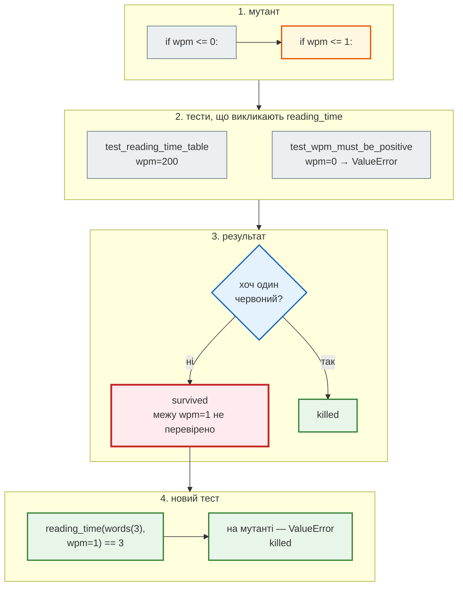

# Якість тестів: покриття, мутації, мінімальні версії, рецензія AI-коду

## Проблема { #problem }

Усі тести зелені, покриття 95%. Чи означає це, що код правильний? Ні — і ось три способи, як зелений набір бреше:

- **тест виконує рядок, але нічого не перевіряє.** Рядок `reading_time(text) == 1` без `assert` дає покриття і ловить нуль помилок;
- **тест перевіряє не ту межу.** `wpm=0` падає — перевірено; що `wpm=1` працює — ні, і зміна `<= 0` на `<= 1` пройде непоміченою;
- **тест повторює реалізацію.** AI-асистент написав функцію і тест до неї — тією самою формулою. Помилка у формулі потрапляє і в очікуване значення.

Ще одна брехня — поза кодом: `requirements.txt` обіцяє `fastapi>=0.121`, а тести ганяли лише на найновішій версії. Ця сторінка — про інструменти, що перевіряють самі тести: покриття рядків і гілок, мутаційне тестування, тести властивостей, прогін на мінімальних версіях — і як ними перевіряти код, який написав не ти.

## Ментальна модель { #mental-model }

Кожен інструмент відповідає на своє питання, і жоден не замінює інший:

| Інструмент | Питання | Чого **не** скаже |
|---|---|---|
| покриття рядків | який рядок жодного разу не виконався | чи перевірено результат |
| покриття гілок | яке рішення (`if`, `for`) пройдено лише в один бік | те саме |
| мутаційне тестування | чи помітить хоч один тест зміну в коді | чи правильна сама вимога |
| тести властивостей | чи виконується правило для будь-яких входів | правило треба сформулювати самому |
| мінімальні версії | чи правда те, що обіцяє `requirements.txt` | — |

Мутаційне тестування найкраще показує різницю між «виконано» і «перевірено». Ось шлях одного мутанта в `reading_time`, у якої покриття рядків і гілок — 100%:



Код — [`examples/testing`](https://github.com/NikoriakViktor/news_hub/tree/main/examples/testing): [`newsapp/text.py`](https://github.com/NikoriakViktor/news_hub/blob/main/examples/testing/newsapp/text.py), [`tests/test_text.py`](https://github.com/NikoriakViktor/news_hub/blob/main/examples/testing/tests/test_text.py), [`tests/test_properties.py`](https://github.com/NikoriakViktor/news_hub/blob/main/examples/testing/tests/test_properties.py), [`setup.cfg`](https://github.com/NikoriakViktor/news_hub/blob/main/examples/testing/setup.cfg), приклади в [`demos/`](https://github.com/NikoriakViktor/news_hub/tree/main/examples/testing/demos).

## Покриття: рядки й гілки { #coverage }

`pytest-cov` (обгортка над coverage.py) показує, які рядки виконувались під час тестів:

```text
$ pytest -q --cov=newsapp --cov-branch --cov-report=term-missing
Name                  Stmts   Miss Branch BrPart  Cover   Missing
-----------------------------------------------------------------
newsapp/__init__.py       0      0      0      0   100%
newsapp/alerts.py         4      0      0      0   100%
newsapp/api.py           77      1      2      0    99%   60
newsapp/digest.py        18      0      4      0   100%
newsapp/mail.py          19      7      0      0    63%   23-28, 33
newsapp/storage.py       39      1      2      1    95%   27
newsapp/text.py          18      0      8      0   100%
-----------------------------------------------------------------
TOTAL                   175      9     16      1    95%
```

| Колонка | Що означає |
|---|---|
| `Stmts` / `Miss` | інструкцій усього / не виконано жодного разу |
| `Branch` / `BrPart` | переходів (виходів з `if`, `for`, `while`) усього / пройдено лише частково |
| `Missing` | номери рядків (`23-28`) і переходів (`7->9`), яких не було |

Кожен червоний рядок — **питання**, а не завдання «покрий»:

- `mail.py 23-28, 33` — справжня відправка SMTP. Її свідомо підмінено в усіх тестах: тест зі справжнім SMTP-сервером — окремий, інтеграційний. Відповідь на питання «чому не покрито» — «так задумано».
- `api.py 60` — справжній `get_mailer` (`return request.app.state.mailer`): тести розсилки підміняють його, а тест без підмін не викликає `/digest`. Тут відповідь — «прогалина»: справжній ланцюг `lifespan → app.state.mailer → get_mailer` не перевіряє жоден тест.
- `storage.py 27` — гілка не-SQLite в `make_engine`; її виконує прогін з `TEST_DATABASE_URL` на PostgreSQL.

Так само у [кроці 5](../tutorials/05_api_testing/coverage.md#red-lines) червоні рядки стали п'ятьма новими тестами, і один із них знайшов помилку в коді — `fakerbc.ua` проходив перевірку домену. Там же — чому async SQLAlchemy потребує `concurrency = thread,greenlet` у `.coveragerc`, інакше звіт занижений.

### Чому гілки, а не лише рядки { #branch }

```python title="demos/pages.py"
def page_count(total: int, size: int) -> int:
    """Скільки сторінок по size новин потрібно для total новин."""
    pages = total // size
    if total % size:
        pages += 1                      # неповна остання сторінка
    return pages
```

Один тест, `page_count(25, 10) == 3`, виконує **кожен** рядок:

```text
$ pytest -q demos/test_pages.py --cov=demos.pages --cov-report=term-missing
Name             Stmts   Miss  Cover   Missing
demos/pages.py       5      0   100%
$ pytest -q demos/test_pages.py --cov=demos.pages --cov-branch --cov-report=term-missing
Name             Stmts   Miss Branch BrPart  Cover   Missing
demos/pages.py       5      0      2      1    86%   7->9
```

`7->9` — перехід з `if` одразу на `return`, тобто випадок «рівно повні сторінки» (`total=20`). Він не виконувався ніколи. Покриття рядків цього не бачить: у `if` без `else` немає рядка, який міг би лишитися червоним. Тому `branch = true` — налаштування за замовчуванням для будь-якого проєкту.

### 100% — не мета { #not-a-goal }

Рядок вважається покритим, якщо він **виконався** — навіть коли жоден `assert` не перевірив результат:

```python title="demos/test_no_asserts.py"
def test_calls_everything() -> None:
    reading_time("слово " * 201)
    slugify("Уряд ухвалив бюджет")
    shorten("Коротко", 10)
    shorten("Уряд ухвалив бюджет", 6)
    for broken in (lambda: reading_time("x", wpm=0), lambda: slugify("?!"), lambda: shorten("x", 0)):
        with contextlib.suppress(ValueError):
            broken()
```

```text
$ pytest -q demos/test_no_asserts.py --cov=newsapp.text --cov-branch --cov-report=term-missing
Name              Stmts   Miss Branch BrPart  Cover   Missing
newsapp/text.py      18      0      8      0   100%
```

100% рядків і гілок — і жодної перевірки. Коли покриття стає метою (поріг `--cov-fail-under=100` в CI), саме такі тести й з'являються. Поріг корисний інакше: як захист від **падіння** покриття (`--cov-fail-under=90` — не нижче, ніж є), а рядки, які свідомо не тестуються, позначають явно (`# pragma: no cover`, `exclude_also` у `.coveragerc`) — щоб кожен виняток був видно в коді.

## Мутаційне тестування { #mutation }

Покриття відповідає «що виконалось». Мутаційне тестування відповідає «чи **помітили б** тести помилку». Інструмент робить у коді маленькі зміни — **мутанти**: `<` на `<=`, `1` на `2`, `True` на `False`, рядок повідомлення на `None` — і для кожного запускає тести, що виконують змінений код. Якщо хоч один тест упав — мутанта **вбито** (`killed`). Якщо всі зелені — мутант **вижив** (`survived`), і це місце, де помилку ніхто б не помітив.

```ini title="setup.cfg"
[mutmut]
source_paths = newsapp/
```

```bash
pip install mutmut
mutmut run            # копія коду — у mutants/ (у .gitignore прикладу)
mutmut results        # список мутантів, що вижили
mutmut show newsapp.text.x_shorten__mutmut_3
```

Перший прогін на тестах без трьох тестів меж (`wpm=1`, `limit=1`, повідомлення для `limit=0`):

```text
⠸ 212/212  🎉 148 🫥 32  ⏰ 0  🤔 0  🙁 32  🔇 0  🧙 0
$ mutmut results | grep text
    newsapp.text.x_reading_time__mutmut_2: survived
    newsapp.text.x_shorten__mutmut_3: survived
```

`🎉` — вбито, `🙁` — вижило, `🫥` — жоден тест не виконує цей код (`mail.py` — справжній SMTP), `⏰` — тести зависли (теж вважається виявленим). Два мутанти, що вижили в `text.py`:

```diff
 def reading_time(text: str, wpm: int = WORDS_PER_MINUTE) -> int:
-    if wpm <= 0:
+    if wpm <= 1:
         raise ValueError(f"wpm має бути додатним, а маємо {wpm}")
```

```diff
     if limit < 1:
-        raise ValueError(f"limit має бути щонайменше 1, а маємо {limit}")
+        raise ValueError(None)
```

Обидва — справжні прогалини:

- **`reading_time`** — прогалина, якої покриття не показує: усі рядки й гілки функції виконувались. Але перевірено лише, що `wpm=0` — помилка, а не те, що `wpm=1` **дозволено**. Межа з іншого боку;
- **`shorten`** — гілку `limit < 1` не виконував жоден тест, і це покриття теж показало: рядок 26 `text.py` був червоним (`92%` у звіті з гілками). mutmut вважає код покритим, якщо тест викликає **функцію**, тому мутант позначено `survived`, а не «немає тестів». Він ще й підказує, яким має бути тест: `pytest.raises(ValueError)` без `match` його не вбив би — `ValueError(None)` усе одно `ValueError`.

Три нові тести в [`tests/test_text.py`](https://github.com/NikoriakViktor/news_hub/blob/main/examples/testing/tests/test_text.py) — `test_wpm_one_is_allowed`, випадок `limit-1` у таблиці `test_shorten` і `test_shorten_rejects_zero_limit` з `match="щонайменше 1, а маємо 0"` — і в `text.py` не лишилось жодного мутанта, що вижив (25 з 25 вбито):

```text
⠏ 212/212  🎉 150 🫥 32  ⏰ 0  🤔 0  🙁 30  🔇 0  🧙 0
```

Для порівняння, той самий `mutmut` з тестом без перевірок з [попереднього розділу](#not-a-goal) замість справжніх тестів: 14 з 25 мутантів `text.py` вижили, хоча покриття — 100%.

### Як читати мутантів, що вижили { #survivors }

Не кожен мутант — помилка в тестах. Серед 30 мутантів, що вижили в решті коду прикладу:

| Мутант | Що це |
|---|---|
| `encoding="utf-8"` → `encoding="UTF-8"` у `write_digest` | **еквівалентний**: поведінка не змінилась, тест і не мав його помітити |
| `mkdir(parents=True)` → `parents=None` | прогалина: тест пише в `tmp_path / "out"`, батьківська папка вже є; випадок глибшої вкладеності не перевірено |
| `order_by(Article.id)` → `order_by(None)` у `search` | прогалина або випадковість: SQLite повертає рядки в порядку вставки й без `ORDER BY` |
| `isolation_level = None` → `""` у SQLite | тонке місце рецепта `SAVEPOINT`; варте окремого тесту, якщо рецепт міняти |

Мутаційне тестування повільне (кожен мутант — прогін тестів) і дає шум з еквівалентних мутантів. Тому його запускають не на кожен коміт, а на критичний код (гроші, права, межі) або перед рефакторингом, щоб знати, яким тестам можна довіряти. Головна цінність — **конкретні рядки**, де тести сліпі.

## Тести властивостей { #properties }

Звичайний тест — приклад: «на вході `("Уряд ухвалив бюджет", 10)` — на виході `"Уряд ухва…"`». Тест властивості формулює **правило** для будь-яких входів, а бібліотека Hypothesis генерує сотні входів сама і, знайшовши порушення, **зменшує** його до найменшого прикладу:

```python title="tests/test_properties.py (фрагмент)"
titles = st.text(min_size=0, max_size=120)
limits = st.integers(min_value=1, max_value=150)


@given(titles, limits)
def test_shorten_never_exceeds_limit(title: str, limit: int) -> None:
    assert len(shorten(title, limit)) <= limit


@given(titles, limits)
def test_shorten_keeps_short_titles_and_marks_cut_ones(title: str, limit: int) -> None:
    result = shorten(title, limit)
    if len(title) <= limit:
        assert result == title
    else:
        assert result.endswith("…") and title.startswith(result[:-1])
```

Властивості, які варто шукати: **межа** (довжина не більша за `limit`), **збереження** (короткий заголовок не змінюється), **ідемпотентність** (`slugify(slugify(t)) == slugify(t)`), **зворотність** (`loads(dumps(x)) == x`), **порівняння з простою реалізацією** (швидкий алгоритм дає те саме, що повільний очевидний). Hypothesis зберігає знайдені приклади в `.hypothesis/` і наступного разу перевіряє їх першими.

## Рецензія AI-коду тестами { #ai-code }

AI-асистенти пишуть код швидко й упевнено — і так само впевнено помиляються: на межах, на порожніх даних, в округленні. Код від AI — як код нового колеги: **приймаємо лише після перевірки**. Попросимо «обріж заголовок до `limit` символів і додай три крапки»:

```python title="demos/ai_shorten.py"
def shorten(title: str, limit: int) -> str:
    if len(title) > limit:
        return title[:limit] + "…"
    return title
```

Попросимо в того самого асистента тест — і отримаємо таке:

```python title="demos/test_ai_shorten.py (фрагмент)"
def test_written_by_ai_repeats_the_implementation() -> None:
    """«Тест», який згенерував той самий асистент: очікуване значення обчислене тією ж формулою."""
    title, limit = "Уряд ухвалив бюджет", 10
    assert shorten(title, limit) == title[:limit] + "…"
```

Тест **повторює реалізацію**: якщо формула неправильна, очікуване значення неправильне так само, і тест зелений. Очікування мають братися з **вимог**, а не з коду. Вимога тут — «не довший за `limit`». Ті самі тести властивостей проти коду асистента:

```text
$ pytest demos/test_ai_shorten.py
demos/test_ai_shorten.py .FF                                             [100%]

title = '00', limit = 1

    @given(st.text(max_size=120), st.integers(min_value=1, max_value=150))
    def test_never_exceeds_limit(title: str, limit: int) -> None:
>       assert len(shorten(title, limit)) <= limit
E       AssertionError: assert 2 <= 1
E        +  where 2 = len('0…')
E        +    where '0…' = shorten('00', 1)
E       Failing test case: test_never_exceeds_limit(
E           title='00',
E           limit=1,
E       )
...
>       with pytest.raises(ValueError):
E       Failed: DID NOT RAISE ValueError
FAILED demos/test_ai_shorten.py::test_never_exceeds_limit - AssertionError: a...
FAILED demos/test_ai_shorten.py::test_zero_limit_is_rejected - Failed: DID NO...
========================= 2 failed, 1 passed in 0.55s ==========================
```

Hypothesis знайшов і зменшив приклад до найменшого: заголовок із двох символів, `limit=1` — результат `'0…'` довжиною 2. Код асистента додає «…» **понад** ліміт, а на `limit=0` мовчки повертає `"…"` замість помилки. Тест асистента цього не бачив, бо перевіряв формулу, а не обіцянку.

!!! tip "Чекліст: тести для чужого коду"
    1. **Спершу специфікація**: що функція обіцяє, які входи допустимі, що робити з недопустимими. Запиши її тестами до того, як читати код.
    2. **Межі**: 0, 1, порожнє, від'ємне, дуже велике, рівно на межі, найменше дозволене.
    3. **Властивості**, що мають виконуватися для будь-яких входів: довжина, сума, кількість, порядок, ідемпотентність.
    4. **Тест мусить падати на зламаному коді**: зламай рядок і запусти. Тест, що проходить на будь-якому коді, — не тест. Мутаційне тестування робить це автоматично.
    5. **Очікувані значення — з вимог**, а не з реалізації.
    6. **Тести асистента — теж код на рецензію**: чи не закріплюють вони помилку як правильну поведінку (`assert parse("не xml") == []`).
    7. **Код, який ти не можеш пояснити, не йде в `main`**, хоч би хто його написав.

Як це виглядає на цілому джерелі новин, яке написав AI-агент, — з двома запусками, специфікацією, яку не можна обійти, і рецензією, що знайшла три випадки поза нею, — [крок 6](../tutorials/06_ai_dev_tools/review_with_tests.md).

## Мінімальні версії залежностей { #min-versions }

`fastapi>=0.121` у `requirements.txt` — обіцянка: «працює з 0.121 і новішими». Але `pip install -r requirements.txt` ставить **найновіші** версії, і тести ганяються лише на них. Нижню межу треба перевірити так само, як код. `pip` не вміє ставити найнижчі дозволені версії, а [`uv`](https://docs.astral.sh/uv/) — вміє:

```bash
uv venv -p 3.10 ~/venvs/testing_min
VIRTUAL_ENV=~/venvs/testing_min uv pip install --resolution lowest-direct -r requirements.txt
~/venvs/testing_min/bin/python -m pytest -q
```

```text
fastapi           0.121.0
httpx             0.28.0
httpx2            2.0.0
hypothesis        6.100.0
pydantic          2.14.3
pytest            8.2.0
pytest-asyncio    0.24.0
pytest-cov        5.0.0
pytest-xdist      3.5.0
sqlalchemy        2.0.30
starlette         0.49.3
Python 3.10.19
.........................s...........................................    [100%]
  .../starlette/testclient.py:51: DeprecationWarning: The anyio.abc.BlockingPortal alias is deprecated, use anyio.from_thread.BlockingPortal instead.
68 passed, 1 skipped, 1 deselected, 1 warning in 1.36s
```

- `--resolution lowest-direct` бере найнижчі версії **прямих** залежностей з `requirements.txt`; непрямі (`starlette`, `pydantic`, `anyio`) розв'язуються як звичайно. Тому `pydantic 2.14.3`: його версію вибрав не файл, а FastAPI.
- Python — найстаріший, який проєкт обіцяє підтримувати. Синтаксис новіших версій (`match`, `type X = ...`, `except*`) на ньому впаде одразу.
- Попередження — зі старої Starlette, а не з коду прикладу: на найновіших версіях його немає.

Тут нижні межі правдиві. Коли ні — прогін знаходить помилку, якої на свіжих версіях не видно взагалі: у [кроці 5](../tutorials/05_api_testing/min_versions.md#finding) парсер News Hub падав з `TypeError` на beautifulsoup4 4.12, яку дозволяв `requirements.txt`. Знайшов несумісність — виправ код так, щоб він працював на обох кінцях діапазону, або підніми нижню межу.

## Набір тестів: що і де перевіряти { #what-to-test }

Багато швидких тестів однієї функції, менше — інтеграційних, ще менше — повільних наскрізних (піраміда тестів, розібрана в [Django-книзі](https://nikoriakviktor.github.io/notes_chat_app/08_testing_and_quality/testing_foundations_full/)). Для API це виглядає так:

| Що | Рівень | Як | Сторінка |
|---|---|---|---|
| чисті функції: `reading_time`, `slugify`, `shorten` | unit | `parametrize` по межах, `pytest.raises`, властивості | [Основи pytest](pytest_basics.md) |
| моделі Pydantic, валідатори | unit | правильні й неправильні дані, `loc` помилки | [Частина II](../02_typing_and_pydantic/README.md) |
| пошта, мережа, LLM, час | межа системи | фейк або мок через параметр; `patch` там, де використовується | [Підміни](test_doubles.md) |
| репозиторій і обмеження бази | integration | справжня база, транзакція на тест, PostgreSQL у CI | [Тести з базою даних](test_databases.md) |
| ендпоінти, middleware, помилки | integration | `TestClient`, `dependency_overrides`, `422`/`404`/`409`/`500` | [Тестування FastAPI](testing_fastapi.md) |
| чужий і AI-код | unit + властивості | специфікація → межі → тест падає на зламаному коді | [вище](#ai-code) |
| обіцянки `requirements.txt` | увесь набір | `--resolution lowest-direct`, найстаріший Python | [вище](#min-versions) |

## У News Hub { #news-hub }

- **Покриття гілок з `.coveragerc`** (`branch = true`, `concurrency = thread,greenlet`): після кроку 5 — 99%, а непокрита гілка в `ScrapeRequest` знайшла помилку `endswith("rbc.ua")` ([крок 5, «Покриття»](../tutorials/05_api_testing/coverage.md)).
- **Мінімальні версії в CI.** Job «pytest · мінімальні версії (Python 3.10)» у [`.github/workflows/news_hub.yml`](https://github.com/NikoriakViktor/news_hub/blob/main/.github/workflows/news_hub.yml) ставить `uv pip install --resolution lowest-direct -r requirements-dev.txt` на кожен push ([крок 12, «Мінімальні версії»](../tutorials/12_ci_cd/what_to_check.md#min-versions)).
- **Рецензія AI-коду тестами.** Друге джерело новин написав AI-агент; специфікація — тести до коду, а `tests/unit/test_pravda_review.py` — три випадки, які знайшла рецензія: «на коді асистента тест падав, після виправлення проходить» ([крок 6](../tutorials/06_ai_dev_tools/review_with_tests.md)).
- **Тест, що падає на зламаному коді, — як правило перевірки.** Тест rate limit на одночасних запитах перевірено підстановкою «наївного» лічильника: на fakeredis він зелений і з помилкою, тому доказом атомарності вважається лише прогін на справжньому Redis ([крок 5, «Межа фейку»](../tutorials/05_api_testing/fake_server.md#fakeredis-limit)).
- **Мутаційне тестування й Hypothesis** у News Hub не використовуються — це інструменти з цієї сторінки, які можна додати до критичних місць (перевірка домену, rate limit, парсери дат).

## Типові помилки { #mistakes }

| Помилка | Наслідок | Як правильно |
|---|---|---|
| поріг `--cov-fail-under=100` як мета | тести без `assert`, аби «зафарбувати» рядки | поріг лише від падіння; виняток — `# pragma: no cover` з причиною |
| покриття без `--cov-branch` | непройдені рішення в `if` без `else` не видно | `branch = true` у `.coveragerc` |
| очікуване значення обчислене формулою з коду | помилка формули — і в тесті | значення з вимог, порахуване вручну |
| тест не бачили червоним | невідомо, чи він узагалі щось перевіряє | зламай код і запусти; мутаційне тестування |
| `raises(ValueError)` без `match` | мутант з порожнім повідомленням виживає | `match="частина повідомлення"` |
| кожен мутант, що вижив, — «баг у тестах» | марна робота над еквівалентними мутантами | спершу питання «чи змінилась поведінка?» |
| `>=` у `requirements.txt` без прогону на нижній межі | користувач зі старішою версією отримує `TypeError` | `uv pip install --resolution lowest-direct` у CI |
| тести асистента прийняті без рецензії | закріплена помилка («битий XML → `[]`») | тести — теж код на рецензію |

## Налагодження { #debugging }

- **Які тести виконують рядок:** `pytest --cov=newsapp --cov-context=test` + `coverage html --show-contexts` — у HTML-звіті біля кожного рядка видно, які тести його виконали.
- **HTML-звіт покриття:** `--cov-report=html` → `htmlcov/index.html`; червоне — рядки, жовте — гілки, пройдені частково.
- **Деталі мутанта:** `mutmut show <ім'я>` — діф; `mutmut browse` — інтерактивний перегляд; `mutmut apply <ім'я>` застосовує мутанта до коду, щоб запустити тести вручну (потім — `git checkout`).
- **Hypothesis знайшов приклад:** він друкує `Failing test case` з аргументами — скопіюй їх у звичайний тест (`@example(title="00", limit=1)` або окремий рядок `parametrize`), щоб регресія перевірялась завжди.
- **Що встановлено на мінімальних версіях:** `uv pip list` у тому середовищі; версія, вища за нижню межу, — її підняла інша залежність (як `pytest 8.2.0` через `pytest-asyncio 0.24` у [кроці 5](../tutorials/05_api_testing/min_versions.md#lowest-env)).

## Питання { #questions }

1. Чим покриття гілок відрізняється від покриття рядків? Наведи приклад, де рядків 100%, а гілок — ні.
2. Чому 100% покриття не гарантує якісних тестів?
3. Що означає «мутант вижив»? Чи завжди це прогалина в тестах?
4. Чому мутант `wpm <= 1` вижив, хоча тест `wpm=0` існував?
5. Чим небезпечний тест, що повторює формулу реалізації?
6. Що Hypothesis робить після того, як знайшов вхід, що ламає властивість?
7. Що перевіряє `--resolution lowest-direct` і чому `pydantic` у тому прогоні не найнижчої версії?
8. Навіщо бачити свій тест червоним хоча б раз?

??? success "Відповіді"

    1. Гілки рахують ще й переходи — обидва виходи кожного `if`/`for`. `page_count(25, 10)` виконує всі рядки, але гілку «остачі немає» (`7->9`) — ні.
    2. Покриття рахує виконані рядки, а не перевірені результати; тест без `assert` дає ті самі 100%.
    3. Жоден тест не впав на зміненому коді. Не завжди: мутант може бути еквівалентним (`"utf-8"` → `"UTF-8"`).
    4. Тест перевіряв лише, що `0` — помилка; випадку «`1` дозволено» не було, тож зсув межі ніхто не помітив.
    5. Помилка у формулі потрапляє в очікуване значення — тест проходить на неправильному коді.
    6. Зменшує його до найменшого прикладу (`title='00', limit=1`) і друкує як `Failing test case`; зберігає в `.hypothesis/` для наступних прогонів.
    7. Що нижні межі прямих залежностей з `requirements.txt` правдиві. `pydantic` — непряма залежність, її версію розв'язав FastAPI.
    8. Тест, який не бачили червоним, міг би проходити на будь-якому коді — і нічого не перевіряти.

## Що далі { #next }

Частина VIII — [Безпека API](../08_security/README.md). Тести з цієї частини — інструмент і там: на кожне правило доступу є тест, що перевіряє відмову (`401`, `403`), а не лише успіх.

**Джерела:** [coverage.py](https://coverage.readthedocs.io/) — [Branch coverage measurement](https://coverage.readthedocs.io/en/latest/branch.html), [Excluding code from coverage](https://coverage.readthedocs.io/en/latest/excluding.html), [Measurement contexts](https://coverage.readthedocs.io/en/latest/contexts.html); [pytest-cov](https://pytest-cov.readthedocs.io/); [mutmut](https://mutmut.readthedocs.io/); [Hypothesis](https://hypothesis.readthedocs.io/) — [What you can generate and how](https://hypothesis.readthedocs.io/en/latest/reference/strategies.html); uv — [Resolution strategy](https://docs.astral.sh/uv/concepts/resolution/#resolution-strategy); Martin Fowler — [Test Pyramid](https://martinfowler.com/bliki/TestPyramid.html), [Test Coverage](https://martinfowler.com/bliki/TestCoverage.html); Django-книга — [основи тестування](https://nikoriakviktor.github.io/notes_chat_app/08_testing_and_quality/testing_foundations_full/).
