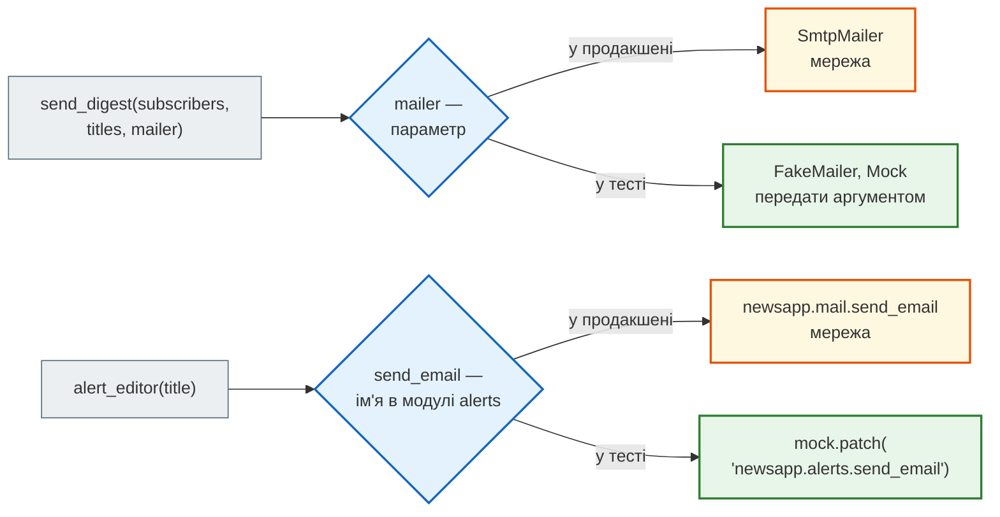

# Підміни: dummy, stub, mock, spy, fake

## Проблема { #problem }

Коли редактор публікує новину, підписники отримують лист. Справжня відправка ходить по мережі до SMTP-сервера: тест з нею повільний, залежить від мережі й чужого сервера, а в гіршому разі розсилає листи справжнім людям. Те саме з HTTP-запитами до чужих сайтів, LLM API (кожен виклик коштує грошей), Telegram, поточним часом і випадковістю. Такі залежності — **межі системи** — у тестах замінюють.

Але підміну легко перестаратися. Тест, у якому замінено все, перевіряє не поведінку, а те, **як** код написано: він зелений, навіть коли справжні частини одна з одною не стикуються, і червоніє від кожного рефакторингу. Ця сторінка — про види підмін (test doubles), інструменти `unittest.mock` і вибір між моком і фейком.

## Ментальна модель { #mental-model }

Залежність потрапляє в код одним із двох шляхів, і від цього залежить, як її підмінити:



- **Залежність параметром** (`mailer`) — підміну просто передають аргументом. Це **впровадження залежностей** (dependency injection): функція не вирішує сама, куди слати, — їй це дають. У FastAPI ту саму роль грає `Depends` і `app.dependency_overrides` ([Тестування FastAPI](testing_fastapi.md#overrides)).
- **Залежність імпортом** (`from .mail import send_email`) — підміняють ім'я в модулі, де його **шукає** код: `mock.patch("newsapp.alerts.send_email")`.

Код, який легко тестувати, майже завжди має й кращу архітектуру: чіткі межі, малі частини, явні залежності.

Види підмін (терміни Джерарда Месароша, «xUnit Test Patterns»):

| Вид | Що робить | Що перевіряє тест | У прикладі |
|---|---|---|---|
| **dummy** | лише заповнює параметр; не має використовуватися | нічого | `mock.Mock(spec=[])` |
| **stub** | дає готову відповідь | результат коду, що тестується | клас `AlwaysOk` |
| **mock** | записує виклики | **як** код скористався залежністю | `mock.Mock()` + `assert_called_once_with` |
| **spy** | справжня поведінка + запис викликів | і результат, і виклики | `mock.Mock(wraps=fake)` |
| **fake** | робоча спрощена реалізація зі станом | результат і стан фейку | `FakeMailer`, SQLite, fakeredis |

У `unittest.mock` усі вони будуються з одного класу `Mock`; назва описує **роль** у тесті, а не клас.

Код — [`tests/test_doubles.py`](https://github.com/NikoriakViktor/news_hub/blob/main/examples/testing/tests/test_doubles.py), [`tests/fakes.py`](https://github.com/NikoriakViktor/news_hub/blob/main/examples/testing/tests/fakes.py), [`newsapp/digest.py`](https://github.com/NikoriakViktor/news_hub/blob/main/examples/testing/newsapp/digest.py), [`newsapp/alerts.py`](https://github.com/NikoriakViktor/news_hub/blob/main/examples/testing/newsapp/alerts.py) у [`examples/testing`](https://github.com/NikoriakViktor/news_hub/tree/main/examples/testing).

## Код, який підміняємо { #code }

```python title="newsapp/digest.py (фрагмент)"
def send_digest(subscribers: list[str], titles: list[str], mailer: Mailer) -> dict[str, list[str]]:
    """Лист кожному підписнику; збій одного не зупиняє інших. Немає новин — листів немає."""
    report: dict[str, list[str]] = {"sent": [], "failed": []}
    if not titles:
        return report
    body = "\n".join(f"• {title}" for title in titles)
    for email in subscribers:
        try:
            mailer.send(email, subject=f"Дайджест новин: {len(titles)}", body=body)
        except ConnectionError:
            report["failed"].append(email)
        else:
            report["sent"].append(email)
    return report
```

`Mailer` — `Protocol` з одним методом `send(to, subject, body) -> str`; справжня реалізація — `SmtpMailer` у [`newsapp/mail.py`](https://github.com/NikoriakViktor/news_hub/blob/main/examples/testing/newsapp/mail.py). Що треба перевірити: лист кожному, текст листа, збій одного не зупиняє інших, без новин листів немає.

## Dummy і stub { #dummy-stub }

```python title="tests/test_doubles.py (фрагмент)"
def test_dummy_is_never_touched() -> None:
    """Dummy — лише щоб заповнити параметр. spec=[]: будь-яке звернення до атрибута — AttributeError."""
    assert send_digest(READERS, [], mailer=mock.Mock(spec=[])) == {"sent": [], "failed": []}


def test_stub_gives_canned_answer() -> None:
    """Stub — готова відповідь; що з ним робили, тест не питає."""
    class AlwaysOk:
        def send(self, to: str, subject: str, body: str) -> str:
            return "id-1"

    assert send_digest(READERS, ["Новина"], AlwaysOk())["sent"] == READERS
```

`mock.Mock(spec=[])` — суворий dummy: у нього немає жодного атрибута, тож якби `send_digest` без новин усе-таки звернувся до `mailer.send`, тест упав би з `AttributeError`. Звичайний `None` замість dummy впаде так само, але тип-чекер його не пропустить.

## Mock: запис викликів { #mock }

`mock.Mock()` — об'єкт, у якого є **будь-який** атрибут і метод. Він приймає будь-які аргументи й запам'ятовує кожен виклик:

```python
mailer = mock.Mock()
print(send_digest(["olena@example.com", "taras@example.com"], ["Новина"], mailer))
print(mailer.send.call_count, mailer.send.call_args)
print(mailer.send.return_value)
mailer.send.side_effect = ConnectionError("таймаут")
print(send_digest(["olena@example.com"], ["Новина"], mailer))
```

```text
{'sent': ['olena@example.com', 'taras@example.com'], 'failed': []}
2 call('taras@example.com', subject='Дайджест новин: 1', body='• Новина')
<Mock name='mock.send()' id='133226963414832'>
{'sent': [], 'failed': ['olena@example.com']}
```

| Атрибут / метод | Що означає |
|---|---|
| `return_value` | що повертає виклик; за замовчуванням — новий `Mock` |
| `side_effect = виняток` | виклик кидає виняток |
| `side_effect = [a, b, …]` | кожен виклик бере наступний елемент; виняток у списку — кидається |
| `side_effect = функція` | виклик передається у функцію, її результат — відповідь |
| `called`, `call_count`, `call_args`, `call_args_list` | що з моком робили |
| `assert_called_once_with(...)`, `assert_any_call(...)`, `assert_not_called()` | перевірка викликів з повідомленням про різницю |
| `mock.ANY` | дорівнює будь-чому: `assert_called_once_with(URL, timeout=mock.ANY)` |
| `MagicMock` | `Mock` + «магічні» методи: `__len__`, `__iter__`, `__enter__`/`__exit__`, `__aenter__`/`__aexit__` |
| `AsyncMock` | метод, який треба `await`; `MagicMock` дає його для `__aenter__` сам |

```python title="tests/test_doubles.py (фрагмент)"
def test_mock_records_calls() -> None:
    mailer = mock.Mock()
    send_digest(["olena@example.com"], ["Перша", "Друга"], mailer)
    mailer.send.assert_called_once_with("olena@example.com", subject="Дайджест новин: 2", body="• Перша\n• Друга")


def test_side_effect_sequence() -> None:
    """side_effect — список: перший виклик кидає виняток, другий повертає значення."""
    mailer = mock.Mock()
    mailer.send.side_effect = [ConnectionError("таймаут"), "id-2"]
    assert send_digest(READERS, ["Новина"], mailer) == {"sent": READERS[1:], "failed": READERS[:1]}
    assert mailer.send.call_count == 2
```

`side_effect` — головний інструмент мока: він відтворює те, чого справжня залежність на замовлення не зробить (тайм-аут, обрив, 403 на другому запиті). Мок мережі з `MagicMock`, `AsyncMock` і `async with` — у [кроці 5, «Мок мережі»](../tutorials/05_api_testing/mock_network.md#mock-session).

`assert_called_once_with` перевіряє аргументи **так, як їх передали**: виклик `send(email, subject=..., body=...)` не дорівнює `send(email, ..., ...)` позиційно. Тест на мок прив'язаний до форми виклику — це ціна, про яку [нижче](#when-mock-hurts).

## Spy і fake { #spy-fake }

```python title="tests/fakes.py"
class FakeMailer:
    """Пошта в пам'яті: листи — у outbox; адреси з `down` «не відповідають» (ConnectionError)."""

    def __init__(self, down: set[str] | None = None) -> None:
        self.outbox: list[tuple[str, str, str]] = []
        self.down = down or set()

    def send(self, to: str, subject: str, body: str) -> str:
        if to in self.down:
            raise ConnectionError(f"{to}: сервер не відповідає")
        self.outbox.append((to, subject, body))
        return f"fake-{len(self.outbox)}"
```

```python title="tests/test_doubles.py (фрагмент)"
def test_spy_wraps_real_object() -> None:
    """Spy — справжня поведінка (тут — фейку) плюс запис викликів."""
    fake = FakeMailer()
    spy = mock.Mock(wraps=fake)
    send_digest(READERS, ["Новина"], spy)
    assert fake.sent_to() == READERS                          # листи справді «пішли»
    assert [c.args[0] for c in spy.send.call_args_list] == READERS


def test_fake_has_state_and_rules() -> None:
    """Fake — робоча спрощена реалізація: пам'ятає листи, уміє «падати» для окремих адрес."""
    fake = FakeMailer(down={"taras@example.com"})
    report = send_digest(READERS, ["Новина"], fake)
    assert report == {"sent": ["olena@example.com"], "failed": ["taras@example.com"]}
    assert fake.outbox == [("olena@example.com", "Дайджест новин: 1", "• Новина")]
```

Фейк перевіряє **результат** — що опинилося в «скриньці», — а не форму виклику. Перепишеш `send_digest` так, що він передає `subject` позиційно, — тест на мок з `assert_called_once_with(..., subject=...)` почервоніє, тест на фейк лишиться зеленим, бо листи ті самі.

## Коли мок шкодить, а фейк кращий { #when-mock-hurts }

| | Mock | Fake |
|---|---|---|
| що перевіряє | взаємодію: який метод, з якими аргументами | стан і результат |
| рефакторинг без зміни поведінки | часто ламає тест | тест лишається зеленим |
| залежність зі станом (сховище, черга, пошта) | сценарій розписується викликами | стан — у фейку |
| рідкісні збої (тайм-аут, 403 на другому запиті) | `side_effect` — одним рядком | треба вбудувати правило у фейк |
| написати | нуль коду | клас, який теж треба підтримувати |
| брехня | мок прийме будь-який виклик ([нижче](#autospec)) | фейк може розійтися зі справжнім |

!!! warning "Мокай межі, не власний код"
    Мокати варто **межі системи**: мережу, пошту, платежі, LLM, час, випадковість. Якщо мокати власні функції (парсер, модель, репозиторій), тест перевіряє не поведінку, а те, як код розкладено по функціях: будь-який рефакторинг ламає тести, хоча програма працює. А тест, у якому замокано все, проходить, навіть коли справжні частини одна з одною не стикуються.

Фейк, у свою чергу, теж спрощує: SQLite пропускає те, що PostgreSQL відхиляє ([Тести з базою даних](test_databases.md#sqlite-vs-postgres)), fakeredis не показує гонок ([крок 5, «Межа фейку»](../tutorials/05_api_testing/fake_server.md#fakeredis-limit)). Тому поруч зі швидким фейком потрібен хоча б один прогін на справжній залежності. Схема вибору «справжнє — фейк — мок — справжній сервер» — у [кроці 5, «Як обрати підміну»](../tutorials/05_api_testing/fake_server.md#choose).

## `patch`: підміна імені в модулі { #patch }

Не весь код приймає залежності параметром:

```python title="newsapp/alerts.py"
from .mail import send_email

EDITOR = "editor@example.com"


def alert_editor(title: str) -> str:
    """Термінова новина → лист редактору. Повертає id листа."""
    return send_email(EDITOR, subject="Терміново", body=title)
```

`mock.patch("модуль.ім'я")` тимчасово кладе мок на місце імені і повертає оригінал після `with` (чи після тесту, якщо це декоратор):

```python title="tests/test_doubles.py (фрагмент)"
def test_patch_where_used() -> None:
    """alerts.py робить `from .mail import send_email` — патчимо ім'я в alerts, а не в mail."""
    with mock.patch("newsapp.alerts.send_email", return_value="id-7") as fake_send:
        assert alerts.alert_editor("Уряд ухвалив бюджет") == "id-7"
    fake_send.assert_called_once_with("editor@example.com", subject="Терміново", body="Уряд ухвалив бюджет")
```

### Patch where used { #where-to-patch }

Головне правило: підміняти ім'я там, де його **шукає** код, а не там, де функцію визначено. Рядок `from .mail import send_email` створив у модулі `newsapp.alerts` **власне** ім'я `send_email`, що вказує на ту саму функцію. Патч `newsapp.mail.send_email` міняє лише ім'я в `mail`:

```python title="demos/test_wrong_patch.py"
def test_patch_where_defined() -> None:
    with mock.patch("newsapp.mail.send_email", return_value="id-7"):
        assert alerts.alert_editor("Уряд ухвалив бюджет") == "id-7"
```

```text
$ pytest -q demos/test_wrong_patch.py
newsapp/alerts.py:9: in alert_editor
newsapp/mail.py:33: in send_email
newsapp/mail.py:26: in send
E               ConnectionRefusedError: [Errno 111] Connection refused
1 failed in 0.12s
```

Тест викликав справжню `send_email` і спробував з'єднатися з SMTP-сервером. Тут його немає, і тест упав. Гірше, коли сервер є: тест зелений і надсилає справжній лист.

| Як імпортовано в `alerts.py` | Що патчити |
|---|---|
| `from .mail import send_email` | `newsapp.alerts.send_email` |
| `from . import mail` → `mail.send_email(...)` | `newsapp.mail.send_email` (шукається в `mail` під час виклику) |
| `import smtplib` → `smtplib.SMTP(...)` | `smtplib.SMTP` або `newsapp.mail.smtplib.SMTP` — той самий об'єкт модуля |

Розбір того самого правила на мережі News Hub, з діаграмою імен, — [крок 5, «patch where used»](../tutorials/05_api_testing/mock_network.md#patch-where-used).

### Форми `patch` { #patch-forms }

```python title="tests/test_doubles.py (фрагмент)"
@mock.patch.object(alerts, "EDITOR", "night-editor@example.com")
@mock.patch("newsapp.alerts.send_email")
def test_patch_as_decorator(fake_send: mock.Mock) -> None:
    """Декоратори застосовуються знизу вгору; patch.object з новим значенням аргумент не додає."""
    alerts.alert_editor("Вночі")
    assert fake_send.call_args.args == ("night-editor@example.com",)
```

| Форма | Коли |
|---|---|
| `with mock.patch("a.b") as m:` | підміна на кілька рядків тесту |
| `@mock.patch("a.b")` | на весь тест; мок приходить аргументом, **нижній декоратор — перший аргумент** |
| `mock.patch.object(модуль_або_клас, "ім'я")` | коли об'єкт уже імпортовано: без рядка з шляхом, одруківку видно одразу |
| `mock.patch("a.b", новe_значення)` | підставити не мок, а значення (константу); аргумент у тест не додається |
| `mock.patch.dict(os.environ, {"K": "v"})` | тимчасово змінити словник |
| `monkeypatch.setattr(...)` | те саме без мока — [Фікстури](fixtures.md#monkeypatch) |

Порядок аргументів при кількох декораторах — часте джерело плутанини: декоратор найближчий до функції застосовується першим і дає перший аргумент.

## `autospec`: мок, що знає справжній інтерфейс { #autospec }

Звичайний `Mock` не знає, що підміняє. Одруківка в імені аргументу чи методу — і жодної помилки:

```python title="tests/test_doubles.py (фрагмент)"
def test_plain_mock_accepts_any_call() -> None:
    """Звичайний Mock не знає справжнього інтерфейсу: одруківка в аргументі — і жодної помилки."""
    mailer = mock.Mock()
    mailer.send("olena@example.com", subjekt="Дайджест")       # у SmtpMailer.send немає subjekt
    mailer.sned("olena@example.com")                          # і методу sned теж немає
    assert mailer.send.called and mailer.sned.called


def test_autospec_checks_the_real_signature() -> None:
    mailer = mock.create_autospec(SmtpMailer, instance=True)
    with pytest.raises(TypeError, match="missing a required argument: 'subject'"):
        mailer.send("olena@example.com", subjekt="Дайджест")
    with pytest.raises(AttributeError, match="sned"):
        mailer.sned("olena@example.com")
```

```text
autospec: missing a required argument: 'subject'
autospec: Mock object has no attribute 'sned'
```

Це не теоретична проблема. Змінився підпис справжнього `send` (перейменували `subject` на `title`), а код і тести на звичайних моках не оновили — усі тести зелені, у продакшені `TypeError`. `autospec` перевіряє кожен виклик за підписом справжнього класу.

| Спосіб | Що перевіряє |
|---|---|
| `Mock(spec=SmtpMailer)` | лише імена атрибутів; читання неіснуючого — `AttributeError` |
| `Mock(spec_set=SmtpMailer)` | ще й забороняє **присвоювати** неіснуючі атрибути |
| `mock.create_autospec(SmtpMailer, instance=True)` | імена і підписи методів, рекурсивно |
| `mock.patch("a.b", autospec=True)` | те саме для `patch` |

Окремо `Mock` захищає від одруківок у самих перевірках. `mailer.send.assert_called_onse()` у старих версіях Python створив би новий атрибут і мовчки нічого не перевірив; тепер це помилка:

```text
AttributeError: 'assert_called_onse' is not a valid assertion. Use a spec for the mock if 'assert_called_onse' is meant to be an attribute.
```

Захист спрацьовує на атрибутах, що починаються з `assert`, `assret`, `asert`, `aseert`, `assrt`, а з Python 3.12 — ще й на назвах assert-методів без `assert_`: `called_once`, `called_once_with`, `not_called` тощо. Вимикає його `Mock(unsafe=True)`.

## Час і випадковість { #time }

`datetime.now()`, `time.monotonic()`, `random`, `uuid4` — теж зовнішні межі: тест з ними не відтворюється. Три способи, від найкращого:

1. **параметр**: `def is_fresh(published: datetime, now: datetime | None = None)`, у тесті передати фіксований `now`;
2. **залежність**: `clock: Callable[[], datetime]` як аргумент класу чи `Depends`, у тесті — `lambda: FIXED`;
3. **патч**: `mock.patch("newsapp.x.datetime")` — останній варіант, крихкий (і `datetime.datetime` вбудований тип, його атрибути не патчаться напряму).

Для тайм-аутів не чекають справжні секунди: зменшують значення в тесті (`monkeypatch` тайм-ауту в [кроці 5](../tutorials/05_api_testing/fake_server.md#more-tests)) або підміняють затримку повторів (`TELEGRAM_RETRY_DELAYS` у тестах webhook News Hub).

## У News Hub { #news-hub }

| Межа | Підміна | Вид | Де |
|---|---|---|---|
| HTTP до rbc.ua в unit-тестах | `MagicMock` замість `aiohttp.ClientSession` | mock + stub | [крок 5, «Мок мережі»](../tutorials/05_api_testing/mock_network.md) |
| HTTP до rbc.ua в integration | `aiohttp.test_utils.TestServer` з `tests/fixtures/*.html` | fake | [крок 5, «Фейк замість моку»](../tutorials/05_api_testing/fake_server.md) |
| скрапер для API-тестів | `fake_scraper` через `dependency_overrides[get_scrapers]` | stub | [`tests/integration/conftest.py`](https://github.com/NikoriakViktor/news_hub/blob/main/steps/12_ci_cd/tests/integration/conftest.py) |
| LLM | `FakeLLM(replies)`: черга відповідей і винятків, `calls` — усі промпти | fake + spy | [крок 7, «`FakeLLM`»](../tutorials/07_llm_api/llm_client.md#fake-llm) |
| SDK Gemini всередині справжнього `GeminiClient` | `FakeGeminiModels`: відповіді по черзі, `calls` | fake | [`tests/unit/test_llm.py`](https://github.com/NikoriakViktor/news_hub/blob/main/steps/12_ci_cd/tests/unit/test_llm.py) |
| Telegram Bot API | `TelegramTwin` — локальний сервер з правилами Telegram (401, 403, 429, HTML, 4096 символів) | fake | [крок 9, «двійник Bot API»](../tutorials/09_telegram_bot/bot_structure.md#twin) |
| Redis | fakeredis; для гонок — `TEST_REDIS_URL` | fake | [крок 5, «Межа фейку»](../tutorials/05_api_testing/fake_server.md#fakeredis-limit) |
| мережа взагалі | `monkeypatch.setattr(socket, "create_connection", no_network)` — доказ, що парсер RSS не ходить у мережу | stub, що падає | [`tests/unit/test_pravda.py`](https://github.com/NikoriakViktor/news_hub/blob/main/steps/12_ci_cd/tests/unit/test_pravda.py) |

Зверни увагу на `test_llm.py`: тест створює **справжній** `GeminiClient` і підміняє лише внутрішній `client._client` — найнижчий шар, що ходить у мережу. Так перевіряється власний код навколо SDK (порядок моделей, що вважається збоєм, що йде в запит), а не сам SDK. Справжні виклики LLM — окремо, з маркером `llm`.

## Типові помилки { #mistakes }

| Помилка | Наслідок | Як правильно |
|---|---|---|
| патч там, де функцію визначено | код викликає справжню функцію (мережа, листи) | патч там, де ім'я **шукають** |
| звичайний `Mock` замість реального класу | одруківки й зміни підпису не помітні | `create_autospec` або `autospec=True` |
| мок власного коду (парсер, репозиторій) | тест ламається від рефакторингу, не ловить нестиковок | справжній код; мок — лише межа системи |
| перевірка лише `called` | не видно, з якими аргументами й скільки разів | `assert_called_once_with(...)` |
| `assert mock.called_once_with(...)` | раніше — завжди істина; тепер `AttributeError` | `mock.assert_called_once_with(...)` |
| `return_value` для `async`-методу | `await` на `Mock` — `TypeError` | `AsyncMock(return_value=...)` |
| порядок аргументів при кількох `@patch` | моки переплутано | нижній декоратор — перший аргумент |
| фейк ніколи не звіряють зі справжнім | фейк «бреше», тести зелені | хоча б один прогін на справжній залежності |

## Налагодження { #debugging }

- **Мок не спрацював** (тест викликав справжню функцію): надрукуй `модуль.ім'я is fake` усередині `with mock.patch(...) as fake` — `False` означає, що патч не там ([приклад у кроці 5](../tutorials/05_api_testing/mock_network.md#patch-where-used)).
- **Що з моком робили:** `print(m.mock_calls)` — усі виклики, разом із вкладеними (`call.send(...)`); `m.call_args_list` — лише прямі.
- **`AssertionError: expected call not found`** показує очікуваний і фактичний виклик поруч. Найчастіше різниця — позиційний аргумент проти іменованого.
- **Тест на мок зелений, а в продакшені `TypeError`** — підпис справжнього методу змінився. Увімкни `autospec`.

## Питання { #questions }

1. Чим stub відрізняється від mock?
2. Чому тест на фейк переживає рефакторинг, а тест на мок — не завжди?
3. `alerts.py` робить `from .mail import send_email`. Що патчити й чому?
4. Що станеться, якщо патчити не те ім'я, а SMTP-сервер існує?
5. Як `create_autospec` ловить помилку, якої не бачить `Mock()`?
6. Що треба мокати, а що — ні?
7. Як підмінити поточний час, щоб тест не залежав від дня запуску?
8. Чому для `FakeLLM` у News Hub є ще й тести з маркером `llm`?

??? success "Відповіді"

    1. Stub лише дає готову відповідь, тест перевіряє результат коду; mock записує виклики, і тест перевіряє, як код ним скористався.
    2. Фейк перевіряють за станом (що опинилося в `outbox`), а мок — за формою виклику, яка при рефакторингу змінюється.
    3. `newsapp.alerts.send_email`: імпорт створив у `alerts` власне ім'я, і `alert_editor` шукає саме його.
    4. Тест надішле справжній лист і, можливо, пройде.
    5. Перевіряє виклики за підписом справжнього класу: неіснуючий аргумент чи метод — `TypeError`/`AttributeError`.
    6. Межі системи: мережу, пошту, платежі, LLM, час, випадковість. Власні функції — ні.
    7. Передати `now` параметром або годинник залежністю; патч `datetime` — останній варіант.
    8. Фейк може розійтися зі справжнім провайдером; рідкісний прогін на справжньому API звіряє контракт.

## Що далі { #next }

[Тестування FastAPI: `TestClient`, `AsyncClient`, `dependency_overrides`](testing_fastapi.md) — та сама ідея підміни, але для залежностей ендпоінтів.

**Джерела:** Python — [`unittest.mock`](https://docs.python.org/3/library/unittest.mock.html) (розділи «Where to patch», «Autospeccing», «side_effect»), [`unittest.mock` — getting started](https://docs.python.org/3/library/unittest.mock-examples.html); pytest — [How to monkeypatch/mock modules and environments](https://docs.pytest.org/en/stable/how-to/monkeypatch.html); Martin Fowler — [Mocks Aren't Stubs](https://martinfowler.com/articles/mocksArentStubs.html), [Test Double](https://martinfowler.com/bliki/TestDouble.html); Django-книга — [Mock і patch](https://nikoriakviktor.github.io/notes_chat_app/08_testing_and_quality/mocking_and_patching_full/).
