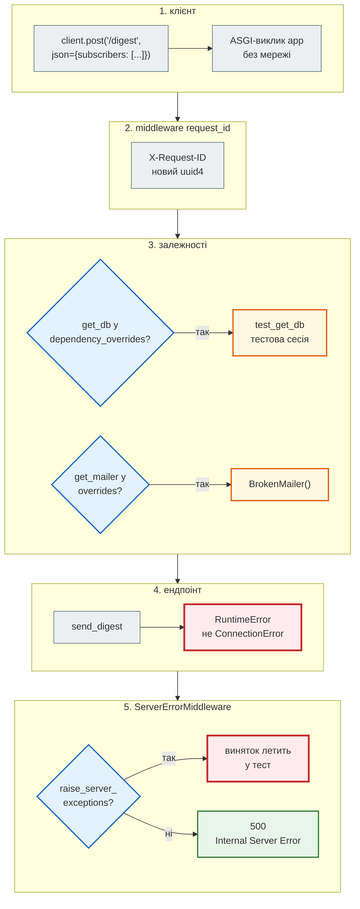

# Тестування FastAPI: `TestClient`, `AsyncClient`, `dependency_overrides`

## Проблема { #problem }

Функцію перевіряє виклик функції. Ендпоінт — це вже більше: маршрут, перевірка тіла Pydantic, залежності (`Depends`), middleware, обробники помилок, `lifespan`, серіалізація відповіді. Тест, що викликає функцію ендпоінта напряму, нічого з цього не перевіряє. Запускати справжній сервер (`uvicorn`) і слати запити по мережі — повільно, потрібен вільний порт, а база й пошта будуть справжні.

FastAPI дає третій шлях: клієнт, що викликає ASGI-застосунок **як функцію**, без мережі, але через увесь стек. А `app.dependency_overrides` дозволяє замінити будь-яку залежність — базу, пошту, LLM — не чіпаючи код ендпоінтів. Ця сторінка — про обидва інструменти і про пастки: `lifespan`, що не запустився, виняток замість `500`, підміни, що пережили тест.

## Ментальна модель { #mental-model }

Запит у тесті проходить той самий шлях, що й від браузера, — лише без мережі. Ось `POST /digest`, де пошту підмінено класом, що кидає `RuntimeError`:



| | `TestClient` | `httpx.AsyncClient` + `ASGITransport` |
|---|---|---|
| тест | звичайна функція | корутина (`@pytest.mark.asyncio`) |
| застосунок | у своєму потоці й циклі подій (anyio portal) | у циклі подій тесту |
| `lifespan` | запускає `with TestClient(app)` | не запускає; `app.router.lifespan_context(app)` |
| виняток застосунку | за замовчуванням летить у тест | летить у тест (`raise_app_exceptions=True`) |
| одночасні запити | ні, по одному | `asyncio.gather` |
| бібліотека | `httpx2` у Starlette 1.x (раніше — `httpx`) | `httpx` |

Код — [`newsapp/api.py`](https://github.com/NikoriakViktor/news_hub/blob/main/examples/testing/newsapp/api.py), [`tests/conftest.py`](https://github.com/NikoriakViktor/news_hub/blob/main/examples/testing/tests/conftest.py), [`tests/test_api.py`](https://github.com/NikoriakViktor/news_hub/blob/main/examples/testing/tests/test_api.py), [`tests/test_async_api.py`](https://github.com/NikoriakViktor/news_hub/blob/main/examples/testing/tests/test_async_api.py), пастки — [`demos/test_client_pitfalls.py`](https://github.com/NikoriakViktor/news_hub/blob/main/examples/testing/demos/test_client_pitfalls.py).

## Застосунок, який тестуємо { #app }

```python title="newsapp/api.py (фрагмент)"
@asynccontextmanager
async def lifespan(app: FastAPI) -> AsyncIterator[None]:
    engine = make_engine(DATABASE_URL)
    Base.metadata.create_all(engine)
    app.state.session_factory = sessionmaker(engine, expire_on_commit=False)
    app.state.mailer = SmtpMailer()
    yield
    engine.dispose()


def get_db(request: Request) -> Iterator[Session]:
    """Сесія на запит: COMMIT, якщо ендпоінт успішний, ROLLBACK — якщо впав."""
    with request.app.state.session_factory() as session:
        try:
            yield session
            session.commit()
        except Exception:
            session.rollback()
            raise


def get_mailer(request: Request) -> Mailer:
    return request.app.state.mailer
```

Ендпоінти: `GET /health`, `POST /articles` (`201`, `409` для дубля, `422` для заголовка без слів), `GET /articles/{slug}` (`404`), `GET /articles?q=` (пошук), `POST /digest` (розсилка через `get_mailer`). Middleware `request_id` повертає `X-Request-ID` клієнта, якщо він безпечний (`[A-Za-z0-9-]{1,64}`), або новий.

## `TestClient` { #test-client }

```python
from fastapi.testclient import TestClient

with TestClient(app) as client:
    response = client.post("/articles", json={"title": "Коро", "source": "rbc.ua"})
```

```text
422 {"detail": [{"type": "string_too_short", "loc": ["body", "title"], "msg": "String should have at least 5 characters", "input": "Коро", "ctx": {"min_length": 5}}]}
201 65707e52323c43f48c8db6901bda97b2 {"slug": "уряд-ухвалив-бюджет", "title": "Уряд ухвалив бюджет", "source": "rbc.ua"}
409 {"detail": "новина з таким slug уже є"}
```

`TestClient` має інтерфейс `httpx.Client`: `get`, `post(json=...)`, `params=`, `headers=`, `cookies`, а відповідь — `status_code`, `json()`, `text`, `headers`. Застосунок крутиться в окремому потоці зі своїм циклом подій, тож тест лишається звичайною синхронною функцією. Параметри конструктора, корисні в тестах: `base_url`, `headers` (за замовчуванням для кожного запиту — так News Hub додає токен адміна), `raise_server_exceptions`, `follow_redirects`.

У Starlette 1.x `TestClient` працює на пакеті **`httpx2`**; зі старим `httpx` він ще працює, але з попередженням:

```text
StarletteDeprecationWarning: Using `httpx` with `starlette.testclient` is deprecated; install `httpx2` instead.
```

Тому в `requirements.txt` прикладу — обидва: `httpx2` для `TestClient`, `httpx` для `AsyncClient` (і як звичайний HTTP-клієнт).

### Що перевіряти у відповіді { #assertions }

```python title="tests/test_api.py (фрагменти)"
def test_create_then_get(client: TestClient) -> None:
    created = client.post("/articles", json=BUDGET)
    assert created.status_code == 201
    assert created.json() == {"slug": "уряд-ухвалив-бюджет", **BUDGET}
    assert client.get("/articles/уряд-ухвалив-бюджет").json()["title"] == BUDGET["title"]


@pytest.mark.parametrize(("body", "loc"), [
    ({"title": "Коро", "source": "rbc.ua"}, ["body", "title"]),           # min_length=5
    ({"title": "Уряд ухвалив бюджет", "source": "x" * 21}, ["body", "source"]),
    ({"title": "Уряд ухвалив бюджет"}, ["body", "source"]),               # поля немає
], ids=["short-title", "long-source", "missing-source"])
def test_invalid_body_is_422(client: TestClient, body: dict[str, str], loc: list[str]) -> None:
    response = client.post("/articles", json=body)
    assert response.status_code == 422
    assert response.json()["detail"][0]["loc"] == loc
```

- **Статус і тіло разом.** `assert (response.status_code, response.json()) == (404, {"detail": "новину не знайдено"})` — одним рядком, і при падінні видно обидва.
- **`422` перевіряй за `loc`**, а не за текстом `msg`: текст повідомлень Pydantic змінюється між версіями, шлях до поля — ні.
- **`json=`, а не `data=`**: `data=` надішле форму, і ендпоінт з моделлю Pydantic відповість `422`.
- **Один сценарій — кілька запитів.** `test_duplicate_is_409_and_first_survives`: `201`, потім `409`, потім `GET` першої — `200`. Так перевіряється не лише код відповіді, а й те, що `ROLLBACK` після дубля не зачепив уже збережене.

## `dependency_overrides` { #overrides }

`app.dependency_overrides` — звичайний словник на об'єкті застосунку: **ключ — оригінальна функція-залежність, значення — що викликати замість неї**. FastAPI перевіряє його під час кожного запиту, тож код ендпоінтів не змінюється.

```python title="tests/conftest.py (фрагмент)"
@pytest.fixture
def client(db: Session, mailer: FakeMailer) -> Iterator[TestClient]:
    """API над тестовою сесією і фейковою поштою; lifespan запускається (with), підміни прибираються."""
    def test_get_db() -> Iterator[Session]:              # той самий контракт, що newsapp.api.get_db
        try:
            yield db
            db.commit()
        except Exception:
            db.rollback()
            raise

    app.dependency_overrides[get_db] = test_get_db
    app.dependency_overrides[get_mailer] = lambda: mailer
    with TestClient(app) as c:
        yield c
    app.dependency_overrides.clear()
```

| Правило | Чому |
|---|---|
| ключ — **той самий** об'єкт функції, що в `Depends(...)` | підміна шукається за `is`; копія чи обгортка з тим самим іменем не спрацює |
| підміна тримає **контракт** оригіналу | `test_get_db` так само робить `commit` і `rollback`; інакше тест перевіряє інший застосунок |
| підміна може мати власні параметри і `Depends` | FastAPI розв'язує її так само, як оригінал |
| значення — будь-що, що можна викликати | `lambda: mailer`, функція, **клас** (`BrokenMailer` — FastAPI викличе `BrokenMailer()`) |
| `clear()` після тесту | словник живе на об'єкті `app` між тестами |

Підміна діє на всі місця, де залежність використовується, включно з вкладеними (`Depends(get_db)` усередині іншої залежності). Підміняти можна і залежності, що повертають налаштування (`get_settings`), і клієнти зовнішніх сервісів — так у тестах з'являються фейки з [попередньої сторінки](test_doubles.md).

!!! warning "Підміна, яку не прибрали"
    Тест, що поставив `app.dependency_overrides[get_mailer] = BrokenMailer` і не прибрав, ламає всі наступні тести розсилки — і лише тоді, коли запускаються разом. Тому підміни ставлять у фікстурі з `yield` і `clear()` після нього. Тест у прикладі змінює підміну **всередині** фікстури `client`, тож її прибирання спрацює й для нього.

### Справжні залежності теж треба виконати { #real-dependencies }

Підмінений `get_db` не виконується в жодному тесті, що використовує `client`. Якщо в ньому помилка (забули `commit`), тести зелені. Тому хоча б один тест іде без підмін:

```python title="tests/test_api.py (фрагмент)"
def test_lifespan_creates_real_dependencies() -> None:
    """Без підмін: справжній lifespan, справжній get_db (SQLite у пам'яті застосунку)."""
    with TestClient(app) as c:
        assert isinstance(app.state.mailer, SmtpMailer)
        assert c.post("/articles", json=BUDGET).status_code == 201
        assert c.get("/articles/уряд-ухвалив-бюджет").status_code == 200     # COMMIT справжнього get_db
    with TestClient(app) as c:                                                    # новий старт — нова база
        assert c.get("/articles/уряд-ухвалив-бюджет").status_code == 404
```

Другий `GET` у новому запиті бачить новину лише тому, що справжній `get_db` зробив `COMMIT`. А новий старт застосунку — нова база в пам'яті.

## `lifespan` у тестах { #lifespan }

`TestClient(app)` **без** `with` не запускає `lifespan`. Запити працюють, але все, що `lifespan` кладе в `app.state`, відсутнє:

```python title="demos/test_client_pitfalls.py (фрагмент)"
def test_without_with_no_lifespan() -> None:
    client = TestClient(app)
    assert client.post("/digest", json={"subscribers": ["olena@example.com"]}).status_code == 200
```

```text
E           KeyError: 'session_factory'
newsapp/api.py:43: in request_id
newsapp/api.py:50: in get_db
E           AttributeError: 'State' object has no attribute 'session_factory'
FAILED demos/test_client_pitfalls.py::test_without_with_no_lifespan - Attribu...
```

`httpx.ASGITransport` `lifespan` не запускає взагалі. Окремо той самий тест падає так само, а **після** іншого тесту — інакше:

```text
$ pytest -q demos/test_client_pitfalls.py -k asgi
E           AttributeError: 'State' object has no attribute 'session_factory'
1 failed, 2 deselected in 0.59s
$ pytest -q demos/test_client_pitfalls.py
E       sqlalchemy.exc.OperationalError: (sqlite3.OperationalError) no such table: articles
FAILED demos/test_client_pitfalls.py::test_asgi_transport_without_lifespan - ...
```

`app.state` — атрибут об'єкта `app`, і він пережив попередній тест: там лишилася фабрика сесій від минулого `lifespan`, чий engine уже закрито, а база в пам'яті зникла. Тест бачить «напівживий» стан і падає не там, де помилка. Висновок той самий: `lifespan` у кожному тесті запускає фікстура.

```python title="tests/test_async_api.py (фрагмент)"
@pytest_asyncio.fixture
async def aclient() -> AsyncIterator[httpx.AsyncClient]:
    """ASGITransport lifespan не запускає — запускаємо його самі."""
    async with app.router.lifespan_context(app):
        transport = httpx.ASGITransport(app=app)
        async with httpx.AsyncClient(transport=transport, base_url="http://test") as c:
            yield c
```

`app.router.lifespan_context(app)` — той самий `lifespan`, що запускає uvicorn. Альтернатива — пакет `asgi-lifespan` (`LifespanManager(app)`), який ще й перевіряє, що старт і зупинка завершились вчасно.

## Помилка сервера: `500` і `raise_server_exceptions` { #server-errors }

Необроблений виняток у застосунку `TestClient` за замовчуванням **передає в тест**:

```text
$ pytest -q demos/test_client_pitfalls.py
newsapp/api.py:43: in request_id
newsapp/api.py:114: in digest
newsapp/digest.py:15: in send_digest
>       raise RuntimeError("SMTP пароль: hunter2")
E       RuntimeError: SMTP пароль: hunter2
FAILED demos/test_client_pitfalls.py::test_server_exception_reaches_the_test
```

Для налагодження це зручно: видно трасування з місцем помилки. Але так не перевірити, що **клієнт** отримує: чи це `500`, і чи не потрапили в тіло подробиці. Для цього — `raise_server_exceptions=False`:

```python title="tests/test_api.py (фрагмент)"
class BrokenMailer:
    def send(self, to: str, subject: str, body: str) -> str:
        raise RuntimeError("SMTP пароль: hunter2")        # не ConnectionError — send_digest не ловить


def test_unexpected_error_is_500_without_details(client: TestClient) -> None:
    app.dependency_overrides[get_mailer] = BrokenMailer
    client.post("/articles", json=BUDGET)
    quiet = TestClient(app, raise_server_exceptions=False)        # відповідь 500, а не виняток у тесті
    response = quiet.post("/digest", json={"subscribers": ["olena@example.com"]})
    assert (response.status_code, response.text) == (500, "Internal Server Error")
    assert "hunter2" not in response.text
    assert "X-Request-ID" not in response.headers      # 500 формує ServerErrorMiddleware — зовні нашого middleware
```

Другий клієнт не входить у `with` — `lifespan` уже запустив `client`, і `quiet` працює з тим самим `app` та тими самими підмінами. `ServerErrorMiddleware` Starlette відповідає `500` з текстом `Internal Server Error`, без трасування (поки не увімкнено `debug=True`). Тест фіксує саме це: секрет з повідомлення винятку не дійшов до клієнта.

`httpx.ASGITransport` має такий самий перемикач: `ASGITransport(app=app, raise_app_exceptions=False)`.

## Middleware { #middleware }

Middleware тестують запитами через клієнт: він проходить увесь ланцюг, як і справжній запит.

```python title="tests/test_api.py (фрагмент)"
@pytest.mark.parametrize(("sent", "kept"), [
    ("abc-123", True),
    ("", False),                              # немає — генеруємо
    ("x" * 65, False),                        # задовгий
    ("<script>alert(1)</script>", False),     # потрапив би в журнали як є
], ids=["valid", "missing", "too-long", "unsafe-chars"])
def test_request_id_middleware(client: TestClient, sent: str, kept: bool) -> None:
    rid = client.get("/health", headers={"X-Request-ID": sent}).headers["X-Request-ID"]
    if kept:
        assert rid == sent
    else:
        assert rid != sent and len(rid) == 32
```

- Перевір обидва шляхи: заголовок прийнято і замінено. Значення, яке приходить від клієнта і потрапляє в журнали, — вхідні дані, і їх перевіряють так само, як тіло.
- Перевір відповіді з помилками. У прикладі `X-Request-ID` є у відповідях `404` і `422`, а в `500` від необробленого винятку — **немає**: виняток пролітає крізь `call_next`, і відповідь формує `ServerErrorMiddleware`, що стоїть зовні всіх middleware застосунку. Якщо id потрібен і там (щоб знайти запит у журналі), потрібен обробник `@app.exception_handler(Exception)` або ASGI-middleware, що сам ловить виняток. Порядок, у якому middleware бачать запит і відповідь, — у [Частині VI](../06_middleware_cache_jobs/README.md).
- Middleware, що залежить від часу чи лічильника (rate limit), тестують ще й одночасними запитами — для цього потрібен `AsyncClient` ([крок 5, «rate limit під одночасними запитами»](../tutorials/05_api_testing/async_client.md#rate-limit)).

## `httpx.AsyncClient` + `ASGITransport` { #async-client }

```python title="tests/test_async_api.py (фрагмент)"
pytestmark = pytest.mark.asyncio


async def test_concurrent_requests_get_distinct_ids(aclient: httpx.AsyncClient) -> None:
    responses = await asyncio.gather(*(aclient.get("/health") for _ in range(20)))
    assert {r.status_code for r in responses} == {200}
    assert len({r.headers["X-Request-ID"] for r in responses}) == 20
```

- `base_url="http://test"` — будь-яка адреса; без неї відносні шляхи `"/health"` не працюють.
- `pytestmark = pytest.mark.asyncio` на рівні модуля ставить маркер усім тестам файлу. Без `pytest-asyncio` (або `anyio`) pytest не виконує `async def`-тести.
- Синхронні ендпоінти (`def`) FastAPI і тут виконує в пулі потоків, тож «той самий цикл подій» стосується async-коду застосунку й тесту, а не всього.

`AsyncClient` потрібен, коли тест має робити одночасні запити або `await`-ити async-стан застосунку (Redis-клієнт з `app.state`). Для решти — `TestClient`: переписувати робочі синхронні тести немає потреби. Як це виглядає з Redis і rate limit, з діаграмою порядку подій, — [крок 5, «API асинхронно»](../tutorials/05_api_testing/async_client.md).

## У News Hub { #news-hub }

- **Підміни бази, фонових задач і скрапера** — в одному місці, клас `TestDatabase.install()`: `get_db`, `get_session_factory` (фонові задачі пишуть у тестову базу), `get_scrapers` (заглушка замість мережі) — [`tests/integration/conftest.py`](https://github.com/NikoriakViktor/news_hub/blob/main/steps/12_ci_cd/tests/integration/conftest.py), [крок 5](../tutorials/05_api_testing/async_client.md#test-database).
- **Клієнт адміна і анонім.** `anon` — `TestClient` без токена; `client` — той самий клієнт з `Authorization: Bearer …` у `headers` за замовчуванням ([крок 8](../tutorials/08_security/index.md)).
- **`raise_server_exceptions=False`** — у тесті, де падає `COMMIT` (`broken_commit_db` кидає виняток після `yield`, у [`tests/integration/test_crud.py`](https://github.com/NikoriakViktor/news_hub/blob/main/steps/12_ci_cd/tests/integration/test_crud.py)): клієнт має отримати `500`.
- **Зламана залежність замість зламаної бази.** Тести `/health/ready` підміняють `get_db` сесією до SQLite-файлу в неіснуючій папці, а `get_redis` — клієнтом на порт, де ніхто не слухає. Так перевіряється `503`, і те, що шлях до бази не потрапив у відповідь (`"secret-name" not in response.text`) — [`tests/integration/test_health.py`](https://github.com/NikoriakViktor/news_hub/blob/main/steps/12_ci_cd/tests/integration/test_health.py).
- **`lifespan` з `portal`.** `TestClient` запускає застосунок у своєму циклі подій, тож async-виклики (`create_tables`, `redis.flushdb`) фікстура робить через `c.portal.call(...)` — [крок 5](../tutorials/05_api_testing/async_client.md#task).
- **Підміна LLM для API** — фікстура `fake_llm` ставить `dependency_overrides[get_llm_client]` і прибирає лише свій ключ (`pop`), не чіпаючи підмін бази ([крок 7](../tutorials/07_llm_api/endpoints_and_tests.md#tests)).

## Типові помилки { #mistakes }

| Помилка | Наслідок | Як правильно |
|---|---|---|
| `TestClient(app)` без `with` | `lifespan` не запущено: `'State' object has no attribute …` | `with TestClient(app) as client:` у фікстурі |
| `ASGITransport` без `lifespan_context` | те саме, або «напівживий» `app.state` з минулого тесту | `async with app.router.lifespan_context(app):` |
| підміна без `clear()` | ламає наступні тести, лише в загальному прогоні | фікстура з `yield` і `clear()` |
| ключ підміни — не той об'єкт | підміна мовчки не діє, тест іде в справжню базу | імпортуй ту саму функцію, що в `Depends` |
| підміна без `commit`/`rollback` оригіналу | тест перевіряє не той застосунок | тримай контракт оригіналу |
| усі тести з підмінами | справжній `get_db` не виконується ніколи | хоча б один тест без підмін |
| очікування `500` з клієнтом за замовчуванням | тест падає з винятком застосунку | `raise_server_exceptions=False` |
| `data=` замість `json=` | `422`: тіло прийшло формою | `json=` |
| перевірка тексту `msg` у `422` | ламається з новою версією Pydantic | перевіряй `loc` і `type` |

## Налагодження { #debugging }

- **Невідомо, що повернув сервер:** `print(response.status_code, response.headers, response.text)` — до `assert`; pytest покаже вивід для тесту, що впав.
- **Виняток застосунку «губиться» за `500`:** прибери `raise_server_exceptions=False` — трасування з'явиться в тесті.
- **Підміна не діє:** `print(app.dependency_overrides)` у тесті — ключ має бути тим самим об'єктом, що в сигнатурі ендпоінта (`is`).
- **Тест проходить окремо, падає разом:** шукай `app.state` і `app.dependency_overrides` — вони живуть на одному об'єкті `app` для всіх тестів процесу.
- **`RuntimeError: ... attached to a different loop`** в async-тестах — ресурс (клієнт Redis, engine) створено в одному циклі подій, а використано в іншому. Створюй їх у фікстурі того самого scope, що й цикл (`asyncio_default_fixture_loop_scope`).

## Безпека { #security }

- **Тест на `500` перевіряє, що подробиці не витекли:** текст винятку, SQL, шлях до файлу, рядок підключення.
- **Тестові секрети — явні й несправжні.** `JWT_SECRET`, паролі й токени в тестах задають у `conftest.py` значеннями на кшталт `test-…`, а не читають з `.env` розробника.
- **Перевіряй і відмову, і доступ.** Для захищених ендпоінтів — тест без токена (`401`), з чужими правами (`403`) і з правильним токеном.
- **Заголовки від клієнта — вхідні дані**: `X-Request-ID`, `X-Forwarded-For` теж перевіряють тестами на межові й шкідливі значення.

## Питання { #questions }

1. Чим `TestClient` відрізняється від справжнього HTTP-запиту до uvicorn?
2. Що станеться з `app.state`, якщо створити `TestClient(app)` без `with`?
3. Чому тест з `ASGITransport` без `lifespan` упав по-різному окремо і разом з іншими?
4. Що є ключем у `app.dependency_overrides`? Що буде, якщо підставити туди копію функції?
5. Чому `test_get_db` у прикладі робить `commit` і `rollback`, хоча транзакцію все одно відкотить фікстура?
6. Навіщо `raise_server_exceptions=False`, якщо без нього видно трасування?
7. Коли брати `httpx.AsyncClient`, а коли — `TestClient`?
8. Чому `422` краще перевіряти за `loc`, а не за `msg`?

??? success "Відповіді"

    1. Немає мережі й сервера: клієнт викликає ASGI-застосунок як функцію, але через увесь стек — маршрути, залежності, middleware, обробники помилок.
    2. `lifespan` не виконається, і все, що він кладе в `app.state`, буде відсутнє: `AttributeError: 'State' object has no attribute …`.
    3. `app.state` живе на об'єкті `app`: після іншого тесту там лишилась фабрика сесій від минулого `lifespan` з уже закритою базою — звідси `no such table`.
    4. Оригінальна функція-залежність, порівняння — за ідентичністю. Копія не спрацює, і запит піде в справжню залежність.
    5. Щоб тест перевіряв той самий контракт, що в продакшені: `409` після `rollback` і збережена перша новина — саме це й перевіряється.
    6. Щоб перевірити, що отримує клієнт: статус `500` і відсутність подробиць у тілі.
    7. `AsyncClient` — для одночасних запитів і `await` до async-стану застосунку; решта — `TestClient`.
    8. Текст повідомлень Pydantic змінюється між версіями; шлях до поля і тип помилки — стабільні.

## Що далі { #next }

[Тести з базою даних: SQLite чи PostgreSQL, транзакція на тест, паралельність](test_databases.md) — що стоїть за фікстурою `db` і чому SQLite у пам'яті — не та сама база.

**Джерела:** FastAPI — [Testing](https://fastapi.tiangolo.com/tutorial/testing/), [Testing Dependencies with Overrides](https://fastapi.tiangolo.com/advanced/testing-dependencies/), [Testing Events: lifespan and startup — shutdown](https://fastapi.tiangolo.com/advanced/testing-events/), [Async Tests](https://fastapi.tiangolo.com/advanced/async-tests/); Starlette — [Test Client](https://starlette.dev/testclient/); HTTPX — [ASGI transport](https://www.python-httpx.org/advanced/transports/#asgi-transport); [pytest-asyncio](https://pytest-asyncio.readthedocs.io/); [asgi-lifespan](https://github.com/florimondmanca/asgi-lifespan).
