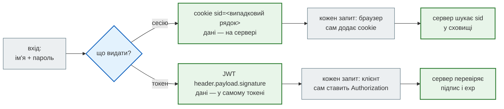
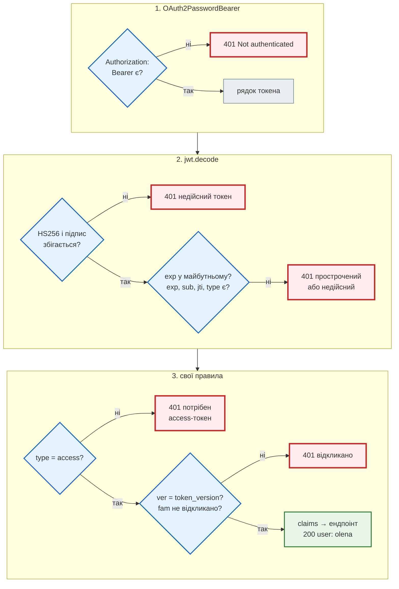
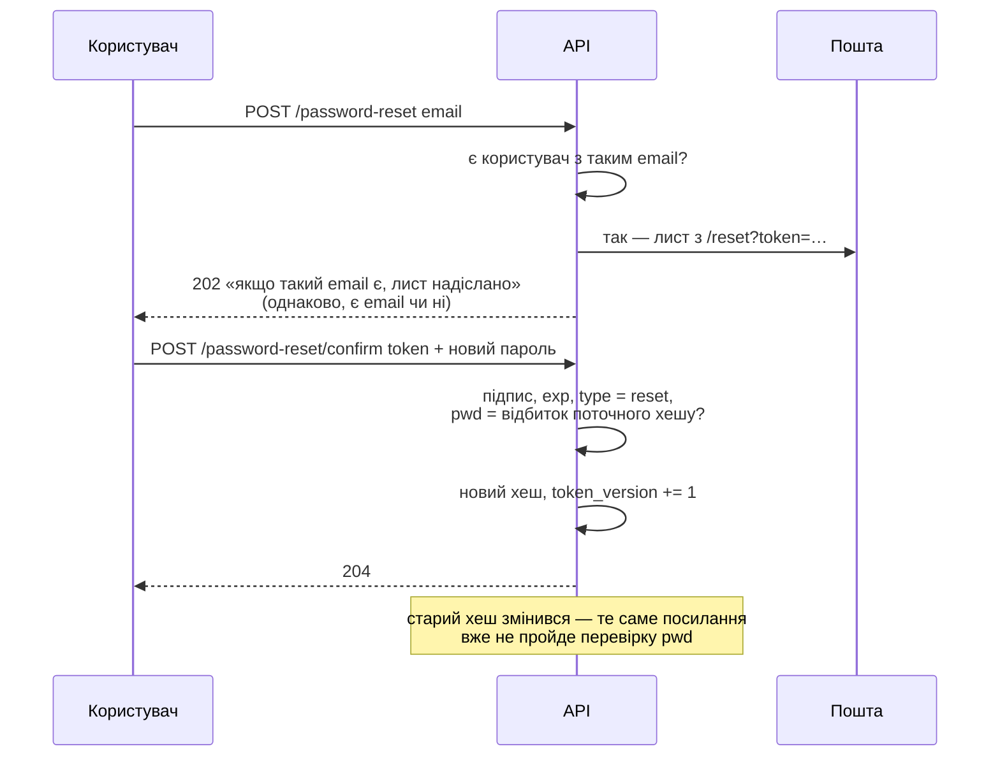

# Автентифікація: сесії, JWT і OAuth2 у FastAPI

## Проблема { #problem }

HTTP не пам'ятає попередніх запитів. Пароль перевірено один раз — а як сервер дізнається, що наступні сто запитів від тієї самої людини? Надсилати пароль з кожним запитом (HTTP Basic) — це сто шансів його перехопити і сто повільних перевірок bcrypt. Тому після входу клієнт отримує **щось інше**: ідентифікатор сесії в cookie або токен у заголовку. Обидва способи працюють, але по-різному відповідають на важкі питання: як вийти, як відкликати вкрадений токен, де його зберігати в браузері, від чого захищає CSRF і чому `OAuth2PasswordBearer` у FastAPI сам нічого не перевіряє.

Автентифікація відповідає на питання **«хто ти»**. Що цій людині можна — авторизація, [наступна сторінка](authorization.md).

## Ментальна модель { #mental-model }



| | Сесія (cookie) | JWT (Bearer) |
|---|---|---|
| Де «я увійшов» | випадковий ідентифікатор у cookie, дані — на сервері | усе в самому токені, підписаному секретом |
| Хто надсилає | браузер сам, з кожним запитом на свій сайт | клієнт явно, заголовком `Authorization: Bearer …` |
| CSRF | **потрібен захист**: браузер додає cookie і до запиту з чужого сайту | не потрібен: заголовок браузер сам не додає |
| Вийти, відкликати | видалити запис на сервері — миттєво | токен діє до `exp`; відкликання — це знову стан на сервері |
| Сервер зберігає | кожну сесію | нічого (поки не потрібне відкликання) |
| Кому | сайт у браузері на тому самому домені | мобільний застосунок, скрипт, бот, інший сервіс, SPA на іншому домені |

Обидва способи — «пред'явник отримує доступ» (bearer): хто має cookie чи токен, той і користувач. Тому їх однаково бережуть від крадіжки.

## `OAuth2PasswordBearer`: що він робить, а що ні { #oauth2-password-bearer }

[`examples/security/auth_app.py`](https://github.com/NikoriakViktor/news_hub/blob/main/examples/security/auth_app.py):

```python title="auth_app.py (фрагмент)"
oauth2_scheme = OAuth2PasswordBearer(tokenUrl="token")                    # лише ОПИС для OpenAPI + читання заголовка


@app.post("/token", response_model=TokenPair)
def login(form: Annotated[OAuth2PasswordRequestForm, Depends()]) -> TokenPair:
    ...


def current_claims(token: Annotated[str, Depends(oauth2_scheme)]) -> dict[str, Any]:
    return decode(token, "access")
```

[`auth_demo.py`](https://github.com/NikoriakViktor/news_hub/blob/main/examples/security/auth_demo.py):

```text
--- 1. OAuth2PasswordBearer в OpenAPI
   {'OAuth2PasswordBearer': {'type': 'oauth2', 'flows': {'password': {'scopes': {}, 'tokenUrl': 'token'}}}}
--- 2. без токена і вхід формою
   GET /me без токена                 → 401 {'detail': 'Not authenticated'} WWW-Authenticate: Bearer
   POST /token, JSON замість форми    → 422 {'detail': [{'type': 'missing', 'loc': ['body', 'username'], 'msg': 'Field required', 'input': None}, {'type': 'missing', 'loc': ['body', 'password'], 'msg': 'Field required', 'input': None}]}
   POST /token, чужий пароль          → 401 {'detail': "неправильне ім'я або пароль"}
```

- **`OAuth2PasswordBearer` лише читає заголовок.** Немає `Authorization: Bearer …` — `401 Not authenticated` з `WWW-Authenticate: Bearer`. Є — повертає рядок токена **як є**: підроблений, прострочений, будь-який. Перевіряє його ваш код (`decode` нижче).
- **Він описує схему для OpenAPI.** У `/docs` з'являється кнопка **Authorize** з формою логіна, яка надсилає `POST tokenUrl`.
- **`OAuth2PasswordRequestForm` — форма, не JSON.** Так вимагає потік «password» з OAuth2 (RFC 6749): `application/x-www-form-urlencoded` з полями `username`, `password`, `scope`. Потрібен пакет `python-multipart`. JSON дає `422`.
- **Назва вводить в оману.** Це не «OAuth2-сервер» і не вхід через Google: з усього OAuth2 тут лише формат запиту за токеном і заголовок `Bearer`.

Альтернатива — `HTTPBearer`: те саме читання заголовка, без форми входу. Ендпоінт входу тоді звичайний, з JSON, а в `/docs` у **Authorize** вставляють готовий токен. Так зроблено в News Hub (нижче).

| | `OAuth2PasswordBearer(tokenUrl=...)` | `HTTPBearer()` | `APIKeyHeader(name=...)` |
|---|---|---|---|
| читає | `Authorization: Bearer <t>` | `Authorization: Bearer <t>` | будь-який заголовок, `X-API-Key` |
| немає заголовка | `401` + `WWW-Authenticate: Bearer` | `401` (`auto_error=False` — `None`) | `401` (`auto_error=False` — `None`) |
| **Authorize** у `/docs` | форма логіна → `tokenUrl` | поле для токена | поле для ключа |
| scopes в OpenAPI | так | ні | ні |

## Що перевірити в JWT { #jwt-checks }

JWT — `header.payload.signature`, кожна частина в base64url. **Payload не зашифрований**:

```text
   header  без ключа: {'alg': 'HS256', 'typ': 'JWT'}
   payload без ключа: {'sub': 'olena', 'type': 'access', 'ver': 0} | живе 300 с
   GET /me з access                   → 200 {'user': 'olena', 'jti': '0872192a'}
   GET /me з refresh замість access   → 401 {'detail': 'потрібен access-токен'}
```

Прочитати payload може будь-хто — без ключа, просто base64. Тому в токен не кладуть нічого секретного: ні пароля, ні email, якщо його не можна показувати. Захищає токен **підпис**: змінити payload і отримати правильний підпис без секрету неможливо.

```python title="auth_app.py (фрагмент)"
def decode(token: str, expected_type: str) -> dict[str, Any]:
    try:
        claims = jwt.decode(token, secret, algorithms=[ALGORITHM],
                            options={"require": ["exp", "sub", "jti", "type"]})
    except jwt.ExpiredSignatureError as error:
        raise unauthorized("токен прострочений") from error
    except jwt.InvalidTokenError as error:
        raise unauthorized("недійсний токен") from error
    if claims["type"] != expected_type:
        raise unauthorized(f"потрібен {expected_type}-токен")
    ...
```

| Що | Навіщо | Якщо забути |
|---|---|---|
| `algorithms=["HS256"]` — список з коду | приймати лише свій алгоритм | `alg: none` чи підміна алгоритму ([крок 8](../tutorials/08_security/admin_jwt.md#result)) |
| `require: ["exp", ...]` | токен без `exp` — безстроковий | украдений токен діє вічно |
| `type` (свій claim) | refresh, reset і access підписані тим самим ключем | refresh-токен (7 днів) працює як access |
| `aud`, `iss` (`audience=`, `issuer=`) | токен одного сервісу не приймається іншим | спільний ключ — токен «адмінки» підходить до API |
| `leeway` | розбіжність годинників між серверами | див. нижче |

```text
--- 5. строк дії і leeway
   прострочений на 10 с, leeway= 0 → ExpiredSignatureError
   прострочений на 10 с, leeway=30 → прийнято
```

`leeway=30` — допуск на годинники, що розійшлися на кілька секунд. Великий `leeway` продовжує життя кожного токена на стільки ж.

### Покроково: `current_claims` на одному запиті { #trace }

`GET /me` з `Authorization: Bearer <access>` у прикладі:



Кроки 1–2 — бібліотеки; крок 3 — те, чого JWT сам не знає. Як тільки з'являється крок 3, сервер знову має стан — і це нормально.

## Access і refresh { #refresh }

Короткий access-токен (тут 5 хвилин) обмежує шкоду від крадіжки: він «згорає» сам. Але просити пароль кожні 5 хвилин не можна. Тому вхід видає пару: **access** — для кожного запиту, **refresh** — довгий (тут 7 днів), лише для `POST /refresh`, щоб отримати нову пару без пароля.

**Ротація**: кожен refresh використовується один раз і замінюється новим. Якщо той самий refresh приходить удруге — його використали двоє, тобто його вкрали. Невідомо, хто з двох справжній, тому відкликається вся **родина** — усі токени цього входу:

```python title="auth_app.py (фрагмент)"
@app.post("/refresh", response_model=TokenPair)
def refresh(body: RefreshIn) -> TokenPair:
    claims = decode(body.refresh_token, "refresh")
    record = store.refresh.get(claims["jti"])
    if record is None:
        raise unauthorized("невідомий refresh-токен")
    if record["used"]:                                     # украдений і вже використаний кимось іншим
        store.revoked_families.add(record["family"])
        raise unauthorized("повторне використання refresh-токена: усю сесію відкликано")
    record["used"] = True
    return issue(claims["sub"], family=record["family"])
```

```text
--- 3. ротація refresh і повторне використання
   POST /refresh                      → нова пара, refresh змінився: True
   той самий старий refresh ще раз    → 401 {'detail': 'повторне використання refresh-токена: усю сесію відкликано'}
   новий refresh після цього          → 401 {'detail': 'сесію відкликано'}
   новий access після цього           → 401 {'detail': 'сесію відкликано'}
```

Злодій і справжній користувач обидва втратили доступ — користувач увійде паролем знову, а злодій ні. Без ротації вкрадений refresh давав би нові access-токени тиждень.

## Відкликання { #revocation }

JWT «не потребує стану» — доки не треба вийти. Вихід — це сервер, який **пам'ятає**, що певні токени вже не діють:

```text
--- 4. вихід: сервер пам'ятає відкликане
   access після /logout               → 401 {'detail': 'сесію відкликано'}
   refresh після /logout              → 401 {'detail': 'сесію відкликано'}
   другий пристрій                    → 200 {'user': 'olena', 'jti': 'c182c2bb'}
   відкликаних родин на сервері: 2
   другий пристрій після /logout-all  → 401 {'detail': 'токен відкликано (вихід на всіх пристроях)'}
```

| Спосіб | Що зберігати | Що відкликає | Ціна |
|---|---|---|---|
| короткий `exp` | нічого | нічого — лише обмежує час | до `exp` токен живий |
| чорний список `jti` / родин | id до їхнього `exp` (Redis з TTL) | один вхід | запит у сховище на кожен запит |
| `token_version` у користувача | одне число | **усі** токени користувача («вийти скрізь», зміна пароля) | читання користувача на кожен запит |
| новий секрет підпису | нічого | **усі** токени **всіх** | усі входять заново |

Запис у чорному списку потрібен лише до `exp` відкликаного токена — далі він і так недійсний. Тому в Redis такі ключі ставлять з TTL, що дорівнює решті строку дії токена.

## Сесія в cookie { #session }

Сесія — протилежний підхід: у cookie лише випадковий рядок, а все інше — на сервері.

```python title="auth_app.py (фрагмент)"
sid = secrets.token_urlsafe(32)                     # випадковий ідентифікатор, у ньому нічого немає
store.sessions[sid] = form.username
response.set_cookie("sid", sid, httponly=True, secure=True, samesite="lax", max_age=3600)
```

```text
--- 6. сесія в cookie
   Set-Cookie: sid …; HttpOnly; Max-Age=3600; Path=/; SameSite=lax; Secure
   GET /session/me (cookie сам)       → 200 {'user': 'olena'}
   по http: cookie є в клієнті: True | надіслано з запитом → GET /session/me 401
   після DELETE /session              → 401 {'detail': 'немає сесії'}
```

| Атрибут | Що робить |
|---|---|
| `HttpOnly` | JavaScript сторінки не прочитає cookie: XSS не вкраде вхід (але може робити запити від імені користувача, поки сторінка відкрита) |
| `Secure` | лише по HTTPS. Клієнт по `http://` cookie має, але **не надсилає** — у прикладі `401` |
| `SameSite=Lax` | cookie не йде з чужих сайтів у `POST`, `fetch`, `<iframe>`; йде лише при переході за посиланням (`GET` верхнього рівня) |
| `SameSite=Strict` | не йде з чужих сайтів узагалі — навіть перехід за посиланням з пошти приходить «без входу» |
| `SameSite=None` | йде завжди; браузери вимагають разом з `Secure` |
| `Max-Age` / `Expires` | без них cookie живе до закриття браузера |

Вихід миттєвий: запис видалено — cookie нічого не означає. Ціна — запит у сховище сесій на кожен запит і спільне сховище (Redis, база) для кількох процесів сервера.

## CSRF: cookie надсилає браузер, а не ваш скрипт { #csrf }

Cookie браузер додає **сам** — і до запиту, який ініціював чужий сайт. Сторінка `evil.example` з прихованою формою `<form action="https://app.example.com/session/transfer" method="post">` виконає переказ від імені користувача, який увійшов у `app.example.com`. CORS тут не допоможе: він ховає **відповідь**, а запит виконується ([CORS](../06_middleware_cache_jobs/cors.md#demo)).

```python title="auth_app.py (фрагмент)"
@app.post("/session/transfer-safe")
def transfer_safe(user: SessionUser, request: Request) -> dict[str, str]:
    origin = request.headers.get("origin")
    if origin not in ALLOWED_ORIGINS:                    # немає Origin або чужий — відмова
        raise HTTPException(status.HTTP_403_FORBIDDEN, detail=f"чуже джерело: {origin}")
    return {"done": f"переказ від {user}"}
```

```text
--- 7. CSRF: дія з cookie і чужий сайт
   transfer, Origin https://evil.example → 200 {'done': 'переказ від olena'}
   transfer-safe, Origin https://evil.example → 403 {'detail': 'чуже джерело: https://evil.example'}
   transfer, Origin https://app.example.com → 200 {'done': 'переказ від olena'}
   transfer-safe, Origin https://app.example.com → 200 {'done': 'переказ від olena'}
   transfer-safe без Origin           → 403 {'detail': 'чуже джерело: None'}
   Bearer-ендпоінт без заголовка      → 401 {'detail': 'Not authenticated'}
```

`TestClient` надсилає cookie з кожним запитом, як браузер. Захист від CSRF для API з cookie — кілька шарів:

1. **`SameSite=Lax` або `Strict`** — браузер не надішле cookie з міжсайтового `POST`. Але «сайт» для `SameSite` — це домен разом з піддоменами: `evil.example.com` і `app.example.com` — один сайт.
2. **Перевірка `Origin`** (або `Sec-Fetch-Site: same-origin`) для кожного методу, що змінює дані. Браузер ставить `Origin` у міжсайтові `POST` сам, і скрипт підробити його не може. Немає `Origin` — відмова (старі клієнти рідкісні, а скрипт без браузера не має cookie користувача).
3. **CSRF-токен** (synchronizer або double-submit) — коли `Origin` недоступний чи потрібен ще один шар. Так робить Django ([Сесії в Django-книзі](https://nikoriakviktor.github.io/notes_chat_app/07_auth_and_security/sessions_flow_full/)).

Останній рядок виводу — чому JWT у заголовку CSRF не потребує: чужа сторінка не знає токена, а браузер сам заголовок `Authorization` не додає.

## Де зберігати токен у браузері { #browser-storage }

| Де | XSS (чужий скрипт на сторінці) | CSRF | Після перезавантаження |
|---|---|---|---|
| `localStorage` / `sessionStorage` | **читає токен** і відправляє собі — злодій користується ним з будь-якого місця до `exp` | не стосується | є |
| змінна в пам'яті JS | читає, поки сторінка відкрита | не стосується | треба знову (тихий refresh) |
| cookie `HttpOnly; Secure; SameSite` | не прочитає; може лише робити запити, поки сторінка відкрита | **потрібен захист** (вище) | є |
| BFF: cookie сесії до свого бекенду, токени лише на сервері | не прочитає | захист для cookie | є |

Від XSS не захищає жоден варіант: шкідливий скрипт на сторінці діє від імені користувача. Але з `HttpOnly` він не **винесе** токен назовні, і атака закінчується, щойно користувач закрив вкладку. Тому для браузера: access — у пам'яті, refresh — у cookie `HttpOnly; Secure; SameSite=Strict` з `Path=/refresh`, або весь обмін токенами на сервері (Backend for Frontend). Для мобільного застосунку чи скрипта питання не стоїть: токен — у захищеному сховищі ОС чи змінній середовища, CSRF немає.

## Скидання пароля { #password-reset }

Окремий вхід «без пароля» — тому найчастіше вразливий. Дві вимоги: не розкривати, хто зареєстрований, і зробити посилання одноразовим.



```text
--- 8. скидання пароля
   POST /password-reset olena@example.com → 202 {'detail': 'якщо такий email є, лист надіслано'}
   POST /password-reset nobody@example.com → 202 {'detail': 'якщо такий email є, лист надіслано'}
   листів: 1 | кому: ['olena@example.com']
   посилання: https://app.example.com/reset?token=… | type: reset
   reset-токен як access              → 401 {'detail': 'потрібен access-токен'}
   confirm                            → 204
   те саме посилання вдруге           → 401 {'detail': 'посилання вже використано'}
   access, виданий до зміни пароля    → 401 {'detail': 'токен відкликано (вихід на всіх пристроях)'}
   вхід зі старим паролем             → 401 {'detail': "неправильне ім'я або пароль"}
   вхід з новим паролем               → 200
```

- **Однакова відповідь** для відомого й невідомого email — інакше форма скидання стає способом перевіряти, хто зареєстрований. Час відповіді теж має бути однаковим: лист надсилають у фоні, а не в запиті.
- **Одноразовість без таблиці**: токен містить відбиток поточного хешу пароля (`pwd`). Пароль змінився — відбиток інший. Ту саму ідею використовує Django: токен скидання залежить від хешу пароля й часу останнього входу.
- **Зміна пароля відкликає все** (`token_version += 1`): якщо пароль скидали через крадіжку, злодійський токен перестає діяти.
- **Посилання будують з налаштувань, а не з `Host` запиту** — інакше атакувальник отримає лист зі своїм доменом ([Host-заголовок](secrets_and_headers.md#trusted-host)).

## У News Hub { #news-hub }

News Hub має одного адміністратора і автентифікує лише його. Код і всі перевірки — [Крок 8. Адмін і JWT](../tutorials/08_security/admin_jwt.md); що з цієї сторінки там є, а чого немає:

| Ідея | News Hub |
|---|---|
| схема | `HTTPBearer(auto_error=False)` — свої `401` з причиною й `WWW-Authenticate: Bearer` |
| вхід | `POST /api/admin/token` з JSON (`TokenRequest`), не формою OAuth2; у `/docs` **Authorize** приймає готовий токен (на сервері `/docs` вимкнено: `DOCS_ENABLED=false`) |
| відповідь з токеном | `Cache-Control: no-store` — токен не осідає в кешах проксі й браузера |
| перебір пароля | за IP — 5 спроб за 300 с; за ім'ям — 20 невдалих за 900 с з усіх адрес → `429` з `Retry-After` ([було → стало](secrets_and_headers.md#news-hub-fixes)) |
| перевірки `decode` | `algorithms=["HS256"]` з коду, `require: ["exp", "sub", "role"]` |
| строк | 30 хвилин (`JWT_EXPIRE_MINUTES`) |
| refresh, ротація | немає: адмін входить паролем знову |
| відкликання | немає; лише зміна `JWT_SECRET` — відкликає все ([межі рішення](../tutorials/08_security/admin_jwt.md#limits)) |
| `type`, `aud`, `iss` | немає: токен одного типу, один сервіс, `JWT_SECRET` не використовується ні для чого іншого |
| cookie, CSRF | немає cookie — немає CSRF; тому й CORS не потребує `allow_credentials` ([CORS](../06_middleware_cache_jobs/cors.md#news-hub)) |

Бот і webhook автентифікуються інакше: Telegram — секретним заголовком, зовнішній планувальник — підписом HMAC ([Webhook і підписи](webhooks_and_signatures.md)).

## Типові помилки { #mistakes }

| Помилка | Наслідок | Як правильно |
|---|---|---|
| вважати, що `OAuth2PasswordBearer` перевіряє токен | будь-який рядок у `Bearer` проходить | `jwt.decode` у своїй залежності |
| `jwt.decode(token, key)` без `algorithms` | PyJWT ≥ 2 кидає `DecodeError`; старий код міг приймати будь-який алгоритм | `algorithms=["HS256"]` з коду |
| `algorithms` з налаштувань чи з заголовка токена | атакувальник обирає алгоритм | константа в коді |
| токен без `exp` або `exp` на тиждень | украдений токен діє вічно чи тиждень | access — хвилини, refresh — окремо |
| refresh і access без `type` | refresh працює як access | свій claim `type` і перевірка |
| той самий refresh можна вживати багато разів | украдений refresh — тиждень доступу | ротація + відкликання родини при повторі |
| секрет у payload | його прочитає будь-хто | payload — лише id і ролі |
| `localStorage` для токена в SPA | XSS виносить токен | пам'ять + `HttpOnly`-cookie для refresh, або BFF |
| cookie без `Secure` / `HttpOnly` / `SameSite` | перехоплення по HTTP, крадіжка через XSS, CSRF | усі три |
| cookie-автентифікація без перевірки `Origin` / CSRF-токена | дії з чужих сайтів | `SameSite` + `Origin` або CSRF-токен |
| JSON у `POST /token` з `OAuth2PasswordRequestForm` | `422` | форма; або свій ендпоінт з JSON і `HTTPBearer` |
| «немає такого email» у скиданні пароля | перебір зареєстрованих | однакова відповідь і час |
| посилання скидання з `request.url_for` без TrustedHost | лист з доменом атакувальника | адреса з налаштувань |

## Налагодження { #debugging }

- **Що в токені?** `jwt.decode(token, options={"verify_signature": False})` або розібрати base64 вручну, як у прикладі. Лише для налагодження: такий виклик у коді сервера — дірка.
- **`401 Not authenticated` при правильному токені.** Заголовок має бути рівно `Authorization: Bearer <токен>`; проксі (nginx) інколи не передає `Authorization` далі.
- **`ExpiredSignatureError` одразу після входу.** Годинник сервера, що видає токени, і того, що перевіряє, розійшлися: `date -u` на обох; `leeway` у кілька секунд.
- **Cookie не приходить.** DevTools → Application → Cookies: чи є `Secure` при `http://localhost` (Chrome дозволяє `Secure` на `localhost`, інші клієнти — ні); `SameSite` для запиту з іншого порту чи домену; `Path`.
- **У `/docs` Authorize не працює.** `tokenUrl` — шлях ендпоінта входу відносно кореня; він приймає форму, а не JSON.

## Безпека й межі { #security }

- **Будь-який токен і cookie — пред'явницькі.** Лише HTTPS, короткий строк, не в URL (адреси потрапляють у журнали — [журнали без секретів](secrets_and_headers.md#logging)).
- **Секрет підпису — найцінніше.** Хто його знає, той сам випускає «справжні» токени для будь-кого ([слабкий секрет](secrets_and_headers.md#weak-secret)).
- **HS256 — один секрет для підпису й перевірки.** Якщо токени перевіряють кілька сервісів, кожен з них може й випускати токени. Тоді — асиметричні RS256/ES256/EdDSA: підписує лише сервер входу, решта мають тільки публічний ключ.
- **Вхід — найпривабливіша ціль.** Ліміт спроб за IP **і** за ім'ям ([ліміт входу](secrets_and_headers.md#login-rate-limit)), повільний хеш ([Паролі](passwords.md)), однакові відповіді.
- **Свій вхід — не завжди потрібен.** Вхід через OpenID Connect (Google, корпоративний IdP) знімає з вас зберігання паролів, скидання і другий фактор; сервер тоді лише перевіряє токени провайдера.

## Питання { #questions }

1. Що робить `OAuth2PasswordBearer` і чого він не робить?
2. Чому `POST /token` з JSON дає `422`?
3. Що можна прочитати з JWT без ключа? Що без ключа зробити неможливо?
4. Навіщо в токені власний claim `type`?
5. Що означає повторне використання refresh-токена і що робить сервер?
6. Три способи відкликати JWT і що кожен відкликає.
7. Чому cookie-автентифікація потребує захисту від CSRF, а `Authorization: Bearer` — ні?
8. Чим небезпечний `localStorage` для токена і що натомість?
9. Як зробити посилання скидання пароля одноразовим без таблиці токенів?

??? success "Відповіді"

    1. Читає `Authorization: Bearer …` і повертає рядок токена (або `401`, якщо заголовка немає) та описує схему для OpenAPI. Не перевіряє ні підпис, ні строк — це робить ваш код.
    2. `OAuth2PasswordRequestForm` — форма `application/x-www-form-urlencoded`, як вимагає потік «password» OAuth2.
    3. Header і payload — це base64. Змінити їх і отримати правильний підпис без секрету неможливо.
    4. Різні токени (access, refresh, reset) підписано тим самим ключем; без `type` довгий refresh чи reset пройде як access.
    5. Токен використали двоє — його вкрали. Сервер відкликає всю родину токенів цього входу; справжній користувач увійде паролем знову.
    6. Чорний список `jti`/родин до `exp` — один вхід; `token_version` користувача — усі його токени; новий секрет — усі токени всіх.
    7. Cookie браузер додає сам, і до запиту з чужого сайту; заголовок `Authorization` браузер сам не додає, а чужий сайт токена не знає.
    8. Будь-який XSS читає `localStorage` і виносить токен. Натомість: access у пам'яті, refresh у cookie `HttpOnly; Secure; SameSite`, або токени лише на бекенді (BFF).
    9. Покласти в токен відбиток поточного хешу пароля: після зміни пароля відбиток інший, і старе посилання не проходить.

## Що далі { #next }

[Авторизація: ролі, scopes, перевірка об'єктів](authorization.md) — ми знаємо, хто це; тепер — що йому можна.

**Джерела:** FastAPI — [Security](https://fastapi.tiangolo.com/tutorial/security/), [OAuth2 with Password (and hashing), Bearer with JWT tokens](https://fastapi.tiangolo.com/tutorial/security/oauth2-jwt/); [RFC 7519 — JSON Web Token](https://datatracker.ietf.org/doc/html/rfc7519), [RFC 8725 — JWT Best Current Practices](https://datatracker.ietf.org/doc/html/rfc8725), [RFC 6749 — OAuth 2.0](https://datatracker.ietf.org/doc/html/rfc6749); [PyJWT — Usage](https://pyjwt.readthedocs.io/en/stable/usage.html); OWASP — [Session Management Cheat Sheet](https://cheatsheetseries.owasp.org/cheatsheets/Session_Management_Cheat_Sheet.html), [Cross-Site Request Forgery Prevention Cheat Sheet](https://cheatsheetseries.owasp.org/cheatsheets/Cross-Site_Request_Forgery_Prevention_Cheat_Sheet.html), [Forgot Password Cheat Sheet](https://cheatsheetseries.owasp.org/cheatsheets/Forgot_Password_Cheat_Sheet.html), [JSON Web Token Cheat Sheet](https://cheatsheetseries.owasp.org/cheatsheets/JSON_Web_Token_Cheat_Sheet.html); [MDN — Set-Cookie](https://developer.mozilla.org/en-US/docs/Web/HTTP/Headers/Set-Cookie); Django-книга — [Автентифікація](https://nikoriakviktor.github.io/notes_chat_app/07_auth_and_security/auth_basics_full/), [Сесії](https://nikoriakviktor.github.io/notes_chat_app/07_auth_and_security/sessions_flow_full/).
