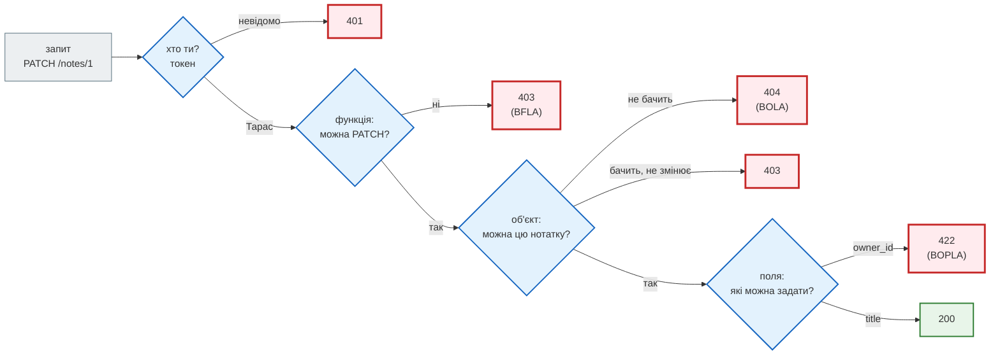
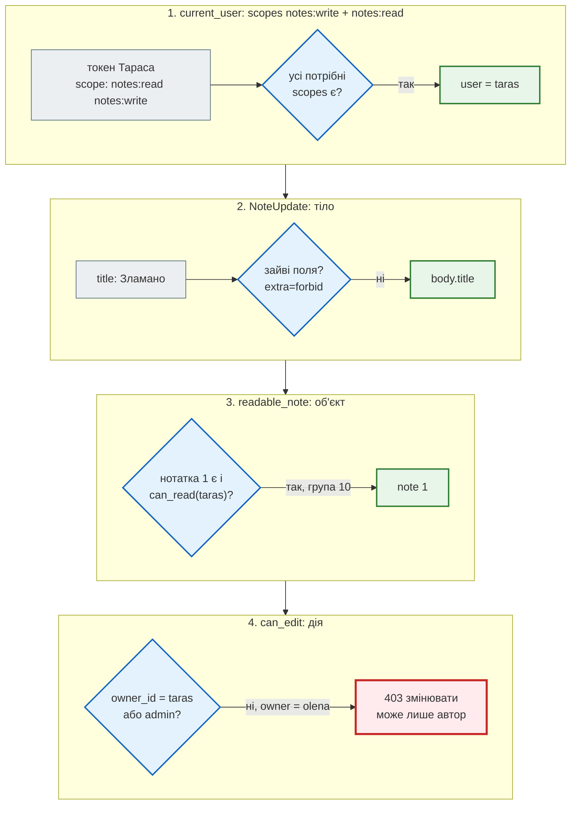
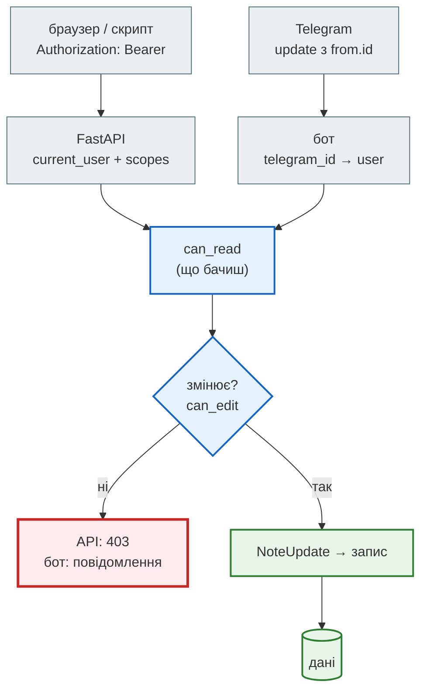

# Авторизація: ролі, scopes, перевірка об'єктів

## Проблема { #problem }

Тарас увійшов, токен справжній. `GET /api/notes/2` повертає нотатку Олени — бо ендпоінт перевірив, **що** запит від когось, хто увійшов, але не перевірив, **чия** це нотатка. Це найчастіша вразливість API (OWASP API1:2023): автентифікація є, авторизації немає. Її не видно в `/docs`, її не ловлять тести «без токена → 401», і вона з'являється знову щоразу, коли додають новий ендпоінт, нову версію або новий вхід у застосунок — наприклад, Telegram-бот, який робить те саме, що API, але правила «хто може змінювати» в ньому забули.

## Ментальна модель { #mental-model }

Автентифікація відповідає «хто ти», авторизація — «що тобі можна». Друга має три рівні, і кожен перевіряється окремо:



| Рівень | Питання | OWASP API Top 10 2023 | У FastAPI |
|---|---|---|---|
| функція | чи можна цей **ендпоінт** (адмінський, запис)? | API5 Broken Function Level Authorization | `Security(..., scopes=[...])`, `dependencies=[...]` на маршруті чи роутері |
| об'єкт | чи можна **цей запис** (чужа нотатка за id)? | API1 Broken Object Level Authorization | фільтр за власником у запиті до бази, залежність, що повертає дозволений об'єкт |
| властивість | які **поля** можна задати й побачити? | API3 Broken Object Property Level Authorization | окремі моделі запиту й відповіді, `extra="forbid"`, `response_model` |

Перший рівень видно з маршруту. Другий і третій — лише з даних, тому їх і забувають.

## Ролі й scopes { #scopes }

**Роль** описує людину («адмін», «користувач»), **scope** — дозвіл у токені («читати нотатки», «видаляти користувачів»). Сервер при вході перетворює роль на набір scopes, а ендпоінт перевіряє scope, а не роль: так можна видати токен з меншими правами (скрипт лише на читання) тому самому користувачу.

[`examples/security/authz_app.py`](https://github.com/NikoriakViktor/news_hub/blob/main/examples/security/authz_app.py):

```python title="authz_app.py (фрагмент)"
oauth2_scheme = OAuth2PasswordBearer(tokenUrl="token", scopes=SCOPES)


def current_user(security_scopes: SecurityScopes, token: Annotated[str, Depends(oauth2_scheme)]) -> User:
    authenticate = f'Bearer scope="{security_scopes.scope_str}"' if security_scopes.scopes else "Bearer"
    ...                                                       # decode → user, як на сторінці «Автентифікація»
    granted = set(claims.get("scope", "").split())
    missing = [s for s in security_scopes.scopes if s not in granted]
    if missing:
        raise HTTPException(403, detail=f"бракує scope: {' '.join(missing)}",
                            headers={"WWW-Authenticate": authenticate})
    return user


Reader = Annotated[User, Security(current_user, scopes=["notes:read"])]
Writer = Annotated[User, Security(current_user, scopes=["notes:write"])]
```

- **`Security(dep, scopes=[...])`** — це `Depends`, який ще й передає список потрібних scopes у параметр `SecurityScopes` залежності. Scopes **накопичуються** вздовж дерева залежностей: `PATCH /v2/notes/{id}` бере `Writer` і `readable_note` (з `Reader`), тож вимагає обидва.
- **Ці scopes з'являються в OpenAPI** — у `/docs` видно, що потрібно кожній операції.
- **`401` чи `403`.** Немає токена або він недійсний — `401`. Токен справжній, але scope бракує — `403`, з `WWW-Authenticate: Bearer scope="..."` (RFC 6750 радить для цього `error="insufficient_scope"`).

[`authz_demo.py`](https://github.com/NikoriakViktor/news_hub/blob/main/examples/security/authz_demo.py):

```text
--- 2. scopes: токен лише на читання
   PATCH з notes:read                       → 403 {'detail': 'бракує scope: notes:write'} | WWW-Authenticate: Bearer scope="notes:write"
   GET з notes:read                         → 200 {'id': 3, 'title': 'Список Тараса'}
   OpenAPI scopes: {'notes:read': 'читати свої нотатки', 'notes:write': 'змінювати свої нотатки', 'users:delete': 'видаляти користувачів (адмін)'}
   PATCH /v2/notes/{note_id} security: [{'OAuth2PasswordBearer': ['notes:write', 'notes:read']}]
```

### Scopes просить клієнт, дає сервер { #grant-scopes }

У формі входу OAuth2 є поле `scope` — клієнт **просить** дозволи. Документація FastAPI у прикладі кладе `form_data.scopes` у токен як є і окремо попереджає, що в реальному застосунку так не можна. Якщо скопіювати приклад без цього попередження:

```python title="authz_app.py (фрагмент)"
ROLE_SCOPES = {"user": {"notes:read", "notes:write"}, "admin": set(SCOPES)}


def grant_scopes(user: User, requested: list[str]) -> list[str]:
    """Клієнт ПРОСИТЬ scopes (форма входу, поле scope), сервер ДАЄ лише ті, що дозволяє роль."""
    return sorted(set(requested) & ROLE_SCOPES[user.role])
```

```text
--- 7. scopes з форми входу: просить клієнт, дає сервер
   токен = запитані scopes; DELETE /v2/users/1 → 200 {'deleted': 1}
   grant_scopes(taras, ...): ['notes:read']
   токен = grant_scopes; DELETE /v2/users/1 → 403 {'detail': 'бракує scope: users:delete'}
```

Звичайний користувач написав `scope=users:delete` у формі — і отримав адмінські права. Перевірка в ендпоінті була правильна, неправильна була **видача**.

## Перевірка об'єкта: BOLA { #bola }

```python title="authz_app.py (фрагмент)"
@app.get("/v1/notes/{note_id}", response_model=NoteOut)
def get_note_v1(note_id: int, user: Reader) -> Note:
    return note_or_404(note_id)                                         # автентифікація є, авторизації немає


def readable_note(note_id: int, user: Reader) -> Note:
    note = notes.get(note_id)
    if note is None or not can_read(user, note, groups[user.id]):
        raise HTTPException(404, detail="нотатки немає")               # чужа = її немає
    return note


@app.get("/v2/notes/{note_id}", response_model=NoteOut)
def get_note_v2(note: Annotated[Note, Depends(readable_note)]) -> Note:
    return note
```

```text
--- 1. API1 BOLA: чужа нотатка за id
   Тарас GET /v1/notes/2 (особиста Олени)   → 200 {'id': 2, 'title': 'Подарунок Тарасу'}
   Тарас GET /v2/notes/2 (особиста Олени)   → 404 {'detail': 'нотатки немає'}
   Тарас GET /v2/notes/1 (нотатка групи)    → 200 {'id': 1, 'title': 'Пароль від Wi-Fi'}
   Тарас GET /v2/notes/999 (немає)          → 404 {'detail': 'нотатки немає'}
```

- **Залежність повертає вже дозволений об'єкт.** Ендпоінт не може «забути» перевірку: без `readable_note` він нотатки взагалі не отримає. Той самий прийом, що `get_news_or_404` у News Hub, тільки з умовою доступу.
- **Чужа нотатка — `404`, як неіснуюча.** `403` підтвердив би, що нотатка з id `2` існує, — уже витік: перебором id видно, скільки записів і які номери зайняті.
- **У справжній базі перевірка — у запиті**, а не після нього: `select(NoteRow).where(NoteRow.id == note_id, NoteRow.owner_id == user.id)`. Список так само: `GET /notes` фільтрує за власником у SQL, а не «завантажити все й відкинути чуже».
- **UUID замість `int` не лікує BOLA.** Важче вгадати, але id потрапляють у посилання, журнали, листи. Перевірка доступу потрібна однаково.

### Бачить, але не змінює { #read-vs-write }

Коли запис бачать кілька людей (нотатка групи), правило розпадається на два: хто **бачить** і хто **змінює**.

| Хто | Бачить | Змінює й видаляє |
|---|---|---|
| автор | так | так |
| учасник групи нотатки | так | ні — `403` |
| інший користувач | ні — `404` | ні — `404` |

```python title="authz_app.py (фрагмент)"
def can_edit(user: User, note: Note) -> bool:
    """ОДНЕ правило для всіх входів: змінює автор або адмін. Учасник групи — лише читає."""
    return note.owner_id == user.id or user.role == "admin"
```

```text
--- 3. учасник групи бачить, але не змінює
   Тарас PATCH /v2/notes/1                  → 403 {'detail': 'змінювати може лише автор'}
   Олена PATCH /v2/notes/1                  → 200 {'id': 1, 'title': 'Wi-Fi (новий)'}
```

`403` для учасника групи чесний: нотатку він і так бачить, приховувати нічого. Для стороннього — `404`, бо `readable_note` спрацьовує раніше за `can_edit`.

### Покроково: `PATCH /v2/notes/1` від Тараса { #trace }



## Перевірка функції: BFLA { #bfla }

```python title="authz_app.py (фрагмент)"
@app.delete("/v1/users/{user_id}", include_in_schema=False)            # «його ж не видно в /docs»
def delete_user_v1(user_id: int, user: Anyone) -> dict[str, int]:
    ...

@app.delete("/v2/users/{user_id}")
def delete_user_v2(user_id: int, user: Annotated[User, Security(current_user, scopes=["users:delete"])]):
    ...
```

```text
--- 6. API5 BFLA: адмін-функція звичайному користувачу
   /v1/users/{id} в OpenAPI: False
   Тарас DELETE /v1/users/1                 → 200 {'deleted': 1}
   Тарас DELETE /v2/users/1                 → 403 {'detail': 'бракує scope: users:delete'}
   адмін DELETE /v2/users/2                 → 200 {'deleted': 2}
```

- **Прихований маршрут — не захищений.** `include_in_schema=False` ховає його з `/docs`, але не з мережі. Адмінські шляхи вгадують за шаблоном (`/admin/...`, `DELETE` замість `GET`, `/v1/` поруч з `/v2/`).
- **Права на рівні роутера**, а не кожного маршруту: `APIRouter(prefix="/admin", dependencies=[Security(current_user, scopes=["admin"])])` — новий маршрут у роутері захищений сам.
- **Тест, що нічого не забуто**: обійти всі маршрути застосунку і порівняти з явним списком публічних — так зроблено в News Hub ([Тести безпеки](../tutorials/08_security/security_tests.md#public)) і в [інвентарі OWASP API9](owasp_api_top10.md#api9).

## Перевірка властивостей: BOPLA { #bopla }

Два боки одного ризику: клієнт **задає** поле, якого не мав би (масове присвоєння), або **бачить** поле, якого не мав би (надмірні дані).

```text
--- 4. API3 масове присвоєння: owner_id у тілі
   Тарас PATCH /v1/notes/3 + owner_id=1     → 200 {'id': 3, 'title': 'x'}
   власник нотатки 3 тепер: 1 | Тарас її більше не змінить: 403
   Тарас PATCH /v2/notes/3 + owner_id=1     → 422 extra_forbidden ['body', 'owner_id']
--- 5. API3 надмірні дані у відповіді
   GET /v1/users/me                         → 200 {'id': 2, 'name': 'taras', 'role': 'user', 'password_hash': '$argon2id$…taras', 'telegram_id': 1002}
   GET /v2/users/me                         → 200 {'id': 2, 'name': 'taras'}
```

- **`/v1` перевірив власника — і все одно вразливий.** `setattr` для кожного поля з `request.json()` дав змінити `owner_id`. Відповідь навіть не показала зміни: `NoteOut` фільтрує поля. Так масове присвоєння часто й лишається непоміченим.
- **Модель запиту — білий список полів**; `extra="forbid"` робить спробу видимою (`422`). Розбір — [Масове присвоєння](../02_typing_and_pydantic/config_dict.md#mass-assignment).
- **Модель відповіді — білий список того, що бачить клієнт.** `return user.__dict__` віддав хеш пароля й прив'язку до Telegram. `response_model=UserOut` лишив два поля. Фільтрувати на клієнті («фронтенд же не показує») — не захист: відповідь видно в DevTools.
- **Одна модель на запит і відповідь** (`User` і туди, і назад) — шлях до обох помилок одразу.

## Два входи — одні правила { #two-entry-points }

API — не єдиний вхід у дані. Telegram-бот, адмін-панель, фонова задача з черги, CLI-команда — кожен виконує ті самі дії. Якщо правило «хто може змінювати» живе в ендпоінті, у бота його не буде:

```python title="authz_app.py (фрагмент)"
def bot_edit_v1(app: FastAPI, telegram_id: int, note_id: int, title: str) -> str:
    """Бот перевіряє лише «це наш користувач?» — правило автора забули."""
    ...
    note.title = title


def bot_edit_v2(app: FastAPI, telegram_id: int, note_id: int, title: str) -> str:
    """Те саме, що PATCH /v2: can_read → can_edit → валідація NoteUpdate."""
    ...
    if not can_edit(user, note):
        return "змінювати може лише автор"
    note.title = NoteUpdate(title=title).title
```

```text
--- 8. два входи: API і бот
   API: Тарас PATCH /v2/notes/1 → 403
   бот v1: Тарас /edit 1 → змінено: Зламано через бота
   бот v2: Тарас /edit 1 → змінювати може лише автор
   бот v2: Тарас /edit 2 → не знайдено
   бот v2: Олена /edit 1 → змінено: Wi-Fi (з бота)
```



- **Автентифікація в кожного входу своя** (токен, `from.id` з update Telegram), **авторизація — спільна**: `can_read`, `can_edit`, `NoteUpdate`.
- **Правило в одній функції** — його можна протестувати окремо і неможливо забути в одному з входів, якщо обидва входи викликають саме її. Правило, записане двічі, колись розійдеться.
- Той самий підхід у Django-застосунку з групами: сайт і DRF API читають тими самими selectors, а правило автора винесено в один permission-клас — [Права доступу в Django-книзі](https://nikoriakviktor.github.io/notes_chat_app/07_auth_and_security/permissions_full/).

## У News Hub { #news-hub }

News Hub має одну роль — адмін — і жодних об'єктів, що належать окремим користувачам. Тому BOLA в класичному вигляді там немає; є перевірка функції і два входи з одним правилом.

| Рівень | News Hub |
|---|---|
| функція | `dependencies=[AdminDep]` на 14 операціях; `require_admin`: `401` — немає/підроблений токен, `403` — `role` не `admin` ([Крок 8](../tutorials/08_security/admin_jwt.md#admin-dep)) |
| «нічого не забули» | тест обходить усі маршрути й порівнює з `PUBLIC` ([Тести безпеки](../tutorials/08_security/security_tests.md#public)) |
| властивості, запис | `NewsPatch` з двома полями, `extra` за замовчуванням: `{"id": 5}` у `PATCH` ігнорується ([ConfigDict у News Hub](../02_typing_and_pydantic/config_dict.md#news-hub)) |
| властивості, відповідь | `NewsOut`, `SourceOut`, `SourceFetchReport` — відповідь `fetch` містить підсумок, а не тіло чужого сервера |
| об'єкти користувачів | підписки бота: `SubscriptionRepository` бере `message.chat.id` з update від Telegram (у режимі webhook — після перевірки секретного заголовка), а не з тексту команди — чужий чат не задати |

### Було → стало: два входи, одне правило { #news-hub-two-entries }

**Було.** «Хто адмін» у News Hub було записано двічі. В API — `role: admin` у JWT, у бота — власний список `BOT_ADMIN_IDS` у `BotSettings` (`cmd_scrape` у `bot/handlers.py`, крок 9). Обидва вирішували одне — «чи можна запустити збір», — але різними даними. Бот з `BOT_ADMIN_IDS` давав `/scrape` навіть тоді, коли адмін-доступ API не налаштовано зовсім. Ліміти теж розходилися: в API — `rate_limit` на `POST /api/scrape*` (`RATE_LIMIT_REQUESTS` = 5 за 60 с), у бота — лише загальний `RateLimitMiddleware`, 20 повідомлень на хвилину на всі команди. Тобто 20 зборів на хвилину.

**Стало.**

- `BOT_ADMIN_IDS` — частина тих самих `AdminSettings` (`telegram_ids`, розбір — `parse_telegram_ids` у `security.py`). Бот бере список через `telegram_admin_ids(load_admin_settings())`: адмін-доступ не налаштовано — адміна немає ніде.
- Помилка в списку зупиняє старт з повідомленням, що саме не так. Раніше був голий `int()`: `ValueError` без пояснення, а цифри інших письмен (`"١٠٠١"`) він мовчки приймав.
- `/scrape` у бота бере межу з тієї самої таблиці `LIMITS["scrape"]`, що й `POST /api/scrape*`. Лічильник — свій на користувача Telegram: `rate:scrape:tg<id>` замість `rate:scrape:<ip>`. Понад межу бот відповідає «Забагато зборів: N за W с; спробуй через T с.». Загальні 20 повідомлень на хвилину лишилися як другий шар.

Перевірка на новому коді — `load_admin_settings` з різними змінними:

```text
API і бот            → [1001, 2002]
лише BOT_ADMIN_IDS   → RuntimeError: BOT_ADMIN_IDS задано, а адмін-доступ — ні: задай JWT_SECRET і ADMIN_PASSWORD_HASH (адмін один для API і бота)
не число             → RuntimeError: BOT_ADMIN_IDS — числові id Telegram через кому, наприклад 1001,2002
нічого               → []
```

Доводять тести `test_bot_admins_are_part_of_admin_settings` і `test_bad_bot_admins_fail_at_start` (`tests/unit/test_security.py`), а також `test_scrape_uses_the_same_rate_limit_as_api` (`tests/integration/test_bot.py`): з межею `(1, 60)` перший `/scrape snapshot` збирає 168 новин, другий отримує «Забагато зборів: 1 за 60 с».

## Типові помилки { #mistakes }

| Помилка | Наслідок | Як правильно |
|---|---|---|
| `get(note_id)` без умови власника | будь-хто читає будь-що за id (BOLA) | фільтр за власником у запиті; залежність, що повертає дозволений об'єкт |
| перевірка власника після завантаження всього списку | повільно й легко забути в одному місці | `WHERE owner_id = :user` у SQL |
| `403` для чужого об'єкта | підтверджує, що id існує | `404`, якщо користувач не має бачити запис |
| scopes з форми входу — у токен як є | користувач сам дає собі `admin` | перетин запитаних з дозволеними ролі |
| перевірка ролі в кожному ендпоінті вручну | забудуть в одному | `Security`/`dependencies` на роутері + тест маршрутів |
| `include_in_schema=False` як захист | маршрут працює для всіх | справжня перевірка прав |
| `setattr` з `request.json()` чи `model_dump()` моделі з `extra="allow"` | клієнт задає `owner_id`, `role` | окрема модель запиту з білим списком полів |
| `return row.__dict__` чи модель ORM без `response_model` | хеші, внутрішні id, email у відповіді | окрема модель відповіді |
| правило доступу лише в ендпоінті API | бот, CLI, черга його не мають | функція правила, яку кличуть усі входи |
| роль у токені без перевірки, що користувач ще має цю роль | розжалуваний адмін — адмін до `exp` | короткий строк або читання ролі з бази |

## Налагодження { #debugging }

- **Хто що бачить?** Тест-матриця: кожен користувач × кожен ендпоінт × свій/чужий/груповий об'єкт → очікуваний код. Матриця з прикладу — 3 × 3 рядки в `authz_demo.py`.
- **Які scopes вимагає маршрут?** `app.openapi()["paths"][шлях][метод]["security"]` — FastAPI збирає їх з усього дерева залежностей.
- **Що всередині токена?** `scope` у payload — рядок через пробіл (так вимагає OAuth2), а не список.
- **`403` без пояснення.** Заголовок `WWW-Authenticate` з `scope="…"` каже, якого scope бракує; у `detail` можна писати назву scope — це не секрет.

## Безпека й межі { #security }

- **Авторизацію перевіряє сервер, на кожному запиті.** Сховані кнопки у фронтенді, `include_in_schema=False`, складні id — не захист.
- **Відмовляти за замовчуванням.** Новий маршрут без явної залежності прав має бути помилкою тесту, а не відкритим ендпоінтом.
- **Роль у токені — знімок на момент входу.** Зняли права — вони діють до `exp`. Для критичних прав (видалення, гроші) роль читають з бази на кожен запит.
- **Логуй відмови.** `403` і `404` на чужі id від одного користувача підряд — ознака перебору; це сигнал для ліміту чи блокування.

## Питання { #questions }

1. Чим автентифікація відрізняється від авторизації? Наведи помилку, де перша є, а другої немає.
2. Чим `Security(dep, scopes=[...])` відрізняється від `Depends(dep)`?
3. Чому чужий об'єкт — `404`, а не `403`? Коли `403` чесний?
4. Як отримати BOLA, якщо в ендпоінті є `user: CurrentUser`?
5. Чому `include_in_schema=False` не захищає адмінський маршрут?
6. Як клієнт може отримати адмінський scope, якщо ендпоінт перевіряє scopes правильно?
7. Як `PATCH` з перевіркою власника може все одно змінити власника?
8. Як зробити, щоб бот і API не розійшлися в правилах доступу?

??? success "Відповіді"

    1. Автентифікація — «хто ти» (токен, сесія), авторизація — «що тобі можна». Помилка: `GET /notes/{id}` вимагає токен, але повертає нотатку за id без перевірки власника.
    2. `Security` — це `Depends`, який додатково передає потрібні scopes у `SecurityScopes` залежності й описує їх в OpenAPI; scopes накопичуються вздовж дерева залежностей.
    3. `403` підтверджує, що запис з таким id існує. `403` чесний, коли користувач запис і так бачить (учасник групи), але дія йому заборонена.
    4. `CurrentUser` лише автентифікує; якщо запис береться `get(id)` без умови `owner_id == user.id`, будь-хто з токеном читає будь-що.
    5. Він ховає маршрут з OpenAPI, але не з мережі: запит на цей шлях обробляється як завжди.
    6. Якщо сервер при вході кладе в токен запитані клієнтом scopes (`form_data.scopes`) без перетину з дозволеними для ролі.
    7. Якщо поля з тіла копіюються в об'єкт без білого списку: `setattr` для кожного ключа з `request.json()`, і `owner_id` серед них.
    8. Правило — одна функція (`can_read`, `can_edit`) і одна модель (`NoteUpdate`), які викликають усі входи; плюс тест на кожен вхід.

## Що далі { #next }

[SSRF і вихідні запити](ssrf_and_outbound.md) — досі ми перевіряли, хто приходить до сервера; тепер — куди сервер ходить сам від імені користувача.

**Джерела:** FastAPI — [OAuth2 scopes](https://fastapi.tiangolo.com/advanced/security/oauth2-scopes/), [Dependencies in path operation decorators](https://fastapi.tiangolo.com/tutorial/dependencies/dependencies-in-path-operation-decorators/); OWASP API Security Top 10 2023 — [API1 Broken Object Level Authorization](https://owasp.org/API-Security/editions/2023/en/0xa1-broken-object-level-authorization/), [API3 Broken Object Property Level Authorization](https://owasp.org/API-Security/editions/2023/en/0xa3-broken-object-property-level-authorization/), [API5 Broken Function Level Authorization](https://owasp.org/API-Security/editions/2023/en/0xa5-broken-function-level-authorization/); [OWASP — Authorization Cheat Sheet](https://cheatsheetseries.owasp.org/cheatsheets/Authorization_Cheat_Sheet.html); [RFC 6750 — Bearer Token Usage](https://datatracker.ietf.org/doc/html/rfc6750); Django-книга — [Права доступу](https://nikoriakviktor.github.io/notes_chat_app/07_auth_and_security/permissions_full/), [Автентифікація, сесії й права: IDOR](https://nikoriakviktor.github.io/notes_chat_app/07_auth_and_security/auth_sessions_permissions/).
