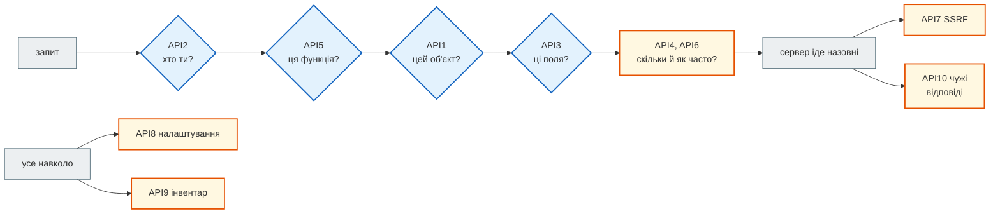

# OWASP API Security Top 10 на FastAPI і News Hub

## Проблема { #problem }

Безпека, перевірена «на око», зводиться до того, що автор встиг згадати. Потрібна карта: які ризики взагалі бувають в API, що з них закриває фреймворк сам, що — наш код, а що — ніхто. OWASP веде два такі списки: **Top 10** для вебзастосунків (редакція 2025) і **API Security Top 10** (редакція 2023) — саме для API, де немає сторінок і форм, зате є id в URL, JSON-тіла й інтеграції з іншими сервісами. Ця сторінка проходить другий список пункт за пунктом: що це в FastAPI, де на сторінках цієї частини пояснено механізм, і чесний стан News Hub — що закрито, що частково, а що ні.

## Ментальна модель { #mental-model }



Перші чотири — ворота, через які проходить кожен запит: автентифікація, потім три рівні авторизації. API4 і API6 — кількість. API7 і API10 — коли сервер сам є клієнтом. API8 і API9 — не код ендпоінта, а все навколо нього.

## Карта: ризик → сторінка → News Hub { #map }

| Ризик | Де пояснено | News Hub (крок 12) |
|---|---|---|
| **API1** Broken Object Level Authorization | [Авторизація: BOLA](authorization.md#bola) | **не стосується**: немає об'єктів окремих користувачів; підписки бота — за `chat.id` з update |
| **API2** Broken Authentication | [Паролі](passwords.md), [Автентифікація](authentication.md) | **закрито для одного адміна**: bcrypt у пулі потоків, однаковий час і відповідь, HS256 з коду, `require exp`, ліміт входу за IP і за ім'ям, `no-store` на токені; без refresh і відкликання |
| **API3** Broken Object Property Level Authorization | [Авторизація: BOPLA](authorization.md#bopla), [Масове присвоєння](../02_typing_and_pydantic/config_dict.md#mass-assignment) | **закрито**: окремі моделі запиту й відповіді; `PATCH` — лише поля `NewsPatch` |
| **API4** Unrestricted Resource Consumption | [нижче](#api4) | **частково**: `le=` на параметрах, `max_length`, 1 МБ тіла в nginx, ліміти на збір, аналіз і вхід, 2 МБ і 10 с на RSS |
| **API5** Broken Function Level Authorization | [Авторизація: BFLA](authorization.md#bfla) | **закрито**: `AdminDep` на 14 операціях + тест «нічого не забули» |
| **API6** Unrestricted Access to Sensitive Business Flows | [нижче](#api6) | **частково**: дорогі дії (LLM, збір) — лише адміну й з лімітом, однаковим для API і бота |
| **API7** Server Side Request Forgery | [SSRF і вихідні запити](ssrf_and_outbound.md) | **закрито для RSS-джерел** (`safe_fetch`); `scraper.py` ходить без перевірки перенаправлень |
| **API8** Security Misconfiguration | [нижче](#api8), [Секрети і заголовки](secrets_and_headers.md) | **закрито для JSON API**: fail fast для секретів, `debug` вимкнено, CORS не потрібен, заголовки безпеки на кожній відповіді, `/docs` на сервері вимкнено, `server_tokens off`; `TrustedHost` немає |
| **API9** Improper Inventory Management | [нижче](#api9) | **закрито тестом**: перелік маршрутів у тестах; одна версія API |
| **API10** Unsafe Consumption of APIs | [нижче](#api10), [Webhook](webhooks_and_signatures.md) | **закрито**: RSS → `NewsItem`, LLM → `NewsAnalysis(extra="forbid")`, webhook — підпис до розбору, повтор за id доставки не запускає збір удруге |

«Закрито» тут означає «є захист і тест на нього», а не «вразливостей немає».

## API1, API3, API5: авторизація { #api1-api3-api5 }

Три рівні — функція, об'єкт, властивість — з прикладами `/v1` (вразливо) і `/v2` (виправлено) розібрані на сторінці [Авторизація](authorization.md). Коротко, що ловить кожен:

| | Вразливість | Захист у FastAPI |
|---|---|---|
| API1 | `GET /notes/2` повертає чужу нотатку | залежність, що повертає лише дозволений об'єкт; фільтр у SQL; чуже — `404` |
| API3 | `PATCH` з `owner_id` у тілі; `password_hash` у відповіді | модель запиту з білим списком (`extra="forbid"`), `response_model` |
| API5 | `DELETE /users/1` від звичайного користувача | `Security(..., scopes=[...])` або `dependencies=[...]` на роутері; тест маршрутів |

## API2: автентифікація { #api2 }

Що входить: слабке зберігання паролів, перебір без ліміту, вхід, що підказує «немає такого імені», токени без строку дії, прийом `alg: none`, секрет за замовчуванням, токени в URL. Механізми — на сторінках [Паролі](passwords.md) і [Автентифікація](authentication.md), ліміт входу — у [Секретах і заголовках](secrets_and_headers.md#login-rate-limit). Як News Hub додав до ліміту за IP лічильник невдалих входів за ім'ям (було → стало) — [там само](secrets_and_headers.md#news-hub-fixes). Атаки на токен News Hub як тести — [Тести безпеки](../tutorials/08_security/security_tests.md#attacks).

## API4: межі ресурсів { #api4 }

Кожен параметр, що визначає «скільки», — межа зверху. [`examples/security/owasp_demo.py`](https://github.com/NikoriakViktor/news_hub/blob/main/examples/security/owasp_demo.py):

```python title="owasp_demo.py (фрагмент)"
@app.get("/v1/items")
def items_v1(limit: int = 20) -> dict[str, int]: ...


@app.get("/v2/items")
def items_v2(limit: Annotated[int, Query(ge=1, le=100)] = 20) -> dict[str, int]: ...


class Tags(BaseModel):
    tags: list[Annotated[str, Field(max_length=30)]] = Field(max_length=10)
```

```text
--- 1. API4: межі параметрів і тіла
   GET /v1/items?limit=1000000 → {'returned': 1000000}
   GET /v2/items?limit=1000000 → 422 less_than_equal {'le': 100}
   POST /v2/tags, 10 000 тегів → 422 too_long ['body', 'tags']
```

| Ресурс | Межа |
|---|---|
| розмір сторінки | `Query(le=...)`; курсорна пагінація замість `offset` на мільйонах ([Колекції](../01_http_and_rest/collections.md)) |
| розмір тіла | у проксі (`client_max_body_size`); FastAPI сам не обмежує |
| рядки й списки в тілі | `max_length` у моделі — і для кожного елемента списку |
| дорогі операції (bcrypt, LLM, завантаження URL) | rate limit за користувачем/IP, черга з обмеженою кількістю задач |
| час | тайм-аути на всі вихідні запити й на запити до бази |
| гроші | ліміт викликів платних API (LLM, SMS) на користувача й на день |

**У News Hub:** `GET /api/news` — `limit: Query(50, ge=1, le=1000)`, пошук — `q` від 2 до 60 символів, `limit ≤ 100`; `ScrapeRequest.pages` — до 20 URL; аналіз — `limit ≤ 200`; `password` — до 1000 символів; nginx — `client_max_body_size 1m`; rate limit на збір, аналіз (LLM) і вхід ([крок 4](../tutorials/04_middleware_redis/rate_limit.md), [крок 8](../tutorials/08_security/admin_jwt.md#login-limit)); `safe_fetch` — 2 МБ і 10 с; бот — 20 повідомлень на хвилину від користувача й не більше 3 нових аналізів LLM на дайджест.

## API6: чутливі бізнес-процеси { #api6 }

Не баг у коді, а сценарій, яким зловживають автоматично: скупити всі квитки ботом, зареєструвати тисячу акаунтів заради бонусу, розіслати спам через «запросити друга». Кожен окремий запит легальний; шкода — у кількості й автоматизації. Захист — від бізнес-логіки: ліміти на **дію** (не лише на IP), затримки, CAPTCHA, перевірка пристрою, ручна модерація для підозрілих.

**У News Hub** найдорожчий процес — аналіз новин платною моделлю. Він доступний лише адміну, має свій ліміт частоти й кеш результатів, а для бота — стелю нових аналізів на один дайджест (`DIGEST_ANALYZE = 3`). Збір через бота бере межу з тієї самої таблиці `LIMITS["scrape"]`, що й `POST /api/scrape*`. Раніше в бота був лише загальний ліміт 20 повідомлень на хвилину ([було → стало](authorization.md#news-hub-two-entries)). Публічних «бізнес-процесів» (реєстрація, покупка) немає.

## API7: SSRF { #api7 }

Розібрано на сторінці [SSRF і вихідні запити](ssrf_and_outbound.md); реалізація News Hub — [крок 8](../tutorials/08_security/ssrf.md). У Top 10:2025 для вебзастосунків окремого пункту SSRF немає — він увійшов до A01 Broken Access Control (CWE-918).

## API8: помилки налаштувань { #api8 }

```python title="owasp_demo.py (фрагмент)"
broken = FastAPI(debug=debug)

@broken.get("/boom")
def boom() -> None:
    raise RuntimeError("connection to postgresql://news:S3cr3t@db:5432/news failed")
```

```text
--- 2. API8: debug=True і текст винятку
   debug=True  → 500 text/plain пароль у відповіді: True | 'Traceback (most recent call last):'
   debug=False → 500 text/plain пароль у відповіді: False | 'Internal Server Error'
   HTTPException(detail=str(error)) → {'detail': 'connection to postgresql://news:S3cr3t@db:5432/news failed'}
```

- **`debug=True`** віддає клієнту повне трасування — з шляхами, кодом і текстом винятку, де часто є адреса бази з паролем. За замовчуванням `False`; вмикати лише локально.
- **`detail=str(error)`** робить те саме вручну, і жодне налаштування від цього не рятує. Назовні — загальне повідомлення, подробиці — у журнал.
- Решта типових пунктів — у [Секретах і заголовках](secrets_and_headers.md): секрети за замовчуванням, `FORWARDED_ALLOW_IPS=*`, відсутні заголовки безпеки, `/docs` у продакшні, а також [CORS з `["*"]` і `allow_credentials`](../06_middleware_cache_jobs/cors.md#wildcard-credentials) і контейнер від root ([крок 10](../tutorials/10_docker/index.md)).

**У News Hub:** `FastAPI(...)` без `debug`; секрети без значень за замовчуванням і з перевіркою при старті; контейнер від користувача `app` (UID 10001); CORS не підключено, бо не потрібен. Раніше `/docs` і `/openapi.json` були доступні всім, а заголовків безпеки не було. Тепер `SecurityHeadersMiddleware` ставить `nosniff`, `X-Frame-Options`, `Referrer-Policy` і CSP, Compose вимикає документацію (`DOCS_ENABLED=false`), а nginx не показує версію ([було → стало](secrets_and_headers.md#news-hub-fixes)); тести — `test_security_headers_on_every_answer`, `test_docs_enabled`, перевірки `smoke.sh`. `502` при збиранні RSS містить текст помилки `aiohttp` — для адміна це зручно, а ендпоінт доступний лише йому.

## API9: інвентар { #api9 }

Неврахований ендпоінт — незахищений ендпоінт: стара версія, що досі працює, «тимчасовий» маршрут для налагодження, маршрут, схований з `/docs`. Інвентар у FastAPI — це `app.routes`, а не `/docs`:

```python title="owasp_demo.py (фрагмент)"
for route in notes_app.routes:
    if not isinstance(route, APIRoute):
        continue
    for method in sorted(route.methods):
        flags = [] if (method, route.path) in documented else ["немає в /docs"]
        flags += [] if protected(route) else ["без перевірки"]
        if route.path.startswith("/v1"):
            flags.append("стара версія")
```

```text
--- 3. API9: інвентар маршрутів
   GET    /v1/notes/{note_id}    стара версія
   GET    /v2/notes/{note_id}    ok
   PATCH  /v1/notes/{note_id}    стара версія
   PATCH  /v2/notes/{note_id}    ok
   DELETE /v1/users/{user_id}    немає в /docs, стара версія
   DELETE /v2/users/{user_id}    ok
   GET    /v1/users/me           стара версія
   GET    /v2/users/me           ok
   службові маршрути (не APIRoute): ['/docs', '/docs/oauth2-redirect', '/openapi.json', '/redoc']
```

Усі маршрути `/v1` формально «захищені» — вимагають токен, — але кожен з них вразливий (BOLA, масове присвоєння, BFLA, надмірні дані на [сторінці авторизації](authorization.md)). Інвентар не знайде вразливість, але покаже, **де шукати**: старі версії, приховані маршрути, маршрути без перевірки. `DELETE /v1/users/{user_id}` немає в `/docs` — і тому про нього забудуть першим. Як вести версії й прибирати старі — [Версіонування](../01_http_and_rest/versioning.md).

**У News Hub:** одна версія (`/api/...`); тест обходить усі маршрути й порівнює незахищені з явним списком `PUBLIC` ([Тести безпеки](../tutorials/08_security/security_tests.md#public)); новий маршрут без `AdminDep` або без запису в `PUBLIC` валить тест.

## API10: чужі API — недовірений вхід { #api10 }

Відповідь партнерського API, RSS-стрічка, вихід LLM, тіло webhook — дані з-за меж вашого контролю. Їм довіряють більше, ніж користувачам («це ж наш партнер»), а зламаний чи підмінений партнер — зручний шлях усередину.

```python title="owasp_demo.py (фрагмент)"
class PartnerNews(BaseModel):
    model_config = ConfigDict(extra="ignore")
    title: str = Field(min_length=1, max_length=300)
    url: HttpUrl
```

```text
--- 4. API10: відповідь чужого API — недовірений вхід
   звичайна           → прийнято: {'title': 'Новина', 'url': 'https://partner.example/n/1'}
   javascript: в url  → відхилено: [('url_scheme', ('url',))]
   заголовок 1 МБ     → відхилено: [('string_too_long', ('title',))]
   немає url          → відхилено: [('missing', ('url',))]
```

- **Валідація моделлю**, як для тіла запиту: типи, межі довжини, схема URL. `extra="ignore"` — партнер додасть поле, і ми не впадемо.
- **Межі на сам запит**: тайм-аут, розмір, тип вмісту, перенаправлення — як у [гігієні вихідних запитів](ssrf_and_outbound.md#outbound-hygiene).
- **Екранування на виході.** Заголовок від партнера, показаний у HTML чи в повідомленні Telegram з `parse_mode=HTML`, — це XSS чи зламана розмітка.
- **Вихід LLM — так само чужі дані**, а текст новини, що потрапляє в запит до моделі, може містити інструкції для неї (prompt injection). Відповідь моделі — лише через сувору схему.

**У News Hub:** HTML сторінок і RSS проходять `parse_*` → `NewsItem` (довжини, `HttpUrl`, allowlist доменів новин); відповідь LLM — `NewsAnalysis` з `extra="forbid"` і переліками тем і тональності ([крок 7](../tutorials/07_llm_api/index.md)); текст новин у повідомленнях бота — через `esc` (`html.escape`) ([крок 9](../tutorials/09_telegram_bot/html_replies.md)); webhook — підпис до розбору.

## OWASP Top 10:2025 для вебзастосунків { #owasp-top10-2025 }

Список для вебзастосунків ширший за API: туди входять ланцюжок постачання, журнали, обробка винятків.

| Ризик Top 10:2025 | Що це для FastAPI | News Hub |
|---|---|---|
| **A01** Broken Access Control (разом із SSRF, CSRF) | API1, API3, API5, API7; CSRF для cookie | `AdminDep` + тест; `safe_fetch`; cookie немає |
| **A02** Security Misconfiguration | API8 | вище, [API8](#api8) |
| **A03** Software Supply Chain Failures | залежності, образи, CI | `requirements.txt` — діапазони `>=`, CI перевіряє найнижчі й найновіші; образ кроку 12 ставиться з `requirements.lock` (70 пакетів з sha256, `pip install --require-hashes`); job `supply-chain` перевіряє, що lock відповідає `requirements.txt`, запускає `pip-audit` по lock і gitleaks по історії git, і без нього образ не публікується |
| **A04** Cryptographic Failures | хеш паролів, секрети, TLS | bcrypt, секрети ≥ 32 символи, HMAC-SHA256; TLS — перед nginx |
| **A05** Injection | SQL, HTML, команди, prompt injection | SQLAlchemy з параметрами; `esc` у бота; сувора схема для LLM |
| **A06** Insecure Design | відсутні межі в самому дизайні | ліміти й «лише адмін» для дорогих дій закладено в дизайн кроків 4, 7, 8 |
| **A07** Authentication Failures | API2 | [API2](#api2) |
| **A08** Software or Data Integrity Failures | непідписані дані й оновлення, десеріалізація | webhook з підписом і id доставки; залежності образу — з хешами в `requirements.lock`; образ з `ghcr.io` з CI; `pickle` не використовується |
| **A09** Security Logging and Alerting Failures | немає подій безпеки в журналі | `rate limit` і `/scrape` від не-адміна — `warning` у журналі; невдалі входи й блокування за ім'ям видно лише як `401`/`429` у рядку `request_context`, окремої події немає |
| **A10** Mishandling of Exceptional Conditions | `500` з подробицями, «fail open» | fail fast при старті; загальний `500`; LLM: тайм-аути, повтори, circuit breaker |

Як ці самі ризики виглядають у Django-застосунку (`check --deploy`, CSRF-middleware, `ALLOWED_HOSTS`) — [OWASP Top 10 у Django-книзі](https://nikoriakviktor.github.io/notes_chat_app/07_auth_and_security/owasp_top_10_full/).

## Типові помилки { #mistakes }

| Помилка | Наслідок | Як правильно |
|---|---|---|
| «автентифікація є — отже, захищено» | API1, API3, API5 | три рівні авторизації окремо |
| `limit: int` без верхньої межі | один запит вивантажує всю таблицю | `Query(le=...)` |
| `debug=True` чи `detail=str(error)` на сервері | трасування й паролі у відповіді | `debug` з налаштувань, загальне повідомлення назовні |
| старі версії й тимчасові маршрути «поки що» живуть | неврахована поверхня атаки | інвентар з `app.routes` у тестах |
| відповідь партнера без валідації | XSS, неочікувані типи, переповнення | модель Pydantic, межі, екранування на виході |
| Top 10 як чекліст «поставити галочки» | безпека закінчується на десятому пункті | карта для пошуку, а не повний перелік |

## Налагодження { #debugging }

- **Матриця доступу як тест**: ролі × ендпоінти × «свій / чужий / неіснуючий» об'єкт → очікуваний код. Нова роль чи ендпоінт — новий рядок.
- **Перелік маршрутів**: `[(sorted(r.methods), r.path) for r in app.routes if isinstance(r, APIRoute)]` — порівняти з тим, що, на вашу думку, є в API.
- **Спробувати як атакувальник** — на локальній копії: чужий id, зайве поле, `limit=1000000`, `Host: evil.example`, `X-Forwarded-For`, токен з `alg: none`. Приклади цієї папки й тести News Hub роблять саме це.

## Безпека й межі { #security }

- **Top 10 — найпоширеніше, а не все.** Бізнес-логіка конкретного застосунку (повернення коштів, промокоди, ролі в команді) у жоден список не потрапить.
- **Стан «закрито» старіє.** Кожен новий ендпоінт, інтеграція чи версія залежності знову відкриває питання; тести безпеки — те, що робить «закрито» тривалим.
- **Рецензія коду ловить те, чого не ловлять тести**: порівняння за сталий час, секрети в журналах, правила, записані двічі.

## Питання { #questions }

1. Чим API1 відрізняється від API5? Наведи приклад кожного.
2. Чому `include_in_schema=False` — проблема API9, а не захист?
3. Які межі має мати ендпоінт списку, щоб не потрапити в API4?
4. Чому `debug=True` — питання налаштувань, а `detail=str(error)` — питання коду, хоча наслідок той самий?
5. Чому відповідь партнерського API валідують так само, як тіло запиту?
6. Куди в Top 10:2025 потрапив SSRF?
7. Що в News Hub лишається відкритим з цього списку?

??? success "Відповіді"

    1. API1 — доступ до **чужого об'єкта** через дозволену функцію (`GET /notes/2` чужої нотатки). API5 — доступ до **функції**, яка тобі не належить (`DELETE /users/1` від звичайного користувача).
    2. Маршрут працює, але його немає в документації й інвентарі — про нього забувають, і він лишається без оновлень і перевірок.
    3. Верхня межа `limit`, межі довжин рядків і списків у фільтрах, тайм-аут запиту до бази, курсорна пагінація для великих таблиць, ліміт частоти для дорогих запитів.
    4. `debug` — один прапорець, який вмикають чи вимикають для середовища. `detail=str(error)` віддає текст винятку незалежно від налаштувань — це треба виправляти в коді.
    5. Це дані з-за меж нашого контролю: партнера можуть зламати чи підмінити, а його помилка стає нашою (XSS, неочікувані типи, переповнення).
    6. До A01 Broken Access Control (CWE-918); в API Security Top 10 2023 — окремий пункт API7.
    7. `scraper.py` без перевірки перенаправлень (API7), немає `TrustedHostMiddleware` (поки без наслідків), невдалі входи не журналюються окремою подією (A09); refresh і відкликання токенів адміна свідомо не реалізовано. Заголовки безпеки, `/docs`, ліміт входу за ім'ям, повтор webhook, одне правило адміна для API і бота, lock-файл з хешами і сканери в CI — уже закрито (було → стало — на сторінках [Секрети і заголовки](secrets_and_headers.md#news-hub-fixes), [Webhook](webhooks_and_signatures.md#news-hub-replay), [Авторизація](authorization.md#news-hub-two-entries)).

## Що далі { #next }

[Частина VIII. Безпека API](README.md) — решта розділів частини. На практиці весь захист News Hub — у [кроці 8](../tutorials/08_security/index.md); далі [крок 9](../tutorials/09_telegram_bot/index.md) додає бота — ще один вхід, для якого діють ті самі правила.

**Джерела:** [OWASP API Security Top 10 2023](https://owasp.org/API-Security/editions/2023/en/0x11-t10/) — [API1](https://owasp.org/API-Security/editions/2023/en/0xa1-broken-object-level-authorization/), [API2](https://owasp.org/API-Security/editions/2023/en/0xa2-broken-authentication/), [API3](https://owasp.org/API-Security/editions/2023/en/0xa3-broken-object-property-level-authorization/), [API4](https://owasp.org/API-Security/editions/2023/en/0xa4-unrestricted-resource-consumption/), [API5](https://owasp.org/API-Security/editions/2023/en/0xa5-broken-function-level-authorization/), [API6](https://owasp.org/API-Security/editions/2023/en/0xa6-unrestricted-access-to-sensitive-business-flows/), [API7](https://owasp.org/API-Security/editions/2023/en/0xa7-server-side-request-forgery/), [API8](https://owasp.org/API-Security/editions/2023/en/0xa8-security-misconfiguration/), [API9](https://owasp.org/API-Security/editions/2023/en/0xa9-improper-inventory-management/), [API10](https://owasp.org/API-Security/editions/2023/en/0xaa-unsafe-consumption-of-apis/); [OWASP Top 10:2025](https://owasp.org/Top10/2025/); FastAPI — [Handling Errors](https://fastapi.tiangolo.com/tutorial/handling-errors/), [Query Parameters and String Validations](https://fastapi.tiangolo.com/tutorial/query-params-str-validations/); Django-книга — [OWASP Top 10](https://nikoriakviktor.github.io/notes_chat_app/07_auth_and_security/owasp_top_10_full/).
