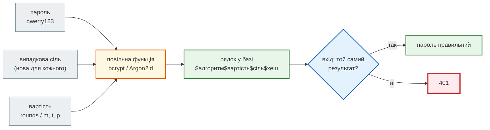
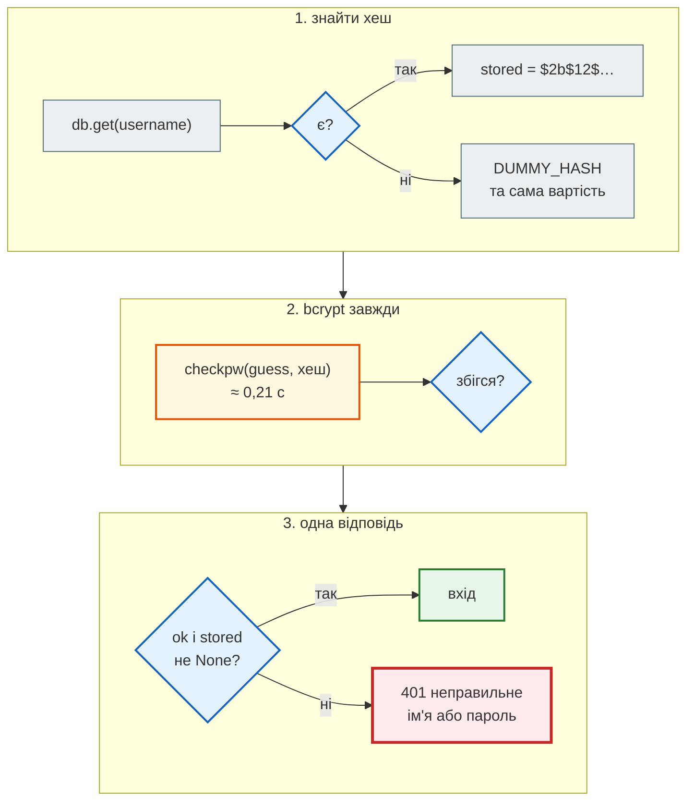

# Паролі: хеш, сіль, вартість

## Проблема { #problem }

Базу даних колись украдуть: через SQL-ін'єкцію, забутий бекап, зламаний сервер, старий дамп у відкритому бакеті. Питання не «чи», а «що тоді прочитають». Пароль, збережений як є, зламує не лише ваш сервіс, а й пошту та банк користувача — люди використовують один пароль усюди. «Захешую sha256» здається відповіддю, але звичайна хеш-функція для паролів майже нічого не дає: вона створена бути **швидкою**, а саме швидкість допомагає перебору. Потрібна функція, яка навмисно повільна, з сіллю, з вартістю, яку можна піднімати з роками. І порівнювати секрети треба так, щоб час відповіді нічого не підказував.

## Ментальна модель { #mental-model }

Сервер **ніколи не зберігає пароль**. Він зберігає рядок, з якого пароль не отримати, але яким можна перевірити спробу: порахувати ту саму функцію від введеного пароля з тією самою сіллю й порівняти.



Три властивості, заради яких усе це:

| Властивість | Що дає | Без неї |
|---|---|---|
| **одностороння** | з хешу не отримати пароль, лише перевірити спробу | пароль читається з бази |
| **сіль** | однакові паролі — різні рядки; заздалегідь пораховані таблиці марні | «злили» один хеш — знаєш усіх з таким паролем |
| **вартість** | кожна спроба дорога: сотні мілісекунд і мегабайти пам'яті | мільйони спроб на секунду на одному ядрі |

## Чому не sha256 { #why-not-sha256 }

[`examples/security/passwords_demo.py`](https://github.com/NikoriakViktor/news_hub/blob/main/examples/security/passwords_demo.py) — «злита база» з чотирма користувачами, паролі збережені як `sha256(пароль)`, і словник на сто тисяч слів:

```python title="passwords_demo.py (фрагмент)"
leaked = {name: hashlib.sha256(pw.encode()).hexdigest() for name, pw in users.items()}
table = {hashlib.sha256(word.encode()).hexdigest(): word for word in wordlist}       # порахували ОДИН раз
cracked = {name: table[d] for name, d in leaked.items() if d in table}
```

```text
--- 1. sha256 без солі: «злита база» і словник
   olena  daaad6e5604e8e17…
   taras  daaad6e5604e8e17…
   ivan   780b5eeb150fb2bb…
   maria  daa2669394262fe9…
   однакові паролі видно без злому: True
   словник 100006 слів → зламано ['ivan', 'olena', 'taras'] за 0.08 с
```

- **Однакові паролі видно одразу.** Олена й Тарас мають однаковий рядок — нічого не зламавши, видно, що в них один пароль.
- **Таблицю рахують один раз** для всіх користувачів і всіх баз світу (rainbow tables — те саме, тільки компактніше). Три паролі з чотирьох — за 0,08 с.
- **Вистояв лише справді випадковий пароль** `maria`. Але більшість паролів — не такі.

Друга проблема — швидкість. Одна спроба для кожної функції на тій самій машині:

```text
--- 2. швидкість одного хешу: sha256, bcrypt, Argon2id
   sha256                           0.0005 мс   ≈    1,925,037 спроб/с на ядро
   bcrypt rounds=12               237.1164 мс   ≈            4 спроб/с на ядро
   argon2id (за замовчуванням)     89.3802 мс   ≈           11 спроб/с на ядро
   bcrypt повільніший за sha256 у ~456,458 разів
```

Майже два мільйони спроб на секунду на одному ядрі Python — а відеокарта рахує sha256 у тисячі разів швидше. Для перевірки цілісності файлу це чеснота, для пароля — вирок. Сіль сама по собі тут не допоможе: вона ламає готові таблиці, але не перебір кожного хешу окремо. Потрібна саме **повільна** функція.

!!! warning "sha256(сіль + пароль) — теж ні"
    Сіль прибирає першу проблему (однакові рядки й готові таблиці), але не другу: кожен хеш з сіллю перебирається окремо з тією самою швидкістю мільйони спроб на секунду. Для паролів — лише функції, створені для паролів: Argon2id, bcrypt, scrypt, PBKDF2 з великою кількістю ітерацій.

## Сіль і будова рядка { #salt }

```text
--- 3. сіль: той самий пароль — різні хеші
   bcrypt : $2b$04$c2b9Po08JDTpUvAv/zIM.u9T7YDEm5dwM8Wpc1mz.0fCMV4Y2pVBi
   bcrypt : $2b$04$POLo30pDLl13hRhCmX1DDOG8uyiPLjYUFbhb7QMUFPSfGyvceXIy.
   різні: True | обидва перевіряються: True True
   будова : алгоритм '2b', вартість '04', сіль 'c2b9Po08JDTpUvAv/zIM.u' (22), хеш '9T7YDEm5dwM8Wpc1mz.0fCMV4Y2pVBi' (31)
   argon2 : $argon2id$v=19$m=65536,t=3,p=4$du3YM/OpkM1eg2NhqOos0w$F/PBUBCQjAPNearfOxr5RTT49lV3l0tooSzFpaxz7Rk
   параметри в рядку: m=65536,t=3,p=4
```

Усе, що потрібно для перевірки, лежить **у самому рядку**: алгоритм, вартість, сіль, хеш. Окремої колонки для солі не треба, а `checkpw` / `verify` самі беруть звідти параметри. Звідси практичний наслідок: у базі можуть одночасно лежати хеші з різною вартістю і навіть різними алгоритмами — кожен перевіряється своїми параметрами.

Той самий принцип у Django: `pbkdf2_sha256$1000000$<сіль>$<хеш>` — PBKDF2 з мільйоном ітерацій у Django 5.2, число записане в рядку й росте з версіями. Як це влаштовано там — [Автентифікація в Django-книзі](https://nikoriakviktor.github.io/notes_chat_app/07_auth_and_security/auth_basics_full/).

## Вартість { #cost }

```text
--- 4. вартість bcrypt: +1 раунд — удвічі довше
   rounds=10: 0.060 с
   rounds=11: 0.121 с
   rounds=12: 0.248 с
   rounds=13: 0.466 с
```

`rounds` у bcrypt — показник степеня: `2^rounds` ітерацій. Кожен +1 подвоює час і для сервера, і для атакувальника. Вартість обирають так, щоб одна перевірка на **вашому** сервері тривала десятки–сотні мілісекунд: користувач цього не помітить, а перебір стане в мільйони разів дорожчим.

| Алгоритм | Параметри | Що ускладнює |
|---|---|---|
| **Argon2id** | `m` — пам'ять (КіБ), `t` — проходи, `p` — потоки | час **і пам'ять**: відеокарті бракує пам'яті на тисячі паралельних спроб |
| **bcrypt** | `rounds` (4–31) | час; пам'яті потрібно мало |
| **scrypt** | `N`, `r`, `p` | час і пам'ять |
| **PBKDF2-HMAC-SHA256** | ітерації (OWASP радить 600 000) | лише час — найслабший з чотирьох, але є всюди (FIPS) |

OWASP Password Storage Cheat Sheet радить Argon2id, а де його немає — scrypt, для старих систем — bcrypt, для FIPS — PBKDF2. `argon2-cffi` за замовчуванням — `m=65536` (64 МіБ), `t=3`, `p=4`; це профіль RFC 9106 для обмеженої пам'яті.

!!! warning "Повільний хеш — це ціна для сервера теж"
    Кожна спроба входу коштує серверу 0,1–0,25 с процесора. Без ліміту спроб ендпоінт входу — зручний спосіб «покласти» сервер. Ліміт — у [Секретах і заголовках](secrets_and_headers.md#login-rate-limit).

## 72 байти bcrypt { #bcrypt-72 }

```text
--- 5. межа bcrypt — 72 байти; Argon2 її не має
   len(str) = 37 | len(bytes) = 74
   bcrypt.hashpw: ValueError — password cannot be longer than 72 bytes, truncate manually if necessary (e.g. my_password[:72])
   argon2: True
```

bcrypt за алгоритмом бере лише перші 72 **байти** пароля. Старі версії бібліотеки мовчки обрізали довший пароль — і два паролі зі спільними першими 72 байтами вважались однаковими. `bcrypt` 5 кидає `ValueError` і в `hashpw`, і в `checkpw`. Межа — у байтах, а не символах: кирилиця — 2 байти на літеру, тож 37 літер — уже 74 байти. Як із цим поводиться News Hub (довгий пароль — «не той пароль», а не `500`) — у [кроці 8](../tutorials/08_security/admin_jwt.md#bcrypt).

Argon2 такої межі не має. Обхід для bcrypt «спершу sha256, потім bcrypt» має власні пастки (нульові байти в сирому дайджесті, «password shucking» — якщо той самий sha256 пароля злитий деінде), тому якщо 72 байти заважають — простіше взяти Argon2id.

## Перевірка і перехешування { #rehash }

Вартість, обрана п'ять років тому, сьогодні замала. Пароль не можна перехешувати без самого пароля, але він у нас є — **у момент успішного входу**:

```python title="passwords_demo.py, розділ 6 (спрощено)"
old = PasswordHasher(time_cost=1, memory_cost=8 * 1024)                    # «старі» параметри
stored = old.hash("Kyiv2024!")
ph.verify(stored, "Kyiv2024!")                                             # True — параметри беруться з рядка
if ph.check_needs_rehash(stored):                                          # параметри рядка ≠ поточні
    stored = ph.hash("Kyiv2024!")                                          # після вдалого входу — новий хеш
```

```text
--- 6. перевірка і «перехешування» при вході
   неправильний пароль: VerifyMismatchError
   правильний: True | check_needs_rehash: True
   після перехешування: m=65536,t=3,p=4 | needs_rehash: False
   bcrypt: вартість у хеші 10 < 12 → перехешувати: True
```

- **`argon2-cffi` кидає виняток** на неправильний пароль (`VerifyMismatchError`), а не повертає `False`. Забудеш `except` — неправильний пароль дасть `500`.
- **`check_needs_rehash`** порівнює параметри в рядку з параметрами `PasswordHasher`. Для bcrypt такої функції немає, але вартість видно в рядку: `int(hash.split("$")[2])`.
- **Міграція з іншого алгоритму** — так само: при вході перевірити старим, записати новим. Користувачі, які не входили роками, лишаються на старому хеші; їм — примусове скидання пароля.

## passlib, pwdlib чи бібліотека напряму { #libraries }

| | Що це | Коли |
|---|---|---|
| `bcrypt` (pyca) | лише bcrypt, два виклики: `hashpw`, `checkpw` | один алгоритм, мінімум залежностей — як у News Hub |
| `argon2-cffi` | Argon2 з `verify`, `check_needs_rehash` | новий проєкт |
| `pwdlib` | обгортка над argon2-cffi і bcrypt з перехешуванням між алгоритмами | її показує документація FastAPI |
| `passlib` | колишній стандарт, `CryptContext` | **не оновлювався з 2020 року**; з `bcrypt` 5 падає при першому хешуванні |

`passlib` досі в багатьох туторіалах і старій документації FastAPI. З `bcrypt` 5 він ламається вже на імпорті застосунку, і повідомлення помилки — про 72 байти, хоча пароль короткий. Розбір цієї помилки на реальній установці — у [кроці 8](../tutorials/08_security/admin_jwt.md#bcrypt).

## Порівняння за сталий час { #constant-time }

Хеші паролів порівнює сама бібліотека. Але є інші секрети, які порівнюємо ми: ім'я адміна, токен webhook, підпис, API-ключ. `==` зупиняється на **першому** байті, що відрізняється:

```python title="passwords_demo.py (фрагмент)"
secret = secrets.token_bytes(1_000_000)                                     # великий рядок — щоб різницю було видно
early = b"X" + secret[1:]                                                  # відрізняється в першому байті
late = secret[:-1] + b"X"                                                  # відрізняється в останньому
```

```text
--- 7. == проти hmac.compare_digest: час залежить від першої розбіжності
   ==              перший байт:     0.04 мкс | останній:    34.27 мкс
   compare_digest  перший байт:   525.15 мкс | останній:   505.08 мкс
```

- **`==` видає позицію розбіжності.** Що довше збігається початок, то довше порівняння. Атакувальник підбирає секрет по байту: перебирає перший, поки час не зросте, потім другий. Для коротких рядків різниця — наносекунди, але її виміряють статистично на тисячах запитів.
- **`hmac.compare_digest`** порівнює весь рядок завжди, незалежно від того, де розбіжність. Він повільніший — і це нормально.
- **Обидва аргументи — `bytes`** (або обидва ASCII-`str`). Для тексту — `.encode()` з обох боків.

Тест цього не спіймає: `==` і `compare_digest` дають **той самий** результат. У News Hub заміна `compare_digest` на `!=` лишає всі тести зеленими — [Тести безпеки](../tutorials/08_security/security_tests.md#mutations). Такі речі перевіряє рецензія коду.

## Вхід: однаковий час для «немає такого користувача» { #enumeration }

Найпоширеніший витік через час — не байтове порівняння, а **ранній вихід**:

```python title="passwords_demo.py (фрагмент)"
def login_leaky(username: str, password: str) -> bool:
    stored = db.get(username)
    if stored is None:
        return False                                                       # миттєво — і цим видає, що імені немає
    return bcrypt.checkpw(password.encode(), stored)


def login_even(username: str, password: str) -> bool:
    stored = db.get(username)
    ok = bcrypt.checkpw(password.encode(), stored or DUMMY_HASH)          # bcrypt завжди
    return ok and stored is not None
```

```text
--- 8. вхід: «немає такого користувача» за часом
   login_leaky  відоме ім'я: 0.189 с | невідоме: 0.000 с
   login_even   відоме ім'я: 0.213 с | невідоме: 0.208 с
```

0,19 с проти нуля — це видно без жодної статистики. Перебором імен атакувальник дізнається, хто зареєстрований, і далі перебирає лише паролі цих людей (user enumeration). `DUMMY_HASH` — хеш випадкового рядка з тією самою вартістю: перевірка йде завжди, і час однаковий. Повідомлення помилки теж однакове: «неправильне ім'я або пароль», а не «немає такого користувача».

## Покроково: перевірка пароля при вході { #trace }

`login_even("olena", "guess")` і `login_even("nobody", "guess")` з прикладу вище:



## У News Hub { #news-hub }

Один адміністратор, хеш — у змінній середовища `ADMIN_PASSWORD_HASH`. Повний розбір — [Крок 8. Адмін і JWT](../tutorials/08_security/admin_jwt.md#bcrypt); тут — що з цієї сторінки там застосовано:

| Ідея | Де в `security.py` і `api.py` |
|---|---|
| bcrypt напряму, без passlib | `hash_password`, `verify_password` |
| вартість 12 (~0,23 с), у тестах — 4 | `hash_password(password, rounds=12)` |
| 72 байти — «не той пароль», а не `500` | `BCRYPT_MAX_BYTES`, ранній `return False` у `verify_password` |
| однаковий час для чужого імені | `authenticate`: `hmac.compare_digest` для імені, `verify_password` — завжди |
| одна відповідь | `POST /api/admin/token` → `401 неправильне ім'я або пароль` |
| у середовищі хеш, а не пароль | `python -m news_hub.security` друкує `ADMIN_PASSWORD_HASH='$2b$12$…'` |
| хеш перевіряється при старті | крок 12: `BCRYPT_HASH.fullmatch` — обрізаний Compose хеш зупиняє старт ([`$` у `.env`](../02_typing_and_pydantic/settings.md#dollar)) |
| bcrypt не в event loop | `admin_token`: `await run_in_threadpool(authenticate, settings, body.username, body.password)` |
| ліміт онлайн-перебору | за IP — 5 спроб за 300 с; за ім'ям — `LoginGuard`, 20 невдалих за 900 с з усіх адрес, після межі bcrypt не запускається ([ліміт входу](secrets_and_headers.md#news-hub-fixes)) |

Чого в News Hub немає, бо немає таблиці користувачів: перехешування при вході, Argon2, скидання пароля. Пароль адміна змінюють, згенерувавши новий хеш і перезапустивши застосунок.

**Було → стало.** Одна деталь з [налагодження нижче](#debugging) раніше стосувалася й News Hub: `admin_token` — `async def`, і `authenticate` викликав `bcrypt.checkpw` прямо в event loop. Кожна спроба входу на ~0,2 с зупиняла обробку **всіх** запитів процесу. Ліміт за IP це стримував, а спроби з багатьох адрес додавалися. Тепер перевірка йде в пулі потоків (`run_in_threadpool`), а лічильник за ім'ям обриває перебір до bcrypt. Його доводить `test_login_lockout_counts_failures_per_name_from_any_address`: після 20 невдач навіть правильний пароль отримує `429`.

## Типові помилки { #mistakes }

| Помилка | Наслідок | Як правильно |
|---|---|---|
| `sha256(пароль)` / `md5(пароль)` | однакові паролі видно; словник ламає більшість за секунди | Argon2id або bcrypt |
| `sha256(сіль + пароль)` | мільйони спроб на секунду на кожен хеш | функція для паролів з вартістю |
| одна сіль на всіх («перець» замість солі) | однакові паролі знову однакові | випадкова сіль для кожного хешу — бібліотека робить це сама |
| `passlib` з `bcrypt` 5 | застосунок падає при першому хешуванні | `bcrypt` напряму, `argon2-cffi` або `pwdlib` |
| пароль > 72 байт у bcrypt 5 без перевірки | `ValueError` → `500` на вході | перевірка довжини в байтах, або Argon2 |
| `ph.verify` без `except VerifyMismatchError` | неправильний пароль → `500` | `try/except` → `False` |
| ранній `return` для невідомого імені | за часом видно, хто зареєстрований | фіктивний хеш, перевірка завжди |
| «немає такого користувача» / «неправильний пароль» | перебір імен через повідомлення | одне повідомлення на обидва випадки |
| `token == expected` | підбір по байту за часом відповіді | `hmac.compare_digest(a.encode(), b.encode())` |
| вартість, обрана раз і назавжди | з роками хеші дешевшають | `check_needs_rehash` при вході |
| вартість 14+ «для надійності» без ліміту входу | кожна спроба — секунда процесора, легкий DoS | 0,1–0,3 с на перевірку + ліміт спроб |

## Налагодження { #debugging }

- **Чим захешовано пароль?** Префікс рядка: `$2b$` — bcrypt, `$argon2id$` — Argon2id, `pbkdf2_sha256$` — Django PBKDF2. 64 hex-символи без префікса — швидше за все, голий sha256: час мігрувати.
- **`checkpw` повертає `False` для правильного пароля.** Найчастіше хеш пошкоджено по дорозі: Compose підставив `$12` у `.env` без лапок — довжина bcrypt-хешу має бути рівно 60 символів. Друге — різні кодування: хешували `password.encode("latin-1")`, перевіряють `utf-8`.
- **Скільки триває одна перевірка на сервері?** `python -c "import bcrypt,time; h=bcrypt.hashpw(b'x', bcrypt.gensalt(12)); t=time.perf_counter(); bcrypt.checkpw(b'x', h); print(time.perf_counter()-t)"` — на слабкому VPS може бути втричі довше, ніж на ноутбуці.
- **Вхід «підвисає» під навантаженням.** bcrypt і Argon2 займають процесор; в `async def` синхронний `checkpw` блокує event loop на 0,2 с. Обробник входу — звичайна `def` (FastAPI виконає її в пулі потоків) або `await asyncio.to_thread(...)` ([Частина IV](../04_async/README.md)).

## Безпека й межі { #security }

- **Хеш захищає лише від читання бази.** Від перебору онлайн (через ендпоінт входу) захищають ліміт спроб і, для людей, друга перевірка (TOTP, ключі доступу).
- **Повільний хеш не врятує слабкий пароль.** `qwerty123` знайдеться в будь-якому словнику, хай і за години, а не мілісекунди. Перевіряй пароль при реєстрації: мінімальна довжина (NIST SP 800-63B-4 — від 15 символів для пароля як єдиного фактора, від 8 — якщо є другий) і список зламаних паролів, а не правила «одна велика літера й одна цифра».
- **Порівняння за сталий час — для всіх секретів**, не лише паролів: токени, підписи, API-ключі.
- **Пароль не потрапляє в журнали.** Модель запиту з `password: SecretStr` або хоча б без `print(body)`; у тексті `422` FastAPI повертає `input` поля, яке не пройшло перевірку, — для поля пароля це сам пароль ([Типи і Pydantic](../02_typing_and_pydantic/settings.md#secret)).

## Питання { #questions }

1. Чому sha256 не підходить для паролів, навіть із сіллю?
2. Де bcrypt зберігає сіль і чому для неї не потрібна окрема колонка?
3. Що станеться з часом перевірки, якщо підняти `rounds` з 12 до 14?
4. Що зробить `bcrypt` 5 з паролем із 40 кириличних літер?
5. Як підняти вартість хешу, якщо паролів користувачів сервер не знає?
6. Чому `==` для токенів — проблема, якщо результат у нього правильний?
7. Як ендпоінт входу може видати, що користувач зареєстрований, навіть з однаковим повідомленням помилки?
8. Чим Argon2id кращий за bcrypt проти перебору на відеокартах?

??? success "Відповіді"

    1. sha256 створено бути швидким: мільйони спроб на секунду на ядро. Сіль ламає готові таблиці, але кожен хеш окремо перебирається з тією самою швидкістю.
    2. У самому рядку хешу: `$2b$12$` + 22 символи солі + 31 символ хешу. `checkpw` бере сіль і вартість звідти.
    3. Учетверо довше: кожен раунд подвоює кількість ітерацій (0,25 с → ~1 с).
    4. 40 × 2 = 80 байт > 72: `ValueError` і в `hashpw`, і в `checkpw`. Довжину треба перевіряти в байтах.
    5. При кожному успішному вході: пароль у цей момент відомий — перевірити старим хешем, записати новий (`check_needs_rehash`).
    6. `==` зупиняється на першій розбіжності, і час відповіді показує, скільки байтів збіглося; секрет підбирають по байту. Тест цього не бачить — лише рецензія.
    7. Часом відповіді: для невідомого імені сервер не рахує хеш і відповідає миттєво. Захист — фіктивний хеш і перевірка завжди.
    8. Argon2id вимагає багато пам'яті на кожну спробу (64 МіБ за замовчуванням), а відеокарта має тисячі ядер, але обмежену пам'ять на кожне.

## Що далі { #next }

[Автентифікація: сесії, JWT, OAuth2 у FastAPI](authentication.md) — пароль перевірено; тепер — як сервер пам'ятає, хто увійшов, між запитами.

**Джерела:** [OWASP — Password Storage Cheat Sheet](https://cheatsheetseries.owasp.org/cheatsheets/Password_Storage_Cheat_Sheet.html); [RFC 9106 — Argon2](https://datatracker.ietf.org/doc/html/rfc9106); [argon2-cffi](https://argon2-cffi.readthedocs.io/en/stable/); [pyca/bcrypt](https://github.com/pyca/bcrypt); [pwdlib](https://frankie567.github.io/pwdlib/); FastAPI — [OAuth2 with Password (and hashing), Bearer with JWT tokens](https://fastapi.tiangolo.com/tutorial/security/oauth2-jwt/); Python — [`hmac.compare_digest`](https://docs.python.org/3/library/hmac.html#hmac.compare_digest), [`secrets`](https://docs.python.org/3/library/secrets.html); [NIST SP 800-63B](https://pages.nist.gov/800-63-4/sp800-63b.html); Django — [Password management](https://docs.djangoproject.com/en/5.2/topics/auth/passwords/).
