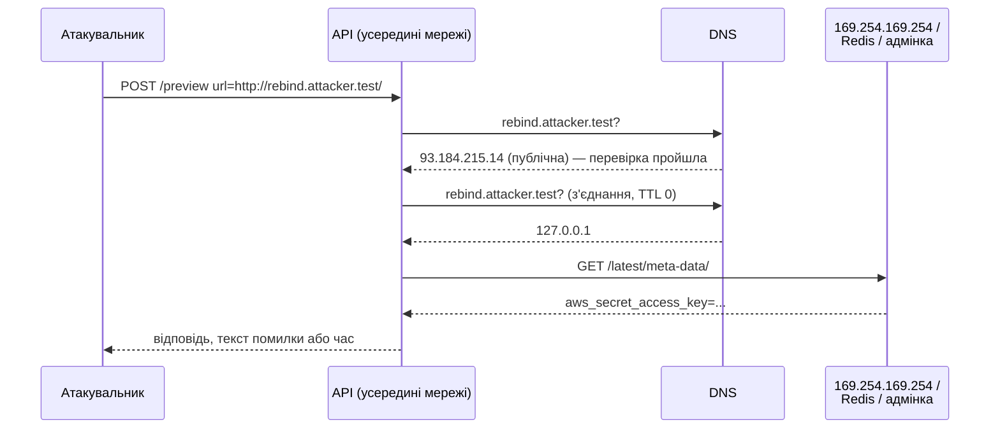
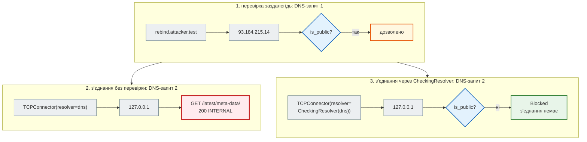

# SSRF і вихідні запити

## Проблема { #problem }

Будь-яка функція «сервер сам сходить за адресою, яку дав користувач» — потенційний SSRF (Server-Side Request Forgery): імпорт RSS за URL, аватар за посиланням, попередній перегляд посилання в чаті, callback-адреса для вихідних webhook, рендер PDF зі сторінки, «перевірити, чи сайт живий». Сервер стоїть **усередині** мережі й бачить те, чого не бачить атакувальник: `localhost`, базу, Redis без пароля, внутрішні адмінки, адресу метаданих хмари з тимчасовими ключами до всього акаунта. URL від користувача — це прохання до сервера сходити туди від свого імені.

Захист «перевірити рядок URL» майже завжди обходять: адресу записують інакше, DNS відповідає по-різному, дозволений сайт перенаправляє на внутрішній. Ця сторінка — про те, **чому** так, і що перевіряти натомість.

## Ментальна модель { #mental-model }



Три висновки:

1. **Перевіряти треба адресу з'єднання**, а не рядок URL: між рядком і з'єднанням є парсер, DNS і перенаправлення — і кожен може «передумати».
2. **Кожне перенаправлення — новий URL** з тими самими перевірками.
3. **Навіть без тіла відповіді** атакувальник дізнається багато: код, текст помилки, час. Це «сліпий» SSRF.

Куди цілять і чому це небезпечно — таблиця в [кроці 8](../tutorials/08_security/ssrf.md#task). Окремо про метадані хмари: AWS IMDSv2 вимагає `PUT` за токеном і заголовок `X-aws-ec2-metadata-token`, GCP — заголовок `Metadata-Flavor: Google`, Azure — `Metadata: true`. Простий SSRF через `GET` без контролю заголовків їх зазвичай не дістане. Але IMDSv1 (без токена) досі ввімкнений на багатьох машинах, а деякі функції («надіслати webhook з моїми заголовками») дають атакувальнику й заголовки. На це не розраховують — це шар захисту, а не захист.

## Які адреси «внутрішні» { #addresses }

Python знає класи адрес — модуль `ipaddress`. [`examples/security/ssrf_demo.py`](https://github.com/NikoriakViktor/news_hub/blob/main/examples/security/ssrf_demo.py):

```python title="ssrf_demo.py (фрагмент)"
def normalize(ip):
    return ip.ipv4_mapped if isinstance(ip, ipaddress.IPv6Address) and ip.ipv4_mapped else ip


def is_public(address: str) -> bool:
    ip = normalize(ipaddress.ip_address(address))
    return ip.is_global and not ip.is_multicast
```

```text
--- 1. які адреси публічні: ipaddress
   127.0.0.1                private=True  global=False → публічна: False
   10.0.0.5                 private=True  global=False → публічна: False
   172.16.0.1               private=True  global=False → публічна: False
   192.168.1.1              private=True  global=False → публічна: False
   169.254.169.254          private=True  global=False → публічна: False
   100.64.0.1               private=False global=False → публічна: False
   0.0.0.0                  private=True  global=False → публічна: False
   ::1                      private=True  global=False → публічна: False
   fe80::1                  private=True  global=False → публічна: False
   fd00::1                  private=True  global=False → публічна: False
   ::ffff:169.254.169.254   private=True  global=False → публічна: False
   64:ff9b::a9fe:a9fe       private=False global=True  → публічна: True
   93.184.215.14            private=False global=True  → публічна: True
```

- **`is_private` — не те питання.** `100.64.0.1` (мережа провайдера, CGNAT) не «приватна», але й не публічна. Питати треба `is_global` — «маршрутизується в інтернеті».
- **`::ffff:169.254.169.254`** — IPv4 всередині IPv6, з'єднання піде на `169.254.169.254`. Перевіряють нормалізовану адресу.
- **`64:ff9b::a9fe:a9fe`** — NAT64-запис `169.254.169.254`; `is_global` для нього `True`. У мережі з NAT64 він веде до метаданих. Чи це ваш випадок, залежить від мережі; розбір — у [межах кроку 8](../tutorials/08_security/ssrf.md#limits).

Модуль лише класифікує адресу. Звідки береться адреса — питання наступних розділів.

## Denylist рядків не працює { #denylist }

```python title="ssrf_demo.py (фрагмент)"
DENY = {"localhost", "127.0.0.1", "169.254.169.254", "::1"}


def naive_allowed(url: str) -> bool:
    host = urlparse(url).hostname or ""
    return host not in DENY and not host.startswith("127.")
```

```text
--- 2. denylist рядків проти getaddrinfo
   http://127.0.0.1/            denylist пропускає: False → з'єднання з ['127.0.0.1']
   http://2130706433/           denylist пропускає: True  → з'єднання з ['127.0.0.1']
   http://0x7f.1/               denylist пропускає: True  → з'єднання з ['127.0.0.1']
   http://0177.0.0.1/           denylist пропускає: True  → з'єднання з ['127.0.0.1']
   http://[::ffff:127.0.0.1]/   denylist пропускає: True  → з'єднання з ['::ffff:127.0.0.1']
   http://LOCALHOST./           denylist пропускає: True  → з'єднання з ['127.0.0.1', '::1']
   http://0/                    denylist пропускає: True  → з'єднання з ['0.0.0.0']
```

`getaddrinfo` (його кличуть і `requests`, і `httpx`, і `aiohttp`) приймає десяткову (`2130706433`), шістнадцяткову (`0x7f.1`), вісімкову (`0177.0.0.1`) і скорочену форми IPv4, ім'я з крапкою в кінці, будь-який регістр. Рядок, якого немає в списку, веде туди ж. До цього додаються імена, які **ви не контролюєте**: будь-який домен може мати запис `A 127.0.0.1`, і є публічні сервіси, що роблять це для будь-якого піддомена. Перевірка, що бачить лише рядок, програє завжди.

## Два парсери — два різні хости { #parsers }

```text
--- 3. два парсери — два різні хости
   http://evil.example@127.0.0.1/     {'urlparse': '127.0.0.1', 'httpx': '127.0.0.1', 'yarl': '127.0.0.1'}
   http://127.0.0.1#@evil.example/    {'urlparse': '127.0.0.1', 'httpx': '127.0.0.1', 'yarl': '127.0.0.1'}
   http://127.0.0.1\@evil.example/    {'urlparse': 'evil.example', 'httpx': 'evil.example', 'yarl': "ValueError: Invalid URL: backslash ('\\')"}
```

- **`user@host`** — усе до `@` — логін, хост — після. «Дозволений» `evil.example` на початку рядка нічого не означає. Простіше заборонити логін у URL зовсім.
- **Зворотна коса риска.** `urlparse` і `httpx` вважають хостом `evil.example`, `yarl` відмовляється розбирати, а стандарт WHATWG URL (за ним працюють браузери) читає `\` як `/` — і хостом стає `127.0.0.1`. Перевірка одним парсером, запит іншим — класичний обхід.
- **Правило:** розібрати URL **один раз** тим самим парсером, яким користується HTTP-клієнт, і далі передавати клієнту вже розібраний об'єкт. Ще надійніше — перевіряти не хост з URL, а IP, до якого справді йде з'єднання.

## Allowlist чи denylist { #allowlist }

| | Allowlist: «лише ці хости» | Denylist IP після DNS: «будь-що, крім внутрішнього» |
|---|---|---|
| коли | набір сайтів відомий наперед (аватари з двох CDN, API партнера) | URL довільний (RSS будь-якого сайту, callback клієнта) |
| що перевіряти | хост після розбору тим самим парсером **і** кожне перенаправлення | IP кожної адреси з DNS у момент з'єднання, кожне перенаправлення |
| слабке місце | відкрите перенаправлення на дозволеному сайті | класи адрес, яких `ipaddress` не знає (NAT64, свої мережі) |
| порт, схема | лише `https`, `443` | лише `http`/`https`, `80`/`443` |

Allowlist сильніший, і де можна — беруть його. Але навіть allowlist без перевірки перенаправлень обходиться одним `302`: розбір з локальними серверами — у [кроці 8](../tutorials/08_security/ssrf.md#old). Обидва підходи потребують одного: **вимкнути автоматичне перенаправлення** і перевіряти кожен `Location` як новий URL ([крок 8](../tutorials/08_security/ssrf.md#redirects)).

| Клієнт | Перенаправлення за замовчуванням |
|---|---|
| `requests` | іде сам (`allow_redirects=True`) |
| `aiohttp` | іде сам (`allow_redirects=True`, до 10) |
| `httpx` | **не** іде (`follow_redirects=False`) |
| `urllib.request` | іде сам |

## DNS rebinding { #dns-rebinding }

Навіть правильна перевірка IP обходиться, якщо **перевіряють одну відповідь DNS, а з'єднуються за іншою**. Атакувальник керує DNS свого домену і ставить TTL 0: перший запит отримує публічну адресу, другий — `127.0.0.1`. Приклад підміняє DNS фейковим resolver з двома відповідями; до публічної адреси жодного з'єднання немає:

```python title="ssrf_demo.py (фрагмент)"
dns = FakeDNS(["93.184.215.14", "127.0.0.1"])
checked = [r["host"] for r in await dns.resolve("rebind.attacker.test", port)]     # перевірка — окремо
async with aiohttp.ClientSession(connector=aiohttp.TCPConnector(resolver=dns, use_dns_cache=False)) as session:
    async with session.get(url) as resp:                                           # з'єднання — DNS ще раз
        ...
```

```text
--- 4. DNS rebinding: перевірили одну адресу, під'єдналися до іншої
   перевірка: rebind.attacker.test → ['93.184.215.14'] публічна: True
   запит: 200 'INTERNAL: aws_secret_access_key=...' | звернень до DNS: 2, до внутрішнього: 1
   перевірка в resolver з'єднання: Blocked — rebind.attacker.test → 127.0.0.1: не публічна адреса | до внутрішнього: 1
```

Виправлення — перевіряти **в тому місці, де з'єднання бере адресу**. В `aiohttp` це resolver конектора: що він повернув, до того й під'єднаються.

```python title="ssrf_demo.py (фрагмент)"
class Blocked(ValueError):
    """Не OSError: aiohttp загортає OSError з resolver у ClientConnectorDNSError — і «заборонено» стало б «DNS-збоєм»."""


class CheckingResolver(AbstractResolver):
    async def resolve(self, host, port=0, family=socket.AF_INET):
        results = await self.inner.resolve(host, port, family)
        for result in results:
            if not is_public(result["host"]):
                raise Blocked(f"{host} → {result['host']}: не публічна адреса")
        return results
```

Лічильник «до внутрішнього» лишився `1` — від першої, вразливої спроби. Друга, з перевіркою в resolver, не дійшла.

### Покроково: дві спроби з тим самим DNS { #trace }



Що з цього випливає для різних клієнтів:

- **`aiohttp`** — свій resolver (`AbstractResolver` або підклас `ThreadedResolver`) і `use_dns_cache=False`. Так влаштовано `PolicyResolver` у News Hub.
- **`requests` / `httpx`** не дають підмінити resolver з'єднання. Варіанти: розв'язати DNS самому, перевірити й під'єднатися **до IP**, передавши ім'я в `Host` (для `https` ще й SNI й перевірка сертифіката за ім'ям — це складно зробити правильно); або всі вихідні запити — через проксі, що сам перевіряє адресу (наприклад, Smokescreen); або мережева політика, яка не випускає процес-завантажувач у внутрішню мережу.
- **Проксі зі змінних середовища.** `httpx` і `requests` за замовчуванням беруть `HTTP_PROXY`/`HTTPS_PROXY` (`trust_env=True`), `aiohttp` — ні (`trust_env=False`). Через проксі з'єднання йде до **проксі**, і ваш resolver його не бачить; адресу тоді має перевіряти проксі.

## Сліпий SSRF: тіла не видно { #blind }

«Ми ж не віддаємо відповідь» — поширена хибна думка. Ендпоінт попереднього перегляду повертає лише код або причину помилки:

```python title="ssrf_demo.py (фрагмент)"
@app.get("/preview")
async def preview(url: str) -> dict[str, str]:
    try:
        async with httpx.AsyncClient(timeout=2) as client:
            response = await client.get(url)
        return {"result": f"HTTP {response.status_code}"}                 # тіло не віддаємо…
    except httpx.HTTPError as error:
        return {"result": type(error).__name__}                          # …але причину відмови — так
```

```text
--- 5. сліпий SSRF: тіла не видно, але текст помилки сканує порти
   /preview?url=http://127.0.0.1:<порт сервісу>/ → {'result': 'HTTP 200'}
   /preview?url=http://127.0.0.1:<порт без сервісу>/ → {'result': 'ConnectError'}
   звернень до внутрішнього сервісу: 2
```

Сервер став сканером портів внутрішньої мережі: `200` — сервіс є, `ConnectError` — порту немає, тайм-аут — фаєрвол. А запит усе одно дійшов до внутрішнього сервісу — для `GET /admin/delete?id=1` без автентифікації цього досить. Тому: не віддавати тіло **і** не розрізняти причини назовні («джерело недоступне»), а головне — не робити запит туди, куди не можна.

## Гігієна вихідних запитів { #outbound-hygiene }

Перевірка адреси — головне, але не все. Кожен вихідний запит за чужим URL:

| Що | Навіщо |
|---|---|
| тайм-аут на весь запит | повільний сервер (`slowloris` навпаки) не тримає воркер хвилинами |
| стеля розміру, читання частинами | `Content-Length` може бути відсутнім або брехати; 10 ГБ у пам'ять — падіння процесу |
| очікуваний `Content-Type` | «RSS», що виявився HTML чи бінарником, далі не йде |
| лише `http`/`https`, порти 80/443 | `file://`, `gopher://`, `redis://`, порт 6379 — інші протоколи і сервіси |
| без логіна в URL і без чужих заголовків | не пересилати `Authorization` користувача на чужий сервер |
| `trust_env` під контролем | проксі з середовища обходить перевірку адреси |
| відповідь — як недовірений вхід | валідація моделлю, як будь-яке тіло запиту ([OWASP API10](owasp_api_top10.md#api10)) |
| окрема мережа або egress-проксі | якщо перевірку обійдуть, процес усе одно не бачить внутрішніх сервісів |

## У News Hub { #news-hub }

Адмін додає RSS-джерело за URL, і сервер завантажує його функцією `safe_fetch`. Повний розбір коду, тестів на двох локальних серверах і меж — [Крок 8. SSRF: куди ходить сервер](../tutorials/08_security/ssrf.md).

| Ідея з цієї сторінки | `news_hub/safe_fetch.py` |
|---|---|
| класи адрес, IPv4 в IPv6 | `normalize`, `is_public_ip` (`is_global and not is_multicast`) |
| перевірка без DNS | `check_url`: схема, хост, без логіна, порт; IP-літерал у URL — одразу |
| перевірка в момент з'єднання (DNS rebinding) | `PolicyResolver(ThreadedResolver)`, `use_dns_cache=False` |
| перенаправлення | `allow_redirects=False`, кожен `Location` — знову `check_url`, не більше 3 |
| проксі з середовища | `trust_env=False` |
| тайм-аут, розмір, тип | `ClientTimeout(total=10)`, `_read_limited` (2 МБ), `FEED_CONTENT_TYPES` |
| сліпий SSRF | назовні — `SourceFetchReport` (підсумок), а не тіло; помилки — `400 заборонена адреса` / `502 джерело недоступне` |
| виняток resolver | `UnsafeURL(ValueError)` — не `OSError`, тож aiohttp не перетворює його на помилку DNS |
| політика — параметром | `FetchPolicy` через `Depends(get_fetch_policy)`; тести розширюють її явно |

Межі, які варто знати: `scraper.py` ходить лише на сторінки rbc.ua, але звичайним `aiohttp.ClientSession()`, і перенаправлення за ним не перевіряються ([межі кроку 8](../tutorials/08_security/ssrf.md#limits)); `502` містить текст помилки `aiohttp` — для адміна це зручно, і ендпоінт доступний лише адміну.

Нумерація OWASP: у коментарях кроку 8 SSRF — «OWASP Top 10, A10» (редакція 2021). У редакції 2025 окремого пункту немає: SSRF (CWE-918) увійшов до A01 Broken Access Control. В OWASP API Security Top 10 2023 це API7.

## Типові помилки { #mistakes }

| Помилка | Наслідок | Як правильно |
|---|---|---|
| перевірка `hostname in DENY` | `2130706433`, `0x7f.1`, `LOCALHOST.` проходять | перевірка IP після DNS |
| `ip.is_private` як «внутрішня» | `100.64.0.0/10` проходить; списки `is_private` ще й змінювались у патч-версіях Python (CVE-2024-4032) | `is_global`, з нормалізацією IPv4-в-IPv6 |
| перевірка DNS окремо від з'єднання | DNS rebinding | перевірка в resolver з'єднання |
| перевірка при **додаванні** URL | DNS зміниться пізніше | перевірка при **кожному** з'єднанні |
| `requests.get(url)` після перевірки | перенаправлення на внутрішню адресу | `allow_redirects=False`, кожен `Location` — знову |
| різні парсери для перевірки й запиту | `\`, `@`, `#` розбираються по-різному | один розібраний об'єкт від перевірки до запиту |
| відповідь чужого сервера — назовні як є | читання внутрішніх сервісів | підсумок, а не тіло |
| різні помилки назовні | сканер портів | одне повідомлення |
| без тайм-ауту й ліміту розміру | воркер висить, пам'ять закінчується | `timeout`, читання частинами з межею |
| `httpx`/`requests` з `trust_env=True` на сервері з `HTTP_PROXY` | з'єднання йде через проксі повз перевірку | `trust_env=False` або перевірка в проксі |
| виняток resolver — підклас `OSError` | aiohttp перетворює «заборонено» на «помилку DNS» | свій виняток від `ValueError` |

## Налагодження { #debugging }

- **Куди насправді під'єднався клієнт?** Свій resolver, що пише в журнал кожну адресу, яку повернув: саме до них під'єднується `aiohttp`. `TraceConfig` (`on_dns_resolvehost_start`/`_end`, `on_request_redirect`) показує, коли й для якого хоста був DNS-запит і куди вело перенаправлення.
- **Що повертає DNS?** `python -c "import socket; print(socket.getaddrinfo('host', 443))"` — те саме, що бачить застосунок (з урахуванням `/etc/hosts` і DNS контейнера).
- **Тести без інтернету.** Локальний сервер як «внутрішній» сервіс і лічильник звернень до нього, що має лишитися нулем; фейковий resolver для rebinding. Так зроблено в прикладі й у тестах News Hub ([Тести безпеки](../tutorials/08_security/security_tests.md#attacks)).

## Безпека й межі { #security }

- **Кілька шарів.** Перевірка IP у коді, egress-фаєрвол або окрема мережа для процесу, що завантажує чужі URL, IMDSv2 з обмеженням hop limit у хмарі, автентифікація на внутрішніх сервісах (Redis з паролем, а не «він же всередині»).
- **Не лише HTTP.** SSRF дають і XML з зовнішніми сутностями (XXE), і бібліотеки, що «відкривають» URL (`PIL.Image.open(urlopen(...))`, рендер HTML у PDF з ``), і SVG.
- **IPv6.** `getaddrinfo` повертає і `A`, і `AAAA`. Перевіряти треба **кожну** адресу з відповіді, а не першу.
- **Перевірка не замінює права.** Хто може додавати URL для завантаження — так само питання авторизації: у News Hub лише адмін.

## Питання { #questions }

1. Чому `hostname not in {"localhost", "127.0.0.1"}` не захищає від SSRF?
2. Чому `is_private` — не та перевірка? Яка правильна?
3. Що таке DNS rebinding і чому перевірка DNS «заздалегідь» від нього не рятує?
4. Де перевіряти IP в `aiohttp`, щоб перевірена адреса й адреса з'єднання збіглися?
5. Як allowlist хостів обходять без жодної помилки в самому allowlist?
6. Чим небезпечний ендпоінт, який повертає лише код відповіді чужого сервера?
7. Чому виняток з resolver краще наслідувати від `ValueError`, а не `OSError`?
8. Чим небезпечна змінна `HTTPS_PROXY` на сервері, що перевіряє адреси в resolver?

??? success "Відповіді"

    1. `getaddrinfo` приймає десяткову, шістнадцяткову, вісімкову форми, ім'я з крапкою в кінці, будь-який регістр, IPv4 в IPv6, а будь-який домен може вказувати на `127.0.0.1`.
    2. `is_private` не охоплює, наприклад, `100.64.0.0/10`. Правильно — `is_global` після нормалізації IPv4-в-IPv6 (і не multicast).
    3. DNS атакувальника з TTL 0 дає публічну адресу на перевірку й внутрішню на з'єднання. Перевірка «заздалегідь» дивиться на іншу відповідь, ніж та, за якою під'єднуються.
    4. У resolver конектора (`TCPConnector(resolver=...)`, `use_dns_cache=False`): з'єднання йде саме на адреси, які повернув resolver.
    5. Відкритим перенаправленням на дозволеному сайті: `302` на внутрішню адресу, а клієнт іде за ним сам.
    6. Це сліпий SSRF: запит до внутрішнього сервісу виконано, а код, текст помилки й час дають сканер портів.
    7. aiohttp загортає `OSError` з resolver у `ClientConnectorDNSError`: заборонена адреса виглядала б як збій DNS і, наприклад, потрапила б у повтори.
    8. Клієнт з `trust_env=True` під'єднується до проксі, а не до цілі; resolver бачить адресу проксі, і перевірка цілі не відбувається.

## Що далі { #next }

[Webhook і підписи](webhooks_and_signatures.md) — SSRF — це запити від нас; тепер — запити до нас від інших систем, і як відрізнити справжні від підроблених.

**Джерела:** [OWASP — Server Side Request Forgery Prevention Cheat Sheet](https://cheatsheetseries.owasp.org/cheatsheets/Server_Side_Request_Forgery_Prevention_Cheat_Sheet.html); [OWASP API7:2023 Server Side Request Forgery](https://owasp.org/API-Security/editions/2023/en/0xa7-server-side-request-forgery/); [OWASP Top 10:2025 — A01 Broken Access Control](https://owasp.org/Top10/2025/A01_2025-Broken_Access_Control/) (CWE-918); Python — [`ipaddress`](https://docs.python.org/3/library/ipaddress.html), [`socket.getaddrinfo`](https://docs.python.org/3/library/socket.html#socket.getaddrinfo); aiohttp — [Client reference: resolvers](https://docs.aiohttp.org/en/stable/client_reference.html#resolvers), [Tracing](https://docs.aiohttp.org/en/stable/tracing_reference.html); httpx — [Redirects](https://www.python-httpx.org/quickstart/#redirection-and-history), [Environment variables](https://www.python-httpx.org/environment_variables/); [WHATWG URL Standard](https://url.spec.whatwg.org/); AWS — [Use IMDSv2](https://docs.aws.amazon.com/AWSEC2/latest/UserGuide/configuring-instance-metadata-service.html); [Smokescreen](https://github.com/stripe/smokescreen).
