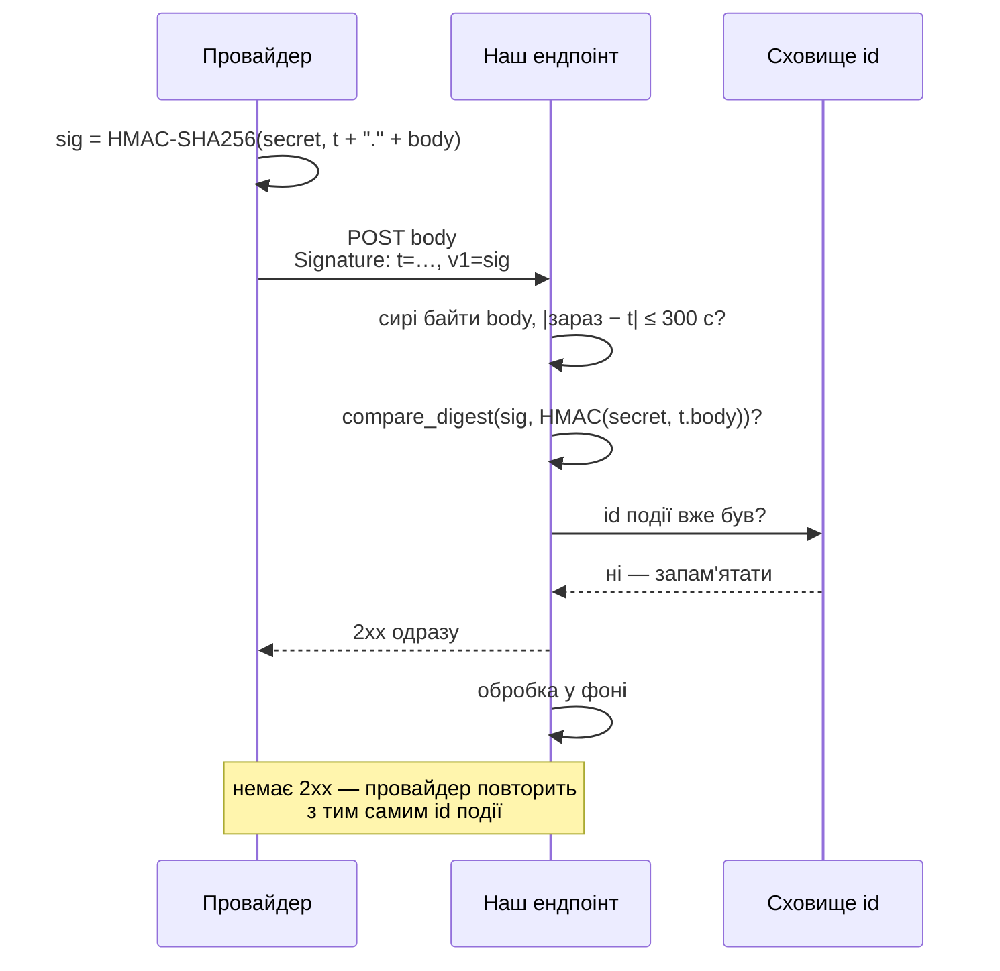
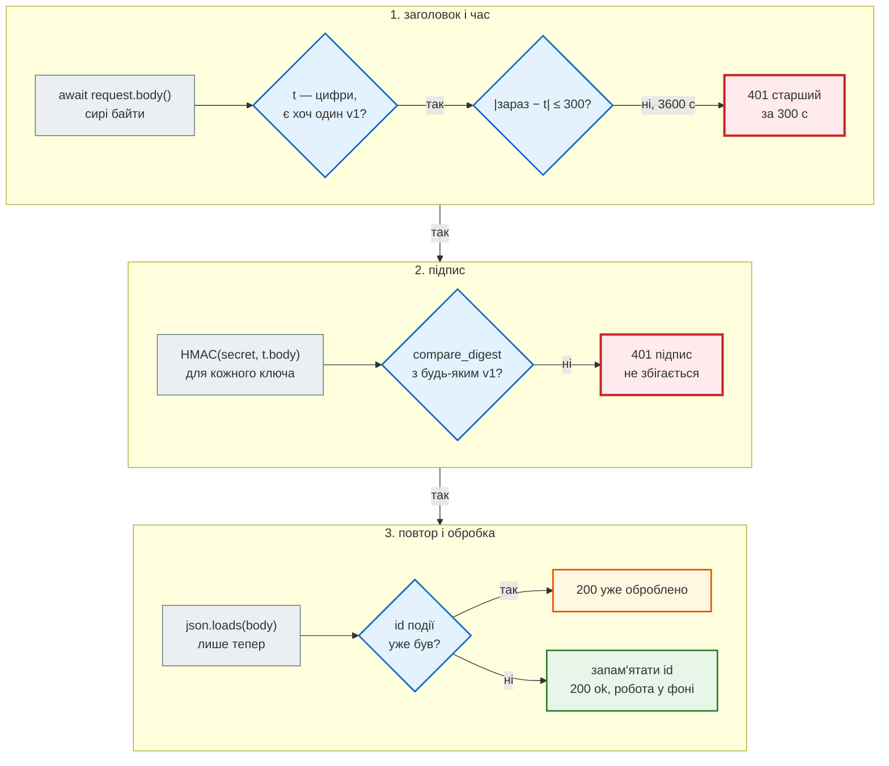

# Webhook і підписи

## Проблема { #problem }

Webhook — запит **до нас** від іншої системи: платіжний сервіс повідомляє «рахунок сплачено», GitHub — «новий pull request», Telegram — «нове повідомлення боту», cron на іншому сервері — «пора збирати новини». Адреса ендпоінта публічна, і будь-хто може надіслати на неї той самий JSON. Користувача з паролем тут немає, JWT на роки не видаси. Треба відрізнити справжній запит від підробленого, зміненого по дорозі й повтореного — і не зламатися, коли провайдер сам повторює доставку, бо не дочекався відповіді.

## Ментальна модель { #mental-model }

Обидві сторони знають **спільний секрет**. Відправник не надсилає секрет — він надсилає **підпис**: HMAC від того, що надсилає. Отримувач рахує HMAC від отриманого тим самим секретом і порівнює.



| Що гарантує | Чим |
|---|---|
| **автентичність** — від того, хто знає секрет | HMAC з секретом |
| **цілісність** — тіло не змінене | HMAC від **сирих байтів** тіла |
| **свіжість** — не перехоплений учора | час у підписаних даних + вікно |
| **унікальність** — оброблено один раз | id доставки чи події + сховище |

## Способи автентифікувати webhook { #methods }

| Спосіб | Приклад | Перехопили один запит — що далі |
|---|---|---|
| секрет у шляху `/webhook/<secret>` | старі інтеграції | секрет назавжди; ще й у журналах проксі й сервера |
| секретний заголовок | Telegram `X-Telegram-Bot-Api-Secret-Token` | секрет назавжди: можна надсилати будь-що |
| HMAC тіла | GitHub `X-Hub-Signature-256` | можна повторити **той самий** запит; змінити — ні |
| HMAC часу й тіла | Stripe `Stripe-Signature: t=…,v1=…`; News Hub | повторити можна лише у вікні часу; з сховищем id — ні |
| асиметричний підпис | Ed25519 / RSA у деяких провайдерів | те саме, але отримувач тримає лише публічний ключ |
| mTLS, allowlist IP | корпоративні інтеграції | доповнення, а не заміна підпису |

Обирає відправник: приймаємо те, що він уміє, і робимо це якнайкраще.

## HMAC тіла: стиль GitHub { #github-style }

[`examples/security/webhooks_demo.py`](https://github.com/NikoriakViktor/news_hub/blob/main/examples/security/webhooks_demo.py) приймає webhook у форматі GitHub: `X-Hub-Signature-256: sha256=<hex>` і id доставки `X-GitHub-Delivery`.

```python title="webhooks_demo.py (фрагмент)"
@app.post("/github")
async def github(request: Request) -> dict[str, str]:
    body = await request.body()                                         # СИРІ байти — до json
    expected = "sha256=" + hmac_hex(GITHUB_SECRET, body)
    received = request.headers.get("X-Hub-Signature-256", "")
    if not hmac.compare_digest(received.encode(), expected.encode()):
        raise HTTPException(401, detail="підпис не збігається")
    delivery = request.headers.get("X-GitHub-Delivery", "")
    if delivery in seen_deliveries:
        return {"status": "уже оброблено"}                              # 2xx: інакше відправник повторюватиме
    seen_deliveries.add(delivery)
    processed["github"].append(json.loads(body)["action"])
    return {"status": "ok"}
```

```text
--- 1. GitHub-стиль: підпис сирого тіла
   X-Hub-Signature-256: sha256=cc56ad84c514… | довжина 71
   справжній                                  → 200 {'status': 'ok'}
   та сама доставка ще раз (повтор провайдера) → 200 {'status': 'уже оброблено'}
   перехоплений, тіло змінено                 → 401 {'detail': 'підпис не збігається'}
   чужий секрет                               → 401 {'detail': 'підпис не збігається'}
   той самий hex ВЕЛИКИМИ літерами            → 401 {'detail': 'підпис не збігається'}
   перехоплений, новий X-GitHub-Delivery      → 200 {'status': 'ok'}
   оброблено подій: ['opened', 'opened']
```

- **Змінити тіло без секрету не можна** — підпис не зійдеться.
- **Повтор провайдера** (той самий `X-GitHub-Delivery`) — `200 уже оброблено`. Саме `2xx`: на `4xx`/`5xx` провайдер повторюватиме далі.
- **Останній рядок — межа цього формату.** Id доставки не входить у підпис, часу в підписі немає. Хто перехопив запит, повторить його з новим id коли завгодно, і подію буде оброблено вдруге. Тому обробник такого webhook має бути ідемпотентним за **змістом** (номер PR, id платежу в тілі), а не лише за id доставки.
- **Hex великими літерами** — інший рядок. Провайдери надсилають малі; якщо документація не обіцяє регістру, порівнюють після `.lower()`.

!!! info "Чому HMAC, а не sha256(секрет + тіло)"
    SHA-256 побудований так, що зі значення `sha256(секрет + тіло)` і довжини секрету можна порахувати `sha256(секрет + тіло + доповнення + своє)` без секрету (length extension). HMAC — `H(k₁ + H(k₂ + тіло))` — від цього захищений. Для підписів — лише `hmac.new(secret, data, hashlib.sha256)`.

## Підпис — від сирих байтів { #raw-body }

```python title="webhooks_demo.py (фрагмент)"
@app.post("/naive")
async def naive(request: Request) -> dict[str, str]:
    data = await request.json()
    body = json.dumps(data).encode()                                   # «ті самі дані» — інші байти
    ...
```

```text
--- 2. підпис від перезібраного JSON
   підписано компактний JSON                  → 401 {'detail': 'підпис не збігається'}
   підписано json.dumps(...) з пробілами      → 200 {'status': 'ok'}
   json.dumps(json.loads(compact)) == compact: False
```

Відправник підписує **байти, які надіслав**. `json.loads` + `json.dumps` дає ті самі дані, але інші байти: пробіли, порядок ключів, екранування кирилиці (`ensure_ascii`). Справжній запит отримав `401`, а «працює» лише тоді, коли відправник випадково форматує JSON так само, як Python. У FastAPI це означає: **не** оголошувати тіло моделлю Pydantic у параметрах ендпоінта webhook. Беремо `await request.body()`, перевіряємо підпис, і лише потім `Model.model_validate_json(body)`. Заодно чужий запит не доходить навіть до розбору JSON.

## Час у підписі: стиль Stripe { #timestamp }

Щоб перехоплений запит не можна було повторити через тиждень, час входить у **підписані** дані: `HMAC(secret, "<t>." + body)`. Час окремим заголовком без підпису нічого не дає — його підмінять.

```python title="webhooks_demo.py (фрагмент)"
@app.post("/stripe")
async def stripe(request: Request) -> dict[str, str]:
    body = await request.body()
    timestamp, signatures = parse_stripe_header(request.headers.get("Stripe-Signature", ""))
    if abs(time.time() - timestamp) > TOLERANCE:
        raise HTTPException(401, detail=f"підпис старший за {TOLERANCE} с")
    if not stripe_valid(STRIPE_SECRETS, timestamp, signatures, body):
        raise HTTPException(401, detail="підпис не збігається")
    event = json.loads(body)
    if event["id"] in seen_events:
        return {"status": "уже оброблено"}
    seen_events.add(event["id"])
    ...
```

```text
--- 3. Stripe-стиль: час у підписі, id події
   Stripe-Signature: t=1794455957,v1=66c830ad84…
   справжній                                  → 200 {'status': 'ok'}
   повтор провайдера: новий t, новий підпис   → 200 {'status': 'уже оброблено'}
   перехоплений годину тому                   → 401 {'detail': 'підпис старший за 300 с'}
   старий v1, підставлено свіжий t            → 401 {'detail': 'підпис не збігається'}
   без t                                      → 401 {'detail': 'немає часу в підписі'}
   оброблено подій: ['invoice.paid']
```

- **Вікно часу** (тут 300 с, як у бібліотеки Stripe за замовчуванням) — і в минуле, і в майбутнє: `abs(...)`. Годинники обох сторін — через NTP.
- **Підставити свіжий `t` до старого `v1` не можна**: `t` підписаний.
- **Повтор провайдера має новий `t` і новий підпис**, але той самий `id` події. Тому ідемпотентність — за id **події**, а не за підписом: інакше кожна повторна доставка пройде як нова.
- **Сховище id потрібне лише на вікно часу** (з запасом): старіші запити відкине перевірка часу. У Redis — `SET key 1 NX EX <2 × вікно>`; `NX` робить «перевірити й запам'ятати» однією атомарною командою.
- **Час — лише цифри.** `"²".isdigit()` — `True`, а `int("²")` — `ValueError`; тому `isascii() and isdigit()` (так і в News Hub).

### Покроково: перевірка webhook { #trace }

Запит «перехоплений годину тому» і «справжній» з виводу вище:



## Ротація секрету { #rotation }

Секрет треба змінити (витік, плановий рік) без простою. Отримувач на час переходу приймає **обидва** ключі; Stripe-подібні провайдери ще й надсилають кілька `v1` — підписи кожним активним ключем.

```text
--- 4. ротація секрету: два v1 і два ключі на прийомі
   підписано старим (відправник ще не перейшов) → 200 {'status': 'ok'}
   підписано обома                            → 200 {'status': 'ok'}
   старим після завершення ротації            → 401 {'detail': 'підпис не збігається'}
```

Порядок: (1) отримувач додає новий ключ до списку; (2) відправник перемикається на новий; (3) після вікна часу отримувач прибирає старий. Будь-який порядок, де одна сторона знає лише ключ, якого не знає друга, — простій.

## Секретний заголовок: Telegram { #telegram }

Telegram тіла не підписує. `setWebhook(secret_token=...)` — і в кожному update приходить заголовок `X-Telegram-Bot-Api-Secret-Token` з цим значенням (1–256 символів `A-Z a-z 0-9 _ -`).

```python title="webhooks_demo.py (фрагмент)"
received = request.headers.get("X-Telegram-Bot-Api-Secret-Token")
if received is None or not hmac.compare_digest(received.encode(), TELEGRAM_SECRET.encode()):
    raise HTTPException(401, detail="неправильний секрет")
```

```text
--- 5. Telegram: секретний заголовок
   правильний секрет                          → 200 {'ok': True}
   без заголовка                              → 401 {'detail': 'неправильний секрет'}
   неправильний                               → 401 {'detail': 'неправильний секрет'}
```

Секрет ходить з кожним запитом, тож тут особливо важливі HTTPS, `compare_digest` і відсутність секрету в URL і журналах. Telegram повторює update, на який не отримав `2xx`; для ідемпотентності є `update_id`.

## Відповідати швидко, обробляти у фоні { #fast-ack }

Провайдер чекає відповіді секунди (GitHub — 10 с) і на тайм-аут повторює доставку. Важка обробка в запиті означає дублікати й зайве навантаження. Правило: перевірити, запам'ятати id, відповісти `2xx`, а роботу — у фонову задачу чи чергу (`BackgroundTasks`, Celery, Redis). Обробник фонової задачі сам ідемпотентний: та сама подія двічі не створює двох платежів.

| Відповідь | Що зробить провайдер |
|---|---|
| `2xx` | доставлено, повторів не буде |
| `2xx` на дублікат | так і треба: інакше повтори не припиняться |
| `4xx` на підробку | для справжнього провайдера `401` — сигнал, що ключі розійшлися |
| `5xx`, тайм-аут | повторить пізніше, зазвичай зі зростаючою паузою |

## Якщо webhook надсилаємо ми { #outgoing }

Коли наш сервіс сам надсилає webhook клієнтам, ролі міняються:

- **підписувати** HMAC від часу й сирих байтів, окремий секрет на кожного отримувача, id події в тілі;
- **повторювати** з паузою, що зростає, і тим самим id;
- **адреса отримувача — URL від користувача**: SSRF у чистому вигляді. Ті самі перевірки адреси з'єднання, перенаправлень і тайм-аутів ([SSRF і вихідні запити](ssrf_and_outbound.md)).

## У News Hub { #news-hub }

`POST /api/webhooks/scrape` — зовнішній планувальник запускає збір. Схема — як у Stripe, з власними заголовками й id доставки, як `X-GitHub-Delivery`. Розбір коду й результати — [Крок 8. Підписані webhook](../tutorials/08_security/webhooks.md).

| Ідея з цієї сторінки | `news_hub/webhooks.py`, `api.py` |
|---|---|
| HMAC часу, id і тіла | `sign`: `HMAC-SHA256(WEBHOOK_SECRET, "<t>.<delivery>." + body)`, заголовки `X-Webhook-Signature: sha256=…`, `X-Webhook-Timestamp`, `X-Webhook-Delivery` |
| id доставки | `X-Webhook-Delivery` обов'язковий: 8–64 символи `[A-Za-z0-9_-]` (`uuid4().hex`); інакше `401` |
| сирі байти, підпис до JSON | `scrape_webhook`: `await request.body()` → `verify_signature` → лише потім `ScrapeRequest.model_validate_json` |
| вікно часу | `TOLERANCE_SECONDS = 300`, `abs(now - int(timestamp))`, `isascii() and isdigit()` |
| повтор | `claim_delivery`: `SET webhook:delivery:<id> <job_id> NX EX 600`; повтор → `200` з тим самим завданням |
| `compare_digest` | у `verify_signature` і `verify_secret_token` |
| швидка відповідь | `202` з `job_id`, збір у `BackgroundTasks` |
| секрет не в URL, довжина | `load_webhook_secret`: не коротший за 32 символи, інакше застосунок не стартує |
| Telegram (крок 9) | `POST /api/telegram/webhook` → `verify_secret_token` до розбору update |

### Було → стало: повтор з новим підписом { #news-hub-replay }

**Було.** Ключем повтору був сам підпис: `remember_delivery` робив `SET webhook:seen:<підпис> NX EX 600`, а на повтор відповідав `409`. Відправник, який не дочекався відповіді й надіслав ту саму подію ще раз **з новим часом**, рахував новий підпис — і `SET NX` його не впізнавав. Перевірка на старому коді (fakeredis, три запити з тим самим тілом: час `t`, потім `t+1` двічі):

```text
1794455968 accepted
1794455969 accepted
1794455969 409 цей запит уже отримано (повтор)
```

Другий рядок — та сама подія, повторена з новим часом: збір запустився вдруге. Відхилено лише байт-у-байт копію. Для збору новин це не шкодило (`insert_new` пропускає вже збережені новини), але для дії з наслідками (платіж, лист) означало б дубль. А `409` на копію — `4xx`, тож сторонній провайдер повторював би її далі.

**Стало.** Подію визначає id доставки, і він сам підписаний — підробити чи змінити його без секрету не можна. `claim_delivery` атомарно закріплює id за `job_id` першої доставки; повтор отримує `200` і **те саме** завдання, без другого збору. `409` лишився для рідкої гонки: «ця доставка ще обробляється» (id уже зайнятий, а завдання ще не створене). Та сама перевірка на новому коді (id один, час `t−30`, потім `t` двічі):

```text
1794459632 нове завдання job-1
1794459662 повтор → те саме завдання job-1
1794459662 повтор → те саме завдання job-1
```

Доводять це тести `test_same_delivery_is_claimed_once` і `test_resent_with_new_timestamp_keeps_delivery_id` (`tests/unit/test_webhooks.py`), `test_exact_replay_returns_same_job` і `test_resent_delivery_with_new_signature_does_not_scrape_twice` (`tests/integration/test_webhooks_api.py`: перша доставка `202`, повтор `200` з тим самим `job_id`, нова доставка — нове завдання).

Що лишилося як є: **один ключ.** Ротація — заміна `WEBHOOK_SECRET` одночасно у відправника й отримувача; списку ключів немає.

## Типові помилки { #mistakes }

| Помилка | Наслідок | Як правильно |
|---|---|---|
| секрет у шляху URL | секрет у журналах nginx, uvicorn, балансувальника | підпис у заголовку |
| `received == expected` | підбір підпису по символу за часом | `hmac.compare_digest` |
| `sha256(secret + body)` | length extension | `hmac.new(secret, body, sha256)` |
| підпис від `json.dumps(json.loads(body))` | справжні запити → `401` | сирі байти `await request.body()` |
| модель Pydantic у параметрах ендпоінта webhook | тіло розбирається до перевірки підпису: чужий запит отримує `422` з описом полів, а сміття обробляється раніше, ніж відомо, хто його надіслав | `request.body()` → перевірка → `model_validate_json` |
| час окремим заголовком, не в підписі | повтор зі свіжим часом | час у підписаних даних |
| немає вікна часу | перехоплений запит повторюється вічно | `abs(зараз − t) ≤ 300` |
| дедуплікація за підписом при повторах провайдера з новим `t` | подія обробляється двічі | за id події |
| `4xx`/`5xx` на дублікат | провайдер повторює без кінця | `2xx` «уже оброблено» |
| важка обробка в запиті | тайм-аут → повтор → дублікати | `2xx` одразу, робота у фоні |
| один ключ без ротації | зміна секрету = простій | список ключів на прийомі |
| `int(timestamp)` без перевірки | `"²"` → `ValueError` → `500` | `isascii() and isdigit()` |

## Налагодження { #debugging }

- **`401 підпис не збігається` на справжньому запиті.** Порівняй байти: `len(body)` і `hashlib.sha256(body).hexdigest()` у відправника й отримувача. Найчастіше: тіло перезібрано (middleware, проксі, що змінює кодування), секрет з пробілом чи переносом рядка в кінці (`.strip()` при завантаженні), інший формат рядка для підпису (`t.body` проти `t + body`).
- **`401 старший за 300 с` на свіжих запитах.** Годинник: `date -u` на обох машинах, NTP.
- **Відтворити запит вручну:** порахувати підпис тією самою функцією `sign`, що й відправник, і надіслати `curl --data-binary @body.json` — саме `--data-binary`, бо `-d` прибирає переноси рядків.
- **Що надіслав провайдер?** Журнал доставок у налаштуваннях webhook провайдера (GitHub, Stripe показують тіло, заголовки й нашу відповідь) і кнопка «Redeliver».

## Безпека й межі { #security }

- **Підпис доводить, хто надіслав, а не що дані правдиві.** Тіло — недовірений вхід, як будь-який запит: валідація моделлю, межі розміру, а для важливих подій — перевірка через API провайдера («чи справді рахунок сплачено?»).
- **Секрет webhook — окремий** від секрету JWT і від API-ключа провайдера; не коротший за 32 випадкові байти; лише в середовищі ([Секрети і заголовки](secrets_and_headers.md#weak-secret)).
- **HTTPS обов'язковий** навіть з підписом: тіло може містити персональні дані, а секретний заголовок Telegram без TLS читається в мережі.
- **Allowlist IP провайдера** — додатковий шар, не заміна: адреси змінюються, а за спільним хмарним IP може стояти будь-хто.

## Питання { #questions }

1. Чим підпис HMAC кращий за секретний заголовок?
2. Чому підпис рахують від сирих байтів, а не від розібраного JSON?
3. Навіщо час у підписаних даних, якщо є сховище id?
4. Чому дедуплікувати треба за id події, а не за підписом?
5. Що повертати на повторну доставку того самого webhook і чому?
6. Як змінити секрет webhook без простою?
7. Чому в FastAPI тіло webhook не оголошують моделлю Pydantic у параметрах ендпоінта?
8. Що не захищає підпис?

??? success "Відповіді"

    1. Секрет не передається: перехоплений запит не дає надсилати довільні запити, а змінене тіло не пройде перевірку.
    2. Відправник підписав байти, які надіслав; перезібраний JSON має інші байти (пробіли, порядок ключів, екранування), і підпис не зійдеться навіть для справжнього запиту.
    3. Без часу сховище мусило б пам'ятати id вічно, а перехоплений запит можна було б повторити з новим id доставки (як у форматі GitHub). Час обмежує вікно, сховище — повтори в ньому.
    4. Провайдер повторює доставку з новим часом і новим підписом, але з тим самим id події; за підписом повтор виглядав би новою подією.
    5. `2xx` («уже оброблено»): на `4xx`/`5xx` провайдер вважатиме доставку невдалою й повторюватиме.
    6. Отримувач приймає обидва ключі, відправник переходить на новий (або підписує обома), після вікна старий прибирають.
    7. FastAPI розбере й перевірить тіло до виконання ендпоінта, тобто до перевірки підпису: непідписаний запит отримає `422` з описом полів замість `401`. Правильний порядок — сирі байти, підпис, потім розбір.
    8. Правдивість даних (дані перевіряють як недовірений вхід) і конфіденційність (потрібен HTTPS).

## Що далі { #next }

[Секрети, заголовки, проксі й ліміт входу](secrets_and_headers.md) — усе це тримається на секретах; тепер — як їх генерувати, зберігати, міняти і що ще налаштувати навколо API.

**Джерела:** [GitHub — Validating webhook deliveries](https://docs.github.com/en/webhooks/using-webhooks/validating-webhook-deliveries), [Best practices for using webhooks](https://docs.github.com/en/webhooks/using-webhooks/best-practices-for-using-webhooks); [Stripe — Check the webhook signatures](https://docs.stripe.com/webhooks#verify-events); [Telegram Bot API — setWebhook](https://core.telegram.org/bots/api#setwebhook); [Standard Webhooks](https://www.standardwebhooks.com/); [RFC 2104 — HMAC](https://datatracker.ietf.org/doc/html/rfc2104); Python — [`hmac`](https://docs.python.org/3/library/hmac.html); [OWASP — REST Security Cheat Sheet](https://cheatsheetseries.owasp.org/cheatsheets/REST_Security_Cheat_Sheet.html).
